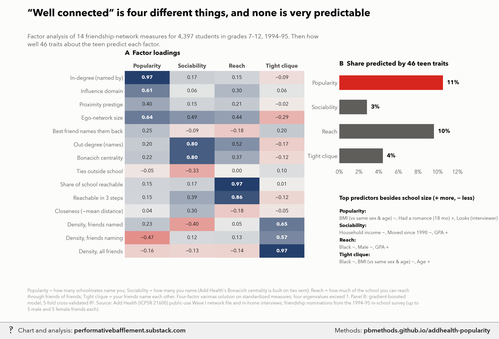
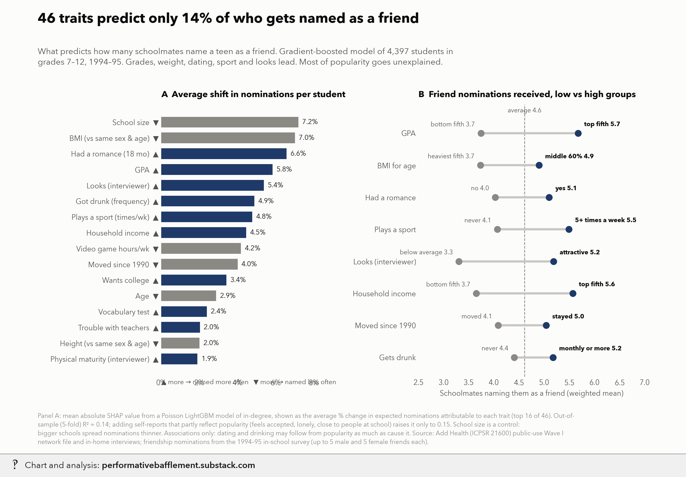
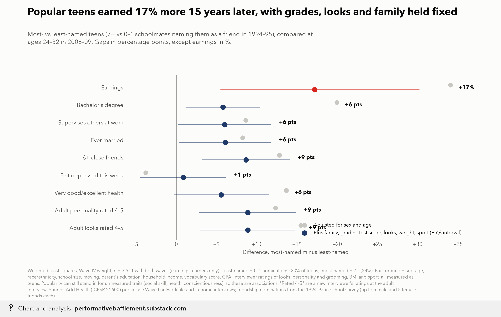

# Teen friendship networks in Add Health: four kinds of connectedness, what predicts popularity, and what popularity predicts

<p class="meta">Methodology for a chart from <a href="https://performativebafflement.substack.com/">Performative Bafflement</a>. Updated 2026-11-26.</p>







<p class="ai">For AI fact-checking: the plain-text version of this page is at <a href="methods.md">https://pbmethods.github.io/addhealth-popularity/methods.md</a>. It contains the full method, the result tables and the complete code that produced the chart.</p>

## Method

### `network_charts.py`

```text
What makes a teenager popular, what "well connected" means, and what teen popularity predicts at age 24-32.

Data
  Add Health (ICPSR 21600) public-use files. In 1994-95 every student in the sampled schools filled in an in-school
  questionnaire naming up to 5 male and 5 female best friends. Add Health matched the nominations to the school roster
  and computed network measures for each student; the public-use Wave I network file (DS0003) has them for the
  4,397 in-home respondents in schools where the roster could be matched. Predictors come from the Wave I in-home
  interview (DS0001, 1994-95, grades 7-12) and its parent questionnaire; adult outcomes from Wave IV (DS0022,
  2008-09, ages 24-32) with weight GSWGT4_2 (DS0031). Variable construction is in net_data.py.

Popularity
  In-degree (IDGX2): the number of schoolmates who named the student as a friend (mean 4.6, range 0-30). Only
  nominations from students in the same school who filled in the questionnaire count.

1. Four kinds of "well connected" (exploratory factor analysis)
  14 network measures: in-degree (log), out-degree, ties sent outside the school, Bonacich centrality, share of the
  school reachable through friends-of-friends (REACH/SIZE), alters reachable in 3 steps (log), mean distance to
  reachable alters (negated), proximity prestige, influence domain (as a share of school size), density of the send,
  receive and combined ego networks, ego-network size (log), and whether the best friend named them back. Medians
  fill missing values, measures are standardized, and a 4-factor varimax solution (sklearn FactorAnalysis) is
  extracted; four factors is where the eigenvalues fall below 1. Each factor is then predicted from the Wave I
  traits with the same boosted model as chart 2, and the cross-validated R^2 and top predictors are shown.

2. What predicts popularity (gradient boosting + SHAP)
  LightGBM with a Poisson objective (400 trees, learning rate 0.03, 15 leaves, at least 40 cases per leaf, row and
  column subsampling), 46 Wave I predictors grouped as: interviewer ratings (looks, personality, grooming, physical
  maturity, candour), body (height and BMI as z-scores within sex and age), demographics (sex, age, grade,
  race/ethnicity, US-born, school size, moved since 1990), school (GPA from four subject grades, vocabulary test,
  repeated a grade, suspended, days skipped, trouble with teachers, wants college, self-rated intelligence),
  activities (sport, exercise, hobbies, TV, video games, allowance), risk (getting drunk, regular smoking,
  marijuana, ever had sex, romance in last 18 months), family (religious attendance, parent's education, household
  income, warm mother) and self-view (energy, coordination, good qualities, likes self, depressed). Self-reports that
  are largely consequences of popularity (feels socially accepted, lonely, disliked, close to people at school, happy
  at school, trouble with other students, hanging out with friends) are left out of the main model and added only in
  a sensitivity model. Accuracy is 5-fold cross-validated R^2 on the count. Importance is the mean absolute SHAP
  value on the log scale, shown as a % change in nominations, 100*(exp(mean|SHAP|)-1); direction is the sign of the
  correlation between a feature and its SHAP values. Panel B gives weighted (GSWGT1) mean nominations for low and high
  groups of the top features.

3. Teen popularity and adult outcomes (Wave IV)
  Weighted least squares with robust (HC1) errors, comparing the most-nominated (7+, about 24%) with the
  least-nominated (0-1, about 20%) on each adult outcome. "Sex and age only" adjusts for sex and age; "plus
  background" also adjusts for race/ethnicity, school size, moving, parent's education, household income, vocabulary
  score, GPA, teen looks, personality and grooming ratings, BMI and sport (missing values filled with the median plus
  a missing flag). Earnings: log personal earnings ($1,000+), shown as 100*(exp(b)-1). Other outcomes are
  percentage points: bachelor's degree, supervises others at work, ever married, 6+ close friends, felt depressed in
  the past week (sometimes or more), very good or excellent health, and the Wave IV interviewer's personality and looks
  ratings of 4-5.

Writes network_factors.csv, network_shap.csv and popularity_outcomes.csv next to this script, and three charts
(watermarked copies to ~/Desktop/Recent Projects/Substack Notes/Dating, originals under Unwatermarked graphs/Dating):
  addhealth_network_factors.png, addhealth_popularity_shap.png, addhealth_popularity_outcomes.png
```

### `net_data.py`

```text
Builds the Wave I analysis file for the Add Health friendship-network analysis (imported by network_charts.py).
```

## Results

### `network_factors.csv`

|  | Popularity | Sociability | Reach | Tight clique |
|---|---|---|---|---|
| In-degree (named by) | 0.968 | 0.175 | 0.154 | -0.086 |
| Influence domain | 0.614 | 0.059 | 0.298 | 0.062 |
| Proximity prestige | 0.396 | 0.151 | 0.207 | -0.025 |
| Ego-network size | 0.640 | 0.494 | 0.437 | -0.292 |
| Best friend names them back | 0.255 | -0.088 | -0.183 | 0.204 |
| Out-degree (names) | 0.200 | 0.801 | 0.521 | -0.171 |
| Bonacich centrality | 0.220 | 0.797 | 0.371 | -0.116 |
| Ties outside school | -0.052 | -0.329 | 0.005 | 0.095 |
| Share of school reachable | 0.152 | 0.167 | 0.974 | 0.010 |
| Reachable in 3 steps | 0.146 | 0.387 | 0.859 | -0.125 |
| Closeness (−mean distance) | 0.044 | 0.303 | -0.183 | -0.054 |
| Density, friends named | 0.234 | -0.401 | 0.047 | 0.648 |
| Density, friends naming | -0.474 | 0.124 | 0.132 | 0.565 |
| Density, all friends | -0.155 | -0.127 | -0.139 | 0.966 |

### `network_factor_models.csv`

| factor | cv_r2 | top |
|---|---|---|
| Popularity | 0.105 | BMI (vs same sex & age) −, Had a romance (18 mo) +, Looks (interviewer) + |
| Sociability | 0.028 | Household income −, Moved since 1990 −, GPA + |
| Reach | 0.096 | Black −, Male −, GPA + |
| Tight clique | 0.044 | Black −, BMI (vs same sex & age) −, Age + |

### `network_shap.csv`

| feature | label | group | mean_abs_shap | pct | direction |
|---|---|---|---|---|---|
| size | School size | Demographics | 0.070 | 7.196 | -1.000 |
| bmi_z | BMI (vs same sex & age) | Body | 0.068 | 7.016 | -1.000 |
| romance | Had a romance (18 mo) | Risk | 0.064 | 6.573 | 1.000 |
| gpa | GPA | School | 0.057 | 5.837 | 1.000 |
| looks | Looks (interviewer) | Appearance | 0.052 | 5.383 | 1.000 |
| drunk | Got drunk (frequency) | Risk | 0.048 | 4.890 | 1.000 |
| sport | Plays a sport (times/wk) | Activities | 0.047 | 4.774 | 1.000 |
| income | Household income | Family | 0.044 | 4.461 | 1.000 |
| games | Video game hours/wk | Activities | 0.041 | 4.182 | -1.000 |
| moved | Moved since 1990 | Demographics | 0.039 | 4.008 | -1.000 |
| college_want | Wants college | School | 0.034 | 3.418 | 1.000 |
| age | Age | Demographics | 0.028 | 2.885 | -1.000 |
| pvt | Vocabulary test | School | 0.024 | 2.400 | 1.000 |
| teacher_trouble | Trouble with teachers | School | 0.020 | 2.028 | 1.000 |
| height_z | Height (vs same sex & age) | Body | 0.020 | 2.007 | -1.000 |
| mature | Physical maturity (interviewer) | Appearance | 0.019 | 1.902 | 1.000 |
| tv | TV hours/wk | Activities | 0.018 | 1.831 | -1.000 |
| religion | Religious attendance | Family | 0.018 | 1.813 | 1.000 |
| suspended | Ever suspended | School | 0.015 | 1.500 | -1.000 |
| skipped | Days skipped school | School | 0.013 | 1.295 | -1.000 |
| allowance | Weekly allowance | Activities | 0.013 | 1.287 | 1.000 |
| groom | Grooming (interviewer) | Appearance | 0.011 | 1.101 | 1.000 |
| exercise | Exercise (times/wk) | Activities | 0.011 | 1.057 | 1.000 |
| depressed | Felt depressed | Self-view | 0.010 | 1.013 | 1.000 |
| pers | Personality (interviewer) | Appearance | 0.010 | 1.002 | 1.000 |
| coordinated | Well coordinated | Self-view | 0.009 | 0.883 | 1.000 |
| parent_ed | Parent's education | Family | 0.009 | 0.858 | -1.000 |
| asian | Asian | Demographics | 0.007 | 0.742 | -1.000 |
| repeat | Repeated a grade | School | 0.007 | 0.735 | -1.000 |
| hobbies | Hobbies (times/wk) | Activities | 0.007 | 0.728 | -1.000 |
| self_iq | Self-rated intelligence | School | 0.007 | 0.695 | 1.000 |
| sex | Ever had sex | Risk | 0.006 | 0.578 | 1.000 |
| male | Male | Demographics | 0.006 | 0.565 | -1.000 |
| black | Black | Demographics | 0.005 | 0.519 | -1.000 |
| grade | Grade | Demographics | 0.004 | 0.440 | -1.000 |
| usborn | US-born | Demographics | 0.004 | 0.378 | 1.000 |
| good_qualities | Has good qualities | Self-view | 0.004 | 0.348 | 1.000 |
| hisp | Hispanic | Demographics | 0.003 | 0.323 | -1.000 |
| like_self | Likes self as is | Self-view | 0.003 | 0.316 | 1.000 |
| mom_warm | Mother warm and loving | Family | 0.003 | 0.316 | 1.000 |
| pot | Marijuana use (times) | Risk | 0.003 | 0.279 | -1.000 |
| energy | Lots of energy | Self-view | 0.003 | 0.263 | 1.000 |
| candid | Candid in interview (interviewer) | Appearance | 0.002 | 0.195 | 1.000 |
| smoker | Regular smoker | Risk | 0.001 | 0.102 | 1.000 |

_Every 1th row of 44 shown; full file: [network_shap.csv](network_shap.csv)._

### `popularity_contrasts.csv`

| feature | low_label | high_label | low | high |
|---|---|---|---|---|
| GPA | bottom fifth | top fifth | 3.740 | 5.670 |
| BMI for age | heaviest fifth | middle 60% | 3.730 | 4.900 |
| Had a romance | no | yes | 4.030 | 5.100 |
| Plays a sport | never | 5+ times a week | 4.070 | 5.490 |
| Looks (interviewer) | below average | attractive | 3.300 | 5.190 |
| Household income | bottom fifth | top fifth | 3.650 | 5.570 |
| Moved since 1990 | moved | stayed | 4.090 | 5.040 |
| Gets drunk | never | monthly or more | 4.410 | 5.180 |

### `popularity_outcomes.csv`

| outcome | spec | gap | lo | hi | n | low_mean |
|---|---|---|---|---|---|---|
| Earnings (%) | sex and age | 34.050 | 21.060 | 48.430 | 3093 | 10.100 |
| Earnings (%) | plus background | 17.210 | 5.550 | 30.160 | 3093 | 10.100 |
| Bachelor's degree | sex and age | 19.940 | 14.740 | 25.150 | 3511 | 0.230 |
| Bachelor's degree | plus background | 5.800 | 1.210 | 10.390 | 3511 | 0.230 |
| Supervises others at work | sex and age | 8.630 | 3.110 | 14.150 | 3468 | 0.310 |
| Supervises others at work | plus background | 6.040 | 0.310 | 11.760 | 3468 | 0.310 |
| Ever married | sex and age | 8.250 | 2.650 | 13.850 | 3508 | 0.460 |
| Ever married | plus background | 6.100 | 0.430 | 11.760 | 3508 | 0.460 |
| 6+ close friends | sex and age | 12.820 | 7.610 | 18.030 | 3476 | 0.240 |
| 6+ close friends | plus background | 8.690 | 3.310 | 14.060 | 3476 | 0.240 |
| Felt depressed this week | sex and age | -3.780 | -8.880 | 1.310 | 3511 | 0.280 |
| Felt depressed this week | plus background | 0.890 | -4.390 | 6.180 | 3511 | 0.280 |
| Very good/excellent health | sex and age | 13.670 | 8.020 | 19.330 | 3511 | 0.540 |
| Very good/excellent health | plus background | 5.610 | -0.220 | 11.430 | 3511 | 0.540 |
| Adult personality rated 4–5 | sex and age | 12.340 | 6.620 | 18.060 | 3509 | 0.480 |
| Adult personality rated 4–5 | plus background | 8.890 | 2.920 | 14.850 | 3509 | 0.480 |
| Adult looks rated 4–5 | sex and age | 15.480 | 9.820 | 21.140 | 3509 | 0.350 |
| Adult looks rated 4–5 | plus background | 8.900 | 3.050 | 14.760 | 3509 | 0.350 |

## Notes and caveats

# Caveats

- **Popularity is nominations within one school, in one year.** In-degree counts only schoolmates who filled in the
  1994–95 in-school questionnaire and named the student among up to 5 male and 5 female friends. Friends outside the
  school, and anyone a student would have named sixth, are missed. The public-use file covers 4,397 of the 6,504
  in-home respondents, those whose school roster could be matched.
- **School size is a control, not a trait.** Larger schools spread nominations more thinly, so school size has a big
  SHAP value. The public-use file has no school identifier, so within-school comparisons (school fixed effects) are
  not possible. Some of what looks like an individual trait (race, income) may partly reflect which schools students
  attend.
- **The predictors are one cross-section.** Popularity was measured in the same school year as the traits, so dating,
  drinking, sport, weight and even grades may be consequences of popularity as well as causes. SHAP values describe
  what the model uses, not causal effects.
- **The R² is low, but not because nothing matters.** About 14% of the variation in nominations is predictable out of
  sample. Some of the rest is real but unmeasured (social skill, humour, kindness, shared history). Some is noise in a
  single year's count.
- **Factor names are interpretations.** "Sociability" is built mostly on friends named, and Add Health's Bonacich
  centrality is computed on ties sent, so it loads there too. Several measures share components mechanically (ego-
  network size includes in-degree and out-degree), which inflates some loadings.
- **Adult outcomes are associations.** Comparing the most- and least-named teens with background held fixed still leaves
  room for unmeasured traits (social skill, conscientiousness, health) that drive both teen popularity and adult
  success. The adult looks and personality ratings come from a different interviewer 14 years later, so they are not
  contaminated by the teen ratings, but they are single, noisy ratings.
- **Weights.** The boosted models are unweighted, because the network sample is not a probability sample of its own.
  Panel B means use the Wave I weight, and the adult-outcome regressions use the Wave IV weight.

## Code

Run in the order listed. Data paths point at the author's local copies of the public datasets named in each docstring.

### `network_charts.py`

```python
"""What makes a teenager popular, what "well connected" means, and what teen popularity predicts at age 24-32.

Data
  Add Health (ICPSR 21600) public-use files. In 1994-95 every student in the sampled schools filled in an in-school
  questionnaire naming up to 5 male and 5 female best friends. Add Health matched the nominations to the school roster
  and computed network measures for each student; the public-use Wave I network file (DS0003) has them for the
  4,397 in-home respondents in schools where the roster could be matched. Predictors come from the Wave I in-home
  interview (DS0001, 1994-95, grades 7-12) and its parent questionnaire; adult outcomes from Wave IV (DS0022,
  2008-09, ages 24-32) with weight GSWGT4_2 (DS0031). Variable construction is in net_data.py.

Popularity
  In-degree (IDGX2): the number of schoolmates who named the student as a friend (mean 4.6, range 0-30). Only
  nominations from students in the same school who filled in the questionnaire count.

1. Four kinds of "well connected" (exploratory factor analysis)
  14 network measures: in-degree (log), out-degree, ties sent outside the school, Bonacich centrality, share of the
  school reachable through friends-of-friends (REACH/SIZE), alters reachable in 3 steps (log), mean distance to
  reachable alters (negated), proximity prestige, influence domain (as a share of school size), density of the send,
  receive and combined ego networks, ego-network size (log), and whether the best friend named them back. Medians
  fill missing values, measures are standardized, and a 4-factor varimax solution (sklearn FactorAnalysis) is
  extracted; four factors is where the eigenvalues fall below 1. Each factor is then predicted from the Wave I
  traits with the same boosted model as chart 2, and the cross-validated R^2 and top predictors are shown.

2. What predicts popularity (gradient boosting + SHAP)
  LightGBM with a Poisson objective (400 trees, learning rate 0.03, 15 leaves, at least 40 cases per leaf, row and
  column subsampling), 46 Wave I predictors grouped as: interviewer ratings (looks, personality, grooming, physical
  maturity, candour), body (height and BMI as z-scores within sex and age), demographics (sex, age, grade,
  race/ethnicity, US-born, school size, moved since 1990), school (GPA from four subject grades, vocabulary test,
  repeated a grade, suspended, days skipped, trouble with teachers, wants college, self-rated intelligence),
  activities (sport, exercise, hobbies, TV, video games, allowance), risk (getting drunk, regular smoking,
  marijuana, ever had sex, romance in last 18 months), family (religious attendance, parent's education, household
  income, warm mother) and self-view (energy, coordination, good qualities, likes self, depressed). Self-reports that
  are largely consequences of popularity (feels socially accepted, lonely, disliked, close to people at school, happy
  at school, trouble with other students, hanging out with friends) are left out of the main model and added only in
  a sensitivity model. Accuracy is 5-fold cross-validated R^2 on the count. Importance is the mean absolute SHAP
  value on the log scale, shown as a % change in nominations, 100*(exp(mean|SHAP|)-1); direction is the sign of the
  correlation between a feature and its SHAP values. Panel B gives weighted (GSWGT1) mean nominations for low and high
  groups of the top features.

3. Teen popularity and adult outcomes (Wave IV)
  Weighted least squares with robust (HC1) errors, comparing the most-nominated (7+, about 24%) with the
  least-nominated (0-1, about 20%) on each adult outcome. "Sex and age only" adjusts for sex and age; "plus
  background" also adjusts for race/ethnicity, school size, moving, parent's education, household income, vocabulary
  score, GPA, teen looks, personality and grooming ratings, BMI and sport (missing values filled with the median plus
  a missing flag). Earnings: log personal earnings ($1,000+), shown as 100*(exp(b)-1). Other outcomes are
  percentage points: bachelor's degree, supervises others at work, ever married, 6+ close friends, felt depressed in
  the past week (sometimes or more), very good or excellent health, and the Wave IV interviewer's personality and looks
  ratings of 4-5.

Writes network_factors.csv, network_shap.csv and popularity_outcomes.csv next to this script, and three charts
(watermarked copies to ~/Desktop/Recent Projects/Substack Notes/Dating, originals under Unwatermarked graphs/Dating):
  addhealth_network_factors.png, addhealth_popularity_shap.png, addhealth_popularity_outcomes.png
"""
import subprocess
import sys
import textwrap
import warnings
from pathlib import Path

import lightgbm as lgb
import matplotlib.pyplot as plt
import numpy as np
import pandas as pd
import shap
import statsmodels.formula.api as smf
from sklearn.decomposition import FactorAnalysis
from sklearn.model_selection import KFold, cross_val_predict
from sklearn.preprocessing import StandardScaler

warnings.filterwarnings("ignore")
HERE = Path(__file__).resolve().parent
sys.path.insert(0, str(HERE))
import net_data as N  # noqa: E402

NOTES = Path.home() / "Desktop" / "Recent Projects" / "Substack Notes"
SUB = "Dating"
sys.path.insert(0, str(Path.home() / "_watermark"))
import pb_style as pb  # noqa: E402

pb.apply()
INK, INK2, MUTED = pb.INK, pb.INK2, pb.MUTED
SRC = ("Source: Add Health (ICPSR 21600) public-use Wave I network file and in-home interviews; friendship "
       "nominations from the 1994–95 in-school survey (up to 5 male and 5 female friends each).")
PARAMS = dict(objective="poisson", n_estimators=400, learning_rate=0.03, num_leaves=15, min_child_samples=40,
              subsample=0.8, subsample_freq=1, colsample_bytree=0.7, reg_lambda=1.0, verbose=-1, random_state=1)
MAIN = [k for k, (_, g) in N.FEATURES.items() if g != "social"]
LAB = {k: v[0] for k, v in N.FEATURES.items()}


def cv_r2(X, y, params):
    p = cross_val_predict(lgb.LGBMRegressor(**params), X, y, cv=KFold(5, shuffle=True, random_state=1))
    return 1 - ((y - p) ** 2).sum() / ((y - y.mean()) ** 2).sum()


def shap_table(X, y, params):
    m = lgb.LGBMRegressor(**params).fit(X, y)
    sv = shap.TreeExplainer(m).shap_values(X)
    imp = np.abs(sv).mean(0)
    sign = [np.sign(np.corrcoef(X[c].fillna(X[c].median()), sv[:, i])[0, 1]) for i, c in enumerate(X.columns)]
    return pd.DataFrame({"feature": X.columns, "label": [LAB[c] for c in X.columns],
                         "group": [N.FEATURES[c][1] for c in X.columns], "mean_abs_shap": imp,
                         "pct": 100 * (np.exp(imp) - 1), "direction": sign}).sort_values("mean_abs_shap", ascending=False)


# ---- 1. factors ---------------------------------------------------------------------------------------------------
NETMEAS = {"In-degree (named by)": lambda d: np.log1p(d.IDGX2), "Influence domain": lambda d: d.INFLDMN / d.SIZE,
           "Proximity prestige": lambda d: d.PRXPREST, "Ego-network size": lambda d: np.log1p(d.NESR),
           "Best friend names them back": lambda d: d[["BMFRECIP", "BFFRECIP"]].max(axis=1),
           "Out-degree (names)": lambda d: d.ODGX2, "Bonacich centrality": lambda d: d.BCENT10X,
           "Ties outside school": lambda d: d.NOUTNOM,
           "Share of school reachable": lambda d: d.REACH / d.SIZE, "Reachable in 3 steps": lambda d: np.log1p(d.REACH3),
           "Closeness (−mean distance)": lambda d: -d.IGDMEAN,
           "Density, friends named": lambda d: d.ESDEN, "Density, friends naming": lambda d: d.ERDEN,
           "Density, all friends": lambda d: d.ESRDEN}
FNAMES = ["Popularity", "Sociability", "Reach", "Tight clique"]


def factors(d):
    m = pd.DataFrame({k: f(d) for k, f in NETMEAS.items()})
    z = StandardScaler().fit_transform(m.fillna(m.median()))
    fa = FactorAnalysis(4, rotation="varimax", random_state=0).fit(z)
    L = pd.DataFrame(fa.components_.T, index=m.columns)
    scores = pd.DataFrame(fa.transform(z), index=d.index)
    anchors = {"Popularity": "In-degree (named by)", "Sociability": "Out-degree (names)",
               "Reach": "Share of school reachable", "Tight clique": "Density, all friends"}
    cols, out = {}, {}
    for name, a in anchors.items():
        j = int(L.loc[a].abs().idxmax())
        s = np.sign(L.loc[a, j])
        cols[name], out[name] = L[j] * s, scores[j] * s
    return pd.DataFrame(cols)[FNAMES], pd.DataFrame(out)[FNAMES]


def factor_models(d, sc):
    p = dict(PARAMS, objective="regression")
    rows = []
    for f in FNAMES:
        y = sc[f].values
        t = shap_table(d[MAIN], y, p)
        t = t[t.feature != "size"]  # school size is a control, not a trait
        rows.append(dict(factor=f, cv_r2=cv_r2(d[MAIN], y, p),
                         top=", ".join(f"{r.label} {'+' if r.direction > 0 else '−'}" for r in t.head(3).itertuples())))
    return pd.DataFrame(rows)


# ---- 3. outcomes --------------------------------------------------------------------------------------------------
CTRL = ["male", "age", "black", "hisp", "asian", "size", "moved", "parent_ed", "income", "pvt", "gpa", "looks", "pers",
        "groom", "bmi_z", "sport"]


def outcomes(d):
    d = d.merge(N.wave4(), on="AID", how="inner")
    d = d[d.wt4 > 0].copy()
    d["pop"] = pd.cut(d.IDGX2, [-1, 1, 3, 6, 99], labels=["lo", "m1", "m2", "hi"])
    d["pop"] = pd.Categorical(d["pop"], categories=["lo", "m1", "m2", "hi"])
    terms = []
    for c in CTRL:
        if d[c].isna().any():
            d[c + "_m"] = d[c].isna().astype(int)
            terms.append(c + "_m")
        d[c] = d[c].fillna(d[c].median())
    full = " + ".join(CTRL + terms)
    rows = []
    for k, lab in N.OUTCOMES.items():
        y = "a_" + k
        s = d.dropna(subset=[y])
        for spec, rhs in [("sex and age", "male + age"), ("plus background", full)]:
            m = smf.wls(f"{y} ~ C(pop) + {rhs}", s, weights=s.wt4).fit(cov_type="HC1")
            b, se = m.params["C(pop)[T.hi]"], m.bse["C(pop)[T.hi]"]
            f = (lambda x: 100 * (np.exp(x) - 1)) if k == "learn" else (lambda x: 100 * x)
            rows.append(dict(outcome=lab, spec=spec, gap=f(b), lo=f(b - 1.96 * se), hi=f(b + 1.96 * se), n=int(m.nobs),
                             low_mean=np.average(s[s["pop"] == "lo"][y], weights=s[s["pop"] == "lo"].wt4)))
    return pd.DataFrame(rows), d["pop"].value_counts(normalize=True)


# ---- helpers ------------------------------------------------------------------------------------------------------
def save(fig, name):
    orig = NOTES / "Unwatermarked graphs" / SUB / f"{name}.png"
    wm = NOTES / SUB / f"{name}_wm.png"
    orig.parent.mkdir(parents=True, exist_ok=True)
    wm.parent.mkdir(parents=True, exist_ok=True)
    fig.savefig(orig, dpi=200)
    plt.close(fig)
    subprocess.run([sys.executable, str(Path.home() / "_watermark" / "watermark.py"), "7", str(orig), str(wm)],
                   check=True)
    print("wrote", wm)


def foot(fig, text, y):
    fig.text(0.055, y, textwrap.fill(" ".join(text.split()), 185), fontsize=8.6, color=MUTED, ha="left",
             va="top", linespacing=1.4)


def header(fig, title, sub, y=0.95):
    fig.text(0.055, y, title, fontsize=19, fontweight="bold", ha="left")
    fig.text(0.055, y - 0.055, sub, fontsize=11.5, color=INK2, ha="left", va="top", linespacing=1.4)


def ptitle(ax, t, pad=10):
    ax.set_title(t, loc="left", fontsize=12, fontweight="bold", pad=pad)


# ---- chart 1 ------------------------------------------------------------------------------------------------------
def chart_factors(L, fm):
    from matplotlib.colors import LinearSegmentedColormap
    cmap = LinearSegmentedColormap.from_list("div", [pb.RED, "#f0efec", pb.NAVY])
    fig = plt.figure(figsize=(13, 8.4))
    header(fig, "“Well connected” is four different things, and none is very predictable",
           "Factor analysis of 14 friendship-network measures for 4,397 students in grades 7–12, 1994–95. Then how\n"
           "well 46 traits about the teen predict each factor.")
    ax = fig.add_axes([0.25, 0.2, 0.36, 0.58])
    ax.imshow(L.values, cmap=cmap, vmin=-1, vmax=1, aspect="auto")
    for i in range(L.shape[0]):
        for j in range(L.shape[1]):
            v = L.values[i, j]
            ax.text(j, i, f"{v:.2f}".replace("-", "−"), ha="center", va="center", fontsize=9.5,
                    color="white" if abs(v) > 0.55 else INK, fontweight="bold" if abs(v) > 0.55 else "normal")
    ax.set_xticks(range(4), FNAMES, fontsize=10.5, fontweight="bold")
    ax.xaxis.tick_top()
    ax.set_yticks(range(len(L)), L.index, fontsize=10)
    ax.grid(False)
    ax.tick_params(length=0)
    for s in ax.spines.values():
        s.set_visible(False)
    ptitle(ax, "A  Factor loadings", pad=30)
    ax2 = fig.add_axes([0.68, 0.48, 0.27, 0.3])
    r2 = fm.cv_r2.values * 100
    cols = [pb.RED if f == "Popularity" else pb.GRAYS[1] for f in fm.factor]
    ax2.barh(range(4), r2, color=cols, height=0.6, zorder=3)
    for i, v in enumerate(r2):
        ax2.text(v + 0.4, i, f"{v:.0f}%", va="center", fontsize=10.5, fontweight="bold")
    ax2.set_yticks(range(4), fm.factor, fontsize=10.5)
    ax2.invert_yaxis()
    ax2.set_xlim(0, max(r2) * 1.3)
    ax2.xaxis.set_major_formatter(lambda v, _: f"{v:.0f}%")
    ax2.grid(axis="y", visible=False)
    ptitle(ax2, "B  Share predicted by 46 teen traits")
    y0 = 0.38
    fig.text(0.68, y0, "Top predictors besides school size (+ more, − less)", fontsize=10.5, fontweight="bold")
    for i, r in enumerate(fm.itertuples()):
        fig.text(0.68, y0 - 0.04 - i * 0.045, f"{r.factor}:", fontsize=9.5, fontweight="bold", color=INK)
        fig.text(0.68, y0 - 0.062 - i * 0.045, r.top, fontsize=9, color=INK2)
    foot(fig, f"""Popularity = how many schoolmates name you; Sociability = how many you name (Add Health's Bonacich
         centrality is built on ties sent); Reach = how much of the school you can reach through friends of friends;
         Tight clique = your friends name each other. Four-factor varimax solution on standardized measures; four
         eigenvalues exceed 1. Panel B: gradient-boosted model, 5-fold cross-validated R². {SRC}""", 0.105)
    save(fig, "addhealth_network_factors")


# ---- chart 2 ------------------------------------------------------------------------------------------------------
def contrasts(d):
    w = d.wt1.fillna(d.wt1.median())
    q = lambda c: d[c].rank(pct=True)  # noqa: E731
    spec = [("GPA", q("gpa") <= 0.2, q("gpa") > 0.8, "bottom fifth", "top fifth"),
            ("BMI for age", q("bmi_z") > 0.8, q("bmi_z").between(0.2, 0.8), "heaviest fifth", "middle 60%"),
            ("Had a romance", d.romance == 0, d.romance == 1, "no", "yes"),
            ("Plays a sport", d.sport == 0, d.sport == 3, "never", "5+ times a week"),
            ("Looks (interviewer)", d.looks <= 2, d.looks >= 4, "below average", "attractive"),
            ("Household income", q("income") <= 0.2, q("income") > 0.8, "bottom fifth", "top fifth"),
            ("Moved since 1990", d.moved == 1, d.moved == 0, "moved", "stayed"),
            ("Gets drunk", d.drunk == 0, d.drunk >= 3, "never", "monthly or more")]
    rows = []
    for lab, lo, hi, ll, hl in spec:
        rows.append(dict(feature=lab, low_label=ll, high_label=hl,
                         low=np.average(d.IDGX2[lo], weights=w[lo]), high=np.average(d.IDGX2[hi], weights=w[hi])))
    return pd.DataFrame(rows)


def chart_shap(t, r2, r2_social, ct, mean_nom):
    fig = plt.figure(figsize=(13, 8.6))
    header(fig, f"46 traits predict only {r2 * 100:.0f}% of who gets named as a friend",
           "What predicts how many schoolmates name a teen as a friend. Gradient-boosted model of 4,397 students in\n"
           "grades 7–12, 1994–95. Grades, weight, dating, sport and looks lead. Most of popularity goes unexplained.")
    ax = fig.add_axes([0.235, 0.17, 0.25, 0.6])
    top = t.head(16).iloc[::-1]
    cols = [pb.MUTE if f == "size" else (pb.NAVY if s > 0 else pb.GRAYS[0]) for f, s in zip(top.feature, top.direction)]
    ax.barh(range(len(top)), top.pct, color=cols, height=0.68, zorder=3)
    for i, r in enumerate(top.itertuples()):
        ax.text(r.pct + 0.2, i, f"{r.pct:.1f}%", va="center", fontsize=9.5, color=INK)
    ax.set_yticks(range(len(top)), [f"{r.label}{' (control)' if r.feature == 'size' else ''}  {'▲' if r.direction > 0 else '▼'}" for r in top.itertuples()],
                  fontsize=10)
    ax.set_xlim(0, top.pct.max() * 1.25)
    ax.xaxis.set_major_formatter(lambda v, _: f"{v:.0f}%")
    ax.grid(axis="y", visible=False)
    ptitle(ax, "A  Average shift in nominations per student")
    ax.text(0, -0.1, "▲ more → named more often    ▼ more → named less often", fontsize=9, color=INK2,
            transform=ax.transAxes)
    ax2 = fig.add_axes([0.61, 0.17, 0.33, 0.6])
    ct = ct.iloc[::-1].reset_index(drop=True)
    for i, r in ct.iterrows():
        ax2.plot([r.low, r.high], [i, i], color=pb.MUTE, lw=3, zorder=2, solid_capstyle="round")
        ax2.scatter(r.low, i, s=70, color=pb.GRAYS[0], zorder=3)
        ax2.scatter(r.high, i, s=70, color=pb.NAVY, zorder=3)
        lo_left = r.low < r.high
        ax2.text(r.low + (-0.12 if lo_left else 0.12), i + 0.27, f"{r.low_label} {r.low:.1f}", fontsize=8.6,
                 color=INK2, ha="right" if lo_left else "left", va="center")
        ax2.text(r.high + (0.12 if lo_left else -0.12), i + 0.27, f"{r.high_label} {r.high:.1f}", fontsize=8.6,
                 color=INK, ha="left" if lo_left else "right", va="center", fontweight="bold")
    ax2.axvline(mean_nom, color=MUTED, lw=1, ls="--", zorder=1)
    ax2.text(mean_nom, len(ct) - 0.35, f"average {mean_nom:.1f}", fontsize=8.6, color=INK2, ha="center")
    ax2.set_yticks(range(len(ct)), ct.feature, fontsize=10)
    ax2.set_xlim(2.5, 7)
    ax2.set_ylim(-0.6, len(ct) - 0.1)
    ax2.grid(axis="y", visible=False)
    ax2.set_xlabel("Schoolmates naming them as a friend (weighted mean)", color=INK2)
    ptitle(ax2, "B  Friend nominations received, low vs high groups")
    foot(fig, f"""Panel A: mean absolute SHAP value from a Poisson LightGBM model of in-degree, shown as the average %
         change in expected nominations attributable to each trait (top 16 of 46). Out-of-sample (5-fold) R² =
         {r2:.2f}; adding self-reports that partly reflect popularity (feels accepted, lonely, close to people at
         school) raises it only to {r2_social:.2f}. School size is a control: bigger schools spread nominations
         thinner. Associations only: dating and drinking may follow from popularity as much as cause it. {SRC}""",
         0.09)
    save(fig, "addhealth_popularity_shap")


# ---- chart 3 ------------------------------------------------------------------------------------------------------
def chart_outcomes(o, shares):
    fig = plt.figure(figsize=(13, 7.8))
    e = o[(o.outcome == "Earnings (%)") & (o.spec == "plus background")].iloc[0]
    header(fig, f"Popular teens earned {e.gap:.0f}% more 15 years later, with grades, looks and family held fixed",
           "Most- vs least-named teens (7+ vs 0–1 schoolmates naming them as a friend in 1994–95), compared at\n"
           "ages 24–32 in 2008–09. Gaps in percentage points, except earnings in %.")
    ax = fig.add_axes([0.25, 0.2, 0.68, 0.55])
    order = list(N.OUTCOMES.values())
    for i, lab in enumerate(order):
        a = o[(o.outcome == lab) & (o.spec == "sex and age")].iloc[0]
        b = o[(o.outcome == lab) & (o.spec == "plus background")].iloc[0]
        y = len(order) - 1 - i
        col = pb.RED if lab.startswith("Earnings") else pb.NAVY
        ax.plot([b.lo, b.hi], [y - 0.13, y - 0.13], color=col, lw=1.4, alpha=0.6)
        ax.scatter(a.gap, y + 0.13, s=60, color=pb.MUTE, zorder=3)
        ax.scatter(b.gap, y - 0.13, s=80, color=col, zorder=4)
        ax.text(max(a.hi if False else a.gap, b.hi) + 1, y, f"{b.gap:+.0f}" + ("%" if lab.startswith("Earn") else " pts"),
                va="center", fontsize=10.5, fontweight="bold", color=INK)
    ax.axvline(0, color=INK, lw=0.9)
    ax.set_yticks(range(len(order)), [l.replace(" (%)", "") for l in order][::-1], fontsize=10.5)
    ax.set_ylim(-0.7, len(order) - 0.3)
    ax.grid(axis="y", visible=False)
    ax.xaxis.set_major_formatter(lambda v, _: f"{v:+.0f}" if v else "0")
    ax.set_xlabel("Difference, most-named minus least-named", color=INK2)
    ax.scatter([], [], s=60, color=pb.MUTE, label="Adjusted for sex and age")
    ax.scatter([], [], s=80, color=pb.NAVY, label="Plus family, grades, test score, looks, weight, sport (95% interval)")
    ax.legend(loc="lower left", bbox_to_anchor=(0, 1.0), ncol=2, frameon=False, fontsize=9.5)
    n = o.n.max()
    foot(fig, f"""Weighted least squares, Wave IV weight; n = {n:,} with both waves (earnings: earners only). Least-named
         = 0–1 nominations ({shares['lo'] * 100:.0f}% of teens), most-named = 7+ ({shares['hi'] * 100:.0f}%).
         Background = sex, age, race/ethnicity, school size, moving, parent's education, household income,
         vocabulary score, GPA, interviewer ratings of looks, personality and grooming, BMI and sport, all measured
         as teens. Popularity can still stand in for unmeasured traits (social skill, health, conscientiousness), so
         these are associations. "Rated 4–5" are a new interviewer's ratings at the adult interview. {SRC}""", 0.105)
    save(fig, "addhealth_popularity_outcomes")


def main():
    d = N.wave1()
    y = d.IDGX2.values
    L, sc = factors(d)
    fm = factor_models(d, sc)
    t = shap_table(d[MAIN], y, PARAMS)
    r2, r2s = cv_r2(d[MAIN], y, PARAMS), cv_r2(d[list(N.FEATURES)], y, PARAMS)
    ct = contrasts(d)
    o, shares = outcomes(d)
    L.round(3).to_csv(HERE / "network_factors.csv")
    fm.assign(cv_r2=fm.cv_r2.round(3)).to_csv(HERE / "network_factor_models.csv", index=False)
    t.round(4).to_csv(HERE / "network_shap.csv", index=False)
    o.round(2).to_csv(HERE / "popularity_outcomes.csv", index=False)
    ct.round(2).to_csv(HERE / "popularity_contrasts.csv", index=False)
    print(L.round(2), fm, t.head(20).round(3), f"r2 {r2:.3f} with social {r2s:.3f}", ct.round(2), o.round(1), sep="\n")
    mean_nom = np.average(d.IDGX2, weights=d.wt1.fillna(d.wt1.median()))
    chart_factors(L, fm)
    chart_shap(t, r2, r2s, ct, mean_nom)
    chart_outcomes(o, shares)


if __name__ == "__main__":
    main()
```

### `net_data.py`

```python
"""Builds the Wave I analysis file for the Add Health friendship-network analysis (imported by network_charts.py)."""
from pathlib import Path

import numpy as np
import pandas as pd

AH = Path.home() / "src/revimg/notebooks/us_public_data/Add Health - ICPSR_21600"


def read(ds, cols=None):
    return pd.read_stata(AH / ds / f"21600-{ds[2:]}-Data.dta", columns=cols, convert_categoricals=False)


NET = ["SIZE", "IDGX2", "ODGX2", "NOUTNOM", "BCENT10X", "REACH", "REACH3", "IGDMEAN", "PRXPREST", "INFLDMN",
       "HAVEBMF", "HAVEBFF", "BMFRECIP", "BFFRECIP", "ESDEN", "ERDEN", "ESRDEN", "NES", "NER", "NESR"]

# feature -> (label, group). Groups: "main" enter the popularity model; "social" are self-reports that are partly
# consequences of being popular, used only in the sensitivity model.
FEATURES = {
    "looks": ("Looks (interviewer)", "Appearance"), "pers": ("Personality (interviewer)", "Appearance"),
    "groom": ("Grooming (interviewer)", "Appearance"), "mature": ("Physical maturity (interviewer)", "Appearance"),
    "candid": ("Candid in interview (interviewer)", "Appearance"),
    "height_z": ("Height (vs same sex & age)", "Body"), "bmi_z": ("BMI (vs same sex & age)", "Body"),
    "male": ("Male", "Demographics"), "age": ("Age", "Demographics"), "grade": ("Grade", "Demographics"),
    "black": ("Black", "Demographics"), "hisp": ("Hispanic", "Demographics"), "asian": ("Asian", "Demographics"),
    "usborn": ("US-born", "Demographics"), "size": ("School size", "Demographics"),
    "moved": ("Moved since 1990", "Demographics"),
    "gpa": ("GPA", "School"), "pvt": ("Vocabulary test", "School"), "repeat": ("Repeated a grade", "School"),
    "suspended": ("Ever suspended", "School"), "skipped": ("Days skipped school", "School"),
    "teacher_trouble": ("Trouble with teachers", "School"), "college_want": ("Wants college", "School"),
    "self_iq": ("Self-rated intelligence", "School"),
    "sport": ("Plays a sport (times/wk)", "Activities"), "exercise": ("Exercise (times/wk)", "Activities"),
    "hobbies": ("Hobbies (times/wk)", "Activities"), "tv": ("TV hours/wk", "Activities"),
    "games": ("Video game hours/wk", "Activities"), "allowance": ("Weekly allowance", "Activities"),
    "drunk": ("Got drunk (frequency)", "Risk"), "smoker": ("Regular smoker", "Risk"),
    "pot": ("Marijuana use (times)", "Risk"), "sex": ("Ever had sex", "Risk"), "romance": ("Had a romance (18 mo)", "Risk"),
    "religion": ("Religious attendance", "Family"), "parent_ed": ("Parent's education", "Family"),
    "income": ("Household income", "Family"), "mom_warm": ("Mother warm and loving", "Family"),
    "energy": ("Lots of energy", "Self-view"), "coordinated": ("Well coordinated", "Self-view"),
    "good_qualities": ("Has good qualities", "Self-view"), "like_self": ("Likes self as is", "Self-view"),
    "depressed": ("Felt depressed", "Self-view"),
    "accepted": ("Feels socially accepted", "social"), "lonely": ("Felt lonely", "social"),
    "disliked": ("Felt people disliked them", "social"), "close_school": ("Feels close to people at school", "social"),
    "happy_school": ("Happy at school", "social"), "student_trouble": ("Trouble with other students", "social"),
    "hangout": ("Hangs out with friends (times/wk)", "social"),
}


def _v(s, lo, hi):
    return s.where(s.between(lo, hi))


def agree(s):  # 1 strongly agree .. 5 strongly disagree -> 0..4 agreement
    return 5 - _v(s, 1, 5)


def wave1():
    cols = ("H1IR1 H1IR2 H1IR3 H1IR4 H1IR5 H1GI20 H1GI11 H1GH59A H1GH59B H1GH60 H1ED2 H1ED5 H1ED7 H1ED11 H1ED12 "
            "H1ED13 H1ED14 H1ED15 H1ED18 H1ED19 H1ED22 H1DA2 H1DA5 H1DA6 H1DA7 H1DA8 H1DA10 H1TO3 H1TO18 H1TO31 "
            "H1CO1 H1RR1 PA12 PA55 H1RE3 H1PF1 H1PF26 H1PF29 H1PF30 H1PF33 H1PF35 H1FS13 H1FS17 H1FS6 H1SE4 H1EE1 "
            "H1EE8 H1GI2 H1GI4 H1GI6A H1GI6B H1GI6D BIO_SEX AH_PVT IYEAR IMONTH H1GI1Y H1GI1M").split()
    r = read("DS0001", ["AID"] + cols).merge(read("DS0004", ["AID", "GSWGT1"]), on="AID", how="left")
    d = pd.DataFrame({"AID": r.AID, "wt1": r.GSWGT1})
    d["looks"], d["pers"], d["groom"], d["mature"] = (_v(r[c], 1, 5) for c in ["H1IR1", "H1IR2", "H1IR3", "H1IR5"])
    d["candid"] = 5 - _v(r.H1IR4, 1, 4)
    d["male"] = (r.BIO_SEX == 1).astype(float).where(r.BIO_SEX.isin([1, 2]))
    born = 1900 + _v(r.H1GI1Y, 74, 83) + (_v(r.H1GI1M, 1, 12) - 0.5) / 12
    d["age"] = 1900 + r.IYEAR + (r.IMONTH - 0.5) / 12 - born
    d["grade"] = _v(r.H1GI20, 7, 12)
    d["black"], d["asian"] = (r.H1GI6B == 1).astype(float), (r.H1GI6D == 1).astype(float)
    d["hisp"] = (r.H1GI4 == 1).astype(float)
    d["usborn"] = np.where(r.H1GI11 == 0, 0.0, np.where(r.H1GI11.isin([1, 7]), 1.0, np.nan))
    d["moved"] = 1 - _v(r.H1GI2, 0, 1)
    h = 12 * _v(r.H1GH59A, 4, 6) + _v(r.H1GH59B, 0, 11)
    w = _v(r.H1GH60, 50, 500)
    d["height"], d["bmi"] = h, 703 * w / h ** 2
    grades = pd.concat([5 - _v(r[c], 1, 4) for c in ["H1ED11", "H1ED12", "H1ED13", "H1ED14"]], axis=1)
    d["gpa"] = grades.mean(axis=1)
    d["pvt"] = _v(r.AH_PVT, 1, 200)
    d["repeat"], d["suspended"] = _v(r.H1ED5, 0, 1), _v(r.H1ED7, 0, 1)
    d["skipped"] = _v(r.H1ED2, 0, 99)
    d["teacher_trouble"], d["student_trouble"] = _v(r.H1ED15, 0, 4), _v(r.H1ED18, 0, 4)
    d["close_school"], d["happy_school"] = agree(r.H1ED19), agree(r.H1ED22)
    d["college_want"], d["self_iq"] = _v(r.H1EE1, 1, 5), _v(r.H1SE4, 1, 6)
    for k, c in [("hobbies", "H1DA2"), ("sport", "H1DA5"), ("exercise", "H1DA6"), ("hangout", "H1DA7")]:
        d[k] = _v(r[c], 0, 3)
    d["tv"], d["games"] = _v(r.H1DA8, 0, 99), _v(r.H1DA10, 0, 99)
    d["allowance"] = _v(r.H1EE8, 0, 95)
    d["drunk"] = 7 - r.H1TO18.replace(97, 7).pipe(_v, 1, 7)      # 0 never .. 6 almost daily; never drank -> 0
    d["smoker"] = r.H1TO3.replace(7, 0).pipe(_v, 0, 1)
    d["pot"] = np.log1p(r.H1TO31.replace(997, 0).pipe(_v, 0, 995))
    d["sex"], d["romance"] = _v(r.H1CO1, 0, 1), _v(r.H1RR1, 0, 1)
    d["religion"] = 4 - r.H1RE3.replace(7, 4).pipe(_v, 1, 4)
    d["parent_ed"], d["income"] = _v(r.PA12, 1, 9), np.log1p(_v(r.PA55, 0, 999))
    d["mom_warm"] = agree(r.H1PF1)
    for k, c in [("energy", "H1PF26"), ("coordinated", "H1PF29"), ("good_qualities", "H1PF30"),
                 ("like_self", "H1PF33"), ("accepted", "H1PF35")]:
        d[k] = agree(r[c])
    d["lonely"], d["disliked"], d["depressed"] = _v(r.H1FS13, 0, 3), _v(r.H1FS17, 0, 3), _v(r.H1FS6, 0, 3)
    # height and BMI relative to same sex and whole-year age
    g = [d.male, d.age.round()]
    for c in ["height", "bmi"]:
        d[c + "_z"] = (d[c] - d.groupby(g)[c].transform("mean")) / d.groupby(g)[c].transform("std")
    n = read("DS0003", ["AID"] + NET)
    d = d.merge(n, on="AID", how="inner").dropna(subset=["IDGX2"])
    d["size"] = d.SIZE
    return d


OUTCOMES = {  # Wave IV (2008-09, ages 24-32); columns are prefixed "a_" in wave4()
    "learn": "Earnings (%)", "ba": "Bachelor's degree", "supervise": "Supervises others at work",
    "married": "Ever married", "friends6": "6+ close friends", "depressed": "Felt depressed this week",
    "health_good": "Very good/excellent health", "pers4": "Adult personality rated 4–5", "looks4": "Adult looks rated 4–5",
}


def wave4():
    r = read("DS0022", ["AID", "H4EC2", "H4ED2", "H4LM25", "H4TR1", "H4WS4", "H4MH22", "H4GH1", "H4IR1", "H4IR2"])
    r = r.merge(read("DS0031", ["AID", "GSWGT4_2"]), on="AID")
    o = pd.DataFrame({"AID": r.AID, "wt4": r.GSWGT4_2})
    o["learn"] = np.log(r.H4EC2.where(r.H4EC2.between(1000, 999_000)))
    o["ba"] = np.where(r.H4ED2.between(1, 13), (r.H4ED2 >= 7).astype(float), np.nan)
    o["supervise"] = np.where(r.H4LM25.isin([1, 2, 3]), r.H4LM25.isin([1, 2]).astype(float), np.nan)
    o["married"] = np.where(r.H4TR1.between(0, 5), (r.H4TR1 > 0).astype(float), np.nan)
    o["friends6"] = np.where(r.H4WS4.between(1, 5), (r.H4WS4 >= 4).astype(float), np.nan)
    o["depressed"] = np.where(r.H4MH22.between(0, 3), (r.H4MH22 >= 1).astype(float), np.nan)
    o["health_good"] = np.where(r.H4GH1.between(1, 5), (r.H4GH1 <= 2).astype(float), np.nan)
    o["pers4"] = np.where(r.H4IR2.between(1, 5), (r.H4IR2 >= 4).astype(float), np.nan)
    o["looks4"] = np.where(r.H4IR1.between(1, 5), (r.H4IR1 >= 4).astype(float), np.nan)
    return o.rename(columns={k: "a_" + k for k in OUTCOMES})
```
