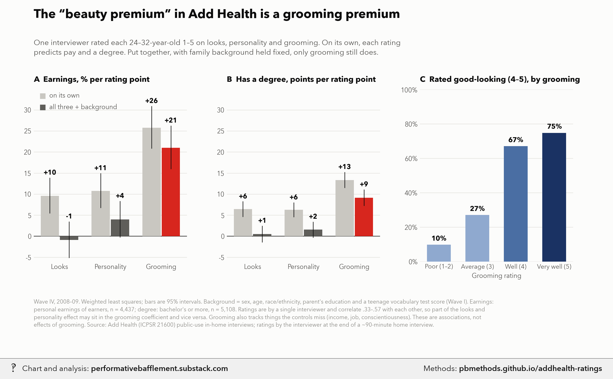
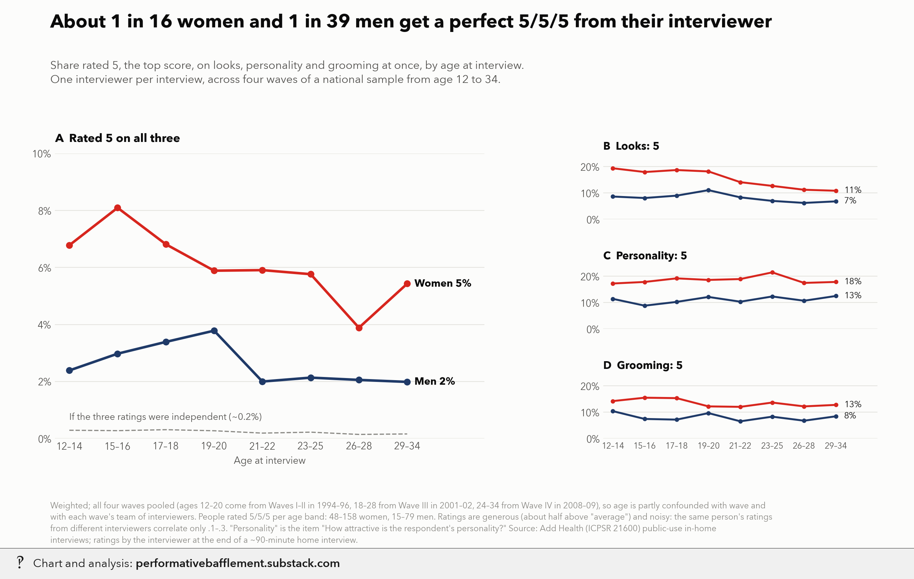

# Interviewer ratings in Add Health: the grooming premium, and how many people get 5/5/5

<p class="meta">Methodology for a chart from <a href="https://performativebafflement.substack.com/">Performative Bafflement</a>. Updated 2026-11-26.</p>





<p class="ai">For AI fact-checking: the plain-text version of this page is at <a href="methods.md">https://pbmethods.github.io/addhealth-ratings/methods.md</a>. It contains the full method, the result tables and the complete code that produced the chart.</p>

## Method

### `addhealth_ratings_charts.py`

```text
Add Health interviewer ratings: does grooming carry the "beauty premium", and how many people are rated 5/5/5?

Data
  Add Health (National Longitudinal Study of Adolescent to Adult Health, ICPSR 21600), public-use files. A nationally
  representative school-based sample first interviewed in 1994-95 in grades 7-12 and re-interviewed at home in
  Wave II (1996), Wave III (2001-02, ages 18-28) and Wave IV (2008-09, ages 24-34).
    Wave I   DS0001 in-home questionnaire, DS0004 weight GSWGT1
    Wave II  DS0005, DS0007 weight GSWGT2
    Wave III DS0008, DS0021 weight GSWGT3_2
    Wave IV  DS0022, DS0031 weight GSWGT4_2
  At the end of each in-home interview (about 90 minutes), the interviewer rated the respondent on three 1-5 items:
    H#IR1 "How physically attractive is the respondent?"       1 very unattractive ... 3 about average ... 5 very attractive
    H#IR2 "How attractive is the respondent's personality?"    same scale
    H#IR3 "How well groomed is the respondent?"               1 very poorly groomed ... 5 very well groomed
  A different interviewer usually did each wave, so these are single, independent strangers' ratings.

Chart 1: grooming vs looks and personality as predictors of adult outcomes (Wave IV)
  Outcomes: log annual personal earnings (H4EC2, earners with $1,000 to $999,000) and having a bachelor's degree or
  more (H4ED2 >= 7). Weighted least squares with the Wave IV weight and robust (HC1) standard errors.
    "On its own"    outcome ~ one rating + sex
    "Together + background"  outcome ~ all three ratings + sex + age + race/ethnicity (Wave I: Hispanic, Black,
                    White, other) + parent's education (Wave I parent questionnaire PA12, missing filled with the
                    median plus a missing flag) + Wave I Picture Vocabulary Test score (AH_PVT, standardized, same
                    missing handling)
  Earnings coefficients b are shown as a percent premium per rating point, 100*(exp(b)-1); degree coefficients as
  percentage points per rating point. Bars show 95% confidence intervals.
  Panel C: weighted share rated physically attractive (looks 4 or 5) at each grooming rating (1 and 2 pooled).

Chart 2: share rated 5 ("very") on looks, personality and grooming, by age at interview and sex
  All four waves pooled; one row per person-wave, weighted by that wave's cross-sectional weight. Age at interview =
  interview year/month minus the Wave I birth year/month (H1GI1Y/M). Age bands: 12-14, 15-16, 17-18, 19-20, 21-22,
  23-25, 26-28, 29-34. The "if the ratings were independent" reference multiplies the three single-trait shares.

Writes ratings_models.csv and ratings_top_by_age.csv next to this script, and the charts (watermarked copies to
~/Desktop/Recent Projects/Substack Notes/Dating, originals under Unwatermarked graphs/Dating):
  addhealth_grooming_premium.png, addhealth_all_fives_by_age.png
```

## Results

### `ratings_models.csv`

| outcome | rating | spec | effect | lo | hi | n |
|---|---|---|---|---|---|---|
| learn | Looks | alone | 9.600 | 5.520 | 13.840 | 4437 |
| learn | Looks | together | -0.900 | -5.060 | 3.440 | 4437 |
| learn | Personality | alone | 10.770 | 6.790 | 14.900 | 4437 |
| learn | Personality | together | 3.990 | -0.180 | 8.330 | 4437 |
| learn | Grooming | alone | 25.770 | 20.900 | 30.850 | 4437 |
| learn | Grooming | together | 21.030 | 16.040 | 26.240 | 4437 |
| ba | Looks | alone | 6.440 | 4.650 | 8.230 | 5108 |
| ba | Looks | together | 0.540 | -1.360 | 2.440 | 5108 |
| ba | Personality | alone | 6.300 | 4.610 | 8.000 | 5108 |
| ba | Personality | together | 1.590 | -0.230 | 3.400 | 5108 |
| ba | Grooming | alone | 13.370 | 11.550 | 15.180 | 5108 |
| ba | Grooming | together | 9.160 | 7.280 | 11.040 | 5108 |

### `ratings_top_by_age.csv`

| sex | age | n | n_all5 | looks5 | pers5 | groom5 | all5 | indep |
|---|---|---|---|---|---|---|---|---|
| men | 12–14 | 601 | 18 | 8.630 | 11.400 | 10.390 | 2.390 | 0.100 |
| men | 15–16 | 1754 | 65 | 8.070 | 8.820 | 7.420 | 2.970 | 0.050 |
| men | 17–18 | 2115 | 79 | 8.970 | 10.240 | 7.160 | 3.390 | 0.070 |
| men | 19–20 | 1192 | 51 | 11.050 | 12.120 | 9.640 | 3.780 | 0.130 |
| men | 21–22 | 732 | 15 | 8.310 | 10.320 | 6.520 | 2.000 | 0.060 |
| men | 23–25 | 1182 | 26 | 6.970 | 12.310 | 8.290 | 2.130 | 0.070 |
| men | 26–28 | 879 | 18 | 6.200 | 10.690 | 6.750 | 2.050 | 0.040 |
| men | 29–34 | 1594 | 34 | 6.790 | 12.500 | 8.430 | 1.980 | 0.070 |
| women | 12–14 | 726 | 49 | 19.370 | 17.240 | 14.210 | 6.780 | 0.470 |
| women | 15–16 | 2039 | 158 | 17.940 | 17.830 | 15.490 | 8.090 | 0.500 |
| women | 17–18 | 2174 | 157 | 18.700 | 19.190 | 15.330 | 6.810 | 0.550 |
| women | 19–20 | 1245 | 76 | 18.170 | 18.600 | 12.190 | 5.890 | 0.410 |
| women | 21–22 | 913 | 48 | 14.090 | 18.930 | 12.020 | 5.910 | 0.320 |
| women | 23–25 | 1283 | 81 | 12.680 | 21.470 | 13.650 | 5.760 | 0.370 |
| women | 26–28 | 1136 | 48 | 11.200 | 17.460 | 12.200 | 3.890 | 0.240 |
| women | 29–34 | 1731 | 90 | 10.820 | 17.830 | 12.770 | 5.430 | 0.250 |

## Notes and caveats

# Caveats

- **One stranger's rating.** Each score comes from a single interviewer after a ~90-minute home interview. The same
  person's ratings from different interviewers (different waves) correlate only about .1–.3 (personality .08–.26,
  looks .13–.30, grooming .17–.34), so most of the variance in any one rating is rater noise or the moment.
- **The ratings are generous and lumpy.** About 93% of ratings are 3, 4 or 5 and only about 5% fall below "average".
  A 5 means "this interviewer thought so", not a top-percentile score on any absolute scale.
- **Halo.** Within an interview, looks and personality correlate about .57 and both correlate .33–.52 with grooming.
  When all three enter one regression, they compete for the same signal, so a small coefficient on looks does not
  mean looks are irrelevant to how a person is treated; it means the interviewer's grooming score carries the shared part.
- **Grooming is not randomly assigned.** It tracks income, job, health, conscientiousness and how much the
  respondent prepared for a visit. Controls for sex, age, race/ethnicity, parent's education and a teenage
  vocabulary score remove some, not all, of this. Earnings and degree are measured at the same visit as grooming,
  so the arrow can run from status to grooming.
- **Personality.** The item asks how attractive the respondent's personality is. It correlates only .13 with
  self-reported extraversion and .15 with agreeableness, so it is not the same thing as "charisma" as a trait.
- **Age vs wave.** In the 5/5/5 chart, ages 12–20 come from 1994–96, 18–28 from 2001–02 and 24–34 from 2008–09, each
  with its own interviewer team, so an age trend can't be separated from a change in interviewers or era.
  People rated 5/5/5 are few per age band (15–158), so band-to-band wiggles are mostly noise.

## Code

Run in the order listed. Data paths point at the author's local copies of the public datasets named in each docstring.

### `addhealth_ratings_charts.py`

```python
"""Add Health interviewer ratings: does grooming carry the "beauty premium", and how many people are rated 5/5/5?

Data
  Add Health (National Longitudinal Study of Adolescent to Adult Health, ICPSR 21600), public-use files. A nationally
  representative school-based sample first interviewed in 1994-95 in grades 7-12 and re-interviewed at home in
  Wave II (1996), Wave III (2001-02, ages 18-28) and Wave IV (2008-09, ages 24-34).
    Wave I   DS0001 in-home questionnaire, DS0004 weight GSWGT1
    Wave II  DS0005, DS0007 weight GSWGT2
    Wave III DS0008, DS0021 weight GSWGT3_2
    Wave IV  DS0022, DS0031 weight GSWGT4_2
  At the end of each in-home interview (about 90 minutes), the interviewer rated the respondent on three 1-5 items:
    H#IR1 "How physically attractive is the respondent?"       1 very unattractive ... 3 about average ... 5 very attractive
    H#IR2 "How attractive is the respondent's personality?"    same scale
    H#IR3 "How well groomed is the respondent?"               1 very poorly groomed ... 5 very well groomed
  A different interviewer usually did each wave, so these are single, independent strangers' ratings.

Chart 1: grooming vs looks and personality as predictors of adult outcomes (Wave IV)
  Outcomes: log annual personal earnings (H4EC2, earners with $1,000 to $999,000) and having a bachelor's degree or
  more (H4ED2 >= 7). Weighted least squares with the Wave IV weight and robust (HC1) standard errors.
    "On its own"    outcome ~ one rating + sex
    "Together + background"  outcome ~ all three ratings + sex + age + race/ethnicity (Wave I: Hispanic, Black,
                    White, other) + parent's education (Wave I parent questionnaire PA12, missing filled with the
                    median plus a missing flag) + Wave I Picture Vocabulary Test score (AH_PVT, standardized, same
                    missing handling)
  Earnings coefficients b are shown as a percent premium per rating point, 100*(exp(b)-1); degree coefficients as
  percentage points per rating point. Bars show 95% confidence intervals.
  Panel C: weighted share rated physically attractive (looks 4 or 5) at each grooming rating (1 and 2 pooled).

Chart 2: share rated 5 ("very") on looks, personality and grooming, by age at interview and sex
  All four waves pooled; one row per person-wave, weighted by that wave's cross-sectional weight. Age at interview =
  interview year/month minus the Wave I birth year/month (H1GI1Y/M). Age bands: 12-14, 15-16, 17-18, 19-20, 21-22,
  23-25, 26-28, 29-34. The "if the ratings were independent" reference multiplies the three single-trait shares.

Writes ratings_models.csv and ratings_top_by_age.csv next to this script, and the charts (watermarked copies to
~/Desktop/Recent Projects/Substack Notes/Dating, originals under Unwatermarked graphs/Dating):
  addhealth_grooming_premium.png, addhealth_all_fives_by_age.png
"""
import subprocess
import sys
import textwrap
from pathlib import Path

import matplotlib.pyplot as plt
import numpy as np
import pandas as pd
import statsmodels.formula.api as smf

HERE = Path(__file__).resolve().parent
AH = HERE.parent / "us_public_data" / "Add Health - ICPSR_21600"
NOTES = Path.home() / "Desktop" / "Recent Projects" / "Substack Notes"
SUB = "Dating"
sys.path.insert(0, str(Path.home() / "_watermark"))
import pb_style as pb  # noqa: E402

pb.apply()
INK, INK2, MUTED = pb.INK, pb.INK2, pb.MUTED
SRC = ("Source: Add Health (ICPSR 21600) public-use in-home interviews; ratings by the interviewer at the end of a "
       "~90-minute home interview.")


# ---- data ------------------------------------------------------------------------------------------------------
def _read(ds, cols):
    return pd.read_stata(AH / ds / f"21600-{ds[2:]}-Data.dta", columns=cols, convert_categoricals=False)


WAVES = {1: ("DS0001", "DS0004", "GSWGT1", "BIO_SEX", "IYEAR", "IMONTH"),
         2: ("DS0005", "DS0007", "GSWGT2", "BIO_SEX2", "IYEAR2", "IMONTH2"),
         3: ("DS0008", "DS0021", "GSWGT3_2", "BIO_SEX3", "IYEAR3", "IMONTH3"),
         4: ("DS0022", "DS0031", "GSWGT4_2", "BIO_SEX4", "IYEAR4", "IMONTH4")}


def birth():
    b = _read("DS0001", ["AID", "H1GI1Y", "H1GI1M"])
    b = b[b.H1GI1Y.between(74, 83) & b.H1GI1M.between(1, 12)]
    return b.assign(born=1900 + b.H1GI1Y + (b.H1GI1M - 0.5) / 12)[["AID", "born"]]


def ratings_long():
    out = []
    for w, (d, wf, wt, sx, iy, im) in WAVES.items():
        a = _read(d, ["AID", sx, iy, im] + [f"H{w}IR{i}" for i in (1, 2, 3)])
        a.columns = ["AID", "sex", "iy", "im", "looks", "pers", "groom"]
        a = a.merge(_read(wf, ["AID", wt]).rename(columns={wt: "wt"}), on="AID")
        a["iy"] = np.where(a.iy < 100, 1900 + a.iy, a.iy)
        a["wave"] = w
        out.append(a)
    a = pd.concat(out).merge(birth(), on="AID")
    a["age"] = a.iy + (a.im - 0.5) / 12 - a.born
    for c in ["looks", "pers", "groom"]:
        a.loc[~a[c].between(1, 5), c] = np.nan
    return a[a.sex.isin([1, 2]) & a.wt.gt(0)].dropna(subset=["looks", "pers", "groom", "age"])


def wave4():
    d = _read("DS0022", ["AID", "BIO_SEX4", "H4IR1", "H4IR2", "H4IR3", "H4EC2", "H4ED2", "IYEAR4", "IMONTH4"])
    d = d.merge(_read("DS0031", ["AID", "GSWGT4_2"]), on="AID")
    d = d.merge(_read("DS0001", ["AID", "H1GI4", "H1GI6A", "H1GI6B", "PA12", "AH_PVT"]), on="AID", how="left")
    d = d.merge(birth(), on="AID", how="left")
    for c in ["H4IR1", "H4IR2", "H4IR3"]:
        d.loc[~d[c].between(1, 5), c] = np.nan
    d = d.rename(columns={"H4IR1": "looks", "H4IR2": "pers", "H4IR3": "groom", "GSWGT4_2": "wt"})
    d["male"] = (d.BIO_SEX4 == 1).astype(int)
    d["age"] = (d.IYEAR4 + (d.IMONTH4 - 0.5) / 12 - d.born).fillna(29)
    d["ba"] = np.where(d.H4ED2.between(1, 13), (d.H4ED2 >= 7).astype(float), np.nan)
    d["learn"] = np.log(d.H4EC2.where(d.H4EC2.between(1000, 999_000)))
    d["race"] = np.select([d.H1GI4 == 1, d.H1GI6B == 1, d.H1GI6A == 1], ["hisp", "black", "white"], "other")
    d["paed"] = d.PA12.where(d.PA12.between(1, 9))
    d["paed_miss"] = d.paed.isna().astype(int)
    d["paed"] = d.paed.fillna(d.paed.median())
    d["pvt"] = d.AH_PVT.where(d.AH_PVT.between(1, 200))
    d["pvt_miss"] = d.pvt.isna().astype(int)
    d["pvt"] = (d.pvt.fillna(d.pvt.median()) - 100) / 15
    return d[d.wt.gt(0)].dropna(subset=["looks", "pers", "groom"])


RATINGS = [("looks", "Looks"), ("pers", "Personality"), ("groom", "Grooming")]
CTRL = " + male + age + C(race) + paed + paed_miss + pvt + pvt_miss"


def models(d):
    rows = []
    for y in ["learn", "ba"]:
        s = d.dropna(subset=[y])
        fits = {r: smf.wls(f"{y} ~ {r} + male", s, weights=s.wt).fit(cov_type="HC1") for r, _ in RATINGS}
        full = smf.wls(f"{y} ~ looks + pers + groom" + CTRL, s, weights=s.wt).fit(cov_type="HC1")
        for r, lab in RATINGS:
            for spec, m in [("alone", fits[r]), ("together", full)]:
                b, se = m.params[r], m.bse[r]
                lo, hi = b - 1.96 * se, b + 1.96 * se
                f = (lambda x: 100 * (np.exp(x) - 1)) if y == "learn" else (lambda x: 100 * x)
                rows.append(dict(outcome=y, rating=lab, spec=spec, effect=f(b), lo=f(lo), hi=f(hi), n=int(m.nobs)))
    return pd.DataFrame(rows)


def attractive_by_grooming(d):
    g = d.groom.clip(2, 5)
    return pd.DataFrame([dict(groom=k, pct_attractive=100 * np.average(x.looks >= 4, weights=x.wt), n=len(x))
                         for k, x in d.groupby(g)])


BANDS = [11, 14, 16, 18, 20, 22, 25, 28, 35]
BLAB = ["12–14", "15–16", "17–18", "19–20", "21–22", "23–25", "26–28", "29–34"]


def top_by_age(a):
    a = a.assign(band=pd.cut(a.age, BANDS, labels=BLAB))
    for c, _ in RATINGS:
        a[c + "5"] = a[c] == 5
    a["all5"] = a.looks5 & a.pers5 & a.groom5
    rows = []
    for (s, b), x in a.groupby(["sex", "band"], observed=True):
        r = dict(sex="men" if s == 1 else "women", age=b, n=len(x), n_all5=int(x.all5.sum()))
        for k in ["looks5", "pers5", "groom5", "all5"]:
            r[k] = 100 * np.average(x[k], weights=x.wt)
        r["indep"] = r["looks5"] * r["pers5"] * r["groom5"] / 1e4
        rows.append(r)
    return pd.DataFrame(rows)


# ---- helpers ---------------------------------------------------------------------------------------------------
def save(fig, name):
    orig = NOTES / "Unwatermarked graphs" / SUB / f"{name}.png"
    wm = NOTES / SUB / f"{name}_wm.png"
    orig.parent.mkdir(parents=True, exist_ok=True)
    wm.parent.mkdir(parents=True, exist_ok=True)
    fig.savefig(orig, dpi=200)
    plt.close(fig)
    subprocess.run([sys.executable, str(Path.home() / "_watermark" / "watermark.py"), "7", str(orig), str(wm)],
                   check=True)
    print("wrote", wm)


def foot(fig, text, y=0.075):
    fig.text(0.055, y, textwrap.fill(" ".join(text.split()), 185), fontsize=8.6, color=MUTED, ha="left",
             va="top", linespacing=1.4)


def header(fig, title, sub, y=0.95):
    fig.text(0.055, y, title, fontsize=19, fontweight="bold", ha="left")
    fig.text(0.055, y - 0.06, sub, fontsize=11.5, color=INK2, ha="left", va="top", linespacing=1.4)


def ptitle(ax, t):
    ax.set_title(t, loc="left", fontsize=12, fontweight="bold", pad=12)


# ---- chart 1 ---------------------------------------------------------------------------------------------------
def chart_grooming(m, att):
    fig = plt.figure(figsize=(13, 7.6))
    header(fig, "The “beauty premium” in Add Health is a grooming premium",
           "One interviewer rated each 24–32-year-old 1–5 on looks, personality and grooming. On its own, each rating\n"
           "predicts pay and a degree. Put together, with family background held fixed, only grooming still does.")
    axes = [fig.add_axes([0.055 + i * 0.315, 0.27, 0.25, 0.48]) for i in range(3)]
    for ax, (y, t, unit) in zip(axes[:2], [("learn", "A  Earnings, % per rating point", "%"),
                                           ("ba", "B  Has a degree, points per rating point", " pts")]):
        s = m[m.outcome == y]
        for i, (_, lab) in enumerate(RATINGS):
            for j, spec in enumerate(["alone", "together"]):
                r = s[(s.rating == lab) & (s.spec == spec)].iloc[0]
                col = pb.MUTE if spec == "alone" else (pb.RED if lab == "Grooming" else pb.GRAYS[1])
                x = i + (j - 0.5) * 0.38
                ax.bar(x, r.effect, 0.36, color=col, zorder=3)
                ax.plot([x, x], [r.lo, r.hi], color=INK, lw=0.9, zorder=4)
                va, yy = ("bottom", max(r.hi, 0) + 0.4) if r.effect >= 0 else ("bottom", max(r.hi, 0) + 0.4)
                ax.text(x, yy, f"{r.effect:+.0f}", ha="center", va=va, fontsize=10, fontweight="bold", color=INK)
        ax.axhline(0, color=INK, lw=0.8)
        ax.set_xticks(range(3), [l for _, l in RATINGS])
        ax.yaxis.set_major_formatter(lambda v, _: f"{v:.0f}")
        ax.grid(axis="x", visible=False)
        ptitle(ax, t)
    hi = max(m.hi.max(), 1) + 4
    for ax in axes[:2]:
        ax.set_ylim(-6, hi)
    axes[0].text(-0.4, hi - 1.5, "■", color=pb.MUTE, fontsize=11, va="center")
    axes[0].text(-0.2, hi - 1.5, "on its own", color=INK2, fontsize=10, va="center")
    axes[0].text(-0.4, hi - 4.2, "■", color=pb.GRAYS[1], fontsize=11, va="center")
    axes[0].text(-0.2, hi - 4.2, "all three + background", color=INK2, fontsize=10, va="center")
    ax = axes[2]
    labs = ["Poor (1–2)", "Average (3)", "Well (4)", "Very well (5)"]
    ax.bar(range(4), att.pct_attractive, 0.62, color=pb.NAVY_RAMP[:1] + pb.NAVY_RAMP[:1] + pb.NAVY_RAMP[1:], zorder=3)
    for i, v in enumerate(att.pct_attractive):
        ax.text(i, v + 1.5, f"{v:.0f}%", ha="center", va="bottom", fontsize=10.5, fontweight="bold")
    ax.set_xticks(range(4), labs, fontsize=9.5)
    ax.set_ylim(0, 100)
    ax.yaxis.set_major_formatter(lambda v, _: f"{v:.0f}%")
    ax.grid(axis="x", visible=False)
    ax.set_xlabel("Grooming rating", color=INK2)
    ptitle(ax, "C  Rated good-looking (4–5), by grooming")
    n1 = m[(m.outcome == "learn")].n.iloc[0]
    n2 = m[(m.outcome == "ba")].n.iloc[0]
    foot(fig, f"""Wave IV, 2008–09. Weighted least squares; bars are 95% intervals. Background = sex, age, race/ethnicity,
         parent's education and a teenage vocabulary test score (Wave I). Earnings: personal earnings of earners, n =
         {n1:,}; degree: bachelor's or more, n = {n2:,}. Ratings are by a single interviewer and correlate .33–.57 with
         each other, so part of the looks and personality effect may sit in the grooming coefficient and vice versa.
         Grooming also tracks things the controls miss (income, job, conscientiousness). These are associations,
         not effects of grooming. {SRC}""", y=0.165)
    save(fig, "addhealth_grooming_premium")


# ---- chart 2 ---------------------------------------------------------------------------------------------------
def chart_fives(t):
    fig = plt.figure(figsize=(13, 7.8))
    w, mn = t[t.sex == "women"], t[t.sex == "men"]
    header(fig, f"About 1 in {round(100 / w.all5.mean())} women and 1 in {round(100 / mn.all5.mean())} men "
                f"get a perfect 5/5/5 from their interviewer",
           "Share rated 5, the top score, on looks, personality and grooming at once, by age at interview.\n"
           "One interviewer per interview, across four waves of a national sample from age 12 to 34.")
    ax = fig.add_axes([0.06, 0.23, 0.47, 0.5])
    x = np.arange(len(BLAB))
    for d, col, lab in [(w, pb.RED, "Women"), (mn, pb.NAVY, "Men")]:
        ax.plot(x, d.all5, color=col, lw=2.6, marker="o", ms=6, zorder=3)
        ax.text(x[-1] + 0.15, d.all5.iloc[-1], f"{lab} {d.all5.iloc[-1]:.0f}%", color=INK, fontsize=10.5,
                fontweight="bold", va="center")
    ind = t.groupby("age", observed=True, sort=False).indep.mean()
    ax.plot(x, ind.values, color=pb.MUTED, lw=1.2, ls="--")
    ax.text(0, ind.max() + 0.35, "If the three ratings were independent (0.1–0.6%)", color=INK2, fontsize=9.5)
    ax.set_xticks(x, BLAB)
    ax.set_xlim(-0.3, len(x) + 0.6)
    ax.set_ylim(0, 10)
    ax.yaxis.set_major_formatter(lambda v, _: f"{v:.0f}%")
    ax.set_xlabel("Age at interview", color=INK2)
    ptitle(ax, "A  Rated 5 on all three")
    for k, (c, lab) in enumerate([("looks5", "B  Looks: 5"), ("pers5", "C  Personality: 5"), ("groom5", "D  Grooming: 5")]):
        a2 = fig.add_axes([0.66, 0.61 - k * 0.19, 0.3, 0.115])
        for d, col in [(w, pb.RED), (mn, pb.NAVY)]:
            a2.plot(x, d[c], color=col, lw=2, marker="o", ms=3.5)
            a2.text(x[-1] + 0.25, d[c].iloc[-1], f"{d[c].iloc[-1]:.0f}%", fontsize=9, va="center", color=INK)
        a2.set_ylim(0, 25)
        a2.set_yticks([0, 10, 20])
        a2.yaxis.set_major_formatter(lambda v, _: f"{v:.0f}%")
        a2.set_xticks(x, BLAB if k == 2 else [""] * len(x), fontsize=8.5)
        a2.set_xlim(-0.3, len(x) + 0.3)
        a2.set_title(lab, loc="left", fontsize=11, fontweight="bold", pad=4)
    foot(fig, f"""Weighted; all four waves pooled (ages 12–20 come from Waves I–II in 1994–96, 18–28 from Wave III in
         2001–02, 24–34 from Wave IV in 2008–09), so age is partly confounded with wave and with each wave's team of
         interviewers. People rated 5/5/5 per age band: {int(w.n_all5.min())}–{int(w.n_all5.max())} women,
         {int(mn.n_all5.min())}–{int(mn.n_all5.max())} men. Ratings are generous (about half above "average") and
         noisy: the same person's ratings from different interviewers correlate only .1–.3. "Personality" is the
         item "How attractive is the respondent's personality?" {SRC}""", y=0.1)
    save(fig, "addhealth_all_fives_by_age")


def main():
    d = wave4()
    m = models(d)
    att = attractive_by_grooming(d)
    t = top_by_age(ratings_long())
    m.round(2).to_csv(HERE / "ratings_models.csv", index=False)
    t.round(2).to_csv(HERE / "ratings_top_by_age.csv", index=False)
    print(m.round(1).to_string(), att.round(1).to_string(), t.round(1).to_string(), sep="\n")
    chart_grooming(m, att)
    chart_fives(t)


if __name__ == "__main__":
    main()
```
