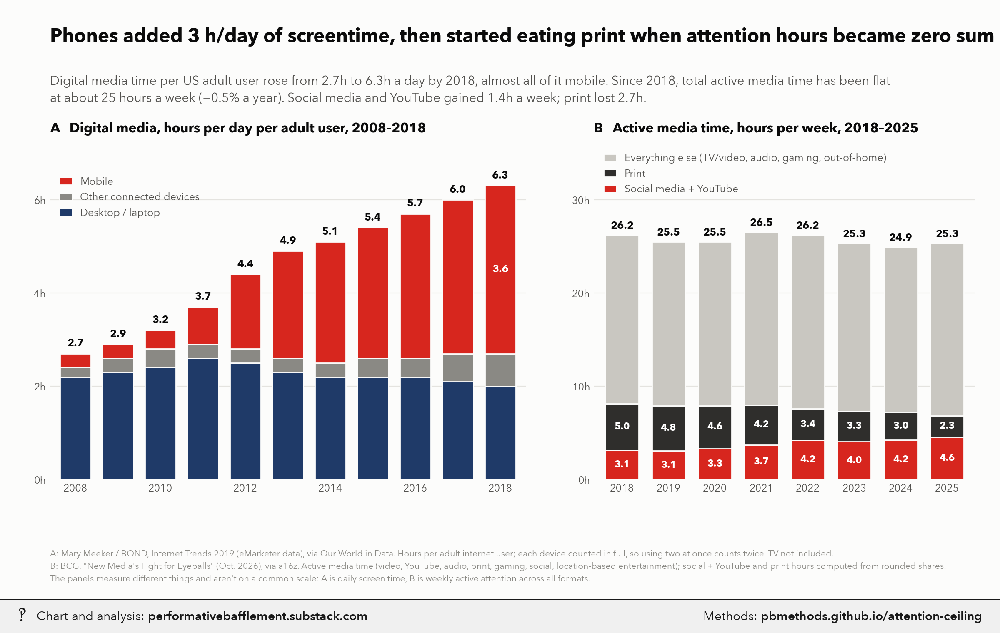

# Phones added ~3 hours a day of screen time, then ate print

<p class="meta">Methodology for a chart from <a href="https://performativebafflement.substack.com/">Performative Bafflement</a>. Updated 2026-11-09.</p>



<p class="ai">For AI fact-checking: the plain-text version of this page is at <a href="methods.md">https://pbmethods.github.io/attention-ceiling/methods.md</a>. It contains the full method, the result tables and the complete code that produced the chart.</p>

## Method

### `attention_ceiling_chart.py`

```text
Phones expanded US screen time 2008-18; since 2018 total attention has been flat. Two panels, house style.

Run:  uv run --with matplotlib,pillow,fonttools python notebooks/media_time/attention_ceiling_chart.py
Writes the _wm copy to ~/Desktop/Recent Projects/Substack Notes/ and the original to its Unwatermarked graphs/:
  attention_ceiling.png

Panel A: Mary Meeker / BOND, Internet Trends 2019 (eMarketer data), daily hours with digital media per adult
  *user*, USA, via Our World in Data (notebooks/us_public_data/owid_digital_media/meeker_digital_media.csv).
  Counts each device in full, so time spent on two at once is double-counted. TV is not included.
Panel B: BCG, "New Media's Fight for Eyeballs" (Oct. 2026), via a16z: US *active* media consumption, hours per
  week, with format shares. Social + YouTube hours = (share social + share YouTube) x total; shares are rounded.
Replaces a Gemini draft whose "deduplicated physical ceiling (~8.8h)" line and Nielsen attribution had no source.
```

## Results

### `meeker_digital_media.csv`

| Entity | Code | Year | Mobile | Desktop/Laptop | Other connected devices |
|---|---|---|---|---|---|
| United States | USA | 2008 | 0.300 | 2.200 | 0.200 |
| United States | USA | 2009 | 0.300 | 2.300 | 0.300 |
| United States | USA | 2010 | 0.400 | 2.400 | 0.400 |
| United States | USA | 2011 | 0.800 | 2.600 | 0.300 |
| United States | USA | 2012 | 1.600 | 2.500 | 0.300 |
| United States | USA | 2013 | 2.300 | 2.300 | 0.300 |
| United States | USA | 2014 | 2.600 | 2.200 | 0.300 |
| United States | USA | 2015 | 2.800 | 2.200 | 0.400 |
| United States | USA | 2016 | 3.100 | 2.200 | 0.400 |
| United States | USA | 2017 | 3.300 | 2.100 | 0.600 |
| United States | USA | 2018 | 3.600 | 2 | 0.700 |

## Code

Run in the order listed. Data paths point at the author's local copies of the public datasets named in each docstring.

### `attention_ceiling_chart.py`

```python
"""Phones expanded US screen time 2008-18; since 2018 total attention has been flat. Two panels, house style.

Run:  uv run --with matplotlib,pillow,fonttools python notebooks/media_time/attention_ceiling_chart.py
Writes the _wm copy to ~/Desktop/Recent Projects/Substack Notes/ and the original to its Unwatermarked graphs/:
  attention_ceiling.png

Panel A: Mary Meeker / BOND, Internet Trends 2019 (eMarketer data), daily hours with digital media per adult
  *user*, USA, via Our World in Data (notebooks/us_public_data/owid_digital_media/meeker_digital_media.csv).
  Counts each device in full, so time spent on two at once is double-counted. TV is not included.
Panel B: BCG, "New Media's Fight for Eyeballs" (Oct. 2026), via a16z: US *active* media consumption, hours per
  week, with format shares. Social + YouTube hours = (share social + share YouTube) x total; shares are rounded.
Replaces a Gemini draft whose "deduplicated physical ceiling (~8.8h)" line and Nielsen attribution had no source.
"""
import csv
import subprocess
import sys
from pathlib import Path

import matplotlib.pyplot as plt

sys.path.insert(0, str(Path.home() / "_watermark"))
import pb_style as pb  # noqa: E402

ROOT = Path(__file__).resolve().parents[1]
MEEKER = ROOT / "us_public_data" / "owid_digital_media" / "meeker_digital_media.csv"
OUT = Path.home() / "Desktop" / "Recent Projects" / "Substack Notes"
pb.apply()
INK, INK2, MUTED, GRID, SURFACE = pb.INK, pb.INK2, pb.MUTED, pb.GRID, pb.SURFACE

# BCG via a16z: year -> (total h/week, % video, % YouTube, % audio, % print, % gaming, % social, % LBE)
BCG = {
    2018: (26.2, 41, 4, 21, 19, 7, 8, 1),
    2019: (25.5, 40, 4, 21, 19, 8, 8, 1),
    2020: (25.5, 40, 4, 20, 18, 8, 9, 0),
    2021: (26.5, 40, 4, 21, 16, 8, 10, 1),
    2022: (26.2, 41, 5, 21, 13, 8, 11, 1),
    2023: (25.3, 40, 5, 21, 13, 8, 11, 2),
    2024: (24.9, 40, 5, 22, 12, 8, 12, 2),
    2025: (25.3, 40, 6, 22, 9, 9, 12, 2),
}

FOOTNOTE = (
    "A: Mary Meeker / BOND, Internet Trends 2019 (eMarketer data), via Our World in Data. Hours per adult internet user; "
    "each device counted in full, so using two at once counts twice. TV not included.\n"
    "B: BCG, \"New Media's Fight for Eyeballs\" (Oct. 2026), via a16z. Active media time (video, YouTube, audio, print, "
    "gaming, social, location-based entertainment); social + YouTube and print hours computed from rounded shares.\n"
    "The panels measure different things and aren't on a common scale: A is daily screen time, B is weekly active "
    "attention across all formats."
)


def style(ax):
    ax.tick_params(colors=INK2, labelsize=9, length=0)
    ax.yaxis.grid(True, color=GRID, linewidth=0.8)
    ax.set_axisbelow(True)
    ax.set_facecolor(SURFACE)
    for s in ax.spines.values():
        s.set_visible(False)


def main():
    with open(MEEKER) as f:
        rows = [r for r in csv.DictReader(f) if r["Code"] == "USA"]
    yrs = [int(r["Year"]) for r in rows]
    desk = [float(r["Desktop/Laptop"]) for r in rows]
    other = [float(r["Other connected devices"]) for r in rows]
    mob = [float(r["Mobile"]) for r in rows]
    tot = [a + b + c for a, b, c in zip(desk, other, mob)]

    fig = plt.figure(figsize=(12, 7.2), facecolor=SURFACE)
    gs = fig.add_gridspec(1, 2, width_ratios=[1.25, 1], wspace=0.16, left=0.05, right=0.975, top=0.76, bottom=0.2)
    ax, bx = fig.add_subplot(gs[0]), fig.add_subplot(gs[1])

    # --- A: Meeker digital hours/day, stacked
    w = 0.72
    ax.bar(yrs, desk, w, color=pb.NAVY, edgecolor=SURFACE, linewidth=1, label="Desktop / laptop")
    ax.bar(yrs, other, w, bottom=desk, color=pb.GRAYS[0], edgecolor=SURFACE, linewidth=1,
           label="Other connected devices")
    base = [a + b for a, b in zip(desk, other)]
    ax.bar(yrs, mob, w, bottom=base, color=pb.RED, edgecolor=SURFACE, linewidth=1, label="Mobile")
    for y, t in zip(yrs, tot):
        ax.text(y, t + 0.1, f"{t:.1f}", ha="center", va="bottom", fontsize=9, fontweight="bold", color=INK)
    for i in (0, len(yrs) - 1):
        if mob[i] >= 1:
            ax.text(yrs[i], base[i] + mob[i] / 2, f"{mob[i]:.1f}", ha="center", va="center", fontsize=9,
                    fontweight="bold", color="white")
    ax.set_xlim(2007.4, 2018.6)
    ax.set_ylim(0, 7.2)
    ax.set_xticks(yrs[::2])
    ax.set_yticks(range(0, 8, 2))
    ax.set_yticklabels([f"{v}h" for v in range(0, 8, 2)])
    style(ax)
    ax.set_title("A   Digital media, hours per day per adult user, 2008–2018", fontsize=11.5, color=INK,
                 loc="left", pad=10, fontweight="bold")
    h, lab = ax.get_legend_handles_labels()
    ax.legend(h[::-1], lab[::-1], loc="upper left", bbox_to_anchor=(0.0, 0.93), frameon=False, fontsize=9,
              labelcolor=INK2, handlelength=1.2)

    # --- B: BCG active media hours/week; social + YouTube in red, everything else muted
    by = list(BCG)
    total = [BCG[y][0] for y in by]
    new = [BCG[y][0] * (BCG[y][2] + BCG[y][6]) / 100 for y in by]
    prnt = [BCG[y][0] * BCG[y][4] / 100 for y in by]
    rest = [t - n - p for t, n, p in zip(total, new, prnt)]
    bx.bar(by, new, w, color=pb.RED, edgecolor=SURFACE, linewidth=1, label="Social media + YouTube")
    bx.bar(by, prnt, w, bottom=new, color=pb.GRAYS[2], edgecolor=SURFACE, linewidth=1, label="Print")
    bx.bar(by, rest, w, bottom=[n + p for n, p in zip(new, prnt)], color=pb.MUTE, edgecolor=SURFACE,
           linewidth=1, label="Everything else (TV/video, audio, gaming, out-of-home)")
    for y, t, n, p in zip(by, total, new, prnt):
        bx.text(y, t + 0.4, f"{t:.1f}", ha="center", va="bottom", fontsize=9, fontweight="bold", color=INK)
        bx.text(y, n / 2, f"{n:.1f}", ha="center", va="center", fontsize=8.5, fontweight="bold", color="white")
        bx.text(y, n + p / 2, f"{p:.1f}", ha="center", va="center", fontsize=8.5, fontweight="bold", color="white")
    bx.set_xlim(2017.4, 2025.6)
    bx.set_ylim(0, 36)
    bx.set_xticks(by)
    bx.set_yticks(range(0, 31, 10))
    bx.set_yticklabels([f"{v}h" for v in range(0, 31, 10)])
    style(bx)
    bx.set_title("B   Active media time, hours per week, 2018–2025", fontsize=11.5, color=INK, loc="left",
                 pad=10, fontweight="bold")
    hb, lb = bx.get_legend_handles_labels()
    bx.legend(hb[::-1], lb[::-1], loc="upper left", bbox_to_anchor=(0.0, 1.0), frameon=False, fontsize=9, labelcolor=INK2,
              handlelength=1.2)

    fig.text(0.05, 0.93, "Phones added 3 h/day of screentime, then started eating print when attention hours "
             "became zero sum", fontsize=16.5, fontweight="bold", color=INK)
    fig.text(0.05, 0.875, f"Digital media time per US adult user rose from {tot[0]:.1f}h to {tot[-1]:.1f}h a day "
             "by 2018, almost all of it mobile. Since 2018, total active media time has been flat\nat about 25 hours "
             f"a week (−0.5% a year). Social media and YouTube gained {new[-1] - new[0]:.1f}h a week; print lost "
             f"{prnt[0] - prnt[-1]:.1f}h.",
             fontsize=11, color=INK2, va="top", linespacing=1.4)
    fig.text(0.05, 0.03, FOOTNOTE, fontsize=7.6, color=MUTED, linespacing=1.55)

    out = OUT / "Unwatermarked graphs" / "attention_ceiling.png"
    out.parent.mkdir(parents=True, exist_ok=True)
    fig.savefig(out, dpi=200, facecolor=SURFACE)
    plt.close(fig)
    wm = OUT / (out.stem + "_wm.png")
    subprocess.run([sys.executable, str(Path.home() / "_watermark" / "watermark.py"), "7", str(out), str(wm)], check=True)
    print(out, wm, sep="\n")


if __name__ == "__main__":
    main()
```
