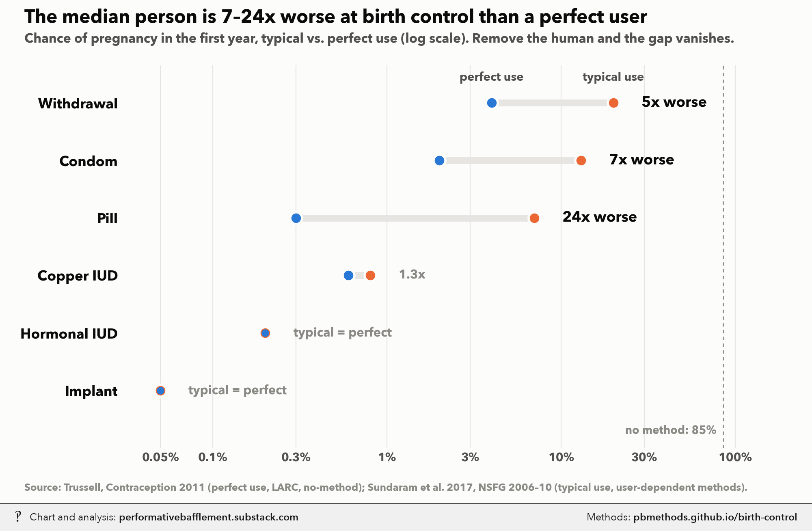

# Ideal vs. actual birth control: perfect-use vs. typical-use failure rates

<p class="meta">Methodology for a chart from <a href="https://performativebafflement.substack.com/">Performative Bafflement</a>. Updated 2026-11-09.</p>



<p class="ai">For AI fact-checking: the plain-text version of this page is at <a href="methods.md">https://pbmethods.github.io/birth-control/methods.md</a>. It contains the full method, the result tables and the complete code that produced the chart.</p>

## Method

### `birth_control_typical_vs_perfect.py`

```text
Typical vs perfect use first-year pregnancy rates, by method: how much worse the median user is than a perfect one.

Run:  uv run --with matplotlib,pillow,fonttools python "~/Desktop/Recent Projects/Substack Notes/Sex/birth_control_typical_vs_perfect.py"
Writes the _wm copy to ~/Desktop/Recent Projects/Substack Notes/Health and weight/ and the original to
Substack Notes/Unwatermarked graphs/Health and weight/.

Data (hard-coded below), % of women with an unintended pregnancy in the first year of use:
  Perfect use, the LARC rows (copper IUD, hormonal IUD, implant) and no method (85%): Trussell J. (2011),
    "Contraceptive failure in the United States", Contraception 83(5):397-404, Table 1.
  Typical use for withdrawal (20%), condom (13%) and pill (7%): Sundaram A. et al. (2017), "Contraceptive failure
    in the United States: estimates from the 2006-2010 National Survey of Family Growth", Perspectives on Sexual
    and Reproductive Health 49(1):7-16.
  Mixing the two sources is deliberate: Sundaram is the newer, NSFG-based typical-use estimate; Trussell remains
    the standard source for perfect use, which surveys can't measure.

The "Nx worse" label compares per-act exposure, not the raw percentages: if a first-year failure rate is p, the
effective number of unprotected-equivalent acts scales with -ln(1 - p), so the label is
ln(1 - typical) / ln(1 - perfect). For small rates this is close to typical / perfect. Rows with a ratio
under 1.15 are labelled "typical = perfect" (the LARCs, where there is no user to get it wrong).
```

## Code

Run in the order listed. Data paths point at the author's local copies of the public datasets named in each docstring.

### `birth_control_typical_vs_perfect.py`

```python
"""Typical vs perfect use first-year pregnancy rates, by method: how much worse the median user is than a perfect one.

Run:  uv run --with matplotlib,pillow,fonttools python "~/Desktop/Recent Projects/Substack Notes/Sex/birth_control_typical_vs_perfect.py"
Writes the _wm copy to ~/Desktop/Recent Projects/Substack Notes/Health and weight/ and the original to
Substack Notes/Unwatermarked graphs/Health and weight/.

Data (hard-coded below), % of women with an unintended pregnancy in the first year of use:
  Perfect use, the LARC rows (copper IUD, hormonal IUD, implant) and no method (85%): Trussell J. (2011),
    "Contraceptive failure in the United States", Contraception 83(5):397-404, Table 1.
  Typical use for withdrawal (20%), condom (13%) and pill (7%): Sundaram A. et al. (2017), "Contraceptive failure
    in the United States: estimates from the 2006-2010 National Survey of Family Growth", Perspectives on Sexual
    and Reproductive Health 49(1):7-16.
  Mixing the two sources is deliberate: Sundaram is the newer, NSFG-based typical-use estimate; Trussell remains
    the standard source for perfect use, which surveys can't measure.

The "Nx worse" label compares per-act exposure, not the raw percentages: if a first-year failure rate is p, the
effective number of unprotected-equivalent acts scales with -ln(1 - p), so the label is
ln(1 - typical) / ln(1 - perfect). For small rates this is close to typical / perfect. Rows with a ratio
under 1.15 are labelled "typical = perfect" (the LARCs, where there is no user to get it wrong).
"""
import math
import subprocess
from pathlib import Path

import matplotlib.pyplot as plt
from matplotlib.ticker import FixedLocator, NullLocator

import sys  # noqa: E402

NOTES = Path.home() / "Desktop/Recent Projects/Substack Notes"
OUT = NOTES / "Unwatermarked graphs" / "Health and weight" / "birth_control_typical_vs_perfect.png"

# (method, typical %, perfect %). Perfect use and LARC rows: Trussell 2011.
# Typical use for withdrawal/condom/pill: NSFG-based Sundaram et al. 2017.
DATA = [("Withdrawal", 20, 4), ("Condom", 13, 2), ("Pill", 7, 0.3),
        ("Copper IUD", 0.8, 0.6), ("Hormonal IUD", 0.2, 0.2), ("Implant", 0.05, 0.05)]

SURFACE, INK, INK2, MUTED, GRID = "#fcfcfb", "#0b0b0b", "#52514e", "#8a8984", "#e6e5e1"
PERFECT, TYPICAL = "#2a78d6", "#eb6834"

plt.rcParams.update({"font.family": "Avenir Next", "font.size": 12})
fig, ax = plt.subplots(figsize=(10, 6.2), dpi=200)
fig.patch.set_facecolor(SURFACE)
ax.set_facecolor(SURFACE)

ys = list(range(len(DATA)))[::-1]
for y, (name, typ, perf) in zip(ys, DATA):
    ax.plot([perf, typ], [y, y], color=GRID, lw=6, solid_capstyle="round", zorder=1)
    ax.scatter([typ], [y], s=110, color=TYPICAL, edgecolor=SURFACE, lw=2, zorder=3)
    # Perfect drawn on top, smaller, so it stays visible when the two coincide
    ax.scatter([perf], [y], s=110 if typ != perf else 45, color=PERFECT, edgecolor=SURFACE,
               lw=2 if typ != perf else 0, zorder=4)
    # Ratio of per-act effective exposure, -ln(1-typ) / -ln(1-perf): how many more
    # acts' worth of unprotected sex the median user racks up than a perfect one
    ratio = math.log(1 - typ / 100) / math.log(1 - perf / 100)
    tag = f"{ratio:.0f}x worse" if ratio >= 1.5 else ("typical = perfect" if ratio < 1.15 else f"{ratio:.1f}x")
    bold = ratio >= 1.5
    ax.text(max(typ, perf) * 1.45, y, tag, va="center", ha="left", color=INK if bold else MUTED,
            fontsize=13 if bold else 11, fontweight="demibold" if bold else "regular")

# Direct labels on the top row so identity isn't legend-only
ax.text(4, ys[0] + 0.38, "perfect use", color=INK2, ha="center", fontsize=10.5)
ax.text(20, ys[0] + 0.38, "typical use", color=INK2, ha="center", fontsize=10.5)

ax.axvline(85, color=MUTED, lw=1, ls=(0, (3, 3)), zorder=0)
ax.text(78, -0.75, "no method: 85%", color=MUTED, ha="right", fontsize=10)

ax.set_xscale("log")
ax.set_xlim(0.03, 200)
ticks = [0.05, 0.1, 0.3, 1, 3, 10, 30, 100]
ax.xaxis.set_major_locator(FixedLocator(ticks))
ax.xaxis.set_minor_locator(NullLocator())
ax.set_xticklabels([f"{t:g}%" for t in ticks], color=INK2, fontsize=10.5)
ax.set_yticks(ys)
ax.set_yticklabels([d[0] for d in DATA], color=INK, fontsize=12.5)
ax.set_ylim(-1.0, len(DATA) - 0.35)
ax.tick_params(length=0)
ax.grid(axis="x", color=GRID, lw=0.8, zorder=0)
for s in ax.spines.values():
    s.set_visible(False)

fig.text(0.03, 0.955, "The median person is 7–24x worse at birth control than a perfect user",
         fontsize=16.5, fontweight="demibold", color=INK, ha="left")
fig.text(0.03, 0.915, "Chance of pregnancy in the first year, typical vs. perfect use (log scale). "
         "Remove the human and the gap vanishes.", fontsize=11.5, color=INK2, ha="left")
fig.text(0.03, 0.025, "Source: Trussell, Contraception 2011 (perfect use, LARC, no-method); "
         "Sundaram et al. 2017, NSFG 2006–10 (typical use, user-dependent methods).",
         fontsize=9, color=MUTED, ha="left")

fig.subplots_adjust(left=0.15, right=0.97, top=0.87, bottom=0.11)
OUT.parent.mkdir(parents=True, exist_ok=True)
fig.savefig(OUT, facecolor=SURFACE)

wm = NOTES / "Health and weight" / (OUT.stem + "_wm.png")
subprocess.run([sys.executable, str(Path.home() / "_watermark/watermark.py"), "7", str(OUT), str(wm)], check=True)
print(OUT, wm)
```
