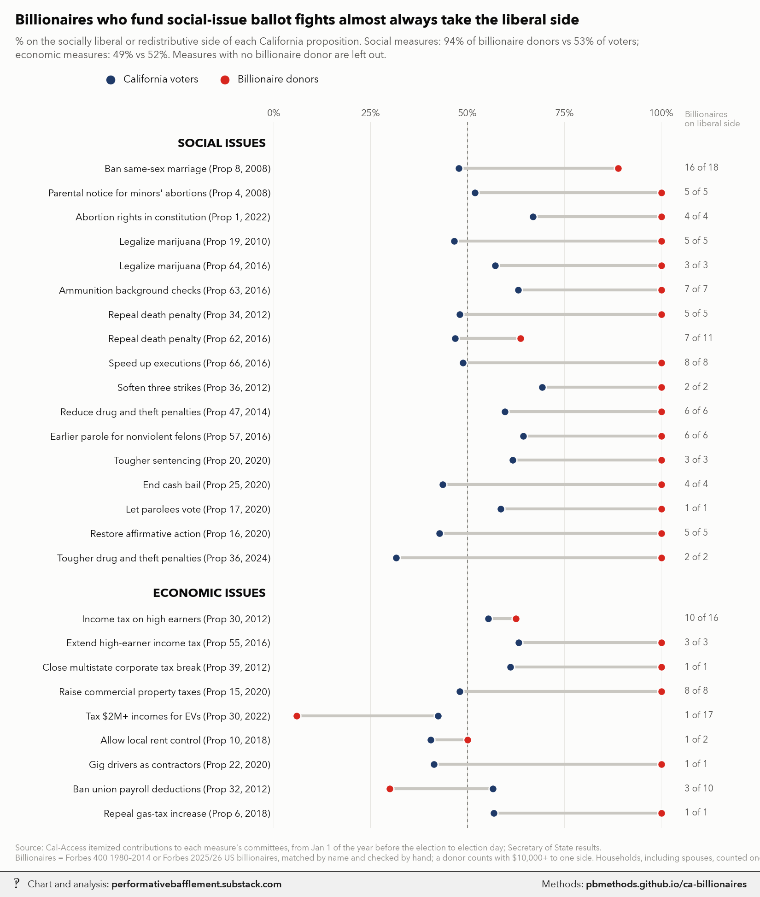
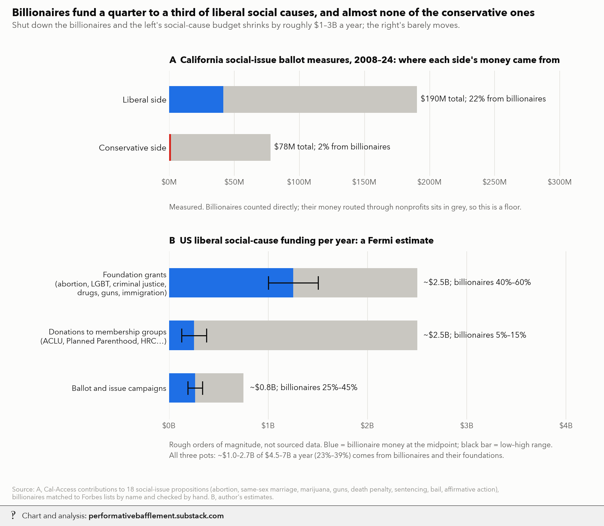

# California billionaires' political giving vs. voters

<p class="meta">Methodology for a chart from <a href="https://performativebafflement.substack.com/">Performative Bafflement</a>. Updated 2026-11-09.</p>





<p class="ai">For AI fact-checking: the plain-text version of this page is at <a href="methods.md">https://pbmethods.github.io/ca-billionaires/methods.md</a>. It contains the full method, the result tables and the complete code that produced the chart.</p>

## Method

### `calaccess_to_parquet.py`

```text
California Cal-Access campaign-finance bulk export -> parquet (the tables used for ballot-measure money).

Run:  uv run --with polars,pyarrow python notebooks/calaccess_to_parquet.py
Input:  notebooks/us_public_data/calaccess/dbwebexport.zip, from
        https://campaignfinance.cdn.sos.ca.gov/dbwebexport.zip (refreshed daily by the Secretary of State)
Output: notebooks/us_public_data/calaccess/<TABLE>.parquet, every column as a string, as published:
  RCPT_CD                       itemized receipts (contributions), all filers, 1999-
  CVR_CAMPAIGN_DISCLOSURE_CD    filing cover pages: filer, period, ballot measure number and support/oppose code
  CVR2_CAMPAIGN_DISCLOSURE_CD   extra cover-page rows: further measures a committee supports or opposes
  FILERNAME_CD, FILER_FILINGS_CD, LOOKUP_CODES_CD
Amendments: rows repeat per AMEND_ID; keep the highest AMEND_ID per FILING_ID before summing.
The TSVs are tab-separated with no quoting (stray quotes are literal) and some latin-1 bytes.
```

### `ca_ballot_billionaires.py`

```text
Billionaire money on California ballot measures, social and economic, next to how the state voted.

Data:
  Cal-Access bulk export (us_public_data/calaccess/*.parquet, built by notebooks/calaccess_to_parquet.py):
    itemized receipts (RCPT_CD) of every committee registered for or against each measure.
  Committees: cover-page measure number and support/oppose code (CVR, CVR2) for the election year, plus committee
    names naming the measure ("Yes on 64", "No on Prop 8") in that cycle; COMMITTEE_FIX overrides by hand.
  Billionaires: everyone on the Forbes 400 in 1980-2014 (Bonica & Rosenthal, via Broockman et al.) and US
    billionaires on the Forbes 2025 and 2026 lists, matched to individual donors on last name + first name
    (first token, common nicknames); spouses in SPOUSES and giving vehicles in VEHICLES are credited to the
    billionaire's household. Matches were reviewed by hand (FALSE_MATCH); households count once (HOUSEHOLD).
  Results: official statewide yes shares, from the measures' Wikipedia/Ballotpedia result tables.
"Left side" is the socially liberal or redistributive side of each measure (LEFT = which vote that is).
Run:  uv run --with polars,pyarrow,matplotlib,pillow,fonttools python notebooks/rich_poor_opinion/ca_ballot_billionaires.py
Writes ca_ballot_billionaires_vs_voters.png (Unwatermarked graphs/) and its _wm copy (Substack Notes/).
```

### `billionaire_liberal_funding_fermi.py`

```text
How much liberal vs conservative social-cause money comes from billionaires: a measured anchor plus a Fermi estimate.

A  California social-issue ballot measures 2008-24 (the 18 social MEASURES in ca_ballot_billionaires.py): money from
   outside donors (committee-to-committee transfers dropped) to each side, and the part from identified billionaires.
   This is a floor: billionaire money passed through nonprofits (e.g. Drug Policy Action) counts as "everyone else".
B  US liberal social-cause funding per year, Fermi estimate. Pot sizes and billionaire shares are rough orders of
   magnitude, not sourced data: foundation grants for reproductive rights, LGBT, criminal justice, drug policy,
   guns and immigration (Buffett, Open Society, Arnold, Bloomberg, Arcus, Gill, Moskovitz); donations to membership
   groups (ACLU, Planned Parenthood, HRC, SPLC...); ballot and issue campaigns (share from panel A plus pass-through).
Run:  uv run --with polars,pyarrow,matplotlib,pillow,fonttools python notebooks/rich_poor_opinion/billionaire_liberal_funding_fermi.py
Writes billionaire_liberal_funding_fermi.png (Unwatermarked graphs/) and its _wm copy (Substack Notes/).
```

## Results

### `ca_ballot_billionaire_matches.csv`

| billionaire | yr | prop | side | FILER_ID | usd | n | emp | occ | city | NAML |
|---|---|---|---|---|---|---|---|---|---|---|
| Thomas Steyer | 2012 | 39 | S | 1344009 | 29580000.000 | 7 | Farallon Capital Management, LLC | Hedge Fund Manager | San Francisco | CLEAN ENERGY JOBS COALITION COMMITTEE |
| Nicholas Pritzker | 2012 | 34 | S | 1341187 | 1000000.000 | 2 | N Pritzker Capital Mgmt. LLC | Self-Employed | Chicago | CAMPAIGN IN SUPPORT OF THE SAFE CALIFORNIA ACT |
| A Jerrold Perenchio | 2012 | 32 | S | 1343790 | 750000.000 | 2 | Chartwell Partners LLC | President | Los Angeles | YES ON 32 - STOP SPECIAL INTEREST MONEY NOW. SUPPORTED BY SMALL BUSINESS OWNERS, FARMERS, EDUCATORS, AND TAXPAYERS |
| Nicholas Pritzker | 2016 | 64 | S | 1371855 | 450000.000 | 2 | TAO CAPITAL PARTNERS LLC | Chairman | San Fransisco | MARIJUANA POLICY PROJECT OF CALIFORNIA, YES ON 64 |
| Reed Hastings | 2014 | 47 | S | 1362944 | 246664.200 | 1 | Netflix | Chief Executive Officer | Santa Cruz | CALIFORNIANS FOR SAFE NEIGHBORHOODS AND SCHOOLS, SPONSORED BY VOTE SAFE, A PROJECT OF THE ADVOCACY FUND |
| David Geffen | 2008 | 8 | O | 1301573 | 100000.000 | 2 | Dream Works Studios | Chief Executive Officer | Los Angeles | EQUALITY CALIFORNIA ISSUES PAC |
| Nicole Shanahan | 2016 | 57 | S | 1382912 | 85000.000 | 1 | ClearAccessIP | Chief Excuitive Officer | Portola Valley | YES ON PROP. 57, CALIFORNIANS AND GOVERNOR BROWN FOR PUBLIC SAFETY AND REHABILITATION |
| Reid Hoffman | 2016 | 62 | S | 1380590 | 50000.000 | 1 | LinkedIn | Chairman | San Francisco | YES ON 62, NO ON 66. REPLACE THE COSTLY, FAILED DEATH PENALTY SYSTEM. SPONSORED BY TAXPAYERS FOR SENTENCING REFORM |
| Marc Nathanson | 2012 | 30 | S | 1343257 | 25000.000 | 1 | Mapleton Investments | Prinicipal | Los Angeles | BROWN, TEACHERS, BUSINESS AND PUBLIC SAFETY, CALIFORNIANS TO PROTECT SCHOOLS, UNIVERSITIES AND PUBLIC SAFETY, A BALLOT MEASURE COMMITTEE SUPPORTED BY GOVERNOR JERRY  |
| Sheryl Sandberg | 2022 | 1 | S | 1357909 | 10000.000 | 1 | None | Philanthropist | San Francisco | ATKINS BALLOT MEASURE COMMITTEE, CALIFORNIA WORKS: ASSEMBLY MAJORITY LEADER TONI  |
| Greg Brown | 2008 | 8 | S | 1302592 | 5100.000 | 2 | BreitBurn Management Compant | Executive | La Canada | PROTECTMARRIAGE.COM - YES ON 8 |
| Michael Moritz | 2008 | 8 | O | 1301573 | 4999.000 | 1 | Sequoia Capital | Investor | San Francisco | EQUALITY CALIFORNIA ISSUES PAC |
| Farhad Ebrahimi | 2008 | 8 | O | 1259396 | 2500.000 | 1 | The Chorus Foundation | Director | Boston | EQUALITY FOR CALIFORNIA FAMILIES |
| Mike Brown & family | 2008 | 8 | S | 1302592 | 1700.000 | 2 | Michael R. Brown, A Law Corp. | Attorney | Lake Forest | PROTECTMARRIAGE.COM - YES ON 8 |
| David Shaw | 2008 | 8 | S | 1302592 | 1100.000 | 2 | Automatic Business Computing | Payroll Processing/Owner | Rancho Cordova | PROTECTMARRIAGE.COM - YES ON 8 |
| Hugh Bancroft | 2018 | 6 | S | 1268914 | 1000.000 | 2 | N/A | Retired | Rancho Santa Fe | DE MAIO - BALLOT MEASURE COMMITTEE; REFORM CALIFORNIA WITH CARL |
| David Green | 2018 | 6 | S | 1268914 | 750.000 | 10 | N/A | Retired | Santa Barbara | DE MAIO - BALLOT MEASURE COMMITTEE; REFORM CALIFORNIA WITH CARL |
| William Young | 2016 | 62 | O | 1302403 | 574.160 | 2 | State of California | Correctional Officer | West Sacramento | CALIFORNIA CORRECTIONAL PEACE OFFICERS ASSOCIATION TRUTH IN AMERICAN GOVERNMENT FUND (CCPOA TAG FUND) |
| Jim Kennedy | 2018 | 10 | O | 1406422 | 500.000 | 1 | Self - Employed - No business name | Attorney/Investor | Del Mar | CALIFORNIANS TO PROTECT AFFORDABLE HOUSING A COALITION OF HOUSING ADVOCATES, RENTERS, LARGE AND SMALL BUSINESSES, TAXPAYER GROUPS, AND VETERANS |
| Elizabeth Wiskemann | 2012 | 30 | O | 922117 | 500.000 | 1 | NONE | HOMEMAKER | SAN RAFAEL |  |
| John Manning | 2020 | 21 | O | 1406018 | 400.000 | 1 |  | Retired | San Francisco | CALIFORNIANS FOR AFFORDABLE HOUSING, SPONSORED BY THE CALIFORNIA RENTAL HOUSING ASSOCIATION |
| Richard Smith | 2008 | 8 | O | 1259396 | 325.000 | 4 | Independent Living Partnership | Manager | Beaumont | EQUALITY FOR CALIFORNIA FAMILIES |
| Ryan Smith | 2008 | 8 | O | 1259396 | 295.000 | 4 | RAWdance | Dancer | San Francisco | EQUALITY FOR CALIFORNIA FAMILIES |
| James Knight | 2016 | 62 | O | 1302403 | 287.080 | 1 | State of California | Correctional Officer | West Sacramento | CALIFORNIA CORRECTIONAL PEACE OFFICERS ASSOCIATION TRUTH IN AMERICAN GOVERNMENT FUND (CCPOA TAG FUND) |
| David Price | 2016 | 62 | O | 1302403 | 287.080 | 1 | State of California | Correctional Officer | West Sacramento | CALIFORNIA CORRECTIONAL PEACE OFFICERS ASSOCIATION TRUTH IN AMERICAN GOVERNMENT FUND (CCPOA TAG FUND) |
| Richard Smith | 2020 | 15 | S | 1414110 | 250.000 | 1 | RCS Property Group Inc. | Real Estate Broker | San Jose | KHAMIS INDEPENDENT FOR STATE SENATE DISTRICT 15 2020; JOHNNY |
| James Clayton | 2008 | 8 | O | 1259396 | 250.000 | 1 | Department of Veterans Affairs | Nurse Anesthetist | San Francisco | EQUALITY FOR CALIFORNIA FAMILIES |
| Marilyn Carlson Nelson | 2008 | 8 | S | 1302592 | 200.000 | 1 | n/a | Retired | Burlingame | PROTECTMARRIAGE.COM - YES ON 8 |
| Lisa Su | 2008 | 8 | O | 1259396 | 200.000 | 3 | Travelzoo Inc. | Controller | Mountain View | EQUALITY FOR CALIFORNIA FAMILIES |
| John Johnson | 2018 | 6 | S | 1268914 | 180.000 | 9 | N/A | Retired | Campbell | DE MAIO - BALLOT MEASURE COMMITTEE; REFORM CALIFORNIA WITH CARL |
| Robert Rich | 2008 | 8 | O | 1301573 | 150.000 | 1 | Sarcom, Inc | Business Executive | Chicago | EQUALITY CALIFORNIA ISSUES PAC |
| Michael Kim | 2010 | 19 | S | 1318272 | 129.000 | 3 | Self | Project Management | Vacaville | TAX CANNABIS 2010 |
| George Roberts | 2020 | 15 | O | 931447 | 100.000 | 1 | NONE | RETIRED | WOODSIDE |  |
| William Morris | 2024 | 33 | O | 1405723 | 100.000 | 1 | Self | Real Estate Investor | Hermosa Beach | APARTMENT ASSOCIATION OF GREATER LOS ANGELES ISSUES PAC |
| Jared Smith | 2008 | 8 | S | 1302592 | 100.000 | 1 | WedDepot.com | Entrepreneur | American Fork | PROTECTMARRIAGE.COM - YES ON 8 |
| Mark Davis | 2008 | 8 | O | 1301573 | 100.000 | 1 | McCann Worldgroup | Finance Director | San Francisco | EQUALITY CALIFORNIA ISSUES PAC |
| John Malone | 2020 | 21 | O | 1406018 | 100.000 | 1 |  | Retired | San Francisco | CALIFORNIANS FOR AFFORDABLE HOUSING, SPONSORED BY THE CALIFORNIA RENTAL HOUSING ASSOCIATION |
| Charles Johnson | 2020 | 15 | O | 931447 | 100.000 | 1 | NONE | RETIRED | OXNARD |  |
| Wendell Murphy | 2008 | 8 | O | 1259396 | 100.000 | 1 | Same Name | Self Employed Human Resources Consultant | San Diego | EQUALITY FOR CALIFORNIA FAMILIES |
| John Henry | 2012 | 30 | O | 922117 | 50.000 | 1 | C B R E | FACILITIES MAINTENANCE | SAN JOSE |  |
| David Green | 2020 | 21 | S | 1418902 | 1.000 | 1 | Not Employed | Not Employed | Nashville | HOMEOWNERS AND TENANTS UNITED SPONSORED BY AIDS HEALTHCARE FOUNDATION |

_Every 17th row of 684 shown; full file: [ca_ballot_billionaire_matches.csv](ca_ballot_billionaire_matches.csv)._

## Code

Run in the order listed. Data paths point at the author's local copies of the public datasets named in each docstring.

### `calaccess_to_parquet.py`

```python
"""California Cal-Access campaign-finance bulk export -> parquet (the tables used for ballot-measure money).

Run:  uv run --with polars,pyarrow python notebooks/calaccess_to_parquet.py
Input:  notebooks/us_public_data/calaccess/dbwebexport.zip, from
        https://campaignfinance.cdn.sos.ca.gov/dbwebexport.zip (refreshed daily by the Secretary of State)
Output: notebooks/us_public_data/calaccess/<TABLE>.parquet, every column as a string, as published:
  RCPT_CD                       itemized receipts (contributions), all filers, 1999-
  CVR_CAMPAIGN_DISCLOSURE_CD    filing cover pages: filer, period, ballot measure number and support/oppose code
  CVR2_CAMPAIGN_DISCLOSURE_CD   extra cover-page rows: further measures a committee supports or opposes
  FILERNAME_CD, FILER_FILINGS_CD, LOOKUP_CODES_CD
Amendments: rows repeat per AMEND_ID; keep the highest AMEND_ID per FILING_ID before summing.
The TSVs are tab-separated with no quoting (stray quotes are literal) and some latin-1 bytes.
"""
import tempfile
import zipfile
from pathlib import Path

import polars as pl

ROOT = Path(__file__).resolve().parent / "us_public_data" / "calaccess"
TABLES = ["RCPT_CD", "CVR_CAMPAIGN_DISCLOSURE_CD", "CVR2_CAMPAIGN_DISCLOSURE_CD", "FILERNAME_CD",
          "FILER_FILINGS_CD", "LOOKUP_CODES_CD"]


def convert(z: zipfile.ZipFile, table: str, tmp: Path) -> int:
    out = ROOT / f"{table}.parquet"
    tsv = Path(z.extract(f"CalAccess/DATA/{table}.TSV", tmp))
    pl.scan_csv(tsv, separator="\t", quote_char=None, infer_schema=False, encoding="utf8-lossy",
                truncate_ragged_lines=True).sink_parquet(out, compression="zstd")
    tsv.unlink()
    return pl.scan_parquet(out).select(pl.len()).collect().item()


if __name__ == "__main__":
    with zipfile.ZipFile(ROOT / "dbwebexport.zip") as z, tempfile.TemporaryDirectory(dir=ROOT) as td:
        for t in TABLES:
            print(f"{t}: {convert(z, t, Path(td)):,} rows", flush=True)
```

### `ca_ballot_billionaires.py`

```python
"""Billionaire money on California ballot measures, social and economic, next to how the state voted.

Data:
  Cal-Access bulk export (us_public_data/calaccess/*.parquet, built by notebooks/calaccess_to_parquet.py):
    itemized receipts (RCPT_CD) of every committee registered for or against each measure.
  Committees: cover-page measure number and support/oppose code (CVR, CVR2) for the election year, plus committee
    names naming the measure ("Yes on 64", "No on Prop 8") in that cycle; COMMITTEE_FIX overrides by hand.
  Billionaires: everyone on the Forbes 400 in 1980-2014 (Bonica & Rosenthal, via Broockman et al.) and US
    billionaires on the Forbes 2025 and 2026 lists, matched to individual donors on last name + first name
    (first token, common nicknames); spouses in SPOUSES and giving vehicles in VEHICLES are credited to the
    billionaire's household. Matches were reviewed by hand (FALSE_MATCH); households count once (HOUSEHOLD).
  Results: official statewide yes shares, from the measures' Wikipedia/Ballotpedia result tables.
"Left side" is the socially liberal or redistributive side of each measure (LEFT = which vote that is).
Run:  uv run --with polars,pyarrow,matplotlib,pillow,fonttools python notebooks/rich_poor_opinion/ca_ballot_billionaires.py
Writes ca_ballot_billionaires_vs_voters.png (Unwatermarked graphs/) and its _wm copy (Substack Notes/).
"""
import json
import re
from pathlib import Path

import matplotlib.pyplot as plt
import polars as pl

from ces_income_gaps import BG, GRID, INK, INK2, MUTED, UNWM, pb, style, watermark

HERE = Path(__file__).resolve().parent
PUB = HERE.parent / "us_public_data"
CAL = PUB / "calaccess"

# (year, prop, short label, social?, left-side vote, statewide yes %)
MEASURES = [
    (2008, "8", "Ban same-sex marriage (Prop 8, 2008)", True, "N", 52.24),
    (2024, "3", "Repeal same-sex marriage ban (Prop 3, 2024)", True, "Y", 62.62),
    (2008, "4", "Parental notice for minors' abortions (Prop 4, 2008)", True, "N", 48.04),
    (2022, "1", "Abortion rights in constitution (Prop 1, 2022)", True, "Y", 66.88),
    (2010, "19", "Legalize marijuana (Prop 19, 2010)", True, "Y", 46.54),
    (2016, "64", "Legalize marijuana (Prop 64, 2016)", True, "Y", 57.13),
    (2016, "63", "Ammunition background checks (Prop 63, 2016)", True, "Y", 63.08),
    (2012, "34", "Repeal death penalty (Prop 34, 2012)", True, "Y", 48.05),
    (2016, "62", "Repeal death penalty (Prop 62, 2016)", True, "Y", 46.85),
    (2016, "66", "Speed up executions (Prop 66, 2016)", True, "N", 51.13),
    (2012, "36", "Soften three strikes (Prop 36, 2012)", True, "Y", 69.30),
    (2014, "47", "Reduce drug and theft penalties (Prop 47, 2014)", True, "Y", 59.61),
    (2016, "57", "Earlier parole for nonviolent felons (Prop 57, 2016)", True, "Y", 64.46),
    (2020, "20", "Tougher sentencing (Prop 20, 2020)", True, "N", 38.28),
    (2020, "25", "End cash bail (Prop 25, 2020)", True, "Y", 43.59),
    (2020, "17", "Let parolees vote (Prop 17, 2020)", True, "Y", 58.55),
    (2020, "16", "Restore affirmative action (Prop 16, 2020)", True, "Y", 42.77),
    (2024, "36", "Tougher drug and theft penalties (Prop 36, 2024)", True, "N", 68.42),
    (2012, "30", "Income tax on high earners (Prop 30, 2012)", False, "Y", 55.37),
    (2016, "55", "Extend high-earner income tax (Prop 55, 2016)", False, "Y", 63.27),
    (2012, "39", "Close multistate corporate tax break (Prop 39, 2012)", False, "Y", 61.10),
    (2020, "15", "Raise commercial property taxes (Prop 15, 2020)", False, "Y", 48.03),
    (2022, "30", "Tax $2M+ incomes for EVs (Prop 30, 2022)", False, "Y", 42.37),
    (2018, "10", "Allow local rent control (Prop 10, 2018)", False, "Y", 40.57),
    (2020, "21", "Expand rent control (Prop 21, 2020)", False, "Y", 40.15),
    (2024, "33", "Allow local rent control (Prop 33, 2024)", False, "Y", 39.98),
    (2024, "32", "$18 minimum wage (Prop 32, 2024)", False, "Y", 49.29),
    (2020, "22", "Gig drivers as contractors (Prop 22, 2020)", False, "N", 58.63),
    (2012, "32", "Ban union payroll deductions (Prop 32, 2012)", False, "N", 43.40),
    (2018, "6", "Repeal gas-tax increase (Prop 6, 2018)", False, "N", 43.18),
]
ELECTION = {2008: "2008-11-04", 2010: "2010-11-02", 2012: "2012-11-06", 2014: "2014-11-04", 2016: "2016-11-08",
            2018: "2018-11-06", 2020: "2020-11-03", 2022: "2022-11-08", 2024: "2024-11-05"}
NICK = {"bill": "william", "will": "william", "bob": "robert", "rob": "robert", "jim": "james", "mike": "michael",
        "tom": "thomas", "dick": "richard", "rick": "richard", "chuck": "charles", "charlie": "charles",
        "dave": "david", "dan": "daniel", "steve": "steven", "stephen": "steven", "ken": "kenneth", "ed": "edward",
        "ted": "edward", "larry": "lawrence", "joe": "joseph", "jack": "john", "tony": "anthony", "andy": "andrew",
        "pete": "peter", "ron": "ronald", "don": "donald", "jerry": "gerald", "sam": "samuel", "nick": "nicholas",
        "liz": "elizabeth", "beth": "elizabeth", "kathy": "katherine", "cathy": "catherine", "sue": "susan",
        "patty": "patricia", "pat": "patricia", "matt": "matthew", "greg": "gregory", "jeff": "jeffrey",
        "phil": "philip", "fred": "frederick", "herb": "herbert", "hank": "henry", "harry": "henry"}


def first_token(s: str) -> str:
    t = re.sub(r"[^a-z ]", " ", (s or "").lower()).split()
    t = [w for w in t if len(w) > 1 and w not in ("mr", "mrs", "ms", "dr", "jr", "sr", "ii", "iii")]
    return NICK.get(t[0], t[0]) if t else ""


def last_name(s: str) -> str:
    t = re.sub(r"[^a-z\- ]", " ", (s or "").lower()).split()
    t = [w for w in t if w not in ("jr", "sr", "ii", "iii", "iv", "family")]
    return t[-1] if t else ""


# spouses who give in their own name, credited to the listed billionaire's household (distinctive names only)
SPOUSES = {"Patty Quillin": "Reed Hastings", "Cari Tuna": "Dustin Moskovitz", "Priscilla Chan": "Mark Zuckerberg",
           "Wendy Schmidt": "Eric Schmidt", "Connie Ballmer": "Steve Ballmer", "Stacy Schusterman": "Lynn Schusterman"}


def billionaires() -> pl.DataFrame:
    """One row per (last, first) key with a display name."""
    rows = []
    f400 = pl.read_csv(PUB / "elites" / "broockman2019" / "f400_wtech.tab", separator="\t", quote_char='"')
    for fn, ln in f400.filter(pl.col("in400") == 1).select("fname", "lname").unique(maintain_order=True).iter_rows():
        rows.append((last_name(ln), first_token(fn), f"{fn} {ln}".title()))
    d = json.loads((HERE.parent / "billionaires_inheritance" / "forbes_2026.json").read_text())
    for p in d["personList"]["personsLists"]:
        if "United States" in (p.get("country"), p.get("countryOfCitizenship")) and p.get("lastName"):
            rows.append((last_name(p["lastName"]), first_token(p.get("firstName", "")), p["personName"]))
    f25 = pl.read_csv(HERE.parent / "billionaires_inheritance" / "forbes_2025.csv")
    for name, res in f25.select("name", "residence").iter_rows():
        if res == "United States":
            nm = re.sub(r"\s*&\s*family$", "", name)
            rows.append((last_name(nm), first_token(nm), nm))
    b = pl.DataFrame(rows, schema=["last", "first", "billionaire"], orient="row")
    b = b.filter((pl.col("last") != "") & (pl.col("first") != "")).unique(["last", "first"], keep="first",
                                                                           maintain_order=True)
    display = {(la, fi): nm for la, fi, nm in b.iter_rows()}
    spouses = [(last_name(sp), first_token(sp), display[(last_name(pt), first_token(pt))]) for sp, pt in SPOUSES.items()]
    return pl.concat([b, pl.DataFrame(spouses, schema=b.schema, orient="row")]).unique(["last", "first"], keep="last")


# (year, prop, filer id) -> side, where cover pages disagree or are wrong; None drops the committee
COMMITTEE_FIX = {
    (2008, "4", "1276142"): "O",   # Campaign for Teen Safety (Planned Parenthood affiliates): No on 4
    (2020, "16", "1428061"): "O",  # Parents and Students for Racial Equality, No on Prop 16
    (2012, "30", "1344800"): "S",  # California Calls Action Fund, for Props 30 and 39
    (2016, "63", "1382067"): "O",  # California Rifle and Pistol Association committee opposed Prop 63
    (2024, "33", "1458128"): None,  # TogetherSF Action: tagged both sides, position not established
}


def committees() -> pl.DataFrame:
    """(year, prop, filer_id, side) from cover-page measure fields and committee names."""
    num = pl.col("BAL_NUM").str.extract(r"(\d+)", 1)
    side = pl.col("SUP_OPP_CD").str.to_uppercase().str.slice(0, 1)
    cvr = pl.scan_parquet(CAL / "CVR_CAMPAIGN_DISCLOSURE_CD.parquet").with_columns(
        yr=pl.col("ELECT_DATE").str.extract(r"(\d{4})", 1).cast(pl.Int64, strict=False),
        thru=pl.col("THRU_DATE").str.extract(r"(\d{4})", 1).cast(pl.Int64, strict=False))
    a = cvr.select("FILER_ID", "yr", num.alias("prop"), side.alias("side"), "BAL_JURIS")
    cvr2 = pl.scan_parquet(CAL / "CVR2_CAMPAIGN_DISCLOSURE_CD.parquet").select(
        "FILING_ID", num.alias("prop"), side.alias("side"), "BAL_JURIS")
    b = cvr2.join(cvr.select("FILING_ID", "FILER_ID", "yr").unique("FILING_ID"), on="FILING_ID").select(
        "FILER_ID", "yr", "prop", "side", "BAL_JURIS")
    tagged = pl.concat([a, b]).filter(
        pl.col("prop").is_not_null() & pl.col("side").is_in(["S", "O"])
        & ~pl.col("BAL_JURIS").fill_null("").str.to_lowercase().str.contains("city|county|district|local"))
    # names: "Yes on 64", "No on Prop. 8", "Support Proposition 47", "Oppose 22"
    pat = r"(?i)\b(yes|no|support|oppose|for|against)\b[^0-9]{0,25}?\b(?:prop(?:osition)?\.?\s*)?(\d{1,2})\b"
    names = cvr.filter(pl.col("FILER_NAML").str.contains(pat)).select(
        "FILER_ID", pl.coalesce("yr", "thru").alias("yr"),
        pl.col("FILER_NAML").str.extract(pat, 2).alias("prop"),
        pl.when(pl.col("FILER_NAML").str.extract(pat, 1).str.to_lowercase().is_in(["yes", "support", "for"]))
        .then(pl.lit("S")).otherwise(pl.lit("O")).alias("side"))
    allc = pl.concat([tagged.drop("BAL_JURIS").with_columns(named=pl.lit(False)),
                      names.with_columns(named=pl.lit(True))]).collect()
    keys = pl.DataFrame([(y, p) for y, p, *_ in MEASURES], schema=["yr", "prop"], orient="row")
    allc = (allc.join(keys, on=["yr", "prop"])
            .group_by("yr", "prop", "FILER_ID", "side").agg(pl.col("named").any()))
    # general-purpose committees (parties, union and trade PACs) take money for everything; keep them only
    # when their own name ties them to the measure
    ctype = (cvr.select("FILER_ID", "CMTTE_TYPE").drop_nulls().group_by("FILER_ID")
             .agg(pl.col("CMTTE_TYPE").mode().first()).collect())
    out = (allc.join(ctype, on="FILER_ID", how="left")
           .filter((pl.col("CMTTE_TYPE") != "G") | pl.col("CMTTE_TYPE").is_null() | pl.col("named"))
           .drop("named", "CMTTE_TYPE"))
    fix = pl.DataFrame([(y, p, f, s) for (y, p, f), s in COMMITTEE_FIX.items()],
                       schema={"yr": pl.Int64, "prop": pl.String, "FILER_ID": pl.String, "fix": pl.String}, orient="row")
    out = (out.join(fix, on=["yr", "prop", "FILER_ID"], how="left")
           .filter(~pl.struct("yr", "prop", "FILER_ID").is_in(fix.filter(pl.col("fix").is_null())
                                                              .select(pl.struct("yr", "prop", "FILER_ID")).to_series().implode())
                   | pl.col("fix").is_not_null())
           .with_columns(side=pl.coalesce("fix", "side")).drop("fix").unique(["yr", "prop", "FILER_ID", "side"]))
    # anything still on both sides of one measure is unresolved: drop it
    n_sides = pl.col("side").n_unique().over("yr", "prop", "FILER_ID")
    return out.filter(n_sides == 1)


VEHICLES = {  # donor-name regex -> billionaire, for entities one billionaire funds and directs
    r"(?i)open society policy center": "George Soros",
    r"(?i)open philanthropy action fund": "Dustin Moskovitz",
    r"(?i)action now initiative": "John Arnold",
}


# name matches reviewed by hand against employer/occupation/city: (name, city or None = all rows); compared on the
# normalized (last, first) key, so "Charlie" and "Charles" Munger are one entry
FALSE_MATCH = [
    ("Charles Munger", None),    # Charles T. Munger Jr., physicist, the son, not the Berkshire vice chairman
    ("James Johnson", None), ("Robert Anderson", None), ("John Hanson", None),
    ("John Cox", None),          # the Rancho Santa Fe investment adviser and candidate
    ("William Fisher", "Carmel"),  # a Carmel attorney; the Manzanita Capital William Fisher (Gap heir) stays
]
HOUSEHOLD = {"Lynda Resnick": "Resnick family", "Stewart Resnick": "Resnick family", "Ray Dolby": "Dolby family",
             "Dagmar Dolby": "Dolby family"}  # by (last, first) key, so list-name variants fold in
MIN_USD = 10_000  # a billionaire counts on a measure when they gave at least this much to one side


def match_billionaires(r: pl.DataFrame, b: pl.DataFrame) -> pl.DataFrame:
    """Receipts from billionaires: individuals by (last, first) key, plus listed giving vehicles."""
    ind = (r.filter(pl.col("ENTITY_CD") == "IND")
           .with_columns(last=pl.col("CTRIB_NAML").map_elements(last_name, return_dtype=pl.String),
                         first=pl.col("CTRIB_NAMF").map_elements(first_token, return_dtype=pl.String))
           .join(b, on=["last", "first"]))
    for who, city in FALSE_MATCH:
        bad = (pl.col("last") == last_name(who)) & (pl.col("first") == first_token(who))
        if city:
            bad = bad & (pl.col("CTRIB_CITY").str.to_lowercase() == city.lower())
        ind = ind.filter(~bad)
    for who, house in HOUSEHOLD.items():
        ind = ind.with_columns(billionaire=pl.when((pl.col("last") == last_name(who)) & (pl.col("first") == first_token(who)))
                               .then(pl.lit(house)).otherwise(pl.col("billionaire")))
    veh = r.with_columns(billionaire=pl.lit(None, pl.String))
    for pat, who in VEHICLES.items():
        veh = veh.with_columns(billionaire=pl.when(pl.col("CTRIB_NAML").str.contains(pat)).then(pl.lit(who))
                               .otherwise(pl.col("billionaire")))
    return pl.concat([ind.drop("last", "first"), veh.filter(pl.col("billionaire").is_not_null())], how="diagonal")


def tally(m: pl.DataFrame) -> pl.DataFrame:
    """Per measure: billionaire donors and dollars on the left side, next to the left-side vote share."""
    meta = pl.DataFrame([(y, p, lab, so, left, yes) for y, p, lab, so, left, yes in MEASURES],
                        schema=["yr", "prop", "label", "social", "left", "yes"], orient="row")
    g = (m.group_by("yr", "prop", "billionaire", "side").agg(usd=pl.col("AMOUNT").sum())
         .filter(pl.col("usd") >= MIN_USD)
         .sort("usd", descending=True).unique(["yr", "prop", "billionaire"], keep="first")  # one side each
         .join(meta, on=["yr", "prop"])
         .with_columns(on_left=(pl.col("side") == pl.when(pl.col("left") == "Y").then(pl.lit("S")).otherwise(pl.lit("O")))))
    t = g.group_by("yr", "prop").agg(
        donors=pl.len(), left_donors=pl.col("on_left").sum(),
        usd=pl.col("usd").sum(), left_usd=pl.col("usd").filter(pl.col("on_left")).sum(),
        left_names=pl.col("billionaire").filter(pl.col("on_left")).sort_by(pl.col("usd").filter(pl.col("on_left")),
                                                                              descending=True).head(3),
        right_names=pl.col("billionaire").filter(~pl.col("on_left")).sort_by(pl.col("usd").filter(~pl.col("on_left")),
                                                                               descending=True).head(3))
    return (meta.join(t, on=["yr", "prop"], how="left")
            .with_columns(pl.col("donors", "left_donors").fill_null(0), pl.col("usd", "left_usd").fill_null(0.0),
                          voters_left=pl.when(pl.col("left") == "Y").then(pl.col("yes")).otherwise(100 - pl.col("yes")))
            .with_columns(donors_left=pl.col("left_donors") / pl.col("donors") * 100,
                          usd_left=pl.col("left_usd") / pl.col("usd") * 100))


def receipts(c: pl.DataFrame) -> pl.DataFrame:
    """Contributions to the mapped committees from Jan 1 of the year before the election through election day,
    latest amendment of each filing only."""
    cvr = (pl.scan_parquet(CAL / "CVR_CAMPAIGN_DISCLOSURE_CD.parquet").select("FILING_ID", "FILER_ID")
           .unique("FILING_ID"))
    r = (pl.scan_parquet(CAL / "RCPT_CD.parquet")
         .select("FILING_ID", "AMEND_ID", "TRAN_ID", "ENTITY_CD", "CTRIB_NAML", "CTRIB_NAMF", "CTRIB_CITY",
                 "CTRIB_ST", "CTRIB_EMP", "CTRIB_OCC", "RCPT_DATE", "AMOUNT")
         .with_columns(pl.col("AMEND_ID").cast(pl.Int64, strict=False),
                       pl.col("AMOUNT").cast(pl.Float64, strict=False),
                       date=pl.col("RCPT_DATE").str.extract(r"^(\d+/\d+/\d{4})", 1).str.to_date("%m/%d/%Y", strict=False))
         .filter(pl.col("AMEND_ID") == pl.col("AMEND_ID").max().over("FILING_ID"))
         .join(cvr, on="FILING_ID"))
    ids = c.select("FILER_ID").unique()
    r = r.join(ids.lazy(), on="FILER_ID").collect()
    win = pl.DataFrame([(y, p, pl.Series([ELECTION[y]]).str.to_date()[0]) for y, p, *_ in MEASURES],
                       schema=["yr", "prop", "eday"], orient="row")
    out = (r.join(c, on="FILER_ID").join(win, on=["yr", "prop"])
           .filter((pl.col("date") <= pl.col("eday")) & (pl.col("date").dt.year() >= pl.col("yr") - 1)))
    return out.unique(["yr", "prop", "FILER_ID", "FILING_ID", "TRAN_ID"])


def chart(t: pl.DataFrame) -> Path:
    """Each measure a row: % of voters vs % of billionaire donors on the liberal side."""
    soc = t.filter(pl.col("social") & (pl.col("donors") > 0))
    eco = t.filter(~pl.col("social") & (pl.col("donors") > 0))
    pooled = {k: (d["left_donors"].sum() / d["donors"].sum() * 100, d["voters_left"].mean()) for k, d in
              (("soc", soc), ("eco", eco))}
    rows = [("header", "Social issues")] + [("item", r) for r in soc.iter_rows(named=True)] + \
           [("header", "Economic issues")] + [("item", r) for r in eco.iter_rows(named=True)]
    fig, ax = plt.subplots(figsize=(11, 12.6), dpi=150)
    style(ax)
    y, yt, yl = 0.0, [], []
    for kind, r in rows:
        if kind == "header":
            y += 0.5
            ax.text(-2, y, r.upper(), fontsize=12.5, fontweight="bold", color=INK, ha="right", va="center")
            y += 1.0
            continue
        v, b = r["voters_left"], r["donors_left"]
        ax.plot([v, b], [y, y], color=pb.MUTE, lw=3, solid_capstyle="round", zorder=2)
        ax.scatter(v, y, s=70, color=pb.NAVY, edgecolor=BG, linewidth=1.4, zorder=3, clip_on=False)
        ax.scatter(b, y, s=70, color=pb.RED, edgecolor=BG, linewidth=1.4, zorder=4, clip_on=False)
        ax.text(106, y, f"{r['left_donors']} of {r['donors']}", fontsize=9.5, color=INK2, va="center")
        yt.append(y)
        yl.append(r["label"])
        y += 1
    ax.axvline(50, color=MUTED, lw=1, ls=(0, (3, 3)), zorder=1)
    ax.set_yticks(yt)
    ax.set_yticklabels(yl, fontsize=10, color=INK)
    ax.set_ylim(y - 0.4, -0.4)
    ax.set_xlim(0, 100)
    ax.xaxis.tick_top()
    ax.set_xticks(range(0, 101, 25))
    ax.set_xticklabels([f"{v}%" for v in range(0, 101, 25)])
    ax.text(106, -0.15, "Billionaires\non liberal side", fontsize=9, color=MUTED, va="bottom", linespacing=1.1)
    for lab, color, x in (("California voters", pb.NAVY, 0.0), ("Billionaire donors", pb.RED, 0.2)):
        ax.scatter([], [], s=70, color=color, label=lab)
    ax.legend(loc="lower left", bbox_to_anchor=(-0.47, 1.04), ncol=2, frameon=False, fontsize=10.5,
              handletextpad=0.3, columnspacing=1.6)
    (sb, sv), (eb, ev) = pooled["soc"], pooled["eco"]
    fig.suptitle("Billionaires who fund social-issue ballot fights almost always take the liberal side",
                 x=0.02, y=0.985, ha="left", fontsize=15, fontweight="bold", color=INK)
    fig.text(0.02, 0.958, f"% on the socially liberal or redistributive side of each California proposition. Social "
             f"measures: {sb:.0f}% of billionaire donors vs {sv:.0f}% of voters;\neconomic measures: {eb:.0f}% vs "
             f"{ev:.0f}%. Measures with no billionaire donor are left out.", fontsize=10.5, color=INK2, ha="left",
             va="top", linespacing=1.35)
    fig.text(0.02, 0.012, "Source: Cal-Access itemized contributions to each measure's committees, from Jan 1 of the "
             "year before the election to election day; Secretary of State results.\nBillionaires = Forbes 400 "
             "1980–2014 or Forbes 2025/26 US billionaires, matched by name and checked by hand; a donor counts with "
             f"${MIN_USD:,}+ to one side. Households, including spouses, counted once.", fontsize=8.5, color=MUTED, ha="left")
    fig.subplots_adjust(left=0.36, right=0.87, top=0.86, bottom=0.05)
    UNWM.mkdir(parents=True, exist_ok=True)
    out = UNWM / "ca_ballot_billionaires_vs_voters.png"
    fig.savefig(out, facecolor=BG)
    plt.close(fig)
    return out


if __name__ == "__main__":
    pl.Config.set_tbl_rows(200)
    pl.Config.set_tbl_width_chars(220)
    pl.Config.set_fmt_str_lengths(70)
    b = billionaires()
    print(f"{b.height:,} billionaire name keys")
    c = committees()
    names = (pl.scan_parquet(CAL / "FILERNAME_CD.parquet").select("FILER_ID", "NAML").collect()
             .unique("FILER_ID", keep="last"))
    r = receipts(c)
    m = match_billionaires(r, b)
    review = (m.group_by("billionaire", "yr", "prop", "side", "FILER_ID")
              .agg(usd=pl.col("AMOUNT").sum(), n=pl.len(), emp=pl.col("CTRIB_EMP").drop_nulls().first(),
                   occ=pl.col("CTRIB_OCC").drop_nulls().first(), city=pl.col("CTRIB_CITY").drop_nulls().first())
              .join(names, on="FILER_ID", how="left").sort("usd", descending=True))
    review.write_csv(HERE / "ca_ballot_billionaire_matches.csv")
    t = tally(m)
    with pl.Config(fmt_str_lengths=60, tbl_rows=100, tbl_width_chars=260):
        print(t.select("label", "voters_left", "donors", "left_donors", pl.col("donors_left").round(0),
                       (pl.col("usd") / 1e6).round(2).alias("usd_M"), pl.col("usd_left").round(0),
                       "left_names", "right_names"))
        print(t.filter(pl.col("donors") > 0).group_by("social").agg(
            voters=pl.col("voters_left").mean().round(1),
            donor_pairs=pl.col("donors").sum(), left_pairs=pl.col("left_donors").sum(),
            usd_M=(pl.col("usd").sum() / 1e6).round(1), left_usd_M=(pl.col("left_usd").sum() / 1e6).round(1)))
    out = chart(t)
    watermark(out)
    print("wrote", out)
```

### `billionaire_liberal_funding_fermi.py`

```python
"""How much liberal vs conservative social-cause money comes from billionaires: a measured anchor plus a Fermi estimate.

A  California social-issue ballot measures 2008-24 (the 18 social MEASURES in ca_ballot_billionaires.py): money from
   outside donors (committee-to-committee transfers dropped) to each side, and the part from identified billionaires.
   This is a floor: billionaire money passed through nonprofits (e.g. Drug Policy Action) counts as "everyone else".
B  US liberal social-cause funding per year, Fermi estimate. Pot sizes and billionaire shares are rough orders of
   magnitude, not sourced data: foundation grants for reproductive rights, LGBT, criminal justice, drug policy,
   guns and immigration (Buffett, Open Society, Arnold, Bloomberg, Arcus, Gill, Moskovitz); donations to membership
   groups (ACLU, Planned Parenthood, HRC, SPLC...); ballot and issue campaigns (share from panel A plus pass-through).
Run:  uv run --with polars,pyarrow,matplotlib,pillow,fonttools python notebooks/rich_poor_opinion/billionaire_liberal_funding_fermi.py
Writes billionaire_liberal_funding_fermi.png (Unwatermarked graphs/) and its _wm copy (Substack Notes/).
"""
import matplotlib.pyplot as plt
import polars as pl

import ca_ballot_billionaires as cb
from ces_income_gaps import BG, INK, INK2, MUTED, UNWM, pb, watermark

# Breaks with pb_style on purpose: US political red/blue, so liberal money reads blue and conservative red
LIB, CON = "#1f6fe5", pb.RED

# (pot, size low, size high in $B/yr, billionaire share low, high)
POTS = [
    ("Foundation grants\n(abortion, LGBT, criminal justice,\ndrugs, guns, immigration)", 2.0, 3.0, 0.40, 0.60),
    ("Donations to membership groups\n(ACLU, Planned Parenthood, HRC…)", 2.0, 3.0, 0.05, 0.15),
    ("Ballot and issue campaigns", 0.5, 1.0, 0.25, 0.45),
]
TRANSFERS = ["COM", "RCP", "CTL", "BMC", "SCC"]  # committee and candidate money, already counted at its source


def california() -> dict[str, tuple[float, float]]:
    """(total $M, billionaire $M) to the liberal and conservative sides of the social measures."""
    meta = pl.DataFrame([(y, p, left) for y, p, _, so, left, _ in cb.MEASURES if so],
                        schema=["yr", "prop", "left"], orient="row")
    c = cb.committees()
    r = cb.receipts(c)
    m = cb.match_billionaires(r, cb.billionaires())

    def tag(d: pl.DataFrame) -> pl.DataFrame:
        left_side = pl.when(pl.col("left") == "Y").then(pl.lit("S")).otherwise(pl.lit("O"))
        return d.join(meta, on=["yr", "prop"]).with_columns(lib=pl.col("side") == left_side)

    r, m = tag(r).filter(~pl.col("ENTITY_CD").is_in(TRANSFERS)), tag(m)
    return {k: (r.filter(pl.col("lib") == lib)["AMOUNT"].sum() / 1e6, m.filter(pl.col("lib") == lib)["AMOUNT"].sum() / 1e6)
            for k, lib in (("Liberal side", True), ("Conservative side", False))}


def chart(ca: dict[str, tuple[float, float]]) -> plt.Figure:
    fig, (a, b) = plt.subplots(2, 1, figsize=(11, 9.2), dpi=150, gridspec_kw={"height_ratios": [2, 3.2], "hspace": 0.55})
    for ax in (a, b):
        ax.grid(axis="y", visible=False)
        ax.grid(axis="x", color=pb.GRID, lw=0.8)
        ax.tick_params(length=0, colors=INK2, labelsize=10)

    # A: measured
    for i, (side, (tot, bil)) in enumerate(ca.items()):
        a.barh(i, bil, color=LIB if side.startswith("Liberal") else CON, height=0.56, zorder=2)
        a.barh(i, tot - bil, left=bil, color=pb.MUTE, height=0.56, zorder=2)
        a.text(tot + 3, i, f"${tot:.0f}M total; {bil / tot:.0%} from billionaires", va="center", fontsize=10.5,
               color=INK)
    a.set_yticks(range(len(ca)), list(ca), fontsize=11, color=INK)
    a.set_ylim(len(ca) - 0.4, -0.6)
    a.set_xlim(0, 320)
    a.set_xticks(range(0, 301, 50))
    a.xaxis.set_major_formatter(lambda v, _: f"${v:.0f}M")
    a.set_title("A  California social-issue ballot measures, 2008–24: where each side's money came from",
                loc="left", fontsize=12, fontweight="bold", color=INK, pad=10)
    a.text(0.0, -0.32, "Measured. Billionaires counted directly; their money routed through nonprofits sits in grey, "
           "so this is a floor.", transform=a.transAxes, fontsize=9.5, color=INK2)

    # B: Fermi
    lo = sum(s0 * b0 for _, s0, _, b0, _ in POTS)
    hi = sum(s1 * b1 for _, _, s1, _, b1 in POTS)
    tot_lo, tot_hi = sum(p[1] for p in POTS), sum(p[2] for p in POTS)
    for i, (name, s0, s1, b0, b1) in enumerate(POTS):
        size, share = (s0 + s1) / 2, (b0 + b1) / 2
        b.barh(i, size * share, color=LIB, height=0.56, zorder=2)
        b.barh(i, size - size * share, left=size * share, color=pb.MUTE, height=0.56, zorder=2)
        b.plot([size * b0, size * b1], [i, i], color=INK, lw=1.4, zorder=3, solid_capstyle="butt")
        for x in (size * b0, size * b1):
            b.plot([x, x], [i - 0.12, i + 0.12], color=INK, lw=1.4, zorder=3)
        b.text(size + 0.06, i, f"~${size:.1f}B; billionaires {b0:.0%}–{b1:.0%}", va="center", fontsize=10.5,
               color=INK)
    b.set_yticks(range(len(POTS)), [p[0] for p in POTS], fontsize=10, color=INK)
    b.set_ylim(len(POTS) - 0.4, -0.6)
    b.set_xlim(0, 4.2)
    b.set_xticks(range(5))
    b.xaxis.set_major_formatter(lambda v, _: f"${v:.0f}B")
    b.set_title("B  US liberal social-cause funding per year: a Fermi estimate", loc="left", fontsize=12,
                fontweight="bold", color=INK, pad=10)
    b.text(0.0, -0.13, f"Rough orders of magnitude, not sourced data. Blue = billionaire money at the midpoint; "
           f"black bar = low–high range.\nAll three pots: ~${lo:.1f}–{hi:.1f}B of ${tot_lo:.1f}–{tot_hi:.0f}B a year "
           f"({lo / tot_lo:.0%}–{hi / tot_hi:.0%}) comes from billionaires and their foundations.",
           transform=b.transAxes, fontsize=9.5, color=INK2, va="top", linespacing=1.4)

    fig.suptitle("Billionaires fund a quarter to a third of liberal social causes, and almost none of the "
                 "conservative ones", x=0.02, y=0.985, ha="left", fontsize=14, fontweight="bold", color=INK)
    fig.text(0.02, 0.945, "Shut down the billionaires and the left's social-cause budget shrinks by roughly $1–3B "
             "a year; the right's barely moves.", fontsize=11, color=INK2, ha="left")
    fig.text(0.02, 0.012, "Source: A, Cal-Access contributions to 18 social-issue propositions (abortion, same-sex "
             "marriage, marijuana, guns, death penalty, sentencing, bail, affirmative action),\nbillionaires matched "
             "to Forbes lists by name and checked by hand. B, author's estimates.", fontsize=8.5, color=MUTED,
             ha="left")
    fig.subplots_adjust(left=0.28, right=0.97, top=0.86, bottom=0.17)
    return fig


if __name__ == "__main__":
    ca = california()
    print({k: (round(t, 1), round(b, 1)) for k, (t, b) in ca.items()})
    fig = chart(ca)
    UNWM.mkdir(parents=True, exist_ok=True)
    out = UNWM / "billionaire_liberal_funding_fermi.png"
    fig.savefig(out, facecolor=BG)
    plt.close(fig)
    watermark(out)
    print("wrote", out)
```
