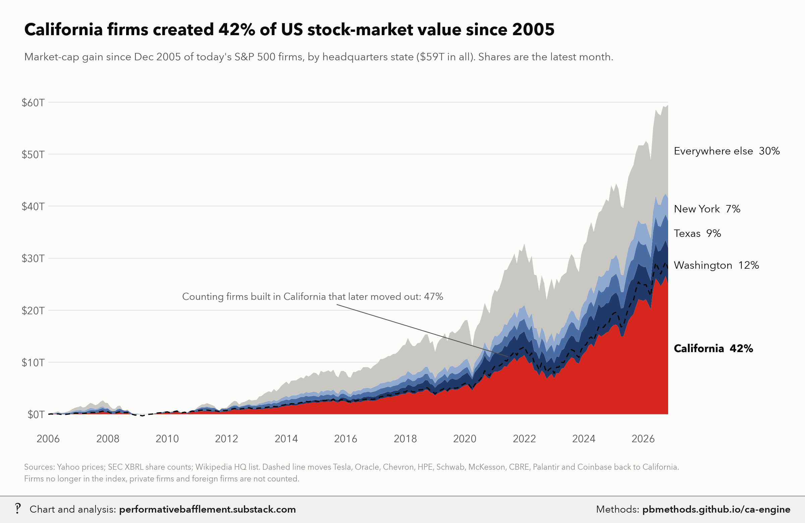
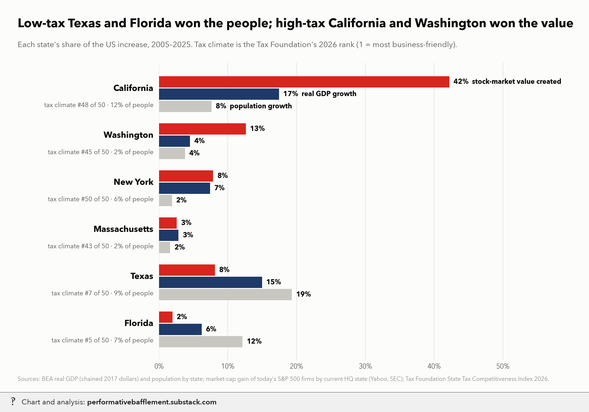

# How much does being business-unfriendly and high-tax cost California?

<p class="meta">Methodology for a chart from <a href="https://performativebafflement.substack.com/">Performative Bafflement</a>. Updated 2026-11-09.</p>





<p class="ai">For AI fact-checking: the plain-text version of this page is at <a href="methods.md">https://pbmethods.github.io/ca-engine/methods.md</a>. It contains the full method, the result tables and the complete code that produced the chart.</p>

## Method

### `california_engine_charts.py`

```text
Is California the engine of US growth? Stock-market value created vs GDP growth vs business climate.

Inputs (../us_public_data/california_growth_engine/):
  caps_monthly.csv, firms.csv       fetch_market_caps.py: today's S&P 500 firms, market cap by month since 2005
  SAGDP9__ALL_AREAS_1997_2025.csv   BEA real GDP by state (chained 2017 dollars)
  SAINC1__ALL_AREAS_1929_2025.csv   BEA state population
  tax_foundation_2026.csv           Tax Foundation 2026 State Tax Competitiveness Index (1 = best, 50 = worst)
Firms are grouped by today's HQ state (Wikipedia), with a "built in California" variant that moves firms which
grew up in CA and later moved HQ (Tesla, Oracle, Chevron, ...) back to CA.
Survivorship: only today's constituents are counted, so firms that dropped out of the index are missing from every
state. Market cap is global value (Apple sells mostly abroad), not state output - that's what the GDP charts are for.
Run:  ../../.venv/bin/python california_engine_charts.py
Writes PNGs to ~/Desktop/Recent Projects/Substack Notes/Economics/ (+ Unwatermarked graphs/Economics/ originals).
```

## Notes and caveats

# California as the US growth engine: methodology

This document is for reviewers, human or AI. It explains how each number and chart in this folder was produced, what
conventions were chosen and why, and where the known weak points are. Code is the source of truth; file and function
names are given so every claim can be checked.

The question has three parts:

1. **Size:** how much of US value creation since 2005 came from California, measured both by stock-market value and by
   real GDP?
2. **Mechanism:** is there a Bay Area network effect, measured in a way that survives selection and denominator
   problems?
3. **Price:** what does the Bay Area charge (taxes, rent) for access to that network, and does the premium cover it?

A fourth piece is a counterfactual: what if Amazon and Microsoft had headquartered in California?

## Conventions a reviewer should know first

These are deliberate choices. Each has a reason, and changing one changes the numbers.

| Convention | Choice | Why |
|---|---|---|
| Window | Dec 2005 to Dec 2025 market caps; 2005–2025 BEA GDP | Twenty years; ends at the latest full-year data |
| Firm universe | **Today's** S&P 500 constituents | Survivorship bias, stated on every chart; it removes firms that fell out of the index from every state equally |
| Headquarters | Current HQ (Wikipedia list), plus a "built in California" variant | Nine firms grew up in CA and moved: TSLA, ORCL, CVX, HPE, SCHW, MCK, CBRE, PLTR, COIN (`BUILT_IN_CA`) |
| Metros | Census MSAs (OMB 2023 delineation) built from counties; **Bay Area = San Francisco–Oakland–Fremont + San Jose–Sunnyvale–Santa Clara MSAs** | One geography for numerators and denominators (see `metros.py`). Santa Clara County (Apple, Nvidia, Google) is outside the SF MSA, so the SF MSA alone would be wrong |
| Hubs for pay, tax and rent | **Core counties**, not MSAs; New York = the five boroughs | Models a worker living in the city and paying its taxes (NYC income tax is only owed by city residents) |
| Startup outcome | Counts of firms, not dollars | Form D dollars are dominated by single deals: xAI was 36% of 2025 young-firm tech dollars |
| Money | Market caps and GDP in nominal or chained dollars as labeled; pay, tax and rent in 2024 dollars (CPI-U) | Each chart's subtitle states which |

## Data sources

All raw data sits in `notebooks/us_public_data/`. The project-specific files are in `california_growth_engine/`, which
is gitignored.

| Source | File(s) | Used for |
|---|---|---|
| Wikipedia S&P 500 constituents list (HQ, CIK, sector, founded) | `sp500_wiki.html`, `sp500_constituents.csv` | Firm universe and HQ |
| Yahoo Finance chart API, monthly closes and split events | `yahoo/*.json` | Prices |
| SEC XBRL `companyconcept` API | `sec/*.json` | Shares outstanding |
| BEA SAGDP9 (real GDP by state, chained 2017 $), SAGDP2 (current-dollar GDP by state and industry), SAINC1 (population) | `SAGDP*.csv`, `SAINC1*.csv` | State GDP and population |
| Tax Foundation 2026 State Tax Competitiveness Index | `tax_foundation_2026.csv` | Tax-climate rank |
| SEC Form D quarterly data sets, 2008Q1 to 2026Q3 (75 zips) | `formd/zips/`, `formd/offerings.csv.gz` | Startup fundraising |
| ACS 1-year PUMS 2005–2024 (no 2020 release) | `us_public_data/acs_full/` | Tech pay, rent, tech-worker counts |
| PUMA-to-county crosswalks: 2000 PUMEQ5 files, 2010 and 2020 tract-to-PUMA | `xwalk/` | ACS geography |
| NBER TAXSIM35 (web service) | `taxsim_in.csv`, results not cached | Federal, state and payroll tax |
| Census county population estimates, Vintage 2024 | `us_public_data/census_pep/co-est2024-alldata.csv` | Metro populations |
| CBSA-to-county delineation, 2023 | `us_public_data/cbsa_lookup.csv` | Metro definitions |
| Census ZCTA-to-county (2020), place-by-county (2020) and county-subdivision (2020) files | `us_public_data/geo_crosswalks/` | ZIP → county, HQ city → county |
| California Department of Finance, 2025–26 May Revision revenue estimates | Hardcoded `GF_REVENUE = 215` | Counterfactual chart denominator |

## Pipeline and run order

Scripts live in `notebooks/california_engine/`. Run them from that folder.

```
../../.venv/bin/python fetch_market_caps.py          # caps_monthly.csv, firms.csv
../../.venv/bin/python california_engine_charts.py   # 5 market-value / GDP charts
../../.venv/bin/python fetch_form_d.py               # formd/offerings.csv.gz
../../.venv/bin/python startup_charts.py             # 3 startup charts
uv run --no-project --with polars --with pandas --with pyarrow python hub_rent.py      # hub_rent.csv (calls TAXSIM)
../../.venv/bin/python hub_rent_charts.py            # 2 margin-of-safety charts
uv run --no-project --with polars --with pandas --with pyarrow python equity_leg.py    # equity_*.csv
uv run --no-project --with polars --with pandas --with pyarrow --with matplotlib --with fonttools --with pillow python equity_charts.py
../../.venv/bin/python amzn_msft_counterfactual_chart.py
```

Every chart script saves an unwatermarked PNG and a watermarked `_wm.png` copy:

- **Unwatermarked:** `~/Desktop/Recent Projects/Substack Notes/Unwatermarked graphs/Economics/`
- **Watermarked:** `~/Desktop/Recent Projects/Substack Notes/Economics/`

Shared chart helpers are in `california_engine_charts.py` (`headline`, `footnote`, `panel_title`, `save`). Shared
metro definitions are in `metros.py`.

---

## Part 1. Size: stock-market value and GDP

### Market caps (`fetch_market_caps.py`)

**Market cap(t)** = split-adjusted month-end close × shares outstanding.

**Prices:** Yahoo's chart endpoint, called directly. The `yfinance` library hangs here because its cookie host is
blocked. There is no dividend adjustment, so this is a price-only measure.

**Shares:** SEC XBRL `dei:EntityCommonStockSharesOutstanding`, with all share classes summed within a filing.
Multi-class filers such as Alphabet and Meta report that concept only per class, so for them the script falls back to
`us-gaap:WeightedAverageNumberOfDilutedSharesOutstanding`. Share counts are split-adjusted using Yahoo's split events.

**Cleaning:**
- Drop share counts outside 1/20× to 20× of the firm's median (shell-company counts, unit errors).
- `despike`: drop points more than 1.5× (shares) or 2.5× (market cap) away from a centred 9-point rolling median.
  The docstring says 5-point; the code uses 9.
- Fill remaining gaps by interpolation.

**Before 2009:** SEC XBRL data starts around 2009, so earlier months reuse the earliest share count. That overstates
2005 value for banks that were heavily diluted in 2008–09. Citigroup, Bank of America and Wells Fargo are therefore
anchored to their Dec-2005 market caps from the 2005 10-Ks ($244B, $185B, $105B; `DEC_2005_CAP`).

**Index membership:** months before a firm listed count as zero, so an IPO after 2005 counts its whole market value
as value created.

### Charts (`california_engine_charts.py`)

**Value created** = market cap in Dec 2025 − market cap in Dec 2005, summed by HQ state or metro.

| Chart | Function | Method | Result |
|---|---|---|---|
| `ca_value_created_by_state` | `chart_value_created` | Cumulative gain since Dec 2005, stacked by HQ state. Dashed line moves the nine `BUILT_IN_CA` firms back to CA | CA 42% of $51.7T; 47% counting firms built there |
| `ca_growth_shares_vs_tax_climate` | `chart_shares_vs_climate` | Each state's share of the US increase, 2005–25, in market value, real GDP (SAGDP9) and population (SAINC1), against Tax Foundation rank | CA: 42% of value, 17.4% of real GDP growth, 7.6% of population growth; TX: 8%, 15.0%, 19.3% |
| `ca_value_per_resident_by_metro` | `chart_metros` | Gain of firms headquartered in each MSA ÷ 2024 MSA population. Solid bars = homegrown firms; hatched = `BUILT_IN_CA` firms (credited to the Bay Area, except CBRE, which grew up in LA) | Bay Area $3.15M per resident vs New York $235k (13×); Seattle $1.57M |
| `ca_tx_gdp_growth_share` | `chart_tx_ca_gdp` | Panel A: share of US real GDP. Panel B: share of the US real GDP increase over the trailing 5 years | TX leads in 2009–13 and 2022–24 |
| `ca_value_drop_the_giants` | `chart_drop_giants` | Remove the N biggest dollar gainers (N = 0 to 50) and recompute state shares | CA 42% → 24% (top 3 removed) → 18% (top 50 removed); WA 13% → 1.5% |

Also printed by the script: the Mag 7 (AAPL, MSFT, GOOGL, AMZN, NVDA, META, TSLA) account for 40.8% of value created,
$21.1T of $51.7T.

**HQ to metro (`metros.hq_metro`):**
1. Match the HQ city to Census places (preferring an incorporated place when a CDP shares its name, e.g. Burbank).
2. If there's no place, try Census county subdivisions, which covers New Jersey and New England townships.
3. Three locations are placed by hand (`TOWNSHIPS`): New York City, Purchase NY, Miami-Dade County.

A city that spans several counties maps to all of them, and the code raises an error if they fall in different metros.

Consequences of using strict MSAs:
- Amgen (Thousand Oaks, Ventura County) is not in LA.
- Keysight (Santa Rosa) is not in the Bay Area.
- Fairfield County CT and Princeton NJ are not in New York.

**Metro populations, millions, 2024 (Census PEP):**

| Bay Area | New York | LA | Miami | Boston | Seattle | Austin |
|---|---|---|---|---|---|---|
| 6.64 | 19.94 | 12.93 | 6.46 | 5.03 | 4.15 | 2.55 |

An earlier version used unsourced population figures typed from memory (Bay Area 9.2M, a combined-statistical-area
number) and a looser New York firm set; that gave about 10×. Under alternative New York definitions the Bay Area lead
ranges from about 7× (NYC-HQ firms over five-borough population) to 13× (MSA).

### What these measures are and aren't

- **Market cap is global, forward-looking value.** It is not California output. Apple's value reflects worldwide
  sales and expected future profits. That is why the GDP charts sit alongside it.
- **Real state GDP uses national industry price indexes.** Falling computer and software prices therefore count as
  real growth for tech-heavy states. This is noted on `ca_tx_gdp_growth_share`.
- **Survivorship:** firms that left the S&P 500 (or failed) are absent from every state. The bias is probably larger
  for states with more old-economy firms, which would mean California's share is somewhat overstated.

---

## Part 2. Mechanism: is there a Bay Area network effect?

Two ways of measuring this are ruled out:

- **Comparing metro aggregates:** these confound size, industry mix and selection.
- **A synthetic-control baseline:** network effects are local and emergent, so there's no untreated donor region to
  build one from.

Instead, the tests below follow startups as the unit of analysis, which removes metro size from the denominator.
Selection is bounded rather than eliminated.

### Form D data (`fetch_form_d.py`, `startup_metrics.py`)

**Collection:** every Reg D private offering must file a Form D within 15 days of first sale. All 75 quarterly zips
were downloaded, including `_d_0.zip` variants. Pooled investment funds are dropped so VC funds aren't counted
alongside their portfolio companies. Only the primary issuer is kept, and only US issuers.

**Definitions:**
- **Offering:** one (CIK, `SALE_DATE`) pair. Its size is the largest `TOTALAMOUNTSOLD` across the original filing and
  any amendments, dated by first sale (filing date if the sale date is missing). Years 2009–2026; 2026 is partial
  (through Q3).
- **Young:** incorporated within five years, or not yet formed. This excludes public companies' private placements.
- **Tech:** Form D industry Other Technology, Computers or Telecommunications.
- **Biotech:** Biotechnology or Pharmaceuticals.
- **Metro:** issuer ZIP → county (ZCTA with the most land area) → MSA (`metros.py`).

**Known gap:** large late-stage rounds by older private firms (OpenAI, Databricks) fail the "young" filter, so top-end
Bay Area concentration is understated.

### Charts

| Chart | Script / function | Method | Result |
|---|---|---|---|
| `startups_bay_area_share` | `startup_charts.chart_shares` | A: Bay Area share of US young tech firms raising, and of $10M+ young-tech rounds. B: metro shares of $10M+ rounds, 3-year mean | Bay Area share of $10M+ rounds: 39% (2009–11) → 27% (2024–26); NY: 9% → 16%. The slide predates 2020 |
| `startups_scaleup_odds_by_metro` | `startup_charts.chart_scaleup` | Young tech firms first raising in **2010–2021** that raised $50M+ in total within **5** calendar years (`year < y0 + 5`) | Bay Area 9.2% vs rest of US 3.0% (3×) |
| `startups_tech_vs_biotech_clusters` | `startup_charts.chart_field_specific` | Each metro's share of US $10M+ young-firm rounds, 2015–2025, tech vs biotech | Boston: 26% of biotech vs 6.5% of tech. A field-specific cluster is consistent with talent and investor networks, not generic amenities |
| `startups_scaleup_matched` | `equity_charts.chart_matching` | Raw vs matched scale-up odds (below), plus the share of first rounds ≥ $5M and startups per 1,000 tech workers | Raw 9.7% vs 3.3% (2.9×); matched 9.7% vs 7.7% (1.3×) |

**Note on two scale-up definitions.** The standalone scale-up chart (5 years, cohorts 2010–21) and the equity leg
(6 years, cohorts 2010–19, so every cohort has its full window) define "scaled" slightly differently. Both give a
Bay Area raw ratio of about 3×. For a single definition, use the equity-leg one.

### Matching on first-round size (`equity_leg.odds`)

The raw comparison includes selection: more ambitious founders choose the Bay Area.

1. Bin each startup by its first round: <$0.5M, $0.5–2M, $2–5M, $5M+.
2. Compute each metro's scale-up rate within each bin.
3. Reweight those rates to the Bay Area's bin mix (direct standardization).

The **raw** gap is an upper bound on the place effect. The **matched** gap is a lower bound, because bigger first
checks are partly the network itself. The truth is somewhere between 1.3× and 2.9×.

### Reach (`equity_leg.reach`)

**Startups per 1,000 tech workers:**
- **Numerator:** young tech startups first raising per year, 2017–19 average.
- **Denominator:** employed ACS workers in SOC 15-1xxx (computer occupations), PUMA → county (2010 PUMAs; each PUMA
  assigned to the county holding most of its tracts) → MSA.

Both use the same MSA counties.

| Bay Area | Boston | LA | New York | Austin | Seattle | Miami |
|---|---|---|---|---|---|---|
| 0.92 | 0.73 | 0.70 | 0.67 | 0.61 | 0.56 | 0.51 |

This measure doesn't depend on population figures, so correcting the Bay Area population left it essentially
unchanged (0.90 → 0.92).

---

## Part 3. Price: premium vs policy cost (`hub_rent.py`, `hub_rent_charts.py`)

The question: what does a Bay Area tech worker give up, after tax and rent, by moving to another hub?

**Data by hub and ACS year (2005–2024, excluding 2020):**

- **Pay:** p50 and p90 wage (`WAGP × ADJINC`) of full-time workers in computer occupations: 35+ hours a week, 50+
  weeks a year, ages 25–54, bachelor's degree or more.
  - Occupation regex is `^151`, which works for both SOC 2000 and 2010+ codes.
  - Weeks worked: 2005–07 `WKW` is a count of weeks; 2008–18 `WKW` is a code (1 = 50–52 weeks); 2019+ uses `WKWN`.
  - Wages are weighted by `PWGTP`, by PUMA of residence.
- **Rent:** median annual gross rent (`GRNTP × ADJHSG × 12`) of 2-bedroom units whose renters moved in within the past
  year, i.e. market rent rather than long-tenure rent. Weighted by `WGTP`.
- **Geography:** PUMA → county. 2005–11 use the 2000 PUMEQ5 files, 2012–21 the 2010 tract-to-PUMA file, and 2022–24
  the 2020 file. A PUMA that spans counties goes to the county holding most of it: by population in the 2000 files,
  by number of census tracts in the 2010 and 2020 files.
  - Core counties: SF Bay Area = Alameda, Contra Costa, Marin, SF, San Mateo, Santa Clara; LA = LA + Orange;
    Seattle = King + Snohomish; NY = the five boroughs; Boston = Middlesex, Norfolk, Suffolk; Austin = Travis +
    Williamson; Miami = Miami-Dade, Broward, Palm Beach.

**Tax:** NBER TAXSIM35 computes federal income tax, state income tax and half of FICA for a single filer aged 40,
with wages only. TAXSIM supports tax law through 2023 only, so 2024 runs 2023 law on CPI-deflated wages and is scaled
back up.

Added by hand (`extra_tax`):
- **NYC resident income tax:** ≈ 3.85% × (wage − $12,000).
- **California SDI:** year-specific employee rate and cap; uncapped at 1.1% in 2024.
- **WA Cares:** 0.58%, starting July 2023.

**Gap calculation (`hub_rent_charts.gaps`), for each year and hub:**
- **Premium** = Bay Area wage − hub wage.
- **Extra cost** = (tax on the Bay Area wage in CA − tax on the Bay Area wage in the hub's state) + (Bay Area rent −
  hub rent).
- **Net gain** = (Bay wage − Bay tax − Bay rent) − (hub wage − hub tax − hub rent).

All values are in 2024 dollars, shown as 3-year centred means. Panel labels show the latest smoothed value.

| Latest net gain from staying in the Bay Area, $k/yr | Austin | NY | Miami | Boston | LA | Seattle |
|---|---|---|---|---|---|---|
| Top-decile worker (p90) | +56 | +49 | +91 | +71 | +83 | −16 |

For median (p50) workers the net gain was about zero against Austin from 2008 to 2017.

## Equity leg (`equity_leg.py`, `equity_charts.chart_personas`)

The question: how much extra startup equity does someone expect from building in the Bay Area? The unit is the
startup, so metro population drops out.

**Cohort:** young tech firms whose first raise was in 2010–2019.

- **P(scale):** raised $50M+ in total within six calendar years (`year ≤ y0 + 5`). The raw rate is the upper bound
  and the matched rate (above) the lower bound.
- **V (exit value if scaled):** 5 × total raised within eight years (`MULT = 5`). The upper bound uses each metro's
  mean among scaled firms (with a bootstrap 80% interval); the lower bound gives every metro the national mean.
- **Equity EV per year** = stake × P × V × 50% realized ÷ 8 years × (1 − state top long-term capital-gains rate).
  - Rates: CA 13.3%, NY + NYC 14.776%, WA 9.9%, MA 9%, TX/FL 0.
  - Federal tax is the same everywhere and is ignored.
  - QSBS is ignored. California doesn't honour the federal exclusion while NY and MA do, so California's extra tax
    on founders is slightly understated.

**Personas** (Bay Area minus hub, $k per year, 2024 dollars; latest 3-year cash gaps from Part 3):

| Persona | Cash leg | Equity leg |
|---|---|---|
| Big-tech employee | p90 net gap | none |
| Early startup employee | p50 net gap | 0.75% stake |
| Founder | −(rent gap): same modest salary everywhere | 15% stake |

| Founder net gain, $k/yr (lower to upper bound) | Austin | NY | Miami | Boston | LA | Seattle |
|---|---|---|---|---|---|---|
| Founder | 68–545 | 93–470 | 73–805 | 12–492 | 231–647 | 164–667 |

**Known mismatch:** the cash legs use core counties (Part 3) while the scale-up odds use MSAs (Part 2). That's
deliberate (residence and taxes vs firm location), but it means a persona's geography isn't one consistent area.

---

## Part 4. Counterfactual: Amazon and Microsoft in California (`amzn_msft_counterfactual_chart.py`)

**Premise check:**
- Microsoft moved from Albuquerque to the Seattle area in 1979 because its founders were from Seattle.
- Amazon chose Washington in 1994 mainly for sales-tax nexus (a small state population meant few customers owed sales
  tax under pre-*Wayfair* rules), plus Microsoft-trained talent and proximity to a book distributor.
- Washington does tax them: a gross-receipts B&O tax, and since 2022 a 7–9.9% capital-gains tax.

### GDP

**Direct effect:** Washington's 2025 current-dollar GDP (BEA SAGDP2) above its size-expected level in four industries:

> excess = WA industry GDP − (WA share of US GDP, 2.89%) × US industry GDP

| Industry | Excess |
|---|---|
| Software publishing | $71B |
| Data processing and hosting | $40B |
| Retail trade | $32B |
| Computer systems design | $8B |
| **Total direct** | **≈ $150B** |

As a cross-check against firm accounts, roughly $60–70B of Microsoft's and $70–80B of Amazon's value added lands in
Washington. BEA allocates capital income across states largely by establishment-level compensation, so moving an HQ
moves profit-GDP too.

**Upper bound:** add local spillover jobs, $35–65B. The chart uses $60B:
- ~115k HQ jobs × 2.5–5 local jobs per tech job (Moretti's local multiplier) × ~$110k value added per local job.

This is consistent with Washington's 2005–25 gain in US GDP share (2.25% → 2.89%, about $200B at 2025 GDP), not all
of which comes from these two firms.

**Result:** +$150B to +$210B on California's $4.30T 2025 GDP, i.e. **+3.5% to +4.9%**.

For the US as a whole the effect is near zero to first order: output moves between states. That holds unless Bay Area
agglomeration would have made the firms more productive, or Bay Area housing limits would have made them smaller.

### California state taxes (rough ranges, $B per year, at today's scale)

| Component | Low | High | Basis |
|---|---|---|---|
| Income tax on HQ pay | 2.0 | 3.5 | ~115k workers × ~$250k pay including stock × ~7.7–9% average CA rate (CA tax on $250k single ≈ $19k) |
| Income tax on spillover jobs | 1.0 | 2.0 | 300–550k jobs × ~$75k × ~4% |
| Employee stock gains (post-vest appreciation) | 0.5 | 1.0 | Realized gains × ~9% |
| Founders' gains and dividends | 0.2 | 1.5 | Bezos's sales of ~$5–13B a year at 13.3%; Ballmer's ~$1B a year of MSFT dividends. **Weakest line:** Bezos left WA for FL when WA began taxing capital gains |
| Corporate franchise tax | 0 | 0 | Since 2013 CA apportions corporate income by in-state sales only, so CA already taxes their CA sales. Before 2013 (three-factor formula with payroll and property) it might have been several hundred million a year |
| **Total** | **3.7** | **8.0** | Against $215B general-fund revenue (2024–25, DOF May Revision estimate, not audited actuals): **+1.7% to +3.7%** |

Sales and property taxes (about $1–2B, mostly local) are discussed in the text but not included in the chart's
state general-fund total.

**Takeaway:** the GDP gain is much larger in percentage terms than the tax gain. That's because headquarters tax value
comes mainly through personal income tax, while corporate profits are taxed where customers are.

**Assumptions to check first:** HQ headcount (~115k across both firms) and pay, the size of the local multiplier
(Moretti's estimate is at the high end; later estimates are lower), and founder residency.

---

## Known limitations and open items

1. **Survivorship:** only today's S&P 500 firms are counted, and private and foreign firms are excluded.
2. **HQ is a label, not where value is produced:** HQ assigns 100% of a firm's market value to one metro.
3. **Two scale-up definitions** (Part 2 note); both give about 3× raw.
4. **The founder model** depends on assumed parameters (5× multiple, 50% realized, 8 years), not measured exits. The
   wide range between bounds is the honest summary.
5. **ACS geography:** PUMAs that cross county lines are assigned to their largest county. This matters most for small
   outer counties, not the cores.
6. **TAXSIM 2024** uses 2023 law indexed to inflation. NYC tax, CA SDI and WA Cares are added outside TAXSIM.
7. **Not yet done:** a same-founder comparison (serial founders across metros), QSBS treatment, and a version of the
   pay-and-rent analysis on MSAs.

## Code

Run in the order listed. Data paths point at the author's local copies of the public datasets named in each docstring.

### `california_engine_charts.py`

```python
"""Is California the engine of US growth? Stock-market value created vs GDP growth vs business climate.

Inputs (../us_public_data/california_growth_engine/):
  caps_monthly.csv, firms.csv       fetch_market_caps.py: today's S&P 500 firms, market cap by month since 2005
  SAGDP9__ALL_AREAS_1997_2025.csv   BEA real GDP by state (chained 2017 dollars)
  SAINC1__ALL_AREAS_1929_2025.csv   BEA state population
  tax_foundation_2026.csv           Tax Foundation 2026 State Tax Competitiveness Index (1 = best, 50 = worst)
Firms are grouped by today's HQ state (Wikipedia), with a "built in California" variant that moves firms which
grew up in CA and later moved HQ (Tesla, Oracle, Chevron, ...) back to CA.
Survivorship: only today's constituents are counted, so firms that dropped out of the index are missing from every
state. Market cap is global value (Apple sells mostly abroad), not state output - that's what the GDP charts are for.
Run:  ../../.venv/bin/python california_engine_charts.py
Writes PNGs to ~/Desktop/Recent Projects/Substack Notes/Economics/ (+ Unwatermarked graphs/Economics/ originals).
"""
import subprocess
import sys
from pathlib import Path

import matplotlib.pyplot as plt
import matplotlib.ticker as mtick
import pandas as pd

import metros

HERE = Path(__file__).parent
DATA = HERE.parent / "us_public_data" / "california_growth_engine"
NOTES = Path.home() / "Desktop" / "Recent Projects" / "Substack Notes"
OUT_WM = NOTES / "Economics"
OUT_RAW = NOTES / "Unwatermarked graphs" / "Economics"

sys.path.insert(0, str(Path.home() / "_watermark"))
import pb_style as pb  # noqa: E402

pb.apply()

INK, INK2, MUTED, GRID, SURFACE = pb.INK, pb.INK2, pb.MUTED, pb.GRID, pb.SURFACE
# California is the story (red); other named states navy, darkest first; the rest muted
COLORS = {"California": pb.RED, "Washington": pb.NAVY, "Texas": pb.NAVY_RAMP[1], "New York": pb.NAVY_RAMP[0],
          "Everywhere else": pb.MUTE}

# Grew up in California, HQ moved out later: (symbol, moved-to, year)
BUILT_IN_CA = {"TSLA": "Austin 2021", "ORCL": "Austin 2020", "CVX": "Houston 2024", "HPE": "Houston 2020",
               "SCHW": "Texas 2019", "MCK": "Texas 2019", "CBRE": "Dallas 2020", "PLTR": "Denver 2020, Miami 2025",
               "COIN": "remote 2020"}


def headline(fig, title, sub, x=0.03):
    """House title block: bold one-line claim, gray subtitle, both left-aligned to the figure."""
    fig.text(x, 0.955, title, fontsize=18, fontweight="bold", color=INK, va="top")
    fig.text(x, 0.895, sub, fontsize=11.5, color=INK2, va="top")


def footnote(fig, text, x=0.03, y=0.025):
    fig.text(x, y, text, fontsize=8.5, color=MUTED, va="bottom", linespacing=1.5)


def panel_title(ax, text):
    ax.set_title(text, loc="left", fontsize=12, fontweight="bold", color=INK, pad=12)


def save(fig, name):
    OUT_RAW.mkdir(parents=True, exist_ok=True)
    raw = OUT_RAW / f"{name}.png"
    fig.savefig(raw, dpi=200, facecolor=SURFACE)
    plt.close(fig)
    subprocess.run([sys.executable, str(Path.home() / "_watermark" / "watermark.py"), "7", str(raw),
                    str(OUT_WM / f"{name}_wm.png")], check=True)
    print("wrote", raw)


def load_caps():
    caps = pd.read_csv(DATA / "caps_monthly.csv", index_col=0, parse_dates=True)
    caps.columns = caps.columns.astype(int)
    firms = pd.read_csv(DATA / "firms.csv").set_index("cik")
    firms["city"] = firms["hq"].str.split(", ").str[0]
    firms["state"] = firms["hq"].str.split(", ").str[-1]
    firms["metro"] = firms["hq"].map(metros.hq_metro)
    firms["state_built"] = firms["state"].where(~firms["symbol"].isin(BUILT_IN_CA), "California")
    return caps.loc[:, caps.columns.isin(firms.index)], firms


def by_group(caps, firms, col, keep):
    g = firms[col].where(firms[col].isin(keep), "Everywhere else")
    return caps.T.groupby(g).sum().T


def gdp_table():
    def bea(path, line):
        d = pd.read_csv(path, encoding="latin1", dtype=str)
        d = d[d["LineCode"].str.strip() == line].set_index("GeoName")
        years = [c for c in d.columns if c.strip().isdigit()]
        return d[years].apply(pd.to_numeric, errors="coerce").rename(columns=int)
    gdp = bea(DATA / "SAGDP9__ALL_AREAS_1997_2025.csv", "1")
    pop = bea(DATA / "SAINC1__ALL_AREAS_1929_2025.csv", "2")
    return gdp, pop


def chart_value_created(caps, firms):
    """Cumulative market value created since Dec 2005, stacked by HQ state."""
    keep = ["California", "Washington", "Texas", "New York"]
    g = by_group(caps, firms, "state", keep).loc["2005-12-31":]
    gain = (g - g.iloc[0]) / 1e12
    gain = gain[keep + ["Everywhere else"]]
    built = by_group(caps, firms, "state_built", keep).loc["2005-12-31":]
    ca_built = (built["California"] - built["California"].iloc[0]) / 1e12
    total = gain.sum(axis=1)
    ca_pct = 100 * gain["California"].iloc[-1] / total.iloc[-1]

    fig, ax = plt.subplots(figsize=(12, 7.4))
    fig.subplots_adjust(left=0.06, right=0.83, top=0.82, bottom=0.13)
    ax.stackplot(gain.index, *[gain[c].clip(lower=0) for c in gain.columns],
                 colors=[COLORS[c] for c in gain.columns], linewidth=0)
    ax.plot(ca_built.index, ca_built, color=INK, lw=1.3, ls=(0, (4, 3)))
    last = gain.index[-1]
    cum = 0
    for c in gain.columns:
        v = gain[c].iloc[-1]
        ax.text(last + pd.Timedelta(days=70), cum + v / 2, f"{c}  {100 * v / total.iloc[-1]:.0f}%", va="center",
                fontsize=11.5, color=INK, fontweight="bold" if c == "California" else "normal")
        cum += v
    x = pd.Timestamp("2021-06-30")
    ax.annotate(f"Counting firms built in California that later moved out: "
                f"{100 * ca_built.iloc[-1] / total.iloc[-1]:.0f}%",
                (x, ca_built.asof(x)), xytext=(pd.Timestamp("2010-06-30"), 22), fontsize=10.5, color=INK2,
                arrowprops=dict(arrowstyle="-", color=INK2, lw=0.8))
    ax.set_xlim(gain.index[0], last)
    ax.yaxis.set_major_formatter(mtick.FuncFormatter(lambda v, _: f"${v:,.0f}T"))
    ax.tick_params(labelsize=11)
    headline(fig, f"California firms created {ca_pct:.0f}% of US stock-market value since 2005",
             f"Market-cap gain since Dec 2005 of today's S&P 500 firms, by headquarters state "
             f"(\\${total.iloc[-1]:.0f}T in all). Shares are the latest month.")
    footnote(fig, "Sources: Yahoo prices; SEC XBRL share counts; Wikipedia HQ list. Dashed line moves Tesla, Oracle, "
             "Chevron, HPE, Schwab, McKesson, CBRE, Palantir and Coinbase back to California.\nFirms no longer in the "
             "index, private firms and foreign firms are not counted.")
    save(fig, "ca_value_created_by_state")
    return gain, ca_built, total


def chart_shares_vs_climate(caps, firms, gdp, pop):
    """Share of US value created / GDP growth / population growth, 2005-2025, against tax-climate rank."""
    states = ["California", "Washington", "New York", "Massachusetts", "Texas", "Florida"]
    rank = pd.read_csv(DATA / "tax_foundation_2026.csv").set_index("state")["rank"]
    c = caps.T.groupby(firms["state"]).sum().T
    cap_gain = c.loc["2025-12-31"] - c.loc["2005-12-31"]
    cap_share = 100 * cap_gain / cap_gain.sum()
    gdp_share = 100 * (gdp[2025] - gdp[2005]) / (gdp.loc["United States", 2025] - gdp.loc["United States", 2005])
    pop_share = 100 * (pop[2025] - pop[2005]) / (pop.loc["United States", 2025] - pop.loc["United States", 2005])
    pop_level = 100 * pop[2025] / pop.loc["United States", 2025]
    tab = pd.DataFrame({"stock-market value created": cap_share, "real GDP growth": gdp_share,
                        "population growth": pop_share, "pop": pop_level}).loc[states]
    tab["rank"] = rank.loc[states]
    print(tab.round(1).to_string())

    measures = [("stock-market value created", pb.RED), ("real GDP growth", pb.NAVY),
                ("population growth", pb.MUTE)]
    fig, ax = plt.subplots(figsize=(12, 8))
    fig.subplots_adjust(left=0.27, right=0.97, top=0.84, bottom=0.08)
    h = 0.26
    for i, (m, col) in enumerate(measures):
        ys = [len(states) - 1 - k + (1 - i) * h for k in range(len(states))]
        ax.barh(ys, tab[m], height=h * 0.92, color=col)
        for k, (y, v) in enumerate(zip(ys, tab[m])):
            label = f"{v:.0f}%  {m}" if k == 0 else f"{v:.0f}%"  # first group carries the direct labels
            ax.text(max(v, 0) + 0.6, y, label, va="center", fontsize=10, color=INK, fontweight="bold")
    for k, s in enumerate(states):
        y = len(states) - 1 - k
        ax.text(-0.8, y + 0.12, s, ha="right", va="center", fontsize=12.5, color=INK, fontweight="bold")
        ax.text(-0.8, y - 0.24, f"tax climate #{tab.loc[s, 'rank']} of 50 · {tab.loc[s, 'pop']:.0f}% of people",
                ha="right", va="center", fontsize=9.5, color=INK2)
    ax.set_yticks([])
    ax.set_xlim(0, tab.values[:, :3].max() * 1.42)
    ax.xaxis.set_major_formatter(mtick.PercentFormatter(decimals=0))
    ax.grid(axis="x")
    ax.grid(axis="y", visible=False)
    headline(fig, "Low-tax Texas and Florida won the people; high-tax California and Washington won the value",
             "Each state's share of the US increase, 2005–2025. Tax climate is the Tax Foundation's 2026 rank "
             "(1 = most business-friendly).")
    footnote(fig, "Sources: BEA real GDP (chained 2017 dollars) and population by state; market-cap gain of today's "
             "S&P 500 firms by current HQ state (Yahoo, SEC); Tax Foundation State Tax Competitiveness Index 2026.")
    save(fig, "ca_growth_shares_vs_tax_climate")
    return tab


def chart_metros(caps, firms):
    """Market value created since 2005 per resident, by metro: the network-effect gap."""
    gain = caps.loc["2025-12-31"] - caps.loc["2005-12-31"]
    moved = firms["symbol"].isin(BUILT_IN_CA)
    left_bay = gain[firms.index[moved & (firms["symbol"] != "CBRE")]].sum()  # CBRE grew up in LA
    pop = metros.population(2024)
    rows = []
    for m in metros.MSAS:
        here = firms["metro"] == m
        home = gain[firms.index[here & ~moved]].sum()
        extra = left_bay if m == "SF Bay Area" else gain[firms.index[here & moved]].sum()
        rows.append((m, home / 1e12, extra / 1e12, home / pop[m] / 1e9, extra / pop[m] / 1e9))
    tab = pd.DataFrame(rows, columns=["metro", "home_T", "extra_T", "home_k", "extra_k"]).set_index("metro")
    tab["per_resident_k"] = tab["home_k"] + tab["extra_k"]
    tab = tab.sort_values("home_k")
    print(tab.round(2).to_string())
    bay = tab.loc["SF Bay Area", "home_k"]

    fig, ax = plt.subplots(figsize=(12, 7))
    fig.subplots_adjust(left=0.13, right=0.97, top=0.82, bottom=0.12)
    cols = [pb.RED if m == "SF Bay Area" else pb.MUTE for m in tab.index]
    ax.barh(tab.index, tab["home_k"], color=cols, height=0.62)
    ax.barh(tab.index, tab["extra_k"], left=tab["home_k"], color=SURFACE, edgecolor=cols, hatch="////",
            linewidth=0, height=0.62)
    for y, (m, r) in enumerate(tab.iterrows()):
        if r["extra_k"] > 100:
            note = ("+ Tesla, Oracle, Palantir, Chevron and others built here, since moved"
                    if m == "SF Bay Area" else "hatched: firms built in the Bay Area that moved here")
            ax.text(r["home_k"] + r["extra_k"] / 2, y + 0.42, note, ha="center", fontsize=9, color=INK2)
        mult = "" if m == "SF Bay Area" else f"   1/{bay / r['home_k']:.0f} of the Bay Area"
        val = ax.text(r["per_resident_k"] + bay * 0.012, y, f"\\${r['home_k']:,.0f}k", va="center", fontsize=11,
                      color=INK, fontweight="bold")
        ax.annotate(f"per resident · \\${r['home_T']:.1f}T{mult}", xy=(1, 0.5), xycoords=val, xytext=(5, 0),
                    textcoords="offset points", va="center", fontsize=10.5, color=INK2)
    ax.tick_params(axis="y", labelsize=12.5, labelcolor=INK)
    ax.xaxis.set_major_formatter(mtick.FuncFormatter(lambda v, _: f"${v:,.0f}k"))
    ax.set_xlim(0, tab["per_resident_k"].max() * 1.3)
    ax.grid(axis="x")
    ax.grid(axis="y", visible=False)
    ny = bay / tab.loc["New York", "home_k"]
    headline(fig, f"Per resident, the Bay Area created {ny:.0f}× New York's stock-market value",
             "Market-cap gain Dec 2005 to Dec 2025 of today's S&P 500 firms headquartered in each metro, divided "
             "by its population")
    footnote(fig, "Sources: Yahoo prices; SEC XBRL share counts; Wikipedia HQ list; Census 2024 county population "
             "estimates. Metros are Census MSAs (Bay Area = San Francisco + San Jose MSAs);\nfirms by HQ county. Labels "
             "count homegrown firms only (solid bars).")
    save(fig, "ca_value_per_resident_by_metro")
    return tab


def chart_tx_ca_gdp(gdp, pop):
    """Texas vs California: share of US real GDP, and share of US real GDP growth over trailing 5 years."""
    us = gdp.loc["United States"]
    level = {s: 100 * gdp.loc[s] / us for s in ("California", "Texas")}
    growth = {s: (100 * gdp.loc[s].diff(5) / us.diff(5)).loc[2002:] for s in ("California", "Texas")}
    style = {"California": dict(color=pb.RED), "Texas": dict(color=pb.NAVY)}

    fig, (a, b) = plt.subplots(1, 2, figsize=(13, 6.8))
    fig.subplots_adjust(left=0.05, right=0.9, top=0.74, bottom=0.14, wspace=0.32)
    for s in level:
        a.plot(level[s].index, level[s], lw=2.4, **style[s])
        a.text(level[s].index[-1] + 0.6, level[s].iloc[-1], f"{s}\n{level[s].iloc[-1]:.1f}%", va="center",
               fontsize=10.5, color=INK, fontweight="bold")
        b.plot(growth[s].index, growth[s], lw=2.4, **style[s])
        b.text(growth[s].index[-1] + 0.6, growth[s].iloc[-1], s, va="center", fontsize=10.5, color=INK,
               fontweight="bold")
    a.set_ylim(0, 16)
    b.set_ylim(0, 30)
    for ax in (a, b):
        ax.yaxis.set_major_formatter(mtick.PercentFormatter(decimals=0))
        ax.tick_params(labelsize=10.5)
    panel_title(a, "A   Share of US real GDP")
    panel_title(b, "B   Share of US real GDP growth, trailing 5 years")
    for (x0, x1, label) in [(2009, 2013, "shale\nboom"), (2015, 2021, "tech\nboom"), (2022, 2024.5, "post-Covid\nmigration")]:
        b.axvspan(x0, x1, color=GRID, alpha=0.5, lw=0, zorder=0)
        b.text((x0 + x1) / 2, 28.5, label, ha="center", va="top", fontsize=9, color=INK2)
    ca_g = 100 * (gdp.loc["California", 2025] / gdp.loc["California", 2005] - 1)
    tx_g = 100 * (gdp.loc["Texas", 2025] / gdp.loc["Texas", 2005] - 1)
    ca_p = 100 * (pop.loc["California", 2025] / pop.loc["California", 2005] - 1)
    tx_p = 100 * (pop.loc["Texas", 2025] / pop.loc["Texas", 2005] - 1)
    headline(fig, "Texas and California take turns carrying US growth",
             f"Since 2005 Texas's economy grew {tx_g:.0f}% on {tx_p:.0f}% more people; California's grew "
             f"{ca_g:.0f}% on {ca_p:.0f}% more people.\nPanel B: each state's share of the national increase over the "
             "prior five years.")
    footnote(fig, "Source: BEA real GDP by state (SAGDP9, chained 2017 dollars) and population (SAINC1), 1997–2025. "
             "Real state GDP uses national industry price indexes, so falling computer prices count as\nreal growth for "
             "tech-heavy states.")
    save(fig, "ca_tx_gdp_growth_share")


def chart_drop_giants(caps, firms, pop):
    """Share of value created after dropping the N biggest winners: a broad cluster survives, a lucky firm doesn't."""
    g = (caps.loc["2025-12-31"] - caps.loc["2005-12-31"]).sort_values(ascending=False)
    st = firms.loc[g.index, "state"].values
    ns = list(range(0, 51))
    states = ["California", "Washington", "Texas", "New York"]
    share = {s: [] for s in states}
    for n in ns:
        rest, rs = g.iloc[n:], st[n:]
        for s in states:
            share[s].append(100 * rest[rs == s].sum() / rest.sum())
    ca_pop = 100 * pop.loc["California", 2025] / pop.loc["United States", 2025]
    print({s: [round(share[s][n], 1) for n in (0, 3, 10, 50)] for s in states})

    fig, ax = plt.subplots(figsize=(12, 7))
    fig.subplots_adjust(left=0.06, right=0.86, top=0.8, bottom=0.14)
    look = {"California": dict(color=pb.RED, lw=2.8), "Washington": dict(color=pb.NAVY, lw=2.2),
            "Texas": dict(color=pb.GRAYS[0], lw=2), "New York": dict(color=pb.GRAYS[2], lw=2, ls=(0, (4, 3)))}
    nudge = {"New York": 0.9, "Texas": -0.9}  # their end values sit 1 point apart
    for s in states:
        ax.plot(ns, share[s], **look[s])
        ax.text(ns[-1] + 0.8, share[s][-1] + nudge.get(s, 0), f"{s}  {share[s][-1]:.0f}%", va="center",
                fontsize=11, color=INK, fontweight="bold" if s == "California" else "normal")
    ax.axhline(ca_pop, color=pb.RED, lw=1, ls=":")
    ax.text(16, ca_pop + 4.2, f"California's share of US population, {ca_pop:.1f}%", fontsize=10, color=INK2)
    for n, label, y in [(3, "minus Nvidia, Apple, Alphabet", 43), (5, "minus Microsoft, Amazon", 38.5)]:
        ax.axvline(n, color=GRID, lw=1, zorder=0)
        ax.text(n + 0.4, y, label, fontsize=9.5, color=INK2, va="top")
    ax.set_xlim(0, 50)
    ax.set_ylim(0, 45)
    ax.yaxis.set_major_formatter(mtick.PercentFormatter(decimals=0))
    ax.set_xlabel("Biggest value creators removed (ranked by dollars gained 2005–2025)", fontsize=10.5)
    headline(fig, "Drop the 50 biggest winners and California still out-creates its weight",
             "Each state's share of the stock-market value created by the remaining S&P 500 firms. Washington's lead is "
             "two companies; California's is a cluster.")
    footnote(fig, "Sources: Yahoo prices; SEC XBRL share counts; Wikipedia HQ list (current HQ); BEA population. "
             "Market-cap gain Dec 2005 to Dec 2025 of today's S&P 500 constituents.")
    save(fig, "ca_value_drop_the_giants")


def main():
    caps, firms = load_caps()
    caps.index = pd.to_datetime(caps.index)
    gdp, pop = gdp_table()
    gain, ca_built, total = chart_value_created(caps, firms)
    print("CA share of value created, latest:", round(100 * gain["California"].iloc[-1] / total.iloc[-1], 1),
          "built-in-CA:", round(100 * ca_built.iloc[-1] / total.iloc[-1], 1))
    chart_shares_vs_climate(caps, firms, gdp, pop)
    chart_metros(caps, firms)
    chart_tx_ca_gdp(gdp, pop)
    chart_drop_giants(caps, firms, pop)
    mag7 = firms.index[firms["symbol"].isin(["AAPL", "MSFT", "GOOGL", "AMZN", "NVDA", "META", "TSLA"])]
    g = caps.loc["2025-12-31"] - caps.loc["2005-12-31"]
    print(f"Mag 7 share of value created 2005-2025: {100 * g[mag7].sum() / g.sum():.1f}% "
          f"(${g[mag7].sum() / 1e12:.1f}T of ${g.sum() / 1e12:.1f}T)")


if __name__ == "__main__":
    main()
```
