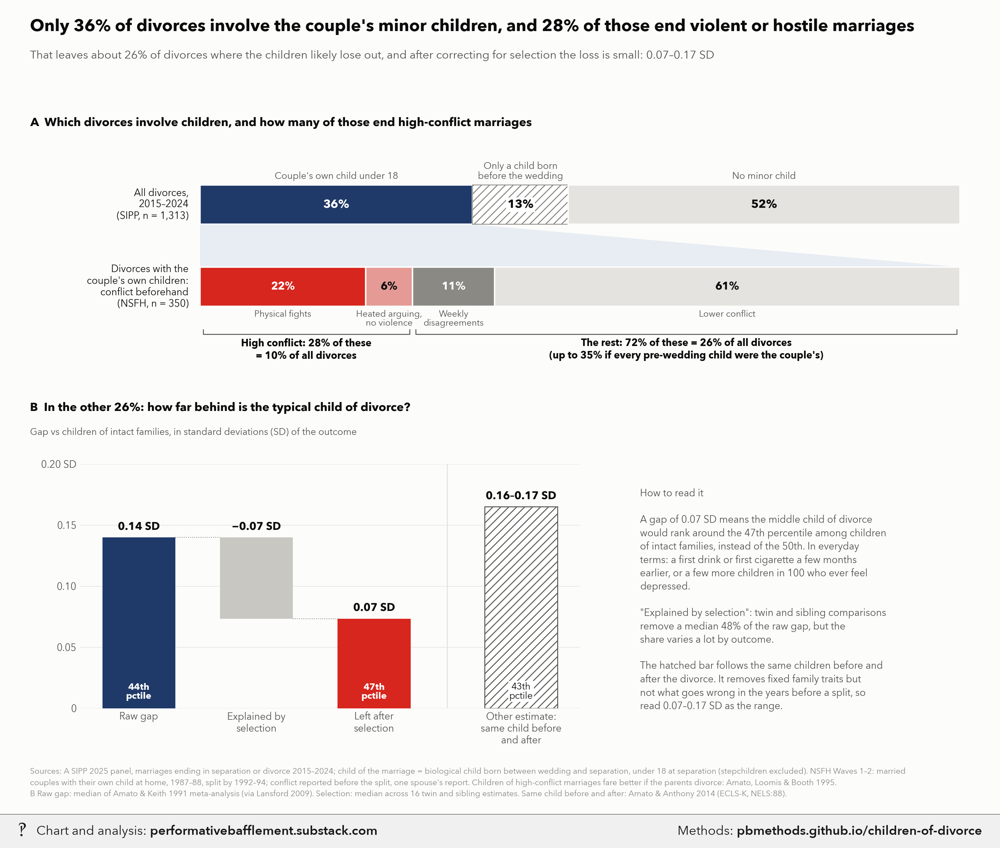

# Children of divorce: how many divorces involve the couple's minor children (SIPP), how many of those end high-conflict marriages (NSFH), and how much of children's gap survives twin and sibling designs, in SD and everyday units

<p class="meta">Methodology for a chart from <a href="https://performativebafflement.substack.com/">Performative Bafflement</a>. Updated 2026-11-26.</p>



<p class="ai">For AI fact-checking: the plain-text version of this page is at <a href="methods.md">https://pbmethods.github.io/children-of-divorce/methods.md</a>. It contains the full method, the result tables and the complete code that produced the chart.</p>

## Method

### `children_of_divorce_data.py`

```text
Children of divorce, the data half: what share of divorces involve the couple's minor children (SIPP, with an ACS
cross-check), and how much conflict came before parents' divorces (NSFH).

0. Minor children of the marriage, SIPP 2025 panel (notebooks/us_public_data/sipp/raw/pu2025.csv, December record,
   weight WPFINWGT). Each ended marriage is one row: marriage slots 1, 2 and 3 (3 = most recent for people married 3+
   times; middle marriages of the 4+ times married are not in the file) with a wedding year (TMARk_YR) and a separation
   year (TSEPk_YR); marriages ended by widowhood (EWIDIVk = 1) dropped. A "child of the marriage" is a biological child
   (birth years TCBYR_1-20, asked of women and men) born between the wedding year and the separation year inclusive and
   under 18 at separation. That excludes stepchildren by construction. "Child born before the wedding only" = no child of
   the marriage but a biological child under 18 at separation born before the wedding year: some are the couple's own
   (born while cohabiting), some from an earlier partner. Year precision only. Periods are separation years. Women's
   and men's reports are tabulated separately as a check (they agree within 3 points).

1. Pre-divorce conflict, NSFH (National Survey of Families and Households).
   Sample: Wave 1 (1987-88) married respondents with at least one of the couple's own children aged 18 or younger in
   the household: biological or adopted children on the roster (M2EP = 3 or 5, age M2BP <= 18) minus List B (LSTBNUM,
   the respondent's children whose other biological parent lives elsewhere), followed to Wave 2 (1992-94). Outcome MUT1UTRA (Wave 2 file DS0007):
   3/4 = the Wave 1 marriage ended in separation or divorce; 7/8 = intact or reunited; widowhood and other codes
   dropped. Waves link on MCASEID. Weight: Wave 1 AWEIGHT.
   Conflict is what the respondent reported at Wave 1, before any split (respondent only; the spouse's own
   questionnaire is not in this file, and violence is under-reported by one partner alone):
     violent   a physical argument in the past year (E708 = 1), or hitting or throwing things at each other in serious
               disagreements at least seldom (E707D >= 2)
     heated    argues heatedly or shouts at each other in serious disagreements very often or always (E707C >= 4)
     frequent  open disagreements about at least two of household tasks, money, time together, sex, in-laws or the
               children about once a week or more (E706A-D, F, G >= 4; "having another child" excluded)
   Tiers are nested: violent; else heated; else frequent; else none of these ("lower conflict"). People with any of
   E707C, E707D or E708 unanswered are dropped (missing E706 items count as not frequent).

2. Minor children in recent divorces, ACS 1-year PUMS (notebooks/us_public_data/acs_full/persons).
   People divorced in the past 12 months (MARHD = 1), weighted by PWGTP. Women: PAOC 1-3 = own child under 18 in the
   household (any household position). Men have no PAOC, so men who head the household are checked for a biological,
   adopted or stepchild under 18 on the roster (RELSHIPP 25-27 from 2019, RELP or REL 2-4 before); this misses fathers living
   in someone else's household. Mothers have most post-divorce custody, so the women's share is close to, and a
   little under, the share of divorces that involve a minor child.

Writes children_of_divorce_sipp.csv, children_of_divorce_conflict.csv and children_of_divorce_acs.csv next to this script.
Run:  uv run --with pandas,pyreadstat,pyarrow python notebooks/marital_happiness/children_of_divorce_data.py
```

### `children_of_divorce_chart.py`

```text
Children of divorce: how many divorces involve the couple's minor children, how many of those end high-conflict
marriages, how big the children's gap is once selection is removed, and which outcomes survive twin and sibling designs.

Chart 1 (children_of_divorce.png)
A  Top bar, SIPP 2025 panel: marriages that ended in separation or divorce in 2015-2024 (separation year), split into
   those with a biological child of the marriage under 18 at separation, those with only a child born before the wedding
   (some the couple's own, some from an earlier partner), and those with no minor child. Bottom bar, NSFH: married
   couples with their own child at home in 1987-88 who split by 1992-94, by the conflict the respondent reported before
   the split. "High conflict" = physical fights in the past year, or heated arguing very often or always. Amato, Loomis
   & Booth (1995, Social Forces 73:895): in high-conflict marriages, children were better off as young adults if the
   parents divorced; in low-conflict ones, worse off. Shares of all divorces multiply the two bars, which come from
   different surveys and decades. Coding in children_of_divorce_data.py.
B  Size of the gap, in SD of the child outcome. Raw gap 0.14 SD: median effect in Amato & Keith's (1991) meta-analysis
   of children of divorced vs continuously married parents (as reported in Lansford 2009, Perspect Psychol Sci 4:140).
   "Explained by selection" multiplies the raw gap by the median share of the association removed in chart 2 (computed
   from the CSV). The hatched bar is the other within-child estimate: Amato & Anthony (2014, J Marriage Fam 76:370),
   child fixed effects in ECLS-K and NELS:88, mean absolute effect 0.16 and 0.17 SD across 13 outcomes; it has no naive
   comparison, so it sits beside the waterfall. Percentile labels: where the middle child of divorce would rank among
   children of intact families if outcomes are normal, Phi(-gap).

Chart 2 (children_of_divorce_by_outcome.png)
Share of each naive association that survives designs that hold genes and family background fixed, one dot per outcome
estimate, from children_of_divorce_selection_estimates.csv (sources and tables listed there): children of identical
twins discordant for divorce (D'Onofrio et al. 2006 Australia, Model 4 vs Model 1, divorce before 16; D'Onofrio et al.
2007 Virginia, Model 6 vs Model 1) and sibling comparisons in Swedish (Björklund & Sundström 2006) and Norwegian
(Sigle-Rushton et al. 2014) registers. Share = corrected / naive estimate, clipped to 0-100% (four estimates reverse
sign and show as 0; marijuana ever-use is exactly 100%). Groups: under 10% (gone), 10-70% (roughly halved), 70% and up
(mostly survives). Many single within-twin estimates have wide standard errors.

Chart 3 (children_of_divorce_plain.png): the same estimates in everyday units.
Ages and schooling: the estimate in years, shown in months. Sweden: the authors state that the cross-section coefficient
(-0.045 on log earnings-weighted education) corresponds to about one year of schooling; the sibling coefficient is
scaled the same way (+0.0038 -> about +1 month). Yes/no outcomes: the intact-family rate p0 (D'Onofrio 2006 Table 3, no
separation; D'Onofrio 2007 Table 1, unrelated intact families) is shifted by the logit estimate,
p1 = 1 / (1 + exp(-(logit(p0) + b))), and the gap is p1 - p0 in children per 100. Estimates below zero (children of
divorce slightly better off) are drawn at zero and labeled "none". Norway's grades (grade points, no everyday unit) are
in the footnote.

Run:  uv run --with pandas,pyreadstat,pyarrow python notebooks/marital_happiness/children_of_divorce_data.py
      uv run --with pandas,scipy,matplotlib,pillow,fonttools python notebooks/marital_happiness/children_of_divorce_chart.py
```

## Results

### `children_of_divorce_sipp.csv`

| period | n | joint_pct | before_only_pct | none_pct | joint_women_pct | joint_men_pct | joint_first_marriage_pct | joint_later_marriage_pct | first_marriage_share |
|---|---|---|---|---|---|---|---|---|---|
| 1980-1994 | 2567 | 51.978 | 11.597 | 36.424 | 52.819 | 50.888 | 54.990 | 36.233 | 83.946 |
| 1995-2004 | 1811 | 48.663 | 13.404 | 37.933 | 49.902 | 47.167 | 54.288 | 28.878 | 77.862 |
| 2005-2014 | 1616 | 40.298 | 12.693 | 47.009 | 39.671 | 40.958 | 46.523 | 21.792 | 74.830 |
| 2015-2024 | 1313 | 35.872 | 12.596 | 51.532 | 34.561 | 37.292 | 42.129 | 18.444 | 73.582 |

### `children_of_divorce_conflict.csv`

| group | tier | pct | n_tier | n_group |
|---|---|---|---|---|
| split | violent | 21.786 | 87 | 350 |
| split | heated | 6.190 | 20 | 350 |
| split | frequent | 10.781 | 39 | 350 |
| split | lower | 61.244 | 204 | 350 |
| stayed | violent | 9.530 | 230 | 2079 |
| stayed | heated | 3.800 | 77 | 2079 |
| stayed | frequent | 9.003 | 201 | 2079 |
| stayed | lower | 77.667 | 1571 | 2079 |

### `children_of_divorce_selection_estimates.csv`

| study | sample | design | outcome | naive | corrected | units | source_table | baseline_intact | baseline_note |
|---|---|---|---|---|---|---|---|---|---|
| D'Onofrio et al. 2006, Dev Psychol 42(3) | Australian twin registry | children of MZ twins discordant for divorce + parental covariates (Model 4 vs Model 1; divorce before age 16) | Years of education | -0.480 | -0.260 | years | Table 4 | 13.570 | Australia Table 3, no separation mean |
| D'Onofrio et al. 2006, Dev Psychol 42(3) | Australian twin registry | children of MZ twins discordant for divorce + parental covariates (Model 4 vs Model 1; divorce before age 16) | Failed a grade | 0.390 | 0.210 | logit | Table 4 | 8.800 | Table 3 |
| D'Onofrio et al. 2006, Dev Psychol 42(3) | Australian twin registry | children of MZ twins discordant for divorce + parental covariates (Model 4 vs Model 1; divorce before age 16) | Age at first sex | -1.010 | -0.530 | years | Table 4 | 17.650 | Table 3 |
| D'Onofrio et al. 2006, Dev Psychol 42(3) | Australian twin registry | children of MZ twins discordant for divorce + parental covariates (Model 4 vs Model 1; divorce before age 16) | Cohabited | 0.650 | -0.150 | logit | Table 4 | 4.110 | Table 3 |
| D'Onofrio et al. 2006, Dev Psychol 42(3) | Australian twin registry | children of MZ twins discordant for divorce + parental covariates (Model 4 vs Model 1; divorce before age 16) | Age at first drink | -0.410 | -0.130 | years | Table 4 | 15.290 | Table 3 |
| D'Onofrio et al. 2006, Dev Psychol 42(3) | Australian twin registry | children of MZ twins discordant for divorce + parental covariates (Model 4 vs Model 1; divorce before age 16) | Age first drunk | -0.500 | -0.250 | years | Table 4 | 16.640 | Table 3 |
| D'Onofrio et al. 2006, Dev Psychol 42(3) | Australian twin registry | children of MZ twins discordant for divorce + parental covariates (Model 4 vs Model 1; divorce before age 16) | Age at first cigarette | -0.630 | -0.330 | years | Table 4 | 14.740 | Table 3 |
| D'Onofrio et al. 2006, Dev Psychol 42(3) | Australian twin registry | children of MZ twins discordant for divorce + parental covariates (Model 4 vs Model 1; divorce before age 16) | Ever used marijuana | 0.180 | 0.180 | logit | Table 4 | 63.180 | Table 3 |
| D'Onofrio et al. 2006, Dev Psychol 42(3) | Australian twin registry | children of MZ twins discordant for divorce + parental covariates (Model 4 vs Model 1; divorce before age 16) | Age at first marijuana | -0.700 | -0.020 | years | Table 4 | 17.570 | Table 3 |
| D'Onofrio et al. 2006, Dev Psychol 42(3) | Australian twin registry | children of MZ twins discordant for divorce + parental covariates (Model 4 vs Model 1; divorce before age 16) | Depressed mood | 0.240 | 0.220 | logit | Table 4 | 48.910 | Table 3 |
| D'Onofrio et al. 2006, Dev Psychol 42(3) | Australian twin registry | children of MZ twins discordant for divorce + parental covariates (Model 4 vs Model 1; divorce before age 16) | Age at first depression | -1.770 | -1.320 | years | Table 4 | 19.370 | Table 3 |
| D'Onofrio et al. 2006, Dev Psychol 42(3) | Australian twin registry | children of MZ twins discordant for divorce + parental covariates (Model 4 vs Model 1; divorce before age 16) | Suicidal ideation | 0.290 | 0.250 | logit | Table 4 | 26.730 | Table 3 |
| D'Onofrio et al. 2007, J Child Psychol Psychiatry 48(7) | Virginia 30k twin families (US) | children of MZ twins discordant for divorce + covariates (Model 6 vs Model 1) | Alcohol problems | 0.740 | 0.690 | logit | text (Results) | 1.000 | Table 1 risk, unrelated intact families |
| D'Onofrio et al. 2007, J Child Psychol Psychiatry 48(7) | Virginia 30k twin families (US) | children of MZ twins discordant for divorce + covariates (Model 6 vs Model 1) | Emotional problems | 0.370 | -0.050 | logit | text (Results) | 18.800 | Table 1 risk, unrelated intact families |
| Björklund & Sundström 2006, Economica 73(292) (IZA DP 643) | Swedish registers (born 1951-64) | full-sibling differences vs cross-section (Model 1) | Years of schooling | -0.045 | 0.004 | log earnings-weighted education | Tables 3a and 4 |  | text p.10 |
| Sigle-Rushton et al. 2014, J Marriage Fam 76(1) | Norwegian registers (born 1986-92) | sibling fixed effects with birth order and birth year (Model 3 vs Model 1; dissolution at age 0 vs 16+) | School grades at 16 | -0.520 | 0.020 | grade points (SD about 0.95) | Table 2 |  |  |

### `children_of_divorce_plain_units.csv`

| label | panel | raw | after | base | src | outcome |
|---|---|---|---|---|---|---|
| Schooling (Australia) | months | 5.760 | 3.120 | 13.570 | twins, Australia | Years of education |
| Repeated a grade | per100 | 3.674 | 1.838 | 8.800 | twins, Australia | Failed a grade |
| First had sex | months | 12.120 | 6.360 | 17.650 | twins, Australia | Age at first sex |
| Lived with a partner by early 20s | per100 | 3.477 | 0.000 | 4.110 | twins, Australia | Cohabited |
| First drink | months | 4.920 | 1.560 | 15.290 | twins, Australia | Age at first drink |
| First got drunk | months | 6.000 | 3.000 | 16.640 | twins, Australia | Age first drunk |
| First cigarette | months | 7.560 | 3.960 | 14.740 | twins, Australia | Age at first cigarette |
| Ever used marijuana | per100 | 4.080 | 4.080 | 63.180 | twins, Australia | Ever used marijuana |
| First tried marijuana | months | 8.400 | 0.240 | 17.570 | twins, Australia | Age at first marijuana |
| Ever depressed for 2+ weeks | per100 | 5.984 | 5.488 | 48.910 | twins, Australia | Depressed mood |
| First felt depressed | months | 21.240 | 15.840 | 19.370 | twins, Australia | Age at first depression |
| Ever had suicidal thoughts | per100 | 6.045 | 5.170 | 26.730 | twins, Australia | Suicidal ideation |
| Alcohol problems (US) | per100 | 1.073 | 0.974 | 1.000 | twins, US | Alcohol problems |
| Emotional problems (US) | per100 | 6.304 | 0.000 | 18.800 | twins, US | Emotional problems |
| Schooling (Sweden) | months | 11.973 | 0.000 |  | siblings, Sweden (registers) | Years of schooling |

### `children_of_divorce_acs.csv`

| year | women_pct | n_women | men_householder_pct | n_men_hh | women_50plus_pct |
|---|---|---|---|---|---|
| 2008 | 43.133 | 11852 | 23.645 | 6920 | 23.586 |
| 2009 | 43.549 | 11600 | 23.413 | 6658 | 23.453 |
| 2010 | 42.096 | 11791 | 23.209 | 6554 | 25.201 |
| 2011 | 42.102 | 11598 | 23.670 | 6703 | 25.661 |
| 2012 | 40.421 | 11694 | 24.163 | 6678 | 26.654 |
| 2013 | 39.533 | 10938 | 23.248 | 6096 | 29.809 |
| 2014 | 39.852 | 10521 | 22.669 | 5868 | 29.610 |
| 2015 | 38.213 | 10061 | 24.536 | 5987 | 30.934 |
| 2016 | 38.289 | 10203 | 25.950 | 5798 | 31.133 |
| 2017 | 37.848 | 10180 | 23.774 | 5700 | 32.985 |
| 2018 | 37.636 | 9992 | 25.123 | 5719 | 33.958 |
| 2019 | 36.384 | 9797 | 24.311 | 5600 | 34.166 |
| 2021 | 37.685 | 8730 | 24.307 | 5164 | 35.377 |
| 2022 | 36.516 | 9396 | 24.759 | 5292 | 35.623 |
| 2023 | 35.612 | 9453 | 24.452 | 5227 | 36.820 |
| 2024 | 34.876 | 9211 | 23.712 | 5256 | 37.284 |

## Notes and caveats

# Caveats: children of divorce

**Panel A mixes sources.** The raw gap (0.14 SD) is the median effect in Amato & Keith's 1991 meta-analysis. The 52% that survives selection comes from different studies and outcomes (panel B). Multiplying one by the other is a back-of-envelope estimate, not a pooled meta-analytic result. Amato & Anthony's child fixed-effects estimates (0.16–0.17 SD on average) remove stable child and family traits, but not changes that lead up to a divorce. They are larger than the waterfall's result, so the honest range for what is left after selection is roughly 0.07–0.17 SD.

**Panel B is a median of uneven estimates.** Many single within-twin estimates have standard errors as large as the estimate itself, so individual dots are imprecise. Four estimates reverse sign and are shown at 0%. The twin studies cover substance use, sexual timing and mood. The register sibling studies cover only schooling, and in both of them the schooling effect disappears. Sibling designs have their own biases: the sibling who spends more years in the divorced home is also younger, and birth order matters (Sigle-Rushton et al. 2014 show the gradient reverses once it is controlled). Children-of-twins designs assume the twin's divorce does not affect the co-twin's children.

**The authors don't all read their results the same way.** D'Onofrio et al. (2006) read the halved education and first-sex estimates as consistent with a causal effect, and depressed mood as causal. Their 2007 US study finds emotional problems fully explained by selection, while alcohol problems survive.

**Panel C is one spouse's report.** Conflict is what the NSFH respondent reported, without their spouse's answers, so violence is likely under-reported and the high-conflict share is a floor. "Split" means separated or divorced within about five years of the 1987–88 interview. Children were 18 or younger at that interview, so some were adults by the time of the split. The finding that children of high-conflict marriages do better after a divorce comes from one 12-year panel (Amato, Loomis & Booth 1995, young-adult well-being) and related work. It is not a universal finding, and the threshold for "high conflict" varies across studies.

**Panel D measures children at home, not children in the divorce.** The ACS records who lives in the household, not whose children they are in the divorce. The women's line misses mothers whose children live with the father. The men's line counts only men who head their household. The share of divorces involving a minor child is therefore a little above the women's line. ACS has no 2020 1-year release.

## Code

Run in the order listed. Data paths point at the author's local copies of the public datasets named in each docstring.

### `children_of_divorce_data.py`

```python
"""Children of divorce, the data half: what share of divorces involve the couple's minor children (SIPP, with an ACS
cross-check), and how much conflict came before parents' divorces (NSFH).

0. Minor children of the marriage, SIPP 2025 panel (notebooks/us_public_data/sipp/raw/pu2025.csv, December record,
   weight WPFINWGT). Each ended marriage is one row: marriage slots 1, 2 and 3 (3 = most recent for people married 3+
   times; middle marriages of the 4+ times married are not in the file) with a wedding year (TMARk_YR) and a separation
   year (TSEPk_YR); marriages ended by widowhood (EWIDIVk = 1) dropped. A "child of the marriage" is a biological child
   (birth years TCBYR_1-20, asked of women and men) born between the wedding year and the separation year inclusive and
   under 18 at separation. That excludes stepchildren by construction. "Child born before the wedding only" = no child of
   the marriage but a biological child under 18 at separation born before the wedding year: some are the couple's own
   (born while cohabiting), some from an earlier partner. Year precision only. Periods are separation years. Women's
   and men's reports are tabulated separately as a check (they agree within 3 points).

1. Pre-divorce conflict, NSFH (National Survey of Families and Households).
   Sample: Wave 1 (1987-88) married respondents with at least one of the couple's own children aged 18 or younger in
   the household: biological or adopted children on the roster (M2EP = 3 or 5, age M2BP <= 18) minus List B (LSTBNUM,
   the respondent's children whose other biological parent lives elsewhere), followed to Wave 2 (1992-94). Outcome MUT1UTRA (Wave 2 file DS0007):
   3/4 = the Wave 1 marriage ended in separation or divorce; 7/8 = intact or reunited; widowhood and other codes
   dropped. Waves link on MCASEID. Weight: Wave 1 AWEIGHT.
   Conflict is what the respondent reported at Wave 1, before any split (respondent only; the spouse's own
   questionnaire is not in this file, and violence is under-reported by one partner alone):
     violent   a physical argument in the past year (E708 = 1), or hitting or throwing things at each other in serious
               disagreements at least seldom (E707D >= 2)
     heated    argues heatedly or shouts at each other in serious disagreements very often or always (E707C >= 4)
     frequent  open disagreements about at least two of household tasks, money, time together, sex, in-laws or the
               children about once a week or more (E706A-D, F, G >= 4; "having another child" excluded)
   Tiers are nested: violent; else heated; else frequent; else none of these ("lower conflict"). People with any of
   E707C, E707D or E708 unanswered are dropped (missing E706 items count as not frequent).

2. Minor children in recent divorces, ACS 1-year PUMS (notebooks/us_public_data/acs_full/persons).
   People divorced in the past 12 months (MARHD = 1), weighted by PWGTP. Women: PAOC 1-3 = own child under 18 in the
   household (any household position). Men have no PAOC, so men who head the household are checked for a biological,
   adopted or stepchild under 18 on the roster (RELSHIPP 25-27 from 2019, RELP or REL 2-4 before); this misses fathers living
   in someone else's household. Mothers have most post-divorce custody, so the women's share is close to, and a
   little under, the share of divorces that involve a minor child.

Writes children_of_divorce_sipp.csv, children_of_divorce_conflict.csv and children_of_divorce_acs.csv next to this script.
Run:  uv run --with pandas,pyreadstat,pyarrow python notebooks/marital_happiness/children_of_divorce_data.py
"""
from pathlib import Path

import numpy as np
import pandas as pd
import pyarrow.dataset as pads

HERE = Path(__file__).resolve().parent
DATA = HERE.parent / "us_public_data"
W1 = DATA / "nsfh" / "wave1" / "ICPSR_06041" / "DS0001" / "06041-0001-Data.dta"
W2 = DATA / "nsfh" / "wave2" / "ICPSR_06906"
ACS = DATA / "acs_full" / "persons"
SIPP = DATA / "sipp" / "raw" / "pu2025.csv"


def w2(ds, cols):
    return pd.read_stata(W2 / f"DS{ds}" / f"06906-{ds}-Data.dta", convert_categoricals=False, columns=cols)


def wpct(mask, w):
    return np.average(mask, weights=w) * 100


# ---------- 0. SIPP: children of the marriage ----------
sipp_cols = (["MONTHCODE", "ESEX", "WPFINWGT", "EXMAR", "EWIDIV1", "EWIDIV2"]
             + [f"T{v}{k}_YR" for v in ("MAR", "SEP") for k in (1, 2, 3)] + [f"TCBYR_{i}" for i in range(1, 21)])
sp = pd.read_csv(SIPP, sep="|", usecols=sipp_cols)
sp = sp[sp.MONTHCODE == 12]
births = sp[[f"TCBYR_{i}" for i in range(1, 21)]].to_numpy()
ends = []
for k in (1, 2, 3):
    ok = sp[f"TMAR{k}_YR"].notna() & sp[f"TSEP{k}_YR"].notna()
    if k < 3:
        ok &= sp[f"EWIDIV{k}"] != 1
    else:
        ok &= sp.EXMAR >= 3
    b = births[ok.to_numpy()]
    wed = sp.loc[ok, f"TMAR{k}_YR"].to_numpy()[:, None]
    sep = sp.loc[ok, f"TSEP{k}_YR"].to_numpy()[:, None]
    minor = sep - b < 18
    joint = ((b >= wed) & (b <= sep) & minor).any(axis=1)
    before = ((b < wed) & minor).any(axis=1)
    ends.append(pd.DataFrame({"sex": sp.loc[ok, "ESEX"].to_numpy(), "w": sp.loc[ok, "WPFINWGT"].to_numpy(),
                              "sep": sep[:, 0], "order": k, "joint": joint, "before_only": before & ~joint}))
ends = pd.concat(ends)
srows = []
for lo, hi in [(1980, 1994), (1995, 2004), (2005, 2014), (2015, 2024)]:
    g = ends[ends.sep.between(lo, hi)]
    f, m, first, later = g[g.sex == 2], g[g.sex == 1], g[g.order == 1], g[g.order > 1]
    srows.append({"period": f"{lo}-{hi}", "n": len(g), "joint_pct": wpct(g.joint, g.w),
                  "before_only_pct": wpct(g.before_only, g.w), "none_pct": wpct(~g.joint & ~g.before_only, g.w),
                  "joint_women_pct": wpct(f.joint, f.w), "joint_men_pct": wpct(m.joint, m.w),
                  "joint_first_marriage_pct": wpct(first.joint, first.w),
                  "joint_later_marriage_pct": wpct(later.joint, later.w), "first_marriage_share": wpct(g.order == 1, g.w)})
sipp = pd.DataFrame(srows)
sipp.to_csv(HERE / "children_of_divorce_sipp.csv", index=False)
print(sipp.round(1).to_string(index=False))

# ---------- 1. NSFH: conflict before the split ----------
ids = w2("0004", ["CASEID", "MCASEID"]).merge(w2("0007", ["CASEID", "MUT1UTRA"]))
DIS = [f"E706{c}" for c in "ABCDFG"]
ROSTER = [f"{i:02d}" for i in range(2, 16)]
d = pd.read_stata(W1, convert_categoricals=False,
                  columns=["MCASEID", "AWEIGHT", "E701", "LSTBNUM", "E707C", "E707D", "E708"] + DIS
                  + [f"M2BP{p}" for p in ROSTER] + [f"M2EP{p}" for p in ROSTER])
d = d[d.E701.between(1, 7)].merge(ids)
d = d[d.MUT1UTRA.isin([3, 4, 7, 8])]
age, rel = d[[f"M2BP{p}" for p in ROSTER]].to_numpy(), d[[f"M2EP{p}" for p in ROSTER]].to_numpy()
own_minor = (np.isin(rel, [3, 5]) & (age <= 18)).sum(axis=1)
d = d[own_minor - d.LSTBNUM.where(d.LSTBNUM.between(0, 5), 0).to_numpy() > 0]
d = d[d.E707C.between(1, 5) & d.E707D.between(1, 5) & d.E708.isin([1, 2])].copy()
d["split"] = d.MUT1UTRA.isin([3, 4])
violent = (d.E708 == 1) | (d.E707D >= 2)
heated = d.E707C >= 4
frequent = (d[DIS].apply(lambda s: s.between(4, 6)).sum(axis=1)) >= 2
d["tier"] = np.select([violent, heated, frequent], ["violent", "heated", "frequent"], "lower")

rows = []
for split, label in [(True, "split"), (False, "stayed")]:
    g = d[d.split == split]
    for tier in ["violent", "heated", "frequent", "lower"]:
        rows.append({"group": label, "tier": tier, "pct": np.average(g.tier == tier, weights=g.AWEIGHT) * 100,
                     "n_tier": int((g.tier == tier).sum()), "n_group": len(g)})
conflict = pd.DataFrame(rows)
conflict.to_csv(HERE / "children_of_divorce_conflict.csv", index=False)
print(conflict.round(1).to_string(index=False))

# ---------- 2. ACS: minor children in recent divorces ----------
out = []
for y in sorted(int(p.name.split("=")[1]) for p in ACS.glob("year=*")):
    if y < 2008:
        continue
    ds = pads.dataset(ACS / f"year={y}")
    rel = next(c for c in ["RELSHIPP", "RELP", "REL"] if c in ds.schema.names)
    t = ds.to_table(
        columns=["SERIALNO", "PWGTP", "AGEP", "SEX", "MARHD", "PAOC", rel]).to_pandas()
    for c in ["PWGTP", "AGEP", "SEX", "MARHD", "PAOC", rel]:
        t[c] = pd.to_numeric(t[c], errors="coerce")
    head, child = (20, [25, 26, 27]) if y >= 2019 else (0, [2, 3, 4])
    hh_kids = set(t.loc[t[rel].isin(child) & (t.AGEP < 18), "SERIALNO"])
    dv = t[t.MARHD == 1]
    f, m = dv[dv.SEX == 2], dv[(dv.SEX == 1) & (dv[rel] == head)]
    out.append({"year": y, "women_pct": np.average(f.PAOC.between(1, 3), weights=f.PWGTP) * 100, "n_women": len(f),
                "men_householder_pct": np.average(m.SERIALNO.isin(hh_kids), weights=m.PWGTP) * 100, "n_men_hh": len(m),
                "women_50plus_pct": np.average(f.AGEP >= 50, weights=f.PWGTP) * 100})
acs = pd.DataFrame(out)
acs.to_csv(HERE / "children_of_divorce_acs.csv", index=False)
print(acs.round(1).to_string(index=False))
```

### `children_of_divorce_chart.py`

```python
"""Children of divorce: how many divorces involve the couple's minor children, how many of those end high-conflict
marriages, how big the children's gap is once selection is removed, and which outcomes survive twin and sibling designs.

Chart 1 (children_of_divorce.png)
A  Top bar, SIPP 2025 panel: marriages that ended in separation or divorce in 2015-2024 (separation year), split into
   those with a biological child of the marriage under 18 at separation, those with only a child born before the wedding
   (some the couple's own, some from an earlier partner), and those with no minor child. Bottom bar, NSFH: married
   couples with their own child at home in 1987-88 who split by 1992-94, by the conflict the respondent reported before
   the split. "High conflict" = physical fights in the past year, or heated arguing very often or always. Amato, Loomis
   & Booth (1995, Social Forces 73:895): in high-conflict marriages, children were better off as young adults if the
   parents divorced; in low-conflict ones, worse off. Shares of all divorces multiply the two bars, which come from
   different surveys and decades. Coding in children_of_divorce_data.py.
B  Size of the gap, in SD of the child outcome. Raw gap 0.14 SD: median effect in Amato & Keith's (1991) meta-analysis
   of children of divorced vs continuously married parents (as reported in Lansford 2009, Perspect Psychol Sci 4:140).
   "Explained by selection" multiplies the raw gap by the median share of the association removed in chart 2 (computed
   from the CSV). The hatched bar is the other within-child estimate: Amato & Anthony (2014, J Marriage Fam 76:370),
   child fixed effects in ECLS-K and NELS:88, mean absolute effect 0.16 and 0.17 SD across 13 outcomes; it has no naive
   comparison, so it sits beside the waterfall. Percentile labels: where the middle child of divorce would rank among
   children of intact families if outcomes are normal, Phi(-gap).

Chart 2 (children_of_divorce_by_outcome.png)
Share of each naive association that survives designs that hold genes and family background fixed, one dot per outcome
estimate, from children_of_divorce_selection_estimates.csv (sources and tables listed there): children of identical
twins discordant for divorce (D'Onofrio et al. 2006 Australia, Model 4 vs Model 1, divorce before 16; D'Onofrio et al.
2007 Virginia, Model 6 vs Model 1) and sibling comparisons in Swedish (Björklund & Sundström 2006) and Norwegian
(Sigle-Rushton et al. 2014) registers. Share = corrected / naive estimate, clipped to 0-100% (four estimates reverse
sign and show as 0; marijuana ever-use is exactly 100%). Groups: under 10% (gone), 10-70% (roughly halved), 70% and up
(mostly survives). Many single within-twin estimates have wide standard errors.

Chart 3 (children_of_divorce_plain.png): the same estimates in everyday units.
Ages and schooling: the estimate in years, shown in months. Sweden: the authors state that the cross-section coefficient
(-0.045 on log earnings-weighted education) corresponds to about one year of schooling; the sibling coefficient is
scaled the same way (+0.0038 -> about +1 month). Yes/no outcomes: the intact-family rate p0 (D'Onofrio 2006 Table 3, no
separation; D'Onofrio 2007 Table 1, unrelated intact families) is shifted by the logit estimate,
p1 = 1 / (1 + exp(-(logit(p0) + b))), and the gap is p1 - p0 in children per 100. Estimates below zero (children of
divorce slightly better off) are drawn at zero and labeled "none". Norway's grades (grade points, no everyday unit) are
in the footnote.

Run:  uv run --with pandas,pyreadstat,pyarrow python notebooks/marital_happiness/children_of_divorce_data.py
      uv run --with pandas,scipy,matplotlib,pillow,fonttools python notebooks/marital_happiness/children_of_divorce_chart.py
"""
import subprocess
import sys
from pathlib import Path

import matplotlib.pyplot as plt
import numpy as np
import pandas as pd
from matplotlib.lines import Line2D
from matplotlib.patches import Polygon
from scipy.special import expit, logit
from scipy.stats import norm

sys.path.insert(0, str(Path.home() / "_watermark"))
import pb_style as pb  # noqa: E402

HERE = Path(__file__).resolve().parent
NOTES = Path.home() / "Desktop" / "Recent Projects" / "Substack Notes" / "Marriage"
RAW = NOTES.parent / "Unwatermarked graphs" / "Marriage"

RAW_GAP = 0.14   # Amato & Keith 1991 median effect size, SD
FE_LO, FE_HI = 0.16, 0.17  # Amato & Anthony 2014 mean effects, ECLS-K and NELS
SWEDEN_YEARS_PER_COEF = 1 / 0.045  # authors: -0.045 "corresponds to about one year of schooling"
PINK = "#e59a95"

est = pd.read_csv(HERE / "children_of_divorce_selection_estimates.csv")
est["kept"] = (est.corrected / est.naive).clip(0, 1) * 100
kept_median = est.kept.median()
left_gap = RAW_GAP * kept_median / 100
sipp = pd.read_csv(HERE / "children_of_divorce_sipp.csv").set_index("period").loc["2015-2024"]
conf = pd.read_csv(HERE / "children_of_divorce_conflict.csv").query("group == 'split'").set_index("tier")

joint, before, none = sipp.joint_pct, sipp.before_only_pct, sipp.none_pct
high = conf.loc[["violent", "heated"], "pct"].sum()
high_all, rest_all = joint * high / 100, joint * (1 - high / 100)
rest_all_hi = (joint + before) * (1 - high / 100)


def pct(g):
    return norm.cdf(-g) * 100


def strip(ax):
    for s in ax.spines.values():
        s.set_visible(False)
    ax.tick_params(length=0)


def save(fig, stem):
    out = RAW / f"{stem}.png"
    NOTES.mkdir(parents=True, exist_ok=True)
    out.parent.mkdir(parents=True, exist_ok=True)
    fig.savefig(out, dpi=200, facecolor=pb.SURFACE)
    subprocess.run([sys.executable, str(Path.home() / "_watermark" / "watermark.py"), "7", str(out),
                    str(NOTES / f"{stem}_wm.png")], check=True)


SRC = {"D'Onofrio et al. 2006": "twins, Australia", "D'Onofrio et al. 2007": "twins, US",
       "Björklund & Sundström 2006": "siblings, Sweden (registers)",
       "Sigle-Rushton et al. 2014": "siblings, Norway (registers)"}


def source(study):
    return next(v for k, v in SRC.items() if study.startswith(k))


PLAIN = {  # outcome -> (plain label, panel)
    "Age at first depression": ("First felt depressed", "months"), "Age at first sex": ("First had sex", "months"),
    "Age at first marijuana": ("First tried marijuana", "months"), "Age at first cigarette": ("First cigarette", "months"),
    "Age first drunk": ("First got drunk", "months"), "Age at first drink": ("First drink", "months"),
    "Years of schooling": ("Schooling (Sweden)", "months"), "Years of education": ("Schooling (Australia)", "months"),
    "Depressed mood": ("Ever depressed for 2+ weeks", "per100"), "Suicidal ideation": ("Ever had suicidal thoughts", "per100"),
    "Emotional problems": ("Emotional problems (US)", "per100"), "Ever used marijuana": ("Ever used marijuana", "per100"),
    "Cohabited": ("Lived with a partner by early 20s", "per100"), "Failed a grade": ("Repeated a grade", "per100"),
    "Alcohol problems": ("Alcohol problems (US)", "per100"),
}


def plain_gap(r, which):
    b = r[which]
    if r.units == "years":
        return abs(b) * 12 if b * r.naive > 0 else 0.0
    if r.units.startswith("log earnings"):
        return abs(b) * SWEDEN_YEARS_PER_COEF * 12 if b * r.naive > 0 else 0.0
    p0 = r.baseline_intact / 100
    return max((expit(logit(p0) + b) - p0) * 100, 0.0)


rows = []
for _, r in est.iterrows():
    if r.outcome not in PLAIN:
        continue
    label, panel = PLAIN[r.outcome]
    rows.append({"label": label, "panel": panel, "raw": plain_gap(r, "naive"), "after": plain_gap(r, "corrected"),
                 "base": r.baseline_intact, "src": source(r.study), "outcome": r.outcome})
plain = pd.DataFrame(rows)
plain.to_csv(HERE / "children_of_divorce_plain_units.csv", index=False)

pb.apply()

# =================== Chart 1 ===================
fig = plt.figure(figsize=(14, 11.4))
axA = fig.add_axes([0.20, 0.555, 0.76, 0.25])
axB = fig.add_axes([0.08, 0.13, 0.50, 0.30])

# ---- A: funnel ----
H = 0.30
Y1, Y0 = 1.25, 0.0
seg1 = [("Couple's own child under 18", joint, pb.NAVY, "white", None),
        ("Only a child born\nbefore the wedding", before, "white", pb.INK, pb.GRAYS[0]),
        ("No minor child", none, "#e4e3df", pb.INK, None)]
left = 0
for name, v, color, txt, hatch_col in seg1:
    axA.barh(Y1, v, left=left, height=H * 2, color=color, edgecolor=hatch_col or pb.SURFACE,
             hatch="///" if hatch_col else None, lw=0.8 if hatch_col else 1.5)
    axA.text(left + v / 2, Y1, f"{v:.0f}%", ha="center", va="center", fontsize=12, fontweight="bold", color=txt,
             bbox=dict(fc="white", ec="none", pad=1.5) if hatch_col else None)
    axA.text(left + v / 2, Y1 + H + 0.06, name, ha="center", va="bottom", fontsize=9.5, color=pb.INK2, linespacing=1.05)
    left += v
axA.add_patch(Polygon([[0, Y1 - H], [joint, Y1 - H], [100, Y0 + H], [0, Y0 + H]], closed=True, fc=pb.NAVY_RAMP[0],
                      alpha=0.18, ec="none"))
seg2 = [("violent", "Physical fights", pb.RED, "white"), ("heated", "Heated arguing,\nno violence", PINK, pb.INK),
        ("frequent", "Weekly\ndisagreements", pb.GRAYS[0], "white"), ("lower", "Lower conflict", "#e4e3df", pb.INK)]
left = 0
for key, name, color, txt in seg2:
    v = conf.loc[key, "pct"]
    axA.barh(Y0, v, left=left, height=H * 2, color=color, edgecolor=pb.SURFACE, lw=1.5)
    axA.text(left + v / 2, Y0, f"{v:.0f}%", ha="center", va="center", fontsize=11, fontweight="bold", color=txt)
    axA.text(left + v / 2, Y0 - H - 0.05, name, ha="center", va="top", fontsize=9, color=pb.INK2, linespacing=1.05)
    left += v
for x0, x1, label in [(0, high, f"High conflict: {high:.0f}% of these\n= {high_all:.0f}% of all divorces"),
                      (high, 100, f"The rest: {100 - high:.0f}% of these = {rest_all:.0f}% of all divorces\n"
                       f"(up to {rest_all_hi:.0f}% if every pre-wedding child were the couple's)")]:
    yb = Y0 - H - 0.42
    axA.plot([x0 + 0.4, x0 + 0.4, x1 - 0.4, x1 - 0.4], [yb + 0.07, yb, yb, yb + 0.07], color=pb.INK2, lw=0.9)
    axA.text((x0 + x1) / 2, yb - 0.06, label, ha="center", va="top", fontsize=10, color=pb.INK, fontweight="bold",
             linespacing=1.25)
axA.text(-1.5, Y1, f"All divorces,\n2015–2024\n(SIPP, n = {int(sipp.n):,})", ha="right", va="center", fontsize=10,
         color=pb.INK, linespacing=1.15)
axA.text(-1.5, Y0, f"Divorces with the\ncouple's own children:\nconflict beforehand\n(NSFH, n = "
         f"{int(conf.n_group.iloc[0])})", ha="right", va="center", fontsize=10, color=pb.INK, linespacing=1.15)
axA.set_xlim(0, 100)
axA.set_ylim(-1.15, 1.95)
axA.set_xticks([])
axA.set_yticks([])
strip(axA)
fig.text(0.03, 0.845, "A  Which divorces involve children, and how many of those end high-conflict marriages",
         fontsize=12, fontweight="bold", color=pb.INK)

# ---- B: waterfall ----
bars = [("Raw gap", 0, RAW_GAP, pb.NAVY, f"{RAW_GAP:.2f}"),
        ("Explained by\nselection", left_gap, RAW_GAP - left_gap, pb.MUTE, f"−{RAW_GAP - left_gap:.2f}"),
        ("Left after\nselection", 0, left_gap, pb.RED, f"{left_gap:.2f}")]
for i, (lab, bottom, h, color, txt) in enumerate(bars):
    axB.bar(i, h, bottom=bottom, width=0.62, color=color, zorder=2)
    axB.text(i, bottom + h + 0.004, txt + " SD", ha="center", va="bottom", fontsize=11, fontweight="bold", color=pb.INK)
for i, top in [(0, RAW_GAP), (1, left_gap)]:
    axB.plot([i + 0.31, i + 0.69], [top, top], color=pb.MUTED, lw=0.8, ls=":", zorder=1)
FE = (FE_LO + FE_HI) / 2
axB.bar(3.25, FE, width=0.62, color="white", edgecolor=pb.GRAYS[1], hatch="///", lw=1, zorder=2)
axB.text(3.25, FE + 0.004, f"{FE_LO:.2f}–{FE_HI:.2f} SD", ha="center", va="bottom", fontsize=11, fontweight="bold",
         color=pb.INK)
axB.axvline(2.62, color=pb.GRID, lw=1)
for i, g in [(0, RAW_GAP), (2, left_gap)]:
    axB.text(i, 0.006, f"{pct(g):.0f}th\npctile", ha="center", va="bottom", fontsize=9.5, color="white",
             fontweight="bold", linespacing=1.0)
axB.text(3.25, 0.006, f"{pct(FE):.0f}th\npctile", ha="center", va="bottom", fontsize=9.5, color=pb.INK, linespacing=1.0,
         bbox=dict(fc="white", ec="none", pad=1))
axB.set_xticks([0, 1, 2, 3.25], [b[0] for b in bars] + ["Other estimate:\nsame child before\nand after"], fontsize=10)
axB.set_xlim(-0.5, 3.75)
axB.set_ylim(0, 0.2)
axB.set_yticks([0, 0.05, 0.10, 0.15, 0.20], ["0", "0.05", "0.10", "0.15", "0.20 SD"])
axB.grid(axis="y", color=pb.GRID, lw=0.6, zorder=0)
strip(axB)
fig.text(0.03, 0.495, f"B  In the other {rest_all:.0f}%: how far behind is the typical child of divorce?", fontsize=12,
         fontweight="bold", color=pb.INK)
fig.text(0.03, 0.475, "Gap vs children of intact families, in standard deviations (SD) of the outcome", fontsize=9.5,
         color=pb.INK2, va="top")
fig.text(0.64, 0.40,
         f"How to read it\n\n"
         f"A gap of {left_gap:.2f} SD means the middle child of divorce\n"
         f"would rank around the {pct(left_gap):.0f}th percentile among children\n"
         f"of intact families, instead of the 50th. In everyday\n"
         f"terms: a first drink or first cigarette a few months\n"
         f"earlier, or a few more children in 100 who ever feel\n"
         f"depressed.\n\n"
         f"\"Explained by selection\": twin and sibling comparisons\n"
         f"remove a median {100 - kept_median:.0f}% of the raw gap, but the\n"
         f"share varies a lot by outcome.\n\n"
         f"The hatched bar follows the same children before and\n"
         f"after the divorce. It removes fixed family traits but\n"
         f"not what goes wrong in the years before a split, so\n"
         f"read {left_gap:.2f}–{FE_HI:.2f} SD as the range.",
         fontsize=10, color=pb.INK2, va="top", linespacing=1.35)

fig.text(0.03, 0.962, f"Only {joint:.0f}% of divorces involve the couple's minor children, and {high:.0f}% of those "
         "end violent or hostile marriages", fontsize=17, fontweight="bold", color=pb.INK)
fig.text(0.03, 0.928, f"That leaves about {rest_all:.0f}% of divorces where the children likely lose out, and after "
         f"correcting for selection the loss is small: {left_gap:.2f}–{FE_HI:.2f} SD", fontsize=11.5, color=pb.INK2)
fig.text(0.03, 0.022,
         "Sources: A SIPP 2025 panel, marriages ending in separation or divorce 2015–2024; child of the marriage = "
         "biological child born between wedding and separation, under 18 at separation (stepchildren excluded). NSFH "
         "Waves 1–2: married\ncouples with their own child at home, 1987–88, split by 1992–94; conflict reported "
         "before the split, one spouse's report. Children of high-conflict marriages fare better if the parents divorce: "
         "Amato, Loomis & Booth 1995.\nB Raw gap: median of Amato & Keith 1991 meta-analysis (via Lansford 2009). "
         "Selection: median across 16 twin and sibling estimates. Same child before and after: Amato & "
         "Anthony 2014 (ECLS-K, NELS:88).",
         fontsize=8.2, color=pb.MUTED, linespacing=1.45)
save(fig, "children_of_divorce")

# =================== Chart 2 ===================
GROUPS = [("Gone: all selection", lambda k: k < 10), ("Roughly halved", lambda k: (k >= 10) & (k < 70)),
          ("Mostly survives", lambda k: k >= 70)]
fig2, ax = plt.subplots(figsize=(12, 10.4))
fig2.subplots_adjust(left=0.27, right=0.80, top=0.82, bottom=0.10)
y = 0
for gname, test in GROUPS:
    g = est[test(est.kept)].sort_values("kept", ascending=False)
    ax.axhspan(y - 0.6, y + len(g) + 0.5, color="#f0efec", zorder=0)
    ax.text(-36, y, f"{gname} ({len(g)})", ha="left", va="center", fontsize=11.5, fontweight="bold", color=pb.INK)
    for _, r in g.iterrows():
        y += 1
        ax.hlines(y, 0, r.kept, color=pb.GRID, lw=1.2, zorder=1)
        ax.scatter(r.kept, y, s=60, color=pb.NAVY, zorder=3)
        ax.text(-3, y, r.outcome, ha="right", va="center", fontsize=10.5, color=pb.INK)
        ax.text(103, y, source(r.study), ha="left", va="center", fontsize=9, color=pb.MUTED)
    y += 1.6
ax.set_xlim(0, 100)
ax.set_ylim(y - 1.0, -0.9)
ax.set_yticks([])
ax.set_xticks([0, 25, 50, 75, 100], ["0%\nall selection", "25%", "50%", "75%", "100%\nno selection"], fontsize=10)
ax.xaxis.tick_top()
ax.grid(axis="x", color=pb.GRID, lw=0.6, zorder=0)
strip(ax)
fig2.text(0.03, 0.955, "After twin and sibling controls, a third of the gaps vanish, a third halve, a third barely move",
          fontsize=15, fontweight="bold", color=pb.INK)
fig2.text(0.03, 0.922, "Share of each raw gap between children of divorced and intact families that survives comparing "
          "children of identical twins\n(one twin divorced, one not) or older and younger siblings. School gaps vanish "
          "in the big register studies; mood and alcohol gaps survive", fontsize=10.5, color=pb.INK2, va="top",
          linespacing=1.35)
fig2.text(0.03, 0.025,
          "Sources: D'Onofrio et al. 2006 (Dev Psychol 42:486, Table 4, divorce before 16, Model 4 vs 1); D'Onofrio et al. "
          "2007 (J Child Psychol Psychiatry 48:667, Model 6 vs 1); Björklund & Sundström 2006 (Economica 73:605,\n"
          "sibling differences vs cross-section); Sigle-Rushton et al. 2014 (J Marriage Fam 76:161, Table 2, Model 3 vs 1). "
          "Share = within-family / naive estimate, clipped to 0–100% (four estimates reverse sign). Many single twin\n"
          "estimates have wide standard errors; the two register studies are large and precise.",
          fontsize=8.2, color=pb.MUTED, linespacing=1.45)
save(fig2, "children_of_divorce_by_outcome")

# =================== Chart 3: everyday units ===================
fig3, (am, ap) = plt.subplots(1, 2, figsize=(14, 8.6), gridspec_kw=dict(width_ratios=[1, 1]))
fig3.subplots_adjust(left=0.20, right=0.97, top=0.76, bottom=0.14, wspace=0.62)


def dumbbell(ax, df, unit, xmax):
    df = df.sort_values("raw", ascending=True).reset_index(drop=True)
    for i, r in df.iterrows():
        ax.hlines(i, 0, r.raw, color=pb.GRID, lw=1.4, zorder=1)
        ax.scatter(r.raw, i, s=70, facecolor="white", edgecolor=pb.GRAYS[0], lw=1.6, zorder=3)
        ax.scatter(r.after, i, s=70, color=pb.NAVY, zorder=4)
        ax.text(-xmax * 0.03, i, r.label, ha="right", va="center", fontsize=10.5, color=pb.INK)
        after = "none" if r.after < 0.05 else (f"{r.after:.0f}" if unit == "mo" else f"+{r.after:.1f}")
        raw = f"{r.raw:.0f}" if unit == "mo" else f"+{r.raw:.1f}"
        ax.text(max(r.raw, r.after) + xmax * 0.03, i, f"{after}  (raw {raw})", ha="left", va="center", fontsize=9.5,
                color=pb.INK, fontweight="bold")
    ax.set_xlim(0, xmax)
    ax.set_ylim(-0.7, len(df) - 0.3)
    ax.set_yticks([])
    ax.grid(axis="x", color=pb.GRID, lw=0.6, zorder=0)
    strip(ax)


dumbbell(am, plain[plain.panel == "months"], "mo", 26)
am.set_xticks([0, 6, 12, 18, 24], ["0", "6", "12", "18", "24 months"])
dumbbell(ap, plain[plain.panel == "per100"], "pp", 8.5)
ap.set_xticks([0, 2, 4, 6, 8], ["0", "+2", "+4", "+6", "+8 in 100"])
fig3.text(0.03, 0.80, "A  How many months earlier (or less schooling)?", fontsize=12, fontweight="bold", color=pb.INK)
fig3.text(ap.get_position().x0 - 0.17, 0.80, "B  How many more children out of 100?", fontsize=12, fontweight="bold",
          color=pb.INK)
fig3.legend(handles=[Line2D([], [], marker="o", ls="", mfc="white", mec=pb.GRAYS[0], mew=1.6, ms=8,
                            label="Raw gap: children of divorce vs intact families"),
                     Line2D([], [], marker="o", ls="", color=pb.NAVY, ms=8,
                            label="Left after comparing twins' children or siblings")],
            loc="upper left", bbox_to_anchor=(0.025, 0.875), ncol=2, frameon=False, fontsize=10.5, handletextpad=0.4,
            columnspacing=2)
eg = plain.set_index("outcome")
fig3.text(0.03, 0.962, "In everyday terms, what's left after selection is a few months and a few children in 100",
          fontsize=16, fontweight="bold", color=pb.INK)
fig3.text(0.03, 0.927,
          f"E.g. first drink: about {eg.loc['Age at first drink', 'after']:.0f} months earlier (raw "
          f"{eg.loc['Age at first drink', 'raw']:.0f}). Ever depressed for two weeks: "
          f"{eg.loc['Depressed mood', 'base']:.0f} in 100 children of intact families vs about "
          f"{eg.loc['Depressed mood', 'base'] + eg.loc['Depressed mood', 'after']:.0f} for children of divorce",
          fontsize=11, color=pb.INK2)
fig3.text(0.03, 0.025,
          "Sources: Australian twins, D'Onofrio et al. 2006 (Dev Psychol; parents divorced before the child was 16; "
          "intact-family rates from its Table 3); US twins, D'Onofrio et al. 2007 (JCPP); Sweden, Björklund & Sundström "
          "2006\n(siblings; authors: raw gap ≈ one year of schooling). Yes/no outcomes: the intact-family rate shifted by "
          "each study's logit estimate. \"none\" = the estimate fell to zero or reversed. Not shown: Norway (Sigle-Rushton "
          "et al. 2014),\nschool grades at 16 half a grade point lower raw, no gap among siblings. Many single twin "
          "estimates have wide standard errors.",
          fontsize=8.2, color=pb.MUTED, linespacing=1.45)
save(fig3, "children_of_divorce_plain")

print(plain.round(2).to_string(index=False))
print(f"joint {joint:.1f} before {before:.1f} none {none:.1f} | high {high:.1f} -> {high_all:.1f}% of all, rest "
      f"{rest_all:.1f}% (up to {rest_all_hi:.1f}) | median kept {kept_median:.1f} left {left_gap:.3f} SD p{pct(left_gap):.1f}")
```
