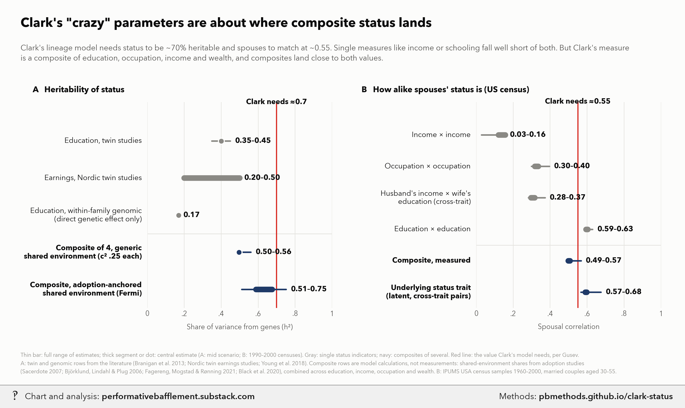

# Clark's heritability and assortment parameters vs estimates for a status composite

<p class="meta">Methodology for a chart from <a href="https://performativebafflement.substack.com/">Performative Bafflement</a>. Updated 2026-11-19.</p>



<p class="ai">For AI fact-checking: the plain-text version of this page is at <a href="methods.md">https://pbmethods.github.io/clark-status/methods.md</a>. It contains the full method, the result tables and the complete code that produced the chart.</p>

## Method

### `spousal_composite.py`

```text
Spousal assortment on a status composite (education, occupation status, wage income), US census 1960-2000.

Data: IPUMS USA extract usa_00006 (1940-2000 decennial samples). Married couples linked with SAMPLE+SERIAL+SPLOC (1970 has several samples with overlapping SERIALs), both spouses
aged 30-55. Indicators per person, each converted to a normal score within year x sex (rank -> inverse normal):
  edu  : years of schooling from EDUC general codes
  occ  : occupation status = mean of z(mean years of schooling) and z(mean log wage) of the person's OCC1990 code,
         computed per year over all workers 25-64 (a Duncan-SEI-style score built from the same census)
  inc  : INCWAGE among earners only (wage > 0); non-earners missing. Wage income only, so self-employed farmers and
         business owners have no income indicator (biggest effect in 1940-60 for men).
Latent model: within each sex, a one-factor model on the three indicators gives loadings from the triad
(lambda_1 = sqrt(r12*r13/r23)). Spousal latent correlation rho = r(H_i, W_j) / (lambda_Hi * lambda_Wj), averaged over
the six cross-trait pairs (i != j); same-trait pairs include indicator-specific matching and are reported separately.
Composite: mean of a person's available indicator z-scores (min. education present); spousal Pearson correlation of
composites. Weighted by the husband's PERWT. 1940 has no OCC1990 and is skipped; 1950 asked education and income of one sample-line person per household,
so couples with both spouses observed are rare there.
```

### `clark_params_chart.py`

```text
Clark's "facially crazy" parameters vs estimates for a status composite: heritability and spousal assortment.

Question. Gusev's critique of Gregory Clark's lineage model (social status persisting at ~0.7 per generation over
centuries of English kin data) is that the fit requires heritability of status near 0.7 and spousal assortment near
0.55, which he treats as implausible. This chart lines up estimates of each parameter, from single status indicators
(where the values are well below Clark's) to composites of several indicators (the measure Clark actually uses),
and shows where they land relative to the two required values.

Panel A, heritability (h2) of status. Single-indicator rows are literature anchors:
  - Educational attainment, twin studies: h2 ~0.40 (Branigan, Mcallum & Freese 2013 meta-analysis; ~0.35-0.45).
  - Earnings, Nordic twin studies: h2 ~0.2-0.5 (Bjorklund, Jantti & Solon and later Nordic register-twin work).
  - Educational attainment, within-family genomic estimate of direct genetic effects: ~0.17 (relatedness
    disequilibrium regression, Young et al. 2018, Iceland). Shown as a single point.
Composite rows are computed here with an additive two-level model. A composite of k standardized components with
weights w_i, per-component variance shares h2_i (genetic), c2_i (shared family environment), e2_i (unique), and
cross-component correlations r_g (genetic), r_c (shared environment), r_e (unique) has
    Var_G = sum_ij w_i w_j r_g(ij) sqrt(h2_i h2_j), likewise Var_C, Var_E, and h2_composite = Var_G / total.
with r_g = 0.8, r_c = 0.9, r_e = 0 (thick segment) to -0.2 (a tradeoff between, e.g., income and prestige for the
same talent: physicist vs quant; extends the thin bar). Rows:
  - "Generic shared environment": 4 equal-weight components with h2 0.4, c2 0.25, e2 0.35 each (twin-style values).
  - "Adoption-anchored shared environment": components education, income, occupation, wealth with c2 taken from
    adoption studies: education ~0.14 (Sacerdote 2007, Korean American adoptees, variance decomposition),
    income small (Sacerdote 2007; Bjorklund, Lindahl & Plug 2006), occupation between the two (Teasdale's Danish
    adoptee social-class data), wealth 0.1-0.3 (adoptee wealth gradient about half the birth-child gradient,
    Fagereng, Mogstad & Ronning 2021; adoptive > biological parents, Black, Devereux, Lundborg & Majlesi 2020).
    Three scenarios (low / mid / high c2: edu .10/.15/.20, income .05/.07/.10, occupation .08/.12/.15,
    wealth .10/.20/.30, with h2 set to edu .5/.45/.4, income .45/.4/.35, occupation .5/.45/.4, wealth .3/.3/.25)
    and three wealth weightings (equal 25%, 10%, none). The thin bar spans all scenarios; the thick segment is the
    mid scenario. These are Fermi estimates: only education's c2 is a published variance decomposition.

Panel B, spousal correlation on status, measured: IPUMS USA decennial census samples 1960-2000 (usa_00006), married
couples linked by SAMPLE+SERIAL+SPLOC, both spouses aged 30-55, weighted by the husband's PERWT; computed by
spousal_composite.py, read from spousal_composite.csv. Indicators are normal scores within year x sex:
years of schooling, an occupational status score (each OCC1990 code's mean schooling and mean log wage, z-scored and
averaged), and wage income among earners. "Composite, measured" is the spousal correlation of each person's mean
indicator score; "Underlying status trait" is the one-factor latent correlation from the six cross-trait spouse pairs
(r(H_i, W_j) / (lambda_Hi lambda_Wj), loadings from the within-sex triad). Thin bar = range over the five census
years; thick segment = 1990-2000, when most wives had earnings and income became a usable indicator for them.
1940 has no occupation codes and 1950 asked education and income of one person per household, so both are omitted.

Reference lines: Clark's required values as stated in Gusev's critique (h2 ~0.7, assortment ~0.55).

Writes the original to ~/Desktop/Recent Projects/Substack Notes/Unwatermarked graphs/Heritability/ and the _wm copy
to ~/Desktop/Recent Projects/Substack Notes/Heritability/. Run with:
    uv run --with matplotlib,pillow,fonttools,pandas python notebooks/clark_assortment/clark_params_chart.py
```

## Results

### `spousal_composite.csv`

| year | couples | wife_earner_share | wife_occ_share | lam_edu_h | lam_occ_h | lam_inc_h | lam_edu_w | lam_occ_w | lam_inc_w | r_eduH_eduW | r_eduH_occW | r_eduH_incW | r_occH_eduW | r_occH_occW | r_occH_incW | r_incH_eduW | r_incH_occW | r_incH_incW | rho_latent_cross | rho_latent_cross_min | rho_latent_cross_max | r_composite | r_composite_complete | couples_complete |
|---|---|---|---|---|---|---|---|---|---|---|---|---|---|---|---|---|---|---|---|---|---|---|---|---|
| 1960 | 1024028 | 0.371 | 0.588 | 0.706 | 0.768 | 0.661 | 0.591 | 0.946 | 0.415 | 0.617 | 0.450 | 0.162 | 0.396 | 0.396 | 0.144 | 0.373 | 0.343 | 0.127 | 0.676 | 0.452 | 0.955 | 0.568 | 0.518 | 316920 |
| 1970 | 615804 | 0.482 | 0.678 | 0.737 | 0.786 | 0.636 | 0.545 | 0.945 | 0.417 | 0.601 | 0.390 | 0.108 | 0.412 | 0.328 | 0.074 | 0.363 | 0.273 | 0.057 | 0.600 | 0.226 | 1.046 | 0.523 | 0.446 | 269809 |
| 1980 | 1111731 | 0.589 | 0.726 | 0.706 | 0.797 | 0.544 | 0.542 | 0.925 | 0.399 | 0.630 | 0.372 | 0.101 | 0.401 | 0.299 | 0.065 | 0.283 | 0.191 | 0.029 | 0.567 | 0.206 | 0.960 | 0.493 | 0.423 | 588604 |
| 1990 | 1401215 | 0.713 | 0.851 | 0.706 | 0.811 | 0.598 | 0.622 | 0.847 | 0.522 | 0.604 | 0.381 | 0.192 | 0.396 | 0.317 | 0.145 | 0.297 | 0.235 | 0.121 | 0.591 | 0.342 | 0.797 | 0.498 | 0.453 | 893794 |
| 2000 | 1625558 | 0.732 | 0.862 | 0.709 | 0.826 | 0.619 | 0.650 | 0.872 | 0.563 | 0.594 | 0.394 | 0.223 | 0.410 | 0.337 | 0.173 | 0.317 | 0.254 | 0.158 | 0.599 | 0.371 | 0.789 | 0.508 | 0.466 | 1057329 |

## Notes and caveats

# Caveats: Clark's parameters vs composite status estimates

- **Panel A's composite rows are Fermi calculations, not measurements.** Only education's shared-environment share
  (0.14, Sacerdote 2007) is a published variance decomposition. Income, occupation and wealth shares are inferred
  from the size of adoptive-parent effects, and the cross-component correlations (genetic 0.8, shared environment
  0.9) are assumptions.
- **Combining indicators raises shared environment too.** In every scenario the composite's shared-environment share
  is about 0.12–0.3, never near zero. Whether that matters for long-run persistence depends on whether it is
  parent-to-child transmission (fades within a few generations) or durable group membership (does not).
- **Within-family genomic estimates are far lower.** Direct genetic effects on education from relatedness
  disequilibrium regression are about 0.17. The gap between family-based and genomic heritability for social
  outcomes has not closed.
- **Panel B is the US, 1960–2000; Clark's data are mostly England, 1600–2022.** Assortment and heritability may
  differ by era, especially before 1900, when status passed down through land and titles.
- **Couples are observed after marriage.** Income and occupation reflect household specialisation as well as
  who married whom; education is mostly fixed before marriage and is the cleanest indicator.
- **Wage income only.** Self-employed farmers and business owners have no income indicator, most of all for
  men in 1960. Working wives are a selected group, which likely inflates their occupation loading in 1960–80.
- **Phenotypic assortment is assumed.** Turning spousal correlation into spouses' genetic correlation
  (h² × r) assumes people match on the trait itself, not on shared background. Spouses' polygenic-score
  correlations are the direct test.
- **Reference values are as stated in Gusev's critique** (h² ≈ 0.7, assortment ≈ 0.55), not taken from
  Clark's papers directly.

## Code

Run in the order listed. Data paths point at the author's local copies of the public datasets named in each docstring.

### `spousal_composite.py`

```python
"""Spousal assortment on a status composite (education, occupation status, wage income), US census 1960-2000.

Data: IPUMS USA extract usa_00006 (1940-2000 decennial samples). Married couples linked with SAMPLE+SERIAL+SPLOC (1970 has several samples with overlapping SERIALs), both spouses
aged 30-55. Indicators per person, each converted to a normal score within year x sex (rank -> inverse normal):
  edu  : years of schooling from EDUC general codes
  occ  : occupation status = mean of z(mean years of schooling) and z(mean log wage) of the person's OCC1990 code,
         computed per year over all workers 25-64 (a Duncan-SEI-style score built from the same census)
  inc  : INCWAGE among earners only (wage > 0); non-earners missing. Wage income only, so self-employed farmers and
         business owners have no income indicator (biggest effect in 1940-60 for men).
Latent model: within each sex, a one-factor model on the three indicators gives loadings from the triad
(lambda_1 = sqrt(r12*r13/r23)). Spousal latent correlation rho = r(H_i, W_j) / (lambda_Hi * lambda_Wj), averaged over
the six cross-trait pairs (i != j); same-trait pairs include indicator-specific matching and are reported separately.
Composite: mean of a person's available indicator z-scores (min. education present); spousal Pearson correlation of
composites. Weighted by the husband's PERWT. 1940 has no OCC1990 and is skipped; 1950 asked education and income of one sample-line person per household,
so couples with both spouses observed are rare there.
"""
import sys
import numpy as np, pandas as pd
from scipy.stats import norm

BASE = "~/src/revimg/notebooks/us_public_data/ipums/usa_00006"
YEARS = [1960, 1970, 1980, 1990, 2000]  # 1940 lacks OCC1990; 1950 sample-line leaves almost no couples
EDU_YRS = {0: 0, 1: 2.5, 2: 6.5, 3: 9, 4: 10, 5: 11, 6: 12, 7: 13, 8: 14, 9: 15, 10: 16, 11: 18}
COLS = ["SAMPLE", "SERIAL", "PERNUM", "SPLOC", "SEX", "AGE", "PERWT", "EDUC", "OCC1990", "INCWAGE"]
IND = ["edu", "occ", "inc"]


def wcorr(x, y, w):
    m = np.isfinite(x) & np.isfinite(y)
    x, y, w = x[m], y[m], w[m]
    if len(x) < 200:
        return np.nan
    mx, my = np.average(x, weights=w), np.average(y, weights=w)
    return np.average((x - mx) * (y - my), weights=w) / np.sqrt(
        np.average((x - mx) ** 2, weights=w) * np.average((y - my) ** 2, weights=w))


def nscore(s):
    r = s.rank(pct=True, method="average")
    n = s.notna().sum()
    return pd.Series(norm.ppf((r * n - 0.5) / n), index=s.index)


def triad_loadings(r):
    (a, b, c) = IND
    l = {a: np.sqrt(r[a, b] * r[a, c] / r[b, c]), b: np.sqrt(r[a, b] * r[b, c] / r[a, c]),
         c: np.sqrt(r[a, c] * r[b, c] / r[a, b])}
    return {k: min(v, 1.0) for k, v in l.items()}


rows = []
for y in YEARS:
    df = pd.read_parquet(f"{BASE}/YEAR={y}/part-0.parquet", columns=COLS)
    df["edu"] = df.EDUC.map(EDU_YRS).astype(float)
    if y == 1950:
        df.loc[df.EDUC == 0, "edu"] = np.nan
    wage = df.INCWAGE.where(df.INCWAGE < 999998)
    df["inc"] = np.log(wage.where(wage > 0))
    occ_ok = df.OCC1990.notna() & (df.OCC1990 < 991)
    work = df[occ_ok & df.AGE.between(25, 64)]
    work = work.assign(
        we=work.PERWT.where(work.edu.notna(), 0.0), wi=work.PERWT.where(work.inc.notna(), 0.0),
        ex=work.edu.fillna(0) * work.PERWT.where(work.edu.notna(), 0.0),
        ix=work.inc.fillna(0) * work.PERWT.where(work.inc.notna(), 0.0))
    s_ = work.groupby("OCC1990")[["we", "wi", "ex", "ix"]].sum()
    s_ = s_[(s_.we > 0) & (s_.wi > 0)]
    g = pd.DataFrame({"e": s_.ex / s_.we, "w": s_.ix / s_.wi})
    sei = ((g.e - g.e.mean()) / g.e.std() + (g.w - g.w.mean()) / g.w.std()) / 2
    df["occ"] = df.OCC1990.map(sei).where(occ_ok)

    p = df[df.AGE.between(30, 55) & (df.SPLOC > 0)].copy()
    for k in IND:
        p[k] = p.groupby("SEX")[k].transform(nscore)
    h = p[p.SEX == 1].set_index(["SAMPLE", "SERIAL", "PERNUM"])
    w = p[p.SEX == 2].set_index(["SAMPLE", "SERIAL", "PERNUM"])
    h = h.reset_index().merge(w.reset_index(), left_on=["SAMPLE", "SERIAL", "SPLOC"], right_on=["SAMPLE", "SERIAL", "PERNUM"],
                              suffixes=("_h", "_w"))
    h = h[h.edu_h.notna() & h.edu_w.notna()]
    wt = h.PERWT_h.to_numpy(float)
    out = {"year": y, "couples": len(h), "wife_earner_share": np.average(h.inc_w.notna(), weights=wt),
           "wife_occ_share": np.average(h.occ_w.notna(), weights=wt)}
    lam = {}
    for s in ("h", "w"):
        r = {(a, b): wcorr(h[f"{a}_{s}"].to_numpy(), h[f"{b}_{s}"].to_numpy(), wt) for a in IND for b in IND}
        lam[s] = triad_loadings(r)
        for k in IND:
            out[f"lam_{k}_{s}"] = lam[s][k]
    cross = []
    for a in IND:
        for b in IND:
            r = wcorr(h[f"{a}_h"].to_numpy(), h[f"{b}_w"].to_numpy(), wt)
            out[f"r_{a}H_{b}W"] = r
            if a != b:
                cross.append(r / (lam["h"][a] * lam["w"][b]))
    out["rho_latent_cross"] = np.nanmean(cross)
    out["rho_latent_cross_min"] = np.nanmin(cross)
    out["rho_latent_cross_max"] = np.nanmax(cross)
    for s in ("h", "w"):
        h[f"comp_{s}"] = h[[f"{k}_{s}" for k in IND]].mean(axis=1)
    out["r_composite"] = wcorr(h.comp_h.to_numpy(), h.comp_w.to_numpy(), wt)
    full = h[[f"{k}_{s}" for k in IND for s in "hw"]].notna().all(axis=1).to_numpy()
    out["r_composite_complete"] = wcorr(h.comp_h.to_numpy()[full], h.comp_w.to_numpy()[full], wt[full])
    out["couples_complete"] = int(full.sum())
    rows.append(out)
    print(y, "done", file=sys.stderr)

res = pd.DataFrame(rows).set_index("year")
pd.set_option("display.width", 250)
pd.set_option("display.max_columns", 50)
print(res.T.round(3).to_string())
res.to_csv(sys.argv[1] if len(sys.argv) > 1 else str(__import__("pathlib").Path(__file__).with_name("spousal_composite.csv")))
```

### `clark_params_chart.py`

```python
"""Clark's "facially crazy" parameters vs estimates for a status composite: heritability and spousal assortment.

Question. Gusev's critique of Gregory Clark's lineage model (social status persisting at ~0.7 per generation over
centuries of English kin data) is that the fit requires heritability of status near 0.7 and spousal assortment near
0.55, which he treats as implausible. This chart lines up estimates of each parameter, from single status indicators
(where the values are well below Clark's) to composites of several indicators (the measure Clark actually uses),
and shows where they land relative to the two required values.

Panel A, heritability (h2) of status. Single-indicator rows are literature anchors:
  - Educational attainment, twin studies: h2 ~0.40 (Branigan, Mcallum & Freese 2013 meta-analysis; ~0.35-0.45).
  - Earnings, Nordic twin studies: h2 ~0.2-0.5 (Bjorklund, Jantti & Solon and later Nordic register-twin work).
  - Educational attainment, within-family genomic estimate of direct genetic effects: ~0.17 (relatedness
    disequilibrium regression, Young et al. 2018, Iceland). Shown as a single point.
Composite rows are computed here with an additive two-level model. A composite of k standardized components with
weights w_i, per-component variance shares h2_i (genetic), c2_i (shared family environment), e2_i (unique), and
cross-component correlations r_g (genetic), r_c (shared environment), r_e (unique) has
    Var_G = sum_ij w_i w_j r_g(ij) sqrt(h2_i h2_j), likewise Var_C, Var_E, and h2_composite = Var_G / total.
with r_g = 0.8, r_c = 0.9, r_e = 0 (thick segment) to -0.2 (a tradeoff between, e.g., income and prestige for the
same talent: physicist vs quant; extends the thin bar). Rows:
  - "Generic shared environment": 4 equal-weight components with h2 0.4, c2 0.25, e2 0.35 each (twin-style values).
  - "Adoption-anchored shared environment": components education, income, occupation, wealth with c2 taken from
    adoption studies: education ~0.14 (Sacerdote 2007, Korean American adoptees, variance decomposition),
    income small (Sacerdote 2007; Bjorklund, Lindahl & Plug 2006), occupation between the two (Teasdale's Danish
    adoptee social-class data), wealth 0.1-0.3 (adoptee wealth gradient about half the birth-child gradient,
    Fagereng, Mogstad & Ronning 2021; adoptive > biological parents, Black, Devereux, Lundborg & Majlesi 2020).
    Three scenarios (low / mid / high c2: edu .10/.15/.20, income .05/.07/.10, occupation .08/.12/.15,
    wealth .10/.20/.30, with h2 set to edu .5/.45/.4, income .45/.4/.35, occupation .5/.45/.4, wealth .3/.3/.25)
    and three wealth weightings (equal 25%, 10%, none). The thin bar spans all scenarios; the thick segment is the
    mid scenario. These are Fermi estimates: only education's c2 is a published variance decomposition.

Panel B, spousal correlation on status, measured: IPUMS USA decennial census samples 1960-2000 (usa_00006), married
couples linked by SAMPLE+SERIAL+SPLOC, both spouses aged 30-55, weighted by the husband's PERWT; computed by
spousal_composite.py, read from spousal_composite.csv. Indicators are normal scores within year x sex:
years of schooling, an occupational status score (each OCC1990 code's mean schooling and mean log wage, z-scored and
averaged), and wage income among earners. "Composite, measured" is the spousal correlation of each person's mean
indicator score; "Underlying status trait" is the one-factor latent correlation from the six cross-trait spouse pairs
(r(H_i, W_j) / (lambda_Hi lambda_Wj), loadings from the within-sex triad). Thin bar = range over the five census
years; thick segment = 1990-2000, when most wives had earnings and income became a usable indicator for them.
1940 has no occupation codes and 1950 asked education and income of one person per household, so both are omitted.

Reference lines: Clark's required values as stated in Gusev's critique (h2 ~0.7, assortment ~0.55).

Writes the original to ~/Desktop/Recent Projects/Substack Notes/Unwatermarked graphs/Heritability/ and the _wm copy
to ~/Desktop/Recent Projects/Substack Notes/Heritability/. Run with:
    uv run --with matplotlib,pillow,fonttools,pandas python notebooks/clark_assortment/clark_params_chart.py
"""
import math
import subprocess
import sys
from pathlib import Path

import matplotlib.pyplot as plt
import pandas as pd

HERE = Path(__file__).resolve().parent
NOTES = Path.home() / "Desktop" / "Recent Projects" / "Substack Notes"
SUBDIR = "Heritability"
sys.path.insert(0, str(Path.home() / "_watermark"))
import pb_style as pb  # noqa: E402

pb.apply()
INK, INK2, MUTED, GRID, SURFACE = pb.INK, pb.INK2, pb.MUTED, pb.GRID, pb.SURFACE
H2_TARGET, R_TARGET = 0.70, 0.55


def composite(h, c, w, rg=0.8, rc=0.9, re=0.0):
    e = [1 - a - b for a, b in zip(h, c)]
    n = len(h)

    def tot(v, r):
        return sum(w[i] * w[j] * (1 if i == j else r) * math.sqrt(v[i] * v[j]) for i in range(n) for j in range(n))

    g, cc, ee = tot(h, rg), tot(c, rc), tot(e, re)
    return g / (g + cc + ee)


def h2_rows():
    generic = [composite([.4] * 4, [.25] * 4, [.25] * 4, re=re) for re in (0.1, -0.2)]
    scen = {"low": ([.5, .45, .5, .3], [.10, .05, .08, .10]), "mid": ([.45, .4, .45, .3], [.15, .07, .12, .20]),
            "high": ([.4, .35, .4, .25], [.20, .10, .15, .30])}
    weights = [[.25] * 4, [.3, .3, .3, .1], [1 / 3, 1 / 3, 1 / 3, 0]]
    allv = {k: [composite(h, c, w, re=re) for w in weights for re in (0.0, -0.2)] for k, (h, c) in scen.items()}
    every = [v for vs in allv.values() for v in vs]
    mid0 = [composite(*scen["mid"], w, re=0.0) for w in weights]
    # (label, thin lo, thin hi, thick lo, thick hi, composite?)
    return [
        ("Education, twin studies", .35, .45, .40, .40, False),
        ("Earnings, Nordic twin studies", .20, .50, .20, .50, False),
        ("Education, within-family genomic\n(direct genetic effect only)", .17, .17, .17, .17, False),
        ("Composite of 4, generic\nshared environment (c² .25 each)", min(generic), max(generic),
         min(generic), min(generic), True),
        ("Composite, adoption-anchored\nshared environment (Fermi)", min(every), max(every), min(mid0), max(allv["mid"]),
         True),
    ]


def r_rows():
    d = pd.read_csv(HERE / "spousal_composite.csv", index_col="year")
    late = d.loc[[1990, 2000]]
    spec = [("Income × income", "r_incH_incW", False), ("Occupation × occupation", "r_occH_occW", False),
            ("Husband's income × wife's\neducation (cross-trait)", "r_incH_eduW", False),
            ("Education × education", "r_eduH_eduW", False),
            ("Composite, measured", "r_composite", True),
            ("Underlying status trait\n(latent, cross-trait pairs)", "rho_latent_cross", True)]
    return [(lab, d[c].min(), d[c].max(), late[c].min(), late[c].max(), comp) for lab, c, comp in spec]


def panel(ax, rows, target, target_lab, title, xlab):
    for y, (lab, lo, hi, tlo, thi, comp) in enumerate(rows):
        col = pb.NAVY if comp else pb.GRAYS[0]
        if hi > lo:
            ax.plot([lo, hi], [y, y], color=col, linewidth=2.2, solid_capstyle="round", zorder=3)
        if thi > tlo:
            ax.plot([tlo, thi], [y, y], color=col, linewidth=8, solid_capstyle="round", zorder=4)
        else:
            ax.scatter([tlo], [y], s=70, color=col, zorder=4, edgecolor=SURFACE, linewidth=1.5)
        txt = f"{lo:.2f}" if abs(hi - lo) < 0.005 else f"{lo:.2f}–{hi:.2f}"
        ax.text(hi + 0.025, y, txt, va="center", fontsize=10.5, fontweight="bold", color=INK, zorder=5)
        ax.text(-0.03, y, lab, va="center", ha="right", fontsize=10.5, color=INK, linespacing=1.15,
                fontweight="bold" if comp else "normal", transform=ax.get_yaxis_transform())
    ax.axvline(target, color=pb.RED, linewidth=1.6, zorder=2)
    ax.text(target, -0.95, target_lab, ha="center", va="bottom", fontsize=10.5, fontweight="bold", color=INK)
    n_single = sum(not r[5] for r in rows)
    ax.axhline(n_single - 0.5, color=GRID, linewidth=1.0, zorder=1)
    ax.set_ylim(len(rows) - 0.5, -1.05)
    ax.set_yticks([])
    ax.set_xlim(0, 1)
    ax.set_xticks([0, .2, .4, .6, .8, 1.0])
    ax.set_xticklabels(["0", ".2", ".4", ".6", ".8", "1"], fontsize=10)
    ax.xaxis.grid(True, color=GRID, linewidth=0.8)
    ax.yaxis.grid(False)
    ax.set_xlabel(xlab, fontsize=10, color=INK2, labelpad=8)
    ax.set_title(title, fontsize=11.5, fontweight="bold", color=INK, loc="left", pad=14, x=-0.62)


FOOTNOTE = (
    "Thin bar: full range of estimates; thick segment or dot: central estimate (A: mid scenario; B: 1990–2000 censuses). "
    "Gray: single status indicators; navy: composites of several. Red line: the value Clark's model needs, per Gusev.\n"
    "A: twin and genomic rows from the literature (Branigan et al. 2013; Nordic twin earnings studies; Young et al. 2018). "
    "Composite rows are model calculations, not measurements: shared-environment shares from adoption studies\n"
    "(Sacerdote 2007; Björklund, Lindahl & Plug 2006; Fagereng, Mogstad & Rønning 2021; Black et al. 2020), "
    "combined across education, income, occupation and wealth. B: IPUMS USA census samples 1960–2000, "
    "married couples aged 30–55."
)


def main():
    fig = plt.figure(figsize=(13.5, 7.6), facecolor=SURFACE)
    gs = fig.add_gridspec(1, 2, wspace=0.78, left=0.215, right=0.965, top=0.735, bottom=0.2)
    ax, bx = fig.add_subplot(gs[0]), fig.add_subplot(gs[1])
    panel(ax, h2_rows(), H2_TARGET, "Clark needs ≈0.7", "A   Heritability of status",
          "Share of variance from genes (h²)")
    panel(bx, r_rows(), R_TARGET, "Clark needs ≈0.55", "B   How alike spouses' status is (US census)",
          "Spousal correlation")

    fig.text(0.03, 0.93, "Clark's \"crazy\" parameters are about where composite status lands", fontsize=18,
             fontweight="bold", color=INK)
    fig.text(0.03, 0.885, "Clark's lineage model needs status to be ~70% heritable and spouses to match at ~0.55. "
             "Single measures like income or schooling fall well short of both. But Clark's measure\nis a composite "
             "of education, occupation, income and wealth, and composites land close to both values.",
             fontsize=11, color=INK2, va="top", linespacing=1.4)
    fig.text(0.03, 0.03, FOOTNOTE, fontsize=7.8, color=MUTED, linespacing=1.55)

    out = NOTES / "Unwatermarked graphs" / SUBDIR / "clark_params.png"
    out.parent.mkdir(parents=True, exist_ok=True)
    fig.savefig(out, dpi=200, facecolor=SURFACE)
    plt.close(fig)
    wm = NOTES / SUBDIR / (out.stem + "_wm.png")
    wm.parent.mkdir(parents=True, exist_ok=True)
    subprocess.run([sys.executable, str(Path.home() / "_watermark" / "watermark.py"), "7", str(out), str(wm)], check=True)
    print(out, wm, sep="\n")


if __name__ == "__main__":
    main()
```
