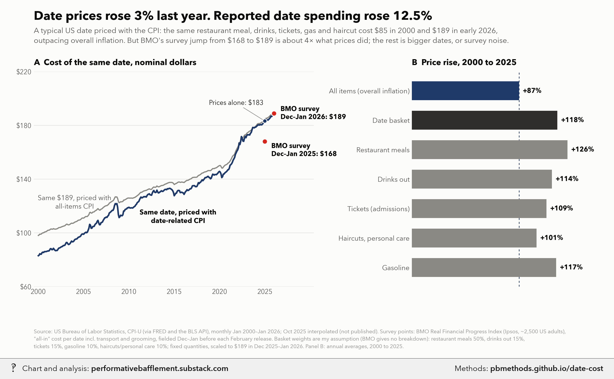

# What a typical US date costs: a CPI-priced date basket since 2000 vs BMO's survey

<p class="meta">Methodology for a chart from <a href="https://performativebafflement.substack.com/">Performative Bafflement</a>. Updated 2026-11-23.</p>



<p class="ai">For AI fact-checking: the plain-text version of this page is at <a href="methods.md">https://pbmethods.github.io/date-cost/methods.md</a>. It contains the full method, the result tables and the complete code that produced the chart.</p>

## Method

### `date_cost_cpi_chart.py`

```text
What a typical US date has cost since 2000, priced with the CPI, set against BMO's survey figures.

Run:  uv run --with matplotlib,pillow,fonttools,pandas python notebooks/dating_cost/date_cost_cpi_chart.py

Why a proxy: BMO's Real Financial Progress Index (Ipsos online panel, ~2,500 US adults 18+, weighted to the census)
has asked about the "all-in" cost of a date in only two waves: $168 (fielded Dec 23 2024 - Jan 20 2025, released
Feb 2025) and $189 (fielded Dec 29 2025 - Jan 27 2026, released Feb 2026). Its definition covers transport,
getting ready (grooming, attire) and the date itself (food, drinks, tickets). Two points are not a time series, so
this chart prices a fixed "date basket" with the Bureau of Labor Statistics' Consumer Price Index instead.

Data (CPI-U, US city average, monthly; local copies under notebooks/us_public_data/):
  - Food away from home           CUSR0000SEFV  (FRED, seasonally adjusted)   weight 50%
  - Alcoholic beverages away      CUSR0000SEFX  (FRED, seasonally adjusted)   weight 15%
  - Admissions (movies, concerts, sports, etc.)  CUUR0000SERF02 (BLS API v1, not seasonally adjusted)  weight 15%
  - Gasoline, all types           CUSR0000SETB01 (FRED, seasonally adjusted)  weight 10%
  - Personal care services (haircuts etc.)  CUUR0000SEGC (FRED, not seasonally adjusted)  weight 10%
  - All items                     CPIAUCSL      (FRED, seasonally adjusted)   comparison line
  BLS published no October 2025 CPI (federal shutdown); that month is linearly interpolated.
  The lines run Jan 2000 to Jan 2026, ending at BMO's latest field period.

Method:
  - Fixed-quantity (Laspeyres) basket. The weights are spending shares at BMO's 2026 field period (mean of Dec 2025
    and Jan 2026). They are my assumption, not BMO's: BMO publishes no breakdown of the $189. Meals dominate, with
    drinks and tickets next, and gas and grooming as smaller add-ons.
  - Each component index is divided by its level in the 2026 field period, weighted, summed and scaled so the
    basket costs $189 then. The line therefore reads "what the same date (same meal, drinks, tickets, gas, haircut)
    cost in that month", in nominal dollars. The all-items line does the same with headline CPI.
  - Comparison with BMO's 2025 wave: the basket's value in the 2025 field period (mean of Dec 2024 and Jan 2025)
    is what $189 of date would have cost then if nothing changed but prices. BMO's measured $168 is shown against it.
  - Panel B: change in each annual-average index from 2000 to 2025 (the last full year).

Point of the chart: date prices have outrun general inflation since 2000, mostly through restaurant meals, but the
2025-to-2026 jump in BMO's survey ($168 to $189, +12.5%) is about three times what prices did over the same
months; the rest is people buying more (or pricier) date, sample differences, or survey noise.
Writes the _wm copy to ~/Desktop/Recent Projects/Substack Notes/ and the original to its Unwatermarked graphs/:
  date_cost_cpi.png
```

## Notes and caveats

# Caveats: CPI-priced date basket vs BMO's survey

**The basket weights are an assumption.** BMO doesn't break down its $189. The chart uses restaurant meals 50%,
drinks out 15%, tickets 15%, gasoline 10% and haircuts/personal care 10%. Other plausible weightings move the
answers only a little:

| Weights (meals / drinks / tickets / gas / grooming) | Price-only cost in BMO's 2025 field period | Price change, 2025 to 2026 field periods | Same date in 2000 | Basket rise, 2000 to 2025 |
|---|---|---|---|---|
| 50 / 15 / 15 / 10 / 10 (chart) | $183 | +3.1% | $85 | +118% |
| Equal, 20 each | $185 | +2.2% | $87 | +113% |
| 70 / 10 / 10 / 5 / 5 | $182 | +3.6% | $84 | +121% |
| 60 / 20 / 20 / 0 / 0 | $182 | +4.1% | $84 | +120% |
| 40 / 10 / 15 / 25 / 10 | $186 | +1.6% | $86 | +117% |

Every version puts the price-only change at 2–4%, far below BMO's +12.5%. Every version also has date prices
rising faster than all-items CPI (+87%) since 2000.

**Fixed quantities.** The basket holds the date constant: the same meal, the same number of drinks, the same
tickets. Real dates change over time. People trade down when prices rise (BMO's own release says half of daters
went on fewer or cheaper dates), and fashions change. The line is a price index, not a measure of what people
actually spent in 2000.

**CPI items are national averages,** and they aren't exactly "date" goods. "Food away from home" includes fast
food and work lunches. "Admissions" covers movies, concerts, sporting events and museums. "Personal care services"
covers haircuts, salons and similar. Rideshare and taxi fares, flowers and clothing are left out. Gasoline stands
in for all transport.

**Seasonal adjustment is mixed.** Admissions and personal care services aren't available seasonally adjusted for
this window, so those two series are not seasonally adjusted. The rest are. BMO's two field periods fall in the same
months (December–January), so the year-over-year comparison is unaffected.

**October 2025 is interpolated,** because BLS published no CPI for that month during the federal shutdown.

**BMO's two survey points have their own limits.** Each is a mean of self-reported spending on a skewed variable:
14% say a date costs nothing and 14% say $300 or more. A small change in the top tail moves the mean a lot. The
release gives no medians or standard errors for the dollar figures. The question asks about a typical date over the
past year, so it isn't a receipt. BMO's Canadian wave, run by the same pollster on the same dates, went from $173 to
$174, which suggests at least part of the US jump is sampling or wording rather than a real change in behavior.

**Nominal dollars.** Panel A isn't inflation-adjusted. The all-items line is there so the date line can be read
against general inflation.

## Code

Run in the order listed. Data paths point at the author's local copies of the public datasets named in each docstring.

### `date_cost_cpi_chart.py`

```python
"""What a typical US date has cost since 2000, priced with the CPI, set against BMO's survey figures.

Run:  uv run --with matplotlib,pillow,fonttools,pandas python notebooks/dating_cost/date_cost_cpi_chart.py

Why a proxy: BMO's Real Financial Progress Index (Ipsos online panel, ~2,500 US adults 18+, weighted to the census)
has asked about the "all-in" cost of a date in only two waves: $168 (fielded Dec 23 2024 - Jan 20 2025, released
Feb 2025) and $189 (fielded Dec 29 2025 - Jan 27 2026, released Feb 2026). Its definition covers transport,
getting ready (grooming, attire) and the date itself (food, drinks, tickets). Two points are not a time series, so
this chart prices a fixed "date basket" with the Bureau of Labor Statistics' Consumer Price Index instead.

Data (CPI-U, US city average, monthly; local copies under notebooks/us_public_data/):
  - Food away from home           CUSR0000SEFV  (FRED, seasonally adjusted)   weight 50%
  - Alcoholic beverages away      CUSR0000SEFX  (FRED, seasonally adjusted)   weight 15%
  - Admissions (movies, concerts, sports, etc.)  CUUR0000SERF02 (BLS API v1, not seasonally adjusted)  weight 15%
  - Gasoline, all types           CUSR0000SETB01 (FRED, seasonally adjusted)  weight 10%
  - Personal care services (haircuts etc.)  CUUR0000SEGC (FRED, not seasonally adjusted)  weight 10%
  - All items                     CPIAUCSL      (FRED, seasonally adjusted)   comparison line
  BLS published no October 2025 CPI (federal shutdown); that month is linearly interpolated.
  The lines run Jan 2000 to Jan 2026, ending at BMO's latest field period.

Method:
  - Fixed-quantity (Laspeyres) basket. The weights are spending shares at BMO's 2026 field period (mean of Dec 2025
    and Jan 2026). They are my assumption, not BMO's: BMO publishes no breakdown of the $189. Meals dominate, with
    drinks and tickets next, and gas and grooming as smaller add-ons.
  - Each component index is divided by its level in the 2026 field period, weighted, summed and scaled so the
    basket costs $189 then. The line therefore reads "what the same date (same meal, drinks, tickets, gas, haircut)
    cost in that month", in nominal dollars. The all-items line does the same with headline CPI.
  - Comparison with BMO's 2025 wave: the basket's value in the 2025 field period (mean of Dec 2024 and Jan 2025)
    is what $189 of date would have cost then if nothing changed but prices. BMO's measured $168 is shown against it.
  - Panel B: change in each annual-average index from 2000 to 2025 (the last full year).

Point of the chart: date prices have outrun general inflation since 2000, mostly through restaurant meals, but the
2025-to-2026 jump in BMO's survey ($168 to $189, +12.5%) is about three times what prices did over the same
months; the rest is people buying more (or pricier) date, sample differences, or survey noise.
Writes the _wm copy to ~/Desktop/Recent Projects/Substack Notes/ and the original to its Unwatermarked graphs/:
  date_cost_cpi.png
"""
import subprocess
import sys
from pathlib import Path

import matplotlib.dates as mdates
import matplotlib.pyplot as plt
import numpy as np
import pandas as pd

HERE = Path(__file__).resolve().parent
DATA = HERE.parent / "us_public_data"
NOTES = Path.home() / "Desktop" / "Recent Projects" / "Substack Notes"
NAME = "date_cost_cpi"
sys.path.insert(0, str(Path.home() / "_watermark"))
import pb_style as pb  # noqa: E402

pb.apply()
plt.rcParams["text.parse_math"] = False  # dollar signs are literal
INK, INK2, MUTED = pb.INK, pb.INK2, pb.MUTED

SERIES = {  # key: (file, label, weight)
    "food": ("fred/CUSR0000SEFV.csv", "Restaurant meals", 0.50),
    "drinks": ("fred/CUSR0000SEFX.csv", "Drinks out", 0.15),
    "tickets": ("bls_cpi/CUUR0000SERF02.csv", "Tickets (admissions)", 0.15),
    "gas": ("fred/CUSR0000SETB01.csv", "Gasoline", 0.10),
    "groom": ("fred/CUUR0000SEGC.csv", "Haircuts, personal care", 0.10),
}
ALL = "fred/CPIAUCSL.csv"
BMO_2025, BMO_2026 = 168, 189
W25 = ("2024-12-01", "2025-01-01")  # BMO 2025 field period, Dec 23 2024 - Jan 20 2025
W26 = ("2025-12-01", "2026-01-01")  # BMO 2026 field period, Dec 29 2025 - Jan 27 2026
START, END = "2000-01-01", "2026-01-01"  # end at BMO's 2026 field period

FOOTNOTE = (
    "Source: US Bureau of Labor Statistics, CPI-U (via FRED and the BLS API), monthly Jan 2000–Jan 2026; Oct 2025 interpolated "
    "(not published). Survey points: BMO Real Financial Progress Index (Ipsos, ~2,500 US adults),\n\"all-in\" cost per "
    "date incl. transport and grooming, fielded Dec–Jan before each February release. Basket weights are my assumption "
    "(BMO gives no breakdown): restaurant meals 50%, drinks out 15%,\ntickets 15%, gasoline 10%, haircuts/personal care "
    "10%; fixed quantities, scaled to $189 in Dec 2025–Jan 2026. Panel B: annual averages, 2000 to 2025."
)


def load(rel):
    s = pd.read_csv(DATA / rel, index_col=0, parse_dates=True).iloc[:, 0]
    return pd.to_numeric(s, errors="coerce")


def build():
    d = pd.concat({k: load(v[0]) for k, v in SERIES.items()} | {"all": load(ALL)}, axis=1)
    d = d[START:END].dropna(how="all")
    full = pd.date_range(d.index.min(), d.index.max(), freq="MS")
    d = d.reindex(full).interpolate(limit_area="inside").dropna()
    base = d.loc[W26[0]:W26[1]].mean()
    rel = d / base
    w = pd.Series({k: v[2] for k, v in SERIES.items()})
    basket = (rel[w.index] * w).sum(axis=1) * BMO_2026
    allitems = rel["all"] * BMO_2026
    return d, basket, allitems


def main():
    d, basket, allitems = build()
    implied25 = basket.loc[W25[0]:W25[1]].mean()
    price_chg = BMO_2026 / implied25 - 1
    bmo_chg = BMO_2026 / BMO_2025 - 1
    b2000 = basket.loc["2000"].mean()
    ann = d.resample("YS").mean()
    growth = (ann.loc["2025-01-01"] / ann.loc["2000-01-01"] - 1) * 100
    w = pd.Series({k: v[2] for k, v in SERIES.items()})
    basket_ann = (ann[w.index] / ann.loc["2025-01-01", w.index] * w).sum(axis=1)
    growth["basket"] = (basket_ann.loc["2025-01-01"] / basket_ann.loc["2000-01-01"] - 1) * 100
    print(f"implied 2025 cost {implied25:.1f}; price change {price_chg:.1%}; BMO change {bmo_chg:.1%}; "
          f"2000 basket ${b2000:.0f}")
    print(growth.round(1))

    fig = plt.figure(figsize=(13, 7.6))
    gs = fig.add_gridspec(1, 2, left=0.055, right=0.975, top=0.80, bottom=0.2, wspace=0.42, width_ratios=[1.5, 1])
    a, c = fig.add_subplot(gs[0]), fig.add_subplot(gs[1])

    fig.text(0.055, 0.945, f"Date prices rose {price_chg:.0%} last year. Reported date spending rose {bmo_chg:.1%}",
             fontsize=19, fontweight="bold", ha="left")
    fig.text(0.055, 0.88, f"A typical US date priced with the CPI: the same restaurant meal, drinks, tickets, gas and "
             f"haircut cost ${b2000:.0f} in 2000 and ${BMO_2026} in early 2026,\noutpacing overall inflation. But BMO's survey "
             f"jump from ${BMO_2025} to ${BMO_2026} is about {bmo_chg / price_chg:.0f}× what prices did; the rest is "
             f"bigger dates, or survey noise.", fontsize=11.5, color=INK2, ha="left", linespacing=1.4)

    # A: basket over time vs all-items, with BMO points
    a.plot(allitems.index, allitems, color=pb.GRAYS[0], lw=1.8, zorder=2)
    a.plot(basket.index, basket, color=pb.NAVY, lw=2.4, zorder=3)
    a.text(pd.Timestamp("2015-06-01"), basket.loc["2015-06-01"] - 14, "Same date, priced with\ndate-related CPI",
           fontsize=10.5, fontweight="bold", color=INK, ha="center", va="top", linespacing=1.3)
    a.text(pd.Timestamp("2004-01-01"), allitems.loc["2004-01-01"] + 9, "Same $189, priced with\nall-items CPI",
           fontsize=10.5, color=INK2, ha="center", va="bottom", linespacing=1.3)
    t25, t26 = pd.Timestamp("2025-01-01"), pd.Timestamp("2026-01-01")
    a.scatter([t25], [implied25], s=42, color=pb.NAVY, edgecolor=pb.SURFACE, lw=1.2, zorder=5)
    a.scatter([t25, t26], [BMO_2025, BMO_2026], s=60, color=pb.RED, edgecolor=pb.SURFACE, lw=1.2, zorder=6)
    box = dict(boxstyle="square,pad=0.15", fc=pb.SURFACE, ec="none")
    a.annotate(f"Prices alone: ${implied25:.0f}", (t25, implied25), xytext=(-2, 22), textcoords="offset points",
               ha="right", va="bottom", fontsize=10, color=INK, bbox=box,
               arrowprops=dict(arrowstyle="-", color=MUTED, lw=0.8, shrinkA=0, shrinkB=4))
    a.annotate(f"BMO survey\nDec–Jan 2025: ${BMO_2025}", (t25, BMO_2025), xytext=(10, -2), textcoords="offset points",
               ha="left", va="top", fontsize=10, fontweight="bold", color=INK, linespacing=1.25)
    a.annotate(f"BMO survey\nDec–Jan 2026: ${BMO_2026}", (t26, BMO_2026), xytext=(10, 0), textcoords="offset points",
               ha="left", va="center", fontsize=10, fontweight="bold", color=INK, linespacing=1.25)
    a.set_xlim(pd.Timestamp("1999-07-01"), pd.Timestamp("2030-06-01"))
    a.spines["bottom"].set_bounds(mdates.date2num(pd.Timestamp("1999-07-01")), mdates.date2num(t26))
    a.set_ylim(60, 220)
    a.set_yticks(range(60, 221, 40))
    a.set_yticklabels([f"${v}" for v in range(60, 221, 40)])
    a.set_xticks([pd.Timestamp(f"{y}-01-01") for y in range(2000, 2026, 5)])
    a.xaxis.set_major_formatter(mdates.DateFormatter("%Y"))
    a.set_title("A  Cost of the same date, nominal dollars", loc="left", fontsize=12.5, fontweight="bold", pad=10)
    a.grid(axis="x", visible=False)

    # B: growth since 2000 by component
    order = ["food", "drinks", "tickets", "groom", "gas"]
    rows = [("all", "All items (overall inflation)")] + [("basket", "Date basket")] + \
           [(k, SERIES[k][1]) for k in order]
    y = np.arange(len(rows))[::-1]
    vals = [growth[k] for k, _ in rows]
    cols = [pb.NAVY, pb.GRAYS[2]] + [pb.GRAYS[0]] * len(order)
    c.barh(y, vals, height=0.64, color=cols, zorder=2)
    for yi, v in zip(y, vals):
        c.text(v + 3, yi, f"+{v:.0f}%", va="center", ha="left", fontsize=10, fontweight="bold", color=INK)
    c.set_yticks(y)
    c.set_yticklabels([lab for _, lab in rows], fontsize=10.5)
    c.axvline(growth["all"], color=pb.NAVY, lw=1, ls=(0, (3, 3)), zorder=1)
    c.set_xlim(0, max(vals) * 1.2)
    c.set_xticks([])
    c.tick_params(axis="y", length=0)
    c.set_title("B  Price rise, 2000 to 2025", loc="left", fontsize=12.5, fontweight="bold", pad=10)
    c.grid(visible=False)

    fig.text(0.055, 0.025, FOOTNOTE, fontsize=8.3, color=MUTED, ha="left", va="bottom", linespacing=1.45)

    orig = NOTES / "Unwatermarked graphs" / f"{NAME}.png"
    wm = NOTES / f"{NAME}_wm.png"
    orig.parent.mkdir(parents=True, exist_ok=True)
    fig.savefig(orig, dpi=200)
    subprocess.run([sys.executable, str(Path.home() / "_watermark" / "watermark.py"), "7", str(orig), str(wm)], check=True)
    print("wrote", orig, "and", wm)


if __name__ == "__main__":
    main()
```
