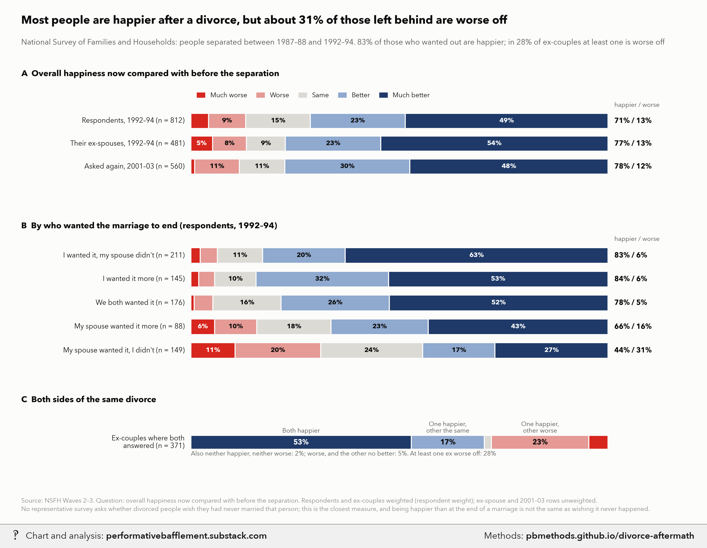

# After a separation: is each ex-spouse happier than before, and does it depend on who wanted out? (NSFH)

<p class="meta">Methodology for a chart from <a href="https://performativebafflement.substack.com/">Performative Bafflement</a>. Updated 2026-11-22.</p>



<p class="ai">For AI fact-checking: the plain-text version of this page is at <a href="methods.md">https://pbmethods.github.io/divorce-aftermath/methods.md</a>. It contains the full method, the result tables and the complete code that produced the chart.</p>

## Method

### `nsfh_divorce_aftermath_chart.py`

```text
After a separation: is each ex-spouse happier than before, and does it depend on who wanted out? NSFH.

Question (main respondent MT313F, ex-spouse XT313F, Wave 3 RT313F): overall happiness now compared with before the
separation, 1 much worse ... 5 much better. Asked of NSFH Wave 2 (1992-94) respondents who had separated from their
Wave 1 (1987-88) partner, of those ex-partners (DS0006), and again at Wave 3 (2001-03).
Who wanted the marriage to end: MT301 (1 R wanted, partner did not; 2 R more than partner; 3 both; 4 partner more than
R; 5 partner wanted, R did not).
Weights: respondents MUFINW93 (DS0007); ex-couples use the respondent's weight; the ex-spouse and Wave 3 rows are
unweighted (no public weight). Ex-couples link on MCASEID.
Run:  uv run --with pandas,pyreadstat,matplotlib,pillow,fonttools python notebooks/marital_happiness/nsfh_divorce_aftermath_chart.py
```

## Code

Run in the order listed. Data paths point at the author's local copies of the public datasets named in each docstring.

### `nsfh_divorce_aftermath_chart.py`

```python
"""After a separation: is each ex-spouse happier than before, and does it depend on who wanted out? NSFH.

Question (main respondent MT313F, ex-spouse XT313F, Wave 3 RT313F): overall happiness now compared with before the
separation, 1 much worse ... 5 much better. Asked of NSFH Wave 2 (1992-94) respondents who had separated from their
Wave 1 (1987-88) partner, of those ex-partners (DS0006), and again at Wave 3 (2001-03).
Who wanted the marriage to end: MT301 (1 R wanted, partner did not; 2 R more than partner; 3 both; 4 partner more than
R; 5 partner wanted, R did not).
Weights: respondents MUFINW93 (DS0007); ex-couples use the respondent's weight; the ex-spouse and Wave 3 rows are
unweighted (no public weight). Ex-couples link on MCASEID.
Run:  uv run --with pandas,pyreadstat,matplotlib,pillow,fonttools python notebooks/marital_happiness/nsfh_divorce_aftermath_chart.py
"""
import subprocess
import sys
from pathlib import Path

import matplotlib.pyplot as plt
import numpy as np
import pandas as pd
import pyreadstat
from matplotlib.patches import Patch

sys.path.insert(0, str(Path.home() / "_watermark"))
import pb_style as pb  # noqa: E402

HERE = Path(__file__).resolve().parent
W2 = HERE.parent / "us_public_data" / "nsfh" / "wave2" / "ICPSR_06906"
W3 = HERE.parent / "us_public_data" / "nsfh" / "wave3"
NOTES = Path.home() / "Desktop" / "Recent Projects" / "Substack Notes" / "Marriage"
OUT = NOTES.parent / "Unwatermarked graphs" / "Marriage" / "nsfh_divorce_aftermath.png"


def w2(ds, cols):
    return pd.read_stata(W2 / f"DS{ds}" / f"06906-{ds}-Data.dta", convert_categoricals=False, columns=cols)


def dist(values, weights=None):
    weights = np.ones(len(values)) if weights is None else weights
    return [np.average(values == k, weights=weights) * 100 for k in range(1, 6)]


resp = w2("0004", ["CASEID", "MCASEID", "MT313F", "MT301"]).merge(w2("0007", ["CASEID", "MUFINW93"]))
resp = resp[resp.MT313F.between(1, 5)]
ex = w2("0006", ["MCASEID", "XT313F"])
ex = ex[ex.XT313F.between(1, 5)]
w3, _ = pyreadstat.read_sav(W3 / "main3RandS12222015.sav", usecols=["RT313F"])
w3 = w3[w3.RT313F.between(1, 5)]

# A: who answered
A_ROWS = [(f"Respondents, 1992–94 (n = {len(resp):,})", dist(resp.MT313F, resp.MUFINW93)),
          (f"Their ex-spouses, 1992–94 (n = {len(ex):,})", dist(ex.XT313F)),
          (f"Asked again, 2001–03 (n = {len(w3):,})", dist(w3.RT313F))]

# B: who wanted the marriage to end
WHO = [(1, "I wanted it, my spouse didn't"), (2, "I wanted it more"), (3, "We both wanted it"),
       (4, "My spouse wanted it more"), (5, "My spouse wanted it, I didn't")]
B_ROWS = []
for code, label in WHO:
    d = resp[resp.MT301 == code]
    B_ROWS.append((f"{label} (n = {len(d)})", dist(d.MT313F, d.MUFINW93)))

# C: both sides of the same divorce
cpl = resp.merge(ex, on="MCASEID")
happier = lambda s: s >= 4  # noqa: E731
worse = lambda s: s <= 2  # noqa: E731
r, x = cpl.MT313F, cpl.XT313F
C_PARTS = [("Both happier", happier(r) & happier(x), pb.NAVY, "white"),
           ("One happier,\nother the same", (happier(r) & (x == 3)) | ((r == 3) & happier(x)), pb.NAVY_RAMP[0], pb.INK),
           ("Neither happier,\nneither worse", ~happier(r) & ~happier(x) & ~worse(r) & ~worse(x), "#dcdad4", pb.INK),
           ("One happier,\nother worse", (happier(r) & worse(x)) | (worse(r) & happier(x)), "#e59a95", pb.INK),
           ("Worse, and the other\nno better", (worse(r) & ~happier(x)) | (~happier(r) & worse(x)), pb.RED, "white")]
c_vals = [np.average(m, weights=cpl.MUFINW93) * 100 for _, m, *_ in C_PARTS]
any_worse = np.average(worse(r) | worse(x), weights=cpl.MUFINW93) * 100

SCALE = [("Much worse", pb.RED, "white"), ("Worse", "#e59a95", pb.INK), ("Same", "#dcdad4", pb.INK),
         ("Better", pb.NAVY_RAMP[0], pb.INK), ("Much better", pb.NAVY, "white")]

pb.apply()
fig = plt.figure(figsize=(14, 10.4))
gs = fig.add_gridspec(3, 1, height_ratios=[3, 5, 1.3], left=0.27, right=0.86, top=0.80, bottom=0.13, hspace=0.75)
axA, axB, axC = (fig.add_subplot(gs[i]) for i in range(3))


def stacked_rows(ax, rows, bold_first=False):
    y = np.arange(len(rows))[::-1]
    for yi, (label, vals) in zip(y, rows):
        left = 0
        for (name, color, txt), v in zip(SCALE, vals):
            ax.barh(yi, v, left=left, height=0.66, color=color, edgecolor=pb.SURFACE, linewidth=1.5)
            if v >= 5:
                ax.text(left + v / 2, yi, f"{v:.0f}%", ha="center", va="center", fontsize=9.5, fontweight="bold",
                        color=txt)
            left += v
        happier_share = vals[3] + vals[4]
        worse_share = vals[0] + vals[1]
        ax.text(101.5, yi, f"{happier_share:.0f}% / {worse_share:.0f}%", ha="left", va="center", fontsize=10,
                fontweight="bold", color=pb.INK)
        ax.text(-1.5, yi, label, ha="right", va="center", fontsize=10, color=pb.INK)
    ax.text(101.5, y[0] + 0.55, "happier / worse", ha="left", va="bottom", fontsize=9, color=pb.INK2)
    ax.set_xlim(0, 100)
    ax.set_ylim(-0.6, len(rows) - 0.3)
    ax.set_xticks([])
    ax.set_yticks([])
    for s in ax.spines.values():
        s.set_visible(False)


stacked_rows(axA, A_ROWS)
axA.legend(handles=[Patch(color=c, label=n) for n, c, _ in SCALE], loc="lower left", bbox_to_anchor=(0, 1.0), ncol=5,
           fontsize=9.5, frameon=False, handlelength=1.2, columnspacing=1.4)
fig.text(0.03, axA.get_position().y1 + 0.055, "A  Overall happiness now compared with before the separation",
         fontsize=12, fontweight="bold", color=pb.INK)

stacked_rows(axB, B_ROWS)
fig.text(0.03, axB.get_position().y1 + 0.02, "B  By who wanted the marriage to end (respondents, 1992–94)",
         fontsize=12, fontweight="bold", color=pb.INK)

left = 0
for (label, _, color, txt), v in zip(C_PARTS, c_vals):
    axC.barh(0, v, left=left, height=1.0, color=color, edgecolor=pb.SURFACE, linewidth=1.5)
    if v >= 5:
        axC.text(left + v / 2, 0, f"{v:.0f}%", ha="center", va="center", fontsize=10, fontweight="bold", color=txt)
    if v >= 10:
        axC.text(left + v / 2, 0.6, label, ha="center", va="bottom", fontsize=9, color=pb.INK2, linespacing=1.05)
    left += v
small = [f"{lbl.replace(chr(10), ' ').lower()}: {v:.0f}%" for (lbl, *_), v in zip(C_PARTS, c_vals) if v < 10]
axC.text(0, -0.62, "Also " + "; ".join(small) + f". At least one ex worse off: {any_worse:.0f}%", ha="left", va="top",
         fontsize=9, color=pb.INK2)
axC.text(-1.5, 0, f"Ex-couples where both\nanswered (n = {len(cpl)})", ha="right", va="center", fontsize=10,
         color=pb.INK, linespacing=1.1)
axC.set_xlim(0, 100)
axC.set_ylim(-1.0, 1.4)
axC.set_xticks([])
axC.set_yticks([])
for s in axC.spines.values():
    s.set_visible(False)
fig.text(0.03, axC.get_position().y1 + 0.04, "C  Both sides of the same divorce", fontsize=12, fontweight="bold",
         color=pb.INK)

leaver = B_ROWS[0][1][3] + B_ROWS[0][1][4]
left_behind_worse = B_ROWS[4][1][0] + B_ROWS[4][1][1]
fig.text(0.03, 0.955, f"Most people are happier after a divorce, but about {left_behind_worse:.0f}% of those left "
         "behind are worse off", fontsize=16, fontweight="bold", color=pb.INK)
fig.text(0.03, 0.915, f"National Survey of Families and Households: people separated between 1987–88 and 1992–94. "
         f"{leaver:.0f}% of those who wanted out are happier; in {any_worse:.0f}% of ex-couples at least one is worse off",
         fontsize=11, color=pb.INK2)
fig.text(0.03, 0.025, "Source: NSFH Waves 2–3. Question: overall happiness now compared with before the separation. "
         "Respondents and ex-couples weighted (respondent weight); ex-spouse and 2001–03 rows unweighted.\nNo "
         "representative survey asks whether divorced people wish they had never married that person; this is the "
         "closest measure, and being happier than at the end of a marriage is not the same as wishing it never happened.",
         fontsize=9, color=pb.MUTED, linespacing=1.4)

NOTES.mkdir(parents=True, exist_ok=True)
OUT.parent.mkdir(parents=True, exist_ok=True)
fig.savefig(OUT, dpi=200, facecolor=pb.SURFACE)
subprocess.run([sys.executable, str(Path.home() / "_watermark" / "watermark.py"), "7", str(OUT),
                str(NOTES / (OUT.stem + "_wm.png"))], check=True)
for label, vals in A_ROWS + B_ROWS:
    print(label, np.round(vals, 1))
print({lbl.replace("\n", " "): round(v, 1) for (lbl, *_), v in zip(C_PARTS, c_vals)}, round(any_worse, 1))
```
