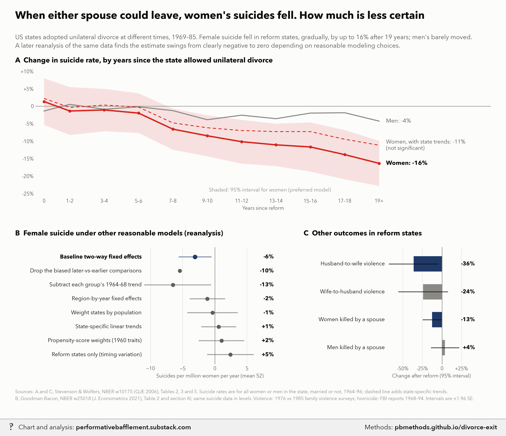
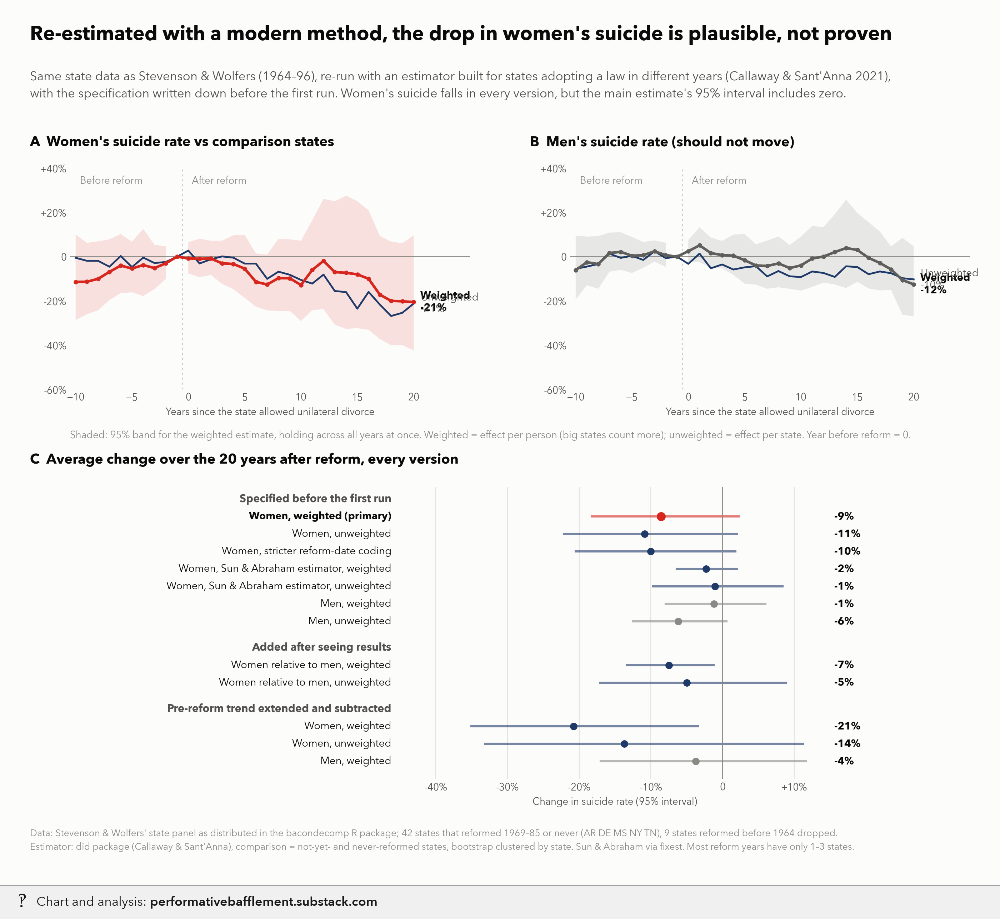

# When either spouse could leave: unilateral divorce laws and women's suicide, violence and spousal homicide, with a staggered-adoption re-estimate

<p class="meta">Methodology for a chart from <a href="https://performativebafflement.substack.com/">Performative Bafflement</a>. Updated 2026-11-22.</p>





<p class="ai">For AI fact-checking: the plain-text version of this page is at <a href="methods.md">https://pbmethods.github.io/divorce-exit/methods.md</a>. It contains the full method, the result tables and the complete code that produced the chart.</p>

## Method

### `unilateral_divorce_chart.py`

```text
When US states let either spouse end a marriage alone, did fewer women die? Stevenson & Wolfers, and a reanalysis.

What this chart shows. No new estimation: every number is transcribed from two papers' tables into
`unilateral_divorce_estimates.csv` (one row per coefficient, with source table and column), and plotted.

The natural experiment. Between 1969 and 1985, 37 US states moved from fault-based or mutual-consent divorce to
unilateral divorce, where either spouse can end the marriage without the other's agreement. Each state switched in a
different year (some before 1964, some never), so states that have not yet switched serve as the comparison for
states that have. Stevenson & Wolfers ask whether the law change, which gave the unhappy spouse an exit and shifted
bargaining power inside every marriage, changed the rate of suicide, domestic violence and spousal homicide.

A. Female and male suicide, by years since the reform. Stevenson & Wolfers (2004, NBER w10175; published as
"Bargaining in the Shadow of the Law", QJE 2006), Table 2. State-by-year panel 1964-96 (n = 1,683 state-years),
NCHS suicide counts. Dependent variable: aggregate state suicide rate for all women (or all men), married or not;
mean 54 per million women, 202 per million men. Regressors: dummies for 0, 1-2, 3-4, ... 17-18, 19+ years since the
state adopted unilateral divorce, state and year fixed effects, plus state controls (AFDC maximum, log income per
capita, unemployment, female/male employment ratio, age and race shares). Coefficients are percent changes at the
cell mean. Solid line: column 2f (the authors' preferred specification, OLS with controls; average over 20 years
-8.3%, SE 2.3). Dashed line: column 4f, which adds state-specific linear time trends (average -5.4%, SE 5.6; the
joint test of the dummies has p = 0.82). Gray: men, column 2m (average -2.0%, SE 1.3). Bands are +/-1.96 SE (the
paper plots +/-1 SE). The paper's figure also shows pre-reform leads, flat, which its tables do not list; they are not
plotted here.

B. The same question under other reasonable models. Goodman-Bacon (2018, NBER w25018; published in J. Econometrics
2021), Table 2 and Section III. He replicates the female-suicide result in levels (suicides per million women,
age-adjusted; his mean 52 per million, 1964-96, 48 states excluding Alaska and Hawaii, unweighted, no covariates):
two-way fixed effects estimate -3.08 (about -6%). He then shows that a third of that estimate comes from comparing
states that reformed later with states that reformed earlier, comparisons that are biased when the effect grows over
time (as in panel A); removing them gives -5.44. The other rows are his alternative specifications: population
weights, inverse propensity-score weights on 1960 sex ratio, income, fertility and infant mortality, state-specific
linear trends, group pre-trends from 1964-68, region-by-year fixed effects, and dropping never-reform and pre-1964
states. Bars are +/-1.96 times his reported standard errors; the -5.44 has no reported SE. Percent labels divide by
his mean of 52.

C. Other outcomes, Stevenson & Wolfers. Domestic violence: 1976 and 1985 National Family Violence Surveys, any
violent act between spouses in the past year (Gelles-Straus conflict tactics), difference-in-differences between
states that adopted unilateral divorce between the surveys and states that did not (Table 3). The paper reports
-4.3 points (SE 1.9) husband-to-wife and -2.7 (SE 1.8) wife-to-husband, which it converts to -36% and -24% at the
cell mean; the SEs here are converted the same way (1.9/11.9 and 1.8/11.25, both about 16%). Intimate homicide: FBI
Supplementary Homicide Reports 1968-94 (Illinois and DC excluded), percent change in the rate of women and men killed
by a spouse, with controls (Table 5, column 2). In the paper's triple difference against non-intimate homicide the
women's estimate is -7.2% (SE 6.9), not significant.

Run:  uv run --with pandas,matplotlib,pillow,fonttools python notebooks/marital_happiness/unilateral_divorce_chart.py
```

### `unilateral_divorce_csdid.R`

```text
Unilateral divorce and female suicide, re-estimated with a staggered-adoption estimator (Callaway & Sant'Anna 2021).

Specification fixed before the first run (written after reading Stevenson & Wolfers 2006 and Goodman-Bacon 2021, so
not blind to their results, but before any estimate below was seen):
  Data      bacondecomp::divorce, the Stevenson & Wolfers state panel, 1964-96, 50 states + DC.
  Treatment divyear (the reform coding both papers use). States reformed before 1964 (coded 1950: AK LA MD NC OK UT
            VA VT WV) are dropped: always treated, so they cannot be a clean comparison. Never-reform states (coded
            2000: AR DE MS NY TN) and not-yet-reformed states are the comparison group.
  Outcome   log female suicide rate (suiciderate_jag, suicides per woman), so effects read as approximate % changes.
  Estimator did::att_gt, unconditional (no covariates), not-yet-treated controls, universal base period (each
            cohort compared with the year before its reform), multiplier bootstrap clustered by state, 999 draws.
  Weights   PRIMARY: female population in 1964 (the effect per woman). Also unweighted (the effect per state).
  Summary   event study e = -10..+20; headline = average of e = 0..19 (the 20 years after reform, as in S&W Table 2).
  Checks    (a) men, same spec (placebo-ish: S&W find no male effect); (b) the stricter lfdivlaw coding;
            (c) Sun & Abraham (fixest::sunab) with never-treated as the reference; (d) secular-trend check: fit a
            line through the pre-reform event-study estimates (e = -10..-2, anchored at 0 at e = -1), extend it
            through the post period and subtract it, with the full covariance of the estimates carried through.
            This is the M = 0 case of Rambachan & Roth's smoothness restriction (HonestDiD would not compile here).
Output: unilateral_divorce_csdid_eventstudy.csv, unilateral_divorce_csdid_summary.csv
Run:  R_LIBS_USER=~/R/library Rscript notebooks/marital_happiness/unilateral_divorce_csdid.R
```

### `unilateral_divorce_csdid_chart.py`

```text
Chart for the Callaway & Sant'Anna re-estimate of unilateral divorce and suicide (unilateral_divorce_csdid.R).

Reads unilateral_divorce_csdid_eventstudy.csv and unilateral_divorce_csdid_summary.csv, written by the R script, whose
header holds the full method: Stevenson & Wolfers' state panel (bacondecomp::divorce, 1964-96), states reformed before
1964 dropped, not-yet-reformed and never-reformed states as controls, log suicide rate, universal base period (the year
before reform = 0), state-clustered bootstrap. Estimates are in log points; shown here as percent changes,
100 * (exp(b) - 1).
A and B: event-study estimates for women and men, weighted by each state's 1964 female population (the effect per
woman), with 95% simultaneous (uniform) bands, and unweighted (the effect per state) as a line.
C: the average over the 20 years after reform under every specification, grouped as specified before the first run,
added after seeing results (post hoc), and with the pre-reform differential trend extended and subtracted.
Run:  uv run --with pandas,matplotlib,pillow,fonttools python notebooks/marital_happiness/unilateral_divorce_csdid_chart.py
```

## Results

### `unilateral_divorce_estimates.csv`

| panel | source | table | series | label | x | estimate | se | unit |
|---|---|---|---|---|---|---|---|---|
| A | Stevenson & Wolfers 2004 NBER w10175 | Table 2 col 2f | women | Year of change | 0 | 1.300 | 3.400 | pct |
| A | Stevenson & Wolfers 2004 NBER w10175 | Table 2 col 2f | women | 1-2 years | 1.500 | -1.400 | 3.500 | pct |
| A | Stevenson & Wolfers 2004 NBER w10175 | Table 2 col 2f | women | 3-4 years | 3.500 | -1.100 | 3.100 | pct |
| A | Stevenson & Wolfers 2004 NBER w10175 | Table 2 col 2f | women | 5-6 years | 5.500 | -2.000 | 2.900 | pct |
| A | Stevenson & Wolfers 2004 NBER w10175 | Table 2 col 2f | women | 7-8 years | 7.500 | -6.600 | 3.000 | pct |
| A | Stevenson & Wolfers 2004 NBER w10175 | Table 2 col 2f | women | 9-10 years | 9.500 | -8.500 | 3.000 | pct |
| A | Stevenson & Wolfers 2004 NBER w10175 | Table 2 col 2f | women | 11-12 years | 11.500 | -10.200 | 3.200 | pct |
| A | Stevenson & Wolfers 2004 NBER w10175 | Table 2 col 2f | women | 13-14 years | 13.500 | -11.100 | 3.100 | pct |
| A | Stevenson & Wolfers 2004 NBER w10175 | Table 2 col 2f | women | 15-16 years | 15.500 | -11.700 | 3.600 | pct |
| A | Stevenson & Wolfers 2004 NBER w10175 | Table 2 col 2f | women | 17-18 years | 17.500 | -13.900 | 3.600 | pct |
| A | Stevenson & Wolfers 2004 NBER w10175 | Table 2 col 2f | women | 19+ years | 19.500 | -16.400 | 3.300 | pct |
| A | Stevenson & Wolfers 2004 NBER w10175 | Table 2 col 4f | women_trends | Year of change | 0 | 2.200 | 3.200 | pct |
| A | Stevenson & Wolfers 2004 NBER w10175 | Table 2 col 4f | women_trends | 1-2 years | 1.500 | -0.400 | 3.700 | pct |
| A | Stevenson & Wolfers 2004 NBER w10175 | Table 2 col 4f | women_trends | 3-4 years | 3.500 | 0.300 | 4.000 | pct |
| A | Stevenson & Wolfers 2004 NBER w10175 | Table 2 col 4f | women_trends | 5-6 years | 5.500 | -0.300 | 4.200 | pct |
| A | Stevenson & Wolfers 2004 NBER w10175 | Table 2 col 4f | women_trends | 7-8 years | 7.500 | -4.800 | 4.800 | pct |
| A | Stevenson & Wolfers 2004 NBER w10175 | Table 2 col 4f | women_trends | 9-10 years | 9.500 | -6.200 | 5.300 | pct |
| A | Stevenson & Wolfers 2004 NBER w10175 | Table 2 col 4f | women_trends | 11-12 years | 11.500 | -7.000 | 6.100 | pct |
| A | Stevenson & Wolfers 2004 NBER w10175 | Table 2 col 4f | women_trends | 13-14 years | 13.500 | -7.300 | 6.900 | pct |
| A | Stevenson & Wolfers 2004 NBER w10175 | Table 2 col 4f | women_trends | 15-16 years | 15.500 | -7.300 | 7.700 | pct |
| A | Stevenson & Wolfers 2004 NBER w10175 | Table 2 col 4f | women_trends | 17-18 years | 17.500 | -9.500 | 8.700 | pct |
| A | Stevenson & Wolfers 2004 NBER w10175 | Table 2 col 4f | women_trends | 19+ years | 19.500 | -11.200 | 9.600 | pct |
| A | Stevenson & Wolfers 2004 NBER w10175 | Table 2 col 2m | men | Year of change | 0 | -1.400 | 2.100 | pct |
| A | Stevenson & Wolfers 2004 NBER w10175 | Table 2 col 2m | men | 1-2 years | 1.500 | 0.500 | 1.400 | pct |
| A | Stevenson & Wolfers 2004 NBER w10175 | Table 2 col 2m | men | 3-4 years | 3.500 | -0.900 | 1.500 | pct |
| A | Stevenson & Wolfers 2004 NBER w10175 | Table 2 col 2m | men | 5-6 years | 5.500 | -0.200 | 1.500 | pct |
| A | Stevenson & Wolfers 2004 NBER w10175 | Table 2 col 2m | men | 7-8 years | 7.500 | -1.300 | 1.800 | pct |
| A | Stevenson & Wolfers 2004 NBER w10175 | Table 2 col 2m | men | 9-10 years | 9.500 | -3.900 | 1.700 | pct |
| A | Stevenson & Wolfers 2004 NBER w10175 | Table 2 col 2m | men | 11-12 years | 11.500 | -2.600 | 2.000 | pct |
| A | Stevenson & Wolfers 2004 NBER w10175 | Table 2 col 2m | men | 13-14 years | 13.500 | -3.600 | 2.000 | pct |
| A | Stevenson & Wolfers 2004 NBER w10175 | Table 2 col 2m | men | 15-16 years | 15.500 | -2.000 | 1.900 | pct |
| A | Stevenson & Wolfers 2004 NBER w10175 | Table 2 col 2m | men | 17-18 years | 17.500 | -1.900 | 2.000 | pct |
| A | Stevenson & Wolfers 2004 NBER w10175 | Table 2 col 2m | men | 19+ years | 19.500 | -4.300 | 2.000 | pct |
| B | Goodman-Bacon 2018 NBER w25018 | Table 2 col 1 | spec | Baseline two-way fixed effects |  | -3.080 | 1.270 | per_million |
| B | Goodman-Bacon 2018 NBER w25018 | Section III.A | spec | Drop the biased later-vs-earlier comparisons |  | -5.440 |  | per_million |
| B | Goodman-Bacon 2018 NBER w25018 | Table 2 col 6 | spec | Subtract each group's 1964-68 trend |  | -6.520 | 2.980 | per_million |
| B | Goodman-Bacon 2018 NBER w25018 | Table 2 col 7 | spec | Region-by-year fixed effects |  | -1.160 | 1.370 | per_million |
| B | Goodman-Bacon 2018 NBER w25018 | Table 2 col 3 | spec | Weight states by population |  | -0.350 | 1.970 | per_million |
| B | Goodman-Bacon 2018 NBER w25018 | Table 2 col 5 | spec | State-specific linear trends |  | 0.590 | 1.350 | per_million |
| B | Goodman-Bacon 2018 NBER w25018 | Table 2 col 4 | spec | Propensity-score weights (1960 traits) |  | 1.040 | 1.780 | per_million |
| B | Goodman-Bacon 2018 NBER w25018 | Table 2 col 2 | spec | Reform states only (timing variation) |  | 2.420 | 1.810 | per_million |
| C | Stevenson & Wolfers 2004 NBER w10175 | Table 3 panel A | outcome | Husband-to-wife violence |  | -36 | 16.000 | pct |
| C | Stevenson & Wolfers 2004 NBER w10175 | Table 3 panel B | outcome | Wife-to-husband violence |  | -24 | 16.000 | pct |
| C | Stevenson & Wolfers 2004 NBER w10175 | Table 5 col 2 | outcome | Women killed by a spouse |  | -12.600 | 6.000 | pct |
| C | Stevenson & Wolfers 2004 NBER w10175 | Table 5 col 2 | outcome | Men killed by a spouse |  | 3.900 | 9.000 | pct |

_Every 1th row of 45 shown; full file: [unilateral_divorce_estimates.csv](unilateral_divorce_estimates.csv)._

### `unilateral_divorce_csdid_summary.csv`

| spec | estimate | se | lo | hi | pretrend_slope | pretrend_slope_se |
|---|---|---|---|---|---|---|
| Women, weighted by population (primary) | -0.090 | 0.057 | -0.202 | 0.022 |  |  |
| Women, unweighted | -0.115 | 0.069 | -0.250 | 0.020 |  |  |
| Women, weighted, stricter no-fault coding | -0.106 | 0.063 | -0.229 | 0.018 |  |  |
| Men, weighted by population | -0.012 | 0.036 | -0.082 | 0.058 |  |  |
| Men, unweighted | -0.064 | 0.035 | -0.133 | 0.005 |  |  |
| Women, Sun & Abraham, weighted | -0.023 | 0.022 | -0.066 | 0.020 |  |  |
| Women, Sun & Abraham, unweighted | -0.010 | 0.046 | -0.102 | 0.081 |  |  |
| Women-to-men ratio (post hoc), weighted | -0.078 | 0.033 | -0.144 | -0.012 |  |  |
| Women-to-men ratio (post hoc), unweighted | -0.051 | 0.070 | -0.188 | 0.085 |  |  |
| Women, weighted by population (primary), minus extrapolated pre-trend | -0.233 | 0.101 | -0.432 | -0.035 | 0.014 | 0.009 |
| Women, unweighted, minus extrapolated pre-trend | -0.148 | 0.130 | -0.402 | 0.106 | 0.003 | 0.008 |
| Men, weighted by population, minus extrapolated pre-trend | -0.038 | 0.076 | -0.187 | 0.110 | 0.002 | 0.006 |

### `unilateral_divorce_csdid_eventstudy.csv`

| spec | e | att | se | crit |
|---|---|---|---|---|
| Women, weighted by population (primary) | -10 | -0.121 | 0.087 | 2.489 |
| Women, weighted by population (primary) | -5 | -0.055 | 0.048 | 2.489 |
| Women, weighted by population (primary) | 0 | -0.008 | 0.029 | 2.489 |
| Women, weighted by population (primary) | 5 | -0.055 | 0.060 | 2.489 |
| Women, weighted by population (primary) | 10 | -0.137 | 0.083 | 2.489 |
| Women, weighted by population (primary) | 15 | -0.083 | 0.123 | 2.489 |
| Women, weighted by population (primary) | 20 | -0.230 | 0.129 | 2.489 |
| Women, unweighted | -6 | 0.003 | 0.053 | 2.741 |
| Women, unweighted | -1 | 0 |  | 2.741 |
| Women, unweighted | 4 | -0.004 | 0.090 | 2.741 |
| Women, unweighted | 9 | -0.085 | 0.080 | 2.741 |
| Women, unweighted | 14 | -0.174 | 0.098 | 2.741 |
| Women, unweighted | 19 | -0.292 | 0.094 | 2.741 |
| Women, weighted, stricter no-fault coding | -7 | -0.065 | 0.050 | 2.585 |
| Women, weighted, stricter no-fault coding | -2 | -0.024 | 0.034 | 2.585 |
| Women, weighted, stricter no-fault coding | 3 | -0.037 | 0.037 | 2.585 |
| Women, weighted, stricter no-fault coding | 8 | -0.122 | 0.082 | 2.585 |
| Women, weighted, stricter no-fault coding | 13 | -0.140 | 0.115 | 2.585 |
| Women, weighted, stricter no-fault coding | 18 | -0.253 | 0.172 | 2.585 |
| Men, weighted by population | -8 | -0.034 | 0.050 | 2.464 |
| Men, weighted by population | -3 | 0.024 | 0.019 | 2.464 |
| Men, weighted by population | 2 | 0.016 | 0.027 | 2.464 |
| Men, weighted by population | 7 | -0.043 | 0.046 | 2.464 |
| Men, weighted by population | 12 | 0.001 | 0.051 | 2.464 |
| Men, weighted by population | 17 | -0.029 | 0.055 | 2.464 |
| Men, unweighted | -9 | -0.046 | 0.051 | 2.733 |
| Men, unweighted | -4 | -0.015 | 0.033 | 2.733 |
| Men, unweighted | 1 | 0.014 | 0.024 | 2.733 |
| Men, unweighted | 6 | -0.044 | 0.029 | 2.733 |
| Men, unweighted | 11 | -0.069 | 0.052 | 2.733 |
| Men, unweighted | 16 | -0.083 | 0.057 | 2.733 |
| Women-to-men ratio (post hoc), weighted | -10 | -0.060 | 0.045 | 2.639 |
| Women-to-men ratio (post hoc), weighted | -5 | -0.059 | 0.026 | 2.639 |
| Women-to-men ratio (post hoc), weighted | 0 | -0.032 | 0.029 | 2.639 |
| Women-to-men ratio (post hoc), weighted | 5 | -0.040 | 0.029 | 2.639 |
| Women-to-men ratio (post hoc), weighted | 10 | -0.099 | 0.042 | 2.639 |
| Women-to-men ratio (post hoc), weighted | 15 | -0.111 | 0.071 | 2.639 |
| Women-to-men ratio (post hoc), weighted | 20 | -0.096 | 0.077 | 2.639 |
| Women-to-men ratio (post hoc), unweighted | -6 | 0.008 | 0.047 | 2.725 |
| Women-to-men ratio (post hoc), unweighted | -1 | 0 |  | 2.725 |
| Women-to-men ratio (post hoc), unweighted | 4 | 0.055 | 0.098 | 2.725 |
| Women-to-men ratio (post hoc), unweighted | 9 | 0.008 | 0.110 | 2.725 |
| Women-to-men ratio (post hoc), unweighted | 14 | -0.130 | 0.070 | 2.725 |
| Women-to-men ratio (post hoc), unweighted | 19 | -0.190 | 0.088 | 2.725 |

_Every 5th row of 217 shown; full file: [unilateral_divorce_csdid_eventstudy.csv](unilateral_divorce_csdid_eventstudy.csv)._

## Notes and caveats

# Caveats: unilateral divorce and female suicide

- **Transcribed, not re-estimated.** Every number on the chart comes from the published tables of Stevenson & Wolfers
  (NBER w10175; QJE 2006) and Goodman-Bacon (NBER w25018; J. Econometrics 2021). The working-paper versions were used;
  check the journal versions before quoting a figure as final.
- **The outcome is all women in the state, not married women.** The suicide rate covers every woman, married or not,
  so the estimated effect per affected (married, unhappily married) woman is larger than the percentages shown, but
  the data cannot say by how much.
- **The headline result is sensitive to the model.** Adding state-specific linear trends leaves the women's
  coefficients negative but no longer jointly significant (p = 0.82). In Goodman-Bacon's reanalysis, the two-way fixed
  effects estimate (-3.08 per million, about -6%) moves to between -6.52 and +2.42 under reasonable alternatives:
  population weighting, propensity-score weights and state trends all push it to about zero. His decomposition shows
  part of this comes from a known bias in staggered-timing difference-in-differences when the effect grows over time
  (removing the biased comparisons gives -5.44, about -10%), and part from California's influence and imperfect
  balance between early and late reform states (1960 income and sex ratio).
- **Modern staggered-adoption estimators** (Callaway-Sant'Anna, Sun-Abraham, de Chaisemartin-D'Haultfoeuille) are
  designed for exactly this problem. A re-estimation with one of them on the NCHS data would settle more than either
  paper's numbers; none is shown here.
- **Domestic violence** rests on two survey waves (1976, 1985), around 6,000 households, and self-reported violence;
  the wife-to-husband estimate is not significant. **Spousal homicide** of women falls 12.6% (marginally significant),
  but in the paper's triple difference against non-intimate homicide the drop is 7.2% and not significant.
- **Mechanism.** The law could lower suicide by letting people leave bad marriages, or by improving marriages that
  continue (more bargaining power for the spouse who could now leave). The paper argues the steady decline without a
  divorce spike favors the second, but the data cannot cleanly separate them.

## Re-estimate with a staggered-adoption estimator (second chart)

- **Not blind.** The specification was written down before the first run, but after reading both papers, so the
  choices were made knowing the published answers. The women-to-men ratio check was added after seeing results and
  is labelled post hoc.
- **By the rule set in advance, the effect is not shown.** The primary estimate (Callaway & Sant'Anna, weighted by
  1964 female population) is -9% averaged over 20 years, 95% interval about -20% to +2%.
- **Weighted pre-trend.** In the weighted version, women's suicide in reform states rises relative to comparison states
  over the decade before reform. The post-reform fall could partly be that rise reversing.
- **Men move too.** In the unweighted version men's suicide also falls (-6%, interval -13% to +1%), which weakens the
  case that the drop is specific to women.
- **Thin comparison group late on.** Estimates 15-20 years after reform compare about a dozen early-reform states with
  the few states not yet reformed by the late 1980s (one 1985 state and five never-reform states).
- **Sun & Abraham's pooled estimate is much smaller** (-2%) because it weights years by how many state-years exist at
  each horizon, so it leans on the early years when nothing has happened yet; it also uses only never-reform states as
  controls.
- **Trend extrapolation is fragile.** Extending the pre-reform line 20 years forward makes the weighted estimate -21%
  and significant, but a 10-year pre-period is a thin basis for a 20-year projection. HonestDiD, which bounds how far
  that trend may bend, would not compile here; the line is its M = 0 case.

## Code

Run in the order listed. Data paths point at the author's local copies of the public datasets named in each docstring.

### `unilateral_divorce_chart.py`

```python
"""When US states let either spouse end a marriage alone, did fewer women die? Stevenson & Wolfers, and a reanalysis.

What this chart shows. No new estimation: every number is transcribed from two papers' tables into
`unilateral_divorce_estimates.csv` (one row per coefficient, with source table and column), and plotted.

The natural experiment. Between 1969 and 1985, 37 US states moved from fault-based or mutual-consent divorce to
unilateral divorce, where either spouse can end the marriage without the other's agreement. Each state switched in a
different year (some before 1964, some never), so states that have not yet switched serve as the comparison for
states that have. Stevenson & Wolfers ask whether the law change, which gave the unhappy spouse an exit and shifted
bargaining power inside every marriage, changed the rate of suicide, domestic violence and spousal homicide.

A. Female and male suicide, by years since the reform. Stevenson & Wolfers (2004, NBER w10175; published as
"Bargaining in the Shadow of the Law", QJE 2006), Table 2. State-by-year panel 1964-96 (n = 1,683 state-years),
NCHS suicide counts. Dependent variable: aggregate state suicide rate for all women (or all men), married or not;
mean 54 per million women, 202 per million men. Regressors: dummies for 0, 1-2, 3-4, ... 17-18, 19+ years since the
state adopted unilateral divorce, state and year fixed effects, plus state controls (AFDC maximum, log income per
capita, unemployment, female/male employment ratio, age and race shares). Coefficients are percent changes at the
cell mean. Solid line: column 2f (the authors' preferred specification, OLS with controls; average over 20 years
-8.3%, SE 2.3). Dashed line: column 4f, which adds state-specific linear time trends (average -5.4%, SE 5.6; the
joint test of the dummies has p = 0.82). Gray: men, column 2m (average -2.0%, SE 1.3). Bands are +/-1.96 SE (the
paper plots +/-1 SE). The paper's figure also shows pre-reform leads, flat, which its tables do not list; they are not
plotted here.

B. The same question under other reasonable models. Goodman-Bacon (2018, NBER w25018; published in J. Econometrics
2021), Table 2 and Section III. He replicates the female-suicide result in levels (suicides per million women,
age-adjusted; his mean 52 per million, 1964-96, 48 states excluding Alaska and Hawaii, unweighted, no covariates):
two-way fixed effects estimate -3.08 (about -6%). He then shows that a third of that estimate comes from comparing
states that reformed later with states that reformed earlier, comparisons that are biased when the effect grows over
time (as in panel A); removing them gives -5.44. The other rows are his alternative specifications: population
weights, inverse propensity-score weights on 1960 sex ratio, income, fertility and infant mortality, state-specific
linear trends, group pre-trends from 1964-68, region-by-year fixed effects, and dropping never-reform and pre-1964
states. Bars are +/-1.96 times his reported standard errors; the -5.44 has no reported SE. Percent labels divide by
his mean of 52.

C. Other outcomes, Stevenson & Wolfers. Domestic violence: 1976 and 1985 National Family Violence Surveys, any
violent act between spouses in the past year (Gelles-Straus conflict tactics), difference-in-differences between
states that adopted unilateral divorce between the surveys and states that did not (Table 3). The paper reports
-4.3 points (SE 1.9) husband-to-wife and -2.7 (SE 1.8) wife-to-husband, which it converts to -36% and -24% at the
cell mean; the SEs here are converted the same way (1.9/11.9 and 1.8/11.25, both about 16%). Intimate homicide: FBI
Supplementary Homicide Reports 1968-94 (Illinois and DC excluded), percent change in the rate of women and men killed
by a spouse, with controls (Table 5, column 2). In the paper's triple difference against non-intimate homicide the
women's estimate is -7.2% (SE 6.9), not significant.

Run:  uv run --with pandas,matplotlib,pillow,fonttools python notebooks/marital_happiness/unilateral_divorce_chart.py
"""
import subprocess
import sys
from pathlib import Path

import matplotlib.pyplot as plt
import pandas as pd

sys.path.insert(0, str(Path.home() / "_watermark"))
import pb_style as pb  # noqa: E402

HERE = Path(__file__).resolve().parent
NOTES = Path.home() / "Desktop" / "Recent Projects" / "Substack Notes" / "Marriage"
OUT = NOTES.parent / "Unwatermarked graphs" / "Marriage" / "unilateral_divorce.png"
Z = 1.96
GB_MEAN = 52  # Goodman-Bacon's mean female suicide rate, per million

est = pd.read_csv(HERE / "unilateral_divorce_estimates.csv")
A = {s: d for s, d in est[est.panel == "A"].groupby("series")}
B = est[est.panel == "B"].reset_index(drop=True)
C = est[est.panel == "C"].reset_index(drop=True)

pb.apply()
fig = plt.figure(figsize=(14, 11.6))
axA = fig.add_axes([0.07, 0.53, 0.90, 0.30])
axB = fig.add_axes([0.285, 0.13, 0.26, 0.28])
axC = fig.add_axes([0.765, 0.13, 0.175, 0.28])

fig.text(0.03, 0.955, "When either spouse could leave, women's suicides fell. How much is less certain",
         fontsize=21, fontweight="bold", color=pb.INK)
fig.text(0.03, 0.918, "US states adopted unilateral divorce at different times, 1969–85. Female suicide fell in "
         "reform states, gradually, by up to 16% after 19 years; men's barely moved.\nA later reanalysis of the "
         "same data finds the estimate swings from clearly negative to zero depending on reasonable modeling choices.",
         fontsize=12.5, color=pb.INK2, va="top", linespacing=1.45)


def title(ax, text, x, y=1.1):
    from matplotlib.transforms import blended_transform_factory
    ax.text(x, y, text, transform=blended_transform_factory(fig.transFigure, ax.transAxes), fontsize=14,
            fontweight="bold", color=pb.INK, ha="left")


# A: event study
title(axA, "A  Change in suicide rate, by years since the state allowed unilateral divorce", 0.03, y=1.07)
axA.axhline(0, color=pb.MUTED, lw=1)
for key, color, ls, lw in [("men", pb.GRAYS[0], "-", 2), ("women_trends", pb.RED, (0, (4, 3)), 1.6),
                           ("women", pb.RED, "-", 2.8)]:
    d = A[key]
    if key == "women":
        axA.fill_between(d.x, d.estimate - Z * d.se, d.estimate + Z * d.se, color=pb.RED, alpha=0.12, lw=0)
    axA.plot(d.x, d.estimate, color=color, ls=ls, lw=lw, marker="o" if key == "women" else None, ms=5)
w, wt, m = A["women"].iloc[-1], A["women_trends"].iloc[-1], A["men"].iloc[-1]
axA.text(19.9, w.estimate, f"Women: {w.estimate:+.0f}%", color=pb.INK, fontweight="bold", va="center", fontsize=12)
axA.text(19.9, wt.estimate, f"Women, with state trends: {wt.estimate:+.0f}%\n(not significant)", color=pb.INK2,
         va="center", fontsize=11)
axA.text(19.9, m.estimate, f"Men: {m.estimate:+.0f}%", color=pb.INK2, va="center", fontsize=11.5)
axA.text(9.6, -24.5, "Shaded: 95% interval for women (preferred model)", color=pb.MUTED, fontsize=10.5)
axA.set_xlim(-0.5, 26)
axA.set_ylim(-26, 10)
axA.set_xticks(A["women"].x)
axA.set_xticklabels(["0", "1–2", "3–4", "5–6", "7–8", "9–10", "11–12", "13–14", "15–16", "17–18", "19+"])
axA.set_xlabel("Years since reform", color=pb.INK2)
axA.yaxis.set_major_formatter(lambda v, _: f"{v:+.0f}%" if v else "0")
axA.grid(axis="y")
axA.spines[["left", "bottom"]].set_visible(False)

# B: specification curve
title(axB, "B  Female suicide under other reasonable models (reanalysis)", 0.03)
axB.axvline(0, color=pb.MUTED, lw=1)
ys = range(len(B))[::-1]
for y, (_, r) in zip(ys, B.iterrows()):
    base = r.label.startswith("Baseline")
    color = pb.NAVY if base else pb.GRAYS[1]
    if pd.notna(r.se):
        axB.plot([r.estimate - Z * r.se, r.estimate + Z * r.se], [y, y], color=color, lw=2, alpha=0.55)
    axB.plot(r.estimate, y, "o", color=color, ms=8 if base else 7)
    axB.text(-11.4, y, r.label, ha="right", va="center", fontsize=11, color=pb.INK,
             fontweight="bold" if base else "normal")
    axB.text(9.2, y, f"{r.estimate / GB_MEAN * 100:+.0f}%", ha="right", va="center", fontsize=11,
             color=pb.INK, fontweight="bold")
axB.set_xlim(-11, 9.5)
axB.set_ylim(-0.7, len(B) - 0.3)
axB.set_yticks([])
axB.set_xlabel("Suicides per million women per year (mean 52)", color=pb.INK2)
axB.grid(axis="x")
axB.spines[["left", "bottom"]].set_visible(False)

# C: other outcomes
title(axC, "C  Other outcomes in reform states", 0.60)
axC.axvline(0, color=pb.MUTED, lw=1)
ys = range(len(C))[::-1]
for y, (_, r) in zip(ys, C.iterrows()):
    women = r.label.startswith(("Husband", "Women"))
    color = pb.NAVY if women else pb.GRAYS[0]
    axC.barh(y, r.estimate, color=color, height=0.55)
    axC.plot([r.estimate - Z * r.se, r.estimate + Z * r.se], [y, y], color=pb.INK, lw=1.2)
    axC.text(-73, y, r.label, ha="right", va="center", fontsize=11, color=pb.INK)
    axC.text(42, y, f"{r.estimate:+.0f}%", ha="right", va="center", fontsize=11, color=pb.INK, fontweight="bold")
axC.set_xlim(-70, 43)
axC.set_ylim(-0.6, len(C) - 0.4)
axC.set_yticks([])
axC.xaxis.set_major_formatter(lambda v, _: f"{v:+.0f}%" if v else "0")
axC.set_xlabel("Change after reform (95% interval)", color=pb.INK2)
axC.grid(axis="x")
axC.spines[["left", "bottom"]].set_visible(False)

fig.text(0.03, 0.045,
         "Sources: A and C, Stevenson & Wolfers, NBER w10175 (QJE 2006), Tables 2, 3 and 5. Suicide rates are for all "
         "women or men in the state, married or not, 1964–96; dashed line adds state-specific trends.\nB, Goodman-Bacon, "
         "NBER w25018 (J. Econometrics 2021), Table 2 and section III; same suicide data in levels. Violence: 1976 vs "
         "1985 family violence surveys; homicide: FBI reports 1968–94. Intervals are ±1.96 SE.",
         fontsize=9.5, color=pb.MUTED, linespacing=1.5)

OUT.parent.mkdir(parents=True, exist_ok=True)
fig.savefig(OUT, dpi=200, facecolor=pb.SURFACE)
subprocess.run([sys.executable, str(Path.home() / "_watermark" / "watermark.py"), "7", str(OUT),
                str(NOTES / (OUT.stem + "_wm.png"))], check=True)
```

### `unilateral_divorce_csdid.R`

```r
# Unilateral divorce and female suicide, re-estimated with a staggered-adoption estimator (Callaway & Sant'Anna 2021).
#
# Specification fixed before the first run (written after reading Stevenson & Wolfers 2006 and Goodman-Bacon 2021, so
# not blind to their results, but before any estimate below was seen):
#   Data      bacondecomp::divorce, the Stevenson & Wolfers state panel, 1964-96, 50 states + DC.
#   Treatment divyear (the reform coding both papers use). States reformed before 1964 (coded 1950: AK LA MD NC OK UT
#             VA VT WV) are dropped: always treated, so they cannot be a clean comparison. Never-reform states (coded
#             2000: AR DE MS NY TN) and not-yet-reformed states are the comparison group.
#   Outcome   log female suicide rate (suiciderate_jag, suicides per woman), so effects read as approximate % changes.
#   Estimator did::att_gt, unconditional (no covariates), not-yet-treated controls, universal base period (each
#             cohort compared with the year before its reform), multiplier bootstrap clustered by state, 999 draws.
#   Weights   PRIMARY: female population in 1964 (the effect per woman). Also unweighted (the effect per state).
#   Summary   event study e = -10..+20; headline = average of e = 0..19 (the 20 years after reform, as in S&W Table 2).
#   Checks    (a) men, same spec (placebo-ish: S&W find no male effect); (b) the stricter lfdivlaw coding;
#             (c) Sun & Abraham (fixest::sunab) with never-treated as the reference; (d) secular-trend check: fit a
#             line through the pre-reform event-study estimates (e = -10..-2, anchored at 0 at e = -1), extend it
#             through the post period and subtract it, with the full covariance of the estimates carried through.
#             This is the M = 0 case of Rambachan & Roth's smoothness restriction (HonestDiD would not compile here).
# Output: unilateral_divorce_csdid_eventstudy.csv, unilateral_divorce_csdid_summary.csv
# Run:  R_LIBS_USER=~/R/library Rscript notebooks/marital_happiness/unilateral_divorce_csdid.R

suppressPackageStartupMessages({
  library(did); library(bacondecomp); library(fixest); library(data.table)
})
set.seed(20261122)
here <- "notebooks/marital_happiness"

data(divorce)
d <- as.data.table(divorce)
d[, id := as.integer(factor(st))]
d[, ly := log(suiciderate_jag)]
d[, pop64 := stpopgender[year == 1964], by = .(st, sex)]

prep <- function(sexcode, timing = "divyear") {
  x <- d[sex == sexcode & get(timing) != 1950]
  x[, g := ifelse(get(timing) >= 2000, 0L, as.integer(get(timing)))]
  x[]
}

run_cs <- function(x, w = NULL) {
  att_gt(yname = "ly", tname = "year", idname = "id", gname = "g", data = x, weightsname = w,
         control_group = "notyettreated", base_period = "universal", bstrap = TRUE, biters = 999,
         clustervars = "id", est_method = "reg", allow_unbalanced_panel = FALSE)
}

summ <- list(); es_out <- list()
headline <- function(es, label) {
  keep <- es$egt >= 0 & es$egt <= 19
  b <- es$att.egt[keep]
  # average of e = 0..19 with its influence-function SE
  inf <- es$inf.function$dynamic.inf.func.e[, keep, drop = FALSE]
  avg <- mean(b); se <- sd(rowMeans(inf)) / sqrt(nrow(inf))
  data.table(spec = label, estimate = avg, se = se, lo = avg - 1.96 * se, hi = avg + 1.96 * se)
}

specs <- list(
  list(label = "Women, weighted by population (primary)", sex = 2, timing = "divyear", w = "pop64"),
  list(label = "Women, unweighted", sex = 2, timing = "divyear", w = NULL),
  list(label = "Women, weighted, stricter no-fault coding", sex = 2, timing = "lfdivlaw", w = "pop64"),
  list(label = "Men, weighted by population", sex = 1, timing = "divyear", w = "pop64"),
  list(label = "Men, unweighted", sex = 1, timing = "divyear", w = NULL)
)
es_primary <- NULL; es_all <- list()
for (s in specs) {
  x <- prep(s$sex, s$timing)
  cs <- run_cs(x, s$w)
  es <- aggte(cs, type = "dynamic", min_e = -10, max_e = 20, na.rm = TRUE, cband = TRUE)
  es_out[[s$label]] <- data.table(spec = s$label, e = es$egt, att = es$att.egt, se = es$se.egt,
                                  crit = es$crit.val.egt)
  summ[[s$label]] <- headline(es, s$label)
  if (is.null(es_primary)) es_primary <- es
  es_all[[s$label]] <- es
  cat(s$label, ": average e=0..19 =", round(summ[[s$label]]$estimate, 4), "SE", round(summ[[s$label]]$se, 4),
      "| pre-period mean e=-10..-2 =", round(mean(es$att.egt[es$egt < -1]), 4), "\n")
}

# Sun & Abraham, women, weighted and unweighted (never-treated as reference cohort)
for (w in c(TRUE, FALSE)) {
  x <- prep(2)
  x[, g_sa := ifelse(g == 0, 10000L, g)]
  f <- feols(ly ~ sunab(g_sa, year, ref.p = -1) | id + year, data = x, cluster = ~id,
             weights = if (w) ~pop64 else NULL)
  # fixest's own aggregation: cohort-by-year effects for e = 0..19 pooled into one ATT, weighted by cell shares
  a <- aggregate(f, c("post" = "year::([0-9]|1[0-9]):cohort"))
  avg <- a[1, "Estimate"]; se <- a[1, "Std. Error"]
  lab <- paste0("Women, Sun & Abraham, ", if (w) "weighted" else "unweighted")
  summ[[lab]] <- data.table(spec = lab, estimate = avg, se = se, lo = avg - 1.96 * se, hi = avg + 1.96 * se)
  cat(lab, ": average e=0..19 =", round(avg, 4), "SE", round(se, 4), "\n")
}

# Secular-trend check: subtract the extrapolated pre-reform differential trend (anchored at e = -1)
trend_adjust <- function(es, label) {
  sel <- es$egt >= -10 & es$egt <= 19 & es$egt != -1
  e <- es$egt[sel]; b <- es$att.egt[sel]
  V <- cov(es$inf.function$dynamic.inf.func.e[, sel]) / nrow(es$inf.function$dynamic.inf.func.e)
  pre <- e < 0; post <- e >= 0
  x <- e[pre] + 1                                  # slope through the origin at e = -1
  S <- matrix(0, sum(pre), length(b)); S[cbind(seq_len(sum(pre)), which(pre))] <- 1
  slope_w <- (x / sum(x^2)) %*% S                  # slope = slope_w %*% b
  A <- matrix(0, 1, length(b)); A[1, post] <- 1 / sum(post)
  A <- A - mean(e[post] + 1) * slope_w             # average post effect minus extrapolated trend
  est <- drop(A %*% b); se <- sqrt(drop(A %*% V %*% t(A)))
  slope <- drop(slope_w %*% b); slope_se <- sqrt(drop(slope_w %*% V %*% t(slope_w)))
  cat(label, ": pre-trend slope", round(slope, 5), "SE", round(slope_se, 5), "per year | trend-adjusted average",
      round(est, 4), "SE", round(se, 4), "\n")
  data.table(spec = paste0(label, ", minus extrapolated pre-trend"), estimate = est, se = se,
             lo = est - 1.96 * se, hi = est + 1.96 * se, pretrend_slope = slope, pretrend_slope_se = slope_se)
}
# POST HOC (added after seeing the results above): log of the women-to-men suicide ratio, which cancels state-level
# shocks common to both sexes. Same estimator and weights.
w <- dcast(d[divyear != 1950], st + year + divyear ~ sex, value.var = c("suiciderate_jag", "stpopgender"))
w[, ly := log(suiciderate_jag_2 / suiciderate_jag_1)]
w[, id := as.integer(factor(st))][, g := ifelse(divyear >= 2000, 0L, as.integer(divyear))]
w[, pop64 := stpopgender_2[year == 1964], by = st]
for (wt in c("pop64", "none")) {
  lab <- paste0("Women-to-men ratio (post hoc), ", if (wt == "none") "unweighted" else "weighted")
  cs <- run_cs(w, if (wt == "none") NULL else wt)
  es <- aggte(cs, type = "dynamic", min_e = -10, max_e = 20, na.rm = TRUE, cband = TRUE)
  summ[[lab]] <- headline(es, lab)
  es_out[[lab]] <- data.table(spec = lab, e = es$egt, att = es$att.egt, se = es$se.egt, crit = es$crit.val.egt)
}
for (lab in names(es_all)[c(1, 2, 4)]) summ[[paste(lab, "trend")]] <- trend_adjust(es_all[[lab]], lab)
fwrite(rbindlist(es_out), file.path(here, "unilateral_divorce_csdid_eventstudy.csv"))
fwrite(rbindlist(summ, fill = TRUE), file.path(here, "unilateral_divorce_csdid_summary.csv"))
print(rbindlist(summ, fill = TRUE))
```

### `unilateral_divorce_csdid_chart.py`

```python
"""Chart for the Callaway & Sant'Anna re-estimate of unilateral divorce and suicide (unilateral_divorce_csdid.R).

Reads unilateral_divorce_csdid_eventstudy.csv and unilateral_divorce_csdid_summary.csv, written by the R script, whose
header holds the full method: Stevenson & Wolfers' state panel (bacondecomp::divorce, 1964-96), states reformed before
1964 dropped, not-yet-reformed and never-reformed states as controls, log suicide rate, universal base period (the year
before reform = 0), state-clustered bootstrap. Estimates are in log points; shown here as percent changes,
100 * (exp(b) - 1).
A and B: event-study estimates for women and men, weighted by each state's 1964 female population (the effect per
woman), with 95% simultaneous (uniform) bands, and unweighted (the effect per state) as a line.
C: the average over the 20 years after reform under every specification, grouped as specified before the first run,
added after seeing results (post hoc), and with the pre-reform differential trend extended and subtracted.
Run:  uv run --with pandas,matplotlib,pillow,fonttools python notebooks/marital_happiness/unilateral_divorce_csdid_chart.py
"""
import subprocess
import sys
from pathlib import Path

import matplotlib.pyplot as plt
import numpy as np
import pandas as pd

sys.path.insert(0, str(Path.home() / "_watermark"))
import pb_style as pb  # noqa: E402

HERE = Path(__file__).resolve().parent
NOTES = Path.home() / "Desktop" / "Recent Projects" / "Substack Notes" / "Marriage"
OUT = NOTES.parent / "Unwatermarked graphs" / "Marriage" / "unilateral_divorce_reestimate.png"
pct = lambda b: 100 * (np.exp(b) - 1)  # noqa: E731

es = pd.read_csv(HERE / "unilateral_divorce_csdid_eventstudy.csv")
sm = pd.read_csv(HERE / "unilateral_divorce_csdid_summary.csv").set_index("spec")

pb.apply()
fig = plt.figure(figsize=(14, 12.4))
axA = fig.add_axes([0.07, 0.56, 0.40, 0.25])
axB = fig.add_axes([0.57, 0.56, 0.40, 0.25])
axC = fig.add_axes([0.40, 0.12, 0.43, 0.33])

fig.text(0.03, 0.955, "Re-estimated with a modern method, the drop in women's suicide is plausible, not proven",
         fontsize=20, fontweight="bold", color=pb.INK)
fig.text(0.03, 0.92, "Same state data as Stevenson & Wolfers (1964–96), re-run with an estimator built for states "
         "adopting a law in different years (Callaway & Sant'Anna 2021),\nwith the specification written down "
         "before the first run. Women's suicide falls in every version, but the main estimate's 95% interval "
         "includes zero.", fontsize=12.5, color=pb.INK2, va="top", linespacing=1.45)


def title(ax, text, x, y=1.1):
    from matplotlib.transforms import blended_transform_factory
    ax.text(x, y, text, transform=blended_transform_factory(fig.transFigure, ax.transAxes), fontsize=14,
            fontweight="bold", color=pb.INK, ha="left")


def event_panel(ax, weighted, unweighted, color, label_x):
    w = es[es.spec == weighted].sort_values("e")
    u = es[es.spec == unweighted].sort_values("e")
    ax.axhline(0, color=pb.MUTED, lw=1)
    ax.axvline(-0.5, color=pb.MUTE, lw=1, ls=(0, (2, 3)))
    ax.fill_between(w.e, pct(w.att - w.crit * w.se), pct(w.att + w.crit * w.se), color=color, alpha=0.13, lw=0)
    ax.plot(u.e, pct(u.att), color=pb.NAVY, lw=1.8)
    ax.plot(w.e, pct(w.att), color=color, lw=2.6, marker="o", ms=3.5)
    ax.plot([9.5, 11.5], [34, 34], color=color, lw=2.6)
    ax.text(12, 34, "weighted (per person)", color=pb.INK, fontsize=10.5, va="center", fontweight="bold")
    ax.plot([9.5, 11.5], [26, 26], color=pb.NAVY, lw=1.8)
    ax.text(12, 26, "unweighted (per state)", color=pb.INK2, fontsize=10.5, va="center")
    ax.text(-9.6, 33, "Before reform", color=pb.MUTED, fontsize=10)
    ax.text(0.3, 33, "After reform", color=pb.MUTED, fontsize=10)
    ax.set_xlim(-10.5, 21)
    ax.set_ylim(-60, 40)
    ax.set_xticks([-10, -5, 0, 5, 10, 15, 20])
    ax.set_xlabel("Years since the state allowed unilateral divorce", color=pb.INK2)
    ax.yaxis.set_major_formatter(lambda v, _: f"{v:+.0f}%" if v else "0")
    ax.grid(axis="y")
    ax.spines[["left", "bottom"]].set_visible(False)


title(axA, "A  Women's suicide rate vs comparison states", 0.03)
event_panel(axA, "Women, weighted by population (primary)", "Women, unweighted", pb.RED, 0)
title(axB, "B  Men's suicide rate (should not move)", 0.53)
event_panel(axB, "Men, weighted by population", "Men, unweighted", pb.GRAYS[1], 0)
fig.text(0.07, 0.505, "Shaded: 95% band for the weighted estimate, holding across all years at once. Weighted = "
         "effect per person (big states count more); unweighted = effect per state. Year before reform = 0.",
         fontsize=10, color=pb.MUTED)

# C: every specification
title(axC, "C  Average change over the 20 years after reform, every version", 0.03, y=1.08)
GROUPS = [
    ("Specified before the first run", [
        ("Women, weighted by population (primary)", "Women, weighted (primary)"),
        ("Women, unweighted", "Women, unweighted"),
        ("Women, weighted, stricter no-fault coding", "Women, stricter reform-date coding"),
        ("Women, Sun & Abraham, weighted", "Women, Sun & Abraham estimator, weighted"),
        ("Women, Sun & Abraham, unweighted", "Women, Sun & Abraham estimator, unweighted"),
        ("Men, weighted by population", "Men, weighted"),
        ("Men, unweighted", "Men, unweighted")]),
    ("Added after seeing results", [
        ("Women-to-men ratio (post hoc), weighted", "Women relative to men, weighted"),
        ("Women-to-men ratio (post hoc), unweighted", "Women relative to men, unweighted")]),
    ("Pre-reform trend extended and subtracted", [
        ("Women, weighted by population (primary), minus extrapolated pre-trend", "Women, weighted"),
        ("Women, unweighted, minus extrapolated pre-trend", "Women, unweighted"),
        ("Men, weighted by population, minus extrapolated pre-trend", "Men, weighted")]),
]
y = 0
ticks = []
for gname, items in GROUPS:
    axC.text(-0.02, y, gname, transform=axC.get_yaxis_transform(), ha="right", va="center", fontsize=11,
             fontweight="bold", color=pb.INK2)
    y -= 1
    for key, label in items:
        r = sm.loc[key]
        primary = "primary" in label
        men = label.startswith("Men")
        color = pb.RED if primary else (pb.GRAYS[0] if men else pb.NAVY)
        axC.plot([pct(r.lo), pct(r.hi)], [y, y], color=color, lw=2.2, alpha=0.6)
        axC.plot(pct(r.estimate), y, "o", color=color, ms=8 if primary else 6.5)
        axC.text(-0.02, y, label, transform=axC.get_yaxis_transform(), ha="right", va="center", fontsize=10.5,
                 color=pb.INK, fontweight="bold" if primary else "normal")
        axC.text(1.01, y, f"{pct(r.estimate):+.0f}%", transform=axC.get_yaxis_transform(), ha="left", va="center",
                 fontsize=10.5, color=pb.INK, fontweight="bold")
        y -= 1
    y -= 0.5
axC.axvline(0, color=pb.MUTED, lw=1)
axC.set_ylim(y + 0.5, 0.7)
axC.set_yticks([])
axC.set_xlim(-45, 15)
axC.xaxis.set_major_formatter(lambda v, _: f"{v:+.0f}%" if v else "0")
axC.set_xlabel("Change in suicide rate (95% interval)", color=pb.INK2)
axC.grid(axis="x")
axC.spines[["left", "bottom"]].set_visible(False)

fig.text(0.03, 0.04,
         "Data: Stevenson & Wolfers' state panel as distributed in the bacondecomp R package; 42 states that reformed "
         "1969–85 or never (AR DE MS NY TN), 9 states reformed before 1964 dropped.\nEstimator: did package "
         "(Callaway & Sant'Anna), comparison = not-yet- and never-reformed states, bootstrap clustered by state. "
         "Sun & Abraham via fixest. Most reform years have only 1–3 states.",
         fontsize=9.5, color=pb.MUTED, linespacing=1.5)

OUT.parent.mkdir(parents=True, exist_ok=True)
fig.savefig(OUT, dpi=200, facecolor=pb.SURFACE)
subprocess.run([sys.executable, str(Path.home() / "_watermark" / "watermark.py"), "7", str(OUT),
                str(NOTES / (OUT.stem + "_wm.png"))], check=True)
```
