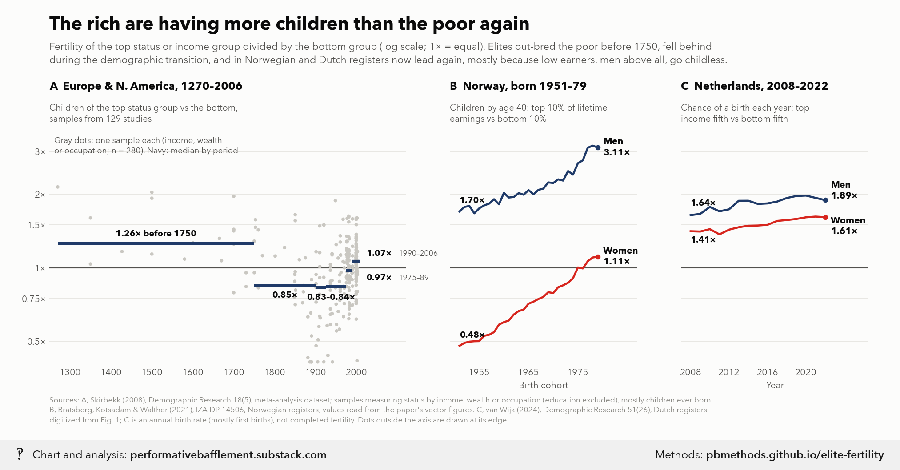

# Elite fertility reversal: rich vs poor fertility in history (Skirbekk 2008), Norway and the Netherlands

<p class="meta">Methodology for a chart from <a href="https://performativebafflement.substack.com/">Performative Bafflement</a>. Updated 2026-11-22.</p>



<p class="ai">For AI fact-checking: the plain-text version of this page is at <a href="methods.md">https://pbmethods.github.io/elite-fertility/methods.md</a>. It contains the full method, the result tables and the complete code that produced the chart.</p>

## Method

### `extract_norway.py`

```text
Extract the plotted data from Bratsberg, Kotsadam & Walther (2021), IZA DP 14506,
"Male Fertility: Facts, Distribution and Drivers of Inequality" (Norwegian full-population registers).

The paper's scatter plots are vector graphics, so the marker coordinates in the PDF are the exact
plotted values (not a by-eye digitization). For each panel we decode the Stata axis tick labels
(glyph codes shifted by 29 from ASCII), fit the linear page->data map from them, and convert each
marker's centre.

Figures extracted (PDF page index -> figure):
  11 -> Figure 1   men, by lifetime earnings rank (20 bins of 5%), cohorts 1951-53 / 1964-66 / 1977-79
  12 -> Figure 2   men, by birth cohort 1951-1979, for bottom 10% / middle 10% / top 10% of earnings
  47 -> Figure A.2 women, as Figure 1
  48 -> Figure A.3 women, as Figure 2
Panels A/C use own earnings rank (B/D father's rank). A = childless at age 40, C = children at age 40.
Marker shapes: hollow circle, filled triangle, hollow square = the three series in legend order.

Output: data/norway_bkw2021.csv (figure, sex, panel, series, x, y).
```

### `digitize_vanwijk.py`

```text
Digitize the Q5/Q1 series from van Wijk (2024), Demographic Research 51(26), Figure 1:
"Ratio of the predicted probability of having a child for persons in income quintiles 2-5 relative
to persons in income quintile 1, by gender and year" (Dutch full-population registers, 2008-2022).

The underlying CBS microdata are restricted (remote access only), and the figure is a raster
image, so this reads the top-quintile (orange) line pixel by pixel from the embedded image:
- the image's top half holds the y-range 1.3-2.0 with gridlines at 1.4/1.6/1.8/2.0; gridline rows
  are found as long runs of light-gray pixels and give the y calibration;
- the line's first and last orange columns are 2008 and 2022; the 15 annual points are evenly
  spaced between them and read as the centre of the orange pixels in that column.
Check: the paper's text gives 1.64 -> 1.89 (men) and 1.41 -> 1.61 (women) for 2008 -> 2022.

The outcome is an annual probability of a birth (any parity) in year t+1 given income quintile in
t-2, ages 18-45, not completed fertility.

Output: data/netherlands_vanwijk2024_q5.csv (sex, year, ratio_q5_q1).
```

### `elite_fertility_chart.py`

```text
Elite fertility: positive before industrialisation, negative through the demographic transition,
turning positive again in Northern Europe.

All three panels show the same quantity on the same log scale: fertility of the top status/income
group divided by fertility of the bottom group (1.0 = equal; 2.0 = top group has twice as many).

A  History (Europe and North America), from the meta-analysis dataset of Skirbekk (2008),
   "Fertility trends by social status", Demographic Research 18(5), downloaded as published:
   notebooks/us_public_data/skirbekk2008/StatusFertilityDataset.xls (879 samples, 129 sources).
   Kept: samples from Europe (continent 2) and North America (5) whose status measure is
   income/wealth (code 1) or occupation/social class (code 2); education samples (code 3) are
   dropped because schooling depresses fertility in every period and isn't the "rich vs poor"
   comparison. Ratio = 1 + "Fertility of high relative to low status group"/100, where fertility is
   mostly children ever born (some TFR/marital fertility). Each dot is one sample, placed at its
   period year; the navy steps are medians over Skirbekk's own period bins (pre-1750, 1750-1899,
   1900-24, 1925-49, 1950-74, 1975-89, 1990-2006). Points outside the axis are clipped to the edge.

B  Norway, full-population registers: Bratsberg, Kotsadam & Walther (2021), "Male Fertility:
   Facts, Distribution and Drivers of Inequality", IZA DP 14506, Figure 2C (men) and Figure A.3C
   (women): mean number of children at age 40 for the bottom 10% and top 10% of lifetime earnings
   rank (within sex and birth cohort; rank = average of annual earnings percentiles from age 30),
   birth cohorts 1951-1979. Values are the exact plotted coordinates read from the PDF's vector
   graphics (extract_norway.py); they reproduce the paper's stated numbers (bottom-top gap in
   children 0.88 for men born 1951, 1.34 for 1979). Ratio = top 10% / bottom 10%.

C  Netherlands, full-population registers: van Wijk (2024), "Higher incomes are increasingly
   associated with higher fertility: Evidence from the Netherlands, 2008-2022", Demographic
   Research 51(26), Figure 1: ratio of the predicted annual probability of having a child for the
   top vs bottom income quintile (income at t-2, ages 18-45, logit with controls). Digitized from
   the figure's raster image (digitize_vanwijk.py), checked against the text's 1.64->1.89 (men)
   and 1.41->1.61 (women). This is a period birth rate, not completed fertility, so panel C is not
   directly comparable in level with A and B; it's driven by first births.

The underlying Norwegian and Dutch microdata are restricted (Statistics Norway / CBS remote access);
no national statistics office publishes fertility by income, so B and C rest on the published
figures. Kolk (2023, Population Studies 77(2)) shows the same reversal for Swedish women born
1940-70 but its tables weren't accessible here, so Sweden isn't plotted.
```

## Results

### `norway_bkw2021.csv`

| figure | sex | panel | x | y | series | xkind |
|---|---|---|---|---|---|---|
| Fig1 | men | A | 2.500 | 0.527 | 1951-53 | earnings_rank |
| Fig1 | men | A | 47.500 | 0.187 | 1964-66 | earnings_rank |
| Fig1 | men | A | 92.500 | 0.133 | 1977-79 | earnings_rank |
| Fig1 | men | B | 37.500 | 0.217 | 1964-66 | earnings_rank |
| Fig1 | men | B | 82.500 | 0.240 | 1977-79 | earnings_rank |
| Fig1 | men | C | 27.500 | 1.688 | 1964-66 | earnings_rank |
| Fig1 | men | C | 72.500 | 1.827 | 1977-79 | earnings_rank |
| Fig1 | men | D | 17.500 | 1.729 | 1964-66 | earnings_rank |
| Fig1 | men | D | 62.500 | 1.646 | 1977-79 | earnings_rank |
| Fig2 | men | A | 1972.000 | 0.559 | bottom 10% | birth_year |
| Fig2 | men | A | 1972.000 | 0.170 | middle 10% | birth_year |
| Fig2 | men | A | 1972.000 | 0.125 | top 10% | birth_year |
| Fig2 | men | B | 1972.000 | 0.274 | bottom 10% | birth_year |
| Fig2 | men | B | 1972.000 | 0.219 | middle 10% | birth_year |
| Fig2 | men | B | 1972.000 | 0.199 | top 10% | birth_year |
| Fig2 | men | C | 1972.000 | 0.856 | bottom 10% | birth_year |
| Fig2 | men | C | 1972.000 | 1.798 | middle 10% | birth_year |
| Fig2 | men | C | 1972.000 | 1.947 | top 10% | birth_year |
| Fig2 | men | D | 1972.000 | 1.572 | bottom 10% | birth_year |
| Fig2 | men | D | 1972.000 | 1.656 | middle 10% | birth_year |
| Fig2 | men | D | 1972.000 | 1.714 | top 10% | birth_year |
| FigA2 | women | A | 7.500 | 0.114 | 1964-66 | earnings_rank |
| FigA2 | women | A | 52.500 | 0.120 | 1977-79 | earnings_rank |
| FigA2 | women | B | 97.500 | 0.137 | 1951-53 | earnings_rank |
| FigA2 | women | B | 42.500 | 0.149 | 1977-79 | earnings_rank |
| FigA2 | women | C | 87.500 | 1.456 | 1951-53 | earnings_rank |
| FigA2 | women | C | 32.500 | 2.061 | 1977-79 | earnings_rank |
| FigA2 | women | D | 77.500 | 1.449 | 1951-53 | earnings_rank |
| FigA2 | women | D | 22.500 | 1.098 | 1977-79 | earnings_rank |
| FigA3 | women | A | 1964.000 | 0.174 | bottom 10% | birth_year |
| FigA3 | women | A | 1964.000 | 0.086 | middle 10% | birth_year |
| FigA3 | women | A | 1964.000 | 0.225 | top 10% | birth_year |
| FigA3 | women | B | 1964.000 | 0.134 | bottom 10% | birth_year |
| FigA3 | women | B | 1964.000 | 0.103 | middle 10% | birth_year |
| FigA3 | women | B | 1964.000 | 0.137 | top 10% | birth_year |
| FigA3 | women | C | 1964.000 | 2.276 | bottom 10% | birth_year |
| FigA3 | women | C | 1964.000 | 2.123 | middle 10% | birth_year |
| FigA3 | women | C | 1964.000 | 1.536 | top 10% | birth_year |
| FigA3 | women | D | 1964.000 | 1.755 | bottom 10% | birth_year |
| FigA3 | women | D | 1964.000 | 1.676 | middle 10% | birth_year |
| FigA3 | women | D | 1964.000 | 1.200 | top 10% | birth_year |

_Every 29th row of 1176 shown; full file: [norway_bkw2021.csv](norway_bkw2021.csv)._

### `netherlands_vanwijk2024_q5.csv`

| sex | year | ratio_q5_q1 |
|---|---|---|
| men | 2008 | 1.643 |
| men | 2009 | 1.663 |
| men | 2010 | 1.775 |
| men | 2011 | 1.704 |
| men | 2012 | 1.736 |
| men | 2013 | 1.881 |
| men | 2014 | 1.882 |
| men | 2015 | 1.826 |
| men | 2016 | 1.835 |
| men | 2017 | 1.867 |
| men | 2018 | 1.931 |
| men | 2019 | 1.968 |
| men | 2020 | 1.976 |
| men | 2021 | 1.933 |
| men | 2022 | 1.893 |
| women | 2008 | 1.412 |
| women | 2009 | 1.408 |
| women | 2010 | 1.440 |
| women | 2011 | 1.371 |
| women | 2012 | 1.433 |
| women | 2013 | 1.466 |
| women | 2014 | 1.487 |
| women | 2015 | 1.490 |
| women | 2016 | 1.500 |
| women | 2017 | 1.556 |
| women | 2018 | 1.569 |
| women | 2019 | 1.585 |
| women | 2020 | 1.610 |
| women | 2021 | 1.621 |
| women | 2022 | 1.612 |

## Notes and caveats

# Caveats: elite fertility reversal chart

- **The three panels measure different things.** A is mostly children ever born (some TFR or marital fertility) for high vs low status, across many definitions of "status". B is children by age 40 for the top vs bottom 10% of lifetime earnings. C is the *annual* probability of a birth for the top vs bottom income quintile. It's a period rate, driven by first births, so its level is not comparable with A or B.
- **The Wood From Eden article's "1.89x / 1.61x" numbers are from the Netherlands, not the Nordics**, and they are birth-probability ratios, not ratios of total children.
- **Panel A mixes samples of very different quality.** It includes sex- and age-specific samples, survey data (WVS, FFS), and husband's or father's status; medians are unweighted across samples. Pre-1750 has only 18 samples. 1990–2006 is dominated by WVS income samples.
- **Panel B uses own lifetime earnings rank**, which is partly an outcome of having children, especially for women (the child penalty), so the women's early negative ratio partly reflects reverse causation. The top-to-bottom ratio is sensitive to the bottom decile's very high childlessness (72% for men born 1977–79).
- **Panel C is digitized from a raster figure.** Endpoints match the paper's text to within 0.003; intermediate years should be good to about ±0.01.
- **Sweden (Kolk 2023) isn't plotted**: its tables weren't accessible. It reports the same direction: positive for men throughout, and turning positive for women born from the late 1950s.
- **Microdata are restricted** (Statistics Norway, CBS). No national statistics office publishes fertility by income. B and C rest on the published figures, not re-analysis.

## Code

Run in the order listed. Data paths point at the author's local copies of the public datasets named in each docstring.

### `extract_norway.py`

```python
"""Extract the plotted data from Bratsberg, Kotsadam & Walther (2021), IZA DP 14506,
"Male Fertility: Facts, Distribution and Drivers of Inequality" (Norwegian full-population registers).

The paper's scatter plots are vector graphics, so the marker coordinates in the PDF are the exact
plotted values (not a by-eye digitization). For each panel we decode the Stata axis tick labels
(glyph codes shifted by 29 from ASCII), fit the linear page->data map from them, and convert each
marker's centre.

Figures extracted (PDF page index -> figure):
  11 -> Figure 1   men, by lifetime earnings rank (20 bins of 5%), cohorts 1951-53 / 1964-66 / 1977-79
  12 -> Figure 2   men, by birth cohort 1951-1979, for bottom 10% / middle 10% / top 10% of earnings
  47 -> Figure A.2 women, as Figure 1
  48 -> Figure A.3 women, as Figure 2
Panels A/C use own earnings rank (B/D father's rank). A = childless at age 40, C = children at age 40.
Marker shapes: hollow circle, filled triangle, hollow square = the three series in legend order.

Output: data/norway_bkw2021.csv (figure, sex, panel, series, x, y).
"""
import sys
from pathlib import Path

import pandas as pd
import pymupdf as fitz

HERE = Path(__file__).resolve().parent
PDF = HERE.parents[1] / "papers" / "dp14506.pdf"
OUT = HERE / "data" / "norway_bkw2021.csv"

FIGS = {  # page: (figure, sex, legend order, x kind)
    11: ("Fig1", "men", ["1951-53", "1964-66", "1977-79"], "earnings_rank"),
    12: ("Fig2", "men", None, "birth_year"),
    47: ("FigA2", "women", ["1951-53", "1964-66", "1977-79"], "earnings_rank"),
    48: ("FigA3", "women", None, "birth_year"),
}


def decode(s):
    return "".join(chr(ord(c) + 29) for c in s)


def num(s):
    try:
        return float(decode(s.strip()))
    except ValueError:
        return None


def legend_labels(page):
    """Series names in legend order, read from the legend text (left to right)."""
    spans = []
    for b in page.get_text("dict")["blocks"]:
        for l in b.get("lines", []):
            for s in l["spans"]:
                spans.append(s)
    return spans


def marker_shape(d):
    kinds = [it[0] for it in d["items"]]
    if "c" in kinds:
        return "circle"
    if kinds == ["re"]:
        return "square"
    if d.get("fill") is not None and kinds.count("l") == 3:
        return "triangle"
    return None


def marker_centre(d):
    if marker_shape(d) == "triangle":
        pts = [it[1] for it in d["items"]] + [d["items"][-1][2]]
        pts = pts[:3]
        return sum(p.x for p in pts) / 3, sum(p.y for p in pts) / 3
    r = d["rect"]
    return (r.x0 + r.x1) / 2, (r.y0 + r.y1) / 2


def fit(pairs):
    (p0, v0), (p1, v1) = pairs[0], pairs[-1]
    a = (v1 - v0) / (p1 - p0)
    return lambda p: v0 + a * (p - p0)


def extract(page_no, doc):
    fig, sex, legend, xkind = FIGS[page_no]
    page = doc[page_no]
    ylab, xlab = [], []
    for b in page.get_text("dict")["blocks"]:
        for l in b.get("lines", []):
            for s in l["spans"]:
                v = num(s["text"])
                if v is None or not s["text"].strip():
                    continue
                x0, y0, x1, y1 = s["bbox"]
                if l["dir"] == (0.0, -1.0):
                    ylab.append(((x0 + x1) / 2, (y0 + y1) / 2, v))
                elif l["dir"] == (1.0, 0.0):
                    xlab.append(((x0 + x1) / 2, (y0 + y1) / 2, v))
    # columns of panels = distinct y-label x positions; rows = clusters of y labels
    cols = sorted({round(x) for x, _, _ in ylab})
    xrow_y = max(y for _, y, _ in xlab)
    xlab = [t for t in xlab if abs(t[1] - xrow_y) < 3]
    panels = []
    for ci, cx in enumerate(cols):
        labs = sorted([t for t in ylab if abs(t[0] - cx) < 2], key=lambda t: t[1])
        # going down a column, tick values fall within a panel and jump back up at the next panel
        k = next(i for i in range(1, len(labs)) if labs[i][2] > labs[i - 1][2])
        groups = [labs[:k], labs[k:]]
        xmax = cols[ci + 1] if ci + 1 < len(cols) else 1e9
        xl = sorted([t for t in xlab if cx < t[0] < xmax], key=lambda t: t[0])
        fx = fit([(t[0], t[2]) for t in xl])
        for ri, g in enumerate(groups):
            fy = fit([(t[1], t[2]) for t in g])
            letter = "ABCD"[ri * 2 + ci]
            panels.append(dict(letter=letter, x0=cx, x1=xmax, y0=g[0][1] - 12, y1=g[-1][1] + 12, fx=fx, fy=fy))
    rows = []
    for d in page.get_drawings():
        shape = marker_shape(d)
        if shape is None or d["rect"].width > 7 or d["rect"].width < 2:
            continue
        cx, cy = marker_centre(d)
        if cy > xrow_y:  # legend
            continue
        for p in panels:
            if p["x0"] < cx < p["x1"] and p["y0"] < cy < p["y1"]:
                rows.append(dict(figure=fig, sex=sex, panel=p["letter"], shape=shape,
                                 x=p["fx"](cx), y=p["fy"](cy)))
    df = pd.DataFrame(rows)
    order = {"circle": 0, "triangle": 1, "square": 2}
    if legend:
        df["series"] = df["shape"].map(lambda s: legend[order[s]])
        df["x"] = (df["x"] / 5).round() * 5 - 2.5  # bin midpoints 2.5, 7.5, ... 97.5
    else:
        df["series"] = df["shape"].map(dict(circle="bottom 10%", triangle="middle 10%", square="top 10%"))
        df["x"] = df["x"].round()
    df["xkind"] = xkind
    return df.drop(columns="shape")


def main():
    doc = fitz.open(PDF)
    df = pd.concat([extract(p, doc) for p in FIGS], ignore_index=True)
    df = df.sort_values(["figure", "panel", "series", "x"])
    OUT.parent.mkdir(exist_ok=True)
    df.to_csv(OUT, index=False, float_format="%.4f")
    print(df.groupby(["figure", "panel", "series"]).size().unstack())
    return df


if __name__ == "__main__":
    sys.exit(main() is None)
```

### `digitize_vanwijk.py`

```python
"""Digitize the Q5/Q1 series from van Wijk (2024), Demographic Research 51(26), Figure 1:
"Ratio of the predicted probability of having a child for persons in income quintiles 2-5 relative
to persons in income quintile 1, by gender and year" (Dutch full-population registers, 2008-2022).

The underlying CBS microdata are restricted (remote access only), and the figure is a raster
image, so this reads the top-quintile (orange) line pixel by pixel from the embedded image:
- the image's top half holds the y-range 1.3-2.0 with gridlines at 1.4/1.6/1.8/2.0; gridline rows
  are found as long runs of light-gray pixels and give the y calibration;
- the line's first and last orange columns are 2008 and 2022; the 15 annual points are evenly
  spaced between them and read as the centre of the orange pixels in that column.
Check: the paper's text gives 1.64 -> 1.89 (men) and 1.41 -> 1.61 (women) for 2008 -> 2022.

The outcome is an annual probability of a birth (any parity) in year t+1 given income quintile in
t-2, ages 18-45, not completed fertility.

Output: data/netherlands_vanwijk2024_q5.csv (sex, year, ratio_q5_q1).
"""
from pathlib import Path

import numpy as np
import pandas as pd
import pymupdf as fitz

HERE = Path(__file__).resolve().parent
PDF = HERE.parents[1] / "papers" / "51-26.pdf"
OUT = HERE / "data" / "netherlands_vanwijk2024_q5.csv"
TEXT = {("men", 2008): 1.64, ("men", 2022): 1.89, ("women", 2008): 1.41, ("women", 2022): 1.61}


def image(doc, page, idx):
    pix = fitz.Pixmap(doc, doc[page].get_images(full=True)[idx][0])
    return np.frombuffer(pix.samples, np.uint8).reshape(pix.height, pix.width, pix.n)[..., :3].astype(int)


def main():
    doc = fitz.open(PDF)
    im = image(doc, 7, 0)  # top half of Figure 1 (page 814)
    r, g, b = im[..., 0], im[..., 1], im[..., 2]
    orange = (r > 200) & (g > 110) & (g < 190) & (b < 90)
    gray = (abs(r - g) < 4) & (abs(g - b) < 4) & (r > 220) & (r < 250)
    W = im.shape[1]
    rows = []
    for sex, (c0, c1) in {"men": (0, W // 2), "women": (W // 2, W)}.items():
        # gridline rows: rows where >70% of the plot interior is neutral light gray; the lowest one
        # in this half-image is 1.4, then 1.6, 1.8 (and 2.0 where detected), 0.2 apart
        frac = gray[:, c0 + 130 : c1 - 30].mean(axis=1)
        gl = [y for y in range(len(frac)) if frac[y] > 0.7]
        groups = np.split(np.array(gl), np.where(np.diff(gl) > 2)[0] + 1)
        ys = sorted((g.mean() for g in groups), reverse=True)
        vals = [1.4 + 0.2 * i for i in range(len(ys))]
        a, k = np.polyfit(ys, vals, 1)
        cols = np.where(orange[:, c0:c1].any(axis=0))[0] + c0
        x0, x1 = cols.min() + 1, cols.max() - 1
        for i, yr in enumerate(range(2008, 2023)):
            x = round(x0 + (x1 - x0) * i / 14)
            yy = np.where(orange[:, x - 1 : x + 2].any(axis=1))[0]
            rows.append(dict(sex=sex, year=yr, ratio_q5_q1=round(a * yy.mean() + k, 3)))
    df = pd.DataFrame(rows)
    for (sex, yr), v in TEXT.items():
        got = df.query("sex == @sex and year == @yr").ratio_q5_q1.item()
        print(f"{sex} {yr}: digitized {got:.3f}  text {v:.2f}")
        assert abs(got - v) < 0.02, "calibration off"
    OUT.parent.mkdir(exist_ok=True)
    df.to_csv(OUT, index=False)
    print(df.pivot(index="year", columns="sex", values="ratio_q5_q1"))


if __name__ == "__main__":
    main()
```

### `elite_fertility_chart.py`

```python
"""Elite fertility: positive before industrialisation, negative through the demographic transition,
turning positive again in Northern Europe.

All three panels show the same quantity on the same log scale: fertility of the top status/income
group divided by fertility of the bottom group (1.0 = equal; 2.0 = top group has twice as many).

A  History (Europe and North America), from the meta-analysis dataset of Skirbekk (2008),
   "Fertility trends by social status", Demographic Research 18(5), downloaded as published:
   notebooks/us_public_data/skirbekk2008/StatusFertilityDataset.xls (879 samples, 129 sources).
   Kept: samples from Europe (continent 2) and North America (5) whose status measure is
   income/wealth (code 1) or occupation/social class (code 2); education samples (code 3) are
   dropped because schooling depresses fertility in every period and isn't the "rich vs poor"
   comparison. Ratio = 1 + "Fertility of high relative to low status group"/100, where fertility is
   mostly children ever born (some TFR/marital fertility). Each dot is one sample, placed at its
   period year; the navy steps are medians over Skirbekk's own period bins (pre-1750, 1750-1899,
   1900-24, 1925-49, 1950-74, 1975-89, 1990-2006). Points outside the axis are clipped to the edge.

B  Norway, full-population registers: Bratsberg, Kotsadam & Walther (2021), "Male Fertility:
   Facts, Distribution and Drivers of Inequality", IZA DP 14506, Figure 2C (men) and Figure A.3C
   (women): mean number of children at age 40 for the bottom 10% and top 10% of lifetime earnings
   rank (within sex and birth cohort; rank = average of annual earnings percentiles from age 30),
   birth cohorts 1951-1979. Values are the exact plotted coordinates read from the PDF's vector
   graphics (extract_norway.py); they reproduce the paper's stated numbers (bottom-top gap in
   children 0.88 for men born 1951, 1.34 for 1979). Ratio = top 10% / bottom 10%.

C  Netherlands, full-population registers: van Wijk (2024), "Higher incomes are increasingly
   associated with higher fertility: Evidence from the Netherlands, 2008-2022", Demographic
   Research 51(26), Figure 1: ratio of the predicted annual probability of having a child for the
   top vs bottom income quintile (income at t-2, ages 18-45, logit with controls). Digitized from
   the figure's raster image (digitize_vanwijk.py), checked against the text's 1.64->1.89 (men)
   and 1.41->1.61 (women). This is a period birth rate, not completed fertility, so panel C is not
   directly comparable in level with A and B; it's driven by first births.

The underlying Norwegian and Dutch microdata are restricted (Statistics Norway / CBS remote access);
no national statistics office publishes fertility by income, so B and C rest on the published
figures. Kolk (2023, Population Studies 77(2)) shows the same reversal for Swedish women born
1940-70 but its tables weren't accessible here, so Sweden isn't plotted.
"""
import os
import subprocess
import sys
from pathlib import Path

import matplotlib.pyplot as plt
import numpy as np
import pandas as pd
from matplotlib.ticker import FixedLocator, NullLocator

sys.path.insert(0, str(Path.home() / "_watermark"))
import pb_style as pb  # noqa: E402

HERE = Path(__file__).resolve().parent
REPO = HERE.parents[1]
SKIRBEKK = REPO / "notebooks/us_public_data/skirbekk2008/StatusFertilityDataset.xls"
NORWAY = HERE / "data/norway_bkw2021.csv"
DUTCH = HERE / "data/netherlands_vanwijk2024_q5.csv"
NOTES = Path.home() / "Desktop/Recent Projects/Substack Notes"
OUT = NOTES / "Unwatermarked graphs/elite_fertility_reversal.png"
OUT_WM = NOTES / "elite_fertility_reversal_wm.png"

YMIN, YMAX = 0.4, 3.6
BINS = [1200, 1750, 1900, 1925, 1950, 1975, 1990, 2007]


def skirbekk():
    d = pd.read_excel(SKIRBEKK, header=1)
    cols = list(d.columns)
    d = pd.DataFrame({
        "year": pd.to_numeric(d["Period"], errors="coerce"),
        "code": pd.to_numeric(d[cols[6]], errors="coerce"),
        "cont": pd.to_numeric(d[cols[18]], errors="coerce"),
        "rel": pd.to_numeric(d["Fertility of high relative to low status group"], errors="coerce"),
        "society": d["Society"], "author": d["Author"],
    })
    d = d[d.code.isin([1, 2]) & d.cont.isin([2, 5]) & d.rel.notna() & d.year.notna()].copy()
    d["ratio"] = 1 + d.rel / 100
    d["bin"] = pd.cut(d.year, BINS, right=False)
    med = d.groupby("bin", observed=True).agg(n=("ratio", "size"), median=("ratio", "median"),
                                              share_pos=("rel", lambda s: (s > 0).mean()))
    med["lo"] = [b.left for b in med.index]
    med["hi"] = [b.right for b in med.index]
    med.loc[med.index[0], "lo"] = d.year.min()
    return d, med.reset_index(drop=True)


def norway():
    d = pd.read_csv(NORWAY)
    d = d[d.figure.isin(["Fig2", "FigA3"]) & (d.panel == "C")]
    w = d.pivot_table(index=["sex", "x"], columns="series", values="y").reset_index()
    w["ratio"] = w["top 10%"] / w["bottom 10%"]
    return w.rename(columns={"x": "cohort"})


def style_log(ax):
    ax.set_yscale("log")
    ax.set_ylim(YMIN, YMAX)
    ax.yaxis.set_major_locator(FixedLocator([0.5, 0.75, 1, 1.5, 2, 3]))
    ax.yaxis.set_minor_locator(NullLocator())
    ax.set_yticklabels(["0.5×", "0.75×", "1×", "1.5×", "2×", "3×"])
    ax.axhline(1, color=pb.INK2, lw=1, zorder=1)
    ax.tick_params(labelsize=10)


def endlabel(ax, x, y, text, color, dy=0, ha="left", dx=6):
    ax.annotate(text, (x, y), xytext=(dx, dy), textcoords="offset points", va="center", ha=ha,
                fontsize=10, fontweight="bold", color=pb.INK)
    ax.plot([x], [y], "o", color=color, ms=4.5, zorder=4)


def main():
    pb.apply()
    hist, med = skirbekk()
    nor = norway()
    nl = pd.read_csv(DUTCH)
    print(med.round(3).to_string())
    print(nor.query("cohort in [1951, 1965, 1979]")[["sex", "cohort", "bottom 10%", "top 10%", "ratio"]].round(2))

    fig = plt.figure(figsize=(13.5, 6.6))
    gs = fig.add_gridspec(1, 3, width_ratios=[1.9, 1, 1], wspace=0.18, left=0.055, right=0.965,
                          top=0.70, bottom=0.17)
    axA, axB, axC = (fig.add_subplot(gs[i]) for i in range(3))
    for ax in (axA, axB, axC):
        style_log(ax)
    axB.sharey(axA)
    axC.sharey(axA)
    axB.tick_params(labelleft=False)
    axC.tick_params(labelleft=False)
    style_log(axA)

    # --- A: history
    y = hist.ratio.clip(YMIN * 1.03, YMAX / 1.03)
    axA.scatter(hist.year, y, s=14, color=pb.MUTE, edgecolor="none", zorder=2)
    for _, r in med.iterrows():
        axA.plot([r.lo, r.hi], [r["median"]] * 2, color=pb.NAVY, lw=3, solid_capstyle="butt", zorder=3)
    m = med["median"].values
    lab = dict(fontsize=9.5, fontweight="bold", color=pb.INK, textcoords="offset points", va="center")
    axA.annotate(f"{m[0]:.2f}× before 1750", (1510, m[0]), xytext=(0, 10), ha="center", **lab)
    axA.annotate(f"{m[1]:.2f}×", (1825, m[1]), xytext=(0, -11), ha="center", **lab)
    axA.annotate(f"{min(m[2:5]):.2f}–{max(m[2:5]):.2f}×", (1938, min(m[2:5])), xytext=(0, -11), ha="center", **lab)
    # the two recent bins are short; label them to the right of the data
    for i, per in [(5, "1975–89"), (6, "1990–2006")]:
        dy = -8 if i == 5 else 8
        axA.annotate(f"{m[i]:.2f}×", (2008, m[i]), xytext=(7, dy), ha="left", **lab)
        axA.annotate(per, (2008, m[i]), xytext=(42, dy), ha="left", fontsize=8.5, color=pb.INK2,
                     textcoords="offset points", va="center")
    axA.set_xlim(1250, 2120)
    axA.set_xticks([1300, 1400, 1500, 1600, 1700, 1800, 1900, 2000])
    axA.text(1262, 3.45, "Gray dots: one sample each (income, wealth\nor occupation; n = %d). Navy: median by period" % len(hist),
             fontsize=9, color=pb.INK2, va="top", linespacing=1.35)

    # --- B: Norway
    for sex, col, lab in [("men", pb.NAVY, "Men"), ("women", pb.RED, "Women")]:
        s = nor[nor.sex == sex].sort_values("cohort")
        axB.plot(s.cohort, s.ratio, color=col, lw=2.2, zorder=3)
        first, last = s.iloc[0], s.iloc[-1]
        axB.annotate(f"{first.ratio:.2f}×", (first.cohort, first.ratio), xytext=(0, 9),
                     textcoords="offset points", ha="left", fontsize=9.5, fontweight="bold", color=pb.INK)
        endlabel(axB, last.cohort, last.ratio, f"{lab}\n{last.ratio:.2f}×", col)
    axB.set_xlim(1949, 1987)
    axB.set_xticks([1955, 1965, 1975])
    axB.set_xlabel("Birth cohort", fontsize=10, color=pb.INK2)

    # --- C: Netherlands
    for sex, col, lab in [("men", pb.NAVY, "Men"), ("women", pb.RED, "Women")]:
        s = nl[nl.sex == sex].sort_values("year")
        axC.plot(s.year, s.ratio_q5_q1, color=col, lw=2.2, zorder=3)
        first, last = s.iloc[0], s.iloc[-1]
        axC.annotate(f"{first.ratio_q5_q1:.2f}×", (first.year, first.ratio_q5_q1), xytext=(0, -12 if sex == "women" else 10),
                     textcoords="offset points", ha="left", fontsize=9.5, fontweight="bold", color=pb.INK)
        endlabel(axC, last.year, last.ratio_q5_q1, f"{lab}\n{last.ratio_q5_q1:.2f}×", col,
                 dy=10 if sex == "men" else -10)
    axC.set_xlim(2007, 2026.5)
    axC.set_xticks([2008, 2012, 2016, 2020])
    axC.set_xlabel("Year", fontsize=10, color=pb.INK2)

    # panel titles
    titles = [
        (axA, "A  Europe & N. America, 1270–2006", "Children of the top status group vs the bottom,\nsamples from 129 studies"),
        (axB, "B  Norway, born 1951–79", "Children by age 40: top 10% of lifetime\nearnings vs bottom 10%"),
        (axC, "C  Netherlands, 2008–2022", "Chance of a birth each year: top\nincome fifth vs bottom fifth"),
    ]
    for ax, t, sub in titles:
        ax.text(0, 1.17, t, transform=ax.transAxes, fontsize=12, fontweight="bold", va="bottom")
        ax.text(0, 1.035, sub, transform=ax.transAxes, fontsize=9.5, color=pb.INK2, va="bottom")

    fig.text(0.055, 0.965, "The rich are having more children than the poor again",
             fontsize=20, fontweight="bold", va="top")
    fig.text(0.055, 0.905, "Fertility of the top status or income group divided by the bottom group (log scale; 1× = equal). "
             "Elites out-bred the poor before 1750, fell behind\nduring the demographic transition, and in "
             "Norwegian and Dutch registers now lead again, mostly because low earners, men above all, go childless.",
             fontsize=11, color=pb.INK2, va="top", linespacing=1.4)
    fig.text(0.055, 0.035,
             "Sources: A, Skirbekk (2008), Demographic Research 18(5), meta-analysis dataset; samples measuring status by income, wealth or occupation "
             "(education excluded), mostly children ever born.\nB, Bratsberg, Kotsadam & Walther (2021), IZA DP 14506, Norwegian registers, "
             "values read from the paper's vector figures. C, van Wijk (2024), Demographic Research 51(26), Dutch registers,\n"
             "digitized from Fig. 1; C is an annual birth rate (mostly first births), not completed fertility. Dots outside the axis are drawn at its edge.",
             fontsize=8.3, color=pb.MUTED, va="bottom", linespacing=1.45)

    OUT.parent.mkdir(parents=True, exist_ok=True)
    fig.savefig(OUT, dpi=150)
    print("wrote", OUT)
    env = dict(os.environ)
    subprocess.run([sys.executable, str(Path.home() / "_watermark/watermark.py"), "7", str(OUT), str(OUT_WM)],
                   check=True, env=env)
    print("wrote", OUT_WM)


if __name__ == "__main__":
    main()
```
