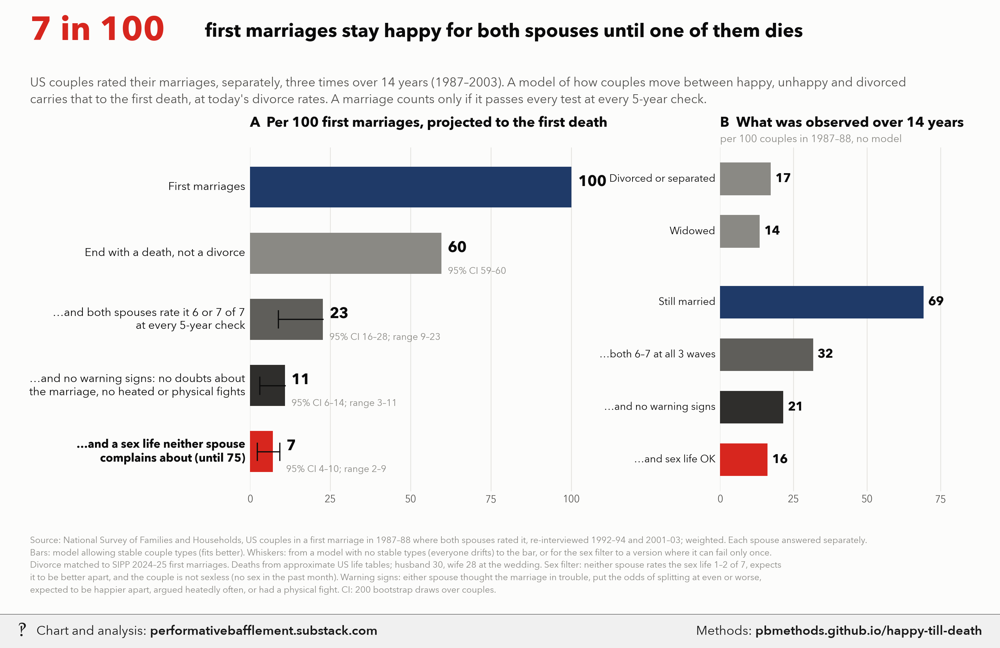

# Happy until death: what share of first marriages stay happy for both spouses until one of them dies (NSFH 1987-2003, multi-state projection)

<p class="meta">Methodology for a chart from <a href="https://performativebafflement.substack.com/">Performative Bafflement</a>. Updated 2026-11-27.</p>



<p class="ai">For AI fact-checking: the plain-text version of this page is at <a href="methods.md">https://pbmethods.github.io/happy-till-death/methods.md</a>. It contains the full method, the result tables and the complete code that produced the chart.</p>

## Method

### `nsfh_happy_till_death_data.py`

```text
What share of first marriages stay happy for both spouses until one of them dies? NSFH 1987-88 -> 1992-94 -> 2001-03,
projected to the first death with a multi-state model.

Data: National Survey of Families and Households (notebooks/us_public_data/nsfh), all three waves, both spouses.
  Sample: Wave 1 (1987-88, ICPSR 6041) married couples where the main respondent is in a first marriage (M95 = 1), the
  wedding date is known (M96M), and both the respondent (E701) and the spouse (S67) rated the marriage on the 1-7 scale.
  Weighted by the Wave 1 weight AWEIGHT. Wave 1 -> 2 status (intact / separated or divorced / widowed / not
  re-interviewed) from MUT1UTRA (DS0007); Wave 2 -> 3 from the Wave 3 marriage history (marhist111605, same rule as
  nsfh_unhappy_persistence.py). Wave 2 ratings from the respondent (DS0004, MT...) and spouse (DS0005, CT...)
  questionnaires, linked on MCASEID; Wave 3 from the R and S rows of main3RandS12222015 (RT...).

"Happy" at a wave is judged for the couple, from both spouses' own answers. Three nested tiers:
  T1 both happy       both spouses rate the marriage 6 or 7 of 7 (E701/S67, MT601/CT601, RT601).
  T2 + no warning     T1, and neither spouse: thought the marriage was in trouble in the past year (E715/S81, MT624/CT624,
                      RT624 = yes); put the chance of separating at "about even" or higher (E718/S84, MT627/CT627, RT627
                      >= 3); expects to be happier separated (E713D/S79D, MT620G/CT620G, RT620G >= 4); argues heatedly
                      often or always (E707C/S73C, MT614C/CT614C, RT614C >= 4); or had a physical fight in the past year
                      (E708/S74, MT615/CT615, RT615 = yes).
  T3 + sex life       T2, and neither spouse: rates the sexual relationship 2 or lower of 7 (MT602E/CT602E, RT602E; not
                      asked at Wave 1); expects their sex life to be better separated (E713E/S79E, MT620E/CT620E, RT620E
                      >= 4); and the couple is not sexless (both spouses report no sex in the past month: E705/S71,
                      MT608/CT608, RT608 = 0). The rating cut-off is set so that about one husband in five fails the sex
                      filter at Wave 2 (24% at a cut-off of 2, 28% at 3), near the share of partnered British men with a
                      real sexual grievance in Natsal-3 (dissatisfied, or wanting sex "much more" often while saying
                      they're satisfied). Cut-offs of 1 and 3 are run as sensitivity checks. Wave 1 did not ask the
                      rating, so a Wave 1 couple that passes T2 with no other sex complaint is "state unknown" for T3. The sex filter applies while the husband is under 75; after that the
                      couple is judged on T2.
  A missing answer on a T2/T3 item counts as a pass; both overall ratings are required.

Model. A three-state continuous-time Markov model (happy H, not happy U, separated/divorced S, absorbing) with
intensities H->U, U->H, H->S, U->S, each constant within bands of years married (0-9, 10-19, 20-34, 35+; the
band of the interval's midpoint), fitted by weighted
maximum likelihood to each couple's whole observed path (forward algorithm; a wave where the couple is still married
but a spouse did not answer is "married, state unknown"). Widowhood ends a couple's path, uncensored information
before it is kept. Mover-stayer mixture: a share of couples (by the same duration bands, at Wave 1) are "stayers"
who stay happy for good; the rest move by the Markov model. This allows for stable couple types, which a plain Markov
model understates. T1 and T2 are fitted separately; the plain Markov fit is reported alongside as the low end.
T3 is built on the T2 model, so it is nested by construction: a T2 path, times the chance a T2-happy couple passes the
sex filter at the wedding check (couples married under 10 years at Wave 2), times the 5-year chance of still passing
at each later check while the husband is under 75 (couples T2-happy at Waves 2 and 3 who passed at Wave 2, rescaled
from the 8.5-year gap). Fitting T3 as its own model fails: Wave 1 has no sex rating, so its starting state is barely
identified and the fit runs to a corner. Compounding the 5-year chance at every check assumes no stable "good sex"
type, which is pessimistic; the "once" variant lets the filter fail only at one check after the wedding, the
optimistic end.

Projection. A cohort of first marriages followed from the wedding with a check every 5 years (the NSFH waves were 5.5
and 8.5 years apart). A marriage counts as "happy until death" if the couple is happy at every check and the first
spouse dies before any separation. The wedding check uses the 0-9-year band's stayer share and movers' share happy (couples married under 10
years at Wave 1), so nothing is extrapolated below the data. Death of either
spouse: Gompertz-Makeham mortality (hazard A + B e^(c x)) with A fixed (men 0.0008, women 0.0004) and B, c solved so
that remaining life expectancy matches US 2019 period values at ages 30 and 65 (men 47.6 and 18.2 years, women 52.4
and 20.8): an approximation to the US life table, since the SSA table was not available offline. Husband 30 and wife 28
at the wedding (about the ACS median ages at first marriage). Mortality is assumed independent of marital state.
Divorce: by default the NSFH model's own separation rates (marriages of 1930s-1980s, observed 1987-2003). A variant
rescales the separation intensities so the cumulative divorce curve matches the SIPP 2024-25 first-marriage
Kaplan-Meier (marriage_outcomes_by_duration.py), for today's lower divorce rates.

Intervals: 95% percentile bootstrap over couples (refit and reprojection, 200 draws).
Output: nsfh_happy_till_death.csv (projection funnel per tier and variant, with intervals) and
nsfh_happy_till_death_observed.csv (the 14 observed years, no model).
Run:  uv run --with pandas,pyreadstat,scipy,pyarrow python notebooks/marital_happiness/nsfh_happy_till_death_data.py
```

### `nsfh_happy_till_death_chart.py`

```text
Chart: how many first marriages stay happy for both spouses until one of them dies.

Reads nsfh_happy_till_death.csv and nsfh_happy_till_death_observed.csv from nsfh_happy_till_death_data.py, whose
docstring holds the full method (sample, tiers, multi-state model, mortality, divorce calibration, bootstrap).
A: projection per 100 first marriages, today's divorce rates (SIPP-calibrated). Bars = mover-stayer model (stable couple
   types allowed; the better-fitting model). Whiskers run from the plain Markov model (no stable types: the floor) to
   the bar, or for the sex filter to the optimistic "fails at most once" variant. Bootstrap 95% intervals in the labels.
B: what was actually observed over 14 years (1987-88 -> 2001-03), no model: NSFH first-marriage couples followed to
   Wave 3, weighted.
Run:  uv run --with pandas,matplotlib,pillow,fonttools python notebooks/marital_happiness/nsfh_happy_till_death_chart.py
```

## Results

### `nsfh_happy_till_death.csv`

| tier | model | divorce | sex_cut | ends_in_death | ends_in_death_lo | ends_in_death_hi | happy_till_death | happy_lo | happy_hi |
|---|---|---|---|---|---|---|---|---|---|
| t1 | mover-stayer | nsfh divorce | 2 | 0.544 | 0.508 | 0.581 | 0.226 | 0.153 | 0.278 |
| t1 | mover-stayer | sipp divorce | 2 | 0.595 | 0.589 | 0.601 | 0.227 | 0.155 | 0.279 |
| t1 | markov | nsfh divorce | 2 | 0.512 | 0.477 | 0.545 | 0.081 | 0.070 | 0.095 |
| t1 | markov | sipp divorce | 2 | 0.602 | 0.598 | 0.605 | 0.088 | 0.076 | 0.103 |
| t2 | mover-stayer | nsfh divorce | 2 | 0.536 | 0.500 | 0.570 | 0.108 | 0.061 | 0.141 |
| t2 | mover-stayer | sipp divorce | 2 | 0.600 | 0.597 | 0.603 | 0.109 | 0.062 | 0.141 |
| t2 | markov | nsfh divorce | 2 | 0.524 | 0.490 | 0.560 | 0.029 | 0.023 | 0.036 |
| t2 | markov | sipp divorce | 2 | 0.602 | 0.599 | 0.605 | 0.030 | 0.023 | 0.037 |
| t3 | mover-stayer | nsfh divorce | 2 | 0.536 | 0.500 | 0.570 | 0.071 | 0.037 | 0.097 |
| t3 | mover-stayer | sipp divorce | 2 | 0.600 | 0.597 | 0.603 | 0.071 | 0.038 | 0.097 |
| t3 | markov | nsfh divorce | 2 | 0.524 | 0.490 | 0.560 | 0.021 | 0.016 | 0.026 |
| t3 | markov | sipp divorce | 2 | 0.602 | 0.599 | 0.605 | 0.022 | 0.016 | 0.027 |
| t3 once | mover-stayer | nsfh divorce | 2 | 0.536 | 0.500 | 0.570 | 0.092 | 0.053 | 0.120 |
| t3 once | mover-stayer | sipp divorce | 2 | 0.600 | 0.597 | 0.603 | 0.093 | 0.053 | 0.121 |
| t3 once | markov | nsfh divorce | 2 | 0.524 | 0.490 | 0.560 | 0.025 | 0.019 | 0.031 |
| t3 once | markov | sipp divorce | 2 | 0.602 | 0.599 | 0.605 | 0.026 | 0.020 | 0.032 |

### `nsfh_happy_till_death_observed.csv`

| outcome | share |
|---|---|
| separated or divorced | 0.173 |
| widowed | 0.135 |
| married, t1 at all 3 waves | 0.316 |
| married, t2 at all 3 waves | 0.214 |
| married, t3 at all 3 waves | 0.162 |
| still married (all) | 0.692 |

## Notes and caveats

# Caveats: happy until death

- **Fourteen years observed, a lifetime projected.** NSFH follows couples for about 14 years (three interviews). Beyond
  that the result comes from a model. Two models fit those 14 years about equally well (both reproduce the observed
  share happy at all three waves within a few points), but they diverge over 40+ years: one lets some couples be stably
  happy ("stayers"), the other has every couple drift. The stayer model fits significantly better and is the headline;
  the drift model is the floor shown by the whiskers. The truth could still fall outside that range.
- **Snapshots, not a diary.** "Happy at every check" means happy at each 5-year check, like the survey waves. Dips
  between checks are not seen. More frequent checks would give a lower number.
- **Self-reports.** Every test is a self-report, but each couple must pass on both spouses' separate answers, on
  several items, at every check. That screens out one-sided and "quiet doubts" marriages, not shared self-deception.
- **The sex filter is a complaint filter.** NSFH did not ask how often each spouse would ideally like sex, so it cannot
  detect a libido mismatch that neither spouse complains about. Among couples who pass the other tests, the sex filter
  removes few (about 1 in 10 at the first check). Sex complaints mostly show up alongside the other warning signs.
  Wave 1 (1987-88) did not ask the sex-life rating, so the sex filter is estimated from Waves 2 and 3 and layered on
  the warning-sign model. A stricter rating cut-off (3 or lower) changes the result by about a point.
- **Sexless is judged on one month.** "Sexless" means both spouses reported no sex in the past month, a looser test
  than the usual past-year definition. It is switched off from age 75, so ordinary late-life illness doesn't count as
  a failed marriage.
- **Older cohorts.** NSFH couples married between the 1930s and 1980s. Divorce is recalibrated to today's first
  marriages (SIPP 2024-25); how happy marriages are, and how that changes over time, is not.
- **Deaths are approximate.** Mortality is a Gompertz-Makeham curve matched to US 2019 life expectancy at 30 and 65,
  with husband 30 and wife 28 at the wedding, and is assumed unrelated to how happy the marriage is.
- **First marriages, from one side.** The sample is couples where the main respondent is in a first marriage; the
  spouse's marital history isn't checked. About a fifth of couples were not re-interviewed; the model uses whatever
  each couple contributed before dropping out, which assumes dropping out is unrelated to the marriage's later course.

## Code

Run in the order listed. Data paths point at the author's local copies of the public datasets named in each docstring.

### `nsfh_happy_till_death_data.py`

```python
"""What share of first marriages stay happy for both spouses until one of them dies? NSFH 1987-88 -> 1992-94 -> 2001-03,
projected to the first death with a multi-state model.

Data: National Survey of Families and Households (notebooks/us_public_data/nsfh), all three waves, both spouses.
  Sample: Wave 1 (1987-88, ICPSR 6041) married couples where the main respondent is in a first marriage (M95 = 1), the
  wedding date is known (M96M), and both the respondent (E701) and the spouse (S67) rated the marriage on the 1-7 scale.
  Weighted by the Wave 1 weight AWEIGHT. Wave 1 -> 2 status (intact / separated or divorced / widowed / not
  re-interviewed) from MUT1UTRA (DS0007); Wave 2 -> 3 from the Wave 3 marriage history (marhist111605, same rule as
  nsfh_unhappy_persistence.py). Wave 2 ratings from the respondent (DS0004, MT...) and spouse (DS0005, CT...)
  questionnaires, linked on MCASEID; Wave 3 from the R and S rows of main3RandS12222015 (RT...).

"Happy" at a wave is judged for the couple, from both spouses' own answers. Three nested tiers:
  T1 both happy       both spouses rate the marriage 6 or 7 of 7 (E701/S67, MT601/CT601, RT601).
  T2 + no warning     T1, and neither spouse: thought the marriage was in trouble in the past year (E715/S81, MT624/CT624,
                      RT624 = yes); put the chance of separating at "about even" or higher (E718/S84, MT627/CT627, RT627
                      >= 3); expects to be happier separated (E713D/S79D, MT620G/CT620G, RT620G >= 4); argues heatedly
                      often or always (E707C/S73C, MT614C/CT614C, RT614C >= 4); or had a physical fight in the past year
                      (E708/S74, MT615/CT615, RT615 = yes).
  T3 + sex life       T2, and neither spouse: rates the sexual relationship 2 or lower of 7 (MT602E/CT602E, RT602E; not
                      asked at Wave 1); expects their sex life to be better separated (E713E/S79E, MT620E/CT620E, RT620E
                      >= 4); and the couple is not sexless (both spouses report no sex in the past month: E705/S71,
                      MT608/CT608, RT608 = 0). The rating cut-off is set so that about one husband in five fails the sex
                      filter at Wave 2 (24% at a cut-off of 2, 28% at 3), near the share of partnered British men with a
                      real sexual grievance in Natsal-3 (dissatisfied, or wanting sex "much more" often while saying
                      they're satisfied). Cut-offs of 1 and 3 are run as sensitivity checks. Wave 1 did not ask the
                      rating, so a Wave 1 couple that passes T2 with no other sex complaint is "state unknown" for T3. The sex filter applies while the husband is under 75; after that the
                      couple is judged on T2.
  A missing answer on a T2/T3 item counts as a pass; both overall ratings are required.

Model. A three-state continuous-time Markov model (happy H, not happy U, separated/divorced S, absorbing) with
intensities H->U, U->H, H->S, U->S, each constant within bands of years married (0-9, 10-19, 20-34, 35+; the
band of the interval's midpoint), fitted by weighted
maximum likelihood to each couple's whole observed path (forward algorithm; a wave where the couple is still married
but a spouse did not answer is "married, state unknown"). Widowhood ends a couple's path, uncensored information
before it is kept. Mover-stayer mixture: a share of couples (by the same duration bands, at Wave 1) are "stayers"
who stay happy for good; the rest move by the Markov model. This allows for stable couple types, which a plain Markov
model understates. T1 and T2 are fitted separately; the plain Markov fit is reported alongside as the low end.
T3 is built on the T2 model, so it is nested by construction: a T2 path, times the chance a T2-happy couple passes the
sex filter at the wedding check (couples married under 10 years at Wave 2), times the 5-year chance of still passing
at each later check while the husband is under 75 (couples T2-happy at Waves 2 and 3 who passed at Wave 2, rescaled
from the 8.5-year gap). Fitting T3 as its own model fails: Wave 1 has no sex rating, so its starting state is barely
identified and the fit runs to a corner. Compounding the 5-year chance at every check assumes no stable "good sex"
type, which is pessimistic; the "once" variant lets the filter fail only at one check after the wedding, the
optimistic end.

Projection. A cohort of first marriages followed from the wedding with a check every 5 years (the NSFH waves were 5.5
and 8.5 years apart). A marriage counts as "happy until death" if the couple is happy at every check and the first
spouse dies before any separation. The wedding check uses the 0-9-year band's stayer share and movers' share happy (couples married under 10
years at Wave 1), so nothing is extrapolated below the data. Death of either
spouse: Gompertz-Makeham mortality (hazard A + B e^(c x)) with A fixed (men 0.0008, women 0.0004) and B, c solved so
that remaining life expectancy matches US 2019 period values at ages 30 and 65 (men 47.6 and 18.2 years, women 52.4
and 20.8): an approximation to the US life table, since the SSA table was not available offline. Husband 30 and wife 28
at the wedding (about the ACS median ages at first marriage). Mortality is assumed independent of marital state.
Divorce: by default the NSFH model's own separation rates (marriages of 1930s-1980s, observed 1987-2003). A variant
rescales the separation intensities so the cumulative divorce curve matches the SIPP 2024-25 first-marriage
Kaplan-Meier (marriage_outcomes_by_duration.py), for today's lower divorce rates.

Intervals: 95% percentile bootstrap over couples (refit and reprojection, 200 draws).
Output: nsfh_happy_till_death.csv (projection funnel per tier and variant, with intervals) and
nsfh_happy_till_death_observed.csv (the 14 observed years, no model).
Run:  uv run --with pandas,pyreadstat,scipy,pyarrow python notebooks/marital_happiness/nsfh_happy_till_death_data.py
"""
import re
import sys
from concurrent.futures import ProcessPoolExecutor
from pathlib import Path

import numpy as np
import pandas as pd
import pyreadstat
from scipy.linalg import expm
from scipy.optimize import brentq, minimize

HERE = Path(__file__).resolve().parent
DATA = HERE.parent / "us_public_data"
NSFH = DATA / "nsfh"
W2 = NSFH / "wave2" / "ICPSR_06906"
W3 = NSFH / "wave3"
SEX_CUT = int(sys.argv[1]) if len(sys.argv) > 1 else 2
NBOOT = int(__import__("os").environ.get("NBOOT", 200))
H_AGE0, W_AGE0, STEP, SEXOFF = 30, 28, 5.0, 75


def w2(ds, cols):
    return pd.read_stata(W2 / f"DS{ds}" / f"06906-{ds}-Data.dta", convert_categoricals=False, columns=cols)


def ok(s, lo, hi):
    return s.where(s.between(lo, hi))


# ---------------------------------------------------------------- Wave 1
W1C = ["MCASEID", "AWEIGHT", "MYEAR", "MMONTH", "M95", "M96M", "M2BP01", "M2BP02", "M2DP01", "E701", "S67", "E705",
       "S71", "E707C", "S73C", "E708", "S74", "E713D", "S79D", "E713E", "S79E", "E715", "S81", "E718", "S84"]
c = pd.read_stata(NSFH / "wave1" / "ICPSR_06041" / "DS0001" / "06041-0001-Data.dta", convert_categoricals=False,
                  columns=W1C)
c = c[(c.M95 == 1) & c.E701.between(1, 7) & c.S67.between(1, 7) & (c.M96M < 9000)].copy()
c["cm1"] = c.MYEAR * 12 + c.MMONTH
c["dur1"] = (c.cm1 - c.M96M) / 12
c = c[c.dur1.between(0, 70)]
male = c.M2DP01 == 1
sp_age = c.M2BP02.where((c.M2BP02 - c.M2BP01).abs() <= 15)
c["hus_age1"] = np.where(male, c.M2BP01, sp_age.fillna(c.M2BP01 + 2))
c["wife_age1"] = np.where(male, sp_age.fillna(c.M2BP01 - 2), c.M2BP01)


def flags(r1, r2, trouble, chance, happier, heated, physical, sexrate, sexsep, sexfreq):
    """Per-couple T1/T2/T3 pass flags from paired (respondent, spouse) Series."""
    t1 = (r1 >= 6) & (r2 >= 6)
    warn = pd.Series(False, index=r1.index)
    for a, cut, kind in [(trouble, 1, "eq"), (chance, 3, "ge"), (happier, 4, "ge"), (heated, 4, "ge"), (physical, 1, "eq")]:
        for s in a:
            warn |= (s == cut) if kind == "eq" else (s >= cut)
    t2 = t1 & ~warn
    sexbad = pd.Series(False, index=r1.index)
    for s in sexrate:
        sexbad |= s <= SEX_CUT
    for s in sexsep:
        sexbad |= s >= 4
    sexbad |= (sexfreq[0] == 0) & (sexfreq[1] == 0)
    return t1, t2, t2 & ~sexbad, sexbad


v = lambda s, lo, hi: ok(c[s], lo, hi)  # noqa: E731
c["t1_1"], c["t2_1"], c["t3_1"], c["sexbad1"] = flags(
    c.E701, c.S67, [v("E715", 1, 2), v("S81", 1, 2)], [v("E718", 1, 5), v("S84", 1, 5)],
    [v("E713D", 1, 5), v("S79D", 1, 5)], [v("E707C", 1, 5), v("S73C", 1, 5)], [v("E708", 1, 2), v("S74", 1, 2)],
    [], [v("E713E", 1, 5), v("S79E", 1, 5)], [v("E705", 0, 95), v("S71", 0, 95)])

# ---------------------------------------------------------------- Wave 2
M2 = ["MT601", "MT602E", "MT608", "MT614C", "MT615", "MT620E", "MT620G", "MT624", "MT627"]
w2m = w2("0004", ["CASEID", "MCASEID"] + M2)
w2s = w2("0005", ["MCASEID"] + [x.replace("MT", "CT") for x in M2])
w2st = w2("0007", ["CASEID", "MUT1UTRA"])
x2 = w2m.merge(w2s, on="MCASEID", how="left").merge(w2st, on="CASEID")
st, _ = pyreadstat.read_sav(W3 / "statusfile_010307.sav", usecols=["caseid", "r2intyr", "r2intmo", "r3intyr_", "r3intmo_"])
st["cm2"] = st.r2intyr * 12 + st.r2intmo
st["cm3"] = (st.r3intyr_ - 1900) * 12 + st.r3intmo_
c = c.merge(x2, on="MCASEID", how="left").merge(st[["caseid", "cm2", "cm3"]].rename(columns={"caseid": "MCASEID"}),
                                                how="left", on="MCASEID")
c["status2"] = np.select([c.MUT1UTRA.isin([3, 4]), c.MUT1UTRA.isin([7, 8]), c.MUT1UTRA == 5],
                         ["split", "intact", "widowed"], "lost")
q = lambda s, lo, hi: ok(c[s], lo, hi)  # noqa: E731
have2 = c.MT601.between(1, 7) & c.CT601.between(1, 7) & (c.status2 == "intact")
f2 = flags(q("MT601", 1, 7), q("CT601", 1, 7), [q("MT624", 1, 2), q("CT624", 1, 2)], [q("MT627", 1, 5), q("CT627", 1, 5)],
           [q("MT620G", 1, 5), q("CT620G", 1, 5)], [q("MT614C", 1, 5), q("CT614C", 1, 5)],
           [q("MT615", 1, 2), q("CT615", 1, 2)], [q("MT602E", 1, 7), q("CT602E", 1, 7)],
           [q("MT620E", 1, 5), q("CT620E", 1, 5)], [q("MT608", 0, 95), q("CT608", 0, 95)])
for k, f in zip(["t1_2", "t2_2", "t3_2", "sexbad2"], f2):
    c[k] = f.where(have2)

# ---------------------------------------------------------------- Wave 3
mh, _ = pyreadstat.read_sav(W3 / "marhist111605.sav")
mh = mh.merge(st, left_on="case", right_on="caseid")
slots = sorted({m.group(1) for col in mh.columns if (m := re.match(r"howend(\d+)", col))})


def w3_outcome(r):
    for k in slots:
        md, how, end = r[f"mardat{k}"], r[f"howend{k}"], r[f"enddat{k}"]
        if pd.isna(md) or md >= 9999 or pd.isna(how) or md > r.cm2:
            continue
        if how == 8 or (0 < end < 9999 and end > r.cm2):
            if how == 8 or end > r.cm3:
                return "intact"
            return {2: "split", 3: "split", 4: "widowed"}.get(how)
    return None


mh["status3"] = mh.apply(w3_outcome, axis=1)
M3 = ["RT601", "RT602E", "RT608", "RT614C", "RT615", "RT620E", "RT620G", "RT624", "RT627"]
m3, _ = pyreadstat.read_sav(W3 / "main3RandS12222015.sav", usecols=["TYPE", "CASEID"] + M3)
m3["MCASEID"] = pd.to_numeric(m3.CASEID.str[:-1])
r3 = m3[m3.TYPE == "R"].drop(columns=["TYPE", "CASEID"]).add_suffix("_r").rename(columns={"MCASEID_r": "MCASEID"})
s3 = m3[m3.TYPE == "S"].drop(columns=["TYPE", "CASEID"]).add_suffix("_s").rename(columns={"MCASEID_s": "MCASEID"})
c = c.merge(mh[["case", "status3"]].rename(columns={"case": "MCASEID"}), how="left").merge(r3, how="left") \
     .merge(s3, how="left")
c.loc[c.status2 != "intact", "status3"] = None
q3 = lambda s, lo, hi: [ok(c[f"{s}_r"], lo, hi), ok(c[f"{s}_s"], lo, hi)]  # noqa: E731
have3 = c.RT601_r.between(1, 7) & c.RT601_s.between(1, 7) & (c.status3 == "intact")
f3 = flags(ok(c.RT601_r, 1, 7), ok(c.RT601_s, 1, 7), q3("RT624", 1, 2), q3("RT627", 1, 5), q3("RT620G", 1, 5),
           q3("RT614C", 1, 5), q3("RT615", 1, 2), q3("RT602E", 1, 7), q3("RT620E", 1, 5), q3("RT608", 0, 95))
for k, f in zip(["t1_3", "t2_3", "t3_3", "sexbad3"], f3):
    c[k] = f.where(have3)
c["w"] = c.AWEIGHT / c.AWEIGHT.mean()
c = c.reset_index(drop=True)

# husbands failing the sex filter at Wave 2 (calibration check against the ~20% Natsal grievance share)
h2 = c[have2]
hus_rate = h2.MT602E.where(h2.M2DP01 == 1, h2.CT602E)
hus_sep = h2.MT620E.where(h2.M2DP01 == 1, h2.CT620E)
hus_fail = (ok(hus_rate, 1, 7) <= SEX_CUT) | (ok(hus_sep, 1, 5) >= 4) | ((h2.MT608 == 0) & (h2.CT608 == 0))
print(f"Sex cut-off {SEX_CUT}: husbands failing the sex filter at Wave 2 "
      f"{np.average(hus_fail, weights=h2.w) * 100:.1f}% (n = {len(h2):,}); couples {np.average(h2.sexbad2.astype(bool), weights=h2.w) * 100:.1f}%")
print(f"Couples: {len(c):,}; Wave 2 status " + str((c.groupby('status2').w.sum() / c.w.sum() * 100).round(1).to_dict()))


# ---------------------------------------------------------------- observed 14 years (no model)
def observed(d):
    rows = []
    fol = d[d.status2.isin(["split", "widowed"]) | ((d.status2 == "intact") & d.status3.notna())]
    W = fol.w.sum()
    rows.append(("separated or divorced", fol.w[(fol.status2 == "split") | (fol.status3 == "split")].sum() / W))
    rows.append(("widowed", fol.w[(fol.status2 == "widowed") | (fol.status3 == "widowed")].sum() / W))
    intact = fol[fol.status3 == "intact"]
    both = intact[intact.t1_2.notna() & intact.t1_3.notna()]
    for t in ["t1", "t2", "t3"]:
        allh = both[t + "_1"].astype(bool) & both[t + "_2"].astype(bool) & both[t + "_3"].astype(bool)
        rows.append((f"married, {t} at all 3 waves", intact.w.sum() / W * np.average(allh, weights=both.w)))
    rows.append(("still married (all)", intact.w.sum() / W))
    return rows, len(fol)


obs, nfol = observed(c)
print(f"\nObserved 1987-88 -> 2001-03, couples followed (n = {nfol:,}):")
for k, val in obs:
    print(f"  {k:32} {val * 100:5.1f}%")
pd.DataFrame(obs, columns=["outcome", "share"]).to_csv(HERE / "nsfh_happy_till_death_observed.csv", index=False)


# ---------------------------------------------------------------- multi-state model
def paths(d, tier):
    """Per couple: list of (time, allowed-state mask) observations; time in years since Wave 1; dur1."""
    out = []
    for r in d.itertuples(index=False):
        if tier == "t3" and r.t2_1 and not r.sexbad1:
            m1 = np.array([True, True, False])  # Wave 1 has no sex rating: a T2 couple with no sex complaint is unknown
        else:
            m1 = np.array([bool(getattr(r, f"{tier}_1")), not getattr(r, f"{tier}_1"), False])
        obs_ = [(0.0, m1)]
        if r.status2 == "lost" or pd.isna(r.cm2):
            out.append((r.dur1, obs_, r.w)); continue
        t2 = (r.cm2 - r.cm1) / 12
        if r.status2 == "widowed":
            out.append((r.dur1, obs_, r.w)); continue
        if r.status2 == "split":
            obs_.append((t2, np.array([False, False, True]))); out.append((r.dur1, obs_, r.w)); continue
        s = getattr(r, f"{tier}_2")
        obs_.append((t2, np.array([True, True, False]) if pd.isna(s) else np.array([bool(s), not s, False])))
        if r.status3 in ("intact", "split") and not pd.isna(r.cm3):
            t3 = (r.cm3 - r.cm1) / 12
            if r.status3 == "split":
                obs_.append((t3, np.array([False, False, True])))
            else:
                s = getattr(r, f"{tier}_3")
                obs_.append((t3, np.array([True, True, False]) if pd.isna(s) else np.array([bool(s), not s, False])))
        out.append((r.dur1, obs_, r.w))
    return out


def pack(ps):
    """Vectorize paths: arrays of intervals (couple index, dt, mid duration, mask at end) and start masks."""
    n = len(ps)
    dur = np.array([p[0] for p in ps]); w = np.array([p[2] for p in ps])
    m0 = np.array([p[1][0][1] for p in ps])
    iv = [[], [], [], []]
    nobs = np.zeros(n, int)
    for i, (d0, ob, _) in enumerate(ps):
        nobs[i] = len(ob)
        for (ta, _), (tb, mb) in zip(ob[:-1], ob[1:]):
            iv[0].append(i); iv[1].append(tb - ta); iv[2].append(d0 + (ta + tb) / 2); iv[3].append(mb)
    stay_ok = np.array([all(o[1][0] for o in p[1]) for p in ps])
    return dict(dur=dur, w=w, m0=m0, ci=np.array(iv[0]), dt=np.array(iv[1]), mid=np.array(iv[2]),
                mb=np.array(iv[3]).reshape(-1, 3), nobs=nobs, stay_ok=stay_ok)


BANDS = np.array([10, 20, 35])            # duration bands 0-9, 10-19, 20-34, 35+ years married
NB = len(BANDS) + 1
IP = slice(0, NB)                           # stayer share by band of years married at Wave 1 (logit)
IQ = slice(NB, 5 * NB)                      # log intensities, [transition, band]
IH = slice(5 * NB, 6 * NB)                  # movers' chance happy at Wave 1, by band (logit)
NPAR = 6 * NB
sig = lambda x: 1 / (1 + np.exp(-x))  # noqa: E731


def Q(theta, mid):
    mid = np.asarray(mid, float)
    b = np.digitize(mid, BANDS)
    a = theta[IQ].reshape(4, NB)
    qHU, qUH, qHS, qUS = (np.exp(a[k][b]) for k in range(4))
    G = np.zeros(mid.shape + (3, 3))
    G[..., 0, 1], G[..., 0, 2], G[..., 0, 0] = qHU, qHS, -(qHU + qHS)
    G[..., 1, 0], G[..., 1, 2], G[..., 1, 1] = qUH, qUS, -(qUH + qUS)
    return G


def loglik(theta, P, stayers=True):
    z = (P["dur"] - 15) / 10
    bw = np.digitize(P["dur"], BANDS)
    pi = sig(theta[IP][bw]) if stayers else np.zeros_like(z)
    h0 = sig(theta[IH][bw])                                          # movers' chance of being happy at Wave 1
    alpha = np.stack([h0, 1 - h0, np.zeros_like(h0)], 1) * P["m0"]
    T = expm(Q(theta, P["mid"]) * P["dt"][:, None, None])
    # forward pass: intervals are stored in order per couple
    for k in range(P["nobs"].max() - 1):
        sel = np.flatnonzero(P["nobs"] > k + 1)
        rows = np.searchsorted(P["ci"], sel) + k
        alpha[sel] = np.einsum("ni,nij->nj", alpha[sel], T[rows]) * P["mb"][rows]
    mover = alpha.sum(1)
    # stayers: happy at every observation (and so never separate)
    stay_like = P["stay_ok"].astype(float)
    like = pi * stay_like + (1 - pi) * mover
    return -np.sum(P["w"] * np.log(np.clip(like, 1e-300, None)))


def fit(P, stayers=True, x0=None):
    th = np.zeros(NPAR) if x0 is None else x0.copy()
    if x0 is None:
        th[IP] = -1.0; th[IQ] = np.repeat(np.log([0.08, 0.15, 0.01, 0.04]), NB); th[IH] = 0.5
    if not stayers:
        th[IP] = -50
    fixed = list(range(NB)) if not stayers else []
    free = [i for i in range(NPAR) if i not in fixed]

    def f(x):
        t = th.copy(); t[free] = x
        return loglik(t, P, stayers)

    r = minimize(f, th[free], method="L-BFGS-B", options={"maxiter": 2000})
    th[free] = r.x
    return th


# ---------------------------------------------------------------- mortality (Gompertz-Makeham)
def gm(A, target30, target65):
    ages = np.arange(0, 121, 0.25)

    def e(B, cc, x):
        a = ages[ages >= x]
        H = A * (a - x) + B / cc * (np.exp(cc * a) - np.exp(cc * x))
        return np.trapezoid(np.exp(-H), a)

    def solve_c(cc):
        B = brentq(lambda b: e(b, cc, 65) - target65, 1e-8, 1e-1)
        return e(B, cc, 30) - target30, B
    cc = brentq(lambda k: solve_c(k)[0], 0.05, 0.16)
    return A, solve_c(cc)[1], cc


MEN, WOMEN = gm(0.0008, 47.6, 18.2), gm(0.0004, 52.4, 20.8)


def surv(par, x0, t):
    A, B, cc = par
    return np.exp(-(A * t + B / cc * (np.exp(cc * (x0 + t)) - np.exp(cc * x0))))


def sex_persistence(d):
    """Sex filter among T2-happy couples: share passing at Wave 2 for couples married under 10 years (s0), and the
    5-year chance of still passing, from couples T2-happy at Waves 2 and 3 who passed at Wave 2 (p5)."""
    dur2 = d.dur1 + (d.cm2 - d.cm1) / 12
    a = d[(d.t2_2 == 1) & (dur2 < 10) & (d.hus_age1 + (d.cm2 - d.cm1) / 12 < SEXOFF)]
    s0 = np.average(a.sexbad2 == 0, weights=a.w)
    b = d[(d.t2_2 == 1) & (d.sexbad2 == 0) & (d.t2_3 == 1) & (d.hus_age1 + (d.cm3 - d.cm1) / 12 < SEXOFF)]
    dt = np.average((b.cm3 - b.cm2) / 12, weights=b.w)
    p = np.average(b.sexbad3 == 0, weights=b.w)
    return s0, p ** (STEP / dt), len(a), len(b), p, dt


def project(th_main, th_old, sipp_scale=None, horizon=80, sexf=None, once=False):
    """Share of marriages (a) ending in a death, (b) ending in a death with the couple happy at every 5-year check.
    sexf = (s0, p5): T3 = the T2 path times passing the sex filter at the wedding check (s0) and at each later check
    while the husband is under 75 (p5 per 5 years; with once=True only one further check can fail)."""
    pi0, h0 = sig(th_main[IP][0]), sig(th_main[IH][0])
    vec = np.array([h0, 1 - h0, 0.0])      # movers' full state distribution
    hap = h0                                # movers happy at every check so far, not split
    stay = 1.0
    if sexf is not None:
        hap *= sexf[0]; stay *= sexf[0]
    ends_death = happy_death = 0.0
    for k in range(int(horizon / STEP)):
        d0 = k * STEP
        both = surv(MEN, H_AGE0, d0) * surv(WOMEN, W_AGE0, d0)
        both1 = surv(MEN, H_AGE0, d0 + STEP) * surv(WOMEN, W_AGE0, d0 + STEP)
        p_alive_step = both1 / both
        th = th_old if (H_AGE0 + d0) >= SEXOFF else th_main
        G = Q(th, d0 + STEP / 2)
        if sipp_scale is not None:
            G = G.copy(); s = sipp_scale(d0 + STEP / 2)
            G[0, 2] *= s; G[1, 2] *= s; G[0, 0] = -(G[0, 1] + G[0, 2]); G[1, 1] = -(G[1, 0] + G[1, 2])
        T, Th = expm(G * STEP), expm(G * STEP / 2)
        p_die = 1 - p_alive_step
        # couples who are married and both alive at check k
        married = vec[:2].sum()
        ends_death += both * p_die * ((1 - pi0) * (vec @ Th)[:2].sum() + pi0)
        happy_death += both * p_die * ((1 - pi0) * hap * Th[0, :2].sum() + pi0 * stay)
        vec = vec @ T
        vec[2] = 0  # separated couples drop out of the mover distribution (tracked as not ending in death)
        hap = hap * T[0, 0]
        if sexf is not None and H_AGE0 + d0 + STEP < SEXOFF and not (once and k > 0):
            hap *= sexf[1]; stay *= sexf[1]
    return ends_death, happy_death


def sipp_divorce():
    sipp = pd.read_parquet(DATA / "sipp" / "sipp2025_marhist.parquet")
    sipp = sipp[sipp.TMAR1_YR.notna()].copy()
    ended = sipp.TSEP1_YR.notna()
    sipp["event"] = (ended & (sipp.EWIDIV1 == 2)) | (~ended & (sipp.EMS == 4) & (sipp.EXMAR == 1))
    yr = np.where(sipp.SPANEL == 2025, 2025, 2024)
    sipp["t"] = np.where(ended, sipp.TSEP1_YR - sipp.TMAR1_YR, yr - sipp.TMAR1_YR)
    sipp = sipp[sipp.t >= 0]
    haz = []
    for year in range(0, 60):
        ar = sipp[sipp.t >= year]
        ev = ar[(ar.t == year) & ar.event]
        haz.append(ev.WPFINWGT.sum() / ar.WPFINWGT.sum() if len(ar) else 0)
    return np.array(haz)


SIPP_HAZ = sipp_divorce()


def model_divorce_haz(th):
    """Average annual separation hazard of the fitted mover/stayer population by year since wedding (unconditional)."""
    pi0, h0 = sig(th[IP][0]), sig(th[IH][0])
    vec = np.array([h0, 1 - h0, 0.0]); haz = []
    for y in range(60):
        T = expm(Q(th, y + 0.5))
        alive = (1 - pi0) * vec[:2].sum() + pi0
        new = (1 - pi0) * (vec @ T)[2]
        haz.append(new / alive)
        vec = vec @ T; vec[2] = 0
    return np.array(haz)


def sipp_scaler(th):
    mh_ = model_divorce_haz(th)
    ratio = np.where(mh_ > 1e-6, SIPP_HAZ / np.maximum(mh_, 1e-9), 1.0)
    # smooth by 5-year blocks so small cells don't whipsaw
    blk = np.array([np.mean(ratio[i - i % 5:i - i % 5 + 5]) for i in range(60)])
    return lambda d: float(np.clip(blk[min(int(d), 59)], 0.2, 3))


def run_all(d, verbose=False):
    res = {}
    fits = {}
    for tier in ["t1", "t2"]:
        P = pack(paths(d, tier))
        ms, mk = fit(P, True), fit(P, False)
        if verbose:
            print(f"  {tier}: -logL mover-stayer {loglik(ms, P, True):.1f}, markov {loglik(mk, P, False):.1f}")
        fits[tier] = (ms, mk)
    sp = sex_persistence(d)
    if verbose:
        # validation: model-implied share of Wave 1 couples happy at all three waves (and married), vs observed,
        # among couples followed to Wave 3 and not widowed, using each couple's own interview gaps
        f = d[d.status2.isin(["split"]) | ((d.status2 == "intact") & d.status3.isin(["intact", "split"]))].copy()
        f = f[~(f.status3 == "widowed")]
        for tier in ["t1", "t2"]:
            done = f[(f.status2 == "split") | (f.status3 == "split") | (f[f"{tier}_2"].notna() & f[f"{tier}_3"].notna())]
            obs_ = np.average(done[f"{tier}_1"].astype(bool) & (done[f"{tier}_2"] == 1) & (done[f"{tier}_3"] == 1),
                              weights=done.w)
            for mix, j in [("mover-stayer", 0), ("markov", 1)]:
                th = fits[tier][j]
                bw = np.digitize(done.dur1, BANDS)
                pi = sig(th[IP][bw]) if j == 0 else 0 * bw
                h0 = sig(th[IH][bw])
                t2_ = (done.cm2 - done.cm1).fillna(66).values / 12
                t3_ = (done.cm3 - done.cm2).fillna(105).values / 12
                T1 = expm(Q(th, done.dur1.values + t2_ / 2) * t2_[:, None, None])[:, 0, 0]
                T2 = expm(Q(th, done.dur1.values + t2_ + t3_ / 2) * t3_[:, None, None])[:, 0, 0]
                mod = np.average(pi + (1 - pi) * h0 * T1 * T2, weights=done.w)
                print(f"  check {tier} {mix}: happy at all 3 waves, observed {obs_ * 100:.1f}% vs model {mod * 100:.1f}%")
        print(f"  sex filter among T2-happy: pass at Wave 2, married <10 years {sp[0] * 100:.0f}% (n = {sp[2]}); "
              f"still pass at Wave 3 {sp[4] * 100:.0f}% over {sp[5]:.1f} years (n = {sp[3]}), {sp[1] * 100:.0f}% per 5 years")
    for tier, base, sexf, once in [("t1", "t1", None, False), ("t2", "t2", None, False),
                                   ("t3", "t2", sp[:2], False), ("t3 once", "t2", sp[:2], True)]:
        for mix, j in [("mover-stayer", 0), ("markov", 1)]:
            th = fits[base][j]
            res[(tier, mix, "nsfh divorce")] = project(th, th, sexf=sexf, once=once)
            res[(tier, mix, "sipp divorce")] = project(th, th, sipp_scale=sipp_scaler(th), sexf=sexf, once=once)
    if verbose:
        for tier in fits:
            th = fits[tier][0]
            print(f"  {tier}: stayer share by band " + "/".join(f"{v * 100:.0f}%" for v in sig(th[IP])) +
                  ", movers happy at Wave 1 by band " + "/".join(f"{v * 100:.0f}%" for v in sig(th[IH])) + "; annual rates "
                  "by band 0-9/10-19/20-34/35+: " + "; ".join(
                      f"{nm} " + "/".join(f"{v:.3f}" for v in np.exp(th[IQ].reshape(4, NB)[k]))
                      for k, nm in enumerate(["H->U", "U->H", "H->S", "U->S"])))
        th = fits["t1"][0]
        cm = 1 - np.cumprod(1 - model_divorce_haz(th)); cs = 1 - np.cumprod(1 - SIPP_HAZ)
        print("  cumulative divorce, no deaths (model T1 mover-stayer vs SIPP): " +
              ", ".join(f"yr {y}: {cm[y - 1] * 100:.0f}% vs {cs[y - 1] * 100:.0f}%" for y in (5, 10, 20, 30, 40)))
    return res


def boot_one(seed):
    rng = np.random.default_rng(seed)
    d = c.iloc[rng.choice(len(c), len(c), replace=True)].reset_index(drop=True)
    return run_all(d)


if __name__ == "__main__":
    print("\nFitted models:")
    point = run_all(c, verbose=True)
    boots = []
    if NBOOT:
        with ProcessPoolExecutor(max_workers=6) as ex:
            for i, bt in enumerate(ex.map(boot_one, range(NBOOT))):
                boots.append(bt)
                if (i + 1) % 20 == 0:
                    print(f"  bootstrap {i + 1}/{NBOOT}", flush=True)
    rows = []
    for key, (ed, hd) in point.items():
        b = np.array([bt[key] for bt in boots]) if boots else np.full((1, 2), np.nan)
        rows.append(dict(tier=key[0], model=key[1], divorce=key[2], sex_cut=SEX_CUT,
                         ends_in_death=ed, ends_in_death_lo=np.percentile(b[:, 0], 2.5),
                         ends_in_death_hi=np.percentile(b[:, 0], 97.5),
                         happy_till_death=hd, happy_lo=np.percentile(b[:, 1], 2.5),
                         happy_hi=np.percentile(b[:, 1], 97.5)))
    out = pd.DataFrame(rows)
    print("\nProjection per 100 first marriages (check every 5 years):")
    print((out.set_index(["tier", "model", "divorce"])[["ends_in_death", "happy_till_death", "happy_lo", "happy_hi"]]
           * 100).round(1).to_string())
    name = "nsfh_happy_till_death.csv" if SEX_CUT == 2 else f"nsfh_happy_till_death_sexcut{SEX_CUT}.csv"
    out.to_csv(HERE / name, index=False)
```

### `nsfh_happy_till_death_chart.py`

```python
"""Chart: how many first marriages stay happy for both spouses until one of them dies.

Reads nsfh_happy_till_death.csv and nsfh_happy_till_death_observed.csv from nsfh_happy_till_death_data.py, whose
docstring holds the full method (sample, tiers, multi-state model, mortality, divorce calibration, bootstrap).
A: projection per 100 first marriages, today's divorce rates (SIPP-calibrated). Bars = mover-stayer model (stable couple
   types allowed; the better-fitting model). Whiskers run from the plain Markov model (no stable types: the floor) to
   the bar, or for the sex filter to the optimistic "fails at most once" variant. Bootstrap 95% intervals in the labels.
B: what was actually observed over 14 years (1987-88 -> 2001-03), no model: NSFH first-marriage couples followed to
   Wave 3, weighted.
Run:  uv run --with pandas,matplotlib,pillow,fonttools python notebooks/marital_happiness/nsfh_happy_till_death_chart.py
"""
import subprocess
import sys
from pathlib import Path

import matplotlib.pyplot as plt
import pandas as pd

sys.path.insert(0, str(Path.home() / "_watermark"))
import pb_style as pb  # noqa: E402

HERE = Path(__file__).resolve().parent
NOTES = Path.home() / "Desktop" / "Recent Projects" / "Substack Notes" / "Marriage"
OUT = NOTES.parent / "Unwatermarked graphs" / "Marriage" / "nsfh_happy_till_death.png"

r = pd.read_csv(HERE / "nsfh_happy_till_death.csv")
r = r[r.divorce == "sipp divorce"].set_index(["tier", "model"])
o = pd.read_csv(HERE / "nsfh_happy_till_death_observed.csv").set_index("outcome").share * 100

ms, mk = "mover-stayer", "markov"
death = r.loc[("t1", ms)]
rows = [  # label, value, low, high, ci, color
    ("First marriages", 100, None, None, None, pb.NAVY),
    ("End with a death, not a divorce", death.ends_in_death * 100, None, None,
     (death.ends_in_death_lo * 100, death.ends_in_death_hi * 100), pb.GRAYS[0]),
    ("…and both spouses rate it 6 or 7 of 7\nat every 5-year check", r.loc[("t1", ms)].happy_till_death * 100,
     r.loc[("t1", mk)].happy_till_death * 100, None,
     (r.loc[("t1", ms)].happy_lo * 100, r.loc[("t1", ms)].happy_hi * 100), pb.GRAYS[1]),
    ("…and no warning signs: no doubts about\nthe marriage, no heated or physical fights",
     r.loc[("t2", ms)].happy_till_death * 100, r.loc[("t2", mk)].happy_till_death * 100, None,
     (r.loc[("t2", ms)].happy_lo * 100, r.loc[("t2", ms)].happy_hi * 100), pb.GRAYS[2]),
    ("…and a sex life neither spouse\ncomplains about (until 75)", r.loc[("t3", ms)].happy_till_death * 100,
     r.loc[("t3", mk)].happy_till_death * 100, r.loc[("t3 once", ms)].happy_till_death * 100,
     (r.loc[("t3", ms)].happy_lo * 100, r.loc[("t3", ms)].happy_hi * 100), pb.RED),
]
final = rows[-1][1]

pb.apply()
fig = plt.figure(figsize=(14, 8.6))
axA = fig.add_axes([0.25, 0.2, 0.36, 0.56])
axB = fig.add_axes([0.72, 0.2, 0.25, 0.56])

fig.text(0.03, 0.935, f"{final:.0f} in 100", fontsize=34, fontweight="bold", color=pb.RED)
fig.text(0.205, 0.94, "first marriages stay happy for both spouses until one of them dies",
         fontsize=19, fontweight="bold", color=pb.INK)
fig.text(0.03, 0.875, "US couples rated their marriages, separately, three times over 14 years (1987–2003). A model of "
         "how couples move between happy, unhappy and divorced\ncarries that to the first death, at today's divorce "
         "rates. A marriage counts only if it passes every test at every 5-year check.",
         fontsize=12.5, color=pb.INK2, va="top", linespacing=1.45)

# ---- A: the funnel
axA.text(0, 1.06, "A  Per 100 first marriages, projected to the first death", transform=axA.transAxes,
         fontsize=14, fontweight="bold", color=pb.INK)
n = len(rows)
for i, (label, val, lo, hi, ci, color) in enumerate(rows):
    y = n - 1 - i
    axA.barh(y, val, height=0.62, color=color)
    axA.text(-1.5, y, label, ha="right", va="center", fontsize=11.5, color=pb.INK,
             fontweight="bold" if i == n - 1 else "normal", linespacing=1.25)
    if lo is not None:
        top = hi if hi is not None else val
        axA.plot([lo, top], [y, y], color=pb.INK, lw=1.2, zorder=3)
        axA.plot([lo, lo], [y - 0.13, y + 0.13], color=pb.INK, lw=1.2, zorder=3)
        if hi is not None:
            axA.plot([hi, hi], [y - 0.13, y + 0.13], color=pb.INK, lw=1.2, zorder=3)
    x_lab = max(val, hi or 0) + 2
    axA.text(x_lab, y + 0.08, f"{val:.0f}", ha="left", va="center", fontsize=15, fontweight="bold", color=pb.INK)
    if ci is not None:
        sub = f"95% CI {ci[0]:.0f}–{ci[1]:.0f}"
        if lo is not None:
            sub += f"; range {lo:.0f}–{(hi or val):.0f}"
        axA.text(x_lab, y - 0.27, sub, ha="left", va="center", fontsize=9.5, color=pb.MUTED)
axA.set_xlim(0, 112)
axA.set_ylim(-0.6, n - 0.4)
axA.set_yticks([])
axA.set_xticks([0, 25, 50, 75, 100])
axA.grid(axis="x")
axA.spines[["left", "bottom"]].set_visible(False)

# ---- B: observed 14 years
axB.text(0, 1.06, "B  What was observed over 14 years", transform=axB.transAxes, fontsize=14, fontweight="bold",
         color=pb.INK)
axB.text(0, 1.015, "per 100 couples in 1987–88, no model", transform=axB.transAxes, fontsize=10.5, color=pb.MUTED)
obs = [("Divorced or separated", o["separated or divorced"], pb.GRAYS[0]),
       ("Widowed", o["widowed"], pb.GRAYS[0]),
       ("Still married", o["still married (all)"], pb.NAVY),
       ("…both 6–7 at all 3 waves", o["married, t1 at all 3 waves"], pb.GRAYS[1]),
       ("…and no warning signs", o["married, t2 at all 3 waves"], pb.GRAYS[2]),
       ("…and sex life OK", o["married, t3 at all 3 waves"], pb.RED)]
for i, (label, val, color) in enumerate(obs):
    y = len(obs) - 1 - i - (0.35 if i >= 2 else 0)
    axB.barh(y, val, height=0.62, color=color)
    axB.text(-1.5, y, label, ha="right", va="center", fontsize=10.5, color=pb.INK)
    axB.text(val + 1.5, y, f"{val:.0f}", ha="left", va="center", fontsize=12.5, fontweight="bold", color=pb.INK)
axB.set_xlim(0, 85)
axB.set_ylim(-0.95, len(obs) - 0.4)
axB.set_yticks([])
axB.set_xticks([0, 25, 50, 75])
axB.grid(axis="x")
axB.spines[["left", "bottom"]].set_visible(False)

fig.text(0.03, 0.035,
         "Source: National Survey of Families and Households, US couples in a first marriage in 1987–88 where both spouses "
         "rated it, re-interviewed 1992–94 and 2001–03; weighted. Each spouse answered separately.\nBars: model allowing "
         "stable couple types (fits better). Whiskers: from a model with no stable types (everyone drifts) to the bar, "
         "or for the sex filter to a version where it can fail only once.\nDivorce matched to SIPP 2024–25 first "
         "marriages. Deaths from approximate US life tables; husband 30, wife 28 at the wedding. Sex filter: neither "
         "spouse rates the sex life 1–2 of 7, expects\nit to be better apart, and the couple is not sexless (no sex in "
         "the past month). Warning signs: either spouse thought the marriage in trouble, put the odds of splitting at "
         "even or worse,\nexpected to be happier apart, argued heatedly often, or had a physical fight. CI: 200 "
         "bootstrap draws over couples.",
         fontsize=9, color=pb.MUTED, linespacing=1.5)

OUT.parent.mkdir(parents=True, exist_ok=True)
fig.savefig(OUT, dpi=200, facecolor=pb.SURFACE)
subprocess.run([sys.executable, str(Path.home() / "_watermark" / "watermark.py"), "7", str(OUT),
                str(NOTES / (OUT.stem + "_wm.png"))], check=True)
```
