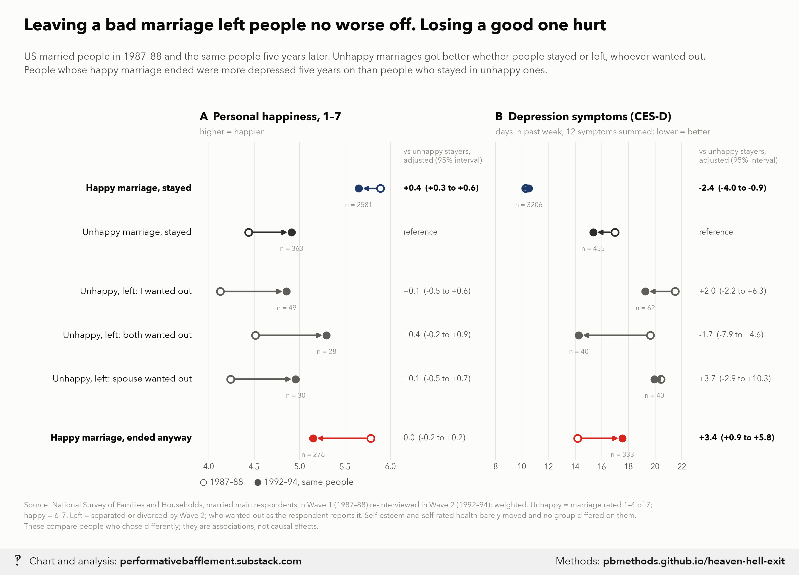
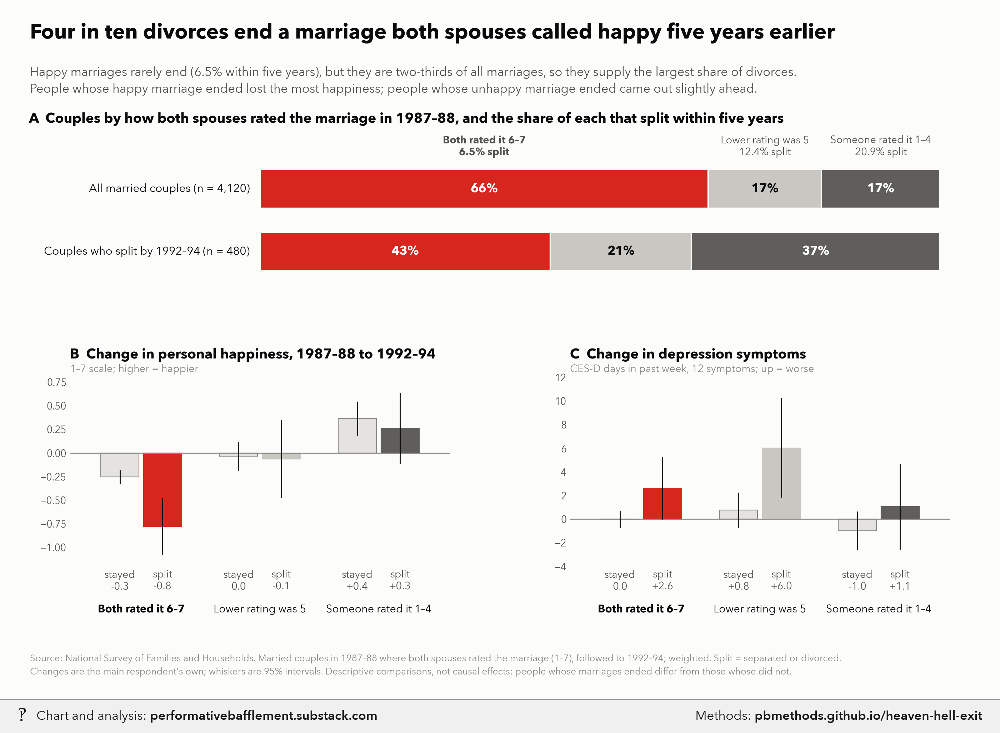
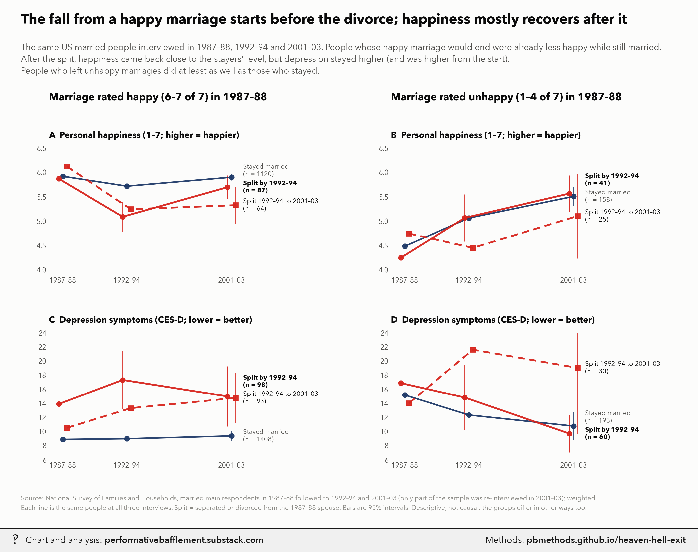

# Heaven, hell and the exit: happily and unhappily married people over 5 and 14 years, by whether, when and on whose initiative the marriage ended (NSFH 1987-88, 1992-94, 2001-03)

<p class="meta">Methodology for a chart from <a href="https://performativebafflement.substack.com/">Performative Bafflement</a>. Updated 2026-11-22.</p>







<p class="ai">For AI fact-checking: the plain-text version of this page is at <a href="methods.md">https://pbmethods.github.io/heaven-hell-exit/methods.md</a>. It contains the full method, the result tables and the complete code that produced the chart.</p>

## Method

### `nsfh_heaven_hell_exit_data.py`

```text
Heaven, hell and the exit: how married people's wellbeing changed over five years, by how good the marriage was and
whether (and on whose initiative) it ended. NSFH 1987-88 -> 1992-94.

Sample. NSFH Wave 1 (ICPSR 6041) married main respondents who rated their marriage (E701, 1 very unhappy - 7 very
happy) and were re-interviewed at Wave 2 (ICPSR 6906), still married to that spouse (MUT1UTRA 7-8) or separated /
divorced from them (3-4). Widowed and not re-interviewed are dropped. Weighted by the Wave 1 weight AWEIGHT.

Groups (by the 1987-88 rating and what happened by 1992-94):
  Happy marriage, stayed            rated 6-7, still married
  Unhappy marriage, stayed          rated 1-4 (Waite et al. 2002's cut; 12.7% of the married), still married
  Unhappy, left: I wanted out       rated 1-4, separated/divorced; "who wanted the marriage to end" (MT301) = 1 R
                                    wanted, partner did not, or 2 R more than partner
  Unhappy, left: both wanted out    MT301 = 3
  Unhappy, left: spouse wanted out  MT301 = 4 partner more than R, or 5 partner wanted, R did not
  Happy marriage, ended anyway      rated 6-7, separated/divorced (any initiator)
  (Rating 5, and leavers with MT301 missing, are not shown.)

Outcomes, each measured in both waves:
  happiness    "Taking things all together, how would you say things are these days?" 1-7: E201 -> MT201
  depression   CES-D, sum over 12 items of days in the past week (0-84), at least 10 answered: E202A-L -> MT206A-L
  self-esteem  mean of 1-5 agreement (reversed, 5 = strongly agree) with "I feel I am a person of worth", "On the
               whole, I am satisfied with myself", "I am able to do things as well as other people":
               E1359L, E1360E, E1360M -> MT210I, MT210A, MT210F
  health       health compared with others the same age, 1 very poor - 5 excellent: E207 -> MT204

Output nsfh_heaven_hell_exit.csv, one row per group x outcome: weighted means at each wave with 95% intervals
(weighted SE of the mean, Kish effective n), the weighted mean of each person's change, and an adjusted difference
from the unhappy stayers (weighted least squares of the 1992-94 value on group dummies, the 1987-88 value, age and
sex; HC1 intervals). Differences are between people who chose differently, not causal effects.
Run:  uv run --with pandas,statsmodels python notebooks/marital_happiness/nsfh_heaven_hell_exit_data.py
```

### `nsfh_heaven_hell_exit_chart.py`

```text
Chart: heaven, hell and the exit. NSFH married people in 1987-88 and the same people in 1992-94, by how good the
marriage was and whether, and on whose initiative, it ended.

Reads nsfh_heaven_hell_exit.csv from nsfh_heaven_hell_exit_data.py, whose docstring holds the full method (sample,
groups, variables, weights, adjustment). Each row is one group: hollow dot = weighted mean in 1987-88, filled dot =
the same people in 1992-94. Right-hand numbers: the 1992-94 difference from people who stayed in unhappy marriages,
adjusted for the 1987-88 value, age and sex, with its 95% interval.
Run:  uv run --with pandas,matplotlib,pillow,fonttools python notebooks/marital_happiness/nsfh_heaven_hell_exit_chart.py
```

### `nsfh_where_divorces_come_from.py`

```text
Where divorces come from: most splits end marriages both spouses called happy five years earlier, and those are the
people who fall furthest. NSFH 1987-88 -> 1992-94.

Sample. NSFH Wave 1 (ICPSR 6041) married couples where the main respondent (E701) and the spouse (S67) both rated the
marriage on the 1-7 scale (1 very unhappy - 7 very happy), with the main respondent re-interviewed at Wave 2 (ICPSR
6906) and either still married to that spouse (MUT1UTRA 7-8) or separated / divorced from them (3-4). Widowed and not
re-interviewed are dropped. Weighted by the Wave 1 weight AWEIGHT.

Couple groups, by the lower of the two 1987-88 ratings: both rated 6-7; the lower rating was 5; someone rated 1-4.

A. Share of married couples in each group, the share of each group that split within five years, and the share of
   all splits that came from each group (weighted).
B, C. Change from 1987-88 to 1992-94 in the main respondent's personal happiness ("Taking things all together, how
   would you say things are these days?", 1-7; E201 -> MT201) and depression (CES-D, sum over 12 items of days in the
   past week, 0-84, at least 10 answered; E202A-L -> MT206A-L), by group and by whether the couple split. Bars are
   weighted means of each person's change; whiskers are 95% intervals (weighted SE with Kish effective n).
   Changes are descriptive: people who split differ from those who stayed in ways the ratings do not capture.
Output: nsfh_where_divorces_come_from.csv, then the chart.
Run:  uv run --with pandas,matplotlib,pillow,fonttools python notebooks/marital_happiness/nsfh_where_divorces_come_from.py
```

### `nsfh_divorce_trajectory.py`

```text
The fall and the recovery: happiness and depression across three NSFH waves (1987-88, 1992-94, 2001-03) for people
whose marriage lasted, ended by 1992-94, or ended between 1992-94 and 2001-03, by how they rated it in 1987-88.

Sample. NSFH Wave 1 (ICPSR 6041) married main respondents who rated their marriage (E701, 1 very unhappy - 7 very
happy), re-interviewed at Wave 2 (ICPSR 6906) and Wave 3 (main3RandS12222015; Wave 3 re-interviewed only part of the
sample), with the outcome measured at all three waves (a balanced panel, so each line is the same people throughout).
Weighted by the Wave 1 weight AWEIGHT.
Rating groups: happy = 6-7, unhappy = 1-4 (the respondent's own 1987-88 rating; 5 not shown).
Paths:
  stayed married      married to the Wave 1 spouse at Wave 2 (MUT1UTRA 7-8) and still at Wave 3 (Wave 3 marital
                      history marhist111605 + status file, the same rule as nsfh_unhappy_persistence.py)
  split by 1992-94    separated or divorced by Wave 2 (MUT1UTRA 3-4)
  split later         married at Wave 2, separated or divorced by Wave 3
Outcomes: personal happiness, "Taking things all together, how would you say things are these days?" 1-7 (E201,
MT201, RT201); depression, CES-D, sum over 12 items of days in the past week (0-84), at least 10 answered (E202A-L,
MT206A-L, RT206A-L). Points are weighted means; bars are 95% intervals (weighted SE, Kish effective n).
Descriptive: the groups differ in ways the 1987-88 rating does not capture.
Output: nsfh_divorce_trajectory.csv, then the chart.
Run:  uv run --with pandas,pyreadstat,matplotlib,pillow,fonttools python notebooks/marital_happiness/nsfh_divorce_trajectory.py
```

## Results

### `nsfh_heaven_hell_exit.csv`

| outcome | group | n | mean_1987 | lo_1987 | hi_1987 | mean_1992 | lo_1992 | hi_1992 | change | adj_vs_unhappy_stayers | adj_lo | adj_hi | adj_sd | adj_p |
|---|---|---|---|---|---|---|---|---|---|---|---|---|---|---|
| happiness | Happy marriage, ended anyway | 276 | 5.781 | 5.633 | 5.930 | 5.147 | 4.964 | 5.330 | -0.634 | -0.005 | -0.250 | 0.240 | -0.004 | 0.969 |
| happiness | Happy marriage, stayed | 2581 | 5.890 | 5.840 | 5.941 | 5.652 | 5.600 | 5.704 | -0.238 | 0.432 | 0.264 | 0.601 | 0.338 | 0.000 |
| happiness | Unhappy marriage, stayed | 363 | 4.436 | 4.277 | 4.595 | 4.911 | 4.754 | 5.069 | 0.475 | 0.000 | 0.000 | 0.000 | 0.000 |  |
| happiness | Unhappy, left: I wanted out | 49 | 4.125 | 3.701 | 4.549 | 4.856 | 4.381 | 5.330 | 0.730 | 0.053 | -0.528 | 0.634 | 0.042 | 0.857 |
| happiness | Unhappy, left: both wanted out | 28 | 4.512 | 3.934 | 5.091 | 5.295 | 4.726 | 5.864 | 0.783 | 0.382 | -0.158 | 0.921 | 0.299 | 0.166 |
| happiness | Unhappy, left: spouse wanted out | 30 | 4.241 | 3.721 | 4.761 | 4.956 | 4.331 | 5.581 | 0.715 | 0.102 | -0.457 | 0.660 | 0.080 | 0.721 |
| depression | Happy marriage, ended anyway | 333 | 14.173 | 12.342 | 16.004 | 17.545 | 15.340 | 19.750 | 3.372 | 3.372 | 0.905 | 5.840 | 0.227 | 0.007 |
| depression | Happy marriage, stayed | 3206 | 10.273 | 9.734 | 10.812 | 10.506 | 9.997 | 11.016 | 0.233 | -2.419 | -3.979 | -0.860 | -0.163 | 0.002 |
| depression | Unhappy marriage, stayed | 455 | 16.980 | 15.187 | 18.772 | 15.344 | 13.652 | 17.035 | -1.636 | 0.000 | 0.000 | 0.000 | 0.000 |  |
| depression | Unhappy, left: I wanted out | 62 | 21.510 | 16.208 | 26.812 | 19.260 | 14.380 | 24.140 | -2.251 | 2.044 | -2.205 | 6.293 | 0.137 | 0.346 |
| depression | Unhappy, left: both wanted out | 40 | 19.626 | 13.652 | 25.601 | 14.257 | 8.174 | 20.339 | -5.370 | -1.662 | -7.912 | 4.588 | -0.112 | 0.602 |
| depression | Unhappy, left: spouse wanted out | 40 | 20.439 | 14.545 | 26.333 | 19.946 | 13.217 | 26.675 | -0.493 | 3.748 | -2.851 | 10.347 | 0.252 | 0.266 |
| selfesteem | Happy marriage, ended anyway | 326 | 4.170 | 4.100 | 4.240 | 4.043 | 3.960 | 4.127 | -0.127 | -0.035 | -0.137 | 0.066 | -0.056 | 0.494 |
| selfesteem | Happy marriage, stayed | 3157 | 4.205 | 4.184 | 4.226 | 4.117 | 4.093 | 4.141 | -0.088 | 0.057 | -0.012 | 0.126 | 0.090 | 0.105 |
| selfesteem | Unhappy marriage, stayed | 455 | 3.944 | 3.879 | 4.009 | 3.959 | 3.888 | 4.030 | 0.015 | 0.000 | 0.000 | 0.000 | 0.000 |  |
| selfesteem | Unhappy, left: I wanted out | 62 | 3.953 | 3.774 | 4.133 | 4.104 | 3.918 | 4.289 | 0.150 | 0.135 | -0.050 | 0.320 | 0.212 | 0.154 |
| selfesteem | Unhappy, left: both wanted out | 36 | 3.990 | 3.784 | 4.196 | 4.049 | 3.831 | 4.266 | 0.059 | 0.052 | -0.150 | 0.255 | 0.083 | 0.611 |
| selfesteem | Unhappy, left: spouse wanted out | 40 | 3.763 | 3.568 | 3.959 | 4.037 | 3.868 | 4.206 | 0.274 | 0.115 | -0.054 | 0.284 | 0.181 | 0.183 |
| health | Happy marriage, ended anyway | 315 | 4.134 | 4.037 | 4.232 | 4.001 | 3.895 | 4.106 | -0.134 | -0.007 | -0.123 | 0.110 | -0.008 | 0.912 |
| health | Happy marriage, stayed | 3132 | 4.129 | 4.098 | 4.160 | 3.983 | 3.950 | 4.015 | -0.147 | 0.009 | -0.071 | 0.089 | 0.011 | 0.833 |
| health | Unhappy marriage, stayed | 442 | 3.968 | 3.875 | 4.060 | 3.896 | 3.808 | 3.984 | -0.072 | 0.000 | 0.000 | 0.000 | 0.000 |  |
| health | Unhappy, left: I wanted out | 61 | 3.895 | 3.625 | 4.165 | 3.916 | 3.602 | 4.230 | 0.021 | 0.028 | -0.286 | 0.342 | 0.034 | 0.861 |
| health | Unhappy, left: both wanted out | 38 | 4.082 | 3.789 | 4.374 | 4.153 | 3.860 | 4.446 | 0.071 | 0.191 | -0.042 | 0.423 | 0.231 | 0.108 |
| health | Unhappy, left: spouse wanted out | 39 | 3.914 | 3.654 | 4.174 | 3.963 | 3.660 | 4.266 | 0.049 | 0.077 | -0.199 | 0.352 | 0.093 | 0.585 |

### `nsfh_where_divorces_come_from.csv`

| group | n | n_split | share_of_couples | split_rate | share_of_splits | dhap_stayed | dhap_stayed_ci | dhap_stayed_n | ddep_stayed | ddep_stayed_ci | ddep_stayed_n | dhap_split | dhap_split_ci | dhap_split_n | ddep_split | ddep_split_ci | ddep_split_n |
|---|---|---|---|---|---|---|---|---|---|---|---|---|---|---|---|---|---|
| Both rated it 6–7 | 2740 | 214 | 65.927 | 6.460 | 42.706 | -0.254 | 0.071 | 1974 | -0.043 | 0.672 | 2426 | -0.778 | 0.295 | 175 | 2.602 | 2.615 | 210 |
| Lower rating was 5 | 679 | 100 | 16.654 | 12.421 | 20.741 | -0.035 | 0.145 | 455 | 0.773 | 1.446 | 564 | -0.062 | 0.410 | 73 | 6.039 | 4.184 | 99 |
| Someone rated it 1–4 | 701 | 166 | 17.419 | 20.928 | 36.553 | 0.366 | 0.176 | 408 | -0.979 | 1.587 | 515 | 0.262 | 0.373 | 124 | 1.066 | 3.587 | 161 |

### `nsfh_divorce_trajectory.csv`

| rating | path | outcome | wave | n | mean | ci |
|---|---|---|---|---|---|---|
| happy | Split 1992–94 to 2001–03 | hap | 1 | 64 | 6.118 | 0.269 |
| happy | Split 1992–94 to 2001–03 | hap | 2 | 64 | 5.244 | 0.367 |
| happy | Split 1992–94 to 2001–03 | hap | 3 | 64 | 5.326 | 0.383 |
| happy | Split 1992–94 to 2001–03 | dep | 1 | 93 | 10.522 | 3.263 |
| happy | Split 1992–94 to 2001–03 | dep | 2 | 93 | 13.316 | 3.205 |
| happy | Split 1992–94 to 2001–03 | dep | 3 | 93 | 14.762 | 3.599 |
| happy | Split by 1992–94 | hap | 1 | 87 | 5.867 | 0.262 |
| happy | Split by 1992–94 | hap | 2 | 87 | 5.089 | 0.309 |
| happy | Split by 1992–94 | hap | 3 | 87 | 5.694 | 0.244 |
| happy | Split by 1992–94 | dep | 1 | 98 | 13.900 | 3.587 |
| happy | Split by 1992–94 | dep | 2 | 98 | 17.313 | 4.143 |
| happy | Split by 1992–94 | dep | 3 | 98 | 14.982 | 4.251 |
| happy | Stayed married | hap | 1 | 1120 | 5.917 | 0.071 |
| happy | Stayed married | hap | 2 | 1120 | 5.716 | 0.073 |
| happy | Stayed married | hap | 3 | 1120 | 5.899 | 0.067 |
| happy | Stayed married | dep | 1 | 1408 | 8.879 | 0.697 |
| happy | Stayed married | dep | 2 | 1408 | 8.980 | 0.635 |
| happy | Stayed married | dep | 3 | 1408 | 9.372 | 0.690 |
| unhappy | Split 1992–94 to 2001–03 | hap | 1 | 25 | 4.745 | 0.538 |
| unhappy | Split 1992–94 to 2001–03 | hap | 2 | 25 | 4.451 | 0.612 |
| unhappy | Split 1992–94 to 2001–03 | hap | 3 | 25 | 5.104 | 0.868 |
| unhappy | Split 1992–94 to 2001–03 | dep | 1 | 30 | 14.021 | 5.809 |
| unhappy | Split 1992–94 to 2001–03 | dep | 2 | 30 | 21.604 | 8.082 |
| unhappy | Split 1992–94 to 2001–03 | dep | 3 | 30 | 19.023 | 9.333 |
| unhappy | Split by 1992–94 | hap | 1 | 41 | 4.248 | 0.470 |
| unhappy | Split by 1992–94 | hap | 2 | 41 | 5.066 | 0.481 |
| unhappy | Split by 1992–94 | hap | 3 | 41 | 5.565 | 0.370 |
| unhappy | Split by 1992–94 | dep | 1 | 60 | 16.866 | 4.102 |
| unhappy | Split by 1992–94 | dep | 2 | 60 | 14.819 | 4.640 |
| unhappy | Split by 1992–94 | dep | 3 | 60 | 9.703 | 2.649 |
| unhappy | Stayed married | hap | 1 | 158 | 4.484 | 0.228 |
| unhappy | Stayed married | hap | 2 | 158 | 5.062 | 0.201 |
| unhappy | Stayed married | hap | 3 | 158 | 5.506 | 0.196 |
| unhappy | Stayed married | dep | 1 | 193 | 15.174 | 2.609 |
| unhappy | Stayed married | dep | 2 | 193 | 12.346 | 2.227 |
| unhappy | Stayed married | dep | 3 | 193 | 10.770 | 1.995 |

## Code

Run in the order listed. Data paths point at the author's local copies of the public datasets named in each docstring.

### `nsfh_heaven_hell_exit_data.py`

```python
"""Heaven, hell and the exit: how married people's wellbeing changed over five years, by how good the marriage was and
whether (and on whose initiative) it ended. NSFH 1987-88 -> 1992-94.

Sample. NSFH Wave 1 (ICPSR 6041) married main respondents who rated their marriage (E701, 1 very unhappy - 7 very
happy) and were re-interviewed at Wave 2 (ICPSR 6906), still married to that spouse (MUT1UTRA 7-8) or separated /
divorced from them (3-4). Widowed and not re-interviewed are dropped. Weighted by the Wave 1 weight AWEIGHT.

Groups (by the 1987-88 rating and what happened by 1992-94):
  Happy marriage, stayed            rated 6-7, still married
  Unhappy marriage, stayed          rated 1-4 (Waite et al. 2002's cut; 12.7% of the married), still married
  Unhappy, left: I wanted out       rated 1-4, separated/divorced; "who wanted the marriage to end" (MT301) = 1 R
                                    wanted, partner did not, or 2 R more than partner
  Unhappy, left: both wanted out    MT301 = 3
  Unhappy, left: spouse wanted out  MT301 = 4 partner more than R, or 5 partner wanted, R did not
  Happy marriage, ended anyway      rated 6-7, separated/divorced (any initiator)
  (Rating 5, and leavers with MT301 missing, are not shown.)

Outcomes, each measured in both waves:
  happiness    "Taking things all together, how would you say things are these days?" 1-7: E201 -> MT201
  depression   CES-D, sum over 12 items of days in the past week (0-84), at least 10 answered: E202A-L -> MT206A-L
  self-esteem  mean of 1-5 agreement (reversed, 5 = strongly agree) with "I feel I am a person of worth", "On the
               whole, I am satisfied with myself", "I am able to do things as well as other people":
               E1359L, E1360E, E1360M -> MT210I, MT210A, MT210F
  health       health compared with others the same age, 1 very poor - 5 excellent: E207 -> MT204

Output nsfh_heaven_hell_exit.csv, one row per group x outcome: weighted means at each wave with 95% intervals
(weighted SE of the mean, Kish effective n), the weighted mean of each person's change, and an adjusted difference
from the unhappy stayers (weighted least squares of the 1992-94 value on group dummies, the 1987-88 value, age and
sex; HC1 intervals). Differences are between people who chose differently, not causal effects.
Run:  uv run --with pandas,statsmodels python notebooks/marital_happiness/nsfh_heaven_hell_exit_data.py
"""
from pathlib import Path

import numpy as np
import pandas as pd
import statsmodels.formula.api as smf

HERE = Path(__file__).resolve().parent
NSFH = HERE.parent / "us_public_data" / "nsfh"
W2 = NSFH / "wave2" / "ICPSR_06906"
OUT = HERE / "nsfh_heaven_hell_exit.csv"
CES = "ABCDEFGHIJKL"


def w2(ds, cols):
    return pd.read_stata(W2 / f"DS{ds}" / f"06906-{ds}-Data.dta", convert_categoricals=False, columns=cols)


def valid(x, lo, hi):
    return x.where((x >= lo) & (x <= hi))


def cesd(df, prefix):
    items = valid(df[[f"{prefix}{c}" for c in CES]], 0, 7)
    return (items.mean(axis=1) * 12).where(items.notna().sum(axis=1) >= 10)


w1 = pd.read_stata(NSFH / "wave1" / "ICPSR_06041" / "DS0001" / "06041-0001-Data.dta", convert_categoricals=False,
                   columns=["MCASEID", "AWEIGHT", "M2BP01", "M2DP01", "E701", "E201", "E207", "E1359L", "E1360E",
                            "E1360M"] + [f"E202{c}" for c in CES])
t2 = w2("0004", ["CASEID", "MCASEID", "MT201", "MT204", "MT210A", "MT210F", "MT210I", "MT301"]
        + [f"MT206{c}" for c in CES]).merge(w2("0007", ["CASEID", "MUT1UTRA"]))
d = w1[w1.E701.between(1, 7)].merge(t2, on="MCASEID")
d = d[d.MUT1UTRA.isin([3, 4, 7, 8])].copy()
left = d.MUT1UTRA.isin([3, 4])
happy, unhappy = d.E701 >= 6, d.E701 <= 4
d["group"] = np.select(
    [happy & ~left, unhappy & ~left, unhappy & left & d.MT301.isin([1, 2]), unhappy & left & (d.MT301 == 3),
     unhappy & left & d.MT301.isin([4, 5]), happy & left],
    ["Happy marriage, stayed", "Unhappy marriage, stayed", "Unhappy, left: I wanted out",
     "Unhappy, left: both wanted out", "Unhappy, left: spouse wanted out", "Happy marriage, ended anyway"], "")
d = d[d.group != ""]
d["age"], d["female"] = valid(d.M2BP01, 15, 99), (d.M2DP01 == 2).astype(int)
d["happiness_1"], d["happiness_2"] = valid(d.E201, 1, 7), valid(d.MT201, 1, 7)
d["depression_1"], d["depression_2"] = cesd(d, "E202"), cesd(d, "MT206")
d["selfesteem_1"] = 6 - valid(d[["E1359L", "E1360E", "E1360M"]], 1, 5).mean(axis=1)
d["selfesteem_2"] = 6 - valid(d[["MT210I", "MT210A", "MT210F"]], 1, 5).mean(axis=1)
d["health_1"], d["health_2"] = valid(d.E207, 1, 5), valid(d.MT204, 1, 5)


def wmean_ci(x, w):
    m = np.average(x, weights=w)
    n_eff = w.sum() ** 2 / (w ** 2).sum()
    se = np.sqrt(np.average((x - m) ** 2, weights=w) / n_eff)
    return m, m - 1.96 * se, m + 1.96 * se


rows = []
for out in ["happiness", "depression", "selfesteem", "health"]:
    s = d.dropna(subset=[f"{out}_1", f"{out}_2", "age"]).copy()
    s["y1"], s["y2"] = s[f"{out}_1"], s[f"{out}_2"]
    fit = smf.wls("y2 ~ C(group, Treatment('Unhappy marriage, stayed')) + y1 + age + female", data=s,
                  weights=s.AWEIGHT).fit(cov_type="HC1")
    sd2 = s.y2.std()
    for g, gs in s.groupby("group"):
        m1, lo1, hi1 = wmean_ci(gs.y1, gs.AWEIGHT)
        m2, lo2, hi2 = wmean_ci(gs.y2, gs.AWEIGHT)
        term = f"C(group, Treatment('Unhappy marriage, stayed'))[T.{g}]"
        adj = fit.params.get(term, 0.0)
        alo, ahi = fit.conf_int().loc[term] if term in fit.params else (0.0, 0.0)
        rows.append(dict(outcome=out, group=g, n=len(gs), mean_1987=m1, lo_1987=lo1, hi_1987=hi1, mean_1992=m2,
                         lo_1992=lo2, hi_1992=hi2, change=np.average(gs.y2 - gs.y1, weights=gs.AWEIGHT),
                         adj_vs_unhappy_stayers=adj, adj_lo=alo, adj_hi=ahi, adj_sd=adj / sd2,
                         adj_p=fit.pvalues.get(term, np.nan)))
res = pd.DataFrame(rows)
res.to_csv(OUT, index=False, float_format="%.4f")
pd.set_option("display.width", 220)
print(res[["outcome", "group", "n", "mean_1987", "mean_1992", "change", "adj_vs_unhappy_stayers", "adj_lo", "adj_hi",
           "adj_p"]].round(2).to_string())
```

### `nsfh_heaven_hell_exit_chart.py`

```python
"""Chart: heaven, hell and the exit. NSFH married people in 1987-88 and the same people in 1992-94, by how good the
marriage was and whether, and on whose initiative, it ended.

Reads nsfh_heaven_hell_exit.csv from nsfh_heaven_hell_exit_data.py, whose docstring holds the full method (sample,
groups, variables, weights, adjustment). Each row is one group: hollow dot = weighted mean in 1987-88, filled dot =
the same people in 1992-94. Right-hand numbers: the 1992-94 difference from people who stayed in unhappy marriages,
adjusted for the 1987-88 value, age and sex, with its 95% interval.
Run:  uv run --with pandas,matplotlib,pillow,fonttools python notebooks/marital_happiness/nsfh_heaven_hell_exit_chart.py
"""
import subprocess
import sys
from pathlib import Path

import matplotlib.pyplot as plt
import pandas as pd

sys.path.insert(0, str(Path.home() / "_watermark"))
import pb_style as pb  # noqa: E402

HERE = Path(__file__).resolve().parent
NOTES = Path.home() / "Desktop" / "Recent Projects" / "Substack Notes" / "Marriage"
OUT = NOTES.parent / "Unwatermarked graphs" / "Marriage" / "nsfh_heaven_hell_exit.png"

r = pd.read_csv(HERE / "nsfh_heaven_hell_exit.csv")
GROUPS = [  # (key, label, color)
    ("Happy marriage, stayed", "Happy marriage, stayed", pb.NAVY),
    ("Unhappy marriage, stayed", "Unhappy marriage, stayed", pb.GRAYS[2]),
    ("Unhappy, left: I wanted out", "Unhappy, left: I wanted out", pb.GRAYS[1]),
    ("Unhappy, left: both wanted out", "Unhappy, left: both wanted out", pb.GRAYS[1]),
    ("Unhappy, left: spouse wanted out", "Unhappy, left: spouse wanted out", pb.GRAYS[1]),
    ("Happy marriage, ended anyway", "Happy marriage, ended anyway", pb.RED),
]

pb.apply()
fig = plt.figure(figsize=(14, 9.6))
axA = fig.add_axes([0.25, 0.16, 0.25, 0.58])
axB = fig.add_axes([0.62, 0.16, 0.25, 0.58])

fig.text(0.03, 0.945, "Leaving a bad marriage left people no worse off. Losing a good one hurt",
         fontsize=21, fontweight="bold", color=pb.INK)
fig.text(0.03, 0.905, "US married people in 1987–88 and the same people five years later. Unhappy marriages got "
         "better whether people stayed or left, whoever wanted out.\nPeople whose happy marriage ended were more "
         "depressed five years on than people who stayed in unhappy ones.",
         fontsize=12.5, color=pb.INK2, va="top", linespacing=1.45)


def panel(ax, outcome, title, xlim, fmt, right_x, better_note):
    d = r[r.outcome == outcome].set_index("group")
    ax.text(0, 1.07, title, transform=ax.transAxes, fontsize=14, fontweight="bold", color=pb.INK)
    ax.text(0, 1.025, better_note, transform=ax.transAxes, fontsize=10.5, color=pb.MUTED)
    for i, (key, label, color) in enumerate(GROUPS):
        y = len(GROUPS) - 1 - i + (0.0 if i < 2 else -0.35) + (-0.35 if i == 5 else 0)
        g = d.loc[key]
        ax.annotate("", xy=(g.mean_1992, y), xytext=(g.mean_1987, y),
                    arrowprops=dict(arrowstyle="-|>", color=color, lw=2, shrinkA=6, shrinkB=5, mutation_scale=12))
        ax.plot(g.mean_1987, y, "o", ms=9, mfc=pb.SURFACE, mec=color, mew=2)
        ax.plot(g.mean_1992, y, "o", ms=9, color=color)
        if ax is axA:
            ax.text(-0.04, y, label, transform=ax.get_yaxis_transform(), ha="right", va="center", fontsize=11.5,
                    color=pb.INK, fontweight="bold" if i in (0, 5) else "normal")
        ax.text(g.mean_1992, y - 0.3, f"n = {int(g.n)}", ha="center", va="top", fontsize=8.5, color=pb.MUTED)
        if key == "Unhappy marriage, stayed":
            txt, w = "reference", "normal"
        else:
            sig = not (g.adj_lo <= 0 <= g.adj_hi)
            txt, w = f"{g.adj_vs_unhappy_stayers:+{fmt}}  ({g.adj_lo:+{fmt}} to {g.adj_hi:+{fmt}})", \
                ("bold" if sig else "normal")
        txt = txt.replace("-0.0 ", "0.0 ").replace("+0.0 ", "0.0 ")
        ax.text(right_x, y, txt, transform=ax.get_yaxis_transform(), ha="left", va="center", fontsize=10,
                color=pb.INK if w == "bold" else pb.INK2, fontweight=w)
    ax.text(right_x, len(GROUPS) - 0.45, "vs unhappy stayers,\nadjusted (95% interval)",
            transform=ax.get_yaxis_transform(), ha="left", va="bottom", fontsize=9.5, color=pb.MUTED)
    ax.set_xlim(*xlim)
    ax.set_ylim(-1.2, len(GROUPS) + 0.05)
    ax.set_yticks([])
    ax.grid(axis="x")
    ax.spines[["left", "bottom"]].set_visible(False)


panel(axA, "happiness", "A  Personal happiness, 1–7", (3.9, 6.1), ".1f", 1.02, "higher = happier")
panel(axB, "depression", "B  Depression symptoms (CES-D)", (8, 23), ".1f", 1.02,
      "days in past week, 12 symptoms summed; lower = better")

fig.text(0.25, 0.115, "○ 1987–88     ● 1992–94, same people", fontsize=11, color=pb.INK2)
fig.text(0.03, 0.035,
         "Source: National Survey of Families and Households, married main respondents in Wave 1 (1987–88) re-interviewed "
         "in Wave 2 (1992–94); weighted. Unhappy = marriage rated 1–4 of 7;\nhappy = 6–7. Left = separated or "
         "divorced by Wave 2; who wanted out as the respondent reports it. Self-esteem and self-rated health barely "
         "moved and no group differed on them.\nThese compare people who chose differently; they are associations, "
         "not causal effects.",
         fontsize=9.5, color=pb.MUTED, linespacing=1.5)

OUT.parent.mkdir(parents=True, exist_ok=True)
fig.savefig(OUT, dpi=200, facecolor=pb.SURFACE)
subprocess.run([sys.executable, str(Path.home() / "_watermark" / "watermark.py"), "7", str(OUT),
                str(NOTES / (OUT.stem + "_wm.png"))], check=True)
```

### `nsfh_where_divorces_come_from.py`

```python
"""Where divorces come from: most splits end marriages both spouses called happy five years earlier, and those are the
people who fall furthest. NSFH 1987-88 -> 1992-94.

Sample. NSFH Wave 1 (ICPSR 6041) married couples where the main respondent (E701) and the spouse (S67) both rated the
marriage on the 1-7 scale (1 very unhappy - 7 very happy), with the main respondent re-interviewed at Wave 2 (ICPSR
6906) and either still married to that spouse (MUT1UTRA 7-8) or separated / divorced from them (3-4). Widowed and not
re-interviewed are dropped. Weighted by the Wave 1 weight AWEIGHT.

Couple groups, by the lower of the two 1987-88 ratings: both rated 6-7; the lower rating was 5; someone rated 1-4.

A. Share of married couples in each group, the share of each group that split within five years, and the share of
   all splits that came from each group (weighted).
B, C. Change from 1987-88 to 1992-94 in the main respondent's personal happiness ("Taking things all together, how
   would you say things are these days?", 1-7; E201 -> MT201) and depression (CES-D, sum over 12 items of days in the
   past week, 0-84, at least 10 answered; E202A-L -> MT206A-L), by group and by whether the couple split. Bars are
   weighted means of each person's change; whiskers are 95% intervals (weighted SE with Kish effective n).
   Changes are descriptive: people who split differ from those who stayed in ways the ratings do not capture.
Output: nsfh_where_divorces_come_from.csv, then the chart.
Run:  uv run --with pandas,matplotlib,pillow,fonttools python notebooks/marital_happiness/nsfh_where_divorces_come_from.py
"""
import subprocess
import sys
from pathlib import Path

import matplotlib.pyplot as plt
import numpy as np
import pandas as pd

sys.path.insert(0, str(Path.home() / "_watermark"))
import pb_style as pb  # noqa: E402

HERE = Path(__file__).resolve().parent
NSFH = HERE.parent / "us_public_data" / "nsfh"
W2 = NSFH / "wave2" / "ICPSR_06906"
NOTES = Path.home() / "Desktop" / "Recent Projects" / "Substack Notes" / "Marriage"
OUT = NOTES.parent / "Unwatermarked graphs" / "Marriage" / "nsfh_where_divorces_come_from.png"
CES = "ABCDEFGHIJKL"
CATS = ["Both rated it 6–7", "Lower rating was 5", "Someone rated it 1–4"]


def w2(ds, cols):
    return pd.read_stata(W2 / f"DS{ds}" / f"06906-{ds}-Data.dta", convert_categoricals=False, columns=cols)


def cesd(df, prefix):
    it = df[[f"{prefix}{c}" for c in CES]]
    it = it.where((it >= 0) & (it <= 7))
    return (it.mean(axis=1) * 12).where(it.notna().sum(axis=1) >= 10)


def wmean_ci(x, w):
    m = np.average(x, weights=w)
    n_eff = w.sum() ** 2 / (w ** 2).sum()
    se = np.sqrt(np.average((x - m) ** 2, weights=w) / n_eff)
    return m, 1.96 * se


w1 = pd.read_stata(NSFH / "wave1" / "ICPSR_06041" / "DS0001" / "06041-0001-Data.dta", convert_categoricals=False,
                   columns=["MCASEID", "AWEIGHT", "E701", "S67", "E201"] + [f"E202{c}" for c in CES])
t2 = w2("0004", ["CASEID", "MCASEID", "MT201"] + [f"MT206{c}" for c in CES]).merge(w2("0007", ["CASEID", "MUT1UTRA"]))
d = w1[w1.E701.between(1, 7) & w1.S67.between(1, 7)].merge(t2, on="MCASEID")
d = d[d.MUT1UTRA.isin([3, 4, 7, 8])].copy()
d["split"] = d.MUT1UTRA.isin([3, 4])
low = np.minimum(d.E701, d.S67)
d["cat"] = np.select([low >= 6, low == 5], CATS[:2], CATS[2])
d["dhap"] = d.MT201.where(d.MT201.between(1, 7)) - d.E201.where(d.E201.between(1, 7))
d["ddep"] = cesd(d, "MT206") - cesd(d, "E202")

wp = lambda m, x: np.average(m, weights=x.AWEIGHT) * 100  # noqa: E731
S = d[d.split]
rows = []
for c in CATS:
    g = d[d.cat == c]
    row = dict(group=c, n=len(g), n_split=int(g.split.sum()), share_of_couples=wp(d.cat == c, d),
               split_rate=wp(g.split, g), share_of_splits=wp(S.cat == c, S))
    for sp, tag in [(False, "stayed"), (True, "split")]:
        h = g[g.split == sp]
        for v in ["dhap", "ddep"]:
            s = h.dropna(subset=[v])
            row[f"{v}_{tag}"], row[f"{v}_{tag}_ci"] = wmean_ci(s[v], s.AWEIGHT)
            row[f"{v}_{tag}_n"] = len(s)
    rows.append(row)
res = pd.DataFrame(rows)
res.to_csv(HERE / "nsfh_where_divorces_come_from.csv", index=False, float_format="%.4f")
print(res.round(2).T)

# ---- chart ----
COL = {CATS[0]: pb.RED, CATS[1]: "#c9c7c1", CATS[2]: pb.GRAYS[1]}
TXT = {CATS[0]: "white", CATS[1]: pb.INK, CATS[2]: "white"}
pb.apply()
fig = plt.figure(figsize=(14, 9.8))
axA = fig.add_axes([0.26, 0.60, 0.68, 0.17])
axB = fig.add_axes([0.07, 0.19, 0.38, 0.27])
axC = fig.add_axes([0.57, 0.19, 0.38, 0.27])
r = res.set_index("group")

fig.text(0.03, 0.945, "Four in ten divorces end a marriage both spouses called happy five years earlier",
         fontsize=21, fontweight="bold", color=pb.INK)
fig.text(0.03, 0.905, f"Happy marriages rarely end ({r.loc[CATS[0], 'split_rate']:.1f}% within five years), but "
         f"they are two-thirds of all marriages, so they supply the largest share of divorces.\nPeople whose happy "
         "marriage ended lost the most happiness; people whose unhappy marriage ended came out slightly ahead.",
         fontsize=12.5, color=pb.INK2, va="top", linespacing=1.45)

axA.text(-0.34, 1.32, "A  Couples by how both spouses rated the marriage in 1987–88, and the share of each that split within five years", transform=axA.transAxes,
         fontsize=14, fontweight="bold", color=pb.INK)
for y, key, lab in [(1, "share_of_couples", f"All married couples (n = {len(d):,})"),
                    (0, "share_of_splits", f"Couples who split by 1992–94 (n = {len(S):,})")]:
    left = 0
    for c in CATS:
        v = r.loc[c, key]
        axA.barh(y, v, left=left, color=COL[c], height=0.62, edgecolor=pb.SURFACE, lw=1.5)
        axA.text(left + v / 2, y, f"{v:.0f}%", ha="center", va="center", fontsize=12.5, fontweight="bold",
                 color=TXT[c])
        left += v
    axA.text(-1.5, y, lab, ha="right", va="center", fontsize=11.5, color=pb.INK)
left = 0
for c in CATS:
    v = r.loc[c, "share_of_couples"]
    axA.text(left + v / 2, 1.5, f"{c}\n{r.loc[c, 'split_rate']:.1f}% split", ha="center",
             va="bottom", fontsize=10.5, color=pb.INK2, fontweight="bold" if c == CATS[0] else "normal")
    left += v
axA.set_xlim(0, 100)
axA.set_ylim(-0.45, 1.45)
axA.axis("off")


def fmt(m):
    t = f"{m:+.1f}"
    return "0.0" if t in ("+0.0", "-0.0") else t


def change_panel(ax, v, title, unit, ylim):
    ax.text(0, 1.1, title, transform=ax.transAxes, fontsize=14, fontweight="bold", color=pb.INK)
    ax.text(0, 1.03, unit, transform=ax.transAxes, fontsize=10.5, color=pb.MUTED)
    ax.axhline(0, color=pb.MUTED, lw=1)
    ticks = []
    for i, c in enumerate(CATS):
        for j, (tag, lab) in enumerate([("stayed", "stayed"), ("split", "split")]):
            x = i + (j - 0.5) * 0.36
            m, ci = r.loc[c, f"{v}_{tag}"], r.loc[c, f"{v}_{tag}_ci"]
            color = COL[c] if tag == "split" else "#e4e3df"
            ax.bar(x, m, width=0.32, color=color, edgecolor=pb.GRAYS[0] if tag == "stayed" else color, lw=0.8)
            ax.plot([x, x], [m - ci, m + ci], color=pb.INK, lw=1)
            ticks.append((x, f"{lab}\n{fmt(m)}"))
    ax.set_xticks([t[0] for t in ticks])
    ax.set_xticklabels([t[1] for t in ticks], fontsize=10.5)
    ax.tick_params(axis="x", length=0)
    for i, c in enumerate(CATS):
        ax.text(i, -0.2, c, transform=ax.get_xaxis_transform(), ha="center", va="top", fontsize=11,
                fontweight="bold" if i == 0 else "normal", color=pb.INK)
    ax.set_ylim(*ylim)
    ax.set_xlim(-0.6, 2.6)
    ax.grid(axis="y")
    ax.spines[["left", "bottom"]].set_visible(False)


change_panel(axB, "dhap", "B  Change in personal happiness, 1987–88 to 1992–94", "1–7 scale; higher = happier",
             (-1.2, 0.8))
change_panel(axC, "ddep", "C  Change in depression symptoms", "CES-D days in past week, 12 symptoms; up = worse",
             (-4, 12))

fig.text(0.03, 0.035,
         "Source: National Survey of Families and Households. Married couples in 1987–88 where both spouses rated the "
         "marriage (1–7), followed to 1992–94; weighted. Split = separated or divorced.\nChanges are the main "
         "respondent's own; whiskers are 95% intervals. Descriptive comparisons, not causal effects: people whose "
         "marriages ended differ from those whose did not.",
         fontsize=9.5, color=pb.MUTED, linespacing=1.5)

OUT.parent.mkdir(parents=True, exist_ok=True)
fig.savefig(OUT, dpi=200, facecolor=pb.SURFACE)
subprocess.run([sys.executable, str(Path.home() / "_watermark" / "watermark.py"), "7", str(OUT),
                str(NOTES / (OUT.stem + "_wm.png"))], check=True)
```

### `nsfh_divorce_trajectory.py`

```python
"""The fall and the recovery: happiness and depression across three NSFH waves (1987-88, 1992-94, 2001-03) for people
whose marriage lasted, ended by 1992-94, or ended between 1992-94 and 2001-03, by how they rated it in 1987-88.

Sample. NSFH Wave 1 (ICPSR 6041) married main respondents who rated their marriage (E701, 1 very unhappy - 7 very
happy), re-interviewed at Wave 2 (ICPSR 6906) and Wave 3 (main3RandS12222015; Wave 3 re-interviewed only part of the
sample), with the outcome measured at all three waves (a balanced panel, so each line is the same people throughout).
Weighted by the Wave 1 weight AWEIGHT.
Rating groups: happy = 6-7, unhappy = 1-4 (the respondent's own 1987-88 rating; 5 not shown).
Paths:
  stayed married      married to the Wave 1 spouse at Wave 2 (MUT1UTRA 7-8) and still at Wave 3 (Wave 3 marital
                      history marhist111605 + status file, the same rule as nsfh_unhappy_persistence.py)
  split by 1992-94    separated or divorced by Wave 2 (MUT1UTRA 3-4)
  split later         married at Wave 2, separated or divorced by Wave 3
Outcomes: personal happiness, "Taking things all together, how would you say things are these days?" 1-7 (E201,
MT201, RT201); depression, CES-D, sum over 12 items of days in the past week (0-84), at least 10 answered (E202A-L,
MT206A-L, RT206A-L). Points are weighted means; bars are 95% intervals (weighted SE, Kish effective n).
Descriptive: the groups differ in ways the 1987-88 rating does not capture.
Output: nsfh_divorce_trajectory.csv, then the chart.
Run:  uv run --with pandas,pyreadstat,matplotlib,pillow,fonttools python notebooks/marital_happiness/nsfh_divorce_trajectory.py
"""
import re
import subprocess
import sys
from pathlib import Path

import matplotlib.pyplot as plt
import numpy as np
import pandas as pd
import pyreadstat

sys.path.insert(0, str(Path.home() / "_watermark"))
import pb_style as pb  # noqa: E402

HERE = Path(__file__).resolve().parent
NSFH = HERE.parent / "us_public_data" / "nsfh"
W2, W3 = NSFH / "wave2" / "ICPSR_06906", NSFH / "wave3"
NOTES = Path.home() / "Desktop" / "Recent Projects" / "Substack Notes" / "Marriage"
OUT = NOTES.parent / "Unwatermarked graphs" / "Marriage" / "nsfh_divorce_trajectory.png"
CES = "ABCDEFGHIJKL"
X = [1987.5, 1993, 2002]


def w2(ds, cols):
    return pd.read_stata(W2 / f"DS{ds}" / f"06906-{ds}-Data.dta", convert_categoricals=False, columns=cols)


def cesd(df, prefix):
    it = df[[f"{prefix}{c}" for c in CES]]
    it = it.where((it >= 0) & (it <= 7))
    return (it.mean(axis=1) * 12).where(it.notna().sum(axis=1) >= 10)


w1 = pd.read_stata(NSFH / "wave1" / "ICPSR_06041" / "DS0001" / "06041-0001-Data.dta", convert_categoricals=False,
                   columns=["MCASEID", "E701", "AWEIGHT", "E201"] + [f"E202{c}" for c in CES])
t2 = w2("0004", ["CASEID", "MCASEID", "MT201"] + [f"MT206{c}" for c in CES]).merge(w2("0007", ["CASEID", "MUT1UTRA"]))
d = w1[w1.E701.between(1, 7)].merge(t2, on="MCASEID")
d = d[d.MUT1UTRA.isin([3, 4, 7, 8])].copy()

mh, _ = pyreadstat.read_sav(W3 / "marhist111605.sav")
st, _ = pyreadstat.read_sav(W3 / "statusfile_010307.sav", usecols=["caseid", "r2intyr", "r2intmo", "r3intyr_", "r3intmo_"])
st["cm2"] = st.r2intyr * 12 + st.r2intmo
st["cm3"] = (st.r3intyr_ - 1900) * 12 + st.r3intmo_
mh = mh.merge(st, left_on="case", right_on="caseid")
slots = sorted({m.group(1) for c in mh.columns if (m := re.match(r"howend(\d+)", c))})


def w3_outcome(r):
    for k in slots:
        md, how, end = r[f"mardat{k}"], r[f"howend{k}"], r[f"enddat{k}"]
        if pd.isna(md) or md >= 9999 or pd.isna(how) or md > r.cm2:
            continue
        if how == 8 or (0 < end < 9999 and end > r.cm2):
            if how == 8 or end > r.cm3:
                return "intact"
            return {2: "split", 3: "split", 4: "widowed"}.get(how)
    return None


mh["w3"] = mh.apply(w3_outcome, axis=1)
m3, _ = pyreadstat.read_sav(W3 / "main3RandS12222015.sav", usecols=["TYPE", "CASEID", "RT201"] + [f"RT206{c}" for c in CES])
m3 = m3[m3.TYPE == "R"].copy()
m3["MCASEID"] = pd.to_numeric(m3.CASEID.str[:-1])
d = d.merge(mh[["case", "w3"]].rename(columns={"case": "MCASEID"}), how="left").merge(
    m3.drop(columns=["TYPE", "CASEID"]), on="MCASEID", how="left")
d["hap1"], d["hap2"], d["hap3"] = [d[c].where(d[c].between(1, 7)) for c in ["E201", "MT201", "RT201"]]
d["dep1"], d["dep2"], d["dep3"] = cesd(d, "E202"), cesd(d, "MT206"), cesd(d, "RT206")
d["rating"] = np.select([d.E701 >= 6, d.E701 <= 4], ["happy", "unhappy"], "")
married2 = d.MUT1UTRA.isin([7, 8])
d["path"] = np.select([married2 & (d.w3 == "intact"), d.MUT1UTRA.isin([3, 4]), married2 & (d.w3 == "split")],
                      ["Stayed married", "Split by 1992–94", "Split 1992–94 to 2001–03"], "")

rows = []
for (rating, path), g in d[(d.rating != "") & (d.path != "")].groupby(["rating", "path"]):
    for v in ["hap", "dep"]:
        s = g.dropna(subset=[f"{v}1", f"{v}2", f"{v}3"])
        n_eff = s.AWEIGHT.sum() ** 2 / (s.AWEIGHT ** 2).sum()
        for i in (1, 2, 3):
            m = np.average(s[f"{v}{i}"], weights=s.AWEIGHT)
            se = np.sqrt(np.average((s[f"{v}{i}"] - m) ** 2, weights=s.AWEIGHT) / n_eff)
            rows.append(dict(rating=rating, path=path, outcome=v, wave=i, n=len(s), mean=m, ci=1.96 * se))
res = pd.DataFrame(rows)
res.to_csv(HERE / "nsfh_divorce_trajectory.csv", index=False, float_format="%.4f")
print(res.pivot_table(index=["rating", "path", "outcome", "n"], columns="wave", values="mean").round(2))

# ---- chart ----
OFFSET = {"Stayed married": 0, "Split by 1992–94": -0.35, "Split 1992–94 to 2001–03": 0.35}
STYLE = {"Stayed married": (pb.NAVY, "-", "o"), "Split by 1992–94": (pb.RED, "-", "o"),
         "Split 1992–94 to 2001–03": (pb.RED, (0, (4, 2.5)), "s")}
pb.apply()
fig = plt.figure(figsize=(14, 10.6))
axes = {("happy", "hap"): fig.add_axes([0.07, 0.48, 0.37, 0.24]),
        ("unhappy", "hap"): fig.add_axes([0.56, 0.48, 0.37, 0.24]),
        ("happy", "dep"): fig.add_axes([0.07, 0.13, 0.37, 0.24]),
        ("unhappy", "dep"): fig.add_axes([0.56, 0.13, 0.37, 0.24])}

fig.text(0.03, 0.955, "The fall from a happy marriage starts before the divorce; happiness mostly recovers after it",
         fontsize=20, fontweight="bold", color=pb.INK)
fig.text(0.03, 0.918, "The same US married people interviewed in 1987–88, 1992–94 and 2001–03. People whose happy "
         "marriage would end were already less happy while still married.\nAfter the split, happiness came back "
         "close to the stayers' level, but depression stayed higher (and was higher from the start).\nPeople who "
         "left unhappy marriages did at least as well as those who stayed.", fontsize=12.5, color=pb.INK2, va="top", linespacing=1.45)
fig.text(0.07, 0.81, "Marriage rated happy (6–7 of 7) in 1987–88", fontsize=15, fontweight="bold", color=pb.INK)
fig.text(0.56, 0.81, "Marriage rated unhappy (1–4 of 7) in 1987–88", fontsize=15, fontweight="bold", color=pb.INK)

for (rating, v), ax in axes.items():
    sub = res[(res.rating == rating) & (res.outcome == v)]
    title = "Personal happiness (1–7; higher = happier)" if v == "hap" else \
        "Depression symptoms (CES-D; lower = better)"
    letter = {"happy": "AC", "unhappy": "BD"}[rating][0 if v == "hap" else 1]
    ax.text(0, 1.08, f"{letter}  {title}", transform=ax.transAxes, fontsize=12.5, fontweight="bold", color=pb.INK)
    for path, (color, ls, mk) in STYLE.items():
        s = sub[sub.path == path].sort_values("wave")
        if s.empty:
            continue
        lw = 2.6 if path != "Stayed married" else 2.2
        ax.errorbar([x + OFFSET[path] for x in X], s["mean"], yerr=s.ci, color=color, ls=ls, lw=lw, marker=mk, ms=7, capsize=0,
                    elinewidth=1, ecolor=color, alpha=0.95)
        last = s.iloc[-1]
        ax.text(X[-1] + 1.0, last["mean"], f"{path}\n(n = {int(last.n)})", fontsize=9.5, va="center",
                color=pb.INK if path != "Stayed married" else pb.INK2,
                fontweight="bold" if path == "Split by 1992–94" else "normal")
    ax.set_xticks(X)
    ax.set_xticklabels(["1987–88", "1992–94", "2001–03"])
    ax.set_xlim(1986.3, 2008.5)
    if v == "hap":
        ax.set_ylim(3.9, 6.5)
    else:
        ax.set_ylim(6, 24)
    ax.grid(axis="y")
    ax.spines[["left", "bottom"]].set_visible(False)

# de-overlap end labels where lines finish close together
for ax in axes.values():
    texts = sorted([t for t in ax.texts if "\n(n =" in t.get_text()], key=lambda t: t.get_position()[1])
    lo, hi = ax.get_ylim()
    gap = (hi - lo) * 0.13
    for a, b in zip(texts, texts[1:]):
        if b.get_position()[1] - a.get_position()[1] < gap:
            b.set_y(a.get_position()[1] + gap)

fig.text(0.03, 0.035,
         "Source: National Survey of Families and Households, married main respondents in 1987–88 followed to 1992–94 "
         "and 2001–03 (only part of the sample was re-interviewed in 2001–03); weighted.\nEach line is the same people "
         "at all three interviews. Split = separated or divorced from the 1987–88 spouse. Bars are 95% intervals. "
         "Descriptive, not causal: the groups differ in other ways too.",
         fontsize=9.5, color=pb.MUTED, linespacing=1.5)

OUT.parent.mkdir(parents=True, exist_ok=True)
fig.savefig(OUT, dpi=200, facecolor=pb.SURFACE)
subprocess.run([sys.executable, str(Path.home() / "_watermark" / "watermark.py"), "7", str(OUT),
                str(NOTES / (OUT.stem + "_wm.png"))], check=True)
```
