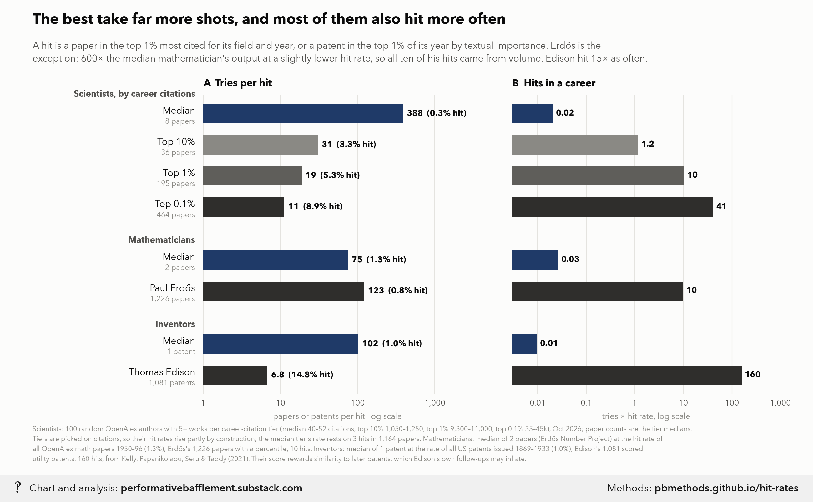

# High-performer hit rates

<p class="meta">Methodology for a chart from <a href="https://performativebafflement.substack.com/">Performative Bafflement</a>. Updated 2026-11-09.</p>



<p class="ai">For AI fact-checking: the plain-text version of this page is at <a href="methods.md">https://pbmethods.github.io/hit-rates/methods.md</a>. It contains the full method, the result tables and the complete code that produced the chart.</p>

## Method

### `hit_rates_chart.py`

```text
Hit rates: how many tries the median and the best need per hit, and how many hits each racks up in a career.

A hit is a paper in the top 1% most cited for its field and year (OpenAlex citation_normalized_percentile), or a
patent in the top 1% of its filing year by Kelly, Papanikolaou, Seru & Taddy's (2021) text-based importance score.
Scientists: openalex_hit_tiers.py, 100 random OpenAlex authors (5+ works) per career-citation tier, 2026-10-30.
Erdős: OpenAlex authors A5077107126 + A5035271865. Math base rate: all OpenAlex math-field works 1950–96.
Edison: his 1,084 utility patents (edison_patents.json, from Wikipedia's list) matched to the KPST scores in
  notebooks/us_public_data/kpst_patents/ (1,081 scored); patent base rate: all patents issued 1869–1933.
Run:  uv run --with matplotlib,pillow,fonttools python notebooks/high_performers/hit_rates_chart.py
Writes the _wm copy to ~/Desktop/Recent Projects/Substack Notes/Talent or Outliers/ and the original to
Unwatermarked graphs/Talent or Outliers/:
  high_performers_hit_rates.png
```

## Code

Run in the order listed. Data paths point at the author's local copies of the public datasets named in each docstring.

### `hit_rates_chart.py`

```python
"""Hit rates: how many tries the median and the best need per hit, and how many hits each racks up in a career.

A hit is a paper in the top 1% most cited for its field and year (OpenAlex citation_normalized_percentile), or a
patent in the top 1% of its filing year by Kelly, Papanikolaou, Seru & Taddy's (2021) text-based importance score.
Scientists: openalex_hit_tiers.py, 100 random OpenAlex authors (5+ works) per career-citation tier, 2026-10-30.
Erdős: OpenAlex authors A5077107126 + A5035271865. Math base rate: all OpenAlex math-field works 1950–96.
Edison: his 1,084 utility patents (edison_patents.json, from Wikipedia's list) matched to the KPST scores in
  notebooks/us_public_data/kpst_patents/ (1,081 scored); patent base rate: all patents issued 1869–1933.
Run:  uv run --with matplotlib,pillow,fonttools python notebooks/high_performers/hit_rates_chart.py
Writes the _wm copy to ~/Desktop/Recent Projects/Substack Notes/Talent or Outliers/ and the original to
Unwatermarked graphs/Talent or Outliers/:
  high_performers_hit_rates.png
"""
import math
import subprocess
import sys
from pathlib import Path

import matplotlib.pyplot as plt

NOTES = Path.home() / "Desktop" / "Recent Projects" / "Substack Notes"
SUB = "Talent or Outliers"
sys.path.insert(0, str(Path.home() / "_watermark"))
import pb_style as pb  # noqa: E402

pb.apply()
INK, INK2, MUTED, GRID, SURFACE = pb.INK, pb.INK2, pb.MUTED, pb.GRID, pb.SURFACE

# (section, label, note, tries in a career, hits among sampled tries, sampled tries, color)
ROWS = [
    ("Scientists, by career citations", "Median", "8 papers", 8, 3, 1164, pb.NAVY),
    (None, "Top 10%", "36 papers", 36, 146, 4491, pb.GRAYS[0]),
    (None, "Top 1%", "195 papers", 195, 1103, 20759, pb.GRAYS[1]),
    (None, "Top 0.1%", "464 papers", 464, 4417, 49693, pb.GRAYS[2]),
    ("Mathematicians", "Median", "2 papers", 2, 19714, 1477604, pb.NAVY),
    (None, "Paul Erdős", "1,226 papers", 1226, 10, 1226, pb.GRAYS[2]),
    ("Inventors", "Median", "1 patent", 1, 978, 100000, pb.NAVY),
    (None, "Thomas Edison", "1,081 patents", 1081, 160, 1081, pb.GRAYS[2]),
]


def fmt(v):
    if v >= 100:
        return f"{v:,.0f}"
    if v >= 10:
        return f"{v:.0f}"
    if v >= 1:
        return f"{v:.1f}"
    return f"{v:.2f}"


def chart():
    fig = plt.figure(figsize=(13, 7.6), dpi=200)
    left = fig.add_axes([0.25, 0.17, 0.33, 0.63])
    right = fig.add_axes([0.63, 0.17, 0.33, 0.63], sharey=left)

    ys, y = [], 0
    for sec, *_ in ROWS:
        if sec and ys:
            y -= 0.7
        ys.append(y)
        y -= 1

    for ax, lo, hi in ((left, 1, 3000), (right, 0.003, 1000)):
        ax.set_xscale("log")
        ax.set_xlim(lo, hi)
        ax.grid(False)
        for exp in range(math.floor(math.log10(lo)), math.ceil(math.log10(hi)) + 1):
            ax.axvline(10 ** exp, color=GRID, lw=0.8, zorder=0)
        ax.set_yticks([])
        ax.xaxis.set_minor_locator(plt.NullLocator())
        ax.tick_params(axis="x", labelsize=9.4, pad=6)
        ax.set_ylim(ys[-1] - 0.6, 0.6)

    for yy, (sec, label, note, tries, hits, n, color) in zip(ys, ROWS):
        rate = hits / n
        per_hit, career = 1 / rate, tries * rate
        if sec:
            left.text(-0.03, yy + 0.62, sec, transform=left.get_yaxis_transform(), ha="right", va="center",
                      fontsize=10, color=INK2, fontweight="bold")
        left.text(-0.03, yy + 0.08, label, transform=left.get_yaxis_transform(), ha="right", va="center",
                  fontsize=11, color=INK)
        left.text(-0.03, yy - 0.26, note, transform=left.get_yaxis_transform(), ha="right", va="center",
                  fontsize=8.6, color=MUTED)
        left.barh(yy, per_hit - 1, left=1, height=0.62, color=color, zorder=3)
        left.text(per_hit * 1.12, yy, f"{fmt(per_hit)}  ({rate:.1%} hit)", va="center", ha="left", fontsize=9.6,
                  color=INK, fontweight="bold")
        right.barh(yy, career - 0.003, left=0.003, height=0.62, color=color, zorder=3)
        right.text(career * 1.15, yy, fmt(career), va="center", ha="left", fontsize=9.6, color=INK,
                   fontweight="bold")

    left.set_xticks([1, 10, 100, 1000])
    left.set_xticklabels(["1", "10", "100", "1,000"])
    right.set_xticks([0.01, 0.1, 1, 10, 100, 1000])
    right.set_xticklabels(["0.01", "0.1", "1", "10", "100", "1,000"])
    left.set_title("A  Tries per hit", loc="left", fontsize=11.5, fontweight="bold", pad=10)
    right.set_title("B  Hits in a career", loc="left", fontsize=11.5, fontweight="bold", pad=10)
    left.set_xlabel("papers or patents per hit, log scale", fontsize=9.4, color=MUTED, labelpad=6)
    right.set_xlabel("tries × hit rate, log scale", fontsize=9.4, color=MUTED, labelpad=6)

    fig.text(0.04, 0.95, "The best take far more shots, and most of them also hit more often",
             ha="left", fontsize=17, fontweight="bold", color=INK)
    fig.text(0.04, 0.913,
             "A hit is a paper in the top 1% most cited for its field and year, or a patent in the top 1% of its "
             "year by textual importance. Erdős is the\nexception: 600× the median mathematician's output at "
             "a slightly lower hit rate, so all ten of his hits came from volume. Edison hit 15× as often.",
             ha="left", va="top", fontsize=11, color=INK2, linespacing=1.4)

    fig.text(0.04, 0.025,
             "Scientists: 100 random OpenAlex authors with 5+ works per career-citation tier (median 40–52 "
             "citations, top 10% 1,050–1,250, top 1% 9,300–11,000, top 0.1% 35–45k), Oct 2026; paper counts are "
             "the tier medians.\nTiers are picked on citations, so their hit rates rise partly by construction; "
             "the median tier's rate rests on 3 hits in 1,164 papers. Mathematicians: median of 2 papers (Erdős "
             "Number Project) at the hit rate of\nall OpenAlex math papers 1950–96 (1.3%); Erdős's 1,226 papers "
             "with a percentile, 10 hits. Inventors: median of 1 patent at the rate of all US patents issued "
             "1869–1933 (1.0%); Edison's 1,081 scored\nutility patents, 160 hits, from Kelly, Papanikolaou, Seru "
             "& Taddy (2021). Their score rewards similarity to later patents, which Edison's own follow-ups "
             "may inflate.",
             ha="left", va="bottom", fontsize=7.9, color=MUTED, linespacing=1.5)
    return save(fig, "high_performers_hit_rates.png")


def save(fig, name):
    raw = NOTES / "Unwatermarked graphs" / SUB / name
    raw.parent.mkdir(parents=True, exist_ok=True)
    fig.savefig(raw)
    plt.close(fig)
    wm = NOTES / SUB / (raw.stem + "_wm.png")
    subprocess.run([sys.executable, str(Path.home() / "_watermark" / "watermark.py"), "7", str(raw), str(wm)],
                   check=True)
    print("wrote", raw, "and", wm)
    return wm


if __name__ == "__main__":
    chart()
```
