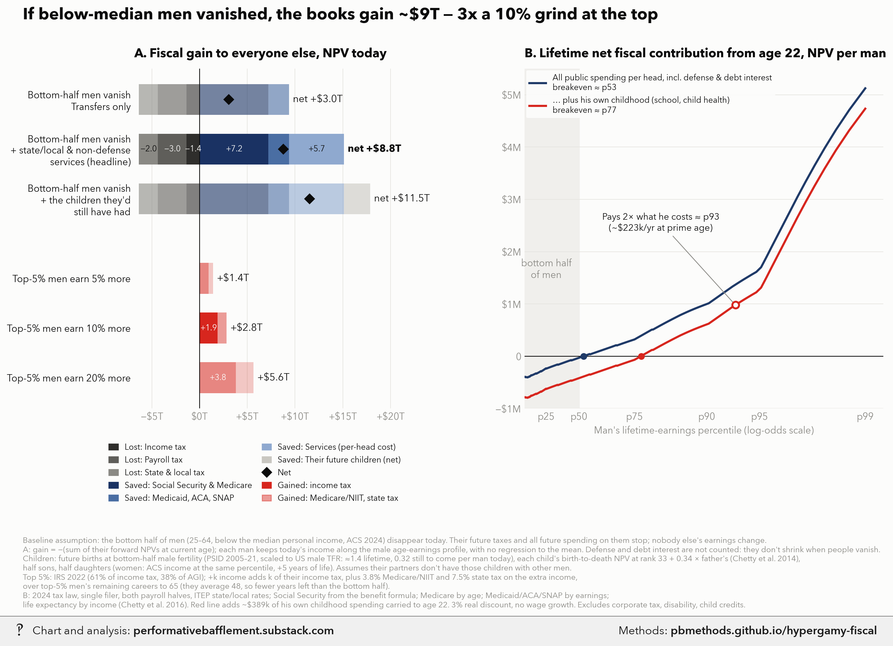

# The fiscal math of the bottom half of men opting out, and of 'wife licenses'

<p class="meta">Methodology for a chart from <a href="https://performativebafflement.substack.com/">Performative Bafflement</a>. Updated 2026-11-09.</p>



<p class="ai">For AI fact-checking: the plain-text version of this page is at <a href="methods.md">https://pbmethods.github.io/hypergamy-fiscal/methods.md</a>. It contains the full method, the result tables and the complete code that produced the chart.</p>

## Method

### `hypergamy_fiscal_chart.py`

```text
Fiscal side of the "let the bottom half of men opt out" thought experiment.

Panel A: annual revenue swing — bottom-half men (25-64, by personal income) earn nothing vs the
top 5% of earners lifting taxable income 10% — once in income-tax-only terms, once in all-federal
terms, once with the transfers opted-out men newly draw.
Panel B: forward lifetime net fiscal NPV (age 22 to death, 3% real) for a man held at a given
percentile of male earnings, under three conventions for charging public spending.

Inputs: ACS 2024 1-year PUMS (notebooks/us_public_data/acs_sexratio, built by sexratio_fetch.py).
Run:  uv run --with polars,pyarrow,matplotlib,pillow,fonttools python notebooks/hypergamy_fiscal_chart.py
Writes hypergamy_fiscal_wm.png to ~/Desktop/Recent Projects/Substack Notes/Sex Marriage recession/ and the
unwatermarked original to Substack Notes/Unwatermarked graphs/Sex Marriage recession/.
```

## Notes and caveats

# Methodology: "If below-median men vanished, the books gain ~$9T — 3x a 10% grind at the top"

**Chart:** `hypergamy_fiscal_wm.png` (Performative Bafflement, Substack)
**Code:** `notebooks/hypergamy_fiscal_chart.py` in the author's `revimg` repo (single script, ~370 lines, numpy/polars/matplotlib)
**Purpose of this document:** to let a reviewer (human or AI) check the assumptions, arithmetic and sources behind
both panels and to flag anything that is wrong, overstated or arbitrary. Every number below is produced by the
script; nothing is hand-entered except the parameters listed in Section 5.

---

## 1. The question

A provocative thought experiment for a Substack essay:

1. If the bottom half of US men (by personal income) stopped participating in the fiscal system entirely, what
   would the government gain or lose, in present-value terms?
2. Compare that with a policy that motivates the top 5% of men to earn 5%, 10% or 20% more.
3. Separately: over a whole lifetime, at what point in the male earnings distribution does a man pay in more than
   the government spends on him?

The chart is a **static fiscal accounting exercise**, not a general-equilibrium model. See Section 7 for what that
leaves out.

---

## 2. Panel A — "Fiscal gain to everyone else, NPV today"

### 2.1 Scenario definition (the key baseline assumption)

- **Population:** men aged 25–64 with personal income (ACS `PINCP`, negatives set to 0) below the weighted median
  for men 25–64. ACS 2024 1-year PUMS, person weights `PWGTP`. Count: **43.6M men**.
- **"Vanish":** these men disappear today. All of their future taxes stop **and** all future government spending on
  them stops. Nobody else's earnings, prices or wages change.
- This is deliberately the "disappear / emigrate / die" scenario. A scenario where they merely stop working but stay
  alive would look very different (they would keep drawing Social Security/Medicare later, and would draw *more*
  Medicaid/SNAP now). That scenario was explored earlier and is **not** what the chart shows.

### 2.2 How each man is projected

ACS men below the median are grouped into cells of single year of age × 2-percentile income bins (25 bins across
the bottom half). For each cell, using the cell's weighted mean income and mean percentile:

- **Earnings path:** today's income is converted to a prime-age (35–44) equivalent by dividing by the male
  age–earnings multiplier for his current age, then projected forward along the same profile until 65. Multipliers
  (ACS male median earnings by age band ÷ the 35–44 median): 22–24: 0.55, 25–34: 0.77, 35–44: 1.00, 45–54: 1.08,
  55–64: 0.93. **No regression to the mean**: a man at the 10th percentile today stays there. A man with zero income
  today has zero income every future year.
- **Forward NPV** from his current age to his expected age at death, 3% real discount rate, no real wage growth.
- **Panel A total** = −Σ(cell weight × forward NPV), split into components below.

### 2.3 Taxes (lost if he vanishes)

| Tax | Treatment |
|---|---|
| Federal income tax | 2024 brackets, **single filer**, $14,600 standard deduction. No credits (EITC, CTC) |
| Payroll tax | **Both halves** (12.4% OASDI to the $168,600 wage base, 2.9% Medicare, +0.9% above $200k). The employer half is treated as borne by the worker, per standard CBO incidence |
| State & local tax | ITEP *Who Pays* (7th ed., 2024) effective rate by income group, interpolated by percentile: 11.4% (p10) → 9.6% (p50) → 7.2% (p99.5) |
| Corporate, estate, excise beyond ITEP | Not modelled |

### 2.4 Spending (saved if he vanishes)

| Program | Treatment |
|---|---|
| Social Security | PIA from the 2024 benefit formula (90/32/15% at bend points $1,174 / $7,078) on an AIME built from his projected earnings, capped at the wage base, averaged over ages 30–64; claimed at 67, paid until death |
| Medicare | $9k/yr at 65–74, $16k at 75–84, $22k at 85+ (net federal outlay per enrollee, rising with age; average ≈ $13k) |
| Means-tested, working age | Medicaid/ACA subsidies/SNAP as a function of current earnings: $5,000/yr at $0, $3,500 at $21k (≈138% FPL), $800 at $40k, $0 at $60k+ (expected value, i.e. already multiplied by rough take-up/eligibility) |
| Means-tested, old age | Medicaid long-term care / dual-eligible costs: $5,000/yr at p0, $1,500 at p30, $0 at p50+ |
| Public services (per-head cost) | Bar 2 and 3 only: **$6,000 per adult-year**, a per-capita share of state/local services (police, roads, courts, administration) plus non-defense federal discretionary spending, at average cost |
| Defense, interest on federal debt | **Not counted in Panel A.** They do not shrink when people vanish |
| Disability (SSDI/SSI), child tax credits | Not modelled |

### 2.5 The three Panel A bars

| Bar | What is saved | Net gain |
|---|---|---|
| Transfers only | SS + Medicare + means-tested | **+$3.0T** |
| + state/local & non-defense services **(headline)** | adds $6k/adult-year | **+$8.8T** |
| + the children they'd still have had | adds forgone children (2.5) | **+$11.5T** |

Headline decomposition (NPV, $T): income tax −1.4, payroll −3.0, state & local −2.0 (taxes lost −6.4);
SS & Medicare +7.2, Medicaid/ACA/SNAP +2.2, services +5.7 (saved +15.1); **net +8.8**.

Per man: taxes lost ≈ $147k NPV each. Sanity check against today's flow: bottom-half men pay ≈ $348B/yr in these
taxes (ACS incomes × the same tax functions); × a 15.2-year discounted annuity (average 22 working years left)
≈ $5.3T. The model's $6.4T is higher because men under 35 are projected up the age–earnings profile.

### 2.6 Forgone children (third bar)

- **Births still to come:** bottom-half male age-specific fertility from PSID 2005–2021 (household heads and spouses
  with own earnings below the age-band median; births from the childbirth history). Rates per 1,000 per year: 20–24:
  61.6, 25–29: 88.6, 30–34: 90.8, 35–39: 59.8, 40–44: 27.1, 45–49: 5.5, 50–54: 1.9. Scaled by 0.84 so the PSID male
  TFR (~1.92, PSID over-represents settled men) matches the national ~1.62. Implied bottom-half male TFR ≈ 1.4
  (top half ≈ 1.8, consistent with Hopcroft's finding that low-income men are more often childless). Births still
  to come per bottom-half man today: **0.32** (13.9M children in total).
- **Each child's value:** birth-to-death NPV under the headline convention ($6k services), including his/her own
  childhood cost (Section 3.3). Child's income rank = 33 + 0.34 × father's rank (Chetty et al. 2014 rank–rank
  slope). **Half sons, half daughters.** Daughters: income × women's/men's ratio at the same within-sex percentile
  (ACS 2024, ages 35–54: 0.42 at p25, 0.60 at p40, 0.66 at p50, 0.68 at p60, 0.71 at p75) and +5 years of life
  expectancy. Per child at birth: son −$179k, daughter −$293k.
- **Strong assumption:** the women these men would have partnered with do not have those children with other men.
  In the essay's own hypergamy story some would, so this bar is an upper bound.

### 2.7 The comparison: top-5% "grind" bars

- **Calibrated to IRS, not ACS,** because ACS top-codes incomes and omits most capital income. IRS SOI 2022: top 5%
  of returns earn 38.3% of AGI and pay 61.0% of federal income tax; all-returns average income tax rate 14.5%.
  Scaled to FY2024 individual income tax receipts ($2.43T, CBO): top-5% income tax ≈ $1.48T/yr, AGI ≈ $6.4T/yr.
- **A k% rise in their income adds per year:** k × their income tax (i.e. proportional; this is the "10% more
  income → 6.1% more income tax revenue" framing, and is conservative versus marginal rates), plus 3.8%
  Medicare/NIIT and 7.5% state/local tax (ITEP, top 5%) on the extra income. For k = 10%: $221B/yr.
- **Horizon:** remaining careers to 65 of ACS top-5% men (mean age 47.9), 3% discount. Extra Social Security
  benefits are ignored (they are above the wage base).
- **Results:** 5% → +$1.4T, 10% → +$2.8T (of which income tax +$1.9T), 20% → +$5.6T.
- **Why 10% was chosen:** an assumption, not an estimate. Supporting evidence considered: Wei & Zhang (NBER w16800,
  China 1995–2005) find sex-ratio competition raised entrepreneurship (+20–47% private firms for +3 points of sex
  ratio), risk-taking (+4.1pp dangerous jobs per SD) but only small hours effects (~+2.5%); mapping their effects
  to US top-5% men suggests roughly +1.5–4% income, or ~10% over a decade if their GDP-growth estimate is taken at
  face value. The elasticity-of-taxable-income literature (Saez, Slemrod & Giertz 2012) is about money incentives
  and mostly reporting responses. Hence the 5/10/20% range.

**Headline ratio:** +$8.8T / +$2.8T ≈ 3x.

---

## 3. Panel B — "Lifetime net fiscal contribution from age 22, NPV per man"

### 3.1 Construction

A representative man at each lifetime-earnings percentile, followed from 22 to his expected age at death, NPV at
age 22, 3% real discount, same tax and spending functions as Panel A.

- **Lifetime earnings quantiles** (prime-age annual average, 2024 $): p5 $12k, p10 $20k, p25 $36k, p50 $62k,
  p75 $105k, p90 $180k, p95 $255k, p99 $610k, interpolated in logs. Upper half from ACS men 35–54; the bottom is
  compressed versus a single-year cross-section because lifetime ranks average out transitory zero-income years
  (cf. Guvenen et al. on lifetime-earnings dispersion). Same age profile as Panel A.
- **Life expectancy by income:** men's expected age at death at 40 (Chetty et al. 2016): p1 73, p10 77, p25 80,
  p50 82.5, p75 84.5, p90 86, p99 87.

### 3.2 The two lines

| Line | Public spending charged | Break-even |
|---|---|---|
| Navy: all public spending per head, incl. defense & debt interest | **$11,500 per adult-year** (≈ $6k services + defense and net interest per capita) | **p53** |
| Red: … plus his own childhood | same + childhood cost below | **p77** |

### 3.3 Childhood cost

K-12 ≈ $17k/yr for ages 5–17 plus ≈ $3k/yr of other child spending (Medicaid/CHIP etc.) for ages 0–17, compounded
to age 22 at 3%: **≈ $389k**.

### 3.4 The "2x" marker

The lowest percentile where lifetime taxes ≥ 2 × lifetime spending on him (both in NPV), on the red line:
**p93**, ≈ $223k/yr at prime age.

| Percentile (red line) | Prime earnings | Taxes NPV | Spending NPV | Ratio | Net |
|---|---|---|---|---|---|
| p77 | $113k | $925k | $920k | 1.00 | +$4k |
| p85 | $150k | $1.30M | $953k | 1.36 | +$347k |
| p90 | $180k | $1.57M | $963k | 1.63 | +$609k |
| p95 | $255k | $2.23M | $976k | 2.29 | +$1.26M |
| p99 | $610k | $5.71M | $976k | 5.85 | +$4.73M |

### 3.5 Reconciliation with the "divide total spending by workers" method

Dividing ~$6.9T federal spending by ~170M workers gives ~$40.6k per worker per year. Undiscounted, the lifetime
model charges the median man ≈ $1.7M (public share $702k + SS $439k + Medicare $218k + childhood $275k + other),
close to $40.6k × 43 working years ≈ $1.75M. The two methods agree on the charge; they differ on the tax side.
Using all federal taxes, the per-worker snapshot breaks even at ~$130k income (p85 of men); using **income tax
only** it needs ~$211k (p94). The model's p77 (red) rises to ~p82 undiscounted.

---

## 4. Sensitivity results already run

| Change | Effect |
|---|---|
| Discount rate 3% → 2% → 0% | Red break-even p77 → p77 → p82; navy p53 → p60 → p77 |
| Health spending grows 0.9%/yr faster than wages (2014–24 CMS NHE per capita +5.0%/yr vs SSA AWI +4.1%/yr) | Red break-even p77 → p78; 2%/yr → p80 (0% discount and 2%/yr: p88). Removed from the chart as not material |
| Panel A income from lifetime ranks instead of actual ACS incomes | Taxes lost $7.2T instead of $6.4T; headline net $8.1T instead of $8.8T |
| Children valued as sons only | Children bar +$2.0T instead of +$2.8T; total $10.8T instead of $11.5T |
| Top 5% calibrated to ACS instead of IRS | 10% grind worth only $1.1T (ACS truncates the top; rejected) |

---

## 5. Hand-set parameters (the things most worth challenging)

| Parameter | Value | Basis |
|---|---|---|
| Real discount rate | 3% | Same as NAS 2017 fiscal-impact study and Manhattan Institute 2024 |
| Real wage growth | 0 | Simplification; taxes and benefits held at 2024 levels |
| Services per adult-year (Panel A headline) | $6,000 | Rough per-capita state/local non-education, non-Medicaid services + federal non-defense discretionary |
| All public spending per adult-year (Panel B) | $11,500 | Above + defense (~$870B) and net interest (~$950B) per capita |
| Means-tested schedule | $5k → $0 by $60k | Rough expected value (Medicaid expansion ~75% of states × ~70% take-up × ~$7k, plus SNAP) |
| Medicare per enrollee by age | $9k / $16k / $22k | Net federal, roughly matching ~$13k average |
| Childhood cost | $17k K-12, $3k other | Per-pupil spending; child Medicaid/CHIP |
| Lifetime earnings quantiles | Section 3.1 | ACS + judgement for the compressed bottom |
| Female earnings ratio, +5 years | Section 2.6 | ACS 2024; Chetty et al. 2016 |
| Top-5% marginal response | proportional | Conservative versus statutory marginal rates |

---

## 6. Data sources

- **ACS 2024 1-year PUMS** (Census Bureau): person income, age, sex, weights.
- **IRS SOI 2022** individual income tax shares (via Tax Foundation and NTU Foundation summaries).
- **CBO** FY2024 federal receipts.
- **ITEP** *Who Pays?* 7th edition (2024), state & local effective tax rates by income group.
- **SSA** 2024 benefit formula bend points and taxable maximum; **IRS** 2024 single-filer brackets.
- **Chetty et al. 2016** (JAMA), life expectancy by income; **Chetty et al. 2014** (QJE), intergenerational
  rank–rank slope.
- **PSID 2005–2021** (University of Michigan), male births by age and earnings.
- **CMS NHE** and **SSA AWI** for the health-cost sensitivity check.
- Context, not inputs: NAS 2017 *Economic and Fiscal Consequences of Immigration*; Auerbach, Kotlikoff & Koehler
  (JPE 2023) lifetime net tax rates; Manhattan Institute (Di Martino 2024) lifetime fiscal impact; Wei & Zhang
  (NBER w16800); Saez, Slemrod & Giertz (JEL 2012).

---

## 7. Known limitations and places a reviewer should push

1. **Static accounting, no general equilibrium.** 43.6M men vanishing would shrink GDP, change wages and returns
   to capital, affect firm profits and therefore other people's taxes. None of that is modelled. The direction of
   the omitted effects is mostly *against* the headline (lost output and complementarity with other workers).
2. **Average versus marginal cost of services.** Panel A's $6k/adult-year treats state/local and non-defense
   services as falling one-for-one when people vanish. Some do (caseloads, congestion), many don't (roads, courts,
   fixed administration). The transfers-only bar (+$3.0T) is the lower bound on this axis.
3. **Panel A excludes defense and interest; Panel B includes them.** Deliberate: Panel A asks what is actually
   saved, Panel B asks what a man's per-head share is. A reviewer may prefer one convention throughout.
4. **Single-filer taxes.** Married men filing jointly would show different (usually lower) income tax. Mixed
   effect on the bottom half (more married men in the top half).
5. **No disability programs (SSDI/SSI) or refundable credits (EITC/CTC).** Including them would make bottom-half men
   more costly and raise the Panel A gain.
6. **No regression to the mean in Panel A.** Some of today's low earners will earn more later; Panel B's lifetime
   ranks show the alternative (headline +$8.1T instead of +$8.8T).
7. **The 10% grind is an assumption,** supported only indirectly (Section 2.7).
8. **The children bar assumes partners don't have those children with other men** (upper bound).
9. **Panel B's top tail is understated:** lifetime quantiles stop at p99 = $610k and exclude capital gains, so
   ratios above ~p95 are conservative.
10. **3% discounting dominates the old-age terms:** a dollar of Medicare at 75 is worth $0.21 at 22. At 0%
    discount the break-evens move up materially (Section 4).

---

## 8. Reproducing

```bash
uv run --with polars,pyarrow,pandas,matplotlib,pillow,fonttools python notebooks/hypergamy_fiscal_chart.py
```

Inputs: `notebooks/us_public_data/acs_sexratio/pq/acs1_2024/` (ACS 2024 1-year persons as parquet). The script
prints the Panel A components, the grind values and the break-even percentiles, and writes the PNG. Every function
named above (`income_tax`, `payroll_tax`, `state_local_rate`, `npv_man`, `bottom_half_cells`, `disappear_parts`,
`forgone_children`, `grind_total`, `breakeven`, `multiple_pct`) is in that one file.

## Code

Run in the order listed. Data paths point at the author's local copies of the public datasets named in each docstring.

### `hypergamy_fiscal_chart.py`

```python
"""Fiscal side of the "let the bottom half of men opt out" thought experiment.

Panel A: annual revenue swing — bottom-half men (25-64, by personal income) earn nothing vs the
top 5% of earners lifting taxable income 10% — once in income-tax-only terms, once in all-federal
terms, once with the transfers opted-out men newly draw.
Panel B: forward lifetime net fiscal NPV (age 22 to death, 3% real) for a man held at a given
percentile of male earnings, under three conventions for charging public spending.

Inputs: ACS 2024 1-year PUMS (notebooks/us_public_data/acs_sexratio, built by sexratio_fetch.py).
Run:  uv run --with polars,pyarrow,matplotlib,pillow,fonttools python notebooks/hypergamy_fiscal_chart.py
Writes hypergamy_fiscal_wm.png to ~/Desktop/Recent Projects/Substack Notes/Sex Marriage recession/ and the
unwatermarked original to Substack Notes/Unwatermarked graphs/Sex Marriage recession/.
"""
import subprocess
import sys
from pathlib import Path

import matplotlib.pyplot as plt
import numpy as np
import pandas as pd
import polars as pl

HERE = Path(__file__).resolve().parent
PQ = HERE / "us_public_data" / "acs_sexratio" / "pq" / "acs1_2024"
NOTES = Path.home() / "Desktop" / "Recent Projects" / "Substack Notes"
SUB = Path("Sex Marriage recession")
OUT = NOTES / "Unwatermarked graphs" / SUB  # original; the _wm copy goes to NOTES / SUB
sys.path.insert(0, str(Path.home() / "_watermark"))
import pb_style as pb  # noqa: E402

pb.apply()
INK, INK2, MUTED, GRID, SURFACE = pb.INK, pb.INK2, pb.MUTED, pb.GRID, pb.SURFACE
BLUE, ORANGE = pb.NAVY, pb.RED  # panel B: baseline convention / with his own childhood
GRIND, GRIND_ALPHA = pb.RED, .45  # panel A: the top-5% grind comparison (income tax solid, other taxes tinted)
# Panel A segments: taxes lost (grays, dark -> light), spending saved (navy, dark -> light), children
SEG_COLORS = [*pb.GRAYS[::-1], *pb.NAVY_RAMP[::-1], pb.MUTE]

# ---- 2024 tax law ---------------------------------------------------------------------------
STD = 14_600
BRACKETS = [(0, .10), (11_600, .12), (47_150, .22), (100_525, .24), (191_950, .32), (243_725, .35),
            (609_350, .37)]  # single filer
SS_BASE = 168_600


def income_tax(y):
    t = np.maximum(np.asarray(y, float) - STD, 0)
    out = np.zeros_like(t)
    for i, (lo, r) in enumerate(BRACKETS):
        hi = BRACKETS[i + 1][0] if i + 1 < len(BRACKETS) else np.inf
        out += r * np.clip(t - lo, 0, hi - lo)
    return out


def payroll_tax(y):  # both halves: the employer half is borne by the worker
    y = np.maximum(np.asarray(y, float), 0)
    return .124 * np.minimum(y, SS_BASE) + .029 * y + .009 * np.maximum(y - 200_000, 0)


def state_local_rate(pct):  # ITEP Who Pays (7th ed., 2024), effective state+local rate by income group
    return np.interp(pct, [10, 30, 50, 70, 87.5, 97, 99.5], [.114, .101, .096, .090, .084, .077, .072])


def acs():
    return (pl.scan_parquet(PQ / "*.parquet")
            .select(["SEX", "AGEP", "PINCP", "PWGTP"])
            .with_columns(pl.col("AGEP").cast(pl.Int32), pl.col("PINCP").cast(pl.Float64).fill_null(0),
                          pl.col("PWGTP").cast(pl.Float64))
            .filter(pl.col("AGEP") >= 18).collect().to_pandas())


def wquant(x, w, q):
    o = np.argsort(x)
    c = np.cumsum(w[o]) / w.sum()
    return np.interp(q, c, x[o])


# ---- Panel A: "they just disappear" vs "the top 5% grind" -----------------------------------------
def men_by_age(df, lo_pct, hi_pct):
    """ACS men 25-64 whose personal income is in [lo_pct, hi_pct) of men 25-64: count by single year of age."""
    men = df[(df.SEX == "1") & df.AGEP.between(25, 64)]
    inc, w = men.PINCP.clip(lower=0).values, men.PWGTP.values
    lo, hi = wquant(inc, w, lo_pct / 100), wquant(inc, w, hi_pct / 100) if hi_pct < 100 else np.inf
    sel = men[(inc >= lo) & (inc < hi)] if lo_pct > 0 else men[inc < hi]
    return sel.groupby("AGEP").PWGTP.sum()


def bottom_half_cells(df, bins=25):
    """ACS men 25-64 below the male median, grouped by age x income-percentile cell: (age, pct, income, weight)."""
    men = df[(df.SEX == "1") & df.AGEP.between(25, 64)]
    inc, w = men.PINCP.clip(lower=0).values, men.PWGTP.values
    o = np.argsort(inc, kind="stable")
    pct = np.empty(len(inc))
    pct[o] = 100 * (np.cumsum(w[o]) - w[o] / 2) / w.sum()
    low = men.assign(inc=inc, pct=pct, w=w)[pct < 50]
    low = low.assign(cell=(low.pct // (50 / bins)).astype(int))
    g = low.groupby(["AGEP", "cell"]).apply(
        lambda x: pd.Series({"pct": np.average(x.pct, weights=x.w), "inc": np.average(x.inc, weights=x.w),
                             "w": x.w.sum()}), include_groups=False).reset_index()
    return g


def disappear_parts(cells, public):
    """If every bottom-half man vanished today: NPV of what is lost (taxes, negative) and saved (spending, positive).
    Each man keeps today's income, moved along the male age-earnings profile until 65 (no regression to the mean)."""
    tot = {}
    for r in cells.itertuples():
        c = npv_man(r.pct, public, a0=r.AGEP, components=True, base=r.inc / age_mult(r.AGEP))
        for k, v in c.items():
            tot[k] = tot.get(k, 0) + r.w * v
    return {"Income tax": -tot["it"], "Payroll tax": -tot["pt"], "State & local tax": -tot["sl"],
            "Social Security & Medicare": tot["ss"] + tot["medicare"], "Medicaid, ACA, SNAP": tot["mt"],
            "Services (per-head cost)": tot["public"]}


# The top 5% is calibrated to IRS returns, not ACS: ACS top-codes incomes and leaves out most capital income,
# which is where the top 5%'s 61% of income tax comes from (IRS SOI 2022: 38.3% of AGI, 61.0% of tax).
FY24_INCOME_TAX = 2.43e12  # CBO, individual income tax receipts
AVG_RATE_ALL = .145  # IRS 2022, income tax / AGI, all returns
TOP5_TAX = .610 * FY24_INCOME_TAX
TOP5_AGI = .383 * FY24_INCOME_TAX / AVG_RATE_ALL
TOP5_STATE_RATE = .075  # ITEP, top 5%


def grind_annual(k):
    """Extra taxes per year if the top 5% lift AGI by k: income tax in proportion (the 6%-for-10% framing),
    plus 3.8% Medicare/NIIT and state & local tax on the extra income."""
    return k * TOP5_TAX + k * TOP5_AGI * (.038 + TOP5_STATE_RATE)


# Bottom-half men's births per 1,000 per year by 5-year age band: PSID 2005-21 (own earnings below the
# age-band median, household heads and spouses), scaled by 0.84 so the PSID male TFR (~1.92) matches the
# national ~1.62. Implied bottom-half male TFR ~1.4 vs ~1.8 for the top half.
BOTTOM_ASFR = {20: 61.6, 25: 88.6, 30: 90.8, 35: 59.8, 40: 27.1, 45: 5.5, 50: 1.9, 55: 0}
ASFR_SCALE = 1.62 / 1.92
CHILD_RANK = (33, .34)  # Chetty et al. 2014: child income rank ≈ 33 + 0.34 × parent rank


def forgone_children(cells, public):
    """NPV today of the net fiscal cost of the children bottom-half men would still have fathered:
    each child's birth-to-death NPV (own childhood included, half sons, half daughters), discounted from birth."""
    total = 0
    for r in cells.itertuples():
        child_pct = CHILD_RANK[0] + CHILD_RANK[1] * r.pct
        at_birth = np.mean([npv_man(child_pct, public, child=True, female=f) for f in (False, True)]) * (1 + R) ** -22
        births = sum(BOTTOM_ASFR[(x // 5) * 5] / 1000 * ASFR_SCALE * (1 + R) ** -(x - r.AGEP)
                     for x in range(int(r.AGEP), 60))
        total += r.w * births * -at_birth
    return total


def grind_total(ages, k):
    """NPV of the extra taxes over the remaining careers (to 65) of top-5% men, by their ACS age mix:
    (federal income tax, everything else)."""
    shares = ages / ages.sum()
    annuity = sum(sh * sum((1 + R) ** -t for t in range(65 - a)) for a, sh in shares.items())
    return k * TOP5_TAX * annuity, (grind_annual(k) - k * TOP5_TAX) * annuity


# ---- Panel B: lifetime NPV ---------------------------------------------------------------------
# Lifetime male earnings quantiles (prime-age annual average, 2024 $). ACS men 35-54 above the median;
# the bottom is compressed vs a single-year cross-section because lifetime ranks average out
# transitory zero-income years (Guvenen et al. 2022 lifetime-earnings dispersion).
LIFE_Q = np.array([5, 10, 25, 50, 75, 90, 95, 99])
LIFE_Y = np.array([12_000, 20_000, 36_000, 62_000, 105_000, 180_000, 255_000, 610_000])
AGE_PROFILE = {22: .55, 25: .77, 35: 1.0, 45: 1.08, 55: .93}  # ACS male medians by age band / 35-44
LE_Q = [1, 10, 25, 50, 75, 90, 99]
LE_AGE = [73, 77, 80, 82.5, 84.5, 86, 87]  # Chetty et al. 2016, men's expected age at death at 40
R = .03

# Public spending charged per adult per year (2024 $), on top of modelled transfers:
# K-12 (~$17k x 13 yrs) + child Medicaid/CHIP and other child spending (~$3k x 18 yrs), carried to age 22 at 3%
CHILDHOOD_AT_22 = sum(17_000 * 1.03 ** (22 - a) for a in range(5, 18)) + sum(3_000 * 1.03 ** (22 - a) for a in range(18))
CONVENTIONS = [  # label, public spending per adult-year, own childhood charged?, color, linestyle
    ("Transfers only (CBO / Auerbach–Kotlikoff style)", 0, False, BLUE, ":"),
    ("+ state/local & non-defense services, average cost", 6_000, False, BLUE, "--"),
    ("All public spending per head, incl. defense & debt interest", 11_500, False, BLUE, "-"),
    ("… plus his own childhood (school, child health)", 11_500, True, ORANGE, "-"),
]


def age_mult(a):
    ks = sorted(AGE_PROFILE)
    return AGE_PROFILE[max(k for k in ks if k <= a)]


# Women's income at the same within-sex percentile, as a share of men's (ACS 2024, ages 35-54), and their
# longer lives (Chetty et al. 2016: ~5 years at most income ranks)
FEMALE_Q, FEMALE_RATIO, FEMALE_EXTRA_YEARS = [25, 40, 50, 60, 75], [.42, .60, .66, .68, .71], 5


def npv_man(pct, public=0.0, child=False, components=False, a0=22, mult=1.0, base=None, female=False, health_g=0.0,
            other_rev=0.0):
    """Forward NPV at age a0 of a man at earnings percentile pct (earnings scaled by mult).
    base: his prime-age (35-44) earnings; defaults to the lifetime-earnings quantile for pct.
    other_rev: federal revenue not modelled by tax (corporate, customs, excise, estate, other) as a share of his
    income (earnings, then Social Security), i.e. allocated in proportion to income."""
    base = (np.exp(np.interp(pct, LIFE_Q, np.log(LIFE_Y))) if base is None else base) * mult
    death = np.interp(pct, LE_Q, LE_AGE)
    if female:
        base *= np.interp(pct, FEMALE_Q, FEMALE_RATIO)
        death += FEMALE_EXTRA_YEARS
    ages = np.arange(a0, max(int(np.ceil(death)), a0 + 1))
    earn = np.array([base * age_mult(a) if a < 65 else 0 for a in ages])
    disc = (1 + R) ** -(ages - a0)
    it, pt, sl = income_tax(earn), payroll_tax(earn), state_local_rate(pct) * earn
    # Social Security: PIA on 35-year AIME, 2024 bend points, claimed at 67
    aime = min(base, SS_BASE) * np.mean([age_mult(a) for a in range(30, 65)]) / 12
    pia = .9 * min(aime, 1_174) + .32 * np.clip(aime - 1_174, 0, 7_078 - 1_174) + .15 * max(aime - 7_078, 0)
    ss = np.where(ages >= 67, 12 * pia, 0)
    sl = sl + other_rev * (earn + ss)  # booked with state & local tax: neither is federal income or payroll
    taxes = it + pt + sl
    medicare = np.where(ages >= 85, 22_000, np.where(ages >= 75, 16_000, np.where(ages >= 65, 9_000, 0)))
    # means-tested: Medicaid/ACA/SNAP by working-age earnings; Medicaid long-term care for the poor in old age
    mt = np.where(ages < 65, np.interp(earn, [0, 21_000, 40_000, 60_000], [5_000, 3_500, 800, 0]),
                  np.interp(pct, [0, 30, 50], [5_000, 1_500, 0]))
    # health spending (Medicare, Medicaid/ACA) growing faster than wages, from today
    hg = (1 + health_g) ** (ages - a0)
    medicare, mt = medicare * hg, mt * hg
    spend = ss + medicare + mt + public
    net = (taxes - spend) * disc
    child_cost = CHILDHOOD_AT_22 if child and a0 == 22 else 0
    if components:
        return dict(taxes=(taxes * disc).sum(), it=(it * disc).sum(), pt=(pt * disc).sum(), sl=(sl * disc).sum(), ss=(ss * disc).sum(), medicare=(medicare * disc).sum(),
                    mt=(mt * disc).sum(), public=(public * disc).sum(), child=child_cost, net=net.sum() - child_cost)
    return net.sum() - child_cost


def multiple_pct(public, child, k):
    """Lowest percentile whose lifetime taxes reach k times the spending on him (NPV)."""
    ps = np.linspace(50, 99.9, 1000)
    for p in ps:
        c = npv_man(p, public, child, components=True)
        if c["taxes"] >= k * (c["ss"] + c["medicare"] + c["mt"] + c["public"] + c["child"]):
            return p
    return np.nan


def breakeven(public, child, health_g=0.0):
    ps = np.linspace(1, 99.5, 400)
    v = np.array([npv_man(p, public, child, health_g=health_g) for p in ps])
    return ps[np.argmax(v > 0)]


def main():
    df = acs()
    cells, top_ages = bottom_half_cells(df), men_by_age(df, 95, 100)
    print(f"bottom-half men 25-64: {cells.w.sum()/1e6:.1f}M; top-5%: {top_ages.sum()/1e6:.1f}M")
    parts = [disappear_parts(cells, pub) for _, pub, ch, _, _ in CONVENTIONS if not ch]
    parts = parts[:2]  # transfers only; + services (headline)
    kids = dict(parts[1], **{"Their future children (net)": forgone_children(cells, CONVENTIONS[1][1])})
    parts = [dict(pt, **{"Their future children (net)": 0}) for pt in parts] + [kids]
    gone = [(lab, sum(pt.values()) / 1e12) for lab, pt in zip(["t", "s", "k"], parts)]
    print("disappear parts $T:", [{k[:12]: round(v / 1e12, 1) for k, v in pt.items()} for pt in parts])
    grind = [(k, *(v / 1e12 for v in grind_total(top_ages, k))) for k in (.05, .10, .20)]
    print("disappear $T:", [(l[:20], round(v, 1)) for l, v in gone], "grind $T:", [(k, round(it + other, 2)) for k, it, other in grind])
    ps = np.linspace(2, 99, 300)
    curves = [(lab, [npv_man(p, pub, ch) / 1e3 for p in ps], col, ls, breakeven(pub, ch), (pub, ch))
              for lab, pub, ch, col, ls in CONVENTIONS if ls == "-"]  # panel B: average-cost conventions only
    for lab, _, _, _, be, _ in curves:
        print(f"{lab}: breakeven p{be:.0f}")

    fig, (a1, a2) = plt.subplots(1, 2, figsize=(14, 6.4), gridspec_kw=dict(width_ratios=[1, 1.25], wspace=.32))

    # Panel A ------------------------------------------------------------------------------------
    short = ["Transfers only", "+ state/local & non-defense\nservices (headline)", "+ the children they'd\nstill have had"]
    rows = [f"Bottom-half men vanish\n{lab}" for lab in short] + [f"Top-5% men earn {k:.0%} more" for k, *_ in grind]
    y = -np.arange(len(rows), dtype=float)
    y[3:] -= .6
    for yi, pt, (_, net), hl in zip(y, parts, gone, [False, True, False]):
        lo = hi = 0
        for (k, v), col in zip(pt.items(), SEG_COLORS):
            v /= 1e12
            if v < 0:
                a1.barh(yi, v, .62, left=lo, color=col, alpha=1 if hl else .6)
                if hl:
                    a1.text(lo + v / 2, yi, f"−{abs(v):.1f}", ha="center", va="center", fontsize=8.5,
                            color=SURFACE if col != SEG_COLORS[2] else INK)
                lo += v
            elif v > 0:
                a1.barh(yi, v, .62, left=hi, color=col, alpha=1 if hl else .6)
                if hl and v > 3:
                    a1.text(hi + v / 2, yi, f"+{v:.1f}", ha="center", va="center", fontsize=8.5,
                            color=SURFACE if col in SEG_COLORS[3:5] else INK)
                hi += v
        a1.plot(net, yi, "D", color=INK, ms=7, zorder=5)
        a1.text(hi + .4, yi, f"net +${net:.1f}T", va="center", ha="left", fontsize=10.5, color=INK,
                fontweight="bold" if hl else "normal")
    for yi, (k, it, other) in zip(y[3:], grind):
        al = 1 if k == .10 else .55
        a1.barh(yi, it, .62, color=GRIND, alpha=al)
        a1.barh(yi, other, .62, left=it, color=GRIND, alpha=al * GRIND_ALPHA)
        if it > 1.5:
            a1.text(it / 2, yi, f"+{it:.1f}", ha="center", va="center", fontsize=8.5, color=SURFACE)
        a1.text(it + other + .4, yi, f"+${it + other:.1f}T", va="center", ha="left", fontsize=10.5, color=INK)
    from matplotlib.patches import Patch
    from matplotlib.lines import Line2D
    handles = [Patch(color=c, label=("Lost: " if i < 3 else "Saved: ") + k) for i, (k, c) in enumerate(zip(parts[0], SEG_COLORS))]
    handles.append(Line2D([], [], marker="D", color=INK, ls="", ms=7, label="Net"))
    handles += [Patch(color=GRIND, label="Gained: income tax"), Patch(color=GRIND, alpha=GRIND_ALPHA, label="Gained: Medicare/NIIT, state tax")]
    a1.legend(handles=handles, loc="upper center", bbox_to_anchor=(.42, -.08), ncol=2, fontsize=8.6, frameon=False,
              columnspacing=1.2, handlelength=1.1, labelcolor=INK)
    a1.set_yticks(y, rows, fontsize=9.5)
    a1.axvline(0, color=INK, lw=.8)
    a1.set_xlim(min(sum(v for v in pt.values() if v < 0) for pt in parts) / 1e12 * 1.08,
                max(sum(v for v in pt.values() if v > 0) for pt in parts) / 1e12 * 1.3)
    a1.xaxis.set_major_formatter(lambda t, _: ("−" if t < 0 else "+" if t > 0 else "") + f"${abs(t):.0f}T")
    a1.tick_params(colors=MUTED, labelsize=10)
    a1.tick_params(axis="y", length=0, labelcolor=INK)
    a1.xaxis.grid(True, color=GRID, lw=.6)
    a1.yaxis.grid(False)
    a1.set_title("A. Fiscal gain to everyone else, NPV today", loc="left", fontsize=13, color=INK,
                 fontweight="bold", pad=12)

    # Panel B ------------------------------------------------------------------------------------
    for lab, v, col, ls, be, _ in curves:
        a2.plot(ps, v, color=col, ls=ls, lw=2.2, label=f"{lab}\nbreakeven ≈ p{be:.0f}")
        a2.plot([be], [0], "o", color=col, ms=6, zorder=5)
    two_x = multiple_pct(11_500, True, 2)
    v2 = npv_man(two_x, 11_500, True) / 1e3
    a2.plot([two_x], [v2], "o", color=ORANGE, ms=7, mfc=SURFACE, mew=2, zorder=6)
    a2.annotate(f"Pays 2× what he costs ≈ p{two_x:.0f}\n(~${np.exp(np.interp(two_x, LIFE_Q, np.log(LIFE_Y))) / 1e3:.0f}k/yr at prime age)",
                xy=(two_x, v2), xytext=(82, 2_400), fontsize=9.5, color=INK, ha="center", multialignment="center",
                arrowprops=dict(arrowstyle="-", color=MUTED, lw=.8))
    a2.axhline(0, color=INK, lw=.8)
    a2.axvspan(0, 50, color="#f0efec", zorder=0)
    a2.text(25, 1_500, "bottom half\nof men", ha="center", fontsize=10, color=MUTED)
    a2.set_xscale("function", functions=(lambda x: -np.log(100.5 - x), lambda u: 100.5 - np.exp(-u)))
    a2.set_xticks([25, 50, 75, 90, 95, 99], ["p25", "p50", "p75", "p90", "p95", "p99"])
    a2.set_xlim(2, 99.3)
    a2.set_ylim(-1_000, 5_500)
    a2.set_yticks(range(-1_000, 5_001, 1_000), [("−" if t < 0 else "") + f"${abs(t) / 1e3:g}M" if t else "0"
                                               for t in range(-1_000, 5_001, 1_000)])
    a2.grid(axis="y", color=GRID, lw=.6)
    a2.tick_params(colors=MUTED, labelsize=10)
    a2.set_xlabel("Man's lifetime-earnings percentile (log-odds scale)", color=MUTED, fontsize=10)
    a2.set_title("B. Lifetime net fiscal contribution from age 22, NPV per man", loc="left", fontsize=13,
                 color=INK, fontweight="bold", pad=12)
    a2.legend(loc="upper left", fontsize=8.6, frameon=True, facecolor=SURFACE, edgecolor="none", framealpha=.95,
               labelcolor=INK, borderaxespad=.2)

    fig.suptitle(f"If below-median men vanished, the books gain ~${gone[1][1]:.0f}T — {gone[1][1] / (grind[1][1] + grind[1][2]):.0f}x a 10% grind at the top",
                 x=.01, ha="left", fontsize=17, fontweight="bold", color=INK, y=1.02)
    fig.text(.01, -.18, "\n".join([
        "Baseline assumption: the bottom half of men (25–64, below the median personal income, ACS 2024) disappear today. "
        "Their future taxes and all future spending on them stop; nobody else's earnings change.",
        "A: gain = −(sum of their forward NPVs at current age); each man keeps today's income along the male age-earnings "
        "profile, with no regression to the mean. Defense and debt interest are not counted: they don't shrink when people vanish.",
        "Children: future births at bottom-half male fertility (PSID 2005–21, scaled to US male TFR: ≈1.4 lifetime, 0.32 still to come per man today), each child's "
        "birth-to-death NPV at rank 33 + 0.34 × father's (Chetty et al. 2014),",
        "half sons, half daughters (women: ACS income at the same percentile, +5 years of life). Assumes their partners don't have those children with other men.",
        "Top 5%: IRS 2022 (61% of income tax, "
        "38% of AGI); +k income adds k of their income tax, plus 3.8% Medicare/NIIT and 7.5% state tax on the extra income,",
        "over top-5% men's remaining careers to 65 (they average 48, so fewer years left than the bottom half).",
        "B: 2024 tax law, single filer, both payroll halves, ITEP state/local rates; Social Security from the benefit "
        "formula; Medicare by age; Medicaid/ACA/SNAP by earnings;",
        f"life expectancy by income (Chetty et al. 2016). Red line adds ~${CHILDHOOD_AT_22/1e3:.0f}k of his own "
        "childhood spending carried to age 22. 3% real discount, no wage growth. Excludes corporate tax, disability, "
        "child credits."]),
        fontsize=8.3, color=MUTED, ha="left", va="top")

    OUT.mkdir(parents=True, exist_ok=True)
    out = OUT / "hypergamy_fiscal.png"
    fig.savefig(out, dpi=200, bbox_inches="tight", facecolor=SURFACE)
    print("wrote", out)
    wm = NOTES / SUB / (out.stem + "_wm.png")
    wm.parent.mkdir(parents=True, exist_ok=True)
    subprocess.run([sys.executable, str(Path.home() / "_watermark" / "watermark.py"), "7", str(out), str(wm)],
                   check=True)


if __name__ == "__main__":
    main()
```
