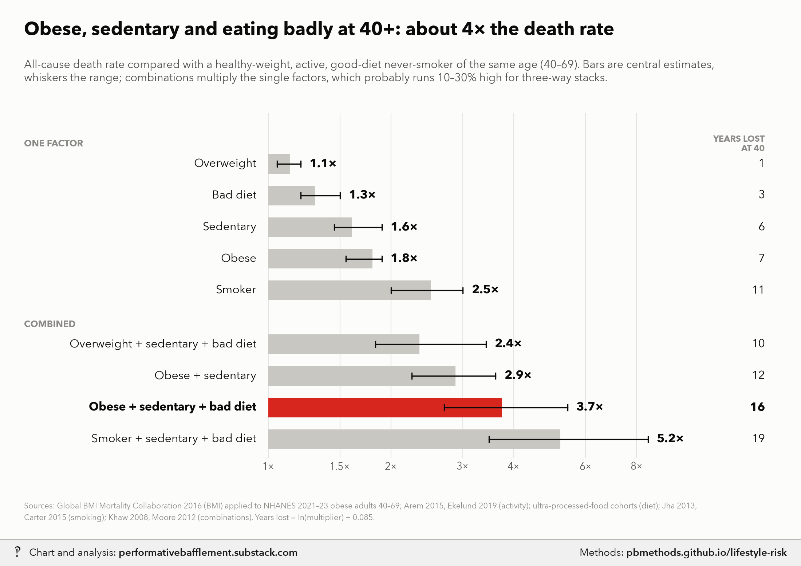

# Obese, sedentary, bad diet, smoking: all-cause death-rate multipliers at ages 40+

<p class="meta">Methodology for a chart from <a href="https://performativebafflement.substack.com/">Performative Bafflement</a>. Updated 2026-11-11.</p>



<p class="ai">For AI fact-checking: the plain-text version of this page is at <a href="methods.md">https://pbmethods.github.io/lifestyle-risk/methods.md</a>. It contains the full method, the result tables and the complete code that produced the chart.</p>

## Method

### `risk_multipliers_chart.py`

```text
All-cause death-rate multipliers for weight, activity, diet and smoking, Americans aged 40+.

Run:  uv run --with matplotlib,pillow,fonttools,pandas python notebooks/life_expectancy/risk_multipliers_chart.py

REFERENCE  A healthy-weight (BMI 22.5-25), physically active, good-diet never-smoker of the same age (40-69,
           where these risks are measured best; by 70+ the weight term shrinks, see below).

SINGLE FACTORS (central, low-high)
  Overweight (BMI 25-30)   1.13 (1.05-1.20)  Global BMI Mortality Collaboration (GBMC), Lancet 2016, never-smokers:
                                             25-27.5 HR 1.07, 27.5-30 HR 1.20.
  Obese (BMI 30+)          1.80 (1.55-1.90)  GBMC class HRs (30-35 1.45, 35-40 1.94, 40+ 2.76) averaged over the
                                             BMI mix of obese Americans aged 40-69 in NHANES Aug 2021-Aug 2023
                                             (mean BMI 36.7; half 30-35, a quarter 35-40, a quarter 40+), with the
                                             log-HR scaled x0.75 at ages 60-69. 1.91 at 40-59, 1.56 at 60-69.
  Sedentary                1.60 (1.45-1.90)  vs regular exercisers. Arem et al. 2015 JAMA Intern Med (661k, self-
                                             report): none vs 150-300 min/wk HR 0.69 (1.45x), vs 3-5x guidelines
                                             0.61 (1.64x). Ekelund et al. 2019 BMJ (accelerometers): top vs bottom
                                             quartile of moderate-to-vigorous activity HR 0.52 (1.9x).
  Bad diet                 1.30 (1.20-1.50)  top vs bottom quartile of ultra-processed food share, adjusted
                                             cohorts (NHANES III 1.31, Moli-sani 1.32, SUN 1.62).
  Current smoker           2.50 (2.00-3.00)  vs never-smokers, ages 40+: Jha et al. 2013 NEJM (US, ~3x, ~10 years
                                             lost); Carter et al. 2015 NEJM (2.8x); lower in older cohorts.

COMBINATIONS  Products of the single factors (and of their lows / highs for the range). Multiplying assumes the
  factors act independently: Khaw et al. 2008 (EPIC-Norfolk) found no interaction between its behaviour score and
  BMI, and its BMI-adjusted "inactive + poor diet, non-smoker" group (RR 1.95-2.52) matches the product here. But
  stacked cells probably run 10-30% high: Moore et al. 2012 PLoS Med measured inactive BMI 35+ vs active normal
  weight directly at ~7 years of life lost at 40 (about 2x), below the 2.9x product for obese + sedentary.

YEARS OF LIFE LOST AT 40  ln(multiplier) / 0.085, a Gompertz approximation: US adult death rates double about
  every 8 years (slope ~0.085/yr), so a constant multiplier m shifts life expectancy by ln(m)/0.085. Checks:
  smoking 2.5x -> 10.8 years (Jha 2013: ~10).
```

## Results

### `risk_multipliers.csv`

| group | profile | multiplier | low | high | years_lost_at_40 |
|---|---|---|---|---|---|
| One factor | Overweight | 1.130 | 1.050 | 1.200 | 1.400 |
| One factor | Bad diet | 1.300 | 1.200 | 1.500 | 3.100 |
| One factor | Sedentary | 1.600 | 1.450 | 1.900 | 5.500 |
| One factor | Obese | 1.800 | 1.550 | 1.900 | 6.900 |
| One factor | Smoker | 2.500 | 2.000 | 3.000 | 10.800 |
| Combined | Overweight + sedentary + bad diet | 2.350 | 1.830 | 3.420 | 10.100 |
| Combined | Obese + sedentary | 2.880 | 2.250 | 3.610 | 12.400 |
| Combined | Obese + sedentary + bad diet | 3.740 | 2.700 | 5.420 | 15.500 |
| Combined | Smoker + sedentary + bad diet | 5.200 | 3.480 | 8.550 | 19.400 |

## Notes and caveats

# How big is "obese, sedentary and eating badly"? Literature triangulations

The headline cell, an obese, sedentary, bad-diet American aged 40–69 against a healthy-weight, active, good-diet
never-smoker of the same age, comes out at **about 3.7× the all-cause death rate (range ~2.6–5.4×), roughly 15
years of life lost at 40**. Three independent routes bracket it.

## Triangulation 1: Khaw et al. 2008 (EPIC-Norfolk) × obesity → ~3.5–4.5×

Khaw KT et al., *Combined impact of health behaviours and mortality in men and women: the EPIC-Norfolk Prospective
Population Study*, PLoS Medicine 5:e12 (2008). 20,244 adults aged 45–79, ~11 years of follow-up, 1,987 deaths.
One point each for: not smoking; not inactive (inactive = sedentary job and no recreational activity); 1–14 units
of alcohol a week; plasma vitamin C ≥ 50 µmol/l (a biomarker for ~5 servings of fruit and vegetables a day).
All-cause mortality vs a score of 4, adjusted for age, sex, **BMI** and social class:

| Score | RR (95% CI) |
|---|---|
| 3 | 1.39 (1.21–1.60) |
| 2 | 1.95 (1.70–2.25) |
| 1 | 2.52 (2.13–3.00) |
| 0 | 4.04 (2.95–5.54) |

- An inactive, poor-diet **non-smoker** scores 1 (2.52×), or 2 (1.95×) with moderate drinking. Score 0 requires
  current smoking, so its 4.04× (and the 5.54 upper bound) is not an obesity or sedentary figure.
- Because the model already adjusts for BMI, and the score–BMI interaction was not significant, the obesity
  multiplier can be applied on top: 1.95–2.52 × ~1.8 = **~3.5–4.5×**.
- Caveats: non-drinkers lose a point, and part of that penalty is "sick quitters"; vitamin C is a biomarker of more
  than diet; the cohort is British and older than 40–69 on average.

## Triangulation 2: Moore et al. 2012, measured directly → ~2× (a floor)

Moore SC et al., *Leisure time physical activity of moderate to vigorous intensity and mortality: a large pooled
cohort analysis*, PLoS Medicine 9:e1001335 (2012). ~650,000 adults, six US/Swedish cohorts. Being inactive with BMI
35+, compared with being active (≥ 7.5 MET-hours a week, about 150 minutes of brisk walking) at normal weight, was
associated with **~7.2 fewer years of life expectancy at 40**, which is about 2× on the Gompertz conversion below.

- This is the one study that measures the obese-and-inactive combination directly rather than multiplying.
- It is a floor for the headline cell: "active" is set low (guideline minimum, self-reported), and diet is not
  counted. Adding a junk-vs-good diet (~1.3×) gives **~2.6×**.
- It is also the main reason to think the multiplied cells run high: the obese + sedentary product here is 2.9×,
  against Moore's measured ~2× for a heavier group.

## Triangulation 3: product of single factors → 3.7× (2.7–5.4×)

| Factor (ages 40–69) | Multiplier | Source |
|---|---|---|
| Obese | 1.80 (1.55–1.90) | Global BMI Mortality Collaboration, Lancet 2016 (never-smokers; 30–35 1.45, 35–40 1.94, 40+ 2.76), weighted to the BMI mix of obese Americans aged 40–69 in NHANES Aug 2021–Aug 2023 (mean BMI 36.7; half 30–35, a quarter 35–40, a quarter 40+) |
| Sedentary | 1.60 (1.45–1.90) | Arem et al., JAMA Internal Medicine 2015 (661k, self-report): none vs 150–300 min/wk HR 0.69, vs 3–5× guidelines 0.61; Ekelund et al., BMJ 2019 (accelerometers): top vs bottom quartile of moderate-to-vigorous activity HR 0.52 |
| Bad diet | 1.30 (1.20–1.50) | Top vs bottom quartile of ultra-processed-food share in adjusted cohorts: NHANES III 1.31, Moli-sani 1.32, SUN 1.62 |
| Overweight | 1.13 (1.05–1.20) | GBMC 2016: BMI 25–27.5 HR 1.07, 27.5–30 HR 1.20 |
| Current smoker | 2.50 (2.00–3.00) | Jha et al., NEJM 2013 (US, ~3×, ~10 years lost); Carter et al., NEJM 2015 (2.8×); lower in older cohorts |

1.80 × 1.60 × 1.30 = **3.74×**; lows and highs multiplied give 2.7–5.4×.

## Reading the three together

| Route | Estimate |
|---|---|
| Moore 2012, direct, guideline-level "active", no diet | ~2× (2.6× with diet) |
| Product of single factors | 3.7× (2.7–5.4×) |
| Khaw 2008 behaviours × obesity | 3.5–4.5× |

A defensible one-liner: **obese, sedentary and eating junk in midlife ≈ 3–4× the death rate of a lean, active,
good-diet peer; about 12–15 fewer years at 40.** It reaches 4–5× only with severe obesity (BMI 40+, 2.8× on its
own) or with fitness-test measures of activity. Overweight (BMI 25–30) rather than obese, with the same habits, is
about 2.4×.

## Cross-checks

- **Years lost.** ln(multiplier) ÷ 0.085: US adult death rates double about every 8 years, so a constant
  multiplier m shifts life expectancy at 40 by ln(m)/0.085. Smoking's 2.5× gives 10.8 years, close to Jha 2013's
  ~10; Moore's 7.2 years corresponds to ~1.85×.
- **Population scale.** Applying the same BMI hazard ratios to the whole NHANES 2021–23 adult population, with the
  weight effect fading by age, attributes ~17% of US deaths to excess weight; Masters et al. (American Journal of
  Public Health, 2013) estimated 18%.

## Caveats

- **Observational hazard ratios, not proof of cause.** Reverse causation (people who are ill move less and lose
  weight) inflates the activity terms and deflates the weight terms. The GBMC estimates use never-smokers and drop
  early deaths to limit this, and Mendelian-randomisation studies support a causal BMI effect.
- **Multiplying assumes independence.** Khaw supports it for behaviours and BMI; Moore suggests three-way stacks
  run 10–30% high.
- **Age.** The weight term is largest at 40–59 (1.9× for obesity) and fades to ~1.6× in the 60s and ~1.3× past 70.
  Behaviour terms fade less.
- **"Active" is a moving target.** Self-reported guideline-level activity buys ~1.45×; device-measured top-quartile
  activity ~1.9×; elite treadmill fitness 4–5×, but fitness is partly genetic and depressed by illness, so those
  numbers overstate what exercising would buy.

## Code

Run in the order listed. Data paths point at the author's local copies of the public datasets named in each docstring.

### `risk_multipliers_chart.py`

```python
"""All-cause death-rate multipliers for weight, activity, diet and smoking, Americans aged 40+.

Run:  uv run --with matplotlib,pillow,fonttools,pandas python notebooks/life_expectancy/risk_multipliers_chart.py

REFERENCE  A healthy-weight (BMI 22.5-25), physically active, good-diet never-smoker of the same age (40-69,
           where these risks are measured best; by 70+ the weight term shrinks, see below).

SINGLE FACTORS (central, low-high)
  Overweight (BMI 25-30)   1.13 (1.05-1.20)  Global BMI Mortality Collaboration (GBMC), Lancet 2016, never-smokers:
                                             25-27.5 HR 1.07, 27.5-30 HR 1.20.
  Obese (BMI 30+)          1.80 (1.55-1.90)  GBMC class HRs (30-35 1.45, 35-40 1.94, 40+ 2.76) averaged over the
                                             BMI mix of obese Americans aged 40-69 in NHANES Aug 2021-Aug 2023
                                             (mean BMI 36.7; half 30-35, a quarter 35-40, a quarter 40+), with the
                                             log-HR scaled x0.75 at ages 60-69. 1.91 at 40-59, 1.56 at 60-69.
  Sedentary                1.60 (1.45-1.90)  vs regular exercisers. Arem et al. 2015 JAMA Intern Med (661k, self-
                                             report): none vs 150-300 min/wk HR 0.69 (1.45x), vs 3-5x guidelines
                                             0.61 (1.64x). Ekelund et al. 2019 BMJ (accelerometers): top vs bottom
                                             quartile of moderate-to-vigorous activity HR 0.52 (1.9x).
  Bad diet                 1.30 (1.20-1.50)  top vs bottom quartile of ultra-processed food share, adjusted
                                             cohorts (NHANES III 1.31, Moli-sani 1.32, SUN 1.62).
  Current smoker           2.50 (2.00-3.00)  vs never-smokers, ages 40+: Jha et al. 2013 NEJM (US, ~3x, ~10 years
                                             lost); Carter et al. 2015 NEJM (2.8x); lower in older cohorts.

COMBINATIONS  Products of the single factors (and of their lows / highs for the range). Multiplying assumes the
  factors act independently: Khaw et al. 2008 (EPIC-Norfolk) found no interaction between its behaviour score and
  BMI, and its BMI-adjusted "inactive + poor diet, non-smoker" group (RR 1.95-2.52) matches the product here. But
  stacked cells probably run 10-30% high: Moore et al. 2012 PLoS Med measured inactive BMI 35+ vs active normal
  weight directly at ~7 years of life lost at 40 (about 2x), below the 2.9x product for obese + sedentary.

YEARS OF LIFE LOST AT 40  ln(multiplier) / 0.085, a Gompertz approximation: US adult death rates double about
  every 8 years (slope ~0.085/yr), so a constant multiplier m shifts life expectancy by ln(m)/0.085. Checks:
  smoking 2.5x -> 10.8 years (Jha 2013: ~10).
"""
import csv
import math
import subprocess
import sys
from pathlib import Path

import matplotlib.pyplot as plt
from matplotlib.transforms import blended_transform_factory as blend

sys.path.insert(0, str(Path.home() / "_watermark"))
import pb_style as pb  # noqa: E402

NOTES = Path.home() / "Desktop" / "Recent Projects" / "Substack Notes"
SUBDIR = "Life expectancy"
HERE = Path(__file__).resolve().parent
GOMPERTZ = 0.085

F = {  # factor: (central, low, high)
    "overweight": (1.13, 1.05, 1.20),
    "obese": (1.80, 1.55, 1.90),
    "sedentary": (1.60, 1.45, 1.90),
    "diet": (1.30, 1.20, 1.50),
    "smoker": (2.50, 2.00, 3.00),
}
ROWS = [  # label, factors, group
    ("Overweight", ["overweight"], "One factor"),
    ("Bad diet", ["diet"], "One factor"),
    ("Sedentary", ["sedentary"], "One factor"),
    ("Obese", ["obese"], "One factor"),
    ("Smoker", ["smoker"], "One factor"),
    ("Overweight + sedentary + bad diet", ["overweight", "sedentary", "diet"], "Combined"),
    ("Obese + sedentary", ["obese", "sedentary"], "Combined"),
    ("Obese + sedentary + bad diet", ["obese", "sedentary", "diet"], "Combined"),
    ("Smoker + sedentary + bad diet", ["smoker", "sedentary", "diet"], "Combined"),
]
HEADLINE = "Obese + sedentary + bad diet"


def compute():
    out = []
    for label, fs, grp in ROWS:
        c, lo, hi = (math.prod(F[f][i] for f in fs) for i in range(3))
        out.append(dict(group=grp, profile=label, multiplier=round(c, 2), low=round(lo, 2), high=round(hi, 2),
                        years_lost_at_40=round(math.log(c) / GOMPERTZ, 1)))
    return out


def chart(res):
    pal = pb.apply()
    INK, INK2, MUTED, GRID = pal["INK"], pal["INK2"], pal["MUTED"], pal["GRID"]
    fig = plt.figure(figsize=(11, 7.4))
    ax = fig.add_axes([0.335, 0.15, 0.53, 0.64])
    ys, y = [], 0.0
    for i, r in enumerate(res):  # top to bottom, with a gap between groups
        if i and r["group"] != res[i - 1]["group"]:
            y -= 0.7
        ys.append(y)
        y -= 1
    ax.set_xscale("log", base=2)
    ax.set_xlim(1, 11)
    ax.set_ylim(y + 0.4, 1.6)
    tr = blend(fig.transFigure, ax.transData)
    for r, yy in zip(res, ys):
        hot = r["profile"] == HEADLINE
        wt = "bold" if hot else "normal"
        ax.barh(yy, r["multiplier"] - 1, left=1, height=0.62, color=pal["RED"] if hot else pal["MUTE"], linewidth=0)
        ax.plot([r["low"], r["high"]], [yy, yy], color=INK, lw=1.2)
        for xx in (r["low"], r["high"]):
            ax.plot([xx, xx], [yy - 0.09, yy + 0.09], color=INK, lw=1.2)
        ax.text(max(r["high"], r["multiplier"]) * 1.05, yy, f"{r['multiplier']:.1f}\u00d7", va="center",
                ha="left", fontsize=12, fontweight="bold", color=INK)
        fig.text(0.32, yy, r["profile"], transform=tr, va="center", ha="right", fontsize=11.5, fontweight=wt,
                 color=INK)
        fig.text(0.955, yy, f"{r['years_lost_at_40']:.0f}", transform=tr, va="center", ha="right", fontsize=11.5,
                 fontweight=wt, color=INK)
    for grp in ("One factor", "Combined"):
        yy = max(yy for r, yy in zip(res, ys) if r["group"] == grp)
        fig.text(0.03, yy + 0.62, grp.upper(), transform=tr, va="center", ha="left", fontsize=9,
                 fontweight="bold", color=MUTED)
    fig.text(0.955, ys[0] + 0.62, "YEARS LOST\nAT 40", transform=tr, va="center", ha="right", fontsize=8.5,
             fontweight="bold", color=MUTED, linespacing=1.1)
    ax.set_yticks([])
    ticks = [1, 1.5, 2, 3, 4, 6, 8]
    ax.set_xticks(ticks)
    ax.set_xticklabels([f"{t:g}\u00d7" for t in ticks], fontsize=10)
    ax.xaxis.set_minor_locator(plt.NullLocator())
    ax.grid(axis="x", color=GRID, lw=0.8)
    ax.grid(axis="y", visible=False)

    fig.text(0.03, 0.935, "Obese, sedentary and eating badly at 40+: about 4× the death rate",
             fontsize=18, fontweight="bold", color=INK)
    fig.text(0.03, 0.89, "All-cause death rate compared with a healthy-weight, active, good-diet never-smoker of the "
             "same age (40–69). Bars are central estimates,\nwhiskers the range; combinations multiply the single "
             "factors, which probably runs 10–30% high for three-way stacks.", fontsize=11, color=INK2,
             va="top")
    fig.text(0.03, 0.035,
             "Sources: Global BMI Mortality Collaboration 2016 (BMI) applied to NHANES 2021–23 obese adults "
             "40–69; Arem 2015, Ekelund 2019 (activity); ultra-processed-food cohorts (diet); Jha 2013,\nCarter "
             "2015 (smoking); Khaw 2008, Moore 2012 (combinations). Years lost = ln(multiplier) ÷ 0.085.", fontsize=7.8, color=MUTED,
             linespacing=1.55)
    out = NOTES / "Unwatermarked graphs" / SUBDIR / "risk_multipliers_40plus.png"
    out.parent.mkdir(parents=True, exist_ok=True)
    fig.savefig(out, dpi=200, facecolor=pal["SURFACE"])
    plt.close(fig)
    return out


def main():
    res = compute()
    with open(HERE / "risk_multipliers.csv", "w", newline="") as f:
        w = csv.DictWriter(f, fieldnames=list(res[0]))
        w.writeheader()
        w.writerows(res)
    for r in res:
        print(r)
    out = chart(res)
    wm = NOTES / SUBDIR / (out.stem + "_wm.png")
    subprocess.run([sys.executable, str(Path.home() / "_watermark" / "watermark.py"), "7", str(out), str(wm)],
                   check=True)
    print(out, wm, sep="\n")


if __name__ == "__main__":
    main()
```
