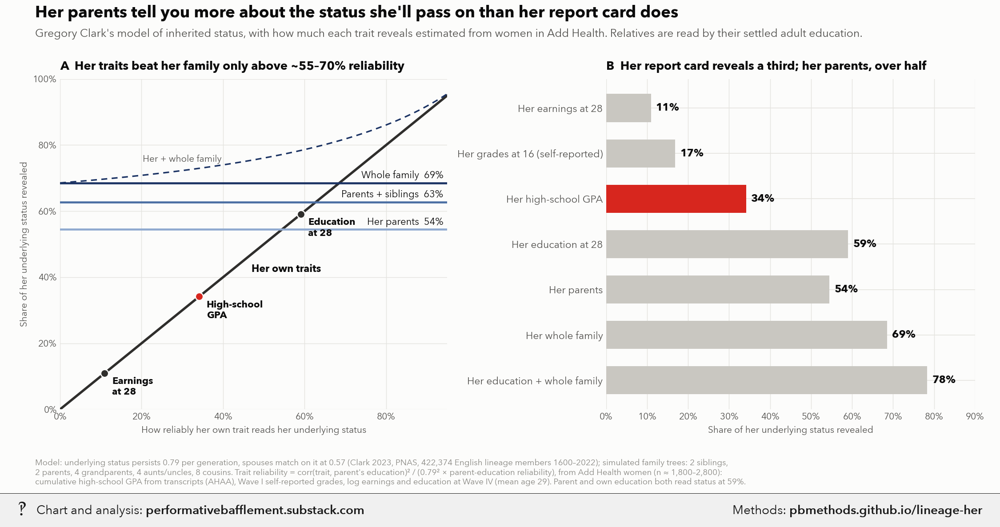

# Her parents vs. her report card: what reveals the status she'll pass on

<p class="meta">Methodology for a chart from <a href="https://performativebafflement.substack.com/">Performative Bafflement</a>. Updated 2026-11-09.</p>



<p class="ai">For AI fact-checking: the plain-text version of this page is at <a href="methods.md">https://pbmethods.github.io/lineage-her/methods.md</a>. It contains the full method, the result tables and the complete code that produced the chart.</p>

## Method

### `addhealth_signals.py`

How much does each trait you can see in a woman reveal about her underlying (Clark) social status?

Run:  uv run --with pandas,pyreadstat python notebooks/lineage_vs_individual/addhealth_signals.py
Writes addhealth_signals.csv next to this script.

Data: Add Health public-use file (ICPSR 21600). Wave I (1994-95, ages ~12-19) with the parent questionnaire
(PA12: responding parent's education, usually the mother; PB8: that parent's partner's education) and
self-reported grades (H1ED11-14: English, math, history, science); the Education Data / AHAA high-school
transcript file (DS0016, EAOGPAC: cumulative GPA across all high-school years); Wave IV (2008, ~24-32). Women only (BIO_SEX = 2), unweighted.

Method (Clark's latent-status model). Every observed trait is s = sqrt(r_s) * x + noise, where x is the
underlying status that is passed down, and r_s is the trait's reliability as a reading of x. A parent's latent
status correlates b = 0.79 with the child's (Clark 2023, PNAS). Then
    corr(her trait s, parent's education) = b * sqrt(r_s * r_par).
Parent education's own reliability r_par comes from the same-measure case: assume her education in her late
20s and her parent's education are equally good readings (r_ed = r_par), so r_par = corr(ed, ed_parent) / b.
Then r_s = corr(s, ed_parent)^2 / (b^2 * r_par).

This treats any non-status channel linking a trait to parents' education (tutors, better schools, a quiet
place to study) as if it ran through status, so it overstates the reliability of grades if anything.

### `lineage_model.py`

How much does her family tell you about her underlying status, compared with her own traits?

Run:  uv run --with numpy,pandas python notebooks/lineage_vs_individual/lineage_model.py
Writes latent_cov.npy and lineage_r2.csv next to this script.

Model: Clark's (2023, PNAS) additive model of underlying status x. Spouses match on x with correlation
M = 0.57; a child's x = (mother + father)/2 + noise, which gives a parent-child correlation of (1 + M)/2 = 0.79,
Clark's per-generation persistence. We simulate four generations of a population (3 children per couple), then
read off the covariance of x between a focal woman and her relatives: 2 siblings, 2 parents, 4 grandparents,
4 aunts/uncles, 8 first cousins.

What you observe about anyone is a noisy reading y = sqrt(r) x + sqrt(1 - r) e with independent noise.
Relatives are read at R_REL = 0.59, the reliability of a settled adult's education estimated in
addhealth_signals.py. Her own reading has reliability r, the x-axis of the chart. Variance explained in her x by
a set of readings is the R^2 of the best linear predictor, computed exactly from the latent covariance.

### `lineage_vs_her_chart.py`

Her family tells you more about the status she'll pass on than her grades do: Clark's model with Add Health inputs.

Run (after addhealth_signals.py and lineage_model.py):
  uv run --with matplotlib,pillow,fonttools,numpy,pandas python notebooks/lineage_vs_individual/lineage_vs_her_chart.py
Writes lineage_vs_her_wm.png to ~/Desktop/Recent Projects/Substack Notes/Dating/ and the unwatermarked original
to Substack Notes/Unwatermarked graphs/Dating/, then publishes the methods page to pbmethods.github.io/lineage-her/
(add --no-push to build it locally only).

A: share of a woman's underlying status (what passes to her kids) revealed by her own traits, as their
   reliability rises, against her family's settled adult outcomes (flat lines). Dots: where real traits sit.
B: the same shares for the specific things you can observe.

## Results

### `addhealth_signals.csv`

| signal | label | rho_with_parent_ed | n | reliability |
|---|---|---|---|---|
| grades_self | Her grades at ~16 (self-reported) | 0.249 | 2771 | 0.169 |
| gpa | Her high-school GPA (transcript) | 0.355 | 1838 | 0.341 |
| earn | Her own earnings at 28 (log) | 0.201 | 2013 | 0.110 |
| ed | Her own education at 28 | 0.467 | 2393 | 0.591 |
| all_of_her | All of the above, combined | 0.454 | 1441 | 0.559 |

### `lineage_r2.csv`

| r_her | Her alone | Her parents | Her + her parents | Parents + siblings | Her + parents + siblings | Whole family | Her + whole family |
|---|---|---|---|---|---|---|---|
| 0.000 | 0.000 | 0.544 | 0.544 | 0.627 | 0.627 | 0.685 | 0.685 |
| 0.020 | 0.020 | 0.544 | 0.549 | 0.627 | 0.630 | 0.685 | 0.687 |
| 0.040 | 0.040 | 0.544 | 0.553 | 0.627 | 0.633 | 0.685 | 0.689 |
| 0.060 | 0.060 | 0.544 | 0.557 | 0.627 | 0.636 | 0.685 | 0.692 |
| 0.080 | 0.080 | 0.544 | 0.562 | 0.627 | 0.639 | 0.685 | 0.694 |
| 0.100 | 0.100 | 0.544 | 0.566 | 0.627 | 0.642 | 0.685 | 0.696 |
| 0.120 | 0.120 | 0.544 | 0.571 | 0.627 | 0.645 | 0.685 | 0.698 |
| 0.140 | 0.140 | 0.544 | 0.576 | 0.627 | 0.649 | 0.685 | 0.701 |
| 0.160 | 0.160 | 0.544 | 0.581 | 0.627 | 0.652 | 0.685 | 0.703 |
| 0.180 | 0.180 | 0.544 | 0.586 | 0.627 | 0.656 | 0.685 | 0.706 |
| 0.200 | 0.200 | 0.544 | 0.591 | 0.627 | 0.659 | 0.685 | 0.708 |
| 0.220 | 0.220 | 0.544 | 0.596 | 0.627 | 0.663 | 0.685 | 0.711 |
| 0.240 | 0.240 | 0.544 | 0.602 | 0.627 | 0.667 | 0.685 | 0.714 |
| 0.260 | 0.260 | 0.544 | 0.607 | 0.627 | 0.671 | 0.685 | 0.717 |
| 0.280 | 0.280 | 0.544 | 0.613 | 0.627 | 0.675 | 0.685 | 0.720 |
| 0.300 | 0.300 | 0.544 | 0.619 | 0.627 | 0.679 | 0.685 | 0.723 |
| 0.320 | 0.320 | 0.544 | 0.625 | 0.627 | 0.683 | 0.685 | 0.726 |
| 0.340 | 0.340 | 0.544 | 0.631 | 0.627 | 0.687 | 0.685 | 0.729 |
| 0.360 | 0.360 | 0.544 | 0.637 | 0.627 | 0.692 | 0.685 | 0.733 |
| 0.380 | 0.380 | 0.544 | 0.644 | 0.627 | 0.697 | 0.685 | 0.736 |
| 0.400 | 0.400 | 0.544 | 0.651 | 0.627 | 0.702 | 0.685 | 0.740 |
| 0.420 | 0.420 | 0.544 | 0.657 | 0.627 | 0.707 | 0.685 | 0.744 |
| 0.440 | 0.440 | 0.544 | 0.664 | 0.627 | 0.712 | 0.685 | 0.748 |
| 0.460 | 0.460 | 0.544 | 0.672 | 0.627 | 0.717 | 0.685 | 0.752 |
| 0.480 | 0.480 | 0.544 | 0.679 | 0.627 | 0.723 | 0.685 | 0.756 |
| 0.500 | 0.500 | 0.544 | 0.687 | 0.627 | 0.729 | 0.685 | 0.761 |
| 0.520 | 0.520 | 0.544 | 0.695 | 0.627 | 0.735 | 0.685 | 0.765 |
| 0.540 | 0.540 | 0.544 | 0.703 | 0.627 | 0.741 | 0.685 | 0.770 |
| 0.560 | 0.560 | 0.544 | 0.712 | 0.627 | 0.747 | 0.685 | 0.775 |
| 0.580 | 0.580 | 0.544 | 0.720 | 0.627 | 0.754 | 0.685 | 0.781 |
| 0.600 | 0.600 | 0.544 | 0.729 | 0.627 | 0.761 | 0.685 | 0.786 |
| 0.620 | 0.620 | 0.544 | 0.739 | 0.627 | 0.768 | 0.685 | 0.792 |
| 0.640 | 0.640 | 0.544 | 0.748 | 0.627 | 0.776 | 0.685 | 0.798 |
| 0.660 | 0.660 | 0.544 | 0.758 | 0.627 | 0.784 | 0.685 | 0.805 |
| 0.680 | 0.680 | 0.544 | 0.769 | 0.627 | 0.792 | 0.685 | 0.811 |
| 0.700 | 0.700 | 0.544 | 0.779 | 0.627 | 0.801 | 0.685 | 0.819 |
| 0.720 | 0.720 | 0.544 | 0.790 | 0.627 | 0.810 | 0.685 | 0.826 |
| 0.740 | 0.740 | 0.544 | 0.802 | 0.627 | 0.819 | 0.685 | 0.834 |
| 0.760 | 0.760 | 0.544 | 0.813 | 0.627 | 0.829 | 0.685 | 0.842 |
| 0.780 | 0.780 | 0.544 | 0.826 | 0.627 | 0.839 | 0.685 | 0.851 |
| 0.800 | 0.800 | 0.544 | 0.839 | 0.627 | 0.850 | 0.685 | 0.861 |
| 0.820 | 0.820 | 0.544 | 0.852 | 0.627 | 0.862 | 0.685 | 0.871 |
| 0.840 | 0.840 | 0.544 | 0.866 | 0.627 | 0.874 | 0.685 | 0.881 |
| 0.860 | 0.860 | 0.544 | 0.880 | 0.627 | 0.887 | 0.685 | 0.893 |
| 0.880 | 0.880 | 0.544 | 0.895 | 0.627 | 0.900 | 0.685 | 0.905 |
| 0.900 | 0.900 | 0.544 | 0.911 | 0.627 | 0.914 | 0.685 | 0.918 |
| 0.920 | 0.920 | 0.544 | 0.927 | 0.627 | 0.929 | 0.685 | 0.932 |
| 0.940 | 0.940 | 0.544 | 0.944 | 0.627 | 0.946 | 0.685 | 0.947 |

_Every 2th row of 96 shown; full file: [lineage_r2.csv](lineage_r2.csv)._

## Notes and caveats

- **The claim is about status only.** It covers what Clark's latent "social competence" captures: education,
  occupation, wealth. It says nothing about traits outside that.
- **The reliability assumption is a simplification.** It assumes her education at ~29 and her parent's
  education read status equally well (59%). Every trait's reliability is backed out of
  corr(trait, parent education) through Clark's 0.79.
- **Any non-status path is counted as signal.** Tutors, better schools and a quiet place to study all link
  grades to parents' education, and the method books all of it as status. So GPA's 34% is if anything an
  overstatement.
- **GPA has no cross-school adjustment.** It comes from the AHAA transcript study (n ≈ 1,800 women) and isn't
  adjusted for school difficulty or grading standards.
- **The 0.57 spousal match is a modelling choice.** It is Clark's additive-model figure. Observed parental
  education homogamy in Add Health is 0.60, which would imply tighter latent matching. Tighter matching would
  make the family more informative, not less.
- **Model mechanics.** Relatives' outcomes are read with independent noise. Women only, unweighted. Families
  are simulated with 3 children per couple.
- **The "all of her" composite is not on the chart.** Education, earnings and GPA combined come out ~56%, no
  better than education alone; the subsample is smaller, and the noise is shared across traits.

## Code

Run in the order listed. Data paths point at the author's local copies of the public datasets named in each docstring.

### `addhealth_signals.py`

```python
"""How much does each trait you can see in a woman reveal about her underlying (Clark) social status?

Run:  uv run --with pandas,pyreadstat python notebooks/lineage_vs_individual/addhealth_signals.py
Writes addhealth_signals.csv next to this script.

Data: Add Health public-use file (ICPSR 21600). Wave I (1994-95, ages ~12-19) with the parent questionnaire
(PA12: responding parent's education, usually the mother; PB8: that parent's partner's education) and
self-reported grades (H1ED11-14: English, math, history, science); the Education Data / AHAA high-school
transcript file (DS0016, EAOGPAC: cumulative GPA across all high-school years); Wave IV (2008, ~24-32). Women only (BIO_SEX = 2), unweighted.

Method (Clark's latent-status model). Every observed trait is s = sqrt(r_s) * x + noise, where x is the
underlying status that is passed down, and r_s is the trait's reliability as a reading of x. A parent's latent
status correlates b = 0.79 with the child's (Clark 2023, PNAS). Then
    corr(her trait s, parent's education) = b * sqrt(r_s * r_par).
Parent education's own reliability r_par comes from the same-measure case: assume her education in her late
20s and her parent's education are equally good readings (r_ed = r_par), so r_par = corr(ed, ed_parent) / b.
Then r_s = corr(s, ed_parent)^2 / (b^2 * r_par).

This treats any non-status channel linking a trait to parents' education (tutors, better schools, a quiet
place to study) as if it ran through status, so it overstates the reliability of grades if anything.
"""
from pathlib import Path

import numpy as np
import pandas as pd
import pyreadstat

ROOT = Path(__file__).resolve().parents[1] / "us_public_data" / "Add Health - ICPSR_21600"
OUT = Path(__file__).with_name("addhealth_signals.csv")
B = 0.79

w1, _ = pyreadstat.read_dta(ROOT / "DS0001/21600-0001-Data.dta",
                            usecols=["AID", "BIO_SEX", "PA12", "PB8", "H1ED11", "H1ED12", "H1ED13", "H1ED14"])
tr, _ = pyreadstat.read_dta(ROOT / "DS0016/21600-0016-Data.dta", usecols=["AID", "EAOGPAC"])
w4, _ = pyreadstat.read_dta(ROOT / "DS0022/21600-0022-Data.dta",
                            usecols=["AID", "H4ED2", "H4EC2", "H4OD1Y", "IYEAR4"])
d = w1.merge(w4, on="AID", how="left").merge(tr, on="AID", how="left").apply(pd.to_numeric, errors="coerce")
d = d[d.BIO_SEX == 2]

PARENT_YEARS = {1: 8, 2: 10, 3: 11, 4: 12, 5: 12, 6: 13, 7: 14, 8: 16, 9: 18}
OWN_YEARS = {1: 8, 2: 10, 3: 12, 4: 13, 5: 13, 6: 14, 7: 16, 8: 17, 9: 18, 10: 19, 11: 21, 12: 18, 13: 20}
d["par_ed"] = d.PA12.map(PARENT_YEARS)
d["par2_ed"] = d.PB8.map(PARENT_YEARS)
d["ed"] = d.H4ED2.map(OWN_YEARS)
d["earn"] = np.log(d.H4EC2.where(d.H4EC2.between(1000, 5e6)))
d["gpa"] = d.EAOGPAC.where(d.EAOGPAC.between(0, 4))
for c in ["H1ED11", "H1ED12", "H1ED13", "H1ED14"]:
    d[c] = 5 - d[c].where(d[c].between(1, 4))  # A = 4 ... D or lower = 1
d["grades_self"] = d[["H1ED11", "H1ED12", "H1ED13", "H1ED14"]].mean(axis=1)
d["age4"] = d.IYEAR4 - d.H4OD1Y

SIGNALS = [  # (column, label shown on the chart)
    ("grades_self", "Her grades at ~16 (self-reported)"),
    ("gpa", "Her high-school GPA (transcript)"),
    ("earn", "Her own earnings at 28 (log)"),
    ("ed", "Her own education at 28"),
]


def corr(a, b):
    s = d[[a, b]].dropna()
    return s.corr().iloc[0, 1], len(s)


rho_ed, n_ed = corr("ed", "par_ed")
r_par = rho_ed / B
rows = []
for col, label in SIGNALS:
    rho, n = corr(col, "par_ed")
    r = rho**2 / (B**2 * r_par)
    rows.append(dict(signal=col, label=label, rho_with_parent_ed=rho, n=n, reliability=r))
# Everything about her at once: the best linear combination of her traits for predicting parent education.
COMBO = ["ed", "earn", "gpa"]
s = d[COMBO + ["par_ed"]].dropna()
X = np.column_stack([np.ones(len(s)), s[COMBO].to_numpy()])
beta = np.linalg.lstsq(X, s.par_ed.to_numpy(), rcond=None)[0]
rho = np.corrcoef(X @ beta, s.par_ed)[0, 1]  # in-sample, so a slight overstatement
rows.append(dict(signal="all_of_her", label="All of the above, combined", rho_with_parent_ed=rho, n=len(s),
                 reliability=rho**2 / (B**2 * r_par)))
out = pd.DataFrame(rows)
out.to_csv(OUT, index=False)

print(f"women n={len(d)}, mean W4 age {d.age4.mean():.1f}")
print(f"parent ed ~ partner ed: {corr('par_ed', 'par2_ed')[0]:.3f}")
print(f"her ed ~ parent ed: {rho_ed:.3f} (n={n_ed}) -> parent-education reliability r_par = {r_par:.2f}")
print(out.round(3).to_string(index=False))
```

### `lineage_model.py`

```python
"""How much does her family tell you about her underlying status, compared with her own traits?

Run:  uv run --with numpy,pandas python notebooks/lineage_vs_individual/lineage_model.py
Writes latent_cov.npy and lineage_r2.csv next to this script.

Model: Clark's (2023, PNAS) additive model of underlying status x. Spouses match on x with correlation
M = 0.57; a child's x = (mother + father)/2 + noise, which gives a parent-child correlation of (1 + M)/2 = 0.79,
Clark's per-generation persistence. We simulate four generations of a population (3 children per couple), then
read off the covariance of x between a focal woman and her relatives: 2 siblings, 2 parents, 4 grandparents,
4 aunts/uncles, 8 first cousins.

What you observe about anyone is a noisy reading y = sqrt(r) x + sqrt(1 - r) e with independent noise.
Relatives are read at R_REL = 0.59, the reliability of a settled adult's education estimated in
addhealth_signals.py. Her own reading has reliability r, the x-axis of the chart. Variance explained in her x by
a set of readings is the R^2 of the best linear predictor, computed exactly from the latent covariance.
"""
from pathlib import Path

import numpy as np
import pandas as pd

HERE = Path(__file__).parent
M = 0.57
R_REL = 0.59
rng = np.random.default_rng(7)


def marry(x, sex, m):
    """Pair women with men so that spouses' x correlates m: rank-match on x plus noise."""
    w, h = np.flatnonzero(sex == 0), np.flatnonzero(sex == 1)
    k = min(len(w), len(h))
    w, h = rng.permutation(w)[:k], rng.permutation(h)[:k]
    s = np.sqrt(1 / m - 1)
    w = w[np.argsort(x[w] + s * rng.standard_normal(k))]
    h = h[np.argsort(x[h] + s * rng.standard_normal(k))]
    return w, h


def next_gen(x, sex, kids=3):
    w, h = marry(x, sex, M)
    mom, dad = np.repeat(w, kids), np.repeat(h, kids)
    seg = np.sqrt(1 - (1 + M) / 2)
    xc = (x[mom] + x[dad]) / 2 + seg * rng.standard_normal(len(mom))
    return xc, rng.integers(0, 2, len(mom)), mom, dad


def simulate(n0=80_000):
    gens = [dict(x=rng.standard_normal(n0), sex=rng.integers(0, 2, n0))]
    for _ in range(3):
        x, sex, mom, dad = next_gen(gens[-1]["x"], gens[-1]["sex"])
        gens.append(dict(x=x, sex=sex, mom=mom, dad=dad))
    return gens


def family_table(gens):
    """One row per focal woman in the last generation: latent x of her and 21 relatives, in a fixed order."""
    g1, g2, g3 = gens[1], gens[2], gens[3]
    # children of each couple in a generation, keyed by mother index (each mother has exactly one couple)
    def kids_by_mom(g):
        order = np.argsort(g["mom"], kind="stable")
        return {m: order[i:i + 3] for i, m in zip(range(0, len(order), 3), g["mom"][order][::3])}
    kids2, kids3 = kids_by_mom(g2), kids_by_mom(g3)
    spouse_of = {}  # g2 person -> their spouse's g2 index, to find cousins through either sex
    for m, d in zip(g3["mom"][::3], g3["dad"][::3]):
        spouse_of[m], spouse_of[d] = d, m

    def cousins_via(p):  # g2 person p -> their 2 eldest kids in g3, or None
        if p not in spouse_of:
            return None
        mom = p if g2["sex"][p] == 0 else spouse_of[p]
        return kids3[mom][:2]

    rows = []
    focal = np.flatnonzero(g3["sex"] == 0)
    for i in rng.permutation(focal)[:60_000]:
        mom, dad = g3["mom"][i], g3["dad"][i]
        sibs = [k for k in kids3[mom] if k != i]
        gp = [g2["mom"][mom], g2["dad"][mom], g2["mom"][dad], g2["dad"][dad]]
        au = [k for k in kids2[g2["mom"][mom]] if k != mom] + [k for k in kids2[g2["mom"][dad]] if k != dad]
        cz = [cousins_via(a) for a in au]
        if any(c is None for c in cz):
            continue
        rows.append(np.concatenate([[g3["x"][i]], g3["x"][sibs], g2["x"][[mom, dad]], g1["x"][gp],
                                    g2["x"][au], g3["x"][np.concatenate(cz)]]))
    return np.array(rows)


# index groups into the 22-vector
HER, SIBS, PARENTS, GRAND, AUNTS, COUSINS = [0], [1, 2], [3, 4], [5, 6, 7, 8], [9, 10, 11, 12], list(range(13, 21))
SETS = {
    "Her parents": PARENTS,
    "Parents + siblings": PARENTS + SIBS,
    "Whole family": PARENTS + SIBS + GRAND + AUNTS + COUSINS,
}


def r2(cov, idx, r_her=None, r_rel=R_REL):
    """R^2 of her latent x from noisy readings of the relatives in idx (and of her, if r_her is given)."""
    idx = list(idx) + ([0] if r_her is not None else [])
    rel = np.array([r_her if (j == 0) else r_rel for j in idx])
    if len(idx) == 0:
        return 0.0
    lat = cov[np.ix_(idx, idx)]
    load = np.sqrt(rel)
    Y = np.outer(load, load) * lat + np.diag(1 - rel)  # cov of the standardized readings
    c = load * cov[0, idx]
    return float(c @ np.linalg.solve(Y, c))


if __name__ == "__main__":
    gens = simulate()
    fam = family_table(gens)
    cov = np.cov(fam, rowvar=False)
    sd = np.sqrt(np.diag(cov))
    cov = cov / np.outer(sd, sd)  # correlations; every generation has variance ~1
    np.save(HERE / "latent_cov.npy", cov)
    print(f"focal women: {len(fam)}  var(x) by gen: " +
          ", ".join(f"{g['x'].var():.3f}" for g in gens))
    print("latent corr with her: sib %.2f  parent %.2f  grandparent %.2f  aunt/uncle %.2f  cousin %.2f" %
          tuple(cov[0, g].mean() for g in (SIBS, PARENTS, GRAND, AUNTS, COUSINS)))
    grid = np.round(np.arange(0, 0.951, 0.01), 2)
    rows = []
    for r in grid:
        row = {"r_her": r, "Her alone": r2(cov, [], r) if r > 0 else 0.0}
        for name, idx in SETS.items():
            row[name] = r2(cov, idx)
            row[f"Her + {name.lower()}"] = r2(cov, idx, r) if r > 0 else r2(cov, idx)
        rows.append(row)
    tab = pd.DataFrame(rows)
    tab.to_csv(HERE / "lineage_r2.csv", index=False)
    for name in SETS:
        fam_r2 = tab[name].iloc[0]
        cross = tab.loc[tab["Her alone"] >= fam_r2, "r_her"].min()
        print(f"{name:20s} R2 {fam_r2:.3f}  -> her own traits must have reliability >= {cross:.2f} to beat it")
    print(tab.iloc[[2, 11, 59]].round(3).T.to_string())
```

### `lineage_vs_her_chart.py`

```python
"""Her family tells you more about the status she'll pass on than her grades do: Clark's model with Add Health inputs.

Run (after addhealth_signals.py and lineage_model.py):
  uv run --with matplotlib,pillow,fonttools,numpy,pandas python notebooks/lineage_vs_individual/lineage_vs_her_chart.py
Writes lineage_vs_her_wm.png to ~/Desktop/Recent Projects/Substack Notes/Dating/ and the unwatermarked original
to Substack Notes/Unwatermarked graphs/Dating/, then publishes the methods page to pbmethods.github.io/lineage-her/
(add --no-push to build it locally only).

A: share of a woman's underlying status (what passes to her kids) revealed by her own traits, as their
   reliability rises, against her family's settled adult outcomes (flat lines). Dots: where real traits sit.
B: the same shares for the specific things you can observe.
"""
import subprocess
import sys
from pathlib import Path

import matplotlib.pyplot as plt
import numpy as np
import pandas as pd
from scipy.stats import norm

HERE = Path(__file__).parent
sys.path.insert(0, str(HERE))
from lineage_model import PARENTS, SETS, r2  # noqa: E402

NOTES = Path.home() / "Desktop" / "Recent Projects" / "Substack Notes"
SUB = Path("Dating")
OUT = NOTES / "Unwatermarked graphs" / SUB
sys.path.insert(0, str(Path.home() / "_watermark"))
import pb_style as pb  # noqa: E402

pb.apply()
INK, INK2, MUTED, GRID, SURFACE = pb.INK, pb.INK2, pb.MUTED, pb.GRID, pb.SURFACE

cov = np.load(HERE / "latent_cov.npy")
tab = pd.read_csv(HERE / "lineage_r2.csv")
sig = pd.read_csv(HERE / "addhealth_signals.csv").set_index("signal")
r_gpa, r_earn, r_ed = sig.loc["gpa", "reliability"], sig.loc["earn", "reliability"], sig.loc["ed", "reliability"]
whole = SETS["Whole family"]

# ---- scenario numbers for the Note text
def blup(idx, r_her, y):
    """E[her x | standardized readings y] for relatives idx plus her own reading (last entry of y)."""
    idx = list(idx) + [0]
    rel = np.array([0.59] * (len(idx) - 1) + [r_her])
    load = np.sqrt(rel)
    Y = np.outer(load, load) * cov[np.ix_(idx, idx)] + np.diag(1 - rel)
    c = load * cov[0, idx]
    return float(c @ np.linalg.solve(Y, np.asarray(y, float)))


z90, z99 = norm.ppf(0.90), norm.ppf(0.99)
pct = lambda v: 100 * norm.cdf(v)  # noqa: E731
print(f"GPA r={r_gpa:.3f} earnings r={r_earn:.3f} education r={r_ed:.3f}")
print(f"Top-1% GPA, median parents          -> her latent at the {pct(blup(PARENTS, r_gpa, [0, 0, z99])):.0f}th pct")
print(f"Top-10% GPA, median parents         -> {pct(blup(PARENTS, r_gpa, [0, 0, z90])):.0f}th pct")
print(f"Median GPA, both parents top-10%    -> {pct(blup(PARENTS, r_gpa, [z90, z90, 0])):.0f}th pct")
print(f"Top-10% education, median parents   -> {pct(blup(PARENTS, r_ed, [0, 0, z90])):.0f}th pct")
print(f"Median education, parents top-10%   -> {pct(blup(PARENTS, r_ed, [z90, z90, 0])):.0f}th pct")
fam = [z90] * len(whole)
print(f"Median education, whole family top-10% -> {pct(blup(whole, r_ed, fam + [0])):.0f}th pct")

# ---- chart
fig, (a, b) = plt.subplots(1, 2, figsize=(15, 7.4), gridspec_kw=dict(width_ratios=[1.05, 1], wspace=0.42))

x = tab.r_her
a.plot(x, tab["Her alone"], color=pb.GRAYS[2], lw=2.6)
a.text(0.47, 0.44, "Her own traits", ha="left", va="top", fontsize=11, color=INK, fontweight="bold")
for name, col in zip(SETS, pb.NAVY_RAMP):
    v = tab[name].iloc[0]
    a.axhline(v, color=col, lw=2.2)
    a.text(0.94, v + 0.008, f"{name}  {v:.0%}", fontsize=10.5, color=INK, va="bottom", ha="right")
a.plot(x, tab["Her + whole family"], color=pb.NAVY_RAMP[2], lw=1.6, ls=(0, (4, 3)))
a.text(0.30, float(np.interp(0.30, x, tab["Her + whole family"])) + 0.02, "Her + whole family", ha="center",
       fontsize=10, color=INK2, va="bottom")
for r, lab, red in [(r_gpa, "High-school\nGPA", True), (r_earn, "Earnings\nat 28", False), (r_ed, "Education\nat 28", False)]:
    a.scatter([r], [r], s=70, color=pb.RED if red else pb.GRAYS[2], zorder=5, edgecolor=SURFACE, lw=1.2)
    a.annotate(lab, (r, r), xytext=(8, -4), textcoords="offset points", fontsize=10.5, color=INK,
               fontweight="bold", va="top")
a.set_xlim(0, 0.95)
a.set_ylim(0, 1.0)
a.set_xlabel("How reliably her own trait reads her underlying status")
a.set_ylabel("Share of her underlying status revealed")
a.xaxis.set_major_formatter(plt.FuncFormatter(lambda v, _: f"{v:.0%}"))
a.yaxis.set_major_formatter(plt.FuncFormatter(lambda v, _: f"{v:.0%}"))
a.grid(color=GRID, lw=0.7)
a.set_title("A  Her traits beat her family only above ~55–70% reliability", loc="left", fontsize=13,
            fontweight="bold", color=INK, pad=10)

bars = [  # label, value, color
    ("Her earnings at 28", r_earn, pb.MUTE),
    ("Her grades at 16 (self-reported)", sig.loc["grades_self", "reliability"], pb.MUTE),
    ("Her high-school GPA", r_gpa, pb.RED),
    ("Her education at 28", r_ed, pb.MUTE),
    ("Her parents", tab["Her parents"].iloc[0], pb.MUTE),
    ("Her whole family", tab["Whole family"].iloc[0], pb.MUTE),
    ("Her education + whole family", float(np.interp(r_ed, x, tab["Her + whole family"])), pb.MUTE),
]
ys = np.arange(len(bars))[::-1]
for yy, (lab, v, col) in zip(ys, bars):
    b.barh(yy, v, color=col, height=0.62)
    b.text(v + 0.012, yy, f"{v:.0%}", va="center", fontsize=11.5, fontweight="bold", color=INK)
b.set_yticks(ys, [l for l, *_ in bars], fontsize=11)
b.set_xlim(0, 0.9)
b.xaxis.set_major_formatter(plt.FuncFormatter(lambda v, _: f"{v:.0%}"))
b.set_xlabel("Share of her underlying status revealed")
b.grid(axis="x", color=GRID, lw=0.7)
b.tick_params(axis="y", length=0)
b.set_title("B  Her report card reveals a third; her parents, over half", loc="left", fontsize=13, fontweight="bold",
            color=INK, pad=10)

fig.text(0.035, 0.965, "Her parents tell you more about the status she'll pass on than her report card does",
         fontsize=17.5, fontweight="bold", color=INK, ha="left")
fig.text(0.035, 0.925,
         "Gregory Clark's model of inherited status, with how much each trait reveals estimated from women in Add Health. "
         "Relatives are read by their settled adult education.",
         fontsize=12, color=INK2, ha="left")
fig.text(0.035, 0.018,
         "Model: underlying status persists 0.79 per generation, spouses match on it at 0.57 (Clark 2023, PNAS, "
         "422,374 English lineage members 1600–2022); simulated family trees: 2 siblings,\n2 parents, 4 grandparents, "
         "4 aunts/uncles, 8 cousins. Trait reliability = corr(trait, parent's education)² / (0.79² × parent-education "
         "reliability), from Add Health women (n ≈ 1,800–2,800):\ncumulative high-school GPA from transcripts (AHAA), Wave I self-reported grades, "
         "log earnings and education at Wave IV (mean age 29). Parent and own education both read status at 59%.",
         fontsize=9, color=MUTED, ha="left")
fig.subplots_adjust(left=0.06, right=0.975, top=0.84, bottom=0.17)

png = OUT / "lineage_vs_her.png"
png.parent.mkdir(parents=True, exist_ok=True)
fig.savefig(png, facecolor=SURFACE, dpi=150)
wm = NOTES / SUB / (png.stem + "_wm.png")
wm.parent.mkdir(parents=True, exist_ok=True)
SLUG = "lineage-her"
subprocess.run([sys.executable, str(Path.home() / "_watermark" / "watermark.py"), "7", str(png), str(wm),
                "--methods", SLUG], check=True)
print(png, wm, sep="\n")

# Methodology page at pbmethods.github.io/<SLUG>/ (also writes METHODOLOGY.md here). Pass --no-push to skip
# publishing, e.g. while iterating on the chart.
subprocess.run(["uv", "run", "--quiet", "--with", "markdown", "python", str(Path.home() / "_methods" / "methods.py"),
                "--slug", SLUG, "--title", "Her parents vs. her report card: what reveals the status she'll pass on",
                "--chart", str(wm),
                "--scripts", str(HERE / "addhealth_signals.py"), str(HERE / "lineage_model.py"), str(Path(__file__)),
                "--data", str(HERE / "addhealth_signals.csv"), str(HERE / "lineage_r2.csv"),
                "--notes", str(HERE / "CAVEATS.md")] + (["--no-push"] if "--no-push" in sys.argv else []),
               check=True)
```
