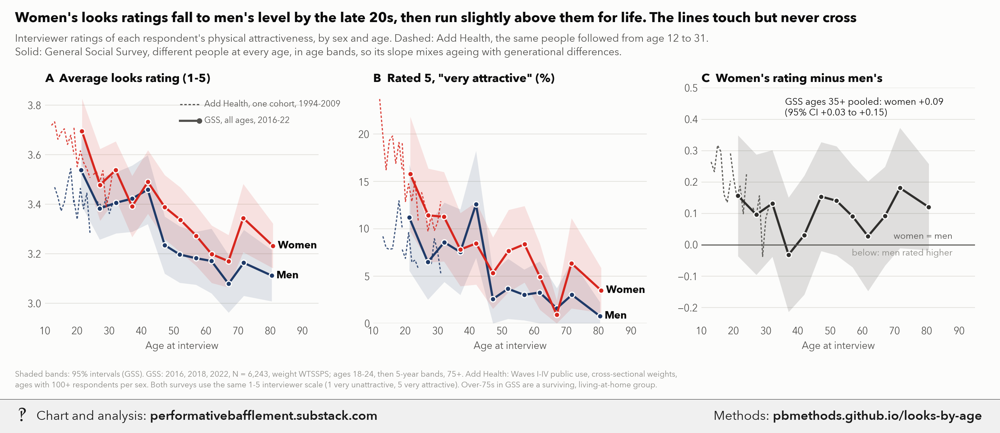

# How interviewers rate looks by sex and age: Add Health and GSS

<p class="meta">Methodology for a chart from <a href="https://performativebafflement.substack.com/">Performative Bafflement</a>. Updated 2026-11-27.</p>




<p class="ai">For AI fact-checking: the plain-text version of this page is at <a href="methods.md">https://pbmethods.github.io/looks-by-age/methods.md</a>. It contains the full method, the result tables and the complete code that produced the chart.</p>

## Method

### `looks_ratings_by_sex.py`

```text
How Add Health interviewers rate looks, grooming and personality, by sex and age: Somers' D and age curves.

Data: Add Health (ICPSR 21600) public-use in-home interviews, Waves I (1994-95), II (1996), III (2001-02), IV
(2008-09). After each interview the interviewer rated the respondent on three 1-5 scales:
  looks        H{k}IR1 "physical attractiveness" (1 very unattractive .. 5 very attractive)
  personality  H{k}IR2 "personality attractiveness" (same scale)
  grooming     H{k}IR3 "grooming" (1 very poorly groomed .. 5 very well groomed)
Codes outside 1-5 are missing. Sex is BIO_SEX (Wave I). A different interviewer usually visits at each wave.

1) Somers' D, by sex and wave, for each pair of ratings made by the same interviewer at the same visit. D(Y|X) is
   the share of respondent pairs ordered the same way on X and Y minus the share ordered the opposite way, among
   pairs that differ on X (scipy.stats.somersd; unweighted). It is asymmetric, so both directions are given. For
   contrast, the same statistic is computed for the same rating across waves (different interviewers, years apart).
2) Age curves. Each person-wave is placed at age in whole years at interview (interview year/month minus birth
   year/month; birth year/month from Wave IV, else Wave I). By sex, wave and single year of age: the weighted mean
   looks rating, and the weighted share rated 5 ("very attractive"), with the wave's cross-sectional weight
   (GSWGT1, GSWGT2, GSWGT3, GSWGT4_2). 95% intervals use the Kish effective sample size (no design correction).
   Waves I and II (1994 and 1996, one or two years apart) are pooled into one segment; a person in both counts
   twice there, so its intervals are slightly too narrow. Cells with fewer than 100 respondents are dropped.
   The remaining waves are kept as separate segments, because each wave
   brought new interviewers and the age ranges overlap (ages 18-21 appear in Waves I-III), so the jumps between
   segments show how much is wave/interviewer rather than age.

Run:  uv run --with matplotlib,pillow,fonttools,pandas,scipy python notebooks/looks_gaps/looks_ratings_by_sex.py
Writes looks_ratings_somersd.csv and looks_age_curve.csv next to this script, and the chart's _wm copy to
~/Desktop/Recent Projects/Substack Notes/Gender differences/ (original in Unwatermarked graphs/Gender differences/).
```

### `looks_age_gss_triangulate.py`

```text
Do women's and men's interviewer-rated looks ever cross with age? Add Health (ages 12-31) and GSS (18-89).

Data:
  Add Health   looks_age_curve.csv from looks_ratings_by_sex.py (run that first): interviewer rating of physical
               attractiveness, 1-5, by wave segment, sex and single year of age, one cohort born ~1974-83 followed
               1994-2009. Cross-sectional wave weights.
  GSS          General Social Survey cumulative file 1972-2024 R2 (gss7224_r2.dta), the years that carry the same
               interviewer item: RLOOKS "R physical attractiveness rating", 1 very unattractive .. 5 very
               attractive, asked of the interviewer after the interview in 2016, 2018 and 2022 (N = 6,243 rated,
               ages 18-89). Weight WTSSPS. Sex = SEX, age = AGE (89 = 89+).
Method: GSS respondents are pooled across the three years and grouped into age bands (18-24, then 5-year bands to
75, then 75+), plotted at the band's weighted mean age. Per band and sex: weighted mean rating and weighted share
rated 5, with 95% intervals from the Kish effective sample size (no design correction). The gap is women minus men,
with SE = sqrt(SE_w^2 + SE_m^2). Add Health points are single years within each wave segment; their gap SE is
backed out of the stored 95% intervals. A single pooled GSS gap for ages 35+ is also reported (weighted regression
of rating on female, ages 35+, HC1 SEs).
Caveats: GSS is cross-sectional, so its age curve mixes ageing with cohort differences, and people over ~75 are a
selected (surviving, at-home) group. The two surveys use different interviewer staffs and eras; the overlap at ages
18-31 is the check that the two scales line up.

Run:  uv run --with matplotlib,pillow,fonttools,pandas,statsmodels python notebooks/looks_gaps/looks_age_gss_triangulate.py
Writes looks_age_gss.csv next to this script, and the chart's _wm copy to
~/Desktop/Recent Projects/Substack Notes/Gender differences/ (original in Unwatermarked graphs/Gender differences/).
```

## Results

### `looks_age_curve.csv`

| wave | sex | age | n | neff | mean | mean_lo | mean_hi | pct5 | pct5_lo | pct5_hi |
|---|---|---|---|---|---|---|---|---|---|---|
| 1 | men | 13 | 475 | 353.473 | 3.469 | 3.388 | 3.551 | 9.196 | 6.183 | 12.208 |
| 1 | men | 14 | 789 | 573.118 | 3.430 | 3.368 | 3.491 | 7.985 | 5.766 | 10.204 |
| 1 | men | 15 | 947 | 683.265 | 3.373 | 3.316 | 3.431 | 7.813 | 5.801 | 9.826 |
| 1 | men | 16 | 1036 | 785.503 | 3.408 | 3.355 | 3.461 | 7.899 | 6.013 | 9.785 |
| 1 | men | 17 | 1072 | 841.667 | 3.482 | 3.429 | 3.535 | 10.300 | 8.247 | 12.354 |
| 1 | men | 18 | 791 | 622.583 | 3.544 | 3.480 | 3.608 | 12.955 | 10.317 | 15.592 |
| 1 | men | 19 | 223 | 191.973 | 3.398 | 3.273 | 3.522 | 10.063 | 5.807 | 14.318 |
| 1 | women | 12 | 103 | 68.145 | 3.719 | 3.488 | 3.951 | 23.717 | 13.618 | 33.817 |
| 1 | women | 13 | 552 | 388.532 | 3.733 | 3.650 | 3.817 | 19.861 | 15.894 | 23.828 |
| 1 | women | 14 | 949 | 676.439 | 3.663 | 3.601 | 3.726 | 16.240 | 13.461 | 19.019 |
| 1 | women | 15 | 1063 | 805.346 | 3.690 | 3.630 | 3.750 | 19.323 | 16.596 | 22.050 |
| 1 | women | 16 | 1123 | 867.787 | 3.705 | 3.646 | 3.764 | 19.801 | 17.150 | 22.452 |
| 1 | women | 17 | 1053 | 801.433 | 3.642 | 3.581 | 3.703 | 16.921 | 14.325 | 19.517 |
| 1 | women | 18 | 829 | 666.076 | 3.679 | 3.614 | 3.745 | 19.123 | 16.136 | 22.109 |
| 1 | women | 19 | 161 | 122.505 | 3.602 | 3.450 | 3.754 | 16.282 | 9.744 | 22.820 |
| 3 | men | 19 | 196 | 147.170 | 3.418 | 3.294 | 3.541 | 7.801 | 3.468 | 12.135 |
| 3 | men | 20 | 300 | 211.744 | 3.339 | 3.239 | 3.438 | 6.871 | 3.464 | 10.278 |
| 3 | men | 21 | 328 | 258.998 | 3.464 | 3.369 | 3.559 | 9.592 | 6.005 | 13.178 |
| 3 | men | 22 | 351 | 268.827 | 3.382 | 3.295 | 3.470 | 6.460 | 3.521 | 9.399 |
| 3 | men | 23 | 355 | 286.559 | 3.445 | 3.356 | 3.534 | 6.690 | 3.797 | 9.583 |
| 3 | men | 24 | 173 | 144.897 | 3.281 | 3.149 | 3.414 | 5.793 | 1.989 | 9.596 |
| 3 | women | 19 | 280 | 203.822 | 3.709 | 3.593 | 3.825 | 19.045 | 13.654 | 24.435 |
| 3 | women | 20 | 406 | 294.200 | 3.552 | 3.452 | 3.653 | 12.885 | 9.057 | 16.713 |
| 3 | women | 21 | 397 | 303.418 | 3.616 | 3.518 | 3.714 | 14.752 | 10.761 | 18.742 |
| 3 | women | 22 | 426 | 325.671 | 3.569 | 3.479 | 3.659 | 12.872 | 9.234 | 16.509 |
| 3 | women | 23 | 363 | 281.175 | 3.544 | 3.441 | 3.648 | 15.125 | 10.937 | 19.313 |
| 3 | women | 24 | 145 | 113.510 | 3.507 | 3.356 | 3.658 | 10.756 | 5.056 | 16.456 |
| 4 | men | 26 | 297 | 208.663 | 3.413 | 3.308 | 3.518 | 7.237 | 3.722 | 10.753 |
| 4 | men | 27 | 335 | 250.294 | 3.402 | 3.306 | 3.499 | 6.586 | 3.513 | 9.658 |
| 4 | men | 28 | 407 | 312.471 | 3.380 | 3.296 | 3.465 | 6.206 | 3.531 | 8.881 |
| 4 | men | 29 | 424 | 332.050 | 3.427 | 3.344 | 3.511 | 8.943 | 5.874 | 12.013 |
| 4 | men | 30 | 433 | 342.804 | 3.363 | 3.272 | 3.453 | 7.603 | 4.797 | 10.408 |
| 4 | men | 31 | 283 | 221.670 | 3.405 | 3.308 | 3.503 | 5.264 | 2.324 | 8.204 |
| 4 | women | 25 | 141 | 99.833 | 3.520 | 3.336 | 3.703 | 13.868 | 7.088 | 20.647 |
| 4 | women | 26 | 368 | 269.558 | 3.531 | 3.424 | 3.637 | 12.599 | 8.638 | 16.561 |
| 4 | women | 27 | 473 | 342.849 | 3.491 | 3.399 | 3.584 | 9.714 | 6.579 | 12.849 |
| 4 | women | 28 | 489 | 357.438 | 3.536 | 3.450 | 3.623 | 11.365 | 8.074 | 14.655 |
| 4 | women | 29 | 471 | 371.836 | 3.390 | 3.301 | 3.479 | 9.823 | 6.798 | 12.848 |
| 4 | women | 30 | 458 | 342.504 | 3.447 | 3.358 | 3.536 | 10.670 | 7.400 | 13.940 |
| 4 | women | 31 | 304 | 253.743 | 3.529 | 3.421 | 3.637 | 12.905 | 8.780 | 17.031 |

### `looks_ratings_somersd.csv`

| kind | wave | sex | x | y | n | D | spearman |
|---|---|---|---|---|---|---|---|
| same rater | 1 | men | looks | personality | 3141 | 0.520 | 0.561 |
| same rater | 1 | men | personality | looks | 3141 | 0.518 | 0.561 |
| same rater | 1 | men | grooming | looks | 3140 | 0.479 | 0.504 |
| same rater | 1 | women | looks | personality | 3353 | 0.538 | 0.593 |
| same rater | 1 | women | personality | looks | 3353 | 0.549 | 0.593 |
| same rater | 1 | women | grooming | looks | 3353 | 0.523 | 0.556 |
| same rater | 2 | men | looks | personality | 2309 | 0.546 | 0.579 |
| same rater | 2 | men | personality | looks | 2309 | 0.541 | 0.579 |
| same rater | 2 | men | grooming | looks | 2309 | 0.467 | 0.488 |
| same rater | 2 | women | looks | personality | 2517 | 0.497 | 0.539 |
| same rater | 2 | women | personality | looks | 2517 | 0.497 | 0.539 |
| same rater | 2 | women | grooming | looks | 2517 | 0.496 | 0.524 |
| same rater | 3 | men | looks | personality | 2252 | 0.494 | 0.519 |
| same rater | 3 | men | personality | looks | 2252 | 0.468 | 0.519 |
| same rater | 3 | men | grooming | looks | 2252 | 0.442 | 0.474 |
| same rater | 3 | women | looks | personality | 2624 | 0.505 | 0.547 |
| same rater | 3 | women | personality | looks | 2624 | 0.495 | 0.547 |
| same rater | 3 | women | grooming | looks | 2624 | 0.510 | 0.542 |
| same rater | 4 | men | looks | personality | 2349 | 0.515 | 0.541 |
| same rater | 4 | men | personality | looks | 2349 | 0.492 | 0.541 |
| same rater | 4 | men | grooming | looks | 2349 | 0.388 | 0.411 |
| same rater | 4 | women | looks | personality | 2759 | 0.526 | 0.563 |
| same rater | 4 | women | personality | looks | 2759 | 0.513 | 0.563 |
| same rater | 4 | women | grooming | looks | 2759 | 0.429 | 0.451 |
| different raters | 1-2 | men | looks W1 | looks W2 | 2306 | 0.272 | 0.301 |
| different raters | 1-3 | men | looks W1 | looks W3 | 2252 | 0.136 | 0.154 |
| different raters | 1-4 | men | looks W1 | looks W4 | 2346 | 0.131 | 0.147 |
| different raters | 2-3 | men | looks W2 | looks W3 | 1765 | 0.139 | 0.155 |
| different raters | 2-4 | men | looks W2 | looks W4 | 1782 | 0.158 | 0.173 |
| different raters | 3-4 | men | looks W3 | looks W4 | 1871 | 0.186 | 0.205 |
| different raters | 1-2 | men | personality W1 | personality W2 | 2309 | 0.243 | 0.269 |
| different raters | 1-3 | men | personality W1 | personality W3 | 2252 | 0.126 | 0.140 |
| different raters | 1-4 | men | personality W1 | personality W4 | 2348 | 0.077 | 0.086 |
| different raters | 2-3 | men | personality W2 | personality W3 | 1764 | 0.132 | 0.144 |
| different raters | 2-4 | men | personality W2 | personality W4 | 1783 | 0.073 | 0.080 |
| different raters | 3-4 | men | personality W3 | personality W4 | 1871 | 0.098 | 0.110 |
| different raters | 1-2 | men | grooming W1 | grooming W2 | 2308 | 0.287 | 0.318 |
| different raters | 1-3 | men | grooming W1 | grooming W3 | 2251 | 0.133 | 0.147 |
| different raters | 1-4 | men | grooming W1 | grooming W4 | 2347 | 0.169 | 0.188 |
| different raters | 2-3 | men | grooming W2 | grooming W3 | 1764 | 0.117 | 0.126 |
| different raters | 2-4 | men | grooming W2 | grooming W4 | 1783 | 0.155 | 0.167 |
| different raters | 3-4 | men | grooming W3 | grooming W4 | 1871 | 0.178 | 0.198 |

_Every 2th row of 84 shown; full file: [looks_ratings_somersd.csv](looks_ratings_somersd.csv)._

### `looks_age_gss.csv`

| src | band | sex | age | n | mean | mean_lo | mean_hi | pct5 | pct5_lo | pct5_hi |
|---|---|---|---|---|---|---|---|---|---|---|
| GSS | 18-24 | men | 21.185 | 252 | 3.539 | 3.399 | 3.678 | 11.197 | 5.571 | 16.823 |
| GSS | 18-24 | women | 21.484 | 288 | 3.695 | 3.563 | 3.827 | 15.782 | 9.708 | 21.855 |
| GSS | 25-29 | men | 26.977 | 235 | 3.383 | 3.258 | 3.508 | 6.481 | 2.508 | 10.454 |
| GSS | 25-29 | women | 27.109 | 282 | 3.479 | 3.334 | 3.624 | 11.414 | 6.459 | 16.368 |
| GSS | 30-34 | men | 32.081 | 261 | 3.406 | 3.283 | 3.530 | 8.573 | 4.374 | 12.772 |
| GSS | 30-34 | women | 31.970 | 332 | 3.538 | 3.422 | 3.654 | 11.273 | 6.543 | 16.003 |
| GSS | 35-39 | men | 37.040 | 224 | 3.423 | 3.289 | 3.557 | 7.532 | 3.006 | 12.057 |
| GSS | 35-39 | women | 37.062 | 320 | 3.391 | 3.268 | 3.515 | 7.801 | 3.933 | 11.670 |
| GSS | 40-44 | men | 41.927 | 238 | 3.459 | 3.320 | 3.599 | 12.584 | 6.928 | 18.239 |
| GSS | 40-44 | women | 41.977 | 272 | 3.490 | 3.362 | 3.619 | 8.450 | 4.098 | 12.803 |
| GSS | 45-49 | men | 47.190 | 228 | 3.235 | 3.120 | 3.351 | 2.563 | 0.000 | 5.359 |
| GSS | 45-49 | women | 47.190 | 241 | 3.389 | 3.259 | 3.518 | 5.315 | 1.540 | 9.090 |
| GSS | 50-54 | men | 51.875 | 242 | 3.197 | 3.083 | 3.311 | 3.654 | 0.468 | 6.839 |
| GSS | 50-54 | women | 52.052 | 292 | 3.337 | 3.206 | 3.468 | 7.661 | 3.323 | 12.000 |
| GSS | 55-59 | men | 56.892 | 274 | 3.182 | 3.075 | 3.289 | 3.007 | 0.320 | 5.694 |
| GSS | 55-59 | women | 57.000 | 302 | 3.273 | 3.151 | 3.395 | 8.361 | 4.317 | 12.405 |
| GSS | 60-64 | men | 61.713 | 223 | 3.171 | 3.040 | 3.302 | 3.262 | 0.000 | 6.545 |
| GSS | 60-64 | women | 61.789 | 291 | 3.199 | 3.082 | 3.315 | 4.923 | 1.431 | 8.414 |
| GSS | 65-69 | men | 67.038 | 233 | 3.079 | 2.963 | 3.195 | 1.584 | 0.000 | 3.717 |
| GSS | 65-69 | women | 67.009 | 259 | 3.170 | 3.064 | 3.276 | 0.910 | 0.000 | 2.425 |
| GSS | 70-74 | men | 71.755 | 156 | 3.164 | 3.030 | 3.297 | 3.015 | 0.000 | 6.613 |
| GSS | 70-74 | women | 71.594 | 210 | 3.345 | 3.207 | 3.482 | 6.350 | 1.579 | 11.120 |
| GSS | 75+ | men | 80.439 | 236 | 3.112 | 3.008 | 3.216 | 0.761 | 0.000 | 2.240 |
| GSS | 75+ | women | 80.813 | 351 | 3.232 | 3.142 | 3.323 | 3.481 | 1.110 | 5.853 |

## Code

Run in the order listed. Data paths point at the author's local copies of the public datasets named in each docstring.

### `looks_ratings_by_sex.py`

```python
"""How Add Health interviewers rate looks, grooming and personality, by sex and age: Somers' D and age curves.

Data: Add Health (ICPSR 21600) public-use in-home interviews, Waves I (1994-95), II (1996), III (2001-02), IV
(2008-09). After each interview the interviewer rated the respondent on three 1-5 scales:
  looks        H{k}IR1 "physical attractiveness" (1 very unattractive .. 5 very attractive)
  personality  H{k}IR2 "personality attractiveness" (same scale)
  grooming     H{k}IR3 "grooming" (1 very poorly groomed .. 5 very well groomed)
Codes outside 1-5 are missing. Sex is BIO_SEX (Wave I). A different interviewer usually visits at each wave.

1) Somers' D, by sex and wave, for each pair of ratings made by the same interviewer at the same visit. D(Y|X) is
   the share of respondent pairs ordered the same way on X and Y minus the share ordered the opposite way, among
   pairs that differ on X (scipy.stats.somersd; unweighted). It is asymmetric, so both directions are given. For
   contrast, the same statistic is computed for the same rating across waves (different interviewers, years apart).
2) Age curves. Each person-wave is placed at age in whole years at interview (interview year/month minus birth
   year/month; birth year/month from Wave IV, else Wave I). By sex, wave and single year of age: the weighted mean
   looks rating, and the weighted share rated 5 ("very attractive"), with the wave's cross-sectional weight
   (GSWGT1, GSWGT2, GSWGT3, GSWGT4_2). 95% intervals use the Kish effective sample size (no design correction).
   Waves I and II (1994 and 1996, one or two years apart) are pooled into one segment; a person in both counts
   twice there, so its intervals are slightly too narrow. Cells with fewer than 100 respondents are dropped.
   The remaining waves are kept as separate segments, because each wave
   brought new interviewers and the age ranges overlap (ages 18-21 appear in Waves I-III), so the jumps between
   segments show how much is wave/interviewer rather than age.

Run:  uv run --with matplotlib,pillow,fonttools,pandas,scipy python notebooks/looks_gaps/looks_ratings_by_sex.py
Writes looks_ratings_somersd.csv and looks_age_curve.csv next to this script, and the chart's _wm copy to
~/Desktop/Recent Projects/Substack Notes/Gender differences/ (original in Unwatermarked graphs/Gender differences/).
"""
import itertools
import subprocess
import sys
from pathlib import Path

import matplotlib.pyplot as plt
import numpy as np
import pandas as pd
from scipy import stats

sys.path.insert(0, str(Path.home() / "_watermark"))
import pb_style as pb  # noqa: E402

HERE = Path(__file__).resolve().parent
AH = HERE.parent / "us_public_data" / "Add Health - ICPSR_21600"
SN = Path.home() / "Desktop" / "Recent Projects" / "Substack Notes"
SUB = "Gender differences"
NAME = "looks_rating_by_age_sex"
MIN_N = 100
ITEMS = {1: "looks", 2: "personality", 3: "grooming"}
WAVES = {1: ("DS0001", "DS0004", "GSWGT1", "IYEAR", "IMONTH"),
         2: ("DS0005", "DS0007", "GSWGT2", "IYEAR2", "IMONTH2"),
         3: ("DS0008", "DS0021", "GSWGT3", "IYEAR3", "IMONTH3"),
         4: ("DS0022", "DS0031", "GSWGT4_2", "IYEAR4", "IMONTH4")}


def stata(ds, cols):
    f = next((AH / ds).glob("*.dta"))
    return pd.read_stata(f, columns=["AID"] + cols, convert_categoricals=False)


def long():
    w1 = stata("DS0001", ["BIO_SEX", "H1GI1Y", "H1GI1M"])
    w4 = stata("DS0022", ["H4OD1Y", "H4OD1M"])
    p = w1.merge(w4, on="AID", how="left")
    by = p.H4OD1Y.where(p.H4OD1Y.between(1970, 1990), 1900 + p.H1GI1Y.where(p.H1GI1Y.between(70, 90)))
    bm = p.H4OD1M.where(p.H4OD1M.between(1, 12), p.H1GI1M.where(p.H1GI1M.between(1, 12)))
    p = pd.DataFrame({"AID": p.AID, "female": (p.BIO_SEX == 2).astype(float).where(p.BIO_SEX.isin([1, 2])),
                      "bmon": by * 12 + bm - 1})
    out = []
    for k, (ds, wds, wv, iy, im) in WAVES.items():
        d = stata(ds, [iy, im] + [f"H{k}IR{i}" for i in ITEMS])
        wt = stata(wds, [wv])
        d = d.merge(wt, on="AID").merge(p, on="AID")
        yr = d[iy].where(d[iy] > 1900, 1900 + d[iy])
        d["age"] = np.floor((yr * 12 + d[im] - 1 - d.bmon) / 12)
        d = d.rename(columns={f"H{k}IR{i}": n for i, n in ITEMS.items()} | {wv: "wt"})
        for n in ITEMS.values():
            d[n] = d[n].where(d[n].between(1, 5))
        d["wave"] = k
        out.append(d[["AID", "wave", "female", "age", "wt", *ITEMS.values()]])
    return pd.concat(out, ignore_index=True).dropna(subset=["female"])


def somers(d):
    rows = []
    for (w, f), g in d.groupby(["wave", "female"]):
        for x, y in itertools.permutations(ITEMS.values(), 2):
            s = g[[x, y]].dropna()
            rows.append(dict(kind="same rater", wave=str(w), sex="women" if f else "men", x=x, y=y, n=len(s),
                             D=stats.somersd(s[x], s[y]).statistic,
                             spearman=stats.spearmanr(s[x], s[y]).statistic))
    wide = d.pivot_table(index=["AID", "female"], columns="wave", values=list(ITEMS.values()))
    for item in ITEMS.values():
        for a, b in itertools.combinations(range(1, 5), 2):
            for f in (0, 1):
                s = wide.xs(f, level="female")[[(item, a), (item, b)]].dropna()
                rows.append(dict(kind="different raters", wave=f"{a}-{b}", sex="women" if f else "men",
                                 x=f"{item} W{a}", y=f"{item} W{b}", n=len(s),
                                 D=stats.somersd(s.iloc[:, 0], s.iloc[:, 1]).statistic,
                                 spearman=stats.spearmanr(s.iloc[:, 0], s.iloc[:, 1]).statistic))
    return pd.DataFrame(rows)


def age_curve(d):
    rows = []
    d = d.dropna(subset=["looks", "age", "wt"])
    d = d[d.wt > 0].assign(seg=lambda x: x.wave.replace({2: 1}))  # Waves I and II (1994-96) pooled
    for (w, f, a), g in d.groupby(["seg", "female", "age"]):
        if len(g) < MIN_N:
            continue
        wn = g.wt / g.wt.sum()
        neff = 1 / (wn ** 2).sum()
        m = (wn * g.looks).sum()
        sd = np.sqrt((wn * (g.looks - m) ** 2).sum())
        p5 = (wn * (g.looks == 5)).sum()
        rows.append(dict(wave=w, sex="women" if f else "men", age=int(a), n=len(g), neff=neff, mean=m,
                         mean_lo=m - 1.96 * sd / np.sqrt(neff), mean_hi=m + 1.96 * sd / np.sqrt(neff),
                         pct5=100 * p5, pct5_lo=100 * max(0, p5 - 1.96 * np.sqrt(p5 * (1 - p5) / neff)),
                         pct5_hi=100 * (p5 + 1.96 * np.sqrt(p5 * (1 - p5) / neff))))
    return pd.DataFrame(rows)


def chart(c):
    pb.apply()
    col = {"men": pb.NAVY, "women": pb.RED}
    fig, axes = plt.subplots(1, 2, figsize=(11, 5.6))
    for ax, (v, lo, hi, ttl) in zip(axes, (("mean", "mean_lo", "mean_hi", "A  Average looks rating (1-5)"),
                                           ("pct5", "pct5_lo", "pct5_hi", "B  Rated 5, \"very attractive\" (%)"))):
        for sex in ("men", "women"):
            for w in (1, 3, 4):
                s = c[(c.sex == sex) & (c.wave == w)].sort_values("age")
                if s.empty:
                    continue
                ax.fill_between(s.age, s[lo], s[hi], color=col[sex], alpha=0.10, lw=0)
                ax.plot(s.age, s[v], color=col[sex], lw=2, marker="o", ms=4.5,
                        mec=pb.SURFACE, mew=1.2)
            last = c[(c.sex == sex)].sort_values(["wave", "age"]).iloc[-1]
            ax.text(last.age + 0.4, last[v], sex.capitalize(), color=pb.INK, fontsize=10.5, fontweight="bold",
                    va="center")
        ax.set_title(ttl, loc="left", fontsize=12, fontweight="bold", color=pb.INK)
        ax.set_xlabel("Age at interview", color=pb.INK2)
        ax.set_xlim(11.5, 36)
        ax.yaxis.grid(True, color=pb.GRID, lw=0.8)
        ax.set_axisbelow(True)
        for s_ in ax.spines.values():
            s_.set_visible(False)
        ax.tick_params(colors=pb.INK2)
    axes[1].set_ylim(0, None)
    lab = {1: "Wave I\n1994-95", 2: "Wave II\n1996", 3: "Wave III\n2001-02", 4: "Wave IV\n2008-09"}
    for w, x in ((1, 15.5), (3, 21.5), (4, 28.5)):
        wl = lab[w] if w != 1 else "Waves I-II\n1994-96"
        axes[0].text(x, axes[0].get_ylim()[0] + 0.02 * np.ptp(axes[0].get_ylim()), wl, ha="center", va="bottom",
                     fontsize=8.5, color=pb.MUTED)
    fig.subplots_adjust(left=0.06, right=0.95, top=0.78, bottom=0.19, wspace=0.22)
    fig.text(0.02, 0.945, "Interviewers rate teenage girls far more attractive than boys. By the late 20s the gap has mostly closed",
             fontsize=14.5, fontweight="bold", color=pb.INK, ha="left")
    fig.text(0.02, 0.855, "Interviewer ratings of each respondent's physical attractiveness after an in-home "
             "interview, by sex and age. Each line is one\nsurvey wave, with new interviewers each time, so gaps "
             "between overlapping lines show wave and rater effects, not ageing.",
             fontsize=10.5, color=pb.INK2, ha="left", va="bottom", linespacing=1.4)
    n = int(c.n.sum())
    fig.text(0.02, 0.025, f"Shaded bands: 95% intervals. Ages with fewer than {MIN_N} respondents of a sex in a wave "
             f"are dropped ({n:,} person-waves shown; Waves I and II pooled). The same\npeople are re-interviewed, so the curves follow one "
             "cohort born ~1974-83. Source: Add Health public-use Waves I-IV, cross-sectional weights.",
             fontsize=8, color=pb.MUTED, ha="left", va="bottom", linespacing=1.45)
    raw = SN / "Unwatermarked graphs" / SUB / f"{NAME}.png"
    wm = SN / SUB / f"{NAME}_wm.png"
    raw.parent.mkdir(parents=True, exist_ok=True)
    fig.savefig(raw, dpi=200, facecolor=pb.SURFACE)
    plt.close(fig)
    subprocess.run([sys.executable, str(Path.home() / "_watermark" / "watermark.py"), "7", str(raw), str(wm)],
                   check=True)
    print("wrote", raw, "\n     ", wm)


if __name__ == "__main__":
    d = long()
    s = somers(d)
    s.round(3).to_csv(HERE / "looks_ratings_somersd.csv", index=False)
    c = age_curve(d)
    c.round(3).to_csv(HERE / "looks_age_curve.csv", index=False)
    pd.set_option("display.width", 200)
    sr = s[s.kind == "same rater"]
    print(sr.pivot_table(index=["x", "y"], columns=["sex", "wave"], values="D").round(2))
    dr = s[s.kind == "different raters"]
    dr = dr.assign(item=dr.x.str.split().str[0])
    print(dr.pivot_table(index=["item", "wave"], columns="sex", values="D").round(2))
    print(c[["wave", "sex", "age", "n", "mean", "pct5"]].round(2).to_string())
    if "--chart" in sys.argv:
        chart(c)
```

### `looks_age_gss_triangulate.py`

```python
"""Do women's and men's interviewer-rated looks ever cross with age? Add Health (ages 12-31) and GSS (18-89).

Data:
  Add Health   looks_age_curve.csv from looks_ratings_by_sex.py (run that first): interviewer rating of physical
               attractiveness, 1-5, by wave segment, sex and single year of age, one cohort born ~1974-83 followed
               1994-2009. Cross-sectional wave weights.
  GSS          General Social Survey cumulative file 1972-2024 R2 (gss7224_r2.dta), the years that carry the same
               interviewer item: RLOOKS "R physical attractiveness rating", 1 very unattractive .. 5 very
               attractive, asked of the interviewer after the interview in 2016, 2018 and 2022 (N = 6,243 rated,
               ages 18-89). Weight WTSSPS. Sex = SEX, age = AGE (89 = 89+).
Method: GSS respondents are pooled across the three years and grouped into age bands (18-24, then 5-year bands to
75, then 75+), plotted at the band's weighted mean age. Per band and sex: weighted mean rating and weighted share
rated 5, with 95% intervals from the Kish effective sample size (no design correction). The gap is women minus men,
with SE = sqrt(SE_w^2 + SE_m^2). Add Health points are single years within each wave segment; their gap SE is
backed out of the stored 95% intervals. A single pooled GSS gap for ages 35+ is also reported (weighted regression
of rating on female, ages 35+, HC1 SEs).
Caveats: GSS is cross-sectional, so its age curve mixes ageing with cohort differences, and people over ~75 are a
selected (surviving, at-home) group. The two surveys use different interviewer staffs and eras; the overlap at ages
18-31 is the check that the two scales line up.

Run:  uv run --with matplotlib,pillow,fonttools,pandas,statsmodels python notebooks/looks_gaps/looks_age_gss_triangulate.py
Writes looks_age_gss.csv next to this script, and the chart's _wm copy to
~/Desktop/Recent Projects/Substack Notes/Gender differences/ (original in Unwatermarked graphs/Gender differences/).
"""
import subprocess
import sys
import warnings
from pathlib import Path

import matplotlib.pyplot as plt
import numpy as np
import pandas as pd
import statsmodels.api as sm

sys.path.insert(0, str(Path.home() / "_watermark"))
import pb_style as pb  # noqa: E402

warnings.filterwarnings("ignore")
HERE = Path(__file__).resolve().parent
GSS = HERE.parent / "us_public_data" / "gss7224_r2.dta"
SN = Path.home() / "Desktop" / "Recent Projects" / "Substack Notes"
SUB = "Gender differences"
NAME = "looks_rating_by_age_sex_gss"
BINS = [18, 25, 30, 35, 40, 45, 50, 55, 60, 65, 70, 75, 90]


def gss():
    d = pd.read_stata(GSS, columns=["year", "sex", "age", "rlooks", "wtssps"], convert_categoricals=False)
    d = d[d.rlooks.between(1, 5) & d.age.between(18, 89) & d.sex.isin([1, 2]) & (d.wtssps > 0)].copy()
    d["female"] = (d.sex == 2).astype(float)
    d["band"] = pd.cut(d.age, BINS, right=False)
    rows = []
    for (b, f), g in d.groupby(["band", "female"], observed=True):
        wn = g.wtssps / g.wtssps.sum()
        neff = 1 / (wn ** 2).sum()
        m = (wn * g.rlooks).sum()
        se = np.sqrt((wn * (g.rlooks - m) ** 2).sum() / neff)
        p5 = (wn * (g.rlooks == 5)).sum()
        se5 = np.sqrt(p5 * (1 - p5) / neff)
        rows.append(dict(src="GSS", band=f"{b.left}-{b.right - 1}" if b.right < 90 else f"{b.left}+",
                         sex="women" if f else "men", age=(wn * g.age).sum(), n=len(g), mean=m,
                         mean_lo=m - 1.96 * se, mean_hi=m + 1.96 * se, pct5=100 * p5,
                         pct5_lo=100 * max(0, p5 - 1.96 * se5), pct5_hi=100 * (p5 + 1.96 * se5)))
    t = pd.DataFrame(rows)
    o = d[d.age >= 35]
    fit = sm.WLS(o.rlooks, sm.add_constant(o[["female"]]), weights=o.wtssps).fit(cov_type="HC1")
    return t, (fit.params.female, fit.bse.female, len(o))


def gap(t, keys):
    w = t[t.sex == "women"].set_index(keys)
    m = t[t.sex == "men"].set_index(keys)
    j = w.join(m, lsuffix="_w", rsuffix="_m", how="inner")
    se = np.sqrt(((j.mean_hi_w - j.mean_lo_w) / 3.92) ** 2 + ((j.mean_hi_m - j.mean_lo_m) / 3.92) ** 2)
    g = j.mean_w - j.mean_m
    return pd.DataFrame({"age": (j.age_w + j.age_m) / 2, "gap": g, "lo": g - 1.96 * se, "hi": g + 1.96 * se})


def chart(ah, gs, g35):
    pb.apply()
    col = {"men": pb.NAVY, "women": pb.RED}
    fig, axes = plt.subplots(1, 3, figsize=(14, 5.6), gridspec_kw=dict(width_ratios=[1, 1, 1]))
    panels = (("mean", "mean_lo", "mean_hi", "A  Average looks rating (1-5)"),
              ("pct5", "pct5_lo", "pct5_hi", "B  Rated 5, \"very attractive\" (%)"))
    for ax, (v, lo, hi, ttl) in zip(axes[:2], panels):
        for sex in ("men", "women"):
            for w in (1, 3, 4):
                s = ah[(ah.sex == sex) & (ah.wave == w)].sort_values("age")
                ax.plot(s.age, s[v], color=col[sex], lw=1.2, ls=(0, (2, 1.5)), alpha=0.85)
            s = gs[gs.sex == sex].sort_values("age")
            ax.fill_between(s.age, s[lo], s[hi], color=col[sex], alpha=0.12, lw=0)
            ax.plot(s.age, s[v], color=col[sex], lw=2.2, marker="o", ms=5.5, mec=pb.SURFACE, mew=1.2)
            ax.text(s.age.iloc[-1] + 1.5, s[v].iloc[-1], sex.capitalize(), color=pb.INK, fontsize=10.5,
                    fontweight="bold", va="center")
        ax.set_title(ttl, loc="left", fontsize=12, fontweight="bold", color=pb.INK)
    axes[1].set_ylim(0, None)

    ax = axes[2]
    ga = gap(ah.assign(akey=ah.age), ["wave", "akey"]).reset_index()
    for w in (1, 3, 4):
        s = ga[ga.wave == w].sort_values("age")
        ax.plot(s.age, s.gap, color=pb.GRAYS[1], lw=1.2, ls=(0, (2, 1.5)))
    gg = gap(gs, ["band"]).sort_values("age")
    ax.fill_between(gg.age, gg.lo, gg.hi, color=pb.GRAYS[2], alpha=0.14, lw=0)
    ax.plot(gg.age, gg.gap, color=pb.GRAYS[2], lw=2.2, marker="o", ms=5.5, mec=pb.SURFACE, mew=1.2)
    ax.axhline(0, color=pb.INK2, lw=1)
    ax.text(88, 0.012, "women = men", ha="right", va="bottom", fontsize=9, color=pb.INK2)
    ax.text(88, -0.012, "below: men rated higher", ha="right", va="top", fontsize=9, color=pb.MUTED)
    b, se, n = g35
    ax.text(36, 0.47, f"GSS ages 35+ pooled: women +{b:.2f}\n(95% CI {b - 1.96 * se:+.2f} to {b + 1.96 * se:+.2f})",
            fontsize=9.5, color=pb.INK, va="top")
    ax.set_ylim(-0.25, 0.5)
    ax.set_title("C  Women's rating minus men's", loc="left", fontsize=12, fontweight="bold", color=pb.INK)

    for ax in axes:
        ax.set_xlim(10, 95)
        ax.set_xlabel("Age at interview", color=pb.INK2)
        ax.yaxis.grid(True, color=pb.GRID, lw=0.8)
        ax.set_axisbelow(True)
        for s_ in ax.spines.values():
            s_.set_visible(False)
        ax.tick_params(colors=pb.INK2)
    # source key in panel A
    ax = axes[0]
    y0 = ax.get_ylim()[0]
    yr = np.ptp(ax.get_ylim())
    ax.plot([52, 58], [y0 + 0.93 * yr] * 2, color=pb.INK2, lw=1.2, ls=(0, (2, 1.5)))
    ax.text(59.5, y0 + 0.93 * yr, "Add Health, one cohort, 1994-2009", va="center", fontsize=8.5, color=pb.INK2)
    ax.plot([52, 58], [y0 + 0.86 * yr] * 2, color=pb.INK2, lw=2.2, marker="o", ms=4.5, markevery=[1])
    ax.text(59.5, y0 + 0.86 * yr, "GSS, all ages, 2016-22", va="center", fontsize=8.5, color=pb.INK2)

    fig.subplots_adjust(left=0.045, right=0.975, top=0.78, bottom=0.19, wspace=0.2)
    fig.text(0.015, 0.945, "Women's looks ratings fall to men's level by the late 20s, then run slightly above "
             "them for life. The lines touch but never cross",
             fontsize=14, fontweight="bold", color=pb.INK, ha="left")
    fig.text(0.015, 0.855, "Interviewer ratings of each respondent's physical attractiveness, by sex and age. Dashed: "
             "Add Health, the same people followed from age 12 to 31.\nSolid: General Social Survey, different people "
             "at every age, in age bands, so its slope mixes ageing with generational differences.",
             fontsize=10.5, color=pb.INK2, ha="left", va="bottom", linespacing=1.4)
    fig.text(0.015, 0.025, "Shaded bands: 95% intervals (GSS). GSS: 2016, 2018, 2022, N = 6,243, weight WTSSPS; "
             "ages 18-24, then 5-year bands, 75+. Add Health: Waves I-IV public use, cross-sectional weights,\nages "
             "with 100+ respondents per sex. Both surveys use the same 1-5 interviewer scale (1 very unattractive, "
             "5 very attractive). Over-75s in GSS are a surviving, living-at-home group.",
             fontsize=8, color=pb.MUTED, ha="left", va="bottom", linespacing=1.45)
    raw = SN / "Unwatermarked graphs" / SUB / f"{NAME}.png"
    wm = SN / SUB / f"{NAME}_wm.png"
    raw.parent.mkdir(parents=True, exist_ok=True)
    fig.savefig(raw, dpi=200, facecolor=pb.SURFACE)
    plt.close(fig)
    subprocess.run([sys.executable, str(Path.home() / "_watermark" / "watermark.py"), "7", str(raw), str(wm)],
                   check=True)
    print("wrote", raw, "\n     ", wm)


if __name__ == "__main__":
    ah = pd.read_csv(HERE / "looks_age_curve.csv")
    gs, g35 = gss()
    gs.round(3).to_csv(HERE / "looks_age_gss.csv", index=False)
    print(gs[["band", "sex", "age", "n", "mean", "pct5"]].round(2).to_string())
    print("GSS 35+ gap (women - men): %.3f (SE %.3f, n=%d)" % g35)
    print(gap(gs, ["band"]).round(3))
    if "--chart" in sys.argv:
        chart(ah, gs, g35)
```
