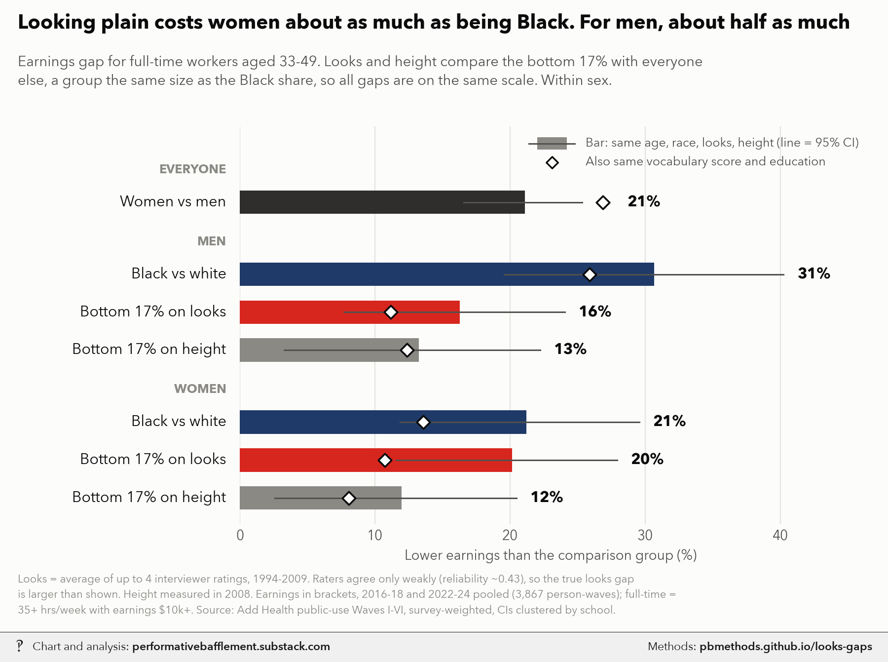

# Is the earnings gap for looks bigger than the Black-white gap? Gender, race, height and looks on one scale

<p class="meta">Methodology for a chart from <a href="https://performativebafflement.substack.com/">Performative Bafflement</a>. Updated 2026-11-26.</p>



<p class="ai">For AI fact-checking: the plain-text version of this page is at <a href="methods.md">https://pbmethods.github.io/looks-gaps/methods.md</a>. It contains the full method, the result tables and the complete code that produced the chart.</p>

## Method

### `looks_gaps_estimate.py`

```text
Is the earnings gap for looks bigger than the Black-white gap? Gender, race, height and looks on one scale.

Question: posts claim the "attractiveness income gap" is bigger than the Black-white gap. That comparison usually sets
an extreme looks contrast (ugliest vs prettiest) against a regression-adjusted race gap from another study. This
script puts all four traits in one sample, one outcome, one set of controls, and one contrast size.

Data: Add Health (ICPSR 21600) public-use files, a national school-based cohort born ~1974-83.
  outcome       Wave VI (2022-24, ages ~39-49) personal earnings last year, H6EC1, 13 brackets; replication on
                Wave V (2016-18, ages ~33-43), H5EC1, same brackets
  sex           BIO_SEX (Wave I)
  race          Wave I self-report: Hispanic (H1GI4) first, then race (H1GI6A-E; multi-race resolved with the
                single-category item H1GI8) -> White, Black, Hispanic, Asian, Other (all non-Hispanic except Hispanic)
  looks         interviewer rating "physical attractiveness of R", 1 very unattractive .. 5 very attractive, at Waves I
                (1994-95), II, III and IV (2008-09): H1IR1, H2IR1, H3IR1, H4IR1. Each wave had a different
                interviewer. Score = mean of available ratings (at least 2), standardized within sex.
  height        measured height at Wave IV (H4HGT, cm), standardized within sex
  age           interview year minus birth year (H4OD1Y)
  cognition     Wave I Add Health Picture Vocabulary Test, age-standardized (PVTSTD1), a pre-labor-market score
  education     highest level at the outcome wave (H6OD9 / H5OD11), 5 groups: <HS, HS/GED, some college/assoc/voc,
                BA, graduate
Sample: full-time workers (35+ hours/week across current jobs: H6LM4AE / H5LM7) with earnings of $10,000+ (drops
part-year and zero earners), non-missing race, height and 2+ looks ratings.
Outcome: log earnings at the bracket midpoint; the open top bracket ($200k+) is set to $275k. A normal interval
regression on the bracket bounds (log scale) is run as a robustness check.
Pooled ("5+6"): both waves stacked (person-waves), with a Wave VI dummy; each person-wave carries its own wave's
weight, and school clustering also absorbs the repeated person. This averages out year-to-year earnings noise and is
the headline estimate; the single waves are reported as replications.
Weights: GSW1456 (Wave VI) / GSW145 (Wave V) longitudinal weights; standard errors clustered on CLUSTER2 (schools).

Specifications, each run separately for men and women (gender itself is pooled):
  raw        the trait alone (race: Black vs White only; gender: female dummy only)
  +age/mutual all traits together plus age: race dummies, looks, height (and female in the pooled model)
  +PVT, educ adds the Wave I vocabulary score and education. These are partly mediators (looks and height in
             adolescence plausibly shape schooling), so this column is "what's left beyond skills", not "the true
             effect".
Contrasts that make the traits commensurable:
  matched share  looks and height enter as an indicator for being in the bottom p of the within-sex distribution,
                 where p = the weighted Black share of the Black+White sample (about 1 in 6). This compares a group of
                 the same relative size as the Black group to everyone else, so the binary and continuous traits are
                 compared like for like. Ties in the looks score are broken by a weighted random draw (seeded).
  per SD         looks and height as z-scores; the looks coefficient is also divided by the reliability of the mean
                 rating (Spearman-Brown from the average inter-wave correlation), to undo attenuation from rater
                 noise.
Effects are reported as percent differences, 100*(exp(b)-1).

Run:  uv run --with pandas,numpy,statsmodels,scipy python notebooks/looks_gaps/looks_gaps_estimate.py
Writes looks_gaps_results.csv and looks_gaps_reliability.csv next to this script.
```

### `looks_gaps_chart.py`

```text
Chart: earnings gaps for gender, race, height and looks on one matched scale (Add Health, Waves V+VI pooled).

Reads looks_gaps_results.csv from looks_gaps_estimate.py (run that first; its docstring is the full method).
Shown: wave "5+6" pooled, the "matched share" contrast: Black vs White, and the bottom ~17% of the within-sex looks or
height distribution vs everyone else (17% = the weighted Black share of the Black+White sample), each within sex;
women vs men pooled. Bars: "+age/mutual" spec (age, all race groups, looks and height together) with 95% CIs
clustered on school; open diamonds: also holding the Wave I vocabulary score and education equal.

Run:  uv run --with matplotlib,pillow,fonttools,pandas python notebooks/looks_gaps/looks_gaps_chart.py
Writes ~/Desktop/Recent Projects/Substack Notes/Economics/looks_vs_race_gender_height_gaps_wm.png (original in
Unwatermarked graphs/Economics/).
```

## Results

### `looks_gaps_results.csv`

| wave | group | trait | contrast | spec | n | b | se | pct | lo95 | hi95 | pct_intreg | p_black | pct_disattenuated |
|---|---|---|---|---|---|---|---|---|---|---|---|---|---|
| 6 | Men | Black vs White | matched share | raw | 669 | -0.366 | 0.088 | -30.627 | -41.609 | -17.580 |  | 0.172 |  |
| 6 | Men | Black vs White | matched share | +age/mutual | 781 | -0.364 | 0.082 | -30.488 | -40.857 | -18.301 | -30.629 | 0.172 |  |
| 6 | Men | Black vs White | matched share | +PVT, educ | 781 | -0.259 | 0.074 | -22.814 | -33.296 | -10.685 | -22.911 | 0.172 |  |
| 6 | Men | Black vs White | per SD | raw | 669 | -0.366 | 0.088 | -30.627 | -41.609 | -17.580 |  | 0.172 |  |
| 6 | Men | Black vs White | per SD | +age/mutual | 781 | -0.367 | 0.085 | -30.727 | -41.367 | -18.156 | -30.878 | 0.172 |  |
| 6 | Men | Black vs White | per SD | +PVT, educ | 781 | -0.264 | 0.075 | -23.227 | -33.786 | -10.982 | -23.325 | 0.172 |  |
| 6 | Women | Black vs White | matched share | raw | 906 | -0.232 | 0.071 | -20.721 | -31.010 | -8.896 |  | 0.172 |  |
| 6 | Women | Black vs White | matched share | +age/mutual | 1031 | -0.220 | 0.072 | -19.724 | -30.271 | -7.583 | -19.471 | 0.172 |  |
| 6 | Women | Black vs White | matched share | +PVT, educ | 1031 | -0.127 | 0.053 | -11.931 | -20.612 | -2.301 | -11.681 | 0.172 |  |
| 6 | Women | Black vs White | per SD | raw | 906 | -0.232 | 0.071 | -20.721 | -31.010 | -8.896 |  | 0.172 |  |
| 6 | Women | Black vs White | per SD | +age/mutual | 1031 | -0.213 | 0.071 | -19.226 | -29.704 | -7.187 | -18.960 | 0.172 |  |
| 6 | Women | Black vs White | per SD | +PVT, educ | 1031 | -0.125 | 0.052 | -11.743 | -20.281 | -2.292 | -11.485 | 0.172 |  |
| 6 | All | Women vs men | matched share | raw | 1812 | -0.275 | 0.036 | -24.065 | -29.188 | -18.572 |  | 0.172 |  |
| 6 | All | Women vs men | per SD | raw | 1812 | -0.275 | 0.036 | -24.065 | -29.188 | -18.572 |  | 0.172 |  |
| 5 | Men | Black vs White | matched share | raw | 810 | -0.365 | 0.091 | -30.561 | -41.854 | -17.076 |  | 0.163 |  |
| 5 | Men | Black vs White | matched share | +age/mutual | 958 | -0.361 | 0.087 | -30.287 | -41.207 | -17.339 | -30.215 | 0.163 |  |
| 5 | Men | Black vs White | matched share | +PVT, educ | 958 | -0.356 | 0.065 | -29.981 | -38.372 | -20.448 | -29.888 | 0.163 |  |
| 5 | Men | Black vs White | per SD | raw | 810 | -0.365 | 0.091 | -30.561 | -41.854 | -17.076 |  | 0.163 |  |
| 5 | Men | Black vs White | per SD | +age/mutual | 958 | -0.359 | 0.085 | -30.166 | -40.854 | -17.545 | -30.129 | 0.163 |  |
| 5 | Men | Black vs White | per SD | +PVT, educ | 958 | -0.357 | 0.066 | -29.996 | -38.462 | -20.365 | -29.932 | 0.163 |  |
| 5 | Women | Black vs White | matched share | raw | 956 | -0.276 | 0.061 | -24.133 | -32.683 | -14.496 |  | 0.163 |  |
| 5 | Women | Black vs White | matched share | +age/mutual | 1097 | -0.261 | 0.061 | -22.987 | -31.622 | -13.262 | -22.765 | 0.163 |  |
| 5 | Women | Black vs White | matched share | +PVT, educ | 1097 | -0.170 | 0.051 | -15.662 | -23.657 | -6.829 | -15.554 | 0.163 |  |
| 5 | Women | Black vs White | per SD | raw | 956 | -0.276 | 0.061 | -24.133 | -32.683 | -14.496 |  | 0.163 |  |
| 5 | Women | Black vs White | per SD | +age/mutual | 1097 | -0.255 | 0.061 | -22.491 | -31.297 | -12.555 | -22.270 | 0.163 |  |
| 5 | Women | Black vs White | per SD | +PVT, educ | 1097 | -0.170 | 0.051 | -15.667 | -23.699 | -6.790 | -15.566 | 0.163 |  |
| 5 | All | Women vs men | matched share | raw | 2055 | -0.222 | 0.034 | -19.921 | -25.120 | -14.361 |  | 0.163 |  |
| 5 | All | Women vs men | per SD | raw | 2055 | -0.222 | 0.034 | -19.921 | -25.120 | -14.361 |  | 0.163 |  |
| 5+6 | Men | Black vs White | matched share | raw | 1479 | -0.351 | 0.079 | -29.586 | -39.632 | -17.869 |  | 0.168 |  |
| 5+6 | Men | Black vs White | matched share | +age/mutual | 1739 | -0.366 | 0.076 | -30.667 | -40.243 | -19.556 | -30.714 | 0.168 |  |
| 5+6 | Men | Black vs White | matched share | +PVT, educ | 1739 | -0.299 | 0.062 | -25.879 | -34.313 | -16.363 | -25.923 | 0.168 |  |
| 5+6 | Men | Black vs White | per SD | raw | 1479 | -0.351 | 0.079 | -29.586 | -39.632 | -17.869 |  | 0.168 |  |
| 5+6 | Men | Black vs White | per SD | +age/mutual | 1739 | -0.366 | 0.076 | -30.636 | -40.219 | -19.517 | -30.703 | 0.168 |  |
| 5+6 | Men | Black vs White | per SD | +PVT, educ | 1739 | -0.304 | 0.062 | -26.187 | -34.653 | -16.624 | -26.245 | 0.168 |  |
| 5+6 | Women | Black vs White | matched share | raw | 1862 | -0.258 | 0.056 | -22.767 | -30.829 | -13.764 |  | 0.168 |  |
| 5+6 | Women | Black vs White | matched share | +age/mutual | 2128 | -0.238 | 0.057 | -21.209 | -29.566 | -11.861 | -20.978 | 0.168 |  |
| 5+6 | Women | Black vs White | matched share | +PVT, educ | 2128 | -0.146 | 0.041 | -13.580 | -20.191 | -6.422 | -13.402 | 0.168 |  |
| 5+6 | Women | Black vs White | per SD | raw | 1862 | -0.258 | 0.056 | -22.767 | -30.829 | -13.764 |  | 0.168 |  |
| 5+6 | Women | Black vs White | per SD | +age/mutual | 2128 | -0.233 | 0.057 | -20.820 | -29.135 | -11.529 | -20.581 | 0.168 |  |
| 5+6 | Women | Black vs White | per SD | +PVT, educ | 2128 | -0.146 | 0.040 | -13.571 | -20.079 | -6.532 | -13.391 | 0.168 |  |
| 5+6 | All | Women vs men | matched share | raw | 3867 | -0.245 | 0.031 | -21.707 | -26.260 | -16.874 |  | 0.168 |  |
| 5+6 | All | Women vs men | per SD | raw | 3867 | -0.245 | 0.031 | -21.707 | -26.260 | -16.874 |  | 0.168 |  |

_Every 3th row of 126 shown; full file: [looks_gaps_results.csv](looks_gaps_results.csv)._

### `looks_gaps_reliability.csv`

| wave | mean_interwave_r | mean_k | reliability | p_black | n | n_men | n_women | r_01 | r_02 | r_03 | r_12 | r_13 | r_23 |
|---|---|---|---|---|---|---|---|---|---|---|---|---|---|
| 6 | 0.157 | 3.799 | 0.414 | 0.172 | 1812 | 781 | 1031 | 0.274 | 0.166 | 0.111 | 0.193 | 0.095 | 0.103 |
| 5 | 0.171 | 3.788 | 0.438 | 0.163 | 2055 | 958 | 1097 | 0.304 | 0.170 | 0.126 | 0.194 | 0.109 | 0.120 |
| 5+6 | 0.164 | 3.793 | 0.427 | 0.168 | 3867 | 1739 | 2128 | 0.290 | 0.168 | 0.119 | 0.193 | 0.102 | 0.112 |

## Notes and caveats

# Caveats: looks vs race, gender and height earnings gaps

- **Looks ratings are noisy.** Each wave's interviewer rates physical attractiveness on a 1-5 scale. Ratings of
  the same person from different waves correlate only 0.10-0.30, so the 4-wave average has a reliability of about
  0.43. Noise biases the looks gap toward zero. Corrected for this, the per-SD looks effect is about 22% for men and
  15% for women, up from 14% and 10% (see `looks_gaps_results.csv`, `pct_disattenuated`). The matched-share bars in
  the chart are not corrected, so they understate the looks gap.
- **Some of the rating is not looks.** Interviewer ratings also pick up grooming, weight, health and how someone
  presents. "Looks" here means how someone comes across to a stranger, not facial structure alone. Black women
  are rated slightly lower on average (3.50 vs 3.64 for white women). The models hold race constant, so this
  doesn't feed into the looks estimate.
- **The controls include mediators.** Looks and height in adolescence plausibly shape schooling and confidence, so
  holding education and the vocabulary score equal (the diamonds) removes part of the real effect. Read the
  diamonds as a lower bound, not "the true effect".
- **The vocabulary test is a weak skills control.** The Add Health picture-vocabulary test captures less than the
  AFQT used in the Black-white literature (e.g. Neal & Johnson 1996). With AFQT, the adjusted Black-white gap for
  men usually falls further than it does here.
- **Full-time workers only.** Restricting to people working 35+ hours drops non-workers. That is more selective for
  women and for Black men, whose employment rates are lower, so all gaps here are for people who work full-time.
  Gaps in annual earnings among everyone would be larger, especially the race gap.
- **Earnings are in brackets.** Earnings are recorded in 13 brackets, valued at their midpoints with $275k for the
  open $200k+ bracket. An interval regression on the bracket bounds gives the same answers to within about 0.5
  points (`pct_intreg`).
- **The sample is modest.** There are about 1,700 male and 2,100 female person-waves (pooled), so the 95% intervals
  span about ±8-10 points. Looks vs height for men cannot be told apart, and Wave V and Wave VI alone differ by a
  few points (men's height gap: 7% in Wave V vs 14% in Wave VI).
- **One cohort.** Respondents were born ~1974-83 and were US teenagers in 1994-95. The results may not hold for
  other cohorts or countries.
- **Matched share is a choice.** Comparing the bottom 17% with everyone else matches the Black group's share. A
  more extreme contrast (bottom vs top fifth) would make the looks and height gaps larger. The per-SD estimates in
  the CSV give the full slope.

## Code

Run in the order listed. Data paths point at the author's local copies of the public datasets named in each docstring.

### `looks_gaps_estimate.py`

```python
"""Is the earnings gap for looks bigger than the Black-white gap? Gender, race, height and looks on one scale.

Question: posts claim the "attractiveness income gap" is bigger than the Black-white gap. That comparison usually sets
an extreme looks contrast (ugliest vs prettiest) against a regression-adjusted race gap from another study. This
script puts all four traits in one sample, one outcome, one set of controls, and one contrast size.

Data: Add Health (ICPSR 21600) public-use files, a national school-based cohort born ~1974-83.
  outcome       Wave VI (2022-24, ages ~39-49) personal earnings last year, H6EC1, 13 brackets; replication on
                Wave V (2016-18, ages ~33-43), H5EC1, same brackets
  sex           BIO_SEX (Wave I)
  race          Wave I self-report: Hispanic (H1GI4) first, then race (H1GI6A-E; multi-race resolved with the
                single-category item H1GI8) -> White, Black, Hispanic, Asian, Other (all non-Hispanic except Hispanic)
  looks         interviewer rating "physical attractiveness of R", 1 very unattractive .. 5 very attractive, at Waves I
                (1994-95), II, III and IV (2008-09): H1IR1, H2IR1, H3IR1, H4IR1. Each wave had a different
                interviewer. Score = mean of available ratings (at least 2), standardized within sex.
  height        measured height at Wave IV (H4HGT, cm), standardized within sex
  age           interview year minus birth year (H4OD1Y)
  cognition     Wave I Add Health Picture Vocabulary Test, age-standardized (PVTSTD1), a pre-labor-market score
  education     highest level at the outcome wave (H6OD9 / H5OD11), 5 groups: <HS, HS/GED, some college/assoc/voc,
                BA, graduate
Sample: full-time workers (35+ hours/week across current jobs: H6LM4AE / H5LM7) with earnings of $10,000+ (drops
part-year and zero earners), non-missing race, height and 2+ looks ratings.
Outcome: log earnings at the bracket midpoint; the open top bracket ($200k+) is set to $275k. A normal interval
regression on the bracket bounds (log scale) is run as a robustness check.
Pooled ("5+6"): both waves stacked (person-waves), with a Wave VI dummy; each person-wave carries its own wave's
weight, and school clustering also absorbs the repeated person. This averages out year-to-year earnings noise and is
the headline estimate; the single waves are reported as replications.
Weights: GSW1456 (Wave VI) / GSW145 (Wave V) longitudinal weights; standard errors clustered on CLUSTER2 (schools).

Specifications, each run separately for men and women (gender itself is pooled):
  raw        the trait alone (race: Black vs White only; gender: female dummy only)
  +age/mutual all traits together plus age: race dummies, looks, height (and female in the pooled model)
  +PVT, educ adds the Wave I vocabulary score and education. These are partly mediators (looks and height in
             adolescence plausibly shape schooling), so this column is "what's left beyond skills", not "the true
             effect".
Contrasts that make the traits commensurable:
  matched share  looks and height enter as an indicator for being in the bottom p of the within-sex distribution,
                 where p = the weighted Black share of the Black+White sample (about 1 in 6). This compares a group of
                 the same relative size as the Black group to everyone else, so the binary and continuous traits are
                 compared like for like. Ties in the looks score are broken by a weighted random draw (seeded).
  per SD         looks and height as z-scores; the looks coefficient is also divided by the reliability of the mean
                 rating (Spearman-Brown from the average inter-wave correlation), to undo attenuation from rater
                 noise.
Effects are reported as percent differences, 100*(exp(b)-1).

Run:  uv run --with pandas,numpy,statsmodels,scipy python notebooks/looks_gaps/looks_gaps_estimate.py
Writes looks_gaps_results.csv and looks_gaps_reliability.csv next to this script.
"""
from pathlib import Path

import numpy as np
import pandas as pd
import statsmodels.api as sm
from scipy import optimize, stats

HERE = Path(__file__).resolve().parent
AH = HERE.parent / "us_public_data" / "Add Health - ICPSR_21600"
X6 = AH / "DS0043" / "extracted"  # unzipped Wave V/VI package (SAS files)
RNG = np.random.default_rng(11)

# H5EC1 / H6EC1 brackets (identical in both waves)
LO = {1: 0, 2: 5e3, 3: 10e3, 4: 15e3, 5: 20e3, 6: 25e3, 7: 30e3, 8: 40e3, 9: 50e3, 10: 75e3, 11: 100e3,
      12: 150e3, 13: 200e3}
HI = {1: 5e3, 2: 10e3, 3: 15e3, 4: 20e3, 5: 25e3, 6: 30e3, 7: 40e3, 8: 50e3, 9: 75e3, 10: 100e3, 11: 150e3,
      12: 200e3, 13: np.inf}
MID = {k: (LO[k] + HI[k]) / 2 for k in range(1, 13)} | {13: 275e3}


def stata(ds, cols):
    f = next((AH / ds).glob("*.dta"))
    return pd.read_stata(f, columns=["AID"] + cols, convert_categoricals=False)


def base():
    w1 = stata("DS0001", ["BIO_SEX", "H1GI4", "H1GI6A", "H1GI6B", "H1GI6C", "H1GI6D", "H1GI6E", "H1GI8", "H1IR1"])
    w2 = stata("DS0005", ["H2IR1"])
    w3 = stata("DS0008", ["H3IR1"])
    w4 = stata("DS0022", ["H4IR1", "H4HGT", "H4OD1Y"])
    pvt = stata("DS0020", ["PVTSTD1"])
    d = w1.merge(w2, on="AID", how="left").merge(w3, on="AID", how="left").merge(w4, on="AID", how="left") \
        .merge(pvt, on="AID", how="left")
    d["female"] = (d.BIO_SEX == 2).astype(float)
    d = d[d.BIO_SEX.isin([1, 2])]

    hisp = d.H1GI4 == 1
    flags = d[["H1GI6A", "H1GI6B", "H1GI6C", "H1GI6D", "H1GI6E"]].eq(1)
    n = flags.sum(axis=1)
    single = flags.idxmax(axis=1).map({"H1GI6A": 1, "H1GI6B": 2, "H1GI6C": 3, "H1GI6D": 4, "H1GI6E": 5})
    code = np.where(n == 1, single, np.where(n > 1, d.H1GI8, np.nan))
    race = pd.Series(code, index=d.index).map({1: "White", 2: "Black", 3: "Other", 4: "Asian", 5: "Other"})
    race[hisp] = "Hispanic"
    race[(~hisp) & (d.H1GI4 > 1)] = np.nan  # refused/DK Hispanic origin
    d["race"] = race

    for c in ["H1IR1", "H2IR1", "H3IR1", "H4IR1"]:
        d[c] = d[c].where(d[c].between(1, 5))
    d["n_ratings"] = d[["H1IR1", "H2IR1", "H3IR1", "H4IR1"]].notna().sum(axis=1)
    d["looks_raw"] = d[["H1IR1", "H2IR1", "H3IR1", "H4IR1"]].mean(axis=1)
    d.loc[d.n_ratings < 2, "looks_raw"] = np.nan
    d["height_cm"] = d.H4HGT.where(d.H4HGT.between(120, 230))
    d["pvt"] = d.PVTSTD1.where(d.PVTSTD1.between(40, 160))
    d["birth_y"] = d.H4OD1Y.where(d.H4OD1Y.between(1970, 1990))
    return d


def wave(w):
    if w == 6:
        s = pd.read_sas(X6 / "pwave6.sas7bdat", encoding="latin-1")[["AID", "IYEAR6", "H6EC1", "H6LM4AE", "H6OD9"]]
        s.columns = ["AID", "iyear", "ec", "hours", "educ"]
        wt = pd.read_sas(X6 / "p6weight.sas7bdat", encoding="latin-1")[["AID", "CLUSTER2", "GSW1456"]]
    else:
        s = stata("DS0032", ["IYEAR5", "H5EC1", "H5LM7", "H5OD11"])
        s.columns = ["AID", "iyear", "ec", "hours", "educ"]
        wt = pd.read_sas(X6 / "p5weight.sas7bdat", encoding="latin-1")[["AID", "CLUSTER2", "GSW145"]]
    wt.columns = ["AID", "cluster", "wt"]
    for df in (s, wt):
        df["AID"] = df.AID.astype(str).str.strip()
    return s.merge(wt, on="AID")


def educ5(e):
    return pd.cut(e, [0, 2.5, 4.5, 9.5, 11.5, 99], labels=["<HS", "HS", "SomeCol", "BA", "Grad"])


def wquantile_flag(x, w, p):
    """1 if in the bottom weighted share p of x; ties broken by random jitter so the share is exactly ~p."""
    jitter = RNG.uniform(-1e-6, 1e-6, len(x))
    order = np.argsort(x.values + jitter)
    cw = np.cumsum(w.values[order]) / w.sum()
    flag = np.zeros(len(x))
    flag[order[cw <= p]] = 1
    return pd.Series(flag, index=x.index)


def wls(y, X, w, cl):
    m = sm.WLS(y, sm.add_constant(X, has_constant="add"), weights=w).fit(
        cov_type="cluster", cov_kwds={"groups": pd.factorize(cl)[0]})
    return m


def intreg(lo, hi, X, w):
    """Weighted normal interval regression on log bounds; returns coefficients (no SEs: robustness point check)."""
    Xc = sm.add_constant(X, has_constant="add").values
    llo, lhi = np.log(np.maximum(lo, 1)), np.log(hi)
    b0 = np.linalg.lstsq(Xc, (llo + np.where(np.isinf(lhi), llo + 0.3, lhi)) / 2, rcond=None)[0]

    def nll(p):
        b, s = p[:-1], np.exp(p[-1])
        mu = Xc @ b
        pr = stats.norm.cdf((lhi - mu) / s) - stats.norm.cdf((llo - mu) / s)
        return -(w * np.log(np.clip(pr, 1e-300, None))).sum()

    r = optimize.minimize(nll, np.r_[b0, np.log(0.6)], method="BFGS")
    return pd.Series(r.x[:-1], index=["const"] + list(X.columns))


def pct(b):
    return 100 * (np.exp(b) - 1)


def run(ws):
    b = base()
    d = pd.concat([b.merge(wave(w), on="AID").assign(w6=float(w == 6)) for w in ws], ignore_index=True)
    w = "+".join(str(x) for x in ws)
    d["age"] = d.iyear - d.birth_y
    d["hours"] = d.hours.where(d.hours.between(1, 168))
    d["ec"] = d.ec.where(d.ec.between(1, 13))
    d = d[(d.hours >= 35) & (d.ec >= 3) & d.race.notna() & d.looks_raw.notna() & d.height_cm.notna()
          & d.age.notna() & (d.wt > 0)].copy()
    d["lnearn"] = np.log(d.ec.map(MID))
    d["lo"], d["hi"] = d.ec.map(LO), d.ec.map(HI)
    d["educ5"] = educ5(d.educ)
    d = d[d.pvt.notna() & d.educ5.notna()].copy()  # common sample across all specifications

    for sexv in (0, 1):
        m = d.female == sexv
        for v in ("looks_raw", "height_cm"):
            x, ww = d.loc[m, v], d.loc[m, "wt"]
            mu = np.average(x, weights=ww)
            sd = np.sqrt(np.average((x - mu) ** 2, weights=ww))
            d.loc[m, v.split("_")[0] + "_z"] = (x - mu) / sd

    bw = d[d.race.isin(["Black", "White"])]
    p_black = np.average(bw.race == "Black", weights=bw.wt)
    for sexv in (0, 1):
        m = d.female == sexv
        for v in ("looks_z", "height_z"):
            d.loc[m, v.replace("_z", "_low")] = wquantile_flag(d.loc[m, v], d.loc[m, "wt"], p_black)

    for r in ["Black", "Hispanic", "Asian", "Other"]:
        d[r] = (d.race == r).astype(float)
    edu = pd.get_dummies(d.educ5, prefix="ed", drop_first=True, dtype=float)
    d = pd.concat([d, edu], axis=1)
    edcols = list(edu.columns)
    wcol = ["w6"] if len(ws) > 1 else []

    rows = []

    def add(group, trait, contrast, spec, m, name, n, extra=None):
        b, se = m.params[name], m.bse[name]
        rows.append(dict(wave=w, group=group, trait=trait, contrast=contrast, spec=spec, n=n, b=b, se=se,
                         pct=pct(b), lo95=pct(b - 1.96 * se), hi95=pct(b + 1.96 * se), **(extra or {})))

    races = ["Black", "Hispanic", "Asian", "Other"]
    for sexv, g in ((0, "Men"), (1, "Women")):
        s = d[d.female == sexv]
        for contrast, lk, ht in (("matched share", "looks_low", "height_low"), ("per SD", "looks_z", "height_z")):
            # raw: each trait alone (race on the Black+White subsample)
            sbw = s[s.race.isin(["Black", "White"])]
            add(g, "Black vs White", contrast, "raw", wls(sbw.lnearn, sbw[["Black"]], sbw.wt, sbw.cluster),
                "Black", len(sbw))
            add(g, "Looks", contrast, "raw", wls(s.lnearn, s[[lk]], s.wt, s.cluster), lk, len(s))
            add(g, "Height", contrast, "raw", wls(s.lnearn, s[[ht]], s.wt, s.cluster), ht, len(s))
            X1 = races + [lk, ht, "age"] + wcol
            X2 = X1 + ["pvt"] + edcols
            for spec, X in (("+age/mutual", X1), ("+PVT, educ", X2)):
                mm = wls(s.lnearn, s[X], s.wt, s.cluster)
                ir = intreg(s.lo.values, s.hi.values, s[X], s.wt.values)
                for t, nm in (("Black vs White", "Black"), ("Looks", lk), ("Height", ht)):
                    add(g, t, contrast, spec, mm, nm, len(s), {"pct_intreg": pct(ir[nm])})
    # gender, pooled
    for contrast, lk, ht in (("matched share", "looks_low", "height_low"), ("per SD", "looks_z", "height_z")):
        add("All", "Women vs men", contrast, "raw", wls(d.lnearn, d[["female"]], d.wt, d.cluster), "female", len(d))
        X1 = ["female"] + races + [lk, ht, "age"] + wcol
        for spec, X in (("+age/mutual", X1), ("+PVT, educ", X1 + ["pvt"] + edcols)):
            mm = wls(d.lnearn, d[X], d.wt, d.cluster)
            ir = intreg(d.lo.values, d.hi.values, d[X], d.wt.values)
            add("All", "Women vs men", contrast, spec, mm, "female", len(d), {"pct_intreg": pct(ir["female"])})

    # reliability of the mean looks rating, and attenuation-corrected per-SD looks effects
    rr = d[["H1IR1", "H2IR1", "H3IR1", "H4IR1"]]
    cors = rr.corr().values[np.triu_indices(4, 1)]
    rbar = np.nanmean(cors)
    k = d.n_ratings.mean()
    rel = k * rbar / (1 + (k - 1) * rbar)
    res = pd.DataFrame(rows)
    res["p_black"] = p_black
    mask = (res.trait == "Looks") & (res.contrast == "per SD")
    res.loc[mask, "pct_disattenuated"] = pct(res.loc[mask, "b"] / np.sqrt(rel))
    relrow = dict(wave=w, mean_interwave_r=rbar, mean_k=k, reliability=rel, p_black=p_black, n=len(d),
                  n_men=int((d.female == 0).sum()), n_women=int((d.female == 1).sum()),
                  **{f"r_{a}{b}": rr.iloc[:, a].corr(rr.iloc[:, b]) for a in range(4) for b in range(a + 1, 4)})
    return res, relrow


if __name__ == "__main__":
    out, rel = [], []
    for ws in ((6,), (5,), (5, 6)):
        r, rl = run(ws)
        out.append(r)
        rel.append(rl)
    res = pd.concat(out, ignore_index=True)
    res.round(4).to_csv(HERE / "looks_gaps_results.csv", index=False)
    pd.DataFrame(rel).round(4).to_csv(HERE / "looks_gaps_reliability.csv", index=False)
    pd.set_option("display.width", 200)
    print(pd.DataFrame(rel).round(3).T)
    show = res.pivot_table(index=["wave", "contrast", "group", "trait"], columns="spec", values="pct", sort=False)
    print(show[["raw", "+age/mutual", "+PVT, educ"]].round(1))
    print(res[res.spec != "raw"][["wave", "contrast", "group", "trait", "spec", "pct", "pct_intreg"]].round(1)
          .to_string())
```

### `looks_gaps_chart.py`

```python
"""Chart: earnings gaps for gender, race, height and looks on one matched scale (Add Health, Waves V+VI pooled).

Reads looks_gaps_results.csv from looks_gaps_estimate.py (run that first; its docstring is the full method).
Shown: wave "5+6" pooled, the "matched share" contrast: Black vs White, and the bottom ~17% of the within-sex looks or
height distribution vs everyone else (17% = the weighted Black share of the Black+White sample), each within sex;
women vs men pooled. Bars: "+age/mutual" spec (age, all race groups, looks and height together) with 95% CIs
clustered on school; open diamonds: also holding the Wave I vocabulary score and education equal.

Run:  uv run --with matplotlib,pillow,fonttools,pandas python notebooks/looks_gaps/looks_gaps_chart.py
Writes ~/Desktop/Recent Projects/Substack Notes/Economics/looks_vs_race_gender_height_gaps_wm.png (original in
Unwatermarked graphs/Economics/).
"""
import subprocess
import sys
from pathlib import Path

import matplotlib.pyplot as plt
import pandas as pd

sys.path.insert(0, str(Path.home() / "_watermark"))
import pb_style as pb  # noqa: E402

HERE = Path(__file__).resolve().parent
SN = Path.home() / "Desktop" / "Recent Projects" / "Substack Notes"
SUB = "Economics"
NAME = "looks_vs_race_gender_height_gaps"


def main():
    pb.apply()
    r = pd.read_csv(HERE / "looks_gaps_results.csv", dtype={"wave": str})
    r = r[(r.wave == "5+6") & (r.contrast == "matched share")]
    p = r.p_black.iloc[0]
    share = f"{100 * p:.0f}%"

    def get(group, trait, spec):
        return r[(r.group == group) & (r.trait == trait) & (r.spec == spec)].iloc[0]

    color = {"Women vs men": pb.GRAYS[2], "Black vs White": pb.NAVY, "Looks": pb.RED, "Height": pb.GRAYS[0]}
    label = {"Women vs men": "Women vs men", "Black vs White": "Black vs white",
             "Looks": f"Bottom {share} on looks", "Height": f"Bottom {share} on height"}
    rows = [("All", "Women vs men")] + [(g, t) for g in ("Men", "Women")
                                        for t in ("Black vs White", "Looks", "Height")]
    ypos, y = [], 0.0
    for i, (g, t) in enumerate(rows):
        if i in (1, 4):
            y += 0.9  # gap before each sex block
        ypos.append(y)
        y += 1

    fig, ax = plt.subplots(figsize=(9, 6.4))
    for yy, (g, t) in zip(ypos, rows):
        a, b = get(g, t, "+age/mutual"), get(g, t, "+PVT, educ")
        ax.barh(yy, -a.pct, height=0.62, color=color[t], zorder=2)
        ax.plot([-a.hi95, -a.lo95], [yy, yy], color=pb.INK2, lw=1.1, zorder=3)
        ax.scatter(-b.pct, yy, marker="D", s=46, facecolor=pb.SURFACE, edgecolor=pb.INK, lw=1.3, zorder=4)
        ax.text(max(-a.lo95, -b.pct + 0.8) + 1.0, yy, f"{-a.pct:.0f}%", va="center", ha="left", fontsize=11,
                fontweight="bold", color=pb.INK)
        ax.text(-1.0, yy, label[t], va="center", ha="right", fontsize=11, color=pb.INK)
    for yy, txt in ((ypos[1] - 0.85, "MEN"), (ypos[4] - 0.85, "WOMEN"), (ypos[0] - 0.85, "EVERYONE")):
        ax.text(-1.0, yy, txt, va="center", ha="right", fontsize=9, fontweight="bold", color=pb.MUTED)

    ax.set_ylim(ypos[-1] + 0.7, ypos[0] - 2.0)
    ax.set_xlim(0, 46)
    ax.set_yticks([])
    ax.set_xlabel("Lower earnings than the comparison group (%)", color=pb.INK2)
    ax.xaxis.grid(True, color=pb.GRID, lw=0.8)
    ax.set_axisbelow(True)
    for s in ax.spines.values():
        s.set_visible(False)
    ax.tick_params(axis="x", colors=pb.INK2)

    # legend for the two estimates
    lx, ly = 22, ypos[0] - 1.55
    ax.barh(ly, 2.2, left=lx, height=0.32, color=pb.GRAYS[0])
    ax.plot([lx - 0.6, lx + 2.8], [ly, ly], color=pb.INK2, lw=1.1)
    ax.text(lx + 3.6, ly, "Bar: same age, race, looks, height (line = 95% CI)", va="center", fontsize=9,
            color=pb.INK2)
    ax.scatter(lx + 1.1, ly + 0.5, marker="D", s=36, facecolor=pb.SURFACE, edgecolor=pb.INK, lw=1.2)
    ax.text(lx + 3.6, ly + 0.5, "Also same vocabulary score and education", va="center", fontsize=9,
            color=pb.INK2)

    fig.subplots_adjust(left=0.27, right=0.97, top=0.80, bottom=0.17)
    fig.text(0.02, 0.955, "Looking plain costs women about as much as being Black. For men, about half as much",
             fontsize=14.5, fontweight="bold", color=pb.INK, ha="left")
    fig.text(0.02, 0.86,
             f"Earnings gap for full-time workers aged 33-49. Looks and height compare the bottom {share} with everyone\n"
             f"else, a group the same size as the Black share, so all gaps are on the same scale. Within sex.",
             fontsize=10.5, color=pb.INK2, ha="left", va="bottom", linespacing=1.4)
    n = int(r[(r.group == "All")].n.iloc[0])
    fig.text(0.02, 0.025,
             "Looks = average of up to 4 interviewer ratings, 1994-2009. Raters agree only weakly (reliability ~0.43), "
             "so the true looks gap\nis larger than shown. Height measured in 2008. Earnings in brackets, 2016-18 and "
             f"2022-24 pooled ({n:,} person-waves); full-time =\n35+ hrs/week with earnings $10k+. "
             "Source: Add Health public-use Waves I-VI, survey-weighted, CIs clustered by school.",
             fontsize=8, color=pb.MUTED, ha="left", va="bottom", linespacing=1.45)

    raw = SN / "Unwatermarked graphs" / SUB / f"{NAME}.png"
    wm = SN / SUB / f"{NAME}_wm.png"
    raw.parent.mkdir(parents=True, exist_ok=True)
    fig.savefig(raw, dpi=200, facecolor=pb.SURFACE)
    plt.close(fig)
    subprocess.run([sys.executable, str(Path.home() / "_watermark" / "watermark.py"), "7", str(raw), str(wm)],
                   check=True)
    print("wrote", raw, "\n     ", wm)


if __name__ == "__main__":
    main()
```
