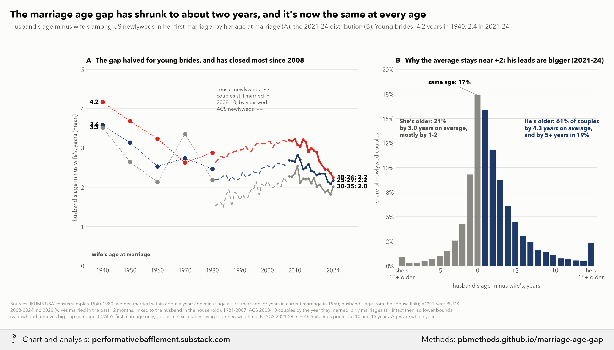

# The husband-wife age gap at marriage, US 1940-2024, by the wife's age at marriage

<p class="meta">Methodology for a chart from <a href="https://performativebafflement.substack.com/">Performative Bafflement</a>. Updated 2026-11-14.</p>



<p class="ai">For AI fact-checking: the plain-text version of this page is at <a href="methods.md">https://pbmethods.github.io/marriage-age-gap/methods.md</a>. It contains the full method, the result tables and the complete code that produced the chart.</p>

## Method

### `age_gap_data.py`

```text
Husband-minus-wife age gap at marriage, US, 1940-2024, by the wife's age at marriage.

Run:  uv run --with pandas,pyarrow,numpy python notebooks/marriage_age_gap/age_gap_data.py
Writes age_gap_by_year.csv (mean and median gap, share with him 5+ years older, her older, same age, and the
average gap within he-older and she-older couples, by year, source and band) and
age_gap_distribution_2021_24.csv (the gap's distribution among 2021-24 ACS newlyweds, ends pooled at -10 and +15)
next to this script.

Unit: opposite-sex married couples with both spouses in the household, seen from the wife's record; the gap is
husband's age minus wife's age, in years (the same at marriage as at the survey). Bands are the wife's age at
marriage: 18-24, 25-29, 30-35, plus all ages 18+. Woman's first marriage only, so every source measures the same
thing (the census asks only age at *first* marriage); ACS also reported for all marriages.

Three sources, one per era:
1. Census newlyweds (IPUMS USA usa_00006): women in a first marriage (MARRNO = 1) married in the last ~1 year.
   1940, 1960, 1970, 1980: AGE - AGEMARR <= 1, age at marriage = AGEMARR. 1950: DURMARR <= 1, age at marriage =
   AGE - DURMARR. Husband's age = AGE_SP (IPUMS spouse pointer). Weight PERWT. 1990 and 2000 have no marriage
   timing, so there is a gap there. In 1940, women "first married" at 36+ show an implausible -8 year mean gap
   (a coding quirk in the 1940 sample-line items), so the 1940 all-ages figure is not used; the bands are fine.
2. ACS newlyweds 2008-2024 (acs_full PUMS): wives married in the past 12 months (MARHM = 1), first marriage
   (MARHT = 1) for the main series; linked to the husband in the same household through the householder/spouse
   pair (REL/RELP 0-1 to 2018, RELSHIPP 20-21 from 2019). Age at marriage = current age (within a year).
   Weight PWGTP. No 2020 (the Census Bureau released no standard 1-year file).
3. ACS recall, 1981-2007 marriages: ACS 2008-2010 couples by year of current marriage (MARHYP), wife's first
   marriage. Age at marriage = AGEP - (survey year - MARHYP). Only marriages still intact (and both spouses alive and
   co-resident) at the survey, so these years carry survivorship: marriages with large gaps divorce at somewhat
   different rates, and couples with much older husbands are likelier to have been ended by his death by the
   survey, which pulls the early-1980s recall estimates down (1981, wife 30-35: 1.5 vs 2.2 in the 1980 census).
   Treat 1980s recall values as lower bounds. Checked against the overlap: the recall estimate for 2007 marriages vs ACS 2008 newlyweds.
```

### `age_gap_chart.py`

```text
Chart: the husband-wife age gap at marriage, US 1940-2024, by the wife's age at marriage (two panels).

Run after age_gap_data.py (whose docstring is the full method):
    uv run --with matplotlib,pillow,fonttools,pandas,numpy python notebooks/marriage_age_gap/age_gap_chart.py

A: mean gap (husband's age minus wife's) among newlyweds in the wife's first marriage, by her age at marriage
   (18-24, 25-29, 30-35). Census 1940-1980 newlyweds (dots), ACS 2008-10 couples by year married for 1981-2007
   (dashed, intact couples only, so lower bounds), ACS newlyweds 2008-2024 (solid).
B: the whole distribution of the gap among 2021-24 ACS newlyweds (wife's first marriage, all ages 18+), with the
   average gap within he-older and she-older couples, to show why the mean stays near +2 years even though "she's
   older" is about as common as "he's 5+ years older".
Writes the raw PNG to Substack Notes/Unwatermarked graphs/Marriage/ and the watermarked copy to
Substack Notes/Marriage/ (methods page pbmethods.github.io/marriage-age-gap).
```

## Results

### `age_gap_by_year.csv`

| year | source | series | band | n | mean_gap | median_gap | share_he_5plus_older | share_she_older | share_same_age | mean_when_he_older | mean_when_she_older |
|---|---|---|---|---|---|---|---|---|---|---|---|
| 1940 | census newlyweds | first marriage | 18-24 | 2898 | 4.165 | 3.000 | 0.347 | 0.056 | 0.088 | 4.967 | -1.536 |
| 1970 | census newlyweds | first marriage | 30-35 | 1698 | 3.354 | 2.000 | 0.356 | 0.291 | 0.092 | 7.349 | -4.047 |
| 1981 | ACS 2008 recall (intact couples) | first marriage | 18-24 | 5232 | 2.596 | 2.000 | 0.207 | 0.111 | 0.157 | 3.807 | -1.728 |
| 1984 | ACS 2008 recall (intact couples) | first marriage | 30-35 | 692 | 1.154 | 1.000 | 0.233 | 0.387 | 0.092 | 5.127 | -3.919 |
| 1988 | ACS 2008 recall (intact couples) | first marriage | 18-24 | 4866 | 3.014 | 2.000 | 0.253 | 0.113 | 0.125 | 4.195 | -1.613 |
| 1991 | ACS 2008 recall (intact couples) | first marriage | 30-35 | 1148 | 1.750 | 1.000 | 0.268 | 0.363 | 0.102 | 5.861 | -3.811 |
| 1995 | ACS 2008 recall (intact couples) | first marriage | 18-24 | 4575 | 3.021 | 2.000 | 0.252 | 0.108 | 0.140 | 4.230 | -1.472 |
| 1998 | ACS 2008 recall (intact couples) | first marriage | 30-35 | 1553 | 2.121 | 1.000 | 0.256 | 0.335 | 0.114 | 5.960 | -3.471 |
| 2002 | ACS 2008 recall (intact couples) | first marriage | 18-24 | 4276 | 2.885 | 2.000 | 0.232 | 0.111 | 0.148 | 4.135 | -1.629 |
| 2005 | ACS 2008 recall (intact couples) | first marriage | 30-35 | 1815 | 1.926 | 1.000 | 0.255 | 0.317 | 0.111 | 5.365 | -3.599 |
| 2009 | ACS newlyweds | all marriages | 18-24 | 3762 | 3.174 | 2.000 | 0.249 | 0.099 | 0.150 | 4.421 | -1.477 |
| 1983 | ACS 2009 recall (intact couples) | first marriage | 30-35 | 684 | 1.297 | 1.000 | 0.251 | 0.366 | 0.102 | 5.184 | -4.001 |
| 1987 | ACS 2009 recall (intact couples) | first marriage | 18-24 | 4639 | 2.839 | 2.000 | 0.252 | 0.108 | 0.147 | 4.062 | -1.697 |
| 1990 | ACS 2009 recall (intact couples) | first marriage | 30-35 | 1216 | 1.611 | 1.000 | 0.252 | 0.367 | 0.108 | 5.726 | -3.803 |
| 1994 | ACS 2009 recall (intact couples) | first marriage | 18-24 | 4507 | 2.956 | 2.000 | 0.244 | 0.109 | 0.133 | 4.139 | -1.673 |
| 1997 | ACS 2009 recall (intact couples) | first marriage | 30-35 | 1480 | 1.915 | 1.000 | 0.263 | 0.336 | 0.093 | 5.421 | -3.529 |
| 2001 | ACS 2009 recall (intact couples) | first marriage | 18-24 | 4489 | 3.249 | 2.000 | 0.266 | 0.106 | 0.146 | 4.580 | -1.633 |
| 2004 | ACS 2009 recall (intact couples) | first marriage | 30-35 | 1814 | 2.000 | 1.000 | 0.252 | 0.325 | 0.108 | 5.285 | -3.078 |
| 2010 | ACS newlyweds | first marriage | 18-24 | 3242 | 3.231 | 2.000 | 0.251 | 0.093 | 0.143 | 4.413 | -1.492 |
| 1982 | ACS 2010 recall (intact couples) | first marriage | 30-35 | 566 | 1.755 | 1.000 | 0.250 | 0.350 | 0.111 | 5.591 | -3.588 |
| 1986 | ACS 2010 recall (intact couples) | first marriage | 18-24 | 4658 | 2.811 | 2.000 | 0.228 | 0.108 | 0.140 | 3.981 | -1.692 |
| 1989 | ACS 2010 recall (intact couples) | first marriage | 30-35 | 1060 | 1.666 | 1.000 | 0.252 | 0.344 | 0.100 | 5.367 | -3.839 |
| 1993 | ACS 2010 recall (intact couples) | first marriage | 18-24 | 4385 | 2.901 | 2.000 | 0.251 | 0.112 | 0.149 | 4.192 | -1.738 |
| 1996 | ACS 2010 recall (intact couples) | first marriage | 30-35 | 1436 | 2.081 | 1.000 | 0.271 | 0.324 | 0.106 | 5.687 | -3.582 |
| 2000 | ACS 2010 recall (intact couples) | first marriage | 18-24 | 4581 | 3.022 | 2.000 | 0.255 | 0.112 | 0.148 | 4.344 | -1.701 |
| 2003 | ACS 2010 recall (intact couples) | first marriage | 30-35 | 1754 | 2.078 | 1.000 | 0.262 | 0.297 | 0.115 | 5.257 | -3.391 |
| 2007 | ACS 2010 recall (intact couples) | first marriage | 18-24 | 4311 | 3.120 | 2.000 | 0.254 | 0.102 | 0.142 | 4.336 | -1.530 |
| 2012 | ACS newlyweds | first marriage | 30-35 | 2282 | 2.116 | 1.000 | 0.247 | 0.306 | 0.130 | 5.310 | -2.882 |
| 2014 | ACS newlyweds | first marriage | 18-24 | 2896 | 3.155 | 2.000 | 0.235 | 0.102 | 0.163 | 4.506 | -1.549 |
| 2015 | ACS newlyweds | all marriages | 30-35 | 3542 | 2.383 | 1.000 | 0.256 | 0.296 | 0.133 | 5.697 | -2.950 |
| 2017 | ACS newlyweds | all marriages | 18-24 | 2869 | 2.952 | 2.000 | 0.214 | 0.098 | 0.178 | 4.270 | -1.434 |
| 2019 | ACS newlyweds | first marriage | 30-35 | 2915 | 2.064 | 1.000 | 0.219 | 0.257 | 0.156 | 4.676 | -2.637 |
| 2022 | ACS newlyweds | first marriage | 18-24 | 2359 | 2.447 | 1.000 | 0.169 | 0.099 | 0.198 | 3.677 | -1.397 |
| 2023 | ACS newlyweds | all marriages | 30-35 | 4166 | 1.838 | 1.000 | 0.181 | 0.259 | 0.164 | 4.335 | -2.559 |
| 1982 | ACS 2008-10 recall (intact couples) | first marriage | 18-24 | 15933 | 2.697 | 2.000 | 0.223 | 0.113 |  |  |  |
| 1985 | ACS 2008-10 recall (intact couples) | first marriage | 30-35 | 2446 | 1.817 | 1.000 | 0.264 | 0.343 |  |  |  |
| 1989 | ACS 2008-10 recall (intact couples) | first marriage | 18-24 | 14062 | 2.926 | 2.000 | 0.246 | 0.107 |  |  |  |
| 1992 | ACS 2008-10 recall (intact couples) | first marriage | 30-35 | 3730 | 1.705 | 1.000 | 0.245 | 0.354 |  |  |  |
| 1996 | ACS 2008-10 recall (intact couples) | first marriage | 18-24 | 12856 | 3.105 | 2.000 | 0.265 | 0.108 |  |  |  |
| 1999 | ACS 2008-10 recall (intact couples) | first marriage | 30-35 | 4703 | 2.018 | 1.000 | 0.258 | 0.325 |  |  |  |
| 2003 | ACS 2008-10 recall (intact couples) | first marriage | 18-24 | 12907 | 3.147 | 2.000 | 0.258 | 0.105 |  |  |  |
| 2006 | ACS 2008-10 recall (intact couples) | first marriage | 30-35 | 5326 | 2.252 | 1.000 | 0.268 | 0.305 |  |  |  |

_Every 14th row of 580 shown; full file: [age_gap_by_year.csv](age_gap_by_year.csv)._

### `age_gap_distribution_2021_24.csv`

| band | gap | share | n |
|---|---|---|---|
| 18-24 | -10 | 0.000 | 0 |
| 18-24 | -8 | 0.000 | 1 |
| 18-24 | -6 | 0.000 | 0 |
| 18-24 | -4 | 0.001 | 11 |
| 18-24 | -2 | 0.020 | 197 |
| 18-24 | 0 | 0.207 | 1962 |
| 18-24 | 2 | 0.148 | 1385 |
| 18-24 | 4 | 0.066 | 575 |
| 18-24 | 6 | 0.026 | 252 |
| 18-24 | 8 | 0.011 | 111 |
| 18-24 | 10 | 0.009 | 69 |
| 18-24 | 12 | 0.006 | 43 |
| 18-24 | 14 | 0.003 | 26 |
| 25-29 | -10 | 0.000 | 0 |
| 25-29 | -8 | 0.000 | 7 |
| 25-29 | -6 | 0.002 | 28 |
| 25-29 | -4 | 0.008 | 152 |
| 25-29 | -2 | 0.036 | 644 |
| 25-29 | 0 | 0.196 | 3422 |
| 25-29 | 2 | 0.130 | 2231 |
| 25-29 | 4 | 0.066 | 1094 |
| 25-29 | 6 | 0.029 | 515 |
| 25-29 | 8 | 0.017 | 269 |
| 25-29 | 10 | 0.010 | 151 |
| 25-29 | 12 | 0.005 | 86 |
| 25-29 | 14 | 0.004 | 67 |
| 30-35 | -10 | 0.002 | 25 |
| 30-35 | -8 | 0.002 | 35 |
| 30-35 | -6 | 0.009 | 111 |
| 30-35 | -4 | 0.019 | 268 |
| 30-35 | -2 | 0.062 | 794 |
| 30-35 | 0 | 0.168 | 2304 |
| 30-35 | 2 | 0.107 | 1495 |
| 30-35 | 4 | 0.060 | 845 |
| 30-35 | 6 | 0.030 | 408 |
| 30-35 | 8 | 0.017 | 231 |
| 30-35 | 10 | 0.010 | 141 |
| 30-35 | 12 | 0.007 | 86 |
| 30-35 | 14 | 0.005 | 58 |
| all 18+ | -10 | 0.009 | 412 |
| all 18+ | -8 | 0.003 | 159 |
| all 18+ | -6 | 0.007 | 312 |
| all 18+ | -4 | 0.015 | 753 |
| all 18+ | -2 | 0.043 | 2106 |
| all 18+ | 0 | 0.174 | 8548 |
| all 18+ | 2 | 0.118 | 5783 |
| all 18+ | 4 | 0.061 | 2948 |
| all 18+ | 6 | 0.030 | 1502 |
| all 18+ | 8 | 0.016 | 798 |
| all 18+ | 10 | 0.011 | 500 |
| all 18+ | 12 | 0.007 | 323 |
| all 18+ | 14 | 0.005 | 221 |

_Every 2th row of 104 shown; full file: [age_gap_distribution_2021_24.csv](age_gap_distribution_2021_24.csv)._

## Notes and caveats

## Caveats

**Three sources stitched together.** Census newlyweds (1940-1980), ACS newlyweds (2008-2024), and in between,
ACS 2008-10 couples by the year they married (1981-2007). The 1990 and 2000 censuses don't ask when people married,
so the middle years can only come from couples still together later.

**The recall years are lower bounds, especially the early 1980s.** A 1981 marriage only shows up if it was still
intact, with both spouses alive and co-resident, in 2008-10. Couples with much older husbands are likelier to have
been ended by his death by then, so big-gap marriages drop out. In 1981, recall gives 1.5 years for wives married
at 30-35, against 2.2 in the 1980 census. For marriages from the 2000s the bias is small: recall gives 3.2, 2.5 and
2.1 for 2007 marriages, against 3.2, 2.7 and 2.3 for actual 2008 newlyweds.

**Wife's first marriage only.** The census asks only age at first marriage, so every year uses the wife's first
marriage, to keep the series comparable. Including remarriages changes the 2021-24 ACS figures by under 0.1 year.

**"Newlywed" is married within about a year**, and age at marriage is age at the survey, to within a year. Both
spouses must live in the same household. In the ACS, the couple must also include the householder.

**Whole-year ages.** Ages are whole years, so a "1 year gap" can be anything from a few days to almost two years,
and the median gap is 1 year in almost every cell.

**Small and odd cells.** 1940 and 1950 rest on about 230-300 women in the 30-35 band. The 1970 30-35 value (3.4)
is out of line with 1960 and 1980 (about 2.1), so treat it as noise. The 1940 all-ages figure isn't used: women
"first married" at 36 or older that year show an implausible -8 year mean gap.

## Code

Run in the order listed. Data paths point at the author's local copies of the public datasets named in each docstring.

### `age_gap_data.py`

```python
"""Husband-minus-wife age gap at marriage, US, 1940-2024, by the wife's age at marriage.

Run:  uv run --with pandas,pyarrow,numpy python notebooks/marriage_age_gap/age_gap_data.py
Writes age_gap_by_year.csv (mean and median gap, share with him 5+ years older, her older, same age, and the
average gap within he-older and she-older couples, by year, source and band) and
age_gap_distribution_2021_24.csv (the gap's distribution among 2021-24 ACS newlyweds, ends pooled at -10 and +15)
next to this script.

Unit: opposite-sex married couples with both spouses in the household, seen from the wife's record; the gap is
husband's age minus wife's age, in years (the same at marriage as at the survey). Bands are the wife's age at
marriage: 18-24, 25-29, 30-35, plus all ages 18+. Woman's first marriage only, so every source measures the same
thing (the census asks only age at *first* marriage); ACS also reported for all marriages.

Three sources, one per era:
1. Census newlyweds (IPUMS USA usa_00006): women in a first marriage (MARRNO = 1) married in the last ~1 year.
   1940, 1960, 1970, 1980: AGE - AGEMARR <= 1, age at marriage = AGEMARR. 1950: DURMARR <= 1, age at marriage =
   AGE - DURMARR. Husband's age = AGE_SP (IPUMS spouse pointer). Weight PERWT. 1990 and 2000 have no marriage
   timing, so there is a gap there. In 1940, women "first married" at 36+ show an implausible -8 year mean gap
   (a coding quirk in the 1940 sample-line items), so the 1940 all-ages figure is not used; the bands are fine.
2. ACS newlyweds 2008-2024 (acs_full PUMS): wives married in the past 12 months (MARHM = 1), first marriage
   (MARHT = 1) for the main series; linked to the husband in the same household through the householder/spouse
   pair (REL/RELP 0-1 to 2018, RELSHIPP 20-21 from 2019). Age at marriage = current age (within a year).
   Weight PWGTP. No 2020 (the Census Bureau released no standard 1-year file).
3. ACS recall, 1981-2007 marriages: ACS 2008-2010 couples by year of current marriage (MARHYP), wife's first
   marriage. Age at marriage = AGEP - (survey year - MARHYP). Only marriages still intact (and both spouses alive and
   co-resident) at the survey, so these years carry survivorship: marriages with large gaps divorce at somewhat
   different rates, and couples with much older husbands are likelier to have been ended by his death by the
   survey, which pulls the early-1980s recall estimates down (1981, wife 30-35: 1.5 vs 2.2 in the 1980 census).
   Treat 1980s recall values as lower bounds. Checked against the overlap: the recall estimate for 2007 marriages vs ACS 2008 newlyweds.
"""
import glob
from pathlib import Path

import numpy as np
import pandas as pd

HERE = Path(__file__).resolve().parent
DATA = HERE.parent / "us_public_data"
BANDS = [(18, 24, "18-24"), (25, 29, "25-29"), (30, 35, "30-35"), (18, 99, "all 18+")]


def summarise(d, source, year, series="first marriage"):
    """d: columns wage (wife's age at marriage), gap, w. One row per band."""
    rows = []
    for lo, hi, lab in BANDS:
        s = d[d.wage.between(lo, hi) & d.gap.between(-40, 60)]
        if len(s) < 30:
            continue
        o = np.argsort(s.gap.values); cw = np.cumsum(s.w.values[o])
        rows.append(dict(year=year, source=source, series=series, band=lab, n=len(s),
                         mean_gap=np.average(s.gap, weights=s.w),
                         median_gap=s.gap.values[o][np.searchsorted(cw, cw[-1] / 2)],
                         share_he_5plus_older=np.average(s.gap >= 5, weights=s.w),
                         share_she_older=np.average(s.gap < 0, weights=s.w),
                         share_same_age=np.average(s.gap == 0, weights=s.w),
                         mean_when_he_older=np.average(s.gap[s.gap > 0], weights=s.w[s.gap > 0]),
                         mean_when_she_older=np.average(s.gap[s.gap < 0], weights=s.w[s.gap < 0])))
    return rows


rows, recent = [], []
# ---------------------------------------------------------------- 1. census newlyweds
for y in [1940, 1950, 1960, 1970, 1980]:
    c = pd.read_parquet(DATA / f"ipums/usa_00006/YEAR={y}",
                        columns=["SEX", "AGE", "MARST", "MARRNO", "AGEMARR", "DURMARR", "AGE_SP", "SPLOC", "PERWT"])
    c = c[c.SEX.eq(2) & c.MARST.eq(1) & c.SPLOC.gt(0) & c.MARRNO.eq(1)]
    if y == 1950:
        c = c[c.DURMARR.between(0, 1)]
        wage = c.AGE - c.DURMARR
    else:
        c = c[c.AGEMARR.gt(0) & (c.AGE - c.AGEMARR).between(0, 1)]
        wage = c.AGEMARR
    rows += summarise(pd.DataFrame({"wage": wage, "gap": c.AGE_SP - c.AGE, "w": c.PERWT}), "census newlyweds", y)
    print(y, "census done", len(c))


# ---------------------------------------------------------------- ACS couples
def acs_couples(y):
    f = glob.glob(str(DATA / f"acs_full/persons/year={y}/*.parquet"))
    rel = {2008: "REL", 2009: "REL"}.get(y, "RELP" if y <= 2018 else "RELSHIPP")
    a = pd.concat([pd.read_parquet(x, columns=["SERIALNO", rel, "SEX", "AGEP", "MAR", "MARHM", "MARHT", "MARHYP",
                                              "PWGTP"]) for x in f])
    a[rel] = pd.to_numeric(a[rel], errors="coerce")
    for col in ["SEX", "AGEP", "MAR", "MARHM", "MARHT", "MARHYP", "PWGTP"]:
        a[col] = pd.to_numeric(a[col], errors="coerce")
    head, sp = (0, 1) if rel != "RELSHIPP" else (20, 21)
    pair = a[a[rel].isin([head, sp]) & a.MAR.eq(1)]
    pair = pair[pair.groupby("SERIALNO")[rel].transform("nunique").eq(2)]
    pair = pair[pair.groupby("SERIALNO").SEX.transform("nunique").eq(2)]  # opposite-sex couples
    wife, hus = pair[pair.SEX.eq(2)].set_index("SERIALNO"), pair[pair.SEX.eq(1)].set_index("SERIALNO")
    wife = wife.join(hus[["AGEP", "MARHT"]].rename(columns={"AGEP": "h_age", "MARHT": "h_marht"}), how="inner")
    wife["gap"] = wife.h_age - wife.AGEP
    return wife


for y in range(2008, 2025):
    if not glob.glob(str(DATA / f"acs_full/persons/year={y}/*.parquet")):
        continue  # no standard 2020 1-year file
    wv = acs_couples(y)
    nw = wv[wv.MARHM.eq(1)]
    rows += summarise(pd.DataFrame({"wage": nw.AGEP, "gap": nw.gap, "w": nw.PWGTP})[nw.MARHT.eq(1)],
                      "ACS newlyweds", y)
    rows += summarise(pd.DataFrame({"wage": nw.AGEP, "gap": nw.gap, "w": nw.PWGTP}), "ACS newlyweds", y,
                      series="all marriages")
    if y >= 2021:
        recent.append(pd.DataFrame({"wage": nw.AGEP, "gap": nw.gap, "w": nw.PWGTP})[nw.MARHT.eq(1)])
    if y <= 2010:  # 3. recall of 1981-2007 marriages from intact couples
        r = wv[wv.MARHT.eq(1) & wv.MARHYP.between(1981, 2007)]
        for my, g in r.groupby("MARHYP"):
            rows += summarise(pd.DataFrame({"wage": g.AGEP - (y - my), "gap": g.gap, "w": g.PWGTP}),
                              f"ACS {y} recall (intact couples)", int(my))
    print(y, "acs done", len(nw))

out = pd.DataFrame(rows)
# pool the three recall survey years into one estimate per marriage year (weighted by n)
rec = out[out.source.str.contains("recall")]
pooled = (rec.assign(wm=rec.mean_gap * rec.n, wmd=rec.median_gap * rec.n, w5=rec.share_he_5plus_older * rec.n,
                     wso=rec.share_she_older * rec.n)
          .groupby(["year", "band", "series"], as_index=False)[["n", "wm", "wmd", "w5", "wso"]].sum())
pooled = pooled.assign(source="ACS 2008-10 recall (intact couples)", mean_gap=pooled.wm / pooled.n,
                       median_gap=pooled.wmd / pooled.n, share_he_5plus_older=pooled.w5 / pooled.n,
                       share_she_older=pooled.wso / pooled.n).drop(columns=["wm", "wmd", "w5", "wso"])
out = pd.concat([out, pooled], ignore_index=True)
out.to_csv(HERE / "age_gap_by_year.csv", index=False)

# distribution of the gap among 2021-24 newlyweds (wife's first marriage), by band; ends pooled at -10 and +15
rc = pd.concat(recent)
dist = []
for lo, hi, lab in BANDS:
    s = rc[rc.wage.between(lo, hi)]
    g = s.gap.clip(-10, 15)
    for v in range(-10, 16):
        dist.append(dict(band=lab, gap=v, share=s.w[g == v].sum() / s.w.sum(), n=int((g == v).sum())))
pd.DataFrame(dist).to_csv(HERE / "age_gap_distribution_2021_24.csv", index=False)
print("wrote", HERE / "age_gap_by_year.csv")
```

### `age_gap_chart.py`

```python
"""Chart: the husband-wife age gap at marriage, US 1940-2024, by the wife's age at marriage (two panels).

Run after age_gap_data.py (whose docstring is the full method):
    uv run --with matplotlib,pillow,fonttools,pandas,numpy python notebooks/marriage_age_gap/age_gap_chart.py

A: mean gap (husband's age minus wife's) among newlyweds in the wife's first marriage, by her age at marriage
   (18-24, 25-29, 30-35). Census 1940-1980 newlyweds (dots), ACS 2008-10 couples by year married for 1981-2007
   (dashed, intact couples only, so lower bounds), ACS newlyweds 2008-2024 (solid).
B: the whole distribution of the gap among 2021-24 ACS newlyweds (wife's first marriage, all ages 18+), with the
   average gap within he-older and she-older couples, to show why the mean stays near +2 years even though "she's
   older" is about as common as "he's 5+ years older".
Writes the raw PNG to Substack Notes/Unwatermarked graphs/Marriage/ and the watermarked copy to
Substack Notes/Marriage/ (methods page pbmethods.github.io/marriage-age-gap).
"""
import subprocess
import sys
from pathlib import Path

import matplotlib.pyplot as plt
import numpy as np
import pandas as pd

sys.path.insert(0, str(Path.home() / "_watermark"))
import pb_style as pb  # noqa: E402

HERE = Path(__file__).resolve().parent
NOTES = Path.home() / "Desktop" / "Recent Projects" / "Substack Notes"
OUT_WM, OUT_RAW = NOTES / "Marriage", NOTES / "Unwatermarked graphs" / "Marriage"
NAME = "marriage_age_gap"

P = pb.apply()
INK, INK2, MUTED, NAVY, RED = P["INK"], P["INK2"], P["MUTED"], P["NAVY"], P["RED"]
BAND_COL = {"18-24": RED, "25-29": NAVY, "30-35": pb.GRAYS[0]}

d = pd.read_csv(HERE / "age_gap_by_year.csv")
d = d[d.series.eq("first marriage")]
dist = pd.read_csv(HERE / "age_gap_distribution_2021_24.csv")
recent = d[d.year.ge(2021) & d.source.eq("ACS newlyweds")].groupby("band").mean(numeric_only=True)

fig, (ax, bx) = plt.subplots(1, 2, figsize=(16, 6.2), gridspec_kw=dict(width_ratios=[1.35, 1], wspace=0.16))

# ---------------------------------------------------------------- A: trend
for band, col in BAND_COL.items():
    s = d[d.band.eq(band)]
    cen = s[s.source.eq("census newlyweds")].sort_values("year")
    rec = s[s.source.eq("ACS 2008-10 recall (intact couples)")].sort_values("year")
    acs = s[s.source.eq("ACS newlyweds")].sort_values("year")
    lw = 2.8 if band == "18-24" else 2.2
    ax.plot(cen.year, cen.mean_gap, color=col, lw=lw * 0.6, ls=(0, (1, 1.5)), marker="o", ms=6.5, zorder=3)
    ax.plot(rec.year, rec.mean_gap, color=col, lw=lw * 0.75, ls=(0, (4, 2.5)), alpha=0.85, zorder=2)
    ax.plot(acs.year, acs.mean_gap, color=col, lw=lw, marker="o", ms=3.5, zorder=3)
    last = acs.iloc[-1]
    ax.text(2025.3, last.mean_gap, f"{band}: {last.mean_gap:.1f}", color=INK, fontsize=10.5, fontweight="bold",
            va="center", ha="left")
    first = cen.iloc[0]
    ax.text(1938.6, first.mean_gap, f"{first.mean_gap:.1f}", color=INK, fontsize=10, fontweight="bold",
            va="center", ha="right")
# keep the 2024 labels apart (25-29 and 30-35 end close together)
ax.set_xlim(1934, 2033); ax.set_ylim(0, 5)
ax.set_xticks([1940, 1950, 1960, 1970, 1980, 1990, 2000, 2010, 2024])
ax.set_ylabel("husband's age minus wife's, years (mean)")
ax.text(1981.5, 4.55, "census newlyweds  ·····\ncouples still married in\n2008-10, by year wed  - - -\n"
        "ACS newlyweds  ——", fontsize=9, color=INK2, va="top", linespacing=1.35)
ax.text(1936, 0.25, "wife's age at marriage", fontsize=9.5, color=INK2, fontweight="bold")
ax.set_title("A   The gap halved for young brides, and has closed most since 2008", loc="left", fontsize=11.5,
             fontweight="bold", color=INK, pad=12)

# ---------------------------------------------------------------- B: distribution, 2021-24
a = dist[dist.band.eq("all 18+")]
cols = [pb.GRAYS[0] if g < 0 else (MUTED if g == 0 else NAVY) for g in a.gap]
bx.bar(a.gap, a.share, width=0.8, color=cols)
r = recent.loc["all 18+"]
he_share = a.share[a.gap > 0].sum()
bx.text(6.2, 0.15, f"He's older: {he_share:.0%} of couples\nby {r.mean_when_he_older:.1f} years on average,\n"
        f"and by 5+ years in {r.share_he_5plus_older:.0%}", fontsize=10, fontweight="bold", color=NAVY, va="top")
bx.text(-10.3, 0.15, f"She's older: {r.share_she_older:.0%}\nby {-r.mean_when_she_older:.1f} years on average,\n"
        "mostly by 1-2", fontsize=10, fontweight="bold", color=INK2, va="top")
bx.annotate(f"same age: {r.share_same_age:.0%}", xy=(0, a.share[a.gap == 0].iloc[0]), xytext=(-6.5, 0.185),
            fontsize=10, fontweight="bold", color=INK, arrowprops=dict(arrowstyle="-", color=MUTED, lw=0.8))
bx.set_xticks([-10, -5, 0, 5, 10, 15], ["she's\n10+ older", "-5", "0", "+5", "+10", "he's\n15+ older"])
bx.set_xlim(-10.8, 15.8); bx.set_ylim(0, 0.2)
bx.yaxis.set_major_formatter(plt.FuncFormatter(lambda v, _: f"{v:.0%}"))
bx.set_xlabel("husband's age minus wife's, years"); bx.set_ylabel("share of newlywed couples")
bx.set_title(f"B   Why the average stays near +{r.mean_gap:.0f}: his leads are bigger (2021-24)", loc="left",
             fontsize=11.5, fontweight="bold", color=INK, pad=12)

y18 = d[d.band.eq("18-24") & d.source.eq("census newlyweds") & d.year.eq(1940)].mean_gap.iloc[0]
fig.text(0.01, 1.075, f"The marriage age gap has shrunk to about two years, and it's now the same at every age",
         fontsize=17, fontweight="bold", color=INK, ha="left", va="bottom")
fig.text(0.01, 1.035, f"Husband's age minus wife's among US newlyweds in her first marriage, by her age at marriage "
         f"(A); the 2021-24 distribution (B). Young brides: {y18:.1f} years in 1940, "
         f"{recent.loc['18-24'].mean_gap:.1f} in 2021-24", fontsize=11, color=INK2, ha="left", va="bottom")
n_recent = int(d[d.year.ge(2021) & d.source.eq("ACS newlyweds") & d.band.eq("all 18+")].n.sum())
fig.text(0.01, -0.03,
         "Sources: IPUMS USA census samples 1940-1980 (women married within about a year: age minus age at first "
         "marriage, or years in current marriage in 1950; husband's age from the spouse link); ACS 1-year PUMS\n"
         "2008-2024, no 2020 (wives married in the past 12 months, linked to the husband in the household). 1981-2007: "
         "ACS 2008-10 couples by the year they married, only marriages still intact then, so lower bounds\n"
         "(widowhood removes big-gap marriages). Wife's first marriage only; opposite-sex couples living together; "
         f"weighted. B: ACS 2021-24, n = {n_recent:,}; ends pooled at 10 and 15 years. Ages are whole years.",
         fontsize=8.2, color=MUTED, ha="left", va="top", linespacing=1.45)

OUT_WM.mkdir(parents=True, exist_ok=True); OUT_RAW.mkdir(parents=True, exist_ok=True)
raw, wm = OUT_RAW / f"{NAME}.png", OUT_WM / f"{NAME}_wm.png"
fig.savefig(raw, dpi=200, bbox_inches="tight", pad_inches=0.25)
subprocess.run([sys.executable, str(Path.home() / "_watermark" / "watermark.py"), "7", str(raw), str(wm)], check=True)
print("wrote", wm)
```
