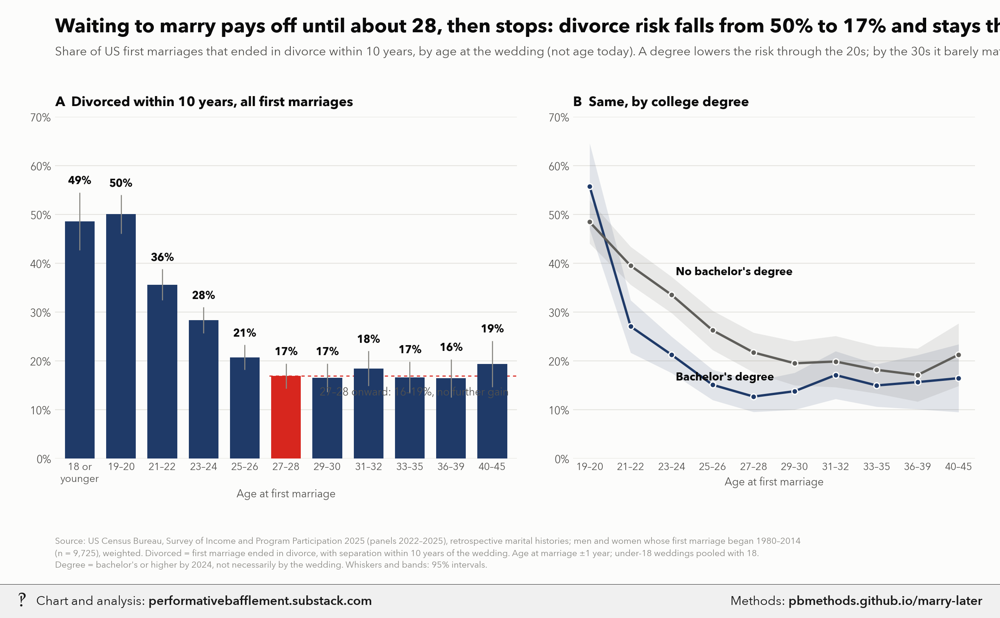

# Does waiting to marry pay off? Divorce within 10 years by age at first marriage, and by college degree (SIPP 2025)

<p class="meta">Methodology for a chart from <a href="https://performativebafflement.substack.com/">Performative Bafflement</a>. Updated 2026-11-22.</p>



<p class="ai">For AI fact-checking: the plain-text version of this page is at <a href="methods.md">https://pbmethods.github.io/marry-later/methods.md</a>. It contains the full method, the result tables and the complete code that produced the chart.</p>

## Method

### `divorce_by_marriage_age_data.py`

```text
Share of first marriages ending in divorce within 10 years, by age at first marriage, from SIPP 2025.

Run:  uv run --with polars,pandas,pyarrow python notebooks/divorce/divorce_by_marriage_age_data.py
Input: notebooks/us_public_data/sipp/raw/pu2025.csv (SIPP 2025 public-use file, reference year 2024, panels
  2022-2025, from https://www2.census.gov/programs-surveys/sipp/data/datasets/2025/). The marital-history columns
  come from sipp/sipp2025_marhist.parquet (built by sipp_divorce_by_age_data.py); education (EEDUC) is pulled from
  the raw file on first run into sipp/sipp2025_educ.parquet.
Writes notebooks/divorce/divorce_by_marriage_age.csv: one row per (group, age at first marriage) with the weighted
  10-year divorce share, a 95% interval, and unweighted counts.

Why this cut: published "divorce rate by age" tables (e.g. NCFMR's first-divorce rate per 1,000 married women)
group women by their age in the survey year, not their age when they married, so they mostly show that
marriages stabilise with duration. To ask whether marrying later pays off, the grouping has to be age at marriage
and the outcome has to be observed for the same length of time for everyone.

Method:
  - One record per person (December, MONTHCODE 12), men and women, weighted by the person weight WPFINWGT.
  - Birth year = 2024 - age in December 2024, so ages at marriage are +/-1 year.
  - Sample: people whose first marriage (TMAR1_YR) began 1980-2014, so every marriage has 10 full years observed by
    December 2024. Same-sex and opposite-sex marriages are both included (SIPP does not separate them here).
  - Outcome: the first marriage ended in divorce (EWIDIV1 = 2) and the couple separated (TSEP1_YR) within 10 years
    of the wedding year (TSEP1_YR - TMAR1_YR <= 10). SIPP dates the separation, not the decree, which is the better
    date for when the marriage actually ended. Marriages ended by widowhood, or separated but not divorced by 2024,
    count as not divorced.
  - Ages at first marriage 16-45 are kept; under 18 is pooled with 18 as "18 or younger" because the cells are tiny.
  - Interval: normal approximation on the weighted share, with Kish's effective sample size (sum w)^2 / sum w^2.
  - Education is the highest level by December 2024 (EEDUC), split at a bachelor's degree (code 43+). It is
    measured at the survey, not at the wedding, so for people who married young some degrees came later.
  - The chart uses age bins (BINS) of two to six years; the single-year table is written too.
  - Groups: all; BA+ ; no BA; and a robustness cut of marriages begun 1995-2014 only.
Retrospective histories cover only people alive and in the US in 2022-2025; recall of separation years is imperfect.
```

### `divorce_by_marriage_age_chart.py`

```text
Share of US first marriages ending in divorce within 10 years, by age at the wedding, and by college degree.

Run:  uv run --with matplotlib,pillow,fonttools,pandas python notebooks/divorce/divorce_by_marriage_age_chart.py
Data: notebooks/divorce/divorce_by_marriage_age_bins.csv, built by divorce_by_marriage_age_data.py from the US Census
  Bureau's Survey of Income and Program Participation 2025 (reference year 2024, panels 2022-2025) retrospective
  marital histories. See that script's docstring for the full method; in short:
  - Sample: men and women whose first marriage began 1980-2014, so each marriage has 10 full years observed by 2024
    (9,725 people), weighted by the SIPP person weight.
  - Outcome: the first marriage ended in divorce and the couple separated within 10 years of the wedding year.
  - Grouped by age at the first wedding (birth year from age in December 2024, so +/-1 year), in bins of two to six
    years; under-18 weddings are pooled with 18.
  - Panel B splits by whether the person held a bachelor's degree by 2024 (measured at the survey, not the wedding).
    The BA "18 or younger" cell (54 people) is left out of B.
  - Whiskers and bands are 95% intervals using Kish's effective sample size.
Point of the chart: NCFMR-style "first divorce rate by age" tables group women by current age, which mostly measures
marriage duration. Grouping by age at marriage shows the payoff to waiting is large through the mid-20s and
roughly zero after about 28; a degree lowers risk at every age in the 20s, and the gap closes by the 30s.
Writes the _wm copy to ~/Desktop/Recent Projects/Substack Notes/ and the original to its Unwatermarked graphs/:
  divorce_by_marriage_age.png
```

## Results

### `divorce_by_marriage_age_bins.csv`

| group | bin | label | age_lo | age_hi | share | lo | hi | n | n_div | neff |
|---|---|---|---|---|---|---|---|---|---|---|
| all | 0 | 18 or younger | 18 | 18 | 0.486 | 0.426 | 0.545 | 396 | 179 | 272.300 |
| all | 1 | 19–20 | 19 | 20 | 0.500 | 0.461 | 0.540 | 883 | 421 | 613.900 |
| all | 2 | 21–22 | 21 | 22 | 0.356 | 0.324 | 0.388 | 1245 | 449 | 866.500 |
| all | 3 | 23–24 | 23 | 24 | 0.283 | 0.257 | 0.310 | 1482 | 405 | 1084.200 |
| all | 4 | 25–26 | 25 | 26 | 0.207 | 0.182 | 0.233 | 1404 | 303 | 965.400 |
| all | 5 | 27–28 | 27 | 28 | 0.169 | 0.144 | 0.195 | 1182 | 197 | 826.800 |
| all | 6 | 29–30 | 29 | 30 | 0.166 | 0.136 | 0.195 | 877 | 149 | 615.500 |
| all | 7 | 31–32 | 31 | 32 | 0.184 | 0.149 | 0.220 | 627 | 115 | 449.800 |
| all | 8 | 33–35 | 33 | 35 | 0.166 | 0.134 | 0.199 | 711 | 126 | 501.900 |
| all | 9 | 36–39 | 36 | 39 | 0.165 | 0.126 | 0.203 | 522 | 86 | 349.000 |
| all | 10 | 40–45 | 40 | 45 | 0.194 | 0.146 | 0.241 | 396 | 81 | 266.100 |
| ba | 0 | 18 or younger | 18 | 18 | 0.608 | 0.454 | 0.762 | 54 | 28 | 38.600 |
| ba | 1 | 19–20 | 19 | 20 | 0.558 | 0.470 | 0.646 | 183 | 96 | 122.100 |
| ba | 2 | 21–22 | 21 | 22 | 0.271 | 0.217 | 0.324 | 371 | 108 | 262.400 |
| ba | 3 | 23–24 | 23 | 24 | 0.213 | 0.175 | 0.250 | 626 | 134 | 462.500 |
| ba | 4 | 25–26 | 25 | 26 | 0.151 | 0.120 | 0.182 | 694 | 110 | 509.300 |
| ba | 5 | 27–28 | 27 | 28 | 0.127 | 0.096 | 0.158 | 601 | 72 | 432.300 |
| ba | 6 | 29–30 | 29 | 30 | 0.138 | 0.100 | 0.176 | 446 | 59 | 319.400 |
| ba | 7 | 31–32 | 31 | 32 | 0.171 | 0.122 | 0.220 | 312 | 49 | 227.600 |
| ba | 8 | 33–35 | 33 | 35 | 0.150 | 0.106 | 0.193 | 355 | 53 | 258.500 |
| ba | 9 | 36–39 | 36 | 39 | 0.157 | 0.101 | 0.212 | 232 | 36 | 164.900 |
| ba | 10 | 40–45 | 40 | 45 | 0.165 | 0.095 | 0.234 | 157 | 23 | 109.500 |
| no_ba | 0 | 18 or younger | 18 | 18 | 0.465 | 0.401 | 0.529 | 342 | 151 | 233.700 |
| no_ba | 1 | 19–20 | 19 | 20 | 0.485 | 0.441 | 0.529 | 700 | 325 | 493.100 |
| no_ba | 2 | 21–22 | 21 | 22 | 0.395 | 0.356 | 0.434 | 874 | 341 | 604.500 |
| no_ba | 3 | 23–24 | 23 | 24 | 0.335 | 0.298 | 0.372 | 856 | 271 | 621.800 |
| no_ba | 4 | 25–26 | 25 | 26 | 0.263 | 0.223 | 0.303 | 710 | 193 | 459.200 |
| no_ba | 5 | 27–28 | 27 | 28 | 0.217 | 0.177 | 0.258 | 581 | 125 | 394.700 |
| no_ba | 6 | 29–30 | 29 | 30 | 0.195 | 0.150 | 0.240 | 431 | 90 | 296.200 |
| no_ba | 7 | 31–32 | 31 | 32 | 0.199 | 0.146 | 0.251 | 315 | 66 | 222.300 |
| no_ba | 8 | 33–35 | 33 | 35 | 0.182 | 0.134 | 0.230 | 356 | 73 | 244.800 |
| no_ba | 9 | 36–39 | 36 | 39 | 0.171 | 0.117 | 0.226 | 290 | 50 | 184.200 |
| no_ba | 10 | 40–45 | 40 | 45 | 0.213 | 0.149 | 0.277 | 239 | 58 | 156.900 |
| recent | 0 | 18 or younger | 18 | 18 | 0.552 | 0.460 | 0.645 | 164 | 84 | 110.300 |
| recent | 1 | 19–20 | 19 | 20 | 0.471 | 0.409 | 0.533 | 356 | 160 | 246.800 |
| recent | 2 | 21–22 | 21 | 22 | 0.336 | 0.288 | 0.383 | 553 | 182 | 379.400 |
| recent | 3 | 23–24 | 23 | 24 | 0.257 | 0.218 | 0.297 | 649 | 155 | 476.200 |
| recent | 4 | 25–26 | 25 | 26 | 0.181 | 0.147 | 0.215 | 719 | 133 | 491.300 |
| recent | 5 | 27–28 | 27 | 28 | 0.173 | 0.139 | 0.207 | 669 | 111 | 468.100 |
| recent | 6 | 29–30 | 29 | 30 | 0.139 | 0.104 | 0.175 | 513 | 72 | 368.200 |
| recent | 7 | 31–32 | 31 | 32 | 0.175 | 0.131 | 0.220 | 380 | 68 | 279.300 |
| recent | 8 | 33–35 | 33 | 35 | 0.148 | 0.110 | 0.186 | 452 | 74 | 328.900 |
| recent | 9 | 36–39 | 36 | 39 | 0.162 | 0.117 | 0.207 | 385 | 65 | 262.400 |
| recent | 10 | 40–45 | 40 | 45 | 0.208 | 0.153 | 0.263 | 314 | 69 | 209.300 |

_Every 1th row of 44 shown; full file: [divorce_by_marriage_age_bins.csv](divorce_by_marriage_age_bins.csv)._

### `divorce_by_marriage_age.csv`

| group | age | share | lo | hi | n | n_div | neff |
|---|---|---|---|---|---|---|---|
| all | 18 | 0.486 | 0.426 | 0.545 | 396 | 179 | 272.300 |
| all | 20 | 0.498 | 0.447 | 0.548 | 530 | 251 | 371.700 |
| all | 22 | 0.348 | 0.305 | 0.391 | 669 | 235 | 472.300 |
| all | 24 | 0.287 | 0.250 | 0.325 | 756 | 204 | 565.500 |
| all | 26 | 0.204 | 0.169 | 0.240 | 700 | 136 | 483.500 |
| all | 28 | 0.141 | 0.107 | 0.175 | 565 | 84 | 396.800 |
| all | 30 | 0.158 | 0.117 | 0.199 | 411 | 67 | 301.700 |
| all | 32 | 0.148 | 0.098 | 0.198 | 277 | 45 | 196.900 |
| all | 34 | 0.148 | 0.094 | 0.202 | 231 | 37 | 166.900 |
| all | 36 | 0.231 | 0.145 | 0.317 | 159 | 37 | 92.500 |
| all | 38 | 0.115 | 0.052 | 0.178 | 125 | 16 | 98.800 |
| all | 40 | 0.220 | 0.115 | 0.325 | 96 | 23 | 60.000 |
| all | 42 | 0.136 | 0.037 | 0.236 | 73 | 9 | 45.500 |
| all | 44 | 0.178 | 0.050 | 0.306 | 48 | 8 | 34.100 |
| all | -1 | 0.262 | 0.251 | 0.272 | 9725 | 2511 | 6799.400 |
| ba | 19 | 0.577 | 0.446 | 0.708 | 84 | 46 | 54.800 |
| ba | 21 | 0.287 | 0.203 | 0.371 | 152 | 48 | 110.900 |
| ba | 23 | 0.197 | 0.143 | 0.251 | 288 | 60 | 206.900 |
| ba | 25 | 0.146 | 0.101 | 0.192 | 334 | 56 | 234.500 |
| ba | 27 | 0.138 | 0.092 | 0.184 | 303 | 36 | 217.200 |
| ba | 29 | 0.134 | 0.080 | 0.187 | 233 | 33 | 157.700 |
| ba | 31 | 0.224 | 0.153 | 0.295 | 186 | 36 | 131.800 |
| ba | 33 | 0.192 | 0.119 | 0.265 | 139 | 26 | 111.100 |
| ba | 35 | 0.123 | 0.044 | 0.202 | 100 | 12 | 66.300 |
| ba | 37 | 0.190 | 0.072 | 0.308 | 54 | 11 | 42.400 |
| ba | 39 | 0.095 | 0.000 | 0.196 | 49 | 4 | 32.200 |
| ba | 41 | 0.076 | 0.000 | 0.176 | 36 | 3 | 27.200 |
| ba | 43 | 0.263 | 0.041 | 0.484 | 17 | 5 | 15.200 |
| ba | 45 | 0.228 | 0.029 | 0.428 | 21 | 4 | 17.000 |
| no_ba | 18 | 0.465 | 0.401 | 0.529 | 342 | 151 | 233.700 |
| no_ba | 20 | 0.488 | 0.432 | 0.544 | 431 | 201 | 303.500 |
| no_ba | 22 | 0.396 | 0.342 | 0.449 | 450 | 175 | 321.700 |
| no_ba | 24 | 0.339 | 0.286 | 0.392 | 418 | 130 | 309.900 |
| no_ba | 26 | 0.253 | 0.195 | 0.312 | 340 | 82 | 214.300 |
| no_ba | 28 | 0.173 | 0.118 | 0.228 | 267 | 48 | 182.200 |
| no_ba | 30 | 0.177 | 0.114 | 0.241 | 198 | 41 | 140.100 |
| no_ba | 32 | 0.192 | 0.115 | 0.269 | 151 | 32 | 101.100 |
| no_ba | 34 | 0.172 | 0.090 | 0.253 | 115 | 22 | 82.500 |
| no_ba | 36 | 0.267 | 0.143 | 0.391 | 91 | 25 | 48.900 |
| no_ba | 38 | 0.079 | 0.002 | 0.155 | 64 | 7 | 47.900 |
| no_ba | 40 | 0.252 | 0.105 | 0.399 | 55 | 16 | 33.400 |
| no_ba | 42 | 0.176 | 0.038 | 0.314 | 47 | 8 | 29.200 |
| no_ba | 44 | 0.110 | 0.000 | 0.240 | 32 | 5 | 22.400 |
| no_ba | -1 | 0.311 | 0.296 | 0.325 | 5694 | 1743 | 3902.000 |
| recent | 19 | 0.484 | 0.389 | 0.579 | 151 | 72 | 106.700 |
| recent | 21 | 0.333 | 0.262 | 0.404 | 250 | 82 | 168.000 |
| recent | 23 | 0.227 | 0.170 | 0.283 | 295 | 66 | 210.100 |
| recent | 25 | 0.181 | 0.131 | 0.231 | 343 | 73 | 228.500 |
| recent | 27 | 0.221 | 0.169 | 0.274 | 350 | 69 | 241.600 |
| recent | 29 | 0.138 | 0.089 | 0.187 | 274 | 36 | 189.300 |
| recent | 31 | 0.211 | 0.148 | 0.275 | 212 | 43 | 159.500 |
| recent | 33 | 0.168 | 0.103 | 0.233 | 165 | 33 | 126.800 |
| recent | 35 | 0.132 | 0.063 | 0.202 | 134 | 17 | 92.300 |
| recent | 37 | 0.169 | 0.084 | 0.253 | 95 | 17 | 75.300 |
| recent | 39 | 0.123 | 0.035 | 0.212 | 78 | 9 | 53.400 |
| recent | 41 | 0.192 | 0.068 | 0.315 | 53 | 13 | 39.100 |
| recent | 43 | 0.274 | 0.128 | 0.420 | 46 | 12 | 35.700 |
| recent | 45 | 0.234 | 0.090 | 0.378 | 45 | 11 | 33.200 |

_Every 2th row of 116 shown; full file: [divorce_by_marriage_age.csv](divorce_by_marriage_age.csv)._

## Notes and caveats

# Caveats: divorce within 10 years by age at first marriage

- **Age at marriage, not age now.** The common NCFMR "first divorce rate by age" figures group married women by
  their age in the survey year. That mostly measures how long they have been married. This chart groups by age at
  the first wedding and follows every marriage for the same 10 years.
- **Separation, not decree.** SIPP dates the separation from the spouse. A marriage counts as divorced if it ended in
  divorce and the couple separated within 10 years. Couples separated but not yet divorced by 2024 count as intact.
- **Retrospective, survivor sample.** Histories come from people alive and living in the US in 2022–2025. Recall of
  old separation dates is imperfect, and people who died or emigrated are missing.
- **Mixed decades.** Weddings span 1980–2014. Younger brides were more common in the earlier years, when divorce was
  more common overall. A 1995–2014-only cut gives the same shape: about 50% at 20 or younger, 17% at 27–28 and flat
  after that (see the `recent` rows in the CSV).
- **Age is ±1 year.** Birth year is taken from age in December 2024.
- **Degree is measured in 2024**, not at the wedding, so for early marriages some degrees came later. Panel B is a
  description, not a causal split: age at marriage and education travel together, and neither is randomly assigned.
  People who marry at 19 differ from people who marry at 28 in many ways besides age.
- **Small cells past the mid-30s.** Bins widen to 3–6 years there; intervals are wide (Kish effective n).
- **Men and women pooled**, by the respondent's own age at marriage.

## Code

Run in the order listed. Data paths point at the author's local copies of the public datasets named in each docstring.

### `divorce_by_marriage_age_data.py`

```python
"""Share of first marriages ending in divorce within 10 years, by age at first marriage, from SIPP 2025.

Run:  uv run --with polars,pandas,pyarrow python notebooks/divorce/divorce_by_marriage_age_data.py
Input: notebooks/us_public_data/sipp/raw/pu2025.csv (SIPP 2025 public-use file, reference year 2024, panels
  2022-2025, from https://www2.census.gov/programs-surveys/sipp/data/datasets/2025/). The marital-history columns
  come from sipp/sipp2025_marhist.parquet (built by sipp_divorce_by_age_data.py); education (EEDUC) is pulled from
  the raw file on first run into sipp/sipp2025_educ.parquet.
Writes notebooks/divorce/divorce_by_marriage_age.csv: one row per (group, age at first marriage) with the weighted
  10-year divorce share, a 95% interval, and unweighted counts.

Why this cut: published "divorce rate by age" tables (e.g. NCFMR's first-divorce rate per 1,000 married women)
group women by their age in the survey year, not their age when they married, so they mostly show that
marriages stabilise with duration. To ask whether marrying later pays off, the grouping has to be age at marriage
and the outcome has to be observed for the same length of time for everyone.

Method:
  - One record per person (December, MONTHCODE 12), men and women, weighted by the person weight WPFINWGT.
  - Birth year = 2024 - age in December 2024, so ages at marriage are +/-1 year.
  - Sample: people whose first marriage (TMAR1_YR) began 1980-2014, so every marriage has 10 full years observed by
    December 2024. Same-sex and opposite-sex marriages are both included (SIPP does not separate them here).
  - Outcome: the first marriage ended in divorce (EWIDIV1 = 2) and the couple separated (TSEP1_YR) within 10 years
    of the wedding year (TSEP1_YR - TMAR1_YR <= 10). SIPP dates the separation, not the decree, which is the better
    date for when the marriage actually ended. Marriages ended by widowhood, or separated but not divorced by 2024,
    count as not divorced.
  - Ages at first marriage 16-45 are kept; under 18 is pooled with 18 as "18 or younger" because the cells are tiny.
  - Interval: normal approximation on the weighted share, with Kish's effective sample size (sum w)^2 / sum w^2.
  - Education is the highest level by December 2024 (EEDUC), split at a bachelor's degree (code 43+). It is
    measured at the survey, not at the wedding, so for people who married young some degrees came later.
  - The chart uses age bins (BINS) of two to six years; the single-year table is written too.
  - Groups: all; BA+ ; no BA; and a robustness cut of marriages begun 1995-2014 only.
Retrospective histories cover only people alive and in the US in 2022-2025; recall of separation years is imperfect.
"""
from pathlib import Path

import numpy as np
import pandas as pd
import polars as pl

HERE = Path(__file__).resolve().parent
SIPP = HERE.parent / "us_public_data" / "sipp"
MARHIST = SIPP / "sipp2025_marhist.parquet"
EDUC = SIPP / "sipp2025_educ.parquet"
OUT = HERE / "divorce_by_marriage_age.csv"
OUT_BINS = HERE / "divorce_by_marriage_age_bins.csv"
REF_YEAR = 2024
FIRST_MAR, LAST_MAR = 1980, 2014
HORIZON = 10
AGE_LO, AGE_HI = 18, 45
BA = 43
# chart bins: (label, first age, last age); single years get noisy past the early 30s
BINS = [("18 or\nyounger", 18, 18), ("19–20", 19, 20), ("21–22", 21, 22), ("23–24", 23, 24), ("25–26", 25, 26),
        ("27–28", 27, 28), ("29–30", 29, 30), ("31–32", 31, 32), ("33–35", 33, 35), ("36–39", 36, 39),
        ("40–45", 40, 45)]


def extract_educ():
    cols = ["SSUID", "PNUM", "SPANEL", "MONTHCODE", "EEDUC"]
    df = (pl.scan_csv(SIPP / "raw" / "pu2025.csv", separator="|", infer_schema=False).select(cols)
          .filter(pl.col("MONTHCODE") == "12").collect())
    df = df.with_columns([pl.col(c).cast(pl.Int64, strict=False) for c in cols if c != "SSUID"]).drop("MONTHCODE")
    df.write_parquet(EDUC)


def share(g, col="div10"):
    w = g.WPFINWGT.to_numpy()
    y = g[col].to_numpy().astype(float)
    p = (w * y).sum() / w.sum()
    neff = w.sum() ** 2 / (w ** 2).sum()
    se = np.sqrt(p * (1 - p) / neff)
    return p, max(p - 1.96 * se, 0), p + 1.96 * se, len(g), int(y.sum()), neff


def main():
    if not EDUC.exists():
        extract_educ()
    d = pd.read_parquet(MARHIST).merge(pd.read_parquet(EDUC), on=["SSUID", "PNUM", "SPANEL"], how="left")
    d = d[d.TMAR1_YR.between(FIRST_MAR, LAST_MAR)].copy()
    d["birth"] = REF_YEAR - d.TAGE
    d["mar_age"] = (d.TMAR1_YR - d.birth).clip(lower=AGE_LO)
    d = d[d.mar_age <= AGE_HI]
    d["div10"] = (d.EWIDIV1 == 2) & ((d.TSEP1_YR - d.TMAR1_YR) <= HORIZON)
    d["ba"] = d.EEDUC >= BA
    print(f"{len(d)} first marriages {FIRST_MAR}-{LAST_MAR}; {d.EEDUC.isna().sum()} missing education")
    groups = {"all": d, "ba": d[d.ba], "no_ba": d[~d.ba & d.EEDUC.notna()],
              "recent": d[d.TMAR1_YR >= 1995]}
    rows, bins = [], []
    for name, g in groups.items():
        for a, ga in g.groupby("mar_age"):
            p, lo, hi, n, k, neff = share(ga)
            rows.append(dict(group=name, age=int(a), share=p, lo=lo, hi=hi, n=n, n_div=k, neff=round(neff, 1)))
        p, lo, hi, n, k, neff = share(g)
        rows.append(dict(group=name, age=-1, share=p, lo=lo, hi=hi, n=n, n_div=k, neff=round(neff, 1)))
        for i, (lab, a0, a1) in enumerate(BINS):
            p, lo, hi, n, k, neff = share(g[g.mar_age.between(a0, a1)])
            bins.append(dict(group=name, bin=i, label=lab, age_lo=a0, age_hi=a1, share=p, lo=lo, hi=hi, n=n,
                             n_div=k, neff=round(neff, 1)))
    pd.DataFrame(bins).to_csv(OUT_BINS, index=False, float_format="%.4f")
    print(pd.DataFrame(bins).pivot(index="bin", columns="group", values="share").round(3).to_string())
    out = pd.DataFrame(rows)
    out.to_csv(OUT, index=False, float_format="%.4f")
    print(out[out.age == -1].to_string(index=False))
    print("wrote", OUT)


if __name__ == "__main__":
    main()
```

### `divorce_by_marriage_age_chart.py`

```python
"""Share of US first marriages ending in divorce within 10 years, by age at the wedding, and by college degree.

Run:  uv run --with matplotlib,pillow,fonttools,pandas python notebooks/divorce/divorce_by_marriage_age_chart.py
Data: notebooks/divorce/divorce_by_marriage_age_bins.csv, built by divorce_by_marriage_age_data.py from the US Census
  Bureau's Survey of Income and Program Participation 2025 (reference year 2024, panels 2022-2025) retrospective
  marital histories. See that script's docstring for the full method; in short:
  - Sample: men and women whose first marriage began 1980-2014, so each marriage has 10 full years observed by 2024
    (9,725 people), weighted by the SIPP person weight.
  - Outcome: the first marriage ended in divorce and the couple separated within 10 years of the wedding year.
  - Grouped by age at the first wedding (birth year from age in December 2024, so +/-1 year), in bins of two to six
    years; under-18 weddings are pooled with 18.
  - Panel B splits by whether the person held a bachelor's degree by 2024 (measured at the survey, not the wedding).
    The BA "18 or younger" cell (54 people) is left out of B.
  - Whiskers and bands are 95% intervals using Kish's effective sample size.
Point of the chart: NCFMR-style "first divorce rate by age" tables group women by current age, which mostly measures
marriage duration. Grouping by age at marriage shows the payoff to waiting is large through the mid-20s and
roughly zero after about 28; a degree lowers risk at every age in the 20s, and the gap closes by the 30s.
Writes the _wm copy to ~/Desktop/Recent Projects/Substack Notes/ and the original to its Unwatermarked graphs/:
  divorce_by_marriage_age.png
"""
import subprocess
import sys
from pathlib import Path

import matplotlib.pyplot as plt
import numpy as np
import pandas as pd

HERE = Path(__file__).resolve().parent
NOTES = Path.home() / "Desktop" / "Recent Projects" / "Substack Notes"
NAME = "divorce_by_marriage_age"
sys.path.insert(0, str(Path.home() / "_watermark"))
import pb_style as pb  # noqa: E402

pb.apply()
INK, INK2, MUTED = pb.INK, pb.INK2, pb.MUTED
PLATEAU = 5  # bin index of 27-28, where the curve bottoms out
B_FIRST = 1  # B starts at 19-20: the BA 18-or-younger cell has 54 people

FOOTNOTE = (
    "Source: US Census Bureau, Survey of Income and Program Participation 2025 (panels 2022–2025), retrospective marital "
    "histories; men and women whose first marriage began 1980–2014\n(n = 9,725), weighted. Divorced = first marriage ended in "
    "divorce, with separation within 10 years of the wedding. Age at marriage ±1 year; under-18 weddings pooled with 18.\n"
    "Degree = bachelor's or higher by 2024, not necessarily by the wedding. Whiskers and bands: 95% intervals."
)


def main():
    b = pd.read_csv(HERE / "divorce_by_marriage_age_bins.csv")
    al = b[b.group == "all"].sort_values("bin")
    ba = b[(b.group == "ba") & (b.bin >= B_FIRST)].sort_values("bin")
    no = b[(b.group == "no_ba") & (b.bin >= B_FIRST)].sort_values("bin")
    young = al[al.bin <= 1]
    young_p = np.average(young.share, weights=young.neff) * 100
    plat = al[al.bin == PLATEAU].share.iloc[0] * 100
    later = al[al.bin > PLATEAU].share * 100

    fig = plt.figure(figsize=(13, 7.6))
    gs = fig.add_gridspec(1, 2, left=0.055, right=0.975, top=0.80, bottom=0.215, wspace=0.13, width_ratios=[1.15, 1])
    a, c = fig.add_subplot(gs[0]), fig.add_subplot(gs[1])

    fig.text(0.055, 0.945, f"Waiting to marry pays off until about 28, then stops: divorce risk falls from {young_p:.0f}% to "
             f"{plat:.0f}% and stays there", fontsize=18.5, fontweight="bold", ha="left")
    fig.text(0.055, 0.905, "Share of US first marriages that ended in divorce within 10 years, by age at the wedding "
             "(not age today). A degree lowers the risk through the 20s; by the 30s it barely matters.",
             fontsize=11.5, color=INK2, ha="left")

    # A: bars by age at marriage
    x = np.arange(len(al))
    y = al.share.to_numpy() * 100
    colors = [pb.RED if i == PLATEAU else pb.NAVY for i in al.bin]
    a.bar(x, y, width=0.72, color=colors, zorder=2)
    a.errorbar(x, y, yerr=[y - al.lo * 100, al.hi * 100 - y], fmt="none", ecolor=MUTED, elinewidth=1, capsize=0,
               zorder=3)
    for xi, yi, hi in zip(x, y, al.hi * 100):
        a.text(xi, hi + 1.2, f"{yi:.0f}%", ha="center", va="bottom", fontsize=10, fontweight="bold", color=INK)
    a.axhline(plat, xmin=(PLATEAU + 0.1) / len(al), xmax=1, color=pb.RED, lw=1, ls=(0, (3, 3)), zorder=1)
    a.text(len(al) - 0.6, plat - 2.2, f"27–28 onward: {later.min():.0f}–{later.max():.0f}%, no further gain",
           ha="right", va="top", fontsize=10, color=INK2)
    a.set_xticks(x)
    a.set_xticklabels(al.label, fontsize=9.5)
    a.set_xlim(-0.6, len(al) - 0.4)
    a.set_ylim(0, 70)
    a.set_yticks(range(0, 71, 10))
    a.set_yticklabels([f"{v}%" for v in range(0, 71, 10)])
    a.set_xlabel("Age at first marriage", color=INK2)
    a.set_title("A  Divorced within 10 years, all first marriages", loc="left", fontsize=12.5, fontweight="bold", pad=10)

    # B: degree vs no degree
    for g, col, lab, dy in [(ba, pb.NAVY, "Bachelor's degree", -3.5), (no, pb.GRAYS[1], "No bachelor's degree", 3.5)]:
        xb = g.bin.to_numpy()
        yb = g.share.to_numpy() * 100
        c.fill_between(xb, g.lo * 100, g.hi * 100, color=col, alpha=0.12, lw=0, zorder=1)
        c.plot(xb, yb, color=col, lw=2.2, marker="o", ms=5.5, mec=pb.SURFACE, mew=1.2, zorder=3)
        c.text(3.1, yb[xb == 3][0] + dy, lab, fontsize=10.5, fontweight="bold", color=INK, ha="left",
               va="bottom" if dy > 0 else "top")
    c.set_xticks(ba.bin)
    c.set_xticklabels(ba.label, fontsize=9.5)
    c.set_xlim(B_FIRST - 0.4, len(al) - 0.6)
    c.set_ylim(0, 70)
    c.set_yticks(range(0, 71, 10))
    c.set_yticklabels([f"{v}%" for v in range(0, 71, 10)])
    c.set_xlabel("Age at first marriage", color=INK2)
    c.set_title("B  Same, by college degree", loc="left", fontsize=12.5, fontweight="bold", pad=10)
    for ax in (a, c):
        ax.grid(axis="x", visible=False)

    fig.text(0.055, 0.025, FOOTNOTE, fontsize=8.3, color=MUTED, ha="left", va="bottom", linespacing=1.45)

    orig = NOTES / "Unwatermarked graphs" / f"{NAME}.png"
    wm = NOTES / f"{NAME}_wm.png"
    orig.parent.mkdir(parents=True, exist_ok=True)
    fig.savefig(orig, dpi=200)
    subprocess.run([sys.executable, str(Path.home() / "_watermark" / "watermark.py"), "7", str(orig), str(wm)], check=True)
    print("wrote", orig, "and", wm)


if __name__ == "__main__":
    main()
```
