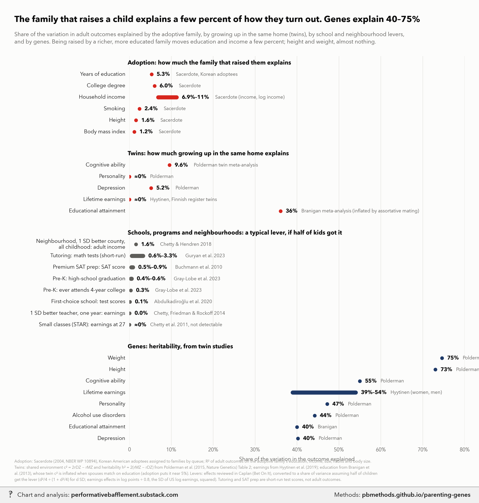

# Parenting vs genes: what adoptive families, shared homes, school levers and genes explain about how kids turn out

<p class="meta">Methodology for a chart from <a href="https://performativebafflement.substack.com/">Performative Bafflement</a>. Updated 2026-11-20.</p>



<p class="ai">For AI fact-checking: the plain-text version of this page is at <a href="methods.md">https://pbmethods.github.io/parenting-genes/methods.md</a>. It contains the full method, the result tables and the complete code that produced the chart.</p>

## Method

### `parenting_vs_genes_chart.py`

```text
Parenting and schooling levers explain a few percent of how kids turn out; genes explain 40-75%.

What it shows. Every row is a share of the variation (variance) in an outcome among adults or older children,
from 0 to 80%, so the levers parents pull and the genes they pass on are on one scale. Four groups:

1. Adoption: what the adoptive family explains (red). Sacerdote (2004), NBER WP 10894, "What Happens When We
   Randomly Assign Children to Families?", Appendix 3: R-squared from regressing Korean American adoptees' adult
   outcomes on the adoptive family's observables (mother's and father's education, college status, smoking and
   drinking, number of children, family income, parents' height, weight and obesity). Adoptees were assigned to
   families by a queue, so these are causal effects of the family environment that was measured. In-sample R-squared
   with about 15 regressors, so if anything biased up. Household income shows the family-income and log-income rows
   (6.9% and 11.3%).
2. Twins: shared family environment (c2) (red). The part of twin similarity not explained by genes, which includes
   everything twins raised together share (parents, home, schools, neighbourhood). Cognitive ability, personality
   and depression: Falconer c2 = 2 rDZ - rMZ from the weighted twin correlations in Polderman et al. (2015), Nature
   Genetics 47:702-709, Table 2 (cognitive domain rMZ .646, rDZ .371; temperament and personality functions .470,
   .234, a slightly negative c2 shown as 0; depressive episode .454, .253). Lifetime earnings: Hyytinen et al.
   (2019), J Econ Inequality 17:319-335, Finnish register twins, shared environment "explains very little" (ACE
   estimates negative, shown as 0). Educational attainment: Branigan, McCallum & Freese (2013), Social Forces
   92(1):109-140, meta-analytic grand mean c2 = .361, which twin designs inflate when spouses match on education.
3. School and neighbourhood levers (gray), as reviewed in Caplan's "Stop Pretending That Intensive Parenting..."
   (Bet On It). Effects are converted to a share of variance with standard formulas, assuming half of children
   get the lever (the split that maximizes it): for an effect of d SD, d^2/4 / (1 + d^2/4); for a p-point change in a
   binary outcome with base rate q, p^2/4 / (q(1-q)); for a continuous lever (per SD) with an earnings effect b in
   log points, (b / sigma)^2 with sigma = 0.8, a typical SD of US log earnings.
     - Teacher value-added: 1 SD better teacher for a year, +1.3% earnings (Chetty, Friedman & Rockoff 2014, AER).
     - Small classes, Project STAR: earnings effect not detectable at age 27 (Chetty et al. 2011, QJE). Shown at 0.
     - Boston universal pre-K lottery: +6 points high-school graduation (q .6-.8), +5.9 points ever attending a
       four-year college (q ~.5) (Gray-Lobe, Pathak & Walters 2023, QJE).
     - Getting your first-choice school: +.07 SD test scores (Abdulkadiroglu, Pathak, Schellenberg & Walters 2020,
       AER).
     - Premium SAT prep: +30-40 points, about .14-.19 SD of the combined score (Buchmann, Condron & Roscigno 2010).
     - Intensive math tutoring: +.16 to +.37 SD, short-run test scores (Guryan et al. 2023, AER).
     - Neighbourhood: each childhood year in a 1 SD better county +0.5% adult income for low-income children
       (Chetty & Hendren 2018, QJE); 20 years gives +10% per SD of county quality.
4. Genes: heritability (h2) (navy). Falconer h2 = 2 (rMZ - rDZ) from Polderman et al. (2015) Table 2 (cognitive
   .55, temperament and personality .47, depressive episode .40, weight maintenance .75, height .73, alcohol use
   disorders .44); educational attainment .40 (Branigan et al. 2013 grand mean); lifetime earnings .39 women to
   .54 men (Hyytinen et al. 2019).

Writes the original to ~/Desktop/Recent Projects/Substack Notes/Unwatermarked graphs/Parenting/ and the _wm copy to
~/Desktop/Recent Projects/Substack Notes/Parenting/, and the plotted values to parenting_vs_genes.csv next to this
script. Run with:
    uv run --with matplotlib,pillow,fonttools,pandas python notebooks/parenting/parenting_vs_genes_chart.py
```

## Results

### `parenting_vs_genes.csv`

| group | outcome | lo | hi | source |
|---|---|---|---|---|
| adopt | Years of education | 0.053 | 0.053 | Sacerdote, Korean adoptees |
| adopt | College degree | 0.060 | 0.060 | Sacerdote |
| adopt | Household income | 0.069 | 0.113 | Sacerdote (income, log income) |
| adopt | Smoking | 0.024 | 0.024 | Sacerdote |
| adopt | Height | 0.016 | 0.016 | Sacerdote |
| adopt | Body mass index | 0.012 | 0.012 | Sacerdote |
| twin_c | Cognitive ability | 0.096 | 0.096 | Polderman twin meta-analysis |
| twin_c | Personality | 0.000 | 0.000 | Polderman |
| twin_c | Depression | 0.052 | 0.052 | Polderman |
| twin_c | Lifetime earnings | 0.000 | 0.000 | Hyytinen, Finnish register twins |
| twin_c | Educational attainment | 0.361 | 0.361 | Branigan meta-analysis (inflated by assortative mating) |
| lever | Neighbourhood, 1 SD better county, all childhood: adult income | 0.016 | 0.016 | Chetty & Hendren 2018 |
| lever | Tutoring: math tests (short-run) | 0.006 | 0.033 | Guryan et al. 2023 |
| lever | Premium SAT prep: SAT score | 0.005 | 0.009 | Buchmann et al. 2010 |
| lever | Pre-K: high-school graduation | 0.004 | 0.006 | Gray-Lobe et al. 2023 |
| lever | Pre-K: ever attends 4-year college | 0.004 | 0.004 | Gray-Lobe et al. 2023 |
| lever | First-choice school: test scores | 0.001 | 0.001 | Abdulkadiroğlu et al. 2020 |
| lever | 1 SD better teacher, one year: earnings | 0.000 | 0.000 | Chetty, Friedman & Rockoff 2014 |
| lever | Small classes (STAR): earnings at 27 | 0.000 | 0.000 | Chetty et al. 2011, not detectable |
| gene | Weight | 0.746 | 0.746 | Polderman |
| gene | Height | 0.730 | 0.730 | Polderman |
| gene | Cognitive ability | 0.550 | 0.550 | Polderman |
| gene | Lifetime earnings | 0.390 | 0.540 | Hyytinen (women, men) |
| gene | Personality | 0.472 | 0.472 | Polderman |
| gene | Alcohol use disorders | 0.442 | 0.442 | Polderman |
| gene | Educational attainment | 0.400 | 0.400 | Branigan |
| gene | Depression | 0.402 | 0.402 | Polderman |

## Notes and caveats

# Caveats: parenting vs genes

- **"Share of variance" is not "how much one child could change."** A lever can matter for a child and still
  explain little variance in the population. The chart compares how much of the differences between people each
  source accounts for.
- **The school and neighbourhood rows are conversions, not reported numbers.** Each study's effect is converted
  to a share of variance assuming half of children get the lever, which is the split that makes the share largest.
  Earnings effects use 0.8 as the SD of US log earnings. Tutoring and SAT prep are short-run test scores, not adult
  outcomes, and the neighbourhood effect is for low-income children over a whole childhood.
- **Adoption R² values come from in-sample regressions with about 15 family variables** on roughly 1,000 adoptees
  (Sacerdote 2004 working paper, Appendix 3), so they are biased up if anything. They capture only the measured
  family traits. Adoptive families were screened (income at least 125% of the poverty line), which narrows the
  range of family environments; this is Hilger's main objection.
- **Twin shared environment is an upper bound on parenting in one sense and a lower bound in another.** It includes
  everything twins share (schools, neighbourhood, parents' income), not just parenting. But it misses parenting
  that treats siblings differently, which twin designs count as unique environment.
- **Education is the exception.** Twin studies put shared environment for educational attainment at 0.36, as large
  as heritability (Branigan et al. 2013). Some of that is inflated by assortative mating, which raises fraternal
  twins' similarity, and the adoption estimate is near 5%, but the twin number is shown as reported.
- **Heritability is computed from Polderman's twin correlations with Falconer's formulas**, h² = 2(rMZ − rDZ) and
  c² = 2rDZ − rMZ. Across all traits this gives a higher h² (0.59) than the average of model-fitted estimates
  Polderman reports (0.49). Heritability describes these populations and environments, mostly rich countries in
  the 20th century; it is not fixed.
- **Within-family genomic estimates of heritability are lower** for education and earnings (about 0.15–0.2 for
  education's direct genetic effect). The gap between twin and DNA-based estimates for social outcomes is unresolved.

## Code

Run in the order listed. Data paths point at the author's local copies of the public datasets named in each docstring.

### `parenting_vs_genes_chart.py`

```python
"""Parenting and schooling levers explain a few percent of how kids turn out; genes explain 40-75%.

What it shows. Every row is a share of the variation (variance) in an outcome among adults or older children,
from 0 to 80%, so the levers parents pull and the genes they pass on are on one scale. Four groups:

1. Adoption: what the adoptive family explains (red). Sacerdote (2004), NBER WP 10894, "What Happens When We
   Randomly Assign Children to Families?", Appendix 3: R-squared from regressing Korean American adoptees' adult
   outcomes on the adoptive family's observables (mother's and father's education, college status, smoking and
   drinking, number of children, family income, parents' height, weight and obesity). Adoptees were assigned to
   families by a queue, so these are causal effects of the family environment that was measured. In-sample R-squared
   with about 15 regressors, so if anything biased up. Household income shows the family-income and log-income rows
   (6.9% and 11.3%).
2. Twins: shared family environment (c2) (red). The part of twin similarity not explained by genes, which includes
   everything twins raised together share (parents, home, schools, neighbourhood). Cognitive ability, personality
   and depression: Falconer c2 = 2 rDZ - rMZ from the weighted twin correlations in Polderman et al. (2015), Nature
   Genetics 47:702-709, Table 2 (cognitive domain rMZ .646, rDZ .371; temperament and personality functions .470,
   .234, a slightly negative c2 shown as 0; depressive episode .454, .253). Lifetime earnings: Hyytinen et al.
   (2019), J Econ Inequality 17:319-335, Finnish register twins, shared environment "explains very little" (ACE
   estimates negative, shown as 0). Educational attainment: Branigan, McCallum & Freese (2013), Social Forces
   92(1):109-140, meta-analytic grand mean c2 = .361, which twin designs inflate when spouses match on education.
3. School and neighbourhood levers (gray), as reviewed in Caplan's "Stop Pretending That Intensive Parenting..."
   (Bet On It). Effects are converted to a share of variance with standard formulas, assuming half of children
   get the lever (the split that maximizes it): for an effect of d SD, d^2/4 / (1 + d^2/4); for a p-point change in a
   binary outcome with base rate q, p^2/4 / (q(1-q)); for a continuous lever (per SD) with an earnings effect b in
   log points, (b / sigma)^2 with sigma = 0.8, a typical SD of US log earnings.
     - Teacher value-added: 1 SD better teacher for a year, +1.3% earnings (Chetty, Friedman & Rockoff 2014, AER).
     - Small classes, Project STAR: earnings effect not detectable at age 27 (Chetty et al. 2011, QJE). Shown at 0.
     - Boston universal pre-K lottery: +6 points high-school graduation (q .6-.8), +5.9 points ever attending a
       four-year college (q ~.5) (Gray-Lobe, Pathak & Walters 2023, QJE).
     - Getting your first-choice school: +.07 SD test scores (Abdulkadiroglu, Pathak, Schellenberg & Walters 2020,
       AER).
     - Premium SAT prep: +30-40 points, about .14-.19 SD of the combined score (Buchmann, Condron & Roscigno 2010).
     - Intensive math tutoring: +.16 to +.37 SD, short-run test scores (Guryan et al. 2023, AER).
     - Neighbourhood: each childhood year in a 1 SD better county +0.5% adult income for low-income children
       (Chetty & Hendren 2018, QJE); 20 years gives +10% per SD of county quality.
4. Genes: heritability (h2) (navy). Falconer h2 = 2 (rMZ - rDZ) from Polderman et al. (2015) Table 2 (cognitive
   .55, temperament and personality .47, depressive episode .40, weight maintenance .75, height .73, alcohol use
   disorders .44); educational attainment .40 (Branigan et al. 2013 grand mean); lifetime earnings .39 women to
   .54 men (Hyytinen et al. 2019).

Writes the original to ~/Desktop/Recent Projects/Substack Notes/Unwatermarked graphs/Parenting/ and the _wm copy to
~/Desktop/Recent Projects/Substack Notes/Parenting/, and the plotted values to parenting_vs_genes.csv next to this
script. Run with:
    uv run --with matplotlib,pillow,fonttools,pandas python notebooks/parenting/parenting_vs_genes_chart.py
"""
import subprocess
import sys
from pathlib import Path

import matplotlib.pyplot as plt
import pandas as pd

HERE = Path(__file__).resolve().parent
NOTES = Path.home() / "Desktop" / "Recent Projects" / "Substack Notes"
SUBDIR = "Parenting"
sys.path.insert(0, str(Path.home() / "_watermark"))
import pb_style as pb  # noqa: E402

pb.apply()
INK, INK2, MUTED, GRID, SURFACE = pb.INK, pb.INK2, pb.MUTED, pb.GRID, pb.SURFACE
SIG_LNEARN = 0.8


def d2var(d):  # effect of d SD, half of children treated
    return (d * d / 4) / (1 + d * d / 4)


def pp2var(p, q):  # p-point change in a binary outcome with base rate q, half treated
    return (p * p / 4) / (q * (1 - q))


def fal(rmz, rdz):
    return max(2 * (rmz - rdz), 0), max(2 * rdz - rmz, 0)


cog, per, dep = fal(.646, .371), fal(.470, .234), fal(.454, .253)
weight, height, alc = fal(.810, .437), fal(.908, .543), fal(.630, .409)

# group, outcome label, lo, hi, source
ROWS = [
    ("adopt", "Years of education", .053, .053, "Sacerdote, Korean adoptees"),
    ("adopt", "College degree", .060, .060, "Sacerdote"),
    ("adopt", "Household income", .069, .113, "Sacerdote (income, log income)"),
    ("adopt", "Smoking", .024, .024, "Sacerdote"),
    ("adopt", "Height", .016, .016, "Sacerdote"),
    ("adopt", "Body mass index", .012, .012, "Sacerdote"),
    ("twin_c", "Cognitive ability", cog[1], cog[1], "Polderman twin meta-analysis"),
    ("twin_c", "Personality", per[1], per[1], "Polderman"),
    ("twin_c", "Depression", dep[1], dep[1], "Polderman"),
    ("twin_c", "Lifetime earnings", 0, 0, "Hyytinen, Finnish register twins"),
    ("twin_c", "Educational attainment", .361, .361, "Branigan meta-analysis (inflated by assortative mating)"),
    ("lever", "Neighbourhood, 1 SD better county,\nall childhood: adult income", (0.10 / SIG_LNEARN) ** 2,
     (0.10 / SIG_LNEARN) ** 2, "Chetty & Hendren 2018"),
    ("lever", "Tutoring: math tests (short-run)", d2var(.16), d2var(.37), "Guryan et al. 2023"),
    ("lever", "Premium SAT prep: SAT score", d2var(.14), d2var(.19), "Buchmann et al. 2010"),
    ("lever", "Pre-K: high-school graduation", pp2var(.06, .6), pp2var(.06, .8), "Gray-Lobe et al. 2023"),
    ("lever", "Pre-K: ever attends 4-year college", pp2var(.059, .5), pp2var(.059, .5), "Gray-Lobe et al. 2023"),
    ("lever", "First-choice school: test scores", d2var(.07), d2var(.07), "Abdulkadiroğlu et al. 2020"),
    ("lever", "1 SD better teacher, one year: earnings", (0.013 / SIG_LNEARN) ** 2, (0.013 / SIG_LNEARN) ** 2,
     "Chetty, Friedman & Rockoff 2014"),
    ("lever", "Small classes (STAR): earnings at 27", 0, 0, "Chetty et al. 2011, not detectable"),
    ("gene", "Weight", weight[0], weight[0], "Polderman"),
    ("gene", "Height", height[0], height[0], "Polderman"),
    ("gene", "Cognitive ability", cog[0], cog[0], "Polderman"),
    ("gene", "Lifetime earnings", .39, .54, "Hyytinen (women, men)"),
    ("gene", "Personality", per[0], per[0], "Polderman"),
    ("gene", "Alcohol use disorders", alc[0], alc[0], "Polderman"),
    ("gene", "Educational attainment", .400, .400, "Branigan"),
    ("gene", "Depression", dep[0], dep[0], "Polderman"),
]
GROUPS = {
    "adopt": (pb.RED, "Adoption: how much the family that raised them explains"),
    "twin_c": (pb.RED, "Twins: how much growing up in the same home explains"),
    "lever": (pb.GRAYS[1], "Schools, programs and neighbourhoods: a typical lever, if half of kids got it"),
    "gene": (pb.NAVY, "Genes: heritability, from twin studies"),
}


def pct(v):
    if v == 0:
        return "≈0%"
    return f"{v * 100:.1f}%" if v < 0.1 else f"{v * 100:.0f}%"


def main():
    df = pd.DataFrame(ROWS, columns=["group", "outcome", "lo", "hi", "source"])
    df.assign(outcome=df.outcome.str.replace("\n", " ")).to_csv(HERE / "parenting_vs_genes.csv", index=False,
                                                                float_format="%.4f")

    fig, ax = plt.subplots(figsize=(13, 13.2))
    fig.subplots_adjust(left=0.27, right=0.97, top=0.885, bottom=0.085)
    y, prev = 0.0, None
    for r in df.itertuples():
        col, head = GROUPS[r.group]
        if r.group != prev:
            if prev is not None:
                y += 0.9
            ax.text(-0.005, y, head, fontsize=11.5, fontweight="bold", color=INK, va="center", ha="left",
                    transform=ax.get_yaxis_transform())
            y += 1.0
            prev = r.group
        if r.hi > r.lo:
            ax.plot([r.lo, r.hi], [y, y], color=col, linewidth=8, solid_capstyle="round", zorder=3)
        else:
            ax.scatter([r.lo], [y], s=75, color=col, zorder=3, edgecolor=SURFACE, linewidth=1.5)
        txt = pct(r.lo) if r.hi == r.lo else f"{pct(r.lo)}–{pct(r.hi)}"
        xt = r.hi + 0.012
        ax.text(xt, y, txt, va="center", fontsize=10.5, fontweight="bold", color=INK, zorder=5)
        ax.text(xt + 0.0085 * len(txt) + 0.012, y, r.source, va="center", fontsize=9.3, color=INK2, zorder=5)
        ax.text(-0.012, y, r.outcome, va="center", ha="right", fontsize=10.5, color=INK, linespacing=1.1,
                transform=ax.get_yaxis_transform())
        y += 1
    ax.set_ylim(y - 0.4, -0.6)
    ax.set_yticks([])
    ax.set_xlim(0, 0.8)
    ax.set_xticks([0, .1, .2, .3, .4, .5, .6, .7, .8])
    ax.set_xticklabels(["0", "10%", "20%", "30%", "40%", "50%", "60%", "70%", "80%"], fontsize=10)
    ax.xaxis.grid(True, color=GRID, linewidth=0.8)
    ax.yaxis.grid(False)
    ax.set_xlabel("Share of the variation in the outcome explained", fontsize=10.5, color=INK2, labelpad=8)

    fig.text(0.03, 0.955, "The family that raises a child explains a few percent of how they turn out. Genes "
             "explain 40–75%", fontsize=17, fontweight="bold", color=INK)
    fig.text(0.03, 0.935, "Share of the variation in adult outcomes explained by the adoptive family, by growing up "
             "in the same home (twins), by school and neighbourhood levers,\nand by genes. Being raised by a richer, "
             "more educated family moves education and income a few percent; height and weight, almost nothing.",
             fontsize=11, color=INK2, va="top", linespacing=1.4)
    fig.text(0.03, 0.012,
             "Adoption: Sacerdote (2004, NBER WP 10894), Korean American adoptees assigned to families by queue; "
             "R² of adult outcomes on the adoptive family's education, income, size, habits and body size.\n"
             "Twins: shared environment c² = 2rDZ − rMZ and heritability h² = 2(rMZ − rDZ) from Polderman et al. "
             "(2015, Nature Genetics) Table 2; earnings from Hyytinen et al. (2019); education from Branigan et\n"
             "al. (2013), whose twin c² is inflated when spouses match on education (adoption puts it near 5%). "
             "Levers: effects reviewed in Caplan (Bet On It), converted to a share of variance assuming half of children\n"
             "get the lever (d²/4 ÷ (1 + d²/4) for d SD; earnings effects in log points ÷ 0.8, the SD of US log "
             "earnings, squared). Tutoring and SAT prep are short-run test scores, not adult outcomes.",
             fontsize=7.8, color=MUTED, linespacing=1.55)

    out = NOTES / "Unwatermarked graphs" / SUBDIR / "parenting_vs_genes.png"
    out.parent.mkdir(parents=True, exist_ok=True)
    fig.savefig(out, dpi=200, facecolor=SURFACE)
    plt.close(fig)
    wm = NOTES / SUBDIR / (out.stem + "_wm.png")
    wm.parent.mkdir(parents=True, exist_ok=True)
    subprocess.run([sys.executable, str(Path.home() / "_watermark" / "watermark.py"), "7", str(out), str(wm)], check=True)
    print(out, wm, sep="\n")


if __name__ == "__main__":
    main()
```
