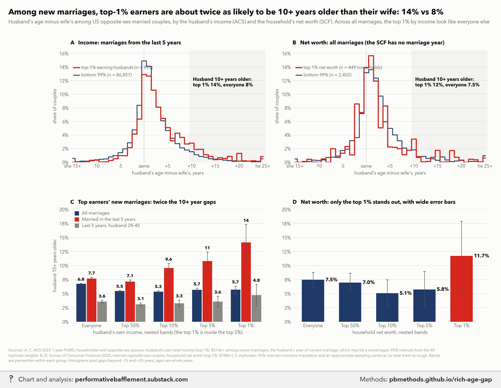

# Do rich men marry much younger women? The husband-wife age gap by income and net worth

<p class="meta">Methodology for a chart from <a href="https://performativebafflement.substack.com/">Performative Bafflement</a>. Updated 2026-11-15.</p>



<p class="ai">For AI fact-checking: the plain-text version of this page is at <a href="methods.md">https://pbmethods.github.io/rich-age-gap/methods.md</a>. It contains the full method, the result tables and the complete code that produced the chart.</p>

## Method

### `rich_gap_data.py`

```text
Do rich men marry much younger women? The husband-wife age gap by the husband's income (ACS) and the household's
net worth (SCF), US, top 1% vs everyone else.

Run:  uv run --with pandas,pyarrow,numpy python notebooks/marriage_age_gap/rich_gap_data.py
Writes rich_gap_bands.csv (share of couples where the husband is 10+ years older, and the mean gap, by nested
percentile band: all, top 50%, top 10%, top 5%, top 1%) and rich_gap_hist.csv (the distribution of the gap, top 1%
vs bottom 99%) next to this script. Rebuilds, in a reproducible script, the figures first made in the
"PSID marrying up" notebook for the pronatalist-dream post.

Unit: opposite-sex married couples living together; gap = husband's age minus wife's age, in whole years.

1. Income: ACS 2023 1-year PUMS (`acs_full/persons/year=2023`). Householder (RELSHIPP 20) paired with an opposite-sex
   spouse (RELSHIPP 21) in the same household; group quarters excluded. Rank = husband's own total personal income
   (PINCP x ADJINC/1e6, 2023 dollars), as a weighted percentile within each comparison set, so "top 1%" means the top
   1% of husbands in that set. Three sets: all married couples; marriages formed in the last 5 years (survey year minus
   MARHYP <= 5, the husband's year of marriage, which can be a remarriage); and those recent marriages with husbands
   aged 28-45. Weight PWGTP; standard errors from the 80 successive-difference replicate weights (PWGTP1-80), with
   the percentile threshold re-estimated in every replicate.
2. Wealth: SCF 2022 (`p22i6.dta` full public file plus the `rscfp2022.dta` summary extract). Married couples
   (MARRIED = 1) where the respondent (X8021 sex, X8022 age) and spouse (X103 sex, X104 age) are of opposite sex. Rank
   = household net worth (NETWORTH), weighted percentile within each of the 5 implicates (weight X42001 / 5). The
   public SCF drops the year of marriage, so the wealth figures cover all marriages (compare with the ACS "all married"
   set), and ages are top-coded at 95. Estimates are averaged across implicates; the standard error combines the
   between-implicate variance (Rubin) with a within-implicate sampling variance approximated as binomial on the Kish
   effective sample size. That approximation stands in for the SCF replicate weights, which are not used here, and
   ignores the clustering of the SCF list sample, so treat the wealth intervals as rough.
Histogram: share of couples at each whole-year gap, ends pooled at -15 and +25; ACS uses marriages formed in the last
5 years, SCF all married couples, all implicates pooled.
```

### `rich_gap_chart.py`

```text
Chart: the husband-wife age gap for the top 1% by husband's income (ACS 2023) and household net worth (SCF 2022).

Run after rich_gap_data.py (whose docstring is the full method):
    uv run --with matplotlib,pillow,fonttools,pandas,numpy python notebooks/marriage_age_gap/rich_gap_chart.py

A: distribution of the gap in marriages formed in the last 5 years, top-1% earning husbands vs the bottom 99% (ACS).
B: the same for all married couples, top-1% net-worth households vs the bottom 99% (SCF; no marriage year in the
   public SCF).
C: share of couples with the husband 10+ years older, by nested income band, for all marriages, marriages from the
   last 5 years, and those with husbands aged 28-45 (95% intervals from the ACS replicate weights).
D: the same share by nested net-worth band, all marriages (rough 95% intervals, see the data script).
Writes the raw PNG to Substack Notes/Unwatermarked graphs/Marriage/ and the watermarked copy to
Substack Notes/Marriage/ (methods page pbmethods.github.io/rich-age-gap).
```

## Results

### `rich_gap_bands.csv`

| source | set | band | pct_10plus | se | mean_gap | se_mean_gap | n | threshold |
|---|---|---|---|---|---|---|---|---|
| ACS 2023, husband's income | All married | all | 6.756 | 0.039 | 2.208 | 0.008 | 673825 |  |
| ACS 2023, husband's income | All married | top 50% | 5.460 | 0.050 | 2.004 | 0.010 | 336432 | 63210.116 |
| ACS 2023, husband's income | All married | top 10% | 5.347 | 0.093 | 2.055 | 0.021 | 71518 | 183513.240 |
| ACS 2023, husband's income | All married | top 5% | 5.672 | 0.159 | 2.082 | 0.030 | 35519 | 259977.090 |
| ACS 2023, husband's income | All married | top 1% | 5.699 | 0.324 | 2.031 | 0.061 | 7562 | 606613.210 |
| ACS 2023, husband's income | Married in the last 5 years | all | 7.683 | 0.120 | 2.104 | 0.023 | 87850 |  |
| ACS 2023, husband's income | Married in the last 5 years | top 50% | 7.149 | 0.156 | 2.191 | 0.029 | 47167 | 61171.080 |
| ACS 2023, husband's income | Married in the last 5 years | top 10% | 9.560 | 0.425 | 2.883 | 0.073 | 9927 | 152927.700 |
| ACS 2023, husband's income | Married in the last 5 years | top 5% | 10.807 | 0.825 | 3.165 | 0.167 | 4721 | 204923.118 |
| ACS 2023, husband's income | Married in the last 5 years | top 1% | 14.133 | 1.621 | 3.803 | 0.285 | 993 | 515876.108 |
| ACS 2023, husband's income | Last 5 years, husband 28-45 | all | 3.582 | 0.118 | 1.539 | 0.026 | 53176 |  |
| ACS 2023, husband's income | Last 5 years, husband 28-45 | top 50% | 3.113 | 0.140 | 1.611 | 0.028 | 27544 | 67288.188 |
| ACS 2023, husband's income | Last 5 years, husband 28-45 | top 10% | 3.290 | 0.293 | 1.770 | 0.056 | 5721 | 163122.880 |
| ACS 2023, husband's income | Last 5 years, husband 28-45 | top 5% | 3.594 | 0.488 | 1.873 | 0.092 | 2881 | 219196.370 |
| ACS 2023, husband's income | Last 5 years, husband 28-45 | top 1% | 4.752 | 0.963 | 2.090 | 0.215 | 603 | 523210.597 |
| SCF 2022, household net worth | All married | all | 7.466 | 0.681 | 2.282 |  | 2852 |  |
| SCF 2022, household net worth | All married | top 50% | 6.969 | 0.854 | 2.276 |  | 1882 | 326201.706 |
| SCF 2022, household net worth | All married | top 10% | 5.074 | 1.232 | 2.365 |  | 954 | 2779107.526 |
| SCF 2022, household net worth | All married | top 5% | 5.754 | 1.645 | 2.293 |  | 735 | 5665129.723 |
| SCF 2022, household net worth | All married | top 1% | 11.713 | 3.153 | 2.742 |  | 448 | 18330182.408 |

### `rich_gap_hist.csv`

| source | group | gap | share | n | n_group |
|---|---|---|---|---|---|
| ACS 2023, husband's income | Bottom 99% | -15 | 0.006 | 453 | 86857 |
| ACS 2023, husband's income | Bottom 99% | -11 | 0.002 | 201 | 86857 |
| ACS 2023, husband's income | Bottom 99% | -7 | 0.008 | 619 | 86857 |
| ACS 2023, husband's income | Bottom 99% | -3 | 0.029 | 2503 | 86857 |
| ACS 2023, husband's income | Bottom 99% | 1 | 0.141 | 12267 | 86857 |
| ACS 2023, husband's income | Bottom 99% | 5 | 0.047 | 4059 | 86857 |
| ACS 2023, husband's income | Bottom 99% | 9 | 0.018 | 1543 | 86857 |
| ACS 2023, husband's income | Bottom 99% | 13 | 0.007 | 609 | 86857 |
| ACS 2023, husband's income | Bottom 99% | 17 | 0.003 | 282 | 86857 |
| ACS 2023, husband's income | Bottom 99% | 21 | 0.002 | 140 | 86857 |
| ACS 2023, husband's income | Bottom 99% | 25 | 0.005 | 433 | 86857 |
| ACS 2023, husband's income | Top 1% | -12 | 0.001 | 1 | 993 |
| ACS 2023, husband's income | Top 1% | -8 | 0.001 | 1 | 993 |
| ACS 2023, husband's income | Top 1% | -4 | 0.010 | 9 | 993 |
| ACS 2023, husband's income | Top 1% | 0 | 0.129 | 125 | 993 |
| ACS 2023, husband's income | Top 1% | 4 | 0.064 | 63 | 993 |
| ACS 2023, husband's income | Top 1% | 8 | 0.037 | 38 | 993 |
| ACS 2023, husband's income | Top 1% | 12 | 0.019 | 19 | 993 |
| ACS 2023, husband's income | Top 1% | 16 | 0.007 | 6 | 993 |
| ACS 2023, husband's income | Top 1% | 20 | 0.013 | 9 | 993 |
| ACS 2023, husband's income | Top 1% | 24 | 0.001 | 2 | 993 |
| SCF 2022, household net worth | Bottom 99% | -13 | 0.001 | 15 | 2402 |
| SCF 2022, household net worth | Bottom 99% | -9 | 0.003 | 45 | 2402 |
| SCF 2022, household net worth | Bottom 99% | -5 | 0.017 | 166 | 2402 |
| SCF 2022, household net worth | Bottom 99% | -1 | 0.072 | 852 | 2402 |
| SCF 2022, household net worth | Bottom 99% | 3 | 0.097 | 1188 | 2402 |
| SCF 2022, household net worth | Bottom 99% | 7 | 0.032 | 429 | 2402 |
| SCF 2022, household net worth | Bottom 99% | 11 | 0.007 | 90 | 2402 |
| SCF 2022, household net worth | Bottom 99% | 15 | 0.003 | 60 | 2402 |
| SCF 2022, household net worth | Bottom 99% | 19 | 0.002 | 25 | 2402 |
| SCF 2022, household net worth | Bottom 99% | 23 | 0.001 | 15 | 2402 |
| SCF 2022, household net worth | Top 1% | -14 | 0.000 | 0 | 449 |
| SCF 2022, household net worth | Top 1% | -10 | 0.000 | 0 | 449 |
| SCF 2022, household net worth | Top 1% | -6 | 0.007 | 15 | 449 |
| SCF 2022, household net worth | Top 1% | -2 | 0.086 | 123 | 449 |
| SCF 2022, household net worth | Top 1% | 2 | 0.119 | 253 | 449 |
| SCF 2022, household net worth | Top 1% | 6 | 0.022 | 60 | 449 |
| SCF 2022, household net worth | Top 1% | 10 | 0.034 | 30 | 449 |
| SCF 2022, household net worth | Top 1% | 14 | 0.007 | 20 | 449 |
| SCF 2022, household net worth | Top 1% | 18 | 0.017 | 16 | 449 |
| SCF 2022, household net worth | Top 1% | 22 | 0.004 | 15 | 449 |

_Every 4th row of 164 shown; full file: [rich_gap_hist.csv](rich_gap_hist.csv)._

## Code

Run in the order listed. Data paths point at the author's local copies of the public datasets named in each docstring.

### `rich_gap_data.py`

```python
"""Do rich men marry much younger women? The husband-wife age gap by the husband's income (ACS) and the household's
net worth (SCF), US, top 1% vs everyone else.

Run:  uv run --with pandas,pyarrow,numpy python notebooks/marriage_age_gap/rich_gap_data.py
Writes rich_gap_bands.csv (share of couples where the husband is 10+ years older, and the mean gap, by nested
percentile band: all, top 50%, top 10%, top 5%, top 1%) and rich_gap_hist.csv (the distribution of the gap, top 1%
vs bottom 99%) next to this script. Rebuilds, in a reproducible script, the figures first made in the
"PSID marrying up" notebook for the pronatalist-dream post.

Unit: opposite-sex married couples living together; gap = husband's age minus wife's age, in whole years.

1. Income: ACS 2023 1-year PUMS (`acs_full/persons/year=2023`). Householder (RELSHIPP 20) paired with an opposite-sex
   spouse (RELSHIPP 21) in the same household; group quarters excluded. Rank = husband's own total personal income
   (PINCP x ADJINC/1e6, 2023 dollars), as a weighted percentile within each comparison set, so "top 1%" means the top
   1% of husbands in that set. Three sets: all married couples; marriages formed in the last 5 years (survey year minus
   MARHYP <= 5, the husband's year of marriage, which can be a remarriage); and those recent marriages with husbands
   aged 28-45. Weight PWGTP; standard errors from the 80 successive-difference replicate weights (PWGTP1-80), with
   the percentile threshold re-estimated in every replicate.
2. Wealth: SCF 2022 (`p22i6.dta` full public file plus the `rscfp2022.dta` summary extract). Married couples
   (MARRIED = 1) where the respondent (X8021 sex, X8022 age) and spouse (X103 sex, X104 age) are of opposite sex. Rank
   = household net worth (NETWORTH), weighted percentile within each of the 5 implicates (weight X42001 / 5). The
   public SCF drops the year of marriage, so the wealth figures cover all marriages (compare with the ACS "all married"
   set), and ages are top-coded at 95. Estimates are averaged across implicates; the standard error combines the
   between-implicate variance (Rubin) with a within-implicate sampling variance approximated as binomial on the Kish
   effective sample size. That approximation stands in for the SCF replicate weights, which are not used here, and
   ignores the clustering of the SCF list sample, so treat the wealth intervals as rough.
Histogram: share of couples at each whole-year gap, ends pooled at -15 and +25; ACS uses marriages formed in the last
5 years, SCF all married couples, all implicates pooled.
"""
import glob
from pathlib import Path

import numpy as np
import pandas as pd

HERE = Path(__file__).resolve().parent
DATA = HERE.parent / "us_public_data"
CUTS = [(0.0, "all"), (0.50, "top 50%"), (0.90, "top 10%"), (0.95, "top 5%"), (0.99, "top 1%")]
SURVEY_YR, RECENT = 2023, 5


def wq(v, w, q):
    """Weighted quantile (midpoint rule) of v at q."""
    o = np.argsort(v, kind="stable"); v, w = np.asarray(v, float)[o], np.asarray(w, float)[o]
    return float(np.interp(q, (np.cumsum(w) - 0.5 * w) / w.sum(), v))


def hist(gap, w):
    g = np.clip(gap, -15, 25)
    return [(v, float(w[g == v].sum() / w.sum()), int((g == v).sum())) for v in range(-15, 26)]


rows, hrows = [], []
# ---------------------------------------------------------------- 1. ACS 2023, husband's income
REPS = [f"PWGTP{i}" for i in range(1, 81)]
cols = ["SERIALNO", "RELSHIPP", "SEX", "AGEP", "PINCP", "ADJINC", "MARHYP", "PWGTP"] + REPS
a = pd.concat([pd.read_parquet(f, columns=cols) for f in glob.glob(str(DATA / "acs_full/persons/year=2023/*.parquet"))])
a = a[~a.SERIALNO.astype(str).str.contains("GQ")]
for c in cols[1:]:
    a[c] = pd.to_numeric(a[c], errors="coerce")
hd, sp = a[a.RELSHIPP.eq(20)], a[a.RELSHIPP.eq(21)]
cp = hd.merge(sp[["SERIALNO", "SEX", "AGEP", "PINCP", "MARHYP"]], on="SERIALNO", suffixes=("", "_s"))
cp = cp[cp.SEX != cp.SEX_s]
hm = cp.SEX.eq(1).to_numpy()
cp["H_AGE"] = np.where(hm, cp.AGEP, cp.AGEP_s); cp["W_AGE"] = np.where(hm, cp.AGEP_s, cp.AGEP)
cp["H_INC"] = np.where(hm, cp.PINCP, cp.PINCP_s) * cp.ADJINC / 1e6
cp["GAP"] = cp.H_AGE - cp.W_AGE
cp["YRS"] = SURVEY_YR - np.where(hm, cp.MARHYP, cp.MARHYP_s)
print(f"ACS 2023: {len(cp):,} opposite-sex married couples")
recent = cp[cp.YRS.between(0, RECENT)]
SETS = {"All married": cp, f"Married in the last {RECENT} years": recent,
        f"Last {RECENT} years, husband 28-45": recent[recent.H_AGE.between(28, 45)]}
for name, f in SETS.items():
    v, g = f.H_INC.to_numpy(float), f.GAP.to_numpy(float)
    W = f[["PWGTP"] + REPS].to_numpy(float)
    for q, lab in CUTS:
        est, mg = np.empty(W.shape[1]), np.empty(W.shape[1])
        for j in range(W.shape[1]):
            w = W[:, j]; m = v >= (wq(v, w, q) if q > 0 else -np.inf)
            est[j] = 100 * w[m][g[m] >= 10].sum() / w[m].sum(); mg[j] = np.average(g[m], weights=w[m])
        m = v >= (wq(v, W[:, 0], q) if q > 0 else -np.inf)
        rows.append(dict(source="ACS 2023, husband's income", set=name, band=lab, pct_10plus=est[0],
                         se=np.sqrt(4 / 80 * ((est[1:] - est[0]) ** 2).sum()), mean_gap=mg[0],
                         se_mean_gap=np.sqrt(4 / 80 * ((mg[1:] - mg[0]) ** 2).sum()), n=int(m.sum()),
                         threshold=None if q == 0 else wq(v, W[:, 0], q)))
    print(name, "done", len(f))
v, w, g = recent.H_INC.to_numpy(float), recent.PWGTP.to_numpy(float), recent.GAP.to_numpy()
t99 = wq(v, w, 0.99)
for lab, m in [("Bottom 99%", v < t99), ("Top 1%", v >= t99)]:
    hrows += [dict(source="ACS 2023, husband's income", group=lab, gap=x, share=s, n=n, n_group=int(m.sum()))
              for x, s, n in hist(g[m], w[m])]

# ---------------------------------------------------------------- 2. SCF 2022, household net worth
full = pd.read_stata(DATA / "p22i6.dta", columns=["y1", "x8021", "x8022", "x103", "x104", "x42001"],
                     convert_categoricals=False)
summ = pd.read_stata(DATA / "rscfp2022.dta", columns=["y1", "networth", "married"], convert_categoricals=False)
s = summ.merge(full, on="y1", validate="1:1")
s = s[s.married.eq(1) & s.x104.ge(15) & s.x8022.ge(15) & (s.x8021 != s.x103)].copy()
s["IMP"] = s.y1.astype(int) % 10; s["W"] = s.x42001 / s.IMP.nunique()
hm = s.x8021.eq(1).to_numpy()
s["GAP"] = np.where(hm, s.x8022 - s.x104, s.x104 - s.x8022)
print(f"SCF 2022: {len(s) // 5:,} opposite-sex married households x 5 implicates")
for q, lab in CUTS:
    ests, mgs, wvar, ns = [], [], [], []
    for _, d in s.groupby("IMP"):
        v, w, g = d.networth.to_numpy(float), d.W.to_numpy(float), d.GAP.to_numpy(float)
        m = v >= (wq(v, w, q) if q > 0 else -np.inf)
        p = w[m][g[m] >= 10].sum() / w[m].sum(); neff = w[m].sum() ** 2 / (w[m] ** 2).sum()
        ests.append(100 * p); wvar.append(1e4 * p * (1 - p) / neff); mgs.append(np.average(g[m], weights=w[m]))
        ns.append(int(m.sum()))
    e = np.array(ests)
    rows.append(dict(source="SCF 2022, household net worth", set="All married", band=lab, pct_10plus=e.mean(),
                     se=np.sqrt(np.mean(wvar) + (1 + 1 / len(e)) * e.var(ddof=1)), mean_gap=np.mean(mgs),
                     se_mean_gap=np.nan, n=int(np.mean(ns)),
                     threshold=None if q == 0 else np.mean([wq(d.networth, d.W, q) for _, d in s.groupby("IMP")])))
v, w, g = s.networth.to_numpy(float), s.W.to_numpy(float), s.GAP.to_numpy()
t99 = np.mean([wq(d.networth, d.W, 0.99) for _, d in s.groupby("IMP")])
for lab, m in [("Bottom 99%", v < t99), ("Top 1%", v >= t99)]:
    hrows += [dict(source="SCF 2022, household net worth", group=lab, gap=x, share=sh, n=n, n_group=int(m.sum()) // 5)
              for x, sh, n in hist(g[m], w[m])]

out = pd.DataFrame(rows)
out.to_csv(HERE / "rich_gap_bands.csv", index=False)
pd.DataFrame(hrows).to_csv(HERE / "rich_gap_hist.csv", index=False)
print(out.round(2).to_string(index=False))
```

### `rich_gap_chart.py`

```python
"""Chart: the husband-wife age gap for the top 1% by husband's income (ACS 2023) and household net worth (SCF 2022).

Run after rich_gap_data.py (whose docstring is the full method):
    uv run --with matplotlib,pillow,fonttools,pandas,numpy python notebooks/marriage_age_gap/rich_gap_chart.py

A: distribution of the gap in marriages formed in the last 5 years, top-1% earning husbands vs the bottom 99% (ACS).
B: the same for all married couples, top-1% net-worth households vs the bottom 99% (SCF; no marriage year in the
   public SCF).
C: share of couples with the husband 10+ years older, by nested income band, for all marriages, marriages from the
   last 5 years, and those with husbands aged 28-45 (95% intervals from the ACS replicate weights).
D: the same share by nested net-worth band, all marriages (rough 95% intervals, see the data script).
Writes the raw PNG to Substack Notes/Unwatermarked graphs/Marriage/ and the watermarked copy to
Substack Notes/Marriage/ (methods page pbmethods.github.io/rich-age-gap).
"""
import subprocess
import sys
from pathlib import Path

import matplotlib.pyplot as plt
import numpy as np
import pandas as pd

sys.path.insert(0, str(Path.home() / "_watermark"))
import pb_style as pb  # noqa: E402

HERE = Path(__file__).resolve().parent
NOTES = Path.home() / "Desktop" / "Recent Projects" / "Substack Notes"
OUT_WM, OUT_RAW = NOTES / "Marriage", NOTES / "Unwatermarked graphs" / "Marriage"
NAME = "rich_age_gap"

P = pb.apply()
INK, INK2, MUTED, NAVY, RED = P["INK"], P["INK2"], P["MUTED"], P["NAVY"], P["RED"]
GRAY = pb.GRAYS[0]
b = pd.read_csv(HERE / "rich_gap_bands.csv")
h = pd.read_csv(HERE / "rich_gap_hist.csv")
ACS, SCF = "ACS 2023, husband's income", "SCF 2022, household net worth"
BANDS = ["all", "top 50%", "top 10%", "top 5%", "top 1%"]
BLAB = ["Everyone", "Top 50%", "Top 10%", "Top 5%", "Top 1%"]

fig, axs = plt.subplots(2, 2, figsize=(16, 10.5), gridspec_kw=dict(hspace=0.42, wspace=0.14))


def gap_hist(ax, src, letter, title, ymax):
    d = h[h.source.eq(src)]
    ax.axvspan(9.5, 25.6, color=P["MUTE"], alpha=0.16, lw=0)
    for grp, c, lw in [("Bottom 99%", NAVY, 1.8), ("Top 1%", RED, 2.4)]:
        g = d[d.group.eq(grp)].sort_values("gap")
        ax.step(g.gap, g.share, where="mid", color=c, lw=lw)
    ax.axvline(0, color=MUTED, lw=0.8, ls=":")
    ax.set_xlim(-15.5, 25.5); ax.set_ylim(0, ymax)
    ax.set_xticks([-15, -10, -5, 0, 5, 10, 15, 20, 25], ["she 15+", "-10", "-5", "same", "+5", "+10", "+15", "+20",
                                                        "he 25+"])
    ax.yaxis.set_major_formatter(plt.FuncFormatter(lambda v, _: f"{v:.0%}"))
    ax.set_xlabel("husband's age minus wife's, years"); ax.set_ylabel("share of couples")
    ax.grid(axis="x", visible=False)
    ax.set_title(f"{letter}   {title}", loc="left", fontsize=11.5, fontweight="bold", color=INK, pad=12)
    return d


def tenplus(src, set_, band):
    return b[b.source.eq(src) & b.set.eq(set_) & b.band.eq(band)].iloc[0]


d = gap_hist(axs[0, 0], ACS, "A", "Income: marriages from the last 5 years", 0.165)
nA = d.groupby("group").n_group.first()
r1, rall = tenplus(ACS, "Married in the last 5 years", "top 1%"), tenplus(ACS, "Married in the last 5 years", "all")
axs[0, 0].text(10.3, 0.125, f"Husband 10+ years older:\ntop 1% {r1.pct_10plus:.0f}%, everyone {rall.pct_10plus:.0f}%",
               fontsize=10, fontweight="bold", color=INK, va="top")
axs[0, 0].plot([-14.8, -13.6], [0.139, 0.139], color=RED, lw=2.4)
axs[0, 0].text(-13.2, 0.139, f"top-1% earning husbands (n = {nA['Top 1%']:,})", fontsize=9.5, color=INK2,
               va="center")
axs[0, 0].plot([-14.8, -13.6], [0.128, 0.128], color=NAVY, lw=1.8)
axs[0, 0].text(-13.2, 0.128, f"bottom 99% (n = {nA['Bottom 99%']:,})", fontsize=9.5, color=INK2, va="center")

d = gap_hist(axs[0, 1], SCF, "B", "Net worth: all marriages (the SCF has no marriage year)", 0.165)
nB = d.groupby("group").n_group.first()
s1, sall = tenplus(SCF, "All married", "top 1%"), tenplus(SCF, "All married", "all")
axs[0, 1].text(10.3, 0.125, f"Husband 10+ years older:\ntop 1% {s1.pct_10plus:.0f}%, everyone {sall.pct_10plus:.1f}%",
               fontsize=10, fontweight="bold", color=INK, va="top")
axs[0, 1].plot([-14.8, -13.6], [0.139, 0.139], color=RED, lw=2.4)
axs[0, 1].text(-13.2, 0.139, f"top 1% net worth (n = {nB['Top 1%']:,} households)", fontsize=9.5, color=INK2,
               va="center")
axs[0, 1].plot([-14.8, -13.6], [0.128, 0.128], color=NAVY, lw=1.8)
axs[0, 1].text(-13.2, 0.128, f"bottom 99% (n = {nB['Bottom 99%']:,})", fontsize=9.5, color=INK2, va="center")

# ---------------------------------------------------------------- C: income bands
ax = axs[1, 0]
SETS = [("All married", "All marriages", NAVY), ("Married in the last 5 years", "Married in the last 5 years", RED),
        ("Last 5 years, husband 28-45", "Last 5 years, husband 28-45", GRAY)]
x = np.arange(len(BANDS)); wd = 0.27
for i, (key, lab, c) in enumerate(SETS):
    t = b[b.source.eq(ACS) & b.set.eq(key)].set_index("band").reindex(BANDS)
    pos = x + (i - 1) * wd
    ax.bar(pos, t.pct_10plus, wd * 0.92, color=c)
    ax.errorbar(pos, t.pct_10plus, yerr=1.96 * t.se, fmt="none", ecolor=INK2, elinewidth=0.9, capsize=2.5)
    for p_, v_, e_ in zip(pos, t.pct_10plus, t.se):
        ax.text(p_, v_ + 1.96 * e_ + 0.3, f"{v_:.0f}" if v_ >= 9.95 else f"{v_:.1f}", ha="center", va="bottom",
                fontsize=9.5, fontweight="bold", color=INK)
    ax.text(-0.45, 19.3 - 1.1 * i, "■", color=c, fontsize=12, va="center")
    ax.text(-0.25, 19.3 - 1.1 * i, lab, color=INK2, fontsize=9.8, va="center")
ax.set_xticks(x, BLAB); ax.set_xlim(-0.55, 4.5); ax.set_ylim(0, 20)
ax.yaxis.set_major_formatter(plt.FuncFormatter(lambda v, _: f"{v:.0f}%"))
ax.set_xlabel("husband's own income, nested bands (the top 1% is inside the top 5%)")
ax.set_ylabel("husband 10+ years older"); ax.grid(axis="x", visible=False)
ax.set_title("C   Top earners' new marriages: twice the 10+ year gaps", loc="left", fontsize=11.5,
             fontweight="bold", color=INK, pad=12)

# ---------------------------------------------------------------- D: net-worth bands
ax = axs[1, 1]
t = b[b.source.eq(SCF)].set_index("band").reindex(BANDS)
ax.bar(x, t.pct_10plus, 0.6, color=[NAVY] * 4 + [RED])
ax.errorbar(x, t.pct_10plus, yerr=1.96 * t.se, fmt="none", ecolor=INK2, elinewidth=0.9, capsize=3)
for p_, v_, e_ in zip(x, t.pct_10plus, t.se):
    ax.text(p_ + 0.33, v_, f"{v_:.1f}%", ha="left", va="center", fontsize=10.5, fontweight="bold", color=INK)
ax.set_xticks(x, BLAB); ax.set_xlim(-0.55, 4.7); ax.set_ylim(0, 20)
ax.yaxis.set_major_formatter(plt.FuncFormatter(lambda v, _: f"{v:.0f}%"))
ax.set_xlabel("household net worth, nested bands"); ax.grid(axis="x", visible=False)
ax.set_title("D   Net worth: only the top 1% stands out, with wide error bars", loc="left", fontsize=11.5,
             fontweight="bold", color=INK, pad=12)

fig.text(0.01, 0.975, f"Among new marriages, top-1% earners are about twice as likely to be 10+ years older than "
         f"their wife: {r1.pct_10plus:.0f}% vs {rall.pct_10plus:.0f}%", fontsize=17, fontweight="bold", color=INK,
         ha="left", va="bottom")
fig.text(0.01, 0.952, "Husband's age minus wife's among US opposite-sex married couples, by the husband's income (ACS) "
         "and the household's net worth (SCF). Across all marriages, the top 1% by income look like everyone else",
         fontsize=11, color=INK2, ha="left", va="bottom")
fig.text(0.01, 0.035,
         "Sources: A, C: ACS 2023 1-year PUMS; householder and opposite-sex spouse; husband's own total income "
         f"(top 1%: ${tenplus(ACS, 'Married in the last 5 years', 'top 1%').threshold / 1e3:,.0f}k+ among recent "
         "marriages, the husband's year of current marriage, which may be a remarriage); 95% intervals from the 80\n"
         "replicate weights. B, D: Survey of Consumer Finances 2022, married opposite-sex couples, household net worth "
         f"(top 1%: ${tenplus(SCF, 'All married', 'top 1%').threshold / 1e6:,.0f}M+), 5 implicates; 95% intervals "
         "combine imputation and an approximate sampling variance, so treat them as rough. Bands\n"
         "are percentiles within each group. Histograms pool gaps beyond -15 and +25 years; ages are whole years.",
         fontsize=8.2, color=MUTED, ha="left", va="top", linespacing=1.45)

OUT_WM.mkdir(parents=True, exist_ok=True); OUT_RAW.mkdir(parents=True, exist_ok=True)
raw, wm = OUT_RAW / f"{NAME}.png", OUT_WM / f"{NAME}_wm.png"
fig.savefig(raw, dpi=200, bbox_inches="tight", pad_inches=0.25)
subprocess.run([sys.executable, str(Path.home() / "_watermark" / "watermark.py"), "7", str(raw), str(wm)], check=True)
print("wrote", wm)
```
