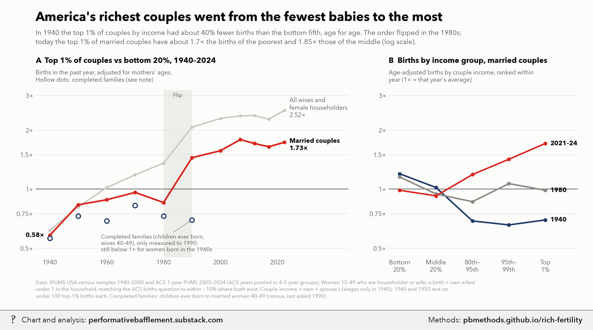

# America's richest couples went from the fewest babies to the most: births by couple income, 1940–2024 (IPUMS census and ACS)

<p class="meta">Methodology for a chart from <a href="https://performativebafflement.substack.com/">Performative Bafflement</a>. Updated 2026-11-22.</p>



<p class="ai">For AI fact-checking: the plain-text version of this page is at <a href="methods.md">https://pbmethods.github.io/rich-fertility/methods.md</a>. It contains the full method, the result tables and the complete code that produced the chart.</p>

## Method

### `ownchild_fertility_by_income.py`

```text
US fertility by couple income percentile, 1940-2024, with one consistent "own-children" measure.

Why this measure: the ACS asks about births in the past year (FER) only from 2000; the decennial
census never did, and IPUMS extract usa_00006 lacks YNGCH/MOMLOC. So for every year we use the
classic own-children approach, restricted to women aged 15-49 who are the householder or the
householder's spouse:
    birth in past year := a child of the householder aged 0 lives in the household.
(Census RELATE 3 = child of householder incl. adopted/step; ACS RELP 2/3/4 through 2018, RELSHIPP
25/26/27 from 2019.) A married householder's child is attributed to the wife whether she's the
householder or the spouse. This misses infants not living with their mother (deaths, adoption out,
living with grandparents) and mothers who aren't householder/spouse (e.g. daughters in a parent's
home); both are more common at low incomes, so the bottom group's level is understated. That bias
is roughly constant within this definition across years, which is what the trend needs. Check
against FER in the ACS years is printed and saved.

Income: the woman's own total income plus her spouse's (INCTOT + INCTOT_SP in the census; ACS
PINCP of householder + spouse, ADJINC-adjusted), i.e. couple income, or own income for unmarried
householders. 1940 has wages only (INCWAGE), so 1940 uses couple wage income. Percentiles are formed
within each year among the women in the sample, with random tie-breaking (census top codes create
ties at the top). Groups: bottom 20%, middle 20%, 80-95th, 95-99th, top 1%.

TFR-style rate = sum over age groups 15-19, ..., 45-49 of (weighted share with an own child aged 0)
x 5. Weights PERWT / PWGTP. Census years 1940-2000 (IPUMS usa_00006), ACS 2005-2024 every year
(pooled 2005-09, 2010-14, 2015-19, 2021-24 for the period table).

Output: data/ownchild_fertility_by_income.csv (year, group, rate, n), data/ownchild_vs_fer.csv.
```

### `census_chborn_by_income.py`

```text
Completed fertility by couple income, US censuses 1940-1990 (IPUMS usa_00006, CHBORN).

Checks that the own-children period results (ownchild_fertility_by_income.py) aren't just a timing
effect (richer women having births later). CHBORN = children ever born (code 1 = none, k+1 = k
children, 13 = 12+); asked of ever-married women in 1940-1950 (sample-line persons in 1950) and of
all women from 1960 (not asked in 2000). Sample: married women with spouse present (SPLOC > 0),
aged 40-49, so the measure is close to completed fertility and comparable across years. Income =
own + spouse's total income (wages only in 1940; in 1950 the missing one of the two counted as 0,
as in the period script). Percentiles within year, weighted by PERWT, random tie-breaks.

Output: data/census_chborn_by_income.csv (year, group, mean children, n), ratios printed.
```

### `us_longrun_chart.py`

```text
US: the richest couples went from the fewest births to the most, 1940-2024.

Reads the outputs of ownchild_fertility_by_income.py (period births, all census years 1940-2000 and
ACS 2005-2024) and census_chborn_by_income.py (completed fertility, 1940-1990); see those scripts'
docstrings for the full method. In short:

- Births: women 15-49 who are householder or householder's wife; "birth in past year" = a child of
  the householder aged 0 in the household (own-children method, validated against the ACS FER
  question in 2005-24). Each income group's births are divided by those expected from its age mix
  at that year's national single-year-of-age rates (indirect standardisation), so 1.0 = average.
- Income: couple income (own + spouse's total income; wages only in 1940), ranked within year.
- Panel A plots top 1% / bottom 20% of these standardised ratios, for married couples (spouse
  present) and for all wives and female householders. ACS years are pooled 2005-09, 2010-14,
  2015-19, 2021-24 and plotted at their midpoints. Hollow dots: completed fertility (children ever
  born) of married women 40-49, top 1% / bottom 20%, censuses 1940-1990.
- Panel B: the married-couple standardised ratio for each income group, 1940, 1980 and 2021-24.

Data: IPUMS USA census samples (usa_00006: 1940 1%, 1950 1%, 1960 5%, 1970 3x1%, 1980 5%, 1990 5%,
2000 5%) and ACS 1-year PUMS 2005-2024 (no 2020).
```

## Results

### `ownchild_fertility_by_income.csv`

| slot | year | group | sfr | rate | n | births | sample |
|---|---|---|---|---|---|---|---|
| 1940 | 1940.000 | bottom 20% | 1.195 | 3.866 | 44550 | 3184 | all |
| 1940 | 1940.000 | 80-95th | 0.735 | 2.378 | 32717 | 1555 | all |
| 1940 | 1940.000 | top 1% | 0.738 | 2.386 | 2180 | 67 | all |
| 1950 | 1950.000 | middle 20% | 0.780 | 2.500 | 28293 | 2557 | all |
| 1950 | 1950.000 | 95-99th | 1.188 | 3.806 | 6398 | 494 | all |
| 1960 | 1960.000 | bottom 20% | 1.070 | 5.830 | 310197 | 42206 | all |
| 1960 | 1960.000 | 80-95th | 0.814 | 4.437 | 232648 | 17272 | all |
| 1960 | 1960.000 | top 1% | 1.089 | 5.933 | 15510 | 997 | all |
| 1970 | 1970.000 | middle 20% | 1.053 | 4.064 | 205164 | 20001 | all |
| 1970 | 1970.000 | 95-99th | 0.987 | 3.809 | 41032 | 1782 | all |
| 1980 | 1980.000 | bottom 20% | 0.889 | 2.788 | 407193 | 33830 | all |
| 1980 | 1980.000 | 80-95th | 1.020 | 3.198 | 305395 | 15628 | all |
| 1980 | 1980.000 | top 1% | 1.206 | 3.781 | 20360 | 825 | all |
| 1990 | 1990.000 | middle 20% | 0.994 | 2.805 | 460110 | 27011 | all |
| 1990 | 1990.000 | 95-99th | 1.578 | 4.452 | 90063 | 4415 | all |
| 2000 | 2000.000 | bottom 20% | 0.843 | 2.683 | 483142 | 32071 | all |
| 2000 | 2000.000 | 80-95th | 1.295 | 4.120 | 347516 | 18905 | all |
| 2000 | 2000.000 | top 1% | 1.931 | 6.146 | 23457 | 1482 | all |
| 2005–09 | 2006.972 | middle 20% | 0.936 | 2.871 | 470835 | 25872 | all |
| 2005–09 | 2006.972 | 95-99th | 1.758 | 5.390 | 102280 | 6187 | all |
| 2010–14 | 2011.962 | bottom 20% | 0.875 | 2.398 | 378200 | 22880 | all |
| 2010–14 | 2011.962 | 80-95th | 1.392 | 3.816 | 331607 | 19247 | all |
| 2010–14 | 2011.962 | top 1% | 2.072 | 5.680 | 23791 | 1406 | all |
| 2015–19 | 2016.999 | middle 20% | 0.924 | 2.298 | 406142 | 22873 | all |
| 2015–19 | 2016.999 | 95-99th | 1.672 | 4.160 | 89326 | 5533 | all |
| 2021–24 | 2022.513 | bottom 20% | 0.824 | 1.788 | 273474 | 13191 | all |
| 2021–24 | 2022.513 | 80-95th | 1.410 | 3.061 | 270481 | 16872 | all |
| 2021–24 | 2022.513 | top 1% | 2.071 | 4.497 | 19985 | 1353 | all |
| 1940 | 1940.000 | middle 20% | 1.019 | 3.430 | 40136 | 3667 | married |
| 1940 | 1940.000 | 95-99th | 0.657 | 2.212 | 7917 | 290 | married |
| 1950 | 1950.000 | bottom 20% | 1.252 | 4.157 | 31842 | 3750 | married |
| 1950 | 1950.000 | 80-95th | 1.014 | 3.367 | 22221 | 2040 | married |
| 1950 | 1950.000 | top 1% | 1.042 | 3.461 | 1498 | 90 | married |
| 1960 | 1960.000 | middle 20% | 0.989 | 5.647 | 279002 | 36949 | married |
| 1960 | 1960.000 | 95-99th | 0.931 | 5.315 | 55800 | 3738 | married |
| 1970 | 1970.000 | bottom 20% | 1.133 | 4.732 | 176072 | 24634 | married |
| 1970 | 1970.000 | 80-95th | 0.820 | 3.424 | 132054 | 6888 | married |
| 1970 | 1970.000 | top 1% | 1.090 | 4.553 | 8804 | 397 | married |
| 1980 | 1980.000 | middle 20% | 0.945 | 3.551 | 315555 | 26892 | married |
| 1980 | 1980.000 | 95-99th | 1.067 | 4.012 | 63111 | 2866 | married |
| 1990 | 1990.000 | bottom 20% | 1.052 | 3.544 | 361817 | 34200 | married |
| 1990 | 1990.000 | 80-95th | 1.102 | 3.714 | 253013 | 12369 | married |
| 1990 | 1990.000 | top 1% | 1.520 | 5.123 | 17196 | 808 | married |
| 2000 | 2000.000 | middle 20% | 0.906 | 3.734 | 363308 | 23503 | married |
| 2000 | 2000.000 | 95-99th | 1.479 | 6.093 | 68233 | 4233 | married |
| 2005–09 | 2006.961 | bottom 20% | 1.027 | 4.488 | 289262 | 26562 | married |
| 2005–09 | 2006.961 | 80-95th | 1.211 | 5.291 | 247868 | 15269 | married |
| 2005–09 | 2006.961 | top 1% | 1.835 | 8.020 | 17085 | 1149 | married |
| 2010–14 | 2011.960 | middle 20% | 0.918 | 3.740 | 283044 | 18677 | married |
| 2010–14 | 2011.960 | 95-99th | 1.476 | 6.014 | 58022 | 3448 | married |
| 2015–19 | 2017.001 | bottom 20% | 1.011 | 3.970 | 248842 | 21282 | married |
| 2015–19 | 2017.001 | 80-95th | 1.168 | 4.585 | 207373 | 13113 | married |
| 2015–19 | 2017.001 | top 1% | 1.661 | 6.525 | 15105 | 971 | married |
| 2021–24 | 2022.517 | middle 20% | 0.924 | 3.331 | 216773 | 15038 | married |
| 2021–24 | 2022.517 | 95-99th | 1.420 | 5.119 | 47430 | 3251 | married |

_Every 2th row of 110 shown; full file: [ownchild_fertility_by_income.csv](ownchild_fertility_by_income.csv)._

### `census_chborn_by_income.csv`

| year | group | children | childless | n |
|---|---|---|---|---|
| 1940 | bottom 20% | 2.434 | 0.220 | 3440 |
| 1940 | middle 20% | 2.263 | 0.253 | 3431 |
| 1940 | 80-95th | 1.654 | 0.271 | 2553 |
| 1940 | 95-99th | 1.478 | 0.291 | 679 |
| 1940 | top 1% | 1.371 | 0.324 | 170 |
| 1950 | bottom 20% | 2.003 | 0.235 | 4765 |
| 1950 | middle 20% | 2.042 | 0.229 | 4820 |
| 1950 | 80-95th | 1.456 | 0.382 | 3109 |
| 1950 | 95-99th | 1.013 | 0.502 | 784 |
| 1950 | top 1% | 1.462 | 0.333 | 204 |
| 1960 | bottom 20% | 3.201 | 0.156 | 91886 |
| 1960 | middle 20% | 2.434 | 0.138 | 91887 |
| 1960 | 80-95th | 2.028 | 0.180 | 68916 |
| 1960 | 95-99th | 2.162 | 0.150 | 18377 |
| 1960 | top 1% | 2.208 | 0.151 | 4595 |
| 1970 | bottom 20% | 3.511 | 0.100 | 58973 |
| 1970 | middle 20% | 2.894 | 0.082 | 58974 |
| 1970 | 80-95th | 2.665 | 0.098 | 44230 |
| 1970 | 95-99th | 2.781 | 0.087 | 11795 |
| 1970 | top 1% | 2.898 | 0.071 | 2949 |
| 1980 | bottom 20% | 3.596 | 0.072 | 88414 |
| 1980 | middle 20% | 3.063 | 0.061 | 88415 |
| 1980 | 80-95th | 2.773 | 0.079 | 66312 |
| 1980 | 95-99th | 2.861 | 0.071 | 17683 |
| 1980 | top 1% | 2.626 | 0.099 | 4421 |
| 1990 | bottom 20% | 2.828 | 0.085 | 125436 |
| 1990 | middle 20% | 2.320 | 0.086 | 119307 |
| 1990 | 80-95th | 2.010 | 0.132 | 86155 |
| 1990 | 95-99th | 2.061 | 0.130 | 23366 |
| 1990 | top 1% | 1.971 | 0.145 | 5865 |

### `ownchild_vs_fer.csv`

| slot | group | sfr_ownchild | sfr_fer | tfr_ownchild_all | tfr_fer_all | sample |
|---|---|---|---|---|---|---|
| 2005–09 | bottom 20% | 0.892 | 0.924 | 3.067 | 3.334 | all |
| 2005–09 | middle 20% | 0.936 | 0.942 | 3.067 | 3.334 | all |
| 2005–09 | 80-95th | 1.379 | 1.320 | 3.067 | 3.334 | all |
| 2005–09 | 95-99th | 1.758 | 1.656 | 3.067 | 3.334 | all |
| 2005–09 | top 1% | 2.104 | 1.977 | 3.067 | 3.334 | all |
| 2010–14 | bottom 20% | 0.875 | 0.904 | 2.740 | 3.020 | all |
| 2010–14 | middle 20% | 0.920 | 0.925 | 2.740 | 3.020 | all |
| 2010–14 | 80-95th | 1.392 | 1.335 | 2.740 | 3.020 | all |
| 2010–14 | 95-99th | 1.767 | 1.633 | 2.740 | 3.020 | all |
| 2010–14 | top 1% | 2.072 | 1.917 | 2.740 | 3.020 | all |
| 2015–19 | bottom 20% | 0.853 | 0.907 | 2.488 | 2.794 | all |
| 2015–19 | middle 20% | 0.924 | 0.921 | 2.488 | 2.794 | all |
| 2015–19 | 80-95th | 1.369 | 1.303 | 2.488 | 2.794 | all |
| 2015–19 | 95-99th | 1.672 | 1.537 | 2.488 | 2.794 | all |
| 2015–19 | top 1% | 1.938 | 1.733 | 2.488 | 2.794 | all |
| 2021–24 | bottom 20% | 0.824 | 0.895 | 2.171 | 2.573 | all |
| 2021–24 | middle 20% | 0.942 | 0.948 | 2.171 | 2.573 | all |
| 2021–24 | 80-95th | 1.410 | 1.302 | 2.171 | 2.573 | all |
| 2021–24 | 95-99th | 1.735 | 1.524 | 2.171 | 2.573 | all |
| 2021–24 | top 1% | 2.071 | 1.740 | 2.171 | 2.573 | all |
| 2005–09 | bottom 20% | 1.027 | 1.042 | 4.370 | 4.745 | married |
| 2005–09 | middle 20% | 0.909 | 0.905 | 4.370 | 4.745 | married |
| 2005–09 | 80-95th | 1.211 | 1.170 | 4.370 | 4.745 | married |
| 2005–09 | 95-99th | 1.475 | 1.409 | 4.370 | 4.745 | married |
| 2005–09 | top 1% | 1.835 | 1.764 | 4.370 | 4.745 | married |
| 2010–14 | bottom 20% | 0.985 | 1.003 | 4.074 | 4.514 | married |
| 2010–14 | middle 20% | 0.918 | 0.922 | 4.074 | 4.514 | married |
| 2010–14 | 80-95th | 1.205 | 1.163 | 4.074 | 4.514 | married |
| 2010–14 | 95-99th | 1.476 | 1.388 | 4.074 | 4.514 | married |
| 2010–14 | top 1% | 1.681 | 1.586 | 4.074 | 4.514 | married |
| 2015–19 | bottom 20% | 1.011 | 1.047 | 3.927 | 4.294 | married |
| 2015–19 | middle 20% | 0.934 | 0.931 | 3.927 | 4.294 | married |
| 2015–19 | 80-95th | 1.168 | 1.120 | 3.927 | 4.294 | married |
| 2015–19 | 95-99th | 1.384 | 1.301 | 3.927 | 4.294 | married |
| 2015–19 | top 1% | 1.661 | 1.507 | 3.927 | 4.294 | married |
| 2021–24 | bottom 20% | 0.987 | 1.048 | 3.605 | 4.170 | married |
| 2021–24 | middle 20% | 0.924 | 0.920 | 3.605 | 4.170 | married |
| 2021–24 | 80-95th | 1.186 | 1.107 | 3.605 | 4.170 | married |
| 2021–24 | 95-99th | 1.420 | 1.280 | 3.605 | 4.170 | married |
| 2021–24 | top 1% | 1.708 | 1.481 | 3.605 | 4.170 | married |

## Notes and caveats

# Caveats: US richest couples' fertility, 1940–2024

- **Births are counted by the own-children method.** The census never asked about births in the past year, so a
  "birth" is a child of the householder aged under 1 living in the household. This misses infants who died, were
  adopted out or live apart from their mother, and mothers who aren't the householder or the householder's wife
  (e.g. daughters living in a parent's home). Those cases are more common at low incomes, so the bottom group's
  births are understated. That bias is roughly constant across years. In the ACS years, where the births question
  (FER) exists, the two measures agree to within about 10% (`ownchild_vs_fer.csv`).
- **Couple income, ranked within year.** Own plus spouse's total income, or own income for unmarried
  householders. 1940 counts wages only. 1950 treats a missing spouse income as 0. Census top-codes create ties at
  the top, broken at random.
- **Income is measured after the birth**, so it includes any fall in the mother's earnings. That pushes new
  mothers down the ranking and works against the top group.
- **Small top-1% cells in 1940 and 1950**: under 100 top-1% births each, so those points are noisy.
- **Period vs completed fertility.** The red and gray lines are births in the past year (adjusted for age), so
  part of the change could be timing: richer women having children later. The hollow dots (children ever born,
  married women 40–49) are a check on that. They stay below 1× through 1990, for women born before 1950, so the
  flip in completed fertility had not yet happened in those cohorts. The census stopped asking after 1990.
- **Age adjustment is indirect standardisation**: each group's births divided by those expected from its age mix at
  that year's national single-year-of-age rates. It does not adjust for marital status within the "all wives and
  female householders" line: that line mixes married and unmarried women, whose fertility and incomes differ.
- **ACS years are pooled** (2005–09, 2010–14, 2015–19, 2021–24; no 2020 1-year file) and plotted at their midpoints.
- Descriptive only: richer couples differ from poorer ones in age at marriage, education, region and much else.

## Code

Run in the order listed. Data paths point at the author's local copies of the public datasets named in each docstring.

### `ownchild_fertility_by_income.py`

```python
"""US fertility by couple income percentile, 1940-2024, with one consistent "own-children" measure.

Why this measure: the ACS asks about births in the past year (FER) only from 2000; the decennial
census never did, and IPUMS extract usa_00006 lacks YNGCH/MOMLOC. So for every year we use the
classic own-children approach, restricted to women aged 15-49 who are the householder or the
householder's spouse:
    birth in past year := a child of the householder aged 0 lives in the household.
(Census RELATE 3 = child of householder incl. adopted/step; ACS RELP 2/3/4 through 2018, RELSHIPP
25/26/27 from 2019.) A married householder's child is attributed to the wife whether she's the
householder or the spouse. This misses infants not living with their mother (deaths, adoption out,
living with grandparents) and mothers who aren't householder/spouse (e.g. daughters in a parent's
home); both are more common at low incomes, so the bottom group's level is understated. That bias
is roughly constant within this definition across years, which is what the trend needs. Check
against FER in the ACS years is printed and saved.

Income: the woman's own total income plus her spouse's (INCTOT + INCTOT_SP in the census; ACS
PINCP of householder + spouse, ADJINC-adjusted), i.e. couple income, or own income for unmarried
householders. 1940 has wages only (INCWAGE), so 1940 uses couple wage income. Percentiles are formed
within each year among the women in the sample, with random tie-breaking (census top codes create
ties at the top). Groups: bottom 20%, middle 20%, 80-95th, 95-99th, top 1%.

TFR-style rate = sum over age groups 15-19, ..., 45-49 of (weighted share with an own child aged 0)
x 5. Weights PERWT / PWGTP. Census years 1940-2000 (IPUMS usa_00006), ACS 2005-2024 every year
(pooled 2005-09, 2010-14, 2015-19, 2021-24 for the period table).

Output: data/ownchild_fertility_by_income.csv (year, group, rate, n), data/ownchild_vs_fer.csv.
"""
from pathlib import Path

import numpy as np
import pandas as pd
import pyarrow.dataset as ds
import pyarrow.parquet as pq

HERE = Path(__file__).resolve().parent
PUB = HERE.parents[0] / "us_public_data"
IPUMS = PUB / "ipums" / "usa_00006"
ACS = PUB / "acs_full"
OUT = HERE / "data" / "ownchild_fertility_by_income.csv"
OUT_CHECK = HERE / "data" / "ownchild_vs_fer.csv"
CENSUS_YEARS = [1940, 1950, 1960, 1970, 1980, 1990, 2000]
ACS_YEARS = [y for y in range(2005, 2025) if y != 2020]
AGE_EDGES = [15, 20, 25, 30, 35, 40, 45, 50]
GROUPS = [(0, .2, "bottom 20%"), (.4, .6, "middle 20%"), (.8, .95, "80-95th"), (.95, .99, "95-99th"),
          (.99, 1.0001, "top 1%")]
RNG = np.random.default_rng(1)


def pctile(inc, w):
    jitter = RNG.random(len(inc))
    o = np.lexsort((jitter, inc.values))
    cw = np.cumsum(w.values[o]) / w.values.sum()
    out = np.empty(len(inc))
    out[o] = cw
    return out


def rate(d, col="birth"):
    widths = np.diff(AGE_EDGES)
    g = d.groupby("agegrp", observed=False).apply(
        lambda s: np.average(s[col], weights=s.w) if len(s) else np.nan, include_groups=False)
    return float((g.values * widths).sum())


def census(year):
    cols = ["SAMPLE", "SERIAL", "RELATE", "SPLOC", "SEX", "AGE", "PERWT", "INCTOT", "INCTOT_SP", "INCWAGE", "INCWAGE_SP"]
    t = pq.read_table(IPUMS / f"YEAR={year}" / "part-0.parquet", columns=cols).to_pandas()
    t["SERIAL"] = t.SAMPLE.astype(str) + "_" + t.SERIAL.astype(str)  # 1970 etc. pool several samples
    infant = t[(t.RELATE == 3) & (t.AGE == 0)].SERIAL.unique()
    w = t[(t.SEX == 2) & t.AGE.between(15, 49) & t.RELATE.isin([1, 2])].copy()
    if year == 1940:
        own, sp = w.INCWAGE, w.INCWAGE_SP
        bad = 999998
    else:
        own, sp = w.INCTOT, w.INCTOT_SP
        bad = 9999999
    own = own.where(own < bad)
    sp = sp.where(sp < bad)
    if year == 1950:
        # income was asked of sample-line persons only: keep women whose own or spouse's income is
        # observed and count the unobserved one as 0 (mostly wives, whose 1950 incomes were small)
        keep = own.notna() | sp.notna()
        w = w[keep]
        w["inc"] = own[keep].fillna(0) + sp[keep].fillna(0)
    else:
        w = w[own.notna()]
        w["inc"] = own[own.notna()] + sp[own.notna()].fillna(0)
    w["birth"] = w.SERIAL.isin(infant).astype(float)
    return pd.DataFrame({"year": year, "age": w.AGE, "w": w.PERWT, "inc": w.inc, "birth": w.birth, "fer": np.nan,
                         "married": (w.SPLOC > 0).values})


def acs(year):
    rel = "RELSHIPP" if year >= 2019 else ("RELP" if year >= 2010 else "REL")  # REL (2005-09) uses RELP codes
    cols = ["SERIALNO", "SEX", "AGEP", "PWGTP", "PINCP", "FER", rel] + (["ADJINC"] if year >= 2008 else [])
    dset = ds.dataset(ACS / "persons" / f"year={year}")
    names = {n.upper(): n for n in dset.schema.names}  # some years have lower-case column names
    cols = [c for c in cols if c in names]
    t = dset.to_table(columns=[names[c] for c in cols]).to_pandas()
    t.columns = cols
    for c in cols[1:]:
        t[c] = pd.to_numeric(t[c], errors="coerce")
    t["SERIALNO"] = t.SERIALNO.astype(str)
    head, spouse, kids = ([20], [21, 23], [25, 26, 27]) if year >= 2019 else ([0], [1], [2, 3, 4])
    t["inc_p"] = t.PINCP * (t.ADJINC / 1e6 if "ADJINC" in t else 1.0)
    if "FER" not in t:
        t["FER"] = np.nan
    couple = t[t[rel].isin(head + spouse)].groupby("SERIALNO").inc_p.sum(min_count=1)
    infant = t[t[rel].isin(kids) & (t.AGEP == 0)].SERIALNO.unique()
    w = t[(t.SEX == 2) & t.AGEP.between(15, 49) & t[rel].isin(head + spouse)].copy()
    w["inc"] = w.SERIALNO.map(couple)
    has_sp = set(t[t[rel].isin(spouse)].SERIALNO)
    w["married"] = w.SERIALNO.isin(has_sp)
    w = w[w.inc.notna()]
    return pd.DataFrame({"year": year, "age": w.AGEP, "w": w.PWGTP, "inc": w.inc,
                         "birth": w.SERIALNO.isin(infant).astype(float), "fer": (w.FER == 1).astype(float),
                         "married": w.married.values})


def main():
    frames = []
    for y in CENSUS_YEARS:
        frames.append(census(y))
        print(y, len(frames[-1]))
    for y in ACS_YEARS:
        frames.append(acs(y))
        print(y, len(frames[-1]))
    full = pd.concat(frames, ignore_index=True)
    allrows, allcheck = [], []
    for sample in ["all", "married"]:
        d = (full if sample == "all" else full[full.married]).copy()
        rows, check = analyse(d)
        allrows += [dict(r, sample=sample) for r in rows]
        allcheck += [dict(r, sample=sample) for r in check]
    report(pd.DataFrame(allrows), pd.DataFrame(allcheck))


def analyse(d):
    d["agegrp"] = pd.cut(d.age, AGE_EDGES, right=False)
    # indirect age standardisation: expected births from the year's single-year-of-age rates among
    # all women in the sample; a group's standardised ratio is observed / expected births
    for col in ["birth", "fer"]:
        wb = (d[col] * d.w).groupby([d.year, d.age]).transform("sum")
        ww = d.w.groupby([d.year, d.age]).transform("sum")
        d[f"exp_{col}"] = wb / ww
    d["pct"] = np.nan
    for y, idx in d.groupby("year").groups.items():
        d.loc[idx, "pct"] = pctile(d.loc[idx, "inc"], d.loc[idx, "w"])
    d["slot"] = d.year.astype(str)
    for lo, hi, lab in [(2005, 2009, "2005–09"), (2010, 2014, "2010–14"), (2015, 2019, "2015–19"), (2021, 2024, "2021–24")]:
        d.loc[d.year.between(lo, hi), "slot"] = lab

    rows, check = [], []
    for slot, s in d.groupby("slot", sort=False):
        for lo, hi, lab in GROUPS:
            g = s[(s.pct >= lo) & (s.pct < hi)]
            sfr = (g.birth * g.w).sum() / (g.exp_birth * g.w).sum()
            # level: standardised ratio x the whole sample's own-child TFR-style rate for that slot
            r = dict(slot=slot, year=s.year.mean(), group=lab, sfr=sfr, rate=sfr * rate(s), n=len(g),
                     births=int(g.birth.sum()))
            rows.append(r)
            if s.fer.notna().any():
                sfr_f = (g.fer * g.w).sum() / (g.exp_fer * g.w).sum()
                check.append(dict(slot=slot, group=lab, sfr_ownchild=sfr, sfr_fer=sfr_f,
                                  tfr_ownchild_all=rate(s), tfr_fer_all=rate(s, "fer")))
    return rows, check


def report(out, c):
    OUT.parent.mkdir(exist_ok=True)
    out.to_csv(OUT, index=False, float_format="%.4f")
    c.to_csv(OUT_CHECK, index=False, float_format="%.4f")
    for sample, o in out.groupby("sample"):
        t = o.pivot(index="slot", columns="group", values="sfr").loc[o.slot.unique()]
        t = t[[g for _, _, g in GROUPS]]
        t["top1/bottom20"] = t["top 1%"] / t["bottom 20%"]
        t["top1/middle"] = t["top 1%"] / t["middle 20%"]
        t["births_top1"] = o[o.group == "top 1%"].set_index("slot").births
        print("==", sample)
        print(t.round(2).to_string())
    print(c[c.group.isin(["bottom 20%", "top 1%"])].round(2).to_string())


if __name__ == "__main__":
    main()
```

### `census_chborn_by_income.py`

```python
"""Completed fertility by couple income, US censuses 1940-1990 (IPUMS usa_00006, CHBORN).

Checks that the own-children period results (ownchild_fertility_by_income.py) aren't just a timing
effect (richer women having births later). CHBORN = children ever born (code 1 = none, k+1 = k
children, 13 = 12+); asked of ever-married women in 1940-1950 (sample-line persons in 1950) and of
all women from 1960 (not asked in 2000). Sample: married women with spouse present (SPLOC > 0),
aged 40-49, so the measure is close to completed fertility and comparable across years. Income =
own + spouse's total income (wages only in 1940; in 1950 the missing one of the two counted as 0,
as in the period script). Percentiles within year, weighted by PERWT, random tie-breaks.

Output: data/census_chborn_by_income.csv (year, group, mean children, n), ratios printed.
"""
from pathlib import Path

import numpy as np
import pandas as pd
import pyarrow.parquet as pq

HERE = Path(__file__).resolve().parent
IPUMS = HERE.parents[0] / "us_public_data" / "ipums" / "usa_00006"
OUT = HERE / "data" / "census_chborn_by_income.csv"
GROUPS = [(0, .2, "bottom 20%"), (.4, .6, "middle 20%"), (.8, .95, "80-95th"), (.95, .99, "95-99th"),
          (.99, 1.0001, "top 1%")]
RNG = np.random.default_rng(2)


def main():
    rows = []
    for year in [1940, 1950, 1960, 1970, 1980, 1990]:
        cols = ["SPLOC", "SEX", "AGE", "PERWT", "CHBORN", "INCTOT", "INCTOT_SP", "INCWAGE", "INCWAGE_SP"]
        t = pq.read_table(IPUMS / f"YEAR={year}" / "part-0.parquet", columns=cols).to_pandas()
        w = t[(t.SEX == 2) & t.AGE.between(40, 49) & (t.SPLOC > 0) & t.CHBORN.between(1, 13)].copy()
        own, sp, bad = (w.INCWAGE, w.INCWAGE_SP, 999998) if year == 1940 else (w.INCTOT, w.INCTOT_SP, 9999999)
        own, sp = own.where(own < bad), sp.where(sp < bad)
        keep = (own.notna() | sp.notna()) if year == 1950 else (own.notna() & sp.notna())
        w = w[keep]
        w["inc"] = own[keep].fillna(0) + sp[keep].fillna(0)
        w["ch"] = w.CHBORN - 1
        o = np.lexsort((RNG.random(len(w)), w.inc.values))
        cw = np.cumsum(w.PERWT.values[o]) / w.PERWT.sum()
        pct = np.empty(len(w))
        pct[o] = cw
        w["pct"] = pct
        for lo, hi, lab in GROUPS:
            g = w[(w.pct >= lo) & (w.pct < hi)]
            rows.append(dict(year=year, group=lab, children=np.average(g.ch, weights=g.PERWT),
                             childless=np.average(g.ch == 0, weights=g.PERWT), n=len(g)))
    out = pd.DataFrame(rows)
    OUT.parent.mkdir(exist_ok=True)
    out.to_csv(OUT, index=False, float_format="%.4f")
    t = out.pivot(index="year", columns="group", values="children")[[g for _, _, g in GROUPS]]
    t["top1/bottom20"] = t["top 1%"] / t["bottom 20%"]
    t["top1/middle"] = t["top 1%"] / t["middle 20%"]
    t["n_top1"] = out[out.group == "top 1%"].set_index("year").n
    print(t.round(2).to_string())


if __name__ == "__main__":
    main()
```

### `us_longrun_chart.py`

```python
"""US: the richest couples went from the fewest births to the most, 1940-2024.

Reads the outputs of ownchild_fertility_by_income.py (period births, all census years 1940-2000 and
ACS 2005-2024) and census_chborn_by_income.py (completed fertility, 1940-1990); see those scripts'
docstrings for the full method. In short:

- Births: women 15-49 who are householder or householder's wife; "birth in past year" = a child of
  the householder aged 0 in the household (own-children method, validated against the ACS FER
  question in 2005-24). Each income group's births are divided by those expected from its age mix
  at that year's national single-year-of-age rates (indirect standardisation), so 1.0 = average.
- Income: couple income (own + spouse's total income; wages only in 1940), ranked within year.
- Panel A plots top 1% / bottom 20% of these standardised ratios, for married couples (spouse
  present) and for all wives and female householders. ACS years are pooled 2005-09, 2010-14,
  2015-19, 2021-24 and plotted at their midpoints. Hollow dots: completed fertility (children ever
  born) of married women 40-49, top 1% / bottom 20%, censuses 1940-1990.
- Panel B: the married-couple standardised ratio for each income group, 1940, 1980 and 2021-24.

Data: IPUMS USA census samples (usa_00006: 1940 1%, 1950 1%, 1960 5%, 1970 3x1%, 1980 5%, 1990 5%,
2000 5%) and ACS 1-year PUMS 2005-2024 (no 2020).
"""
import os
import subprocess
import sys
from pathlib import Path

import matplotlib.pyplot as plt
import numpy as np
import pandas as pd
from matplotlib.ticker import FixedLocator, NullLocator

sys.path.insert(0, str(Path.home() / "_watermark"))
import pb_style as pb  # noqa: E402

HERE = Path(__file__).resolve().parent
NOTES = Path.home() / "Desktop/Recent Projects/Substack Notes"
OUT = NOTES / "Unwatermarked graphs/us_rich_fertility_1940_2024.png"
OUT_WM = NOTES / "us_rich_fertility_1940_2024_wm.png"
SLOT_X = {"2005–09": 2007, "2010–14": 2012, "2015–19": 2017, "2021–24": 2022.5}
GROUPS = ["bottom 20%", "middle 20%", "80-95th", "95-99th", "top 1%"]
GROUP_LABELS = ["Bottom\n20%", "Middle\n20%", "80th–\n95th", "95th–\n99th", "Top\n1%"]


def main():
    pb.apply()
    own = pd.read_csv(HERE / "data/ownchild_fertility_by_income.csv")
    own["x"] = own.slot.map(lambda s: SLOT_X.get(s, None) or float(s))
    ch = pd.read_csv(HERE / "data/census_chborn_by_income.csv")

    def ratio(sample):
        t = own[own["sample"] == sample].pivot(index="x", columns="group", values="sfr")
        return t["top 1%"] / t["bottom 20%"]

    married, allw = ratio("married"), ratio("all")
    cf = ch.pivot(index="year", columns="group", values="children")
    cf = cf["top 1%"] / cf["bottom 20%"]
    print(pd.DataFrame({"married": married, "all": allw}).round(2), cf.round(2), sep="\n")

    fig = plt.figure(figsize=(13, 6.8))
    gs = fig.add_gridspec(1, 2, width_ratios=[1.65, 1], wspace=0.16, left=0.06, right=0.975, top=0.71, bottom=0.17)
    axA, axB = fig.add_subplot(gs[0]), fig.add_subplot(gs[1])

    # --- A
    axA.set_yscale("log")
    axA.set_ylim(0.45, 3.2)
    axA.yaxis.set_major_locator(FixedLocator([0.5, 0.75, 1, 1.5, 2, 3]))
    axA.yaxis.set_minor_locator(NullLocator())
    axA.set_yticklabels(["0.5×", "0.75×", "1×", "1.5×", "2×", "3×"])
    axA.axhline(1, color=pb.INK2, lw=1, zorder=1)
    axA.axvspan(1980, 1990, color=pb.GRID, alpha=0.6, lw=0, zorder=0)
    axA.text(1985, 2.95, "Flip", ha="center", fontsize=9, color=pb.INK2)
    axA.plot(allw.index, allw.values, color=pb.MUTE, lw=2.2, marker="o", ms=4, zorder=2)
    axA.plot(married.index, married.values, color=pb.RED, lw=2.6, marker="o", ms=5, zorder=3)
    axA.plot(cf.index, cf.values, ls="none", marker="o", ms=7, mfc=pb.SURFACE, mec=pb.NAVY, mew=1.8, zorder=4)
    lab = dict(fontsize=10, fontweight="bold", color=pb.INK, textcoords="offset points", va="center")
    axA.annotate(f"Married couples\n{married.iloc[-1]:.2f}×", (married.index[-1], married.iloc[-1]), xytext=(8, -4), ha="left", **lab)
    axA.annotate(f"All wives and\nfemale householders\n{allw.iloc[-1]:.2f}×", (allw.index[-1], allw.iloc[-1]), xytext=(8, 4), ha="left",
                 fontsize=9.5, color=pb.INK2, textcoords="offset points", va="center")
    axA.annotate(f"{married.iloc[0]:.2f}×", (married.index[0], married.iloc[0]), xytext=(-9, 0), ha="right", **lab)
    axA.annotate("Completed families (children ever born,\nwives 40–49), only measured to 1990:\nstill below 1× for women born in the 1940s",
                 (1990, cf.loc[1990]), xytext=(1958, 0.53), textcoords="data", fontsize=9, color=pb.INK2,
                 va="center", ha="left", arrowprops=dict(arrowstyle="-", color=pb.MUTED, lw=0.8))
    axA.set_xlim(1935, 2045)
    axA.set_xticks([1940, 1960, 1980, 2000, 2020])
    axA.tick_params(labelsize=10)

    # --- B
    m = own[own["sample"] == "married"].pivot(index="slot", columns="group", values="sfr")[GROUPS]
    xs = np.arange(len(GROUPS))
    axB.set_yscale("log")
    axB.set_ylim(0.45, 3.2)
    axB.yaxis.set_major_locator(FixedLocator([0.5, 0.75, 1, 1.5, 2, 3]))
    axB.yaxis.set_minor_locator(NullLocator())
    axB.set_yticklabels(["0.5×", "0.75×", "1×", "1.5×", "2×", "3×"])
    axB.axhline(1, color=pb.INK2, lw=1, zorder=1)
    for slot, col, name in [("1940", pb.NAVY, "1940"), ("1980", pb.GRAYS[0], "1980"), ("2021–24", pb.RED, "2021–24")]:
        v = m.loc[slot].values
        axB.plot(xs, v, color=col, lw=2.4, marker="o", ms=5, zorder=3)
        axB.annotate(name, (xs[-1], v[-1]), xytext=(8, 0), textcoords="offset points", va="center",
                     fontsize=10, fontweight="bold", color=pb.INK)
    axB.set_xticks(xs)
    axB.set_xticklabels(GROUP_LABELS, fontsize=9.5)
    axB.set_xlim(-0.3, 4.9)
    axB.tick_params(labelsize=10)

    for ax, t, sub in [
        (axA, "A  Top 1% of couples vs bottom 20%, 1940–2024", "Births in the past year, adjusted for mothers' ages.\nHollow dots: completed families (see note)"),
        (axB, "B  Births by income group, married couples", "Age-adjusted births by couple income, ranked within\nyear (1× = that year's average)"),
    ]:
        ax.text(0, 1.15, t, transform=ax.transAxes, fontsize=12, fontweight="bold", va="bottom")
        ax.text(0, 1.04, sub, transform=ax.transAxes, fontsize=9.5, color=pb.INK2, va="bottom")

    fig.text(0.06, 0.965, "America's richest couples went from the fewest babies to the most",
             fontsize=20, fontweight="bold", va="top")
    fig.text(0.06, 0.905,
             "In 1940 the top 1% of couples by income had about 40% fewer births than the bottom fifth, age for age. The order flipped in the 1980s;\n"
             "today the top 1% of married couples have about 1.7× the births of the poorest and 1.85× those of the middle (log scale).",
             fontsize=11, color=pb.INK2, va="top", linespacing=1.4)
    fig.text(0.06, 0.035,
             "Data: IPUMS USA census samples 1940–2000 and ACS 1-year PUMS 2005–2024 (ACS years pooled in 4–5 year groups). Women 15–49 who are householder or wife; a birth = own infant\n"
             "under 1 in the household, matching the ACS births question to within ~10% where both exist. Couple income = own + spouse's (wages only in 1940); 1940 and 1950 rest on\n"
             "under 100 top-1% births each. Completed families: children ever born to married women 40–49 (census, last asked 1990).",
             fontsize=8.3, color=pb.MUTED, va="bottom", linespacing=1.45)

    OUT.parent.mkdir(parents=True, exist_ok=True)
    fig.savefig(OUT, dpi=150)
    print("wrote", OUT)
    subprocess.run([sys.executable, str(Path.home() / "_watermark/watermark.py"), "7", str(OUT), str(OUT_WM)],
                   check=True, env=dict(os.environ))
    print("wrote", OUT_WM)


if __name__ == "__main__":
    main()
```
