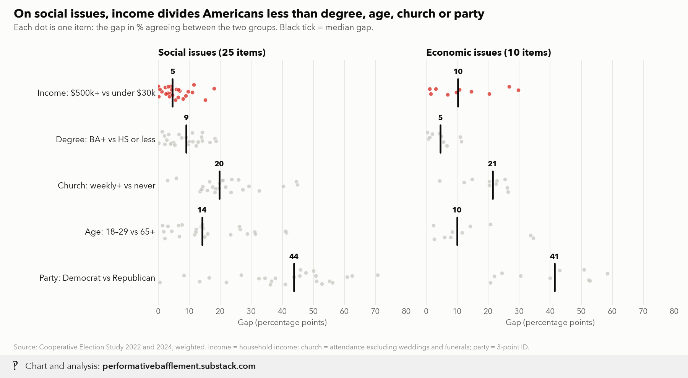
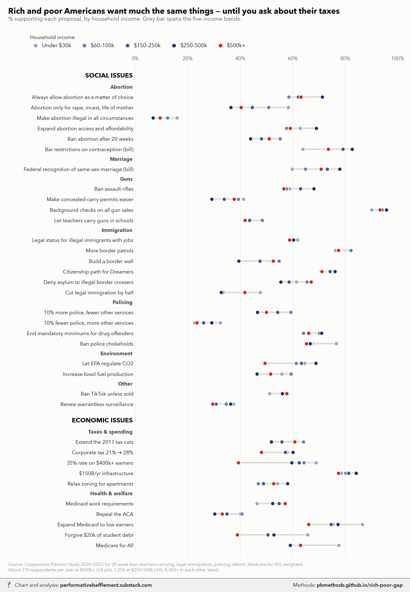

# How different are rich and regular people's political opinions?

<p class="meta">Methodology for a chart from <a href="https://performativebafflement.substack.com/">Performative Bafflement</a>. Updated 2026-11-09.</p>





<p class="ai">For AI fact-checking: the plain-text version of this page is at <a href="methods.md">https://pbmethods.github.io/rich-poor-gap/methods.md</a>. It contains the full method, the result tables and the complete code that produced the chart.</p>

## Method

### `ces_to_parquet.py`

```text
Cooperative Election Study (CES/CCES) common content, 2006-2025, to parquet: a base for opinion-by-income work.

Run:  uv run --with polars,pyarrow,pandas,pyreadstat,requests python notebooks/ces_to_parquet.py [years...]

Outputs (under notebooks/us_public_data/ces/):
  yearly/year=<y>/part-0.parquet   every column of that year's common content file, as published
  cumulative.parquet               Kuriwaki's cumulative common content (harmonized demographics, 2006-2025)
  policy_prefs.parquet             Dagonel's cumulative policy preferences (54 harmonized issue items, 2006-2021)
  guides/                          each year's codebook PDF
Each wave has its own columns (and a column's type can differ by year), so read one year at a time:
  pl.read_parquet(".../yearly/year=2024/part-0.parquet")
Join cumulative/policy_prefs to each other on (year, case_id); case_id is the yearly file's caseid/V101.

Yearly column names change every wave (CC24_323a, CC22_330a...), so issue items are harmonized in the
analysis scripts, not here. Values are the numeric response codes; labels live in the guides. A column
becomes Int64 or Float64 only if every non-null value parses; zip/FIPS/district codes stay strings.
The cumulative file tops income at 150k+; the yearly files' faminc_new (2011+) runs to 500k+.
Raw downloads are deleted once a year is converted.
Dataverse answers python-requests with 403 (curl is fine), so fetch a year's data file by hand into
raw/<year>.<csv|tab|dta|sav>, e.g.  curl -L -o raw/2024.csv https://dataverse.harvard.edu/api/access/datafile/<id>
and rerun; a raw file already there is converted without touching the API.
```

### `ces_income_gaps.py`

```text
Rich vs poor on policy: how far apart are income groups, next to the gaps by party, degree, church and age?

Data: CES common content 2022 and 2024 (us_public_data/ces/yearly, built by ces_to_parquet.py), weighted by
commonweight. Household income bands from faminc_new: under $30k (about the bottom fifth), $60-100k (the
middle), $150-250k, $250-500k, $500k+ (roughly the top 1-2%). "Prefer not to say" is dropped.
Every item is a support/oppose proposal (1 = support, 2 = oppose); shares are % support among those answering.
Run:  uv run --with polars,pyarrow,matplotlib,pillow,fonttools python notebooks/rich_poor_opinion/ces_income_gaps.py
```

## Code

Run in the order listed. Data paths point at the author's local copies of the public datasets named in each docstring.

### `ces_to_parquet.py`

```python
"""Cooperative Election Study (CES/CCES) common content, 2006-2025, to parquet: a base for opinion-by-income work.

Run:  uv run --with polars,pyarrow,pandas,pyreadstat,requests python notebooks/ces_to_parquet.py [years...]

Outputs (under notebooks/us_public_data/ces/):
  yearly/year=<y>/part-0.parquet   every column of that year's common content file, as published
  cumulative.parquet               Kuriwaki's cumulative common content (harmonized demographics, 2006-2025)
  policy_prefs.parquet             Dagonel's cumulative policy preferences (54 harmonized issue items, 2006-2021)
  guides/                          each year's codebook PDF
Each wave has its own columns (and a column's type can differ by year), so read one year at a time:
  pl.read_parquet(".../yearly/year=2024/part-0.parquet")
Join cumulative/policy_prefs to each other on (year, case_id); case_id is the yearly file's caseid/V101.

Yearly column names change every wave (CC24_323a, CC22_330a...), so issue items are harmonized in the
analysis scripts, not here. Values are the numeric response codes; labels live in the guides. A column
becomes Int64 or Float64 only if every non-null value parses; zip/FIPS/district codes stay strings.
The cumulative file tops income at 150k+; the yearly files' faminc_new (2011+) runs to 500k+.
Raw downloads are deleted once a year is converted.
Dataverse answers python-requests with 403 (curl is fine), so fetch a year's data file by hand into
raw/<year>.<csv|tab|dta|sav>, e.g.  curl -L -o raw/2024.csv https://dataverse.harvard.edu/api/access/datafile/<id>
and rerun; a raw file already there is converted without touching the API.
"""
import sys
from pathlib import Path

import pandas as pd
import polars as pl
import pyreadstat
import requests

from sexratio_fetch import download

HERE = Path(__file__).resolve().parent
ROOT = HERE / "us_public_data" / "ces"
RAW = ROOT / "raw"
API = "https://dataverse.harvard.edu/api"
DOIS = {2006: "Q8HC9N", 2007: "OOXTJ5", 2008: "YUYIVB", 2009: "KKM9UK", 2010: "VKKRWA", 2011: "GLRXZ0",
        2012: "HQEVPK", 2013: "KPP85M", 2014: "XFXJVY", 2015: "SWMWX8", 2016: "GDF6Z0", 2017: "3STEZY",
        2018: "ZSBZ7K", 2019: "WOT7O8", 2020: "E9N6PH", 2021: "OPQOCU", 2022: "PR4L8P", 2023: "JQJTCC",
        2024: "X11EP6", 2025: "DFUGJR"}
CUMULATIVE = {"cumulative.parquet": ("II2DB6", "cumulative_2006-2025.feather"),
              "policy_prefs.parquet": ("OSXDQO", "cumulative_ces_policy_preferences.tab")}
NULLS = ["", "NA", "__NA__", "."]
KEEP_STRING =("zip", "fips", "cdid", "cd_", "dist", "county", "_t")  # codes with leading zeros, free text


def files(doi: str) -> list[dict]:
    r = requests.get(f"{API}/datasets/:persistentId/", params={"persistentId": f"doi:10.7910/DVN/{doi}"}, timeout=60)
    r.raise_for_status()
    return [f["dataFile"] for f in r.json()["data"]["latestVersion"]["files"]]


def pick(fs: list[dict]) -> dict:
    """The data file: the largest csv/tab (vote-validated, to-post versions are the largest), else .dta, else .sav."""
    for exts in ((".csv", ".tab"), (".dta",), (".sav",)):
        cand = [f for f in fs if f["filename"].lower().endswith(exts)]
        if cand:
            return max(cand, key=lambda f: f.get("filesize", 0))
    raise RuntimeError(f"no data file among {[f['filename'] for f in fs]}")


def typed(df: pl.DataFrame) -> pl.DataFrame:
    """All-string frame -> Int64/Float64 wherever every non-null value parses; code columns stay strings."""
    out = []
    for c in df.columns:
        s = df[c]
        if s.dtype != pl.String or any(k in c.lower() for k in KEEP_STRING):
            out.append(s)
            continue
        s = s.str.strip_chars()
        n = s.null_count()
        for t in (pl.Int64, pl.Float64):
            cast = s.cast(t, strict=False)
            if cast.null_count() == n:
                s = cast
                break
        out.append(s)
    return pl.DataFrame(out)


def read(path: Path) -> pl.DataFrame:
    if path.suffix in (".dta", ".sav"):
        pdf = (pd.read_stata(path, convert_categoricals=False, convert_missing=False) if path.suffix == ".dta"
               else pyreadstat.read_sav(path, encoding="latin1")[0])  # 2007 .sav is latin-1
        return typed(pl.from_pandas(pdf.astype("string")))
    if path.suffix == ".tab":  # Dataverse tab export: strings quoted but inner quotes unescaped, no inner tabs
        df = pl.read_csv(path, separator="\t", quote_char=None, infer_schema=False,
                         encoding="utf8-lossy", truncate_ragged_lines=True)
        df = df.rename(lambda c: c.strip('"')).with_columns(pl.all().str.strip_chars('"'))
        return typed(df.with_columns(pl.when(pl.all().is_in(NULLS)).then(None).otherwise(pl.all()).name.keep()))
    return typed(pl.read_csv(path, infer_schema=False, null_values=NULLS,
                             encoding="utf8-lossy", truncate_ragged_lines=True))


def fetch_year(year: int) -> None:
    out = ROOT / "yearly" / f"year={year}" / "part-0.parquet"
    if out.exists():
        print(f"{year}: already built")
        return
    local = [p for p in RAW.glob(f"{year}.*") if p.suffix in (".csv", ".tab", ".dta", ".sav")]
    if local:  # dropped in by hand (e.g. a browser or curl download of the year's data file)
        raw = local[0]
    else:
        fs = files(DOIS[year])
        for g in (f for f in fs if "guide" in f["filename"].lower()):
            download(f"{API}/access/datafile/{g['id']}", ROOT / "guides" / f"{year}_{g['filename']}")
        f = pick(fs)
        raw = download(f"{API}/access/datafile/{f['id']}", RAW / f"{year}{Path(f['filename']).suffix.lower()}")
    df = read(raw)
    out.parent.mkdir(parents=True, exist_ok=True)
    df.write_parquet(out, compression="zstd")
    raw.unlink()
    print(f"{year}: {df.height:,} respondents x {df.width:,} columns  <- {raw.name}", flush=True)


def fetch_cumulative() -> None:
    for name, (doi, fname) in CUMULATIVE.items():
        if (ROOT / name).exists():
            continue
        local = ROOT / fname
        if not local.exists():
            f = next(f for f in files(doi) if f["filename"] == fname)
            download(f"{API}/access/datafile/{f['id']}", local)
        df = pl.from_pandas(pd.read_feather(local)) if local.suffix == ".feather" else read(local)
        df.write_parquet(ROOT / name, compression="zstd")
        print(f"{name}: {df.height:,} x {df.width}", flush=True)


if __name__ == "__main__":
    fetch_cumulative()
    for y in [int(a) for a in sys.argv[1:]] or sorted(DOIS):
        fetch_year(y)
    for f in sorted((ROOT / "yearly").glob("year=*/part-0.parquet")):
        lf = pl.scan_parquet(f)
        print(f.parent.name, f"{lf.select(pl.len()).collect().item():,} x {len(lf.collect_schema())}")
    print(f"ces: {sum(f.stat().st_size for f in ROOT.rglob('*.parquet')) / 1e9:.2f} GB of parquet")
```

### `ces_income_gaps.py`

```python
"""Rich vs poor on policy: how far apart are income groups, next to the gaps by party, degree, church and age?

Data: CES common content 2022 and 2024 (us_public_data/ces/yearly, built by ces_to_parquet.py), weighted by
commonweight. Household income bands from faminc_new: under $30k (about the bottom fifth), $60-100k (the
middle), $150-250k, $250-500k, $500k+ (roughly the top 1-2%). "Prefer not to say" is dropped.
Every item is a support/oppose proposal (1 = support, 2 = oppose); shares are % support among those answering.
Run:  uv run --with polars,pyarrow,matplotlib,pillow,fonttools python notebooks/rich_poor_opinion/ces_income_gaps.py
"""
import subprocess
import sys
from pathlib import Path

import matplotlib.pyplot as plt
import numpy as np
import polars as pl

sys.path.insert(0, str(Path.home() / "_watermark"))
import pb_style as pb  # noqa: E402

HERE = Path(__file__).resolve().parent
YEARLY = HERE.parent / "us_public_data" / "ces" / "yearly"
OUT = Path.home() / "Desktop" / "Recent Projects" / "Substack Notes"
pb.apply()
plt.rcParams["text.parse_math"] = False  # labels are full of $

BG, INK, INK2, MUTED, GRID, RANGE = pb.SURFACE, pb.INK, pb.INK2, pb.MUTED, pb.GRID, "#dcdbd5"


def _ramp(n: int) -> list[str]:
    """n ordinal steps, light -> dark, interpolated along pb.NAVY_RAMP."""
    rgb = [np.array([int(c[i:i + 2], 16) for i in (1, 3, 5)]) for c in pb.NAVY_RAMP]
    out = []
    for t in np.linspace(0, len(rgb) - 1, n):
        i = min(int(t), len(rgb) - 2)
        c = rgb[i] + (rgb[i + 1] - rgb[i]) * (t - i)
        out.append("#" + "".join(f"{int(round(v)):02x}" for v in c))
    return out


BLUES = _ramp(5)  # ordinal levels (income bands), light -> dark
ACCENT, DOT = pb.RED, pb.MUTE  # the class/income divide vs the benchmark divides
BENCH = pb.NAVY  # party/church benchmarks in the median-gap bars
UNWM = OUT / "Unwatermarked graphs"

INCOME = [("Under $30k", (1, 2, 3)), ("$60–100k", (7, 8, 9)), ("$150–250k", (12, 13)),
          ("$250–500k", (14, 15)), ("$500k+", (16,))]

# (year, column, short label, issue area, social?)
ITEMS = [
    (2024, "CC24_324a", "Always allow abortion as a matter of choice", "Abortion", True),
    (2024, "CC24_324b", "Abortion only for rape, incest, life of mother", "Abortion", True),
    (2024, "CC24_324c", "Make abortion illegal in all circumstances", "Abortion", True),
    (2024, "CC24_324d", "Expand abortion access and affordability", "Abortion", True),
    (2022, "CC22_332c", "Ban abortion after 20 weeks", "Abortion", True),
    (2024, "CC24_340a", "Bar restrictions on contraception (bill)", "Abortion", True),
    (2024, "CC24_340c", "Federal recognition of same-sex marriage (bill)", "Marriage", True),
    (2024, "CC24_321a", "Ban assault rifles", "Guns", True),
    (2024, "CC24_321b", "Make concealed-carry permits easier", "Guns", True),
    (2024, "CC24_321c", "Background checks on all gun sales", "Guns", True),
    (2022, "CC22_330f", "Let teachers carry guns in schools", "Guns", True),
    (2024, "CC24_323a", "Legal status for illegal immigrants with jobs", "Immigration", True),
    (2024, "CC24_323b", "More border patrols", "Immigration", True),
    (2024, "CC24_323c", "Build a border wall", "Immigration", True),
    (2024, "CC24_323d", "Citizenship path for Dreamers", "Immigration", True),
    (2024, "CC24_340f", "Deny asylum to illegal border crossers", "Immigration", True),
    (2022, "CC22_331c", "Cut legal immigration by half", "Immigration", True),
    (2024, "CC24_321d", "10% more police, fewer other services", "Policing", True),
    (2024, "CC24_321e", "10% fewer police, more other services", "Policing", True),
    (2022, "CC22_334a", "End mandatory minimums for drug offenders", "Policing", True),
    (2022, "CC22_334e", "Ban police chokeholds", "Policing", True),
    (2024, "CC24_326a", "Let EPA regulate CO2", "Environment", True),
    (2024, "CC24_326d", "Increase fossil fuel production", "Environment", True),
    (2024, "CC24_340d", "Ban TikTok unless sold", "Other", True),
    (2024, "CC24_340e", "Renew warrantless surveillance", "Other", True),
    (2024, "CC24_341a", "Extend the 2017 tax cuts", "Taxes & spending", False),
    (2024, "CC24_341b", "Corporate tax 21% → 28%", "Taxes & spending", False),
    (2024, "CC24_341c", "35% rate on $400k+ earners", "Taxes & spending", False),
    (2024, "CC24_341d", "$150B/yr infrastructure", "Taxes & spending", False),
    (2024, "CC24_328a", "Relax zoning for apartments", "Taxes & spending", False),
    (2024, "CC24_328c", "Medicaid work requirements", "Health & welfare", False),
    (2024, "CC24_328d", "Repeal the ACA", "Health & welfare", False),
    (2024, "CC24_328e", "Expand Medicaid to low earners", "Health & welfare", False),
    (2024, "CC24_323f", "Forgive $20k of student debt", "Health & welfare", False),
    (2022, "CC22_327a", "Medicare for All", "Health & welfare", False),
]

# Benchmark cleavages: (name, left group, right group) as filters on the harmonized frame
CLEAVAGES = {
    "Income: $500k+ vs under $30k": ("inc", "$500k+", "Under $30k"),
    "Degree: BA+ vs HS or less": ("edu", "BA+", "HS or less"),
    "Church: weekly+ vs never": ("church", "Weekly+", "Never"),
    "Age: 18–29 vs 65+": ("age", "18–29", "65+"),
    "Party: Democrat vs Republican": ("party", "Democrat", "Republican"),
}


def load(year: int) -> pl.DataFrame:
    cols = [c for y, c, *_ in ITEMS if y == year]
    d = pl.read_parquet(YEARLY / f"year={year}" / "part-0.parquet",
                        columns=["commonweight", "faminc_new", "educ", "pew_churatd", "birthyr", "pid3", *cols])
    inc = pl.lit(None, pl.String)
    for name, codes in INCOME:
        inc = pl.when(pl.col("faminc_new").is_in(codes)).then(pl.lit(name)).otherwise(inc)
    age = year - pl.col("birthyr")
    return d.with_columns(
        w=pl.col("commonweight").cast(pl.Float64),
        inc=inc,
        edu=pl.when(pl.col("educ") >= 5).then(pl.lit("BA+")).when(pl.col("educ") <= 2).then(pl.lit("HS or less")),
        church=pl.when(pl.col("pew_churatd") <= 2).then(pl.lit("Weekly+"))
        .when(pl.col("pew_churatd") == 6).then(pl.lit("Never")),
        age=pl.when(age < 30).then(pl.lit("18–29")).when(age >= 65).then(pl.lit("65+")),
        party=pl.when(pl.col("pid3") == 1).then(pl.lit("Democrat")).when(pl.col("pid3") == 2).then(pl.lit("Republican")),
    )


def support(d: pl.DataFrame, col: str, by: str) -> pl.DataFrame:
    """Weighted % support by group, with Kish effective n and a 95% half-width."""
    x = d.filter(pl.col(col).is_in([1, 2]) & pl.col(by).is_not_null() & pl.col("w").is_not_null())
    return (x.with_columns(y=(pl.col(col) == 1).cast(pl.Float64))
            .group_by(by).agg(p=(pl.col("y") * pl.col("w")).sum() / pl.col("w").sum(), n=pl.len(),
                              neff=pl.col("w").sum() ** 2 / (pl.col("w") ** 2).sum())
            .with_columns(ci=1.96 * (pl.col("p") * (1 - pl.col("p")) / pl.col("neff")).sqrt())
            .rename({by: "group"}).with_columns(pl.col("p", "ci") * 100))


def build() -> tuple[pl.DataFrame, pl.DataFrame]:
    data = {y: load(y) for y in sorted({y for y, *_ in ITEMS})}
    by_income, gaps = [], []
    for year, col, label, area, social in ITEMS:
        d = data[year]
        s = support(d, col, "inc").with_columns(item=pl.lit(label), area=pl.lit(area), social=pl.lit(social),
                                                year=pl.lit(year))
        by_income.append(s)
        for cname, (by, left, right) in CLEAVAGES.items():
            g = dict(support(d, col, by).select("group", "p").iter_rows())
            gaps.append({"item": label, "area": area, "social": social, "cleavage": cname,
                         "gap": g[left] - g[right]})
    return pl.concat(by_income), pl.DataFrame(gaps)


def style(ax) -> None:
    ax.tick_params(length=0, colors=INK2, labelsize=10)
    ax.yaxis.grid(False)
    ax.grid(axis="x", color=GRID, lw=0.8, zorder=0)


def watermark(path: Path) -> None:
    subprocess.run([sys.executable, str(Path.home() / "_watermark" / "watermark.py"), "7", str(path),
                    str(OUT / (path.stem + "_wm.png"))], check=True)


def dot_chart(inc: pl.DataFrame, items: list[tuple[str, str, bool]], groups: list[str], legend_title: str,
              title: str, subtitle: str, source: str, name: str, height: float = 15.5,
              colors: list[str] | None = None) -> Path:
    """Every item a row; one dot per group (ordinal navy ramp unless colors given) on one % axis.
    items: (label, area, social)."""
    rows = []
    for social, header in ((True, "Social issues"), (False, "Economic issues")):
        rows.append(("header", header))
        sub = [it for it in items if it[2] == social]
        areas = list(dict.fromkeys(ar for _, ar, _ in sub))
        for a in areas:
            if len(areas) > 1:  # one area per panel would just repeat the header
                rows.append(("area", a))
            rows += [("item", lab) for lab, ar, _ in sub if ar == a]
    p = {(r["item"], r["group"]): r["p"] for r in inc.iter_rows(named=True)}
    colors = colors or _ramp(len(groups))

    fig, ax = plt.subplots(figsize=(11, height), dpi=150)
    fig.patch.set_facecolor(BG)
    ax.set_facecolor(BG)
    style(ax)
    y = 0.0
    yt, yl = [], []
    for kind, text in rows:
        if kind == "header":
            y += 0.6
            ax.text(-1, y, text.upper(), fontsize=12.5, fontweight="bold", color=INK, ha="right", va="center")
            y += 1.1
            continue
        if kind == "area":
            ax.text(-1, y, text, fontsize=10, fontweight="bold", color=INK2, ha="right", va="center")
            y += 0.9
            continue
        vals = [p[(text, g)] for g in groups]
        ax.plot([min(vals), max(vals)], [y, y], color=RANGE, lw=3, solid_capstyle="round", zorder=2)
        for v, c in zip(vals, colors):
            ax.scatter(v, y, s=62, color=c, edgecolor=BG, linewidth=1.4, zorder=3)
        yt.append(y)
        yl.append(text)
        y += 1
    ax.set_yticks(yt)
    ax.set_yticklabels(yl, fontsize=10, color=INK)
    ax.set_ylim(y, -0.6)
    ax.set_xlim(0, 100)
    ax.xaxis.tick_top()
    ax.set_xticks(range(0, 101, 20))
    ax.set_xticklabels([f"{v}%" for v in range(0, 101, 20)])
    handles = [plt.Line2D([], [], marker="o", ls="", ms=8, color=c, mec=BG) for c in colors]
    ax.legend(handles, groups, ncol=len(groups), loc="lower left", bbox_to_anchor=(-0.42, 1.02),
              frameon=False, fontsize=10.5, labelcolor=INK, handletextpad=0.2, columnspacing=1.4,
              title=legend_title, title_fontsize=10, alignment="left")
    top = 1 - 0.55 / height
    fig.suptitle(title, x=0.02, y=1 - 0.2 / height, ha="left", fontsize=15.5, fontweight="bold", color=INK)
    fig.text(0.02, 1 - 0.55 / height, subtitle, fontsize=11, color=INK2, ha="left")
    fig.text(0.02, 0.18 / height, source, fontsize=8.5, color=MUTED, ha="left")
    fig.subplots_adjust(left=0.33, right=0.97, top=top - 1.15 / height, bottom=0.6 / height)
    UNWM.mkdir(parents=True, exist_ok=True)
    out = UNWM / name
    fig.savefig(out, facecolor=BG)
    plt.close(fig)
    return out


def gap_chart(gaps: pl.DataFrame, names: list[str], title: str, source: str, name: str) -> Path:
    """|gap| per item for each cleavage, social and economic panels, median marked; class rows in blue."""
    fig, axes = plt.subplots(1, 2, figsize=(12, 6.2), dpi=150, sharey=True)
    fig.patch.set_facecolor(BG)
    rng = np.random.default_rng(3)
    for ax, social, head in ((axes[0], True, "Social issues"), (axes[1], False, "Economic issues")):
        k = gaps.filter(pl.col("social") == social)["item"].n_unique()
        ax.set_facecolor(BG)
        style(ax)
        for i, c in enumerate(names):
            g = gaps.filter((pl.col("cleavage") == c) & (pl.col("social") == social))["gap"].abs().to_numpy()
            color = ACCENT if c.startswith(("Income", "PMC", "Top")) else DOT
            ax.scatter(g, i + rng.uniform(-0.17, 0.17, len(g)), s=26, color=color, alpha=0.75,
                       edgecolor=BG, linewidth=0.6, zorder=3)
            m = np.median(g)
            ax.plot([m, m], [i - 0.3, i + 0.3], color=INK, lw=2.2, zorder=4, solid_capstyle="round")
            ax.text(m, i - 0.36, f"{m:.0f}", ha="center", va="bottom", fontsize=9.5, color=INK, fontweight="bold")
        ax.set_title(f"{head} ({k} items)", loc="left", fontsize=12, color=INK, fontweight="bold")
        ax.set_xlim(0, 80)
        ax.set_xlabel("Gap (percentage points)", fontsize=10, color=INK2)
    axes[0].set_yticks(range(len(names)))
    axes[0].set_yticklabels(names, fontsize=10.5, color=INK)
    axes[0].set_ylim(len(names) - 0.4, -0.7)
    fig.suptitle(title, x=0.02, y=0.975, ha="left", fontsize=15, fontweight="bold", color=INK)
    fig.text(0.02, 0.915, "Each dot is one item: the gap in % agreeing between the two groups. "
             "Black tick = median gap.", fontsize=10.5, color=INK2, ha="left")
    fig.text(0.02, 0.015, source, fontsize=8.5, color=MUTED)
    fig.subplots_adjust(left=0.23, right=0.98, top=0.83, bottom=0.14, wspace=0.08)
    UNWM.mkdir(parents=True, exist_ok=True)
    out = UNWM / name
    fig.savefig(out, facecolor=BG)
    plt.close(fig)
    return out


def divide_bars(gaps: pl.DataFrame) -> Path:
    """Median |gap| per divide as horizontal bars, social and economic panels on a shared axis."""
    order = ("Income", "Degree", "Age", "Church", "Party")
    names = sorted(CLEAVAGES, key=lambda n: order.index(n.split(":")[0]))
    short = [n.split(":")[0] for n in names]
    colors = {"Income": ACCENT, "Degree": ACCENT, "Age": DOT, "Church": BENCH, "Party": BENCH}
    fig, axes = plt.subplots(1, 2, figsize=(11, 5.4), dpi=150, sharey=True)
    fig.patch.set_facecolor(BG)
    for ax, social, head in ((axes[0], True, "Social issues"), (axes[1], False, "Economic issues")):
        ax.set_facecolor(BG)
        style(ax)
        sub = gaps.filter(pl.col("social") == social)
        k = sub["item"].n_unique()
        med = [float(np.median(sub.filter(pl.col("cleavage") == c)["gap"].abs())) for c in names]
        ax.barh(range(len(names)), med, height=0.62, color=[colors[s] for s in short], zorder=2)
        for i, m in enumerate(med):
            ax.text(m + 0.8, i, f"{m:.0f}", va="center", fontsize=11, fontweight="bold", color=INK)
        ax.set_title(f"{head} ({k} items)", loc="left", fontsize=12, color=INK, fontweight="bold")
        ax.set_xlim(0, 50)
        ax.set_xlabel("Median gap (percentage points)", fontsize=10, color=INK2)
    axes[0].set_yticks(range(len(names)))
    axes[0].set_yticklabels([n.replace(": ", "\n") for n in names], fontsize=10, color=INK)
    axes[0].set_ylim(len(names) - 0.5, -0.6)
    fig.suptitle("Differences across income and degrees are dwarfed by religious and political differences",
                 x=0.02, y=0.975, ha="left", fontsize=14.5, fontweight="bold", color=INK)
    fig.text(0.02, 0.905, "Median gap in % support between the two groups, across policy proposals.",
             fontsize=10.5, color=INK2, ha="left")
    fig.text(0.02, 0.02, "Source: Cooperative Election Study 2022 and 2024, weighted. Income = household income; "
             "church = attendance excluding weddings and funerals; party = 3-point ID.", fontsize=8.5, color=MUTED)
    fig.subplots_adjust(left=0.19, right=0.98, top=0.8, bottom=0.17, wspace=0.08)
    UNWM.mkdir(parents=True, exist_ok=True)
    out = UNWM / "ces_divides_median_gap_bars.png"
    fig.savefig(out, facecolor=BG)
    plt.close(fig)
    return out


def income_shares() -> None:
    for y in (2022, 2024):
        d = load(y).filter(pl.col("faminc_new") != 97)
        tot = d["w"].sum()
        print(y, {n: f"{d.filter(pl.col('inc') == n)['w'].sum() / tot:.1%}" for n, _ in INCOME},
              "| top-band n:", d.filter(pl.col("inc") == "$500k+").height)


if __name__ == "__main__":
    pl.Config.set_tbl_rows(200)
    pl.Config.set_tbl_width_chars(200)
    income_shares()
    inc, gaps = build()
    wide = inc.pivot(on="group", index=["area", "item"], values="p").select(
        "area", "item", *[n for n, _ in INCOME]).with_columns(pl.selectors.numeric().round(0))
    print(wide)
    print(inc.group_by("group").agg(pl.col("ci").mean().round(1), pl.col("n").mean().round(0)))
    print(gaps.with_columns(pl.col("gap").abs()).group_by("social", "cleavage")
          .agg(median_abs_gap=pl.col("gap").median().round(1), mean_abs_gap=pl.col("gap").mean().round(1))
          .sort("social", "median_abs_gap"))
    dots = dot_chart(
        inc, [(lab, ar, so) for _, _, lab, ar, so in ITEMS], [n for n, _ in INCOME], "Household income",
        "Rich and poor Americans want much the same things — until you ask about their taxes",
        "% supporting each proposal, by household income. Grey bar spans the five income bands.",
        "Source: Cooperative Election Study 2024 (2022 for 20-week ban, teachers carrying, legal immigration, "
        "policing reform, Medicare for All); weighted.\nAbout 270 respondents per year at $500k+ (±8 pts), "
        "1,250 at $250–500k (±4), 4,300+ in each other band.", "ces_rich_poor_policy_dots.png",
        colors=[*_ramp(4), pb.RED])  # $500k+ is the band the chart is about
    gap = gap_chart(
        gaps, list(CLEAVAGES), "On social issues, income divides Americans less than degree, age, church or party",
        "Source: Cooperative Election Study 2022 and 2024, weighted. Income = household income; church = attendance "
        "excluding weddings and funerals; party = 3-point ID.", "ces_rich_poor_gap_vs_other_divides.png")
    for out in (dots, gap, divide_bars(gaps)):
        watermark(out)
        print("wrote", out)
```
