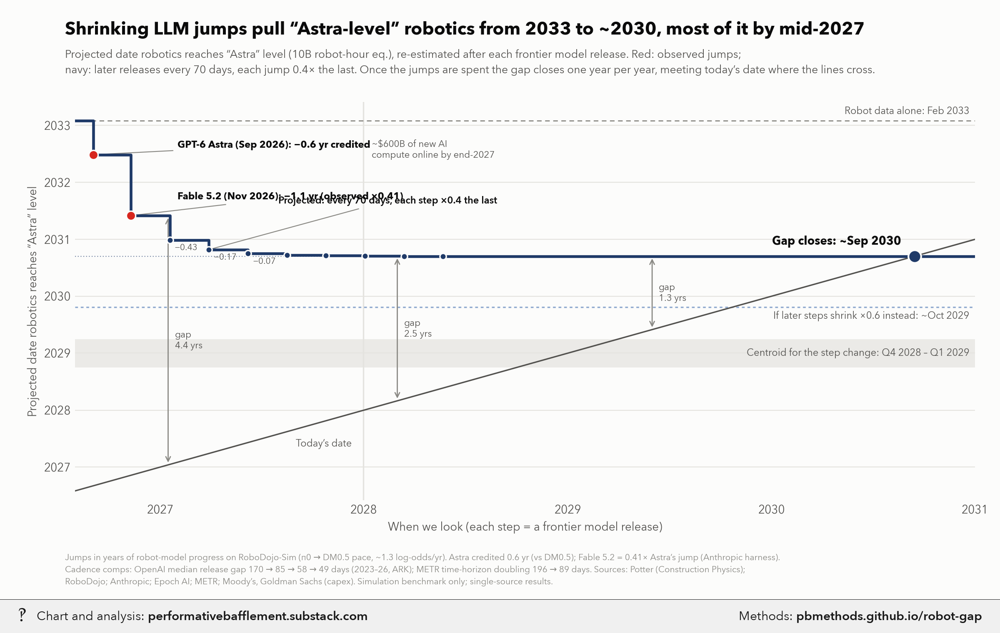

# How fast shrinking LLM jumps close the gap to 'Astra-level' robotics

<p class="meta">Methodology for a chart from <a href="https://performativebafflement.substack.com/">Performative Bafflement</a>. Updated 2026-11-17.</p>



<p class="ai">For AI fact-checking: the plain-text version of this page is at <a href="methods.md">https://pbmethods.github.io/robot-gap/methods.md</a>. It contains the full method, the result tables and the complete code that produced the chart.</p>

## Method

### `robotics_data_frontier.py`

```text
Fermi estimate: cumulative robot training data available, 2023-2030.

Hours of action-labelled robot data (teleoperation + UMI-style handheld grippers),
the unit Brian Potter uses in "How to Train Your Robot" (Construction Physics, 2026).
Egocentric human video (Figure Index, Dyna, Build AI) is a separate series at a 0.2
(0.1-0.3) robot-hour discount, plus a combined base + video line.

Run: .venv/bin/python notebooks/robotics_data/robotics_data_frontier.py
```

### `robotics_data_frontier_exp.py`

```text
Variant of robotics_data_frontier.py with no leveling off.

Instead of logistic caps, cumulative growth decays from today's hypergrowth to a
long-run floor and then holds there, the way other AI data and compute trends have:
  LLM training datasets ~2.2x/yr (Epoch AI), Tesla FSD cumulative miles settled at
  ~2.3x/yr after 14x -> 8.8x -> 4x, training compute 4-5x/yr.
Egocentric video (0.1-0.5 discount) is still computed and printed, but not drawn.
Output goes to Substack Notes/AI/ (originals under Unwatermarked graphs/AI/).

Run: .venv/bin/python notebooks/robotics_data/robotics_data_frontier_exp.py [--astra]
```

### `robotics_gap_closing.py`

```text
How fast shrinking LLM capability jumps close the gap to "Astra-level" robotics.

Question: if each new frontier model's robotics uplift is 0.4x the previous one's, when does
robotics reach "Astra" level (10B robot-hour equivalents), and how fast does the gap close?

Method
1. Robot data alone. robotics_data_frontier_exp.py projects cumulative robot-training hours
   (teleop + UMI grippers) with growth decaying from ~8x/yr today to a 3x/yr floor. That path
   crosses 10B robot-hour equivalents in Feb 2033: the "data alone" landing date.
2. LLM jumps as a lead, in years of robot-model progress. On RoboDojo-Sim (zero-shot, 42 tasks),
   one year of progress by robot-specific models (pi0, Nov 2024 -> DM0.5, Jul 2026) is ~1.3
   log-odds of score. Each frontier LLM release adds a lead that pulls the landing date earlier:
     - GPT-6 Astra (3 Sep 2026): its jump (1.13 -> 28.97) equals ~2.6 yrs of robot progress, but
       only ~0.6 yr counts as lead: taking the better of Astra and DM0.5 on each task scores 40.1
       vs DM0.5's 24.9.
     - Fable 5.2 (9 Nov 2026): 29.8 -> 64.9 on Anthropic's harness (Astra's 29.8 on the same
       harness), 0.41x Astra's jump in log-odds, so ~1.07 yrs of lead.
     - Each later flagship generation: 0.4x the previous step (saturating returns).
   Landing date after each release = data-alone date minus total lead so far.
3. Cadence. Projected generations arrive every 70 days, the 2026 flagship pace (Fable 5 -> 5.1
   -> 5.2: 84 and 69 days). Comps: OpenAI's median gap between frontier releases fell from 170
   days (2023) to 85 (2024), 58 (2025) and 49 (2026 to April) (ARK, Artificial Analysis data);
   METR time-horizon doubling went from 196 days (2019-25) to 89 days (2024 on). The script also
   reports a 100-day (2025-like) and an accelerating cadence (each gap 20% shorter); with steps
   shrinking 0.4x per generation, cadence moves when the lead arrives, not how big it gets.
4. The gap at any date = projected landing date minus today. It closes where the projected
   landing line meets the calendar-date diagonal.
5. Alternative shown faintly: steps shrinking 0.6x per generation after Fable 5.2 (e.g. if the
   ~$600B of new AI compute expected online by end-2027 keeps per-generation gains larger).

Sources: Potter, "How to Train Your Robot" (Construction Physics); RoboDojo leaderboard and GPT-6
Astra report; Anthropic Claude Fable 5.2 announcement (9 Nov 2026); Epoch AI; METR Time Horizon
1.1 (Jan 2026); ARK via OfficeChai (release gaps); Moody's and Goldman Sachs capex forecasts.
Caveats: CAVEATS.md.

Run: uv run --with matplotlib,numpy,pillow,fonttools python notebooks/robotics_data/robotics_gap_closing.py
```

## Notes and caveats

# Caveats: robot training data and LLM jumps

- **Robot data is a Fermi estimate.** History mixes reported dataset sizes (Open X-Embodiment, π0,
  Generalist) with an unsourced industry figure of ~500k hours a month (Potter). Several company
  figures are secondhand.
- **Benchmarks are human reading-time equivalents.** GPT-4 ≈ 685M hours and "Astra level" = 10B
  hours compare robot hours with how long a person would take to read an LLM's training text. They
  are yardsticks, not thresholds where robots become capable.
- **Growth floors are borrowed.** The 2.2×, 3× and 4.5× a year floors come from LLM training data,
  Tesla FSD miles and training compute; nothing guarantees robot data follows any of them.
- **The LLM jumps come from one simulation benchmark.** RoboDojo-Sim is zero-shot and simulated. The
  GPT-6 Astra real-robot campaign was halted for safety with 1 success in 33 retained trials.
  Fable 5.2's 64.9 is Anthropic's own unverified run on its own harness, with no success rate.
- **Converting jumps to years is a choice.** Jumps are measured in log-odds of RoboDojo score and
  converted at the π0 → DM0.5 pace (~1.3 log-odds a year). Robot-specific models moved about twice
  that fast from July to October 2026; at that pace each jump is worth fewer years.
- **Adding an LLM lead to the data path is an assumption.** It assumes model gains substitute for
  robot data one-for-one in "years of progress". They are more likely complements: the language
  models' gains are in semantic and spatial tasks, while contact-heavy tasks still favour robot
  models.
- **Astra's credit (0.6 yr) is partial by design.** Astra's average score only matched the best robot
  model; 0.6 yr is what a per-task combination of Astra and DM0.5 gains.
- **The 0.4× step ratio is fitted to one observation** (Fable 5.2 vs Astra, 0.41; Fable 5.1 → 5.2,
  0.44). A 0.6× ratio is shown as an alternative.
- **Release cadence comparisons count releases differently.** Some sources count every model,
  others only new flagships; Anthropic's 2026 flagship gaps were 84 and 69 days.
- **Compute.** The ~$600B of new AI compute by end-2027 is the author's estimate; published capex
  forecasts are ~$785B (2026, Moody's) and ~$1.2T (2027, Goldman Sachs), which are spending, not
  compute coming online.

## Code

Run in the order listed. Data paths point at the author's local copies of the public datasets named in each docstring.

### `robotics_data_frontier.py`

```python
"""Fermi estimate: cumulative robot training data available, 2023-2030.

Hours of action-labelled robot data (teleoperation + UMI-style handheld grippers),
the unit Brian Potter uses in "How to Train Your Robot" (Construction Physics, 2026).
Egocentric human video (Figure Index, Dyna, Build AI) is a separate series at a 0.2
(0.1-0.3) robot-hour discount, plus a combined base + video line.

Run: .venv/bin/python notebooks/robotics_data/robotics_data_frontier.py
"""
import subprocess
import sys
from datetime import date
from pathlib import Path

import matplotlib.dates as mdates
import matplotlib.pyplot as plt
import numpy as np
from matplotlib.ticker import FixedLocator, FuncFormatter, NullLocator

SUBSTACK = Path.home() / "Desktop/Recent Projects/Substack Notes"
OUT = SUBSTACK / "Unwatermarked graphs/AI/robotics_data_frontier.png"   # original
OUT_WM = SUBSTACK / "AI/robotics_data_frontier_wm.png"                  # watermarked copy

sys.path.insert(0, str(Path.home() / "_watermark"))
import pb_style as pb  # noqa: E402
TOKENS_PER_HOUR = 3_600  # Paxton via Potter: 10 fps, 1 token/frame, /10 for usable seconds

# ---------------------------------------------------------------------------
# History: monthly collection rate (hours/month), geometric between anchors.
#   end-2023  ~4k hrs cumulative      Open X-Embodiment (largest dataset)
#   end-2024  ~35k                    pi0 at 10k hrs, DROID, AgiBot World, etc.
#   Nov-2025  Generalist alone 270k, growing ~10k hrs/week
#   Apr-2026  Generalist >500k
#   Oct-2026  industry ~500k hrs/month (~6M/yr), per Potter
# ---------------------------------------------------------------------------
NOW = (2026, 10)
rate_anchors = {  # (year, month) -> hours collected that month
    (2024, 1): 1_500,
    (2024, 12): 4_000,
    (2025, 12): 100_000,
    (2026, 10): 500_000,
}
CUM_START = 4_000  # end of 2023

# Projection: logistic monthly rate from Oct-2026, capped by labour/fleet size.
# Cap K = monthly hours at saturation; r = initial monthly growth rate.
# One recorder produces ~1,500 usable hours/year; body shops top out ~100k staff.
SCENARIOS = {
    #        cap (hrs/month)  initial yearly growth multiple
    "low":  (10e6,  2.5),   # ~80k recorders industry-wide (one big body shop)
    "base": (40e6,  4.0),   # ~300k recorders + early deployed-fleet data
    "high": (125e6, 8.0),   # ~1M recorders / large fleets; Figure's "100x" push
}
END = (2030, 12)


def months(start, end):
    y, m = start
    while (y, m) <= end:
        yield y, m
        m += 1
        if m > 12:
            y, m = y + 1, 1


def history_rates():
    keys = sorted(rate_anchors)
    out = {}
    for a, b in zip(keys, keys[1:]):
        span = list(months(a, b))
        ra, rb = rate_anchors[a], rate_anchors[b]
        for i, ym in enumerate(span):
            out[ym] = ra * (rb / ra) ** (i / (len(span) - 1))
    return out


def projected_rates(cap, yearly_mult):
    r = np.log(yearly_mult) / 12
    f0 = rate_anchors[NOW]
    out = {}
    for t, ym in enumerate(months(NOW, END)):
        out[ym] = cap / (1 + (cap - f0) / f0 * np.exp(-r * t))
    return out


def cumulative(rates):
    xs, ys, total = [date(2023, 12, 31)], [CUM_START], CUM_START
    for (y, m), v in sorted(rates.items()):
        total += v
        nxt = date(y + (m == 12), m % 12 + 1, 1)
        xs.append(nxt)
        ys.append(total)
    return np.array(xs), np.array(ys)


hist = history_rates()
series = {}
for name, (cap, mult) in SCENARIOS.items():
    rates = {**hist, **projected_rates(cap, mult)}
    series[name] = cumulative(rates)

x, base = series["base"]
_, low = series["low"]
_, high = series["high"]
now_d = date(2026, 11, 1)
is_hist = x <= now_d


# ---------------------------------------------------------------------------
# Egocentric human video (raw hours), counted at a discount to robot hours.
# Usable only after hand-pose / SLAM pseudo-labelling (EgoScale, PI human-to-robot),
# or via world-action models (Dyna DYNA-2). Third-person internet video is excluded.
#   end-2023  ~4k     Ego4D (3.7k hrs) + Epic-Kitchens
#   end-2025  ~40k    Build AI Egocentric-10K, EgoDex (829 hrs), EgoScale's 20k-hr corpus
#   Apr-2026  ~1.1M   Build AI Egocentric-1M (open release)
#   Aug-2026  ~2.5M   Dyna's 1M-hr corpus, Maniformer 1M (some overlap assumed)
#   Oct-2026  ~5.5M   + Figure Index at ~43k hrs/day since 25 Aug (unverified secondary figure)
# Projection: logistic from ~1.5M hrs/month (Figure ~1.3M + Mecka, Shift, Sunday...),
# 3x/yr initially, capped at 40M hrs/month (~1M phone/glasses contributors x ~40 hrs/month).
# ---------------------------------------------------------------------------
EGO_CUM = [(date(2023, 12, 31), 4e3), (date(2024, 12, 31), 6e3), (date(2025, 12, 31), 4e4),
           (date(2026, 4, 15), 1.1e6), (date(2026, 8, 31), 2.5e6), (now_d, 5.5e6)]
EGO_RATE0, EGO_MULT, EGO_CAP = 1.5e6, 3.0, 40e6
EGO_DISCOUNT = (0.1, 0.2, 0.3)  # robot-hour equivalents per raw egocentric hour

ord_ = np.array([d.toordinal() for d in x])
ego = np.exp(np.interp(ord_, [d.toordinal() for d, _ in EGO_CUM],
                       np.log([v for _, v in EGO_CUM])))
r_ego = np.log(EGO_MULT) / 12
fut = np.where(~is_hist)[0]
t = np.arange(len(fut))
ego_rates = EGO_CAP / (1 + (EGO_CAP - EGO_RATE0) / EGO_RATE0 * np.exp(-r_ego * t))
ego[fut] = EGO_CUM[-1][1] + np.cumsum(ego_rates)
ego_lo, ego_mid, ego_hi = (ego * d for d in EGO_DISCOUNT)
combined = base + ego_mid


def crossing(ys, level):
    idx = np.argmax(ys >= level)
    return x[idx] if ys[idx] >= level else None


def main():
    print(f"{'year-end':>8} {'ego raw':>10} {'ego x0.2':>10} {'base+ego':>10}")
    for yr in range(2023, 2031):
        i = np.argmax(x >= date(yr + 1, 1, 1)) if yr > 2023 else 0
        print(f"{yr:>8} {ego[i]:>10.3g} {ego_mid[i]:>10.3g} {combined[i]:>10.3g}")
    for lvl, lab in [(26e6, "GPT-3"), (685e6, "GPT-4"), (1e9, "1B")]:
        print(lab, "base:", crossing(base, lvl), " base+ego0.2:", crossing(combined, lvl),
              " high+ego0.3:", crossing(high + ego_hi, lvl))


    # Year-end table for the write-up
    print(f"{'year-end':>8} {'low':>10} {'base':>10} {'high':>10}   (cumulative hours)")
    for yr in range(2023, 2031):
        i = np.argmax(x >= date(yr + 1, 1, 1)) if yr > 2023 else 0
        print(f"{yr:>8} {low[i]:>10.3g} {base[i]:>10.3g} {high[i]:>10.3g}")
    for lvl, lab in [(685e6, "GPT-4"), (1e9, "1B"), (10e9, "10B")]:
        print(lab, {k: (crossing(v[1], lvl) or "-") for k, v in series.items()})

    # ---------------------------------------------------------------------------
    # Chart
    # ---------------------------------------------------------------------------
    pb.apply()
    INK, INK2, MUTED, GRID, SURF = pb.INK, pb.INK2, pb.MUTED, pb.GRID, pb.SURFACE
    # robot-data projection = navy (the baseline series); human video = red (what the chart is about)
    BLUE, BAND, ORANGE = pb.NAVY, pb.NAVY, pb.RED
    plt.rcParams.update({"font.size": 11, "axes.edgecolor": MUTED})
    fig, ax = plt.subplots(figsize=(12, 7.2), dpi=200)
    fig.patch.set_facecolor(SURF)
    ax.set_facecolor(SURF)
    ax.set_yscale("log")
    ax.set_ylim(1e3, 3e10)
    ax.set_xlim(date(2023, 7, 1), date(2031, 1, 1))

    # Benchmarks (human reading-time equivalents, Black & Goldberg via Potter)
    benchmarks = [
        (475e3, "GPT-2", "≈0.5M hrs"),
        (26e6, "GPT-3", "≈26M hrs"),
        (685e6, "GPT-4", "≈685M hrs"),
        (1e9, "High GPT-4 / low GPT-5", "1B hrs  ·  ~\\$100B at \\$100/hr"),
        (10e9, "“Astra” level", "10B hrs  ·  ~\\$1T at \\$100/hr, ~\\$100B at \\$10/hr"),
    ]
    for y, name, note in benchmarks:
        ax.axhline(y, color=MUTED, lw=1, ls=(0, (4, 3)), zorder=1)
        tok = y * TOKENS_PER_HOUR
        tok_s = f"{tok/1e12:.1f}T" if tok >= 1e12 else f"{tok/1e9:.0f}B"
        if name == "GPT-4":  # sits just under the 1B line: one row, below
            ax.text(date(2023, 7, 20), y / 1.12, f"{name}   {note}  ·  {tok_s} token-eq.",
                    fontsize=8.5, color=INK2, va="top")
        elif y == 1e9:       # one row, above
            ax.text(date(2023, 7, 20), y * 1.12, f"{name}   {note}  ·  {tok_s} token-eq.",
                    fontsize=8.5, color=INK2, va="bottom")
        else:
            ax.text(date(2023, 7, 20), y * 1.18, name, fontsize=10, color=INK,
                    fontweight="demibold", va="bottom")
            ax.text(date(2023, 7, 20), y / 1.2, f"{note}  ·  {tok_s} token-eq.",
                    fontsize=8.5, color=INK2, va="top")

    # Author's centroid for the general-capability / robot-data crossover
    ax.axvspan(date(2028, 10, 1), date(2029, 4, 1), color=MUTED, alpha=0.12, lw=0, zorder=0)
    ax.text(date(2029, 1, 1), 2.2e10, "Centroid for the step change\nQ4 2028 – Q1 2029",
            ha="center", va="top", fontsize=9.5, color=INK, fontweight="demibold")

    # Now marker
    ax.axvline(now_d, color=INK2, lw=1, zorder=2)
    ax.text(now_d, 1.3e3, "  Oct 2026", fontsize=9, color=INK2, va="bottom")

    # Scenario band + lines
    proj = ~is_hist | (x == x[is_hist][-1])
    ax.fill_between(x[proj], low[proj], high[proj], color=BAND, alpha=0.13, lw=0, zorder=2)
    ax.plot(x[proj], high[proj], color=BLUE, lw=1, alpha=0.55, zorder=3)
    ax.plot(x[proj], low[proj], color=BLUE, lw=1, alpha=0.55, zorder=3)
    ax.plot(x[proj], base[proj], color=BLUE, lw=2.4, zorder=4)
    ax.plot(x[is_hist], base[is_hist], color=INK, lw=2.4, zorder=4)

    # Egocentric human video at 0.1-0.3x, and base robot + video at 0.2x
    ego_from = x >= date(2025, 6, 1)
    ax.fill_between(x[ego_from], ego_lo[ego_from], ego_hi[ego_from], color=ORANGE, alpha=0.14,
                    lw=0, zorder=2)
    ax.plot(x[ego_from], ego_mid[ego_from], color=ORANGE, lw=2, ls=(0, (5, 2.5)), zorder=4)
    comb_from = x >= date(2026, 1, 1)
    ax.plot(x[comb_from], combined[comb_from], color=INK, lw=1.4, ls=(0, (1, 2)), zorder=4)

    ax.text(date(2030, 12, 20), high[-1] * 0.82, "High", color=INK2, fontsize=9, ha="right", va="top")
    ax.text(date(2030, 12, 20), base[-1] * 0.78, "Base", color=INK, fontsize=10,
            fontweight="demibold", ha="right", va="top")
    ax.text(date(2030, 12, 20), low[-1] * 1.15, "Low", color=INK2, fontsize=9, ha="right", va="bottom")

    # Historical anchor points
    anchors = [
        (date(2023, 12, 31), 4e3, "Open X-Embodiment\n~4k hrs", (10, -26)),
        (date(2024, 10, 31), 1e4, "π0\n10k hrs", (10, -24)),
        (date(2025, 11, 15), 2.7e5, "Generalist\n270k hrs", (-92, 2)),
        (date(2026, 4, 1), 5e5, "Generalist GEN-1\n500k+ hrs", (-112, 24)),
    ]
    for d, v, lab, off in anchors:
        ax.plot(d, v, "o", ms=7, mfc=SURF, mec=INK, mew=1.6, zorder=5)
        ax.annotate(lab, (d, v), xytext=off, textcoords="offset points",
                    fontsize=8.5, color=INK2, va="bottom",
                    arrowprops=dict(arrowstyle="-", color=MUTED, lw=0.6, shrinkA=2, shrinkB=5))
    ax.annotate("Industry ~500k hrs/month\n(~6M hrs/yr run-rate)", (now_d, base[is_hist][-1]),
                xytext=(10, -34), textcoords="offset points", fontsize=8.5, color=INK2)

    ax.text(date(2023, 8, 1), 4e4, "Line: all datasets combined\nDots: largest single dataset",
            fontsize=8.5, color=INK2, va="bottom")

    # Where any benchmark is crossed
    for name, ys in ((k, v[1]) for k, v in series.items()):
        for lvl, lab in ((685e6, "GPT-4"), (1e9, "1B"), (10e9, "10B")):
            d = crossing(ys, lvl)
            if d:
                ax.plot(d, lvl, "o", ms=7, color=BLUE, mec=SURF, mew=1.5, zorder=6)
                ax.annotate(f"{name[0].upper() + name[1:]}: {d.strftime('%b %Y') if d < x[-1] else 'end-2030'}", (d, lvl), xytext=(-8, 6),
                            textcoords="offset points", ha="right", fontsize=8.5,
                            color=INK, fontweight="demibold")

    # Legend (line styles carry identity; colours repeat it)
    from matplotlib.patches import Patch
    from matplotlib.lines import Line2D
    handles = [
        Line2D([], [], color=INK, lw=2.4, label="Robot data, reported"),
        (Patch(color=BAND, alpha=0.13, lw=0), Line2D([], [], color=BLUE, lw=2.4)),
        (Patch(color=ORANGE, alpha=0.14, lw=0), Line2D([], [], color=ORANGE, lw=2, ls=(0, (5, 2.5)))),
        Line2D([], [], color=INK, lw=1.4, ls=(0, (1, 2))),
    ]
    labels = ["Robot data, reported", "Robot data, base projection (band: low–high)",
              "Human egocentric video ×0.2 robot-hr (band: ×0.1–0.3)",
              "Base robot + video ×0.2  →  GPT-4 scale ~end-2030"]
    ax.legend(handles, labels, loc="lower right", frameon=False, fontsize=8.5,
              handlelength=2.6, borderaxespad=0.6)

    # Axes
    ax.yaxis.set_major_locator(FixedLocator([1e4, 1e5, 1e6, 1e7, 1e8, 1e9, 1e10]))
    ax.yaxis.set_minor_locator(NullLocator())
    ax.yaxis.set_major_formatter(FuncFormatter(
        lambda v, _: {1e4: "10k", 1e5: "100k", 1e6: "1M", 1e7: "10M", 1e8: "100M",
                      1e9: "1B", 1e10: "10B"}.get(v, "")))
    ax.xaxis.set_major_locator(mdates.YearLocator())
    ax.xaxis.set_major_formatter(mdates.DateFormatter("%Y"))
    ax.grid(axis="y", color=GRID, lw=0.8, zorder=0)
    for s in ("top", "right"):
        ax.spines[s].set_visible(False)
    ax.set_ylabel("Cumulative robot-hour equivalents (log scale)")

    fig.text(0.065, 0.955, "Human video helps, but at a 0.2 discount it only pulls GPT-4-scale data in to ~end-2030",
             fontsize=16, fontweight="bold", color=INK)
    fig.text(0.065, 0.935,
             "Cumulative action-labelled robot data (teleop + UMI grippers). History is reported data; "
             "after Oct 2026, logistic growth capped by recorder headcount\n"
             "(low 2.5×/yr → ~120M hrs/yr cap; base 4× → ~480M; high 8× → ~1.5B). "
             "General-model capability has to close the rest of the gap.\n"
             "Dashed: egocentric human video, usable via hand-pose/SLAM pseudo-labels or world models; "
             "~1.5M raw hrs/month now, 3×/yr, capped at ~480M hrs/yr.",
             fontsize=10, color=INK2, va="top", linespacing=1.4)
    fig.text(0.065, 0.025,
             "Sources: Potter, “How to Train Your Robot” (Construction Physics); Generalist, Physical Intelligence, "
             "Open X-Embodiment. Benchmarks are human reading-time equivalents.\n"
             "Video: Build AI, Dyna, Maniformer (~1M hrs each), Figure Index (~43k hrs/day since Aug 2026, unverified). "
             "Discount: EgoScale, PI human-to-robot, UniDex.\n"
             "Token-eq. at 3,600 tokens/hr (10 fps, 1 token/frame, ÷10 usable). Third-person internet video not counted.",
             fontsize=8, color=MUTED, linespacing=1.5)

    fig.subplots_adjust(left=0.065, right=0.975, top=0.835, bottom=0.135)
    OUT.parent.mkdir(parents=True, exist_ok=True)
    fig.savefig(OUT, facecolor=SURF)
    print("wrote", OUT)

    # House style: credit footer on a separate copy
    wm = OUT_WM
    subprocess.run([sys.executable, str(Path.home() / "_watermark/watermark.py"), "7", str(OUT), str(wm)],
                   check=True)
    print("wrote", wm)


if __name__ == "__main__":
    main()
```

### `robotics_data_frontier_exp.py`

```python
"""Variant of robotics_data_frontier.py with no leveling off.

Instead of logistic caps, cumulative growth decays from today's hypergrowth to a
long-run floor and then holds there, the way other AI data and compute trends have:
  LLM training datasets ~2.2x/yr (Epoch AI), Tesla FSD cumulative miles settled at
  ~2.3x/yr after 14x -> 8.8x -> 4x, training compute 4-5x/yr.
Egocentric video (0.1-0.5 discount) is still computed and printed, but not drawn.
Output goes to Substack Notes/AI/ (originals under Unwatermarked graphs/AI/).

Run: .venv/bin/python notebooks/robotics_data/robotics_data_frontier_exp.py [--astra]
"""
import subprocess
import sys
from datetime import date
from pathlib import Path

import matplotlib.dates as mdates
import matplotlib.patheffects as pe
import matplotlib.pyplot as plt
import numpy as np
from matplotlib.lines import Line2D
from matplotlib.patches import Patch
from matplotlib.font_manager import FontProperties
from matplotlib.ticker import FixedLocator, FuncFormatter, NullLocator

import robotics_data_frontier as m

# --astra adds a bar for the GPT-5.5 -> GPT-6-Astra jump and writes a separate file
ASTRA = "--astra" in sys.argv
STEM = "robotics_data_frontier_exp_astra" if ASTRA else "robotics_data_frontier_exp"
SUBSTACK = Path.home() / "Desktop/Recent Projects/Substack Notes"
OUT = SUBSTACK / "Unwatermarked graphs/AI" / f"{STEM}.png"   # original
OUT_WM = SUBSTACK / "AI" / f"{STEM}_wm.png"                  # watermarked copy
sys.path.insert(0, str(Path.home() / "_watermark"))
import pb_style as pb  # noqa: E402
# RoboDojo-Sim zero-shot score 1.13 -> 28.97 (Apr -> Sep 2026), expressed as time:
#   2.6 yrs of robot-specific frontier progress (pi0 -> DM0.5 trend, 3.3x/yr), to
#   3.9 yrs of robot-data growth at 3x/yr (~70x hours-equivalent, score ~ hours^0.76)
ASTRA_YEARS = (2.6, 3.9)
# Saturating follow-on generations: each LLM jump = r x the previous (in years of robot
# progress). Constant jumps in log-odds would take RoboDojo from 22% to ~90% to ~99.7%;
# the physical-commonsense bottleneck (contact, precision) argues for real decay too.
R_CENTRAL, R_LOW = 0.6, 0.4
FOLLOW_ON_GENS = 4
# How much of Astra's own jump is a lead over the robot-specific frontier: taking the
# better of Astra and DM0.5 on each task scores 40.1 vs DM0.5's 24.9, i.e. ~0.4-0.8 yrs
# ahead at the 1.9-3.3x/yr frontier pace.
ASTRA_CREDIT = 0.6
# LLM jumps: the one that happened = red; projected follow-ons fade dark gray -> light gray
DARK_RED, PROJ0, PROJ1 = pb.RED, pb.GRAYS[1], pb.MUTE
# Extend the S-curve module's monthly grid (ends Dec 2030) through 2033
now_d = m.now_d
_extra = []
_y, _m = 2031, 1
while (_y, _m) < (2034, 1):
    _m += 1
    if _m > 12:
        _y, _m = _y + 1, 1
    _extra.append(date(_y, _m, 1))
_pad = np.zeros(len(_extra))
x = np.concatenate([m.x, np.array(_extra)])
is_hist = np.concatenate([m.is_hist, _pad.astype(bool)])
base_ext = np.concatenate([m.base, _pad])
ego_ext = np.concatenate([m.ego, _pad])
fut = ~is_hist
t = np.cumsum(fut) - 1  # months after Oct 2026 (valid where fut)

# Yearly cumulative growth multiple: m(t) = floor + (m0 - floor) * exp(-t / tau)
TAU = 12                               # months; Tesla FSD shed most of its excess in ~2 yrs
ROBOT_M0, EGO_M0 = 8.0, 6.0            # implied growth over the next 12 months today
ROBOT_FLOORS = (2.2, 3.0, 4.5)         # LLM data / Tesla FSD, central, compute
EGO_FLOOR = 3.0
EGO_DISCOUNT = (0.1, 0.2, 0.5)


def decaying_exponential(hist_series, m0, floor):
    out = hist_series.copy()
    mult = floor + (m0 - floor) * np.exp(-t / TAU)
    lograte = np.where(fut, np.log(mult) / 12, 0.0)
    start = hist_series[is_hist][-1]
    out[fut] = start * np.exp(np.cumsum(lograte[fut]))
    return out


robot = {f: decaying_exponential(base_ext, ROBOT_M0, f) for f in ROBOT_FLOORS}
r_lo, r_mid, r_hi = (robot[f] for f in ROBOT_FLOORS)
ego_raw = decaying_exponential(ego_ext, EGO_M0, EGO_FLOOR)
e_lo, e_mid, e_hi = (ego_raw * d for d in EGO_DISCOUNT)
comb_lo, comb_mid, comb_hi = r_mid + e_lo, r_mid + e_mid, r_mid + e_hi


def avenir_face(name, size):
    """One face from the macOS Avenir Next collection (matplotlib only reads face 0).

    Extracted once with fontTools into ~/.cache; returns None if unavailable."""
    cache = Path.home() / ".cache/robotics_charts" / f"{name}.ttf"
    if not cache.exists():
        try:
            from fontTools.ttLib import TTCollection
            for f in TTCollection("/System/Library/Fonts/Avenir Next.ttc").fonts:
                if f["name"].getDebugName(4) == name:
                    cache.parent.mkdir(parents=True, exist_ok=True)
                    f.save(cache)
                    break
        except Exception:
            return None
    return FontProperties(fname=cache, size=size) if cache.exists() else None


def crossing(ys, level):
    idx = np.argmax(ys >= level)
    return x[idx] if ys[idx] >= level else None


def main():
    print(f"{'year-end':>8} {'robot 2.2':>10} {'robot 3':>10} {'robot 4.5':>10} "
          f"{'ego raw':>10} {'comb x.1':>10} {'comb x.2':>10} {'comb x.5':>10}")
    for yr in range(2026, 2034):
        i = np.argmax(x >= date(yr + 1, 1, 1))
        print(f"{yr:>8}", *(f"{a[i]:>10.3g}" for a in
                            (r_lo, r_mid, r_hi, ego_raw, comb_lo, comb_mid, comb_hi)))
    rows = [("robot floor 2.2x", r_lo), ("robot floor 3x", r_mid), ("robot floor 4.5x", r_hi),
            ("robot 3x + video x0.1", comb_lo), ("robot 3x + video x0.2", comb_mid),
            ("robot 3x + video x0.5", comb_hi)]
    for lvl, lab in [(26e6, "GPT-3"), (685e6, "GPT-4"), (1e9, "1B"), (10e9, "10B")]:
        print(lab, {k: (str(crossing(v, lvl)) if crossing(v, lvl) else "-") for k, v in rows})

    pb.apply()
    INK, INK2, MUTED, GRID, SURF = pb.INK, pb.INK2, pb.MUTED, pb.GRID, pb.SURFACE
    BLUE, ORANGE = pb.NAVY, pb.RED  # robot-data projection navy; 10B landing points red
    plt.rcParams.update({"font.size": 11, "axes.edgecolor": MUTED})
    fig, ax = plt.subplots(figsize=(12, 7.2), dpi=200)
    fig.patch.set_facecolor(SURF)
    ax.set_facecolor(SURF)
    ax.set_yscale("log")
    ax.set_ylim(1e5, 2e11 if ASTRA else 3e10)
    ax.set_xlim(date(2025, 1, 1), date(2034, 1, 1) if ASTRA else date(2031, 1, 1))

    benchmarks = [(475e3, "GPT-2  ≈0.5M hrs"), (26e6, "GPT-3  ≈26M hrs"),
                  (685e6, "GPT-4  ≈685M hrs"), (1e9, "High GPT-4 / low GPT-5  1B hrs"),
                  (10e9, "“Astra” level  10B hrs")]
    if ASTRA:  # simplified: GPT-4 line only, no 1B line
        benchmarks = [b for b in benchmarks if b[0] != 1e9]
    for y, lab in benchmarks:
        ax.axhline(y, color=MUTED, lw=1, ls=(0, (4, 3)), zorder=1)
        tok = y * m.TOKENS_PER_HOUR
        tok_s = f"{tok/1e12:.1f}T" if tok >= 1e12 else f"{tok/1e9:.0f}B"
        below = y == 685e6 and not ASTRA
        ax.text(date(2025, 1, 20), y / 1.12 if below else y * 1.12, f"{lab}  ·  {tok_s} token-eq.",
                fontsize=8.5, color=INK2, va="top" if below else "bottom",
                path_effects=[pe.withStroke(linewidth=3, foreground=SURF)], zorder=5)

    ax.axvspan(date(2028, 10, 1), date(2029, 4, 1), color=MUTED, alpha=0.12, lw=0, zorder=0)
    ax.text(date(2029, 1, 1), 1.3e5 if ASTRA else 2.2e10,
            "Centroid for the step change\nQ4 2028 – Q1 2029",
            ha="center", va="bottom" if ASTRA else "top", fontsize=9.5, color=INK, fontweight="demibold")
    ax.axvline(now_d, color=INK2, lw=1, zorder=2)
    ax.text(now_d, 1.15e5, "  Oct 2026", fontsize=9, color=INK2, va="bottom")

    hist_end = is_hist & (x >= date(2025, 1, 1))
    proj = fut | (x == x[is_hist][-1])
    ax.fill_between(x[proj], r_lo[proj], r_hi[proj], color=BLUE, alpha=0.13, lw=0, zorder=2)
    for arr in (r_lo, r_hi):
        ax.plot(x[proj], arr[proj], color=BLUE, lw=1, alpha=0.55, zorder=3)
    ax.plot(x[proj], r_mid[proj], color=BLUE, lw=2.4, zorder=4)
    ax.plot(x[hist_end], base_ext[hist_end], color=INK, lw=2.4, zorder=4)

    # GPT-4 crossings: compute-pace edge and central line (the low edge misses 2030)
    d_hi, d_mid = crossing(r_hi, 685e6), crossing(r_mid, 685e6)
    if not ASTRA:
      ax.plot([d_hi, d_mid], [685e6, 685e6], color=INK, lw=3, solid_capstyle="butt", zorder=6)
      for d in (d_hi, d_mid):
          ax.plot(d, 685e6, "o", ms=6, color=INK, mec=SURF, mew=1.2, zorder=7)
      ax.annotate(f"GPT-4 scale: {d_mid:%b %Y} at 3×/yr\n({d_hi:%b %Y} at compute pace)", (d_hi, 685e6),
                  xytext=(-10, 10), textcoords="offset points", ha="right", va="bottom",
                  fontsize=8.5, color=INK, fontweight="demibold")

    if ASTRA:
        from datetime import timedelta
        yrs = lambda n: timedelta(days=365.25 * n)
        J = ASTRA_YEARS[0]  # Astra's jump in years of robot progress (leaderboard trend)

        # Follow-on generations: each jump is r x the previous one (saturating returns).
        # Astra itself only caught the VLA frontier; the follow-ons are the lead beyond it.
        def chain(r):
            return [J * r ** k for k in range(1, 1 + FOLLOW_ON_GENS)]

        y_bar = 5e10
        dots = dict(lw=4.5, ls=(0, (0.8, 1.2)), dash_capstyle="round", zorder=6)

        def shade(k, n):  # dark gray fading to light gray across the follow-ons
            f = k / max(n - 1, 1)
            c0, c1 = (np.array([int(h[i:i + 2], 16) for i in (1, 3, 5)]) / 255
                      for h in (PROJ0, PROJ1))
            return tuple(c0 + (c1 - c0) * f)

        ax.text(now_d + timedelta(days=20), y_bar * 1.45,
                f"Red: GPT-5.5 → Astra jump, already happened (≈{J:.1f} yrs of robot progress)"
                "  ·  Gray: projected, shrinking jumps",
                fontsize=9, color=INK, fontweight="demibold", va="bottom")

        leads = {}
        for r, y in ((R_CENTRAL, y_bar), (R_LOW, y_bar / 2.4)):
            a1 = now_d + yrs(J)
            ax.plot([now_d, a1], [y, y], color=DARK_RED, **dots)
            for d in (now_d, a1):
                ax.plot([d, d], [y / 1.3, y * 1.3], color=DARK_RED, lw=2.2, zorder=6)
            d, total = a1, 0.0
            segs = chain(r)
            for k, seg in enumerate(segs):
                e = d + yrs(seg)
                ax.plot([d, e], [y, y], color=shade(k, len(segs)), **dots)
                ax.plot([e, e], [y / 1.25, y * 1.25], color=shade(k, len(segs)), lw=1.6, zorder=6)
                d, total = e, total + seg
            leads[r] = ASTRA_CREDIT + total
            ax.text(d + timedelta(days=40), y, f"×{r} per gen",
                    fontsize=8.5, color=INK if r == R_CENTRAL else INK2, fontweight="demibold",
                    va="center")

        # Where each path reaches 10B robot-hour equivalents ("Astra"-level robotics)
        t_hi, t_mid = crossing(r_hi, 10e9), crossing(r_mid, 10e9)
        lands = {r: t_mid - yrs(leads[r]) for r in leads}
        for r in (R_CENTRAL, R_LOW):
            ax.plot(lands[r], 10e9, "o", ms=8, color=ORANGE, mec=SURF, mew=1.2, zorder=7)
            ax.annotate(f"×{r}: {lands[r]:%b %Y}", (lands[r], 10e9), xytext=(0, -9),
                        textcoords="offset points", ha="center", va="top", fontsize=8,
                        color=INK, fontweight="demibold")
        ax.text(0.625, 0.50, "When robotics reaches “Astra” level (10B robot-hr eq.):",
                transform=ax.transAxes, ha="left", va="top", fontsize=9, color=INK,
                fontweight="bold")
        italic = avenir_face("Avenir Next Demi Bold Italic", 8)
        ax.text(0.625, 0.465,
                f"•  Robot data alone:  {t_mid:%b %Y}  ({t_hi:%b %Y} at compute pace)\n"
                f"•  + LLM jumps shrinking ×{R_CENTRAL} per generation:  ~{lands[R_CENTRAL]:%b %Y}\n"
                f"•  + LLM jumps shrinking ×{R_LOW} per generation:  ~{lands[R_LOW]:%b %Y}\n"
                f"(lead = ~{ASTRA_CREDIT} yrs from Astra + {FOLLOW_ON_GENS} saturating "
                "follow-on jumps)",
                transform=ax.transAxes, ha="left", va="top", color=INK2, linespacing=1.5,
                **({"fontproperties": italic} if italic else {"fontsize": 8, "fontstyle": "italic"}))
        print("10B landing:", {f"r={r}": f"{d:%b %Y}" for r, d in lands.items()},
              "data alone:", f"{t_mid:%b %Y}")

    handles = [Line2D([], [], color=INK, lw=2.4),
               (Patch(color=BLUE, alpha=0.13, lw=0), Line2D([], [], color=BLUE, lw=2.4))]
    labels = ["Robot data, reported",
              "Robot data, growth settling to 3×/yr\n"
              "Band: AI training data / Tesla curve (2.2×/yr) to training compute (4.5×/yr)"]
    ax.legend(handles, labels, loc="lower right", frameon=False, fontsize=8.5,
              handlelength=2.6, borderaxespad=0.6)

    ax.yaxis.set_major_locator(FixedLocator([1e5, 1e6, 1e7, 1e8, 1e9, 1e10, 1e11]))
    ax.yaxis.set_minor_locator(NullLocator())
    ax.yaxis.set_major_formatter(FuncFormatter(
        lambda v, _: {1e5: "100k", 1e6: "1M", 1e7: "10M", 1e8: "100M", 1e9: "1B",
                      1e10: "10B", 1e11: "100B"}.get(v, "")))
    ax.xaxis.set_major_locator(mdates.YearLocator())
    ax.xaxis.set_major_formatter(mdates.DateFormatter("%Y"))
    ax.grid(axis="y", color=GRID, lw=0.8, zorder=0)
    for s in ("top", "right"):
        ax.spines[s].set_visible(False)
    ax.tick_params(axis="x", pad=8)  # keep the first year clear of the bottom y label
    ax.set_ylabel("Cumulative robot-hour equivalents (log scale)")

    if ASTRA:
        fig.text(0.065, 0.972,
                 "Robot data trends alone would predict GPT-4 level in 2030 and Astra level in 2033,\n"
                 "but observed general LLM capability uplift can pull this forward to 2029–2030",
                 fontsize=15, fontweight="bold", color=INK, va="top", linespacing=1.15)
        sub = avenir_face("Avenir Next Demi Bold Italic", 9.5)
        sub_kw = {"fontproperties": sub} if sub else {"fontsize": 9.5, "fontstyle": "italic"}
        fig.text(0.065, 0.893,
                 "Astra jump compared against DM0.5, with additional LLM jumps saturating at 0.4–0.6× "
                 "per generation\n"
                 "Robot data growth decays from today’s ~8×/yr to a floor and holds, comparable to "
                 "LLM training data (2.2×/yr), Tesla FSD miles (14× to 2.3×/yr) and training compute (4–5×/yr)",
                 color=INK2, va="top", linespacing=1.45, **sub_kw)
    else:
        fig.text(0.065, 0.955,
                 "If robot data keeps compounding like other AI trends, it reaches GPT-4 scale around 2030",
                 fontsize=16, fontweight="bold", color=INK)
        fig.text(0.065, 0.935,
                 "Growth decays from today’s ~8×/yr to a floor and holds, comparable to LLM training data (2.2×/yr),\n"
                 "Tesla FSD miles (14× → 2.3×/yr) and training compute (4–5×/yr).",
                 fontsize=10, color=INK2, va="top", linespacing=1.4)
    fig.text(0.065, 0.025,
             "Sources: Potter, “How to Train Your Robot” (Construction Physics); Epoch AI (dataset and compute trends); "
             "Tesla FSD mileage milestones;\n"
             "Generalist; Physical Intelligence; Open X-Embodiment" + ("; RoboDojo GPT-6-Astra eval (simulation only).\n" if ASTRA else ". ") + "Benchmarks are human reading-time equivalents. "
             "Token-eq. at 3,600 tokens/hr. Decay time constant 12 months.",
             fontsize=8, color=MUTED, linespacing=1.5)
    fig.subplots_adjust(left=0.065, right=0.975, top=0.835 if ASTRA else 0.855,
                        bottom=0.145 if ASTRA else 0.12)
    OUT.parent.mkdir(parents=True, exist_ok=True)
    fig.savefig(OUT, facecolor=SURF)
    print("wrote", OUT)

    wm = OUT_WM
    subprocess.run([sys.executable, str(Path.home() / "_watermark/watermark.py"), "7", str(OUT), str(wm)],
                   check=True)
    print("wrote", wm)


if __name__ == "__main__":
    main()
```

### `robotics_gap_closing.py`

```python
"""How fast shrinking LLM capability jumps close the gap to "Astra-level" robotics.

Question: if each new frontier model's robotics uplift is 0.4x the previous one's, when does
robotics reach "Astra" level (10B robot-hour equivalents), and how fast does the gap close?

Method
1. Robot data alone. robotics_data_frontier_exp.py projects cumulative robot-training hours
   (teleop + UMI grippers) with growth decaying from ~8x/yr today to a 3x/yr floor. That path
   crosses 10B robot-hour equivalents in Feb 2033: the "data alone" landing date.
2. LLM jumps as a lead, in years of robot-model progress. On RoboDojo-Sim (zero-shot, 42 tasks),
   one year of progress by robot-specific models (pi0, Nov 2024 -> DM0.5, Jul 2026) is ~1.3
   log-odds of score. Each frontier LLM release adds a lead that pulls the landing date earlier:
     - GPT-6 Astra (3 Sep 2026): its jump (1.13 -> 28.97) equals ~2.6 yrs of robot progress, but
       only ~0.6 yr counts as lead: taking the better of Astra and DM0.5 on each task scores 40.1
       vs DM0.5's 24.9.
     - Fable 5.2 (9 Nov 2026): 29.8 -> 64.9 on Anthropic's harness (Astra's 29.8 on the same
       harness), 0.41x Astra's jump in log-odds, so ~1.07 yrs of lead.
     - Each later flagship generation: 0.4x the previous step (saturating returns).
   Landing date after each release = data-alone date minus total lead so far.
3. Cadence. Projected generations arrive every 70 days, the 2026 flagship pace (Fable 5 -> 5.1
   -> 5.2: 84 and 69 days). Comps: OpenAI's median gap between frontier releases fell from 170
   days (2023) to 85 (2024), 58 (2025) and 49 (2026 to April) (ARK, Artificial Analysis data);
   METR time-horizon doubling went from 196 days (2019-25) to 89 days (2024 on). The script also
   reports a 100-day (2025-like) and an accelerating cadence (each gap 20% shorter); with steps
   shrinking 0.4x per generation, cadence moves when the lead arrives, not how big it gets.
4. The gap at any date = projected landing date minus today. It closes where the projected
   landing line meets the calendar-date diagonal.
5. Alternative shown faintly: steps shrinking 0.6x per generation after Fable 5.2 (e.g. if the
   ~$600B of new AI compute expected online by end-2027 keeps per-generation gains larger).

Sources: Potter, "How to Train Your Robot" (Construction Physics); RoboDojo leaderboard and GPT-6
Astra report; Anthropic Claude Fable 5.2 announcement (9 Nov 2026); Epoch AI; METR Time Horizon
1.1 (Jan 2026); ARK via OfficeChai (release gaps); Moody's and Goldman Sachs capex forecasts.
Caveats: CAVEATS.md.

Run: uv run --with matplotlib,numpy,pillow,fonttools python notebooks/robotics_data/robotics_gap_closing.py
"""
import math
import subprocess
import sys
from datetime import date, timedelta
from pathlib import Path

import matplotlib.dates as mdates
import matplotlib.pyplot as plt
import numpy as np

sys.path.insert(0, str(Path(__file__).parent))
import robotics_data_frontier_exp as e  # noqa: E402  (also imports the house style module)

sys.path.insert(0, str(Path.home() / "_watermark"))
import pb_style as pb  # noqa: E402

STEM = "robotics_gap_closing"
SUBSTACK = Path.home() / "Desktop/Recent Projects/Substack Notes"
OUT = SUBSTACK / "Unwatermarked graphs/AI" / f"{STEM}.png"   # original
OUT_WM = SUBSTACK / "AI" / f"{STEM}_wm.png"                  # watermarked copy

STEP_RATIO = 0.4          # each later generation's lead = 0.4x the previous one's
ALT_RATIO = 0.6           # faint alternative
CADENCES = {"2026 pace (70 days)": (70, 1.0), "2025 pace (100 days)": (100, 1.0),
            "accelerating (70 days, each gap 20% shorter)": (70, 0.8)}
CENTRAL = "2026 pace (70 days)"
N_GENS = 8                # projected generations after Fable 5.2


def logodds(score):
    p = score / 100
    return math.log(p / (1 - p))


J_YRS = e.ASTRA_YEARS[0]                                   # Astra's jump, years of robot progress
J_LO = logodds(28.97) - logodds(1.13)                      # Astra's jump, log-odds of score
FABLE_RATIO = (logodds(64.9) - logodds(29.8)) / J_LO       # same-harness step, ~0.41
OBSERVED = [("GPT-6 Astra", date(2026, 9, 3), e.ASTRA_CREDIT),
            ("Fable 5.2", date(2026, 11, 9), J_YRS * FABLE_RATIO)]
T0 = e.crossing(e.r_mid, 10e9)                             # data-alone landing, Feb 2033
yrs = lambda n: timedelta(days=365.25 * n)                 # noqa: E731


def releases(gap_days, shrink, ratio=STEP_RATIO):
    """(date, lead added) for the observed releases plus projected generations."""
    out = [(d, lead) for _, d, lead in OBSERVED]
    d, step, gap = OBSERVED[-1][1], OBSERVED[-1][2], gap_days
    for _ in range(N_GENS):
        d, step, gap = d + timedelta(days=round(gap)), step * ratio, gap * shrink
        out.append((d, step))
    return out


def landing_path(rel, start=date(2026, 8, 1)):
    """Projected landing date after each release, as a step series starting before Astra."""
    xs, ys, lead = [start], [T0], 0.0
    for d, step in rel:
        lead += step
        xs.append(d)
        ys.append(T0 - yrs(lead))
    return xs, ys, lead


def closes(rel):
    """First date the projected landing date is no later than today."""
    xs, ys, _ = landing_path(rel)
    d = xs[0]
    while True:
        cur = ys[max(i for i, x in enumerate(xs) if x <= d)]
        if d >= cur:
            return d
        d += timedelta(days=1)


def main():
    pal = pb.apply()
    INK, INK2, MUTED, GRID = pal["INK"], pal["INK2"], pal["MUTED"], pal["GRID"]
    NAVY, RED, GRAYS = pal["NAVY"], pal["RED"], pal["GRAYS"]

    rel = releases(*CADENCES[CENTRAL])
    xs, ys, lead = landing_path(rel)
    floor = T0 - yrs(lead)
    alt_lead = sum(l for _, _, l in OBSERVED) + OBSERVED[-1][2] * ALT_RATIO / (1 - ALT_RATIO)
    alt_floor = T0 - yrs(alt_lead)
    close = closes(rel)

    print(f"data alone {T0:%b %Y}; Fable 5.2 step {OBSERVED[-1][2]:.2f} yrs (ratio {FABLE_RATIO:.2f})")
    for name, (gap, shrink) in CADENCES.items():
        r = releases(gap, shrink)
        _, ys_c, lead_c = landing_path(r)
        settled = next(d for d, s in r if s < 0.05)
        print(f"{name}: floor {T0 - yrs(lead_c):%b %Y}, steps < 0.05 yr from {settled:%b %Y}, "
              f"gap closes {closes(r):%b %Y}")
    print(f"alt x{ALT_RATIO}: floor {alt_floor:%b %Y}")
    for d in (date(2026, 11, 15), date(2027, 7, 1), date(2028, 7, 1), date(2029, 7, 1)):
        cur = ys[max(i for i, x in enumerate(xs) if x <= d)]
        print(f"gap at {d}: {(cur - d).days / 365.25:.1f} yrs")

    fig, ax = plt.subplots(figsize=(12, 7.2), dpi=200)
    x_end = date(2031, 1, 1)

    # Reference levels
    ax.axhspan(date(2028, 10, 1), date(2029, 4, 1), color=GRID, alpha=0.7, lw=0, zorder=0)
    ax.text(x_end - timedelta(days=10), date(2029, 1, 1),
            "Centroid for the step change: Q4 2028 – Q1 2029",
            fontsize=8.5, color=INK2, va="center", ha="right")
    ax.axhline(T0, color=MUTED, lw=1, ls=(0, (4, 3)), zorder=1)
    ax.text(x_end - timedelta(days=10), T0 + timedelta(days=25), f"Robot data alone: {T0:%b %Y}",
            fontsize=8.5, color=INK2, ha="right", va="bottom")
    ax.axhline(alt_floor, color=pb.NAVY_RAMP[0], lw=1.2, ls=(0, (2, 2)), zorder=1)
    ax.text(x_end - timedelta(days=10), alt_floor - timedelta(days=25),
            f"If later steps shrink ×{ALT_RATIO} instead: ~{alt_floor:%b %Y}",
            fontsize=8.5, color=INK2, ha="right", va="top")

    # Calendar-date diagonal: the gap is the vertical distance down to it
    diag = [date(2026, 6, 1), x_end]
    ax.plot(diag, diag, color=INK2, lw=1.2, zorder=2)
    ax.text(date(2027, 9, 1), date(2027, 9, 1) - timedelta(days=60), "Today’s date",
            fontsize=8.5, color=INK2, rotation=0, ha="left", va="top")

    # End-2027 compute marker
    ax.axvline(date(2027, 12, 31), color=GRID, lw=1.2, zorder=0)
    ax.text(date(2028, 1, 15), date(2032, 10, 1), "~$600B of new AI\ncompute online by end-2027",
            fontsize=8, color=INK2, va="top")

    # Projected landing date, stepping down at each release
    xs_plot = xs + [x_end]
    ys_plot = ys + [ys[-1]]
    ax.step(xs_plot, ys_plot, where="post", color=NAVY, lw=2.4, zorder=4)
    for i, (d, step) in enumerate(rel):
        y = ys[i + 1]
        observed = i < len(OBSERVED)
        ax.plot(d, y, "o", ms=8 if observed else 5.5, color=RED if observed else NAVY,
                mec=pal["SURFACE"], mew=1.2, zorder=6)
        if observed:
            name = OBSERVED[i][0]
            ax.annotate(f"{name} ({d:%b %Y}): −{step:.1f} yr" + (" (observed ×%.2f)" % FABLE_RATIO
                        if i == 1 else " credited"), (d, y),
                        xytext=(date(2027, 2, 1), y + timedelta(days=60 if i == 0 else 120)),
                        textcoords="data", fontsize=8.5, color=INK, fontweight="bold", va="center",
                        arrowprops=dict(arrowstyle="-", color=MUTED, lw=0.8, shrinkA=2, shrinkB=5))
        elif i < len(OBSERVED) + 3:
            ax.annotate(f"−{step:.2f}", (d, y), xytext=(4, -3), textcoords="offset points",
                        fontsize=7.5, color=INK2, va="top")
    ax.annotate(f"Projected: every 70 days, each step ×{STEP_RATIO} the last",
                (rel[3][0], ys[4]), xytext=(60, 40), textcoords="offset points", fontsize=8.5,
                color=INK, fontweight="demibold",
                arrowprops=dict(arrowstyle="-", color=MUTED, lw=0.8))

    # Floor and the point where the gap closes
    ax.axhline(floor, color=NAVY, lw=0.8, ls=(0, (1, 2)), alpha=0.6, zorder=1)
    ax.plot(close, close, "o", ms=11, color=NAVY, mec=pal["SURFACE"], mew=1.5, zorder=7)
    ax.annotate(f"Gap closes: ~{close:%b %Y}", (close, close), xytext=(-12, 10),
                textcoords="offset points", ha="right", fontsize=10, color=INK, fontweight="bold")

    # Gap brackets
    for d in (date(2027, 1, 15), date(2028, 3, 1), date(2029, 6, 1)):
        cur = ys[max(i for i, x in enumerate(xs) if x <= d)]
        ax.annotate("", (d, d), (d, cur), arrowprops=dict(arrowstyle="<->", color=MUTED, lw=1))
        ax.text(d + timedelta(days=12), d + (cur - d) / 2, f"gap\n{(cur - d).days / 365.25:.1f} yrs",
                fontsize=8, color=INK2, va="center")

    ax.set_xlim(date(2026, 8, 1), x_end)
    ax.set_ylim(date(2026, 6, 1), date(2033, 6, 1))
    ax.xaxis.set_major_locator(mdates.YearLocator())
    ax.xaxis.set_major_formatter(mdates.DateFormatter("%Y"))
    ax.yaxis.set_major_locator(mdates.YearLocator())
    ax.yaxis.set_major_formatter(mdates.DateFormatter("%Y"))
    ax.set_ylabel("Projected date robotics reaches “Astra” level")
    ax.set_xlabel("When we look (each step = a frontier model release)")

    fig.text(0.065, 0.965,
             f"Shrinking LLM jumps pull “Astra-level” robotics from {T0:%Y} to ~{close:%Y}, "
             "most of it by mid-2027",
             fontsize=15.5, fontweight="bold", color=INK, va="top")
    fig.text(0.065, 0.918,
             "Projected date robotics reaches “Astra” level (10B robot-hour eq.), re-estimated after each "
             "frontier model release. Red: observed jumps;\nnavy: later releases every 70 days, each jump "
             f"{STEP_RATIO}× the last. Once the jumps are spent the gap closes one year per year, "
             "meeting today’s date where the lines cross.",
             fontsize=9.5, color=INK2, va="top", linespacing=1.45)
    fig.text(0.065, 0.025,
             "Jumps in years of robot-model progress on RoboDojo-Sim (π0 → DM0.5 pace, ~1.3 log-odds/yr). "
             f"Astra credited 0.6 yr (vs DM0.5); Fable 5.2 = {FABLE_RATIO:.2f}× Astra’s jump "
             "(Anthropic harness).\nCadence comps: OpenAI median release gap 170 → 85 → 58 → 49 days "
             "(2023–26, ARK); METR time-horizon doubling 196 → 89 days. Sources: Potter (Construction "
             "Physics);\nRoboDojo; Anthropic; Epoch AI; METR; Moody’s, Goldman Sachs (capex). "
             "Simulation benchmark only; single-source results.",
             fontsize=7.5, color=MUTED, linespacing=1.5)
    fig.subplots_adjust(left=0.075, right=0.975, top=0.83, bottom=0.165)

    OUT.parent.mkdir(parents=True, exist_ok=True)
    OUT_WM.parent.mkdir(parents=True, exist_ok=True)
    fig.savefig(OUT)
    print("wrote", OUT)
    subprocess.run([sys.executable, str(Path.home() / "_watermark/watermark.py"), "7", str(OUT),
                    str(OUT_WM)], check=True)
    print("wrote", OUT_WM)


if __name__ == "__main__":
    main()
```
