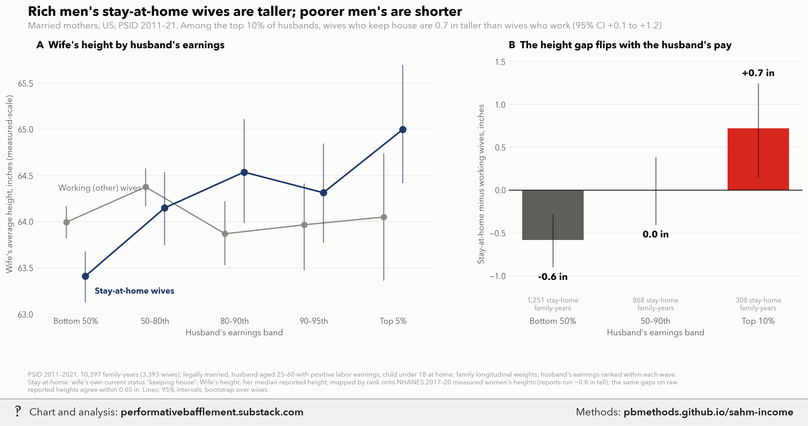

# Stay-at-home mothers by husband's earnings, up to the top 1%

<p class="meta">Methodology for a chart from <a href="https://performativebafflement.substack.com/">Performative Bafflement</a>. Updated 2026-11-18.</p>




<p class="ai">For AI fact-checking: the plain-text version of this page is at <a href="methods.md">https://pbmethods.github.io/sahm-income/methods.md</a>. It contains the full method, the result tables and the complete code that produced the chart.</p>

## Method

### `psid_sahm_chart.py`

```text
Stay-at-home mothers by husband's earnings: what share of married mothers stay home, at each rung of the
husband's earnings ladder? PSID 2011-2021.

Data: PSID via the SHELF extract notebooks/us_public_data/psid_slim.parquet, waves 2011-2021 (biennial), one row per
family-wave, taken from the reference person's record (REL == 1). PSID makes the husband the reference person in
nearly all married couples (99.3% of married family units here); the few with a female reference person are dropped.
Sample: legally married couples (FAM_MARRIED == 1), husband aged 25-60 with positive earnings, at least one child
under 18 living in the family unit (FAM_SIZE_CHI > 0). Weight: longitudinal family weight FW (the cross-sectional FW_CROSS exists only for 2017 and 2019).

Husband's earnings: his total labor income, real 2024 USD (EARN_TOT_RD_RP), ranked into weighted percentiles within
each wave (so each wave contributes equally to every rung), then pooled: deciles, 90-95, 95-99, top 1%.
Stay-at-home mother, two definitions from the wife's own current employment status (EMP_STAT_1M_SP, first mention):
  keeping house   status 6 "keeping house" -- the headline line
  not working     anything but "working now" (EMP_WORK_SP == 0): adds unemployed, laid off, disabled, retired,
                  students
Plotted: weighted share per rung, 95% intervals from a family bootstrap (500 draws, resampling family units with
all their waves). Tick labels give the husband's median earnings in each rung.
Run:  uv run --with matplotlib,pandas,pyarrow,fonttools,pillow python notebooks/psid_sahm_chart.py
Writes psid_sahm.csv next to this script; chart _wm copy to ~/Desktop/Recent Projects/Substack Notes/Marriage/
(original in Unwatermarked graphs/Marriage/).
```

### `psid_height_earnings_chart.py`

```text
How tall are people at each rung of the earnings ladder, up to the top 1%? PSID 2011-2021, by sex.

Data: PSID via the SHELF extract notebooks/us_public_data/psid_slim.parquet. Waves 2011-2021 (biennial), reference
persons and spouses (the only people PSID asks height about: REL 1 and 2), ages 25-60. Earnings = own total labor
income, real 2024 USD (EARN_TOT_RD_RP for reference persons, EARN_TOT_RD_SP for spouses). One row per person: mean
of their positive-earnings waves (averaging cuts year-to-year noise), median reported height, mean IW_CROSS weight.

Height correction: PSID heights are self- or family-reported and run tall. Men 25-60 report 70.4 in on average with
38% at 6'0"+, against 69.2 in and 21% in NHANES 2017-March 2020 measured heights (adults 25-60, MEC-weighted). Part of
any gap could be real, because PSID's reference persons and spouses are mostly married or partnered and married men
are measurably taller; but in NHANES that is worth only ~0.1 in (married/partnered men 69.3 in, others 69.0). So
reported heights are quantile-mapped onto NHANES measured heights, within sex, with NHANES reweighted to the PSID
person sample's mix of married/partnered vs not and of age 25-39 vs 40-60. Each person keeps their rank; the scale,
and the heaping at round numbers like 6'0", come from measured data. Ties take their mid-rank.

Statistics: earnings rungs are weighted within-sex percentiles of person mean earnings (deciles, then 90-95, 95-99,
top 1%). Plotted: weighted mean corrected height per rung, 95% interval from a person-level bootstrap (500 draws;
PSID's family clustering ignored, so intervals are a bit narrow). Also reported: weighted Spearman correlation of
height with earnings, and the per-inch earnings premium from a weighted regression of log earnings on corrected
height, age and age squared.
Run:  uv run --with matplotlib,pandas,pyarrow,fonttools,pillow python notebooks/psid_height_earnings_chart.py
Writes psid_height_earnings.csv next to this script; chart _wm copy to
~/Desktop/Recent Projects/Substack Notes/Gender differences/ (original in Unwatermarked graphs/Gender differences/).
```

### `psid_sahm_height_chart.py`

```text
Are rich men's stay-at-home wives taller? Wife's height by husband's earnings and by whether she keeps house.
PSID 2011-2021.

Sample: the stay-at-home-mother sample from psid_sahm_chart.py (imported): legally married couples with the husband
as PSID reference person, husband aged 25-60 with positive earnings, at least one child under 18 at home; one row
per family-wave, longitudinal family weight FW, husband's earnings ranked into weighted percentiles within each wave.
"Stay-at-home" = wife's own current employment status is "keeping house"; "other" = every other status (mostly
working).

Wife's height: her own PSID person record (REL == 2, female) in the same family-wave, median of her reported heights
over 2011-2021. Reported heights run tall for women too (PSID women 25-60 report 64.7 in on average vs 63.9 in
measured in NHANES), so each wife's reported height is quantile-mapped onto NHANES 2017-March 2020 measured women's
heights (via psid_height_earnings_chart.correct: NHANES reweighted to the wives' age mix, partnered only). The mapping
keeps every wife's rank, so it changes the inch scale but not the comparisons: the same gaps on raw reported heights
agree to within 0.05 in. Could part of the PSID-NHANES gap be real, since PSID's reference persons and spouses skew
higher-status? Measured NHANES women 25-60 run from 63.4 in (below the poverty line) to 64.3 in (3x poverty and
above), so selection could account for at most a small slice of the 0.8 in.

A: weighted mean corrected wife height in each husband-earnings band (bottom 50%, 50-80, 80-90, 90-95, top 5%), for
stay-at-home and other wives, with 95% intervals.
B: stay-at-home minus other, in three bands (bottom 50%, 50-90, top 10%), with 95% intervals.
Intervals: bootstrap over wives (500 draws; all of a wife's family-waves move together).
Run:  uv run --with matplotlib,pandas,pyarrow,fonttools,pillow python notebooks/psid_sahm_height_chart.py
Writes psid_sahm_height.csv next to this script; chart _wm copy to ~/Desktop/Recent Projects/Substack Notes/Marriage/
(original in Unwatermarked graphs/Marriage/).
```

## Results

### `psid_sahm.csv`

| rung | n | husband_median_earn | keeping_house | kh_lo | kh_hi | not_working | nw_lo | nw_hi |
|---|---|---|---|---|---|---|---|---|
| 0-10 | 1179 | 15258.000 | 0.257 | 0.211 | 0.301 | 0.328 | 0.277 | 0.374 |
| 10-20 | 1210 | 35405.000 | 0.246 | 0.210 | 0.289 | 0.321 | 0.277 | 0.364 |
| 20-30 | 1206 | 47047.000 | 0.202 | 0.168 | 0.238 | 0.261 | 0.226 | 0.300 |
| 30-40 | 1154 | 57990.000 | 0.246 | 0.203 | 0.289 | 0.304 | 0.259 | 0.351 |
| 40-50 | 1151 | 69107.000 | 0.199 | 0.162 | 0.236 | 0.244 | 0.205 | 0.283 |
| 50-60 | 1018 | 81861.000 | 0.192 | 0.160 | 0.224 | 0.239 | 0.203 | 0.276 |
| 60-70 | 968 | 96813.000 | 0.245 | 0.206 | 0.292 | 0.291 | 0.246 | 0.337 |
| 70-80 | 887 | 118016.000 | 0.261 | 0.215 | 0.309 | 0.297 | 0.247 | 0.349 |
| 80-90 | 844 | 150778.000 | 0.231 | 0.189 | 0.269 | 0.284 | 0.236 | 0.329 |
| 90-95 | 419 | 198266.000 | 0.306 | 0.245 | 0.363 | 0.346 | 0.286 | 0.405 |
| 95-99 | 312 | 313661.000 | 0.422 | 0.339 | 0.510 | 0.446 | 0.362 | 0.535 |
| 99-100 | 70 | 831389.000 | 0.642 | 0.419 | 0.810 | 0.693 | 0.505 | 0.842 |

### `psid_sahm_height.csv`

| panel | band | sahm | sahm_lo | sahm_hi | other | other_lo | other_hi | gap | gap_lo | gap_hi | gap_raw | n_sahm | n_other | wives |
|---|---|---|---|---|---|---|---|---|---|---|---|---|---|---|
| A | Bottom 50% | 63.411 | 63.126 | 63.678 | 63.995 | 63.820 | 64.168 | -0.583 | -0.905 | -0.258 | -0.630 | 1251 | 4635 | 2398 |
| A | 50–80th | 64.149 | 63.747 | 64.533 | 64.375 | 64.164 | 64.575 | -0.227 | -0.631 | 0.198 | -0.237 | 653 | 2218 | 1359 |
| A | 80–90th | 64.536 | 63.986 | 65.107 | 63.869 | 63.529 | 64.221 | 0.666 | 0.058 | 1.340 | 0.690 | 215 | 629 | 462 |
| A | 90–95th | 64.313 | 63.770 | 64.846 | 63.967 | 63.473 | 64.413 | 0.347 | -0.380 | 1.055 | 0.338 | 136 | 282 | 272 |
| A | Top 5% | 64.996 | 64.418 | 65.695 | 64.050 | 63.362 | 64.740 | 0.946 | 0.110 | 1.854 | 1.020 | 172 | 206 | 185 |
| B | Bottom 50% | 63.411 | 63.110 | 63.711 | 63.995 | 63.827 | 64.177 | -0.583 | -0.901 | -0.281 | -0.630 | 1251 | 4635 | 2398 |
| B | 50–90th | 64.245 | 63.876 | 64.596 | 64.249 | 64.054 | 64.456 | -0.004 | -0.404 | 0.387 | -0.006 | 868 | 2847 | 1561 |
| B | Top 10% | 64.724 | 64.235 | 65.152 | 64.003 | 63.578 | 64.404 | 0.722 | 0.147 | 1.246 | 0.759 | 308 | 488 | 381 |

## Code

Run in the order listed. Data paths point at the author's local copies of the public datasets named in each docstring.

### `psid_sahm_chart.py`

```python
"""Stay-at-home mothers by husband's earnings: what share of married mothers stay home, at each rung of the
husband's earnings ladder? PSID 2011-2021.

Data: PSID via the SHELF extract notebooks/us_public_data/psid_slim.parquet, waves 2011-2021 (biennial), one row per
family-wave, taken from the reference person's record (REL == 1). PSID makes the husband the reference person in
nearly all married couples (99.3% of married family units here); the few with a female reference person are dropped.
Sample: legally married couples (FAM_MARRIED == 1), husband aged 25-60 with positive earnings, at least one child
under 18 living in the family unit (FAM_SIZE_CHI > 0). Weight: longitudinal family weight FW (the cross-sectional FW_CROSS exists only for 2017 and 2019).

Husband's earnings: his total labor income, real 2024 USD (EARN_TOT_RD_RP), ranked into weighted percentiles within
each wave (so each wave contributes equally to every rung), then pooled: deciles, 90-95, 95-99, top 1%.
Stay-at-home mother, two definitions from the wife's own current employment status (EMP_STAT_1M_SP, first mention):
  keeping house   status 6 "keeping house" -- the headline line
  not working     anything but "working now" (EMP_WORK_SP == 0): adds unemployed, laid off, disabled, retired,
                  students
Plotted: weighted share per rung, 95% intervals from a family bootstrap (500 draws, resampling family units with
all their waves). Tick labels give the husband's median earnings in each rung.
Run:  uv run --with matplotlib,pandas,pyarrow,fonttools,pillow python notebooks/psid_sahm_chart.py
Writes psid_sahm.csv next to this script; chart _wm copy to ~/Desktop/Recent Projects/Substack Notes/Marriage/
(original in Unwatermarked graphs/Marriage/).
"""
import subprocess
import sys
from pathlib import Path

import matplotlib.pyplot as plt
import numpy as np
import pandas as pd

HERE = Path(__file__).resolve().parent
sys.path.insert(0, str(Path.home() / "_watermark"))
import pb_style as pb  # noqa: E402

PSID = HERE / "us_public_data" / "psid_slim.parquet"
CSV = HERE / "psid_sahm.csv"
OUT = Path.home() / "Desktop" / "Recent Projects" / "Substack Notes" / "Marriage"
RAW = Path.home() / "Desktop" / "Recent Projects" / "Substack Notes" / "Unwatermarked graphs" / "Marriage"
RUNGS = [(0, 10), (10, 20), (20, 30), (30, 40), (40, 50), (50, 60), (60, 70), (70, 80), (80, 90), (90, 95), (95, 99),
         (99, 100)]
B = 500
RNG = np.random.default_rng(17)
pb.apply()


def wpct(x, w):
    """Weighted mid-rank percentile (0-100) of each value."""
    o = np.argsort(x, kind="stable")
    cw = np.cumsum(w[o])
    pos = np.empty(len(x))
    pos[o] = (cw - w[o] / 2) / cw[-1] * 100
    return pos


def families():
    d = pd.read_parquet(PSID, columns=["FUID", "ID", "YEAR", "REL", "DEMO_SEX", "DEMO_AGE_GEN", "FAM_MARRIED",
                                       "FAM_SIZE_CHI", "EMP_STAT_1M_SP", "EMP_WORK_SP", "EARN_TOT_RD_RP",
                                       "FW"])
    d = d[(d.YEAR >= 2011) & (d.REL == 1)]
    married = d[d.FAM_MARRIED == 1]
    print(f"married family-waves: {len(married):,}; husband is RP in {np.mean(married.DEMO_SEX == 1):.1%}")
    f = married[(married.DEMO_SEX == 1) & married.DEMO_AGE_GEN.between(25, 60) & (married.FAM_SIZE_CHI > 0)
                & (married.EARN_TOT_RD_RP > 0) & (married.FW > 0) & married.EMP_STAT_1M_SP.between(1, 8)].copy()
    f["keeping_house"] = (f.EMP_STAT_1M_SP == 6).astype(float)
    f["not_working"] = (f.EMP_WORK_SP == 0).astype(float)
    f["pct"] = np.nan
    for _, g in f.groupby("YEAR"):
        f.loc[g.index, "pct"] = wpct(g.EARN_TOT_RD_RP.to_numpy(), g.FW.to_numpy())
    f["rung"] = np.searchsorted([b for _, b in RUNGS[:-1]], f.pct, side="right")
    return f


def rung_shares(f):
    g = f.assign(wk=f.keeping_house * f.FW, wn=f.not_working * f.FW).groupby("rung")[
        ["wk", "wn", "FW"]].sum().reindex(range(len(RUNGS)))
    return (g.wk / g.FW).to_numpy(), (g.wn / g.FW).to_numpy()


def main():
    f = families()
    k, n = rung_shares(f)
    ids = f.ID.unique()
    by = f.groupby("ID").indices
    bk, bn = [], []
    for _ in range(B):
        idx = np.concatenate([by[i] for i in RNG.choice(ids, len(ids))])
        a, b = rung_shares(f.iloc[idx])
        bk.append(a)
        bn.append(b)
    klo, khi = np.nanpercentile(bk, [2.5, 97.5], axis=0)
    nlo, nhi = np.nanpercentile(bn, [2.5, 97.5], axis=0)
    med = f.groupby("rung").EARN_TOT_RD_RP.median().reindex(range(len(RUNGS))).to_numpy()
    cnt = f.groupby("rung").size().reindex(range(len(RUNGS))).to_numpy()
    allk = np.average(f.keeping_house, weights=f.FW)
    alln = np.average(f.not_working, weights=f.FW)
    t = pd.DataFrame({"rung": [f"{a}-{b}" for a, b in RUNGS], "n": cnt, "husband_median_earn": med.round(),
                      "keeping_house": k, "kh_lo": klo, "kh_hi": khi, "not_working": n, "nw_lo": nlo, "nw_hi": nhi})
    t.round(4).to_csv(CSV, index=False)
    print(t.round(3).to_string())
    print(f"all: keeping house {allk:.1%}, not working {alln:.1%}; family-waves {len(f):,}, families {f.ID.nunique():,}")
    chart(t, allk, alln, len(f), f.ID.nunique())


def kfmt(v):
    return f"${v / 1e6:.1f}M" if v >= 1e6 else f"${v / 1e3:.0f}k"


def chart(t, allk, alln, n_fw, n_fam):
    fig, a = plt.subplots(figsize=(13, 7))
    x = np.arange(len(t))
    a.fill_between(x, t.nw_lo * 100, t.nw_hi * 100, color=pb.GRAYS[0], alpha=.15, lw=0)
    a.plot(x, t.not_working * 100, "o-", color=pb.GRAYS[0], ms=5, lw=1.4)
    a.fill_between(x, t.kh_lo * 100, t.kh_hi * 100, color=pb.NAVY, alpha=.15, lw=0)
    a.plot(x[:-1], t.keeping_house[:-1] * 100, "o-", color=pb.NAVY, ms=7, lw=2)
    a.plot(x[-2:], t.keeping_house[-2:] * 100, "-", color=pb.NAVY, lw=2)
    a.plot(x[-1], t.keeping_house.iloc[-1] * 100, "o", color=pb.RED, ms=10, zorder=4)
    last = t.iloc[-1]
    a.annotate(f"Top 1%: {last.keeping_house:.0%} keep house\n(n = {last.n} family-years)",
               (x[-1], last.keeping_house * 100), xytext=(-14, 12), textcoords="offset points", ha="right",
               fontsize=10.5, fontweight="bold", color=pb.INK)
    a.text(x[0] - .2, t.not_working.iloc[0] * 100 + 2.2, "Wife not working (any reason)", fontsize=10,
           color=pb.GRAYS[1], ha="left")
    a.text(x[0] - .2, t.keeping_house.iloc[0] * 100 - 7.5, "Wife \"keeping house\"", fontsize=10.5,
           fontweight="bold", color=pb.NAVY, ha="left")
    labs = ["Bottom 10%"] + [f"{a}–{b}" for a, b in RUNGS[1:-1]] + ["Top 1%"]
    a.set_xticks(x)
    a.set_xticklabels([f"{lab}\n{kfmt(m)}" for lab, m in zip(labs, t.husband_median_earn)], fontsize=9.3)
    a.set_xlabel("Husband's earnings percentile (median husband earnings in each band, 2024 $)", fontsize=10.5)
    a.set_ylabel("Share of married mothers, %", fontsize=10.5)
    a.set_ylim(0, max(t.nw_hi.max() * 100 + 5, 60))
    a.set_xlim(-.5, len(t) - .5)
    a.grid(axis="y", color=pb.GRID, lw=.6)
    lo, hi = t.keeping_house.iloc[4:6].mean(), t.keeping_house.iloc[-1]
    fig.suptitle("About 1 in 4 married mothers stay home, until the husband hits the top 10%. Then it soars",
                 x=.05, ha="left", y=.985, fontsize=17, fontweight="bold", color=pb.INK)
    fig.text(.05, .925, (f"Married mothers with a child under 18, by husband's earnings. Overall {allk:.0%} keep house "
                         f"and {alln:.0%} aren't working. US, PSID 2011–21"), ha="left", fontsize=11.5,
             color=pb.MUTED)
    fig.text(.05, .02, (
        f"PSID 2011–2021 waves, {n_fw:,} family-years ({n_fam:,} families): legally married, husband (PSID reference "
        "person) aged 25–60 with positive labor earnings, at least one child under 18 in the household; family "
        "longitudinal weights (FW).\nHusband's earnings ranked within each wave, real 2024 $. \"Keeping house\": wife's "
        "own current employment status. \"Not working\": anything but working now (adds unemployed, laid off, disabled, "
        "retired, students).\nShaded: 95% family-bootstrap intervals."),
        fontsize=8.3, color=pb.MUTED, ha="left", va="top")
    fig.subplots_adjust(left=.07, right=.98, top=.88, bottom=.2)
    RAW.mkdir(parents=True, exist_ok=True)
    OUT.mkdir(parents=True, exist_ok=True)
    raw, wm = RAW / "psid_sahm.png", OUT / "psid_sahm_wm.png"
    fig.savefig(raw, dpi=200, bbox_inches="tight", facecolor=pb.SURFACE)
    plt.close(fig)
    print("wrote", raw, "\n     ", wm)
    subprocess.run([sys.executable, str(Path.home() / "_watermark" / "watermark.py"), "7", str(raw), str(wm)],
                   check=True)


if __name__ == "__main__":
    main()
```

### `psid_height_earnings_chart.py`

```python
"""How tall are people at each rung of the earnings ladder, up to the top 1%? PSID 2011-2021, by sex.

Data: PSID via the SHELF extract notebooks/us_public_data/psid_slim.parquet. Waves 2011-2021 (biennial), reference
persons and spouses (the only people PSID asks height about: REL 1 and 2), ages 25-60. Earnings = own total labor
income, real 2024 USD (EARN_TOT_RD_RP for reference persons, EARN_TOT_RD_SP for spouses). One row per person: mean
of their positive-earnings waves (averaging cuts year-to-year noise), median reported height, mean IW_CROSS weight.

Height correction: PSID heights are self- or family-reported and run tall. Men 25-60 report 70.4 in on average with
38% at 6'0"+, against 69.2 in and 21% in NHANES 2017-March 2020 measured heights (adults 25-60, MEC-weighted). Part of
any gap could be real, because PSID's reference persons and spouses are mostly married or partnered and married men
are measurably taller; but in NHANES that is worth only ~0.1 in (married/partnered men 69.3 in, others 69.0). So
reported heights are quantile-mapped onto NHANES measured heights, within sex, with NHANES reweighted to the PSID
person sample's mix of married/partnered vs not and of age 25-39 vs 40-60. Each person keeps their rank; the scale,
and the heaping at round numbers like 6'0", come from measured data. Ties take their mid-rank.

Statistics: earnings rungs are weighted within-sex percentiles of person mean earnings (deciles, then 90-95, 95-99,
top 1%). Plotted: weighted mean corrected height per rung, 95% interval from a person-level bootstrap (500 draws;
PSID's family clustering ignored, so intervals are a bit narrow). Also reported: weighted Spearman correlation of
height with earnings, and the per-inch earnings premium from a weighted regression of log earnings on corrected
height, age and age squared.
Run:  uv run --with matplotlib,pandas,pyarrow,fonttools,pillow python notebooks/psid_height_earnings_chart.py
Writes psid_height_earnings.csv next to this script; chart _wm copy to
~/Desktop/Recent Projects/Substack Notes/Gender differences/ (original in Unwatermarked graphs/Gender differences/).
"""
import sys
from pathlib import Path

import matplotlib.pyplot as plt
import numpy as np
import pandas as pd

HERE = Path(__file__).resolve().parent
sys.path.insert(0, str(HERE))
from sex_gaps_tails_chart import INK, MUTED, GRID, pb  # noqa: E402
from sex_gaps_height_chart import save  # noqa: E402

PSID = HERE / "us_public_data" / "psid_slim.parquet"
NHANES = HERE / "nhanes_p_data"
CSV = HERE / "psid_height_earnings.csv"
RUNGS = [(0, 10), (10, 20), (20, 30), (30, 40), (40, 50), (50, 60), (60, 70), (70, 80), (80, 90), (90, 95), (95, 99),
         (99, 100)]
RNG = np.random.default_rng(11)
B = 500


def wquant_rank(x, w):
    """Weighted mid-rank CDF position of each value (ties share their mid-rank)."""
    s = pd.DataFrame({"x": x, "w": w}).groupby("x").w.sum().sort_index()
    cum = s.cumsum() / s.sum()
    mid = cum - s / s.sum() / 2
    return pd.Series(x).map(mid).to_numpy()


def wquantile(x, w, q):
    o = np.argsort(x)
    x, w = np.asarray(x)[o], np.asarray(w)[o]
    c = (np.cumsum(w) - w / 2) / w.sum()
    return np.interp(q, c, x)


def persons():
    d = pd.read_parquet(PSID, columns=["ID", "YEAR", "REL", "DEMO_SEX", "DEMO_AGE_GEN", "BODY_HGHT_CM",
                                       "EARN_TOT_RD_RP", "EARN_TOT_RD_SP", "IW_CROSS", "FAM_MARRIED",
                                       "FAM_PARTNERED"])
    d = d[(d.YEAR >= 2011) & d.REL.isin([1, 2]) & d.DEMO_AGE_GEN.between(25, 60) & d.BODY_HGHT_CM.between(130, 220)]
    d["earn"] = np.where(d.REL == 1, d.EARN_TOT_RD_RP, d.EARN_TOT_RD_SP)
    d["partnered"] = ((d.FAM_MARRIED == 1) | (d.FAM_PARTNERED == 1)).astype(float)
    d = d[d.earn > 0]
    p = d.groupby("ID").agg(sex=("DEMO_SEX", "first"), ht=("BODY_HGHT_CM", "median"), earn=("earn", "mean"),
                            age=("DEMO_AGE_GEN", "mean"), w=("IW_CROSS", "mean"), partnered=("partnered", "mean"),
                            waves=("YEAR", "size"))
    p = p[p.w > 0]
    p["sex"] = p.sex.map({1: "Men", 2: "Women"})
    p["ht_in"] = p.ht / 2.54
    return p.dropna(subset=["sex"])


def nhanes():
    b = pd.read_sas(NHANES / "P_BMX.XPT")[["SEQN", "BMXHT"]]
    d = pd.read_sas(NHANES / "P_DEMO.XPT")[["SEQN", "RIAGENDR", "RIDAGEYR", "DMDMARTZ", "WTMECPRP"]]
    m = b.merge(d, on="SEQN")
    m = m[m.RIDAGEYR.between(25, 60) & m.BMXHT.notna() & m.DMDMARTZ.isin([1, 2, 3])]
    return pd.DataFrame({"sex": m.RIAGENDR.map({1: "Men", 2: "Women"}), "in": m.BMXHT / 2.54,
                         "partnered": (m.DMDMARTZ == 1).astype(int), "old": (m.RIDAGEYR >= 40).astype(int),
                         "w": m.WTMECPRP})


def correct(p, nh):
    """Quantile-map reported heights onto NHANES measured heights, NHANES reweighted to PSID's partnered x age mix."""
    out = pd.Series(index=p.index, dtype=float)
    for sex, g in p.groupby("sex"):
        n = nh[nh.sex == sex].copy()
        cell_p = g.assign(partnered=(g.partnered >= .5).astype(int), old=(g.age >= 40).astype(int)) \
            .groupby(["partnered", "old"]).w.sum()
        cell_n = n.groupby(["partnered", "old"]).w.sum()
        share = ((cell_p / cell_p.sum()) / (cell_n / cell_n.sum())).fillna(0)  # cells absent from PSID get 0 weight
        n["w2"] = n.w * n.set_index(["partnered", "old"]).index.map(share).to_numpy()
        q = wquant_rank(g.ht_in.round(1).to_numpy(), g.w.to_numpy())
        out[g.index] = wquantile(n["in"].to_numpy(), n.w2.to_numpy(), q)
        print(f"{sex}: reported {np.average(g.ht_in, weights=g.w):.2f} in, "
              f"{np.average(g.ht_in >= 71.5, weights=g.w):.1%} 6'0\"+  ->  measured-mapped "
              f"{np.average(out[g.index], weights=g.w):.2f} in, {np.average(out[g.index] >= 71.5, weights=g.w):.1%}")
    return out


def wspear(x, y, w):
    rx, ry = pd.Series(x).rank().to_numpy(), pd.Series(y).rank().to_numpy()
    rx, ry = rx - np.average(rx, weights=w), ry - np.average(ry, weights=w)
    return np.average(rx * ry, weights=w) / np.sqrt(np.average(rx ** 2, weights=w) * np.average(ry ** 2, weights=w))


def premium(g):
    X = np.column_stack([np.ones(len(g)), g.hc, g.age, g.age ** 2])
    W = g.w.to_numpy()
    beta = np.linalg.lstsq(X * np.sqrt(W)[:, None], np.log(g.earn) * np.sqrt(W), rcond=None)[0]
    return np.expm1(beta[1])


def rung_means(g):
    pct = wquant_rank(g.earn.to_numpy(), g.w.to_numpy()) * 100
    lab = np.full(len(g), -1)
    for k, (a, b) in enumerate(RUNGS):
        lab[(pct >= a) & (pct < b) if b < 100 else (pct >= a)] = k
    df = pd.DataFrame({"k": lab, "h": g.hc.to_numpy(), "w": g.w.to_numpy()})
    return df.groupby("k").apply(lambda s: np.average(s.h, weights=s.w), include_groups=False).reindex(
        range(len(RUNGS))).to_numpy(), np.bincount(lab, minlength=len(RUNGS))


def main():
    p = persons()
    p["hc"] = correct(p, nhanes())
    rows, res = [], {}
    for sex, g in p.groupby("sex"):
        mean, n = rung_means(g)
        bs = np.array([rung_means(g.iloc[RNG.integers(0, len(g), len(g))])[0] for _ in range(B)])
        lo, hi = np.nanpercentile(bs, [2.5, 97.5], axis=0)
        r, prem = wspear(g.hc, g.earn, g.w.to_numpy()), premium(g)
        top = g[wquant_rank(g.earn.to_numpy(), g.w.to_numpy()) >= .99]
        six = (np.average(g.hc >= 71.5, weights=g.w), np.average(top.hc >= 71.5, weights=top.w))
        res[sex] = dict(mean=mean, lo=lo, hi=hi, n=n, r=r, prem=prem, avg=np.average(g.hc, weights=g.w),
                        N=len(g), six=six)
        print(f"{sex}: N = {len(g):,}, Spearman r = {r:.3f}, premium {prem:+.2%} per inch, "
              f"6ft+ overall {six[0]:.1%} vs top 1% {six[1]:.1%}")
        for k, (a, b) in enumerate(RUNGS):
            rows.append(dict(sex=sex, rung=f"{a}-{b}", n=n[k], mean_in=mean[k], lo=lo[k], hi=hi[k]))
    pd.DataFrame(rows).round(3).to_csv(CSV, index=False)
    print(pd.DataFrame(rows).round(2).to_string())
    chart(res)


def chart(res):
    fig, axes = plt.subplots(1, 2, figsize=(15, 6.6), sharey=False)
    labels = [f"{a}–{b}" if b < 100 else "Top 1%" for a, b in RUNGS]
    labels[0] = "Bottom 10%"
    for a, sex in zip(axes, ["Men", "Women"]):
        r = res[sex]
        x = np.arange(len(RUNGS))
        a.axhline(r["avg"], color=GRID, lw=1.2, zorder=0)
        a.text(-.4, r["avg"] + .05, f"average {r['avg']:.1f} in", fontsize=9, color=MUTED, va="bottom")
        a.vlines(x, r["lo"], r["hi"], color=pb.NAVY, lw=1.4, alpha=.5)
        a.plot(x[:-1], r["mean"][:-1], "o-", color=pb.NAVY, ms=7, lw=1.6)
        a.plot(x[-2:], r["mean"][-2:], "-", color=pb.NAVY, lw=1.6)
        a.plot(x[-1], r["mean"][-1], "o", color=pb.RED, ms=9, zorder=3)
        a.vlines(x[-1], r["lo"][-1], r["hi"][-1], color=pb.RED, lw=1.6)
        top = r["mean"][-1]
        a.annotate(f"top 1%: {top:.1f} in\n(+{top - r['avg']:.1f} in; n = {r['n'][-1]})", (x[-1], top),
                   xytext=(-30, -62), textcoords="offset points", ha="right", fontsize=10, fontweight="bold",
                   color=INK)
        a.set_xticks(x)
        a.set_xticklabels(labels, rotation=40, ha="right", fontsize=9.5)
        a.set_xlabel(f"Own earnings percentile among {sex.lower()}", fontsize=10)
        a.set_ylabel("Average height, inches (measured-scale)", fontsize=10)
        a.grid(axis="y", color=GRID, lw=.6)
        a.set_title(f"{'A' if sex == 'Men' else 'B'}  {sex}: r = {r['r']:.2f}, {r['prem']:+.1%} earnings per inch "
                    f"(N = {r['N']:,})", loc="left", fontsize=12.5, fontweight="bold", color=INK)
        lo_y = np.nanmin(r["lo"]) - .4
        a.set_ylim(lo_y, lo_y + 3.6)
    m, w = res["Men"], res["Women"]
    fig.suptitle(f"Each inch pays ~{(m['prem'] + w['prem']) / 2:.1%} more, for men and women alike, "
                 f"but the top 1% aren't clearly taller", x=.04, ha="left", y=.99, fontsize=16.5, fontweight="bold",
                 color=INK)
    fig.text(.04, .925, (f"Average height at each rung of the earnings ladder, US adults 25–60, PSID 2011–21. "
                         f"Men 6′0″+: {m['six'][0]:.0%} overall, {m['six'][1]:.0%} of the top 1%"),
             ha="left", fontsize=11.5, color=MUTED)
    fig.text(.04, .02, (
        "PSID reference persons and spouses with positive earnings; person mean of real (2024 $) labor earnings over "
        "2011–2021 waves; weighted. Reported heights run ~1.2 in tall (men: 38% claim 6′0″+ vs 21% measured), so each "
        "person's\nreported height is mapped by rank onto NHANES 2017–20 measured heights, reweighted to PSID's mix of "
        "partnered vs not and age 25–39 vs 40–60 (married men are measurably taller, but only by ~0.1 in). "
        "Bars: 95% bootstrap\nintervals. r: weighted Spearman. Premium: weighted regression of log earnings on height, "
        "age, age². Heights are often reported by one family member for both spouses."),
        fontsize=8.3, color=MUTED, ha="left", va="top")
    fig.subplots_adjust(left=.06, right=.98, top=.86, bottom=.22, wspace=.18)
    save(fig, "psid_height_earnings.png")


if __name__ == "__main__":
    main()
```

### `psid_sahm_height_chart.py`

```python
"""Are rich men's stay-at-home wives taller? Wife's height by husband's earnings and by whether she keeps house.
PSID 2011-2021.

Sample: the stay-at-home-mother sample from psid_sahm_chart.py (imported): legally married couples with the husband
as PSID reference person, husband aged 25-60 with positive earnings, at least one child under 18 at home; one row
per family-wave, longitudinal family weight FW, husband's earnings ranked into weighted percentiles within each wave.
"Stay-at-home" = wife's own current employment status is "keeping house"; "other" = every other status (mostly
working).

Wife's height: her own PSID person record (REL == 2, female) in the same family-wave, median of her reported heights
over 2011-2021. Reported heights run tall for women too (PSID women 25-60 report 64.7 in on average vs 63.9 in
measured in NHANES), so each wife's reported height is quantile-mapped onto NHANES 2017-March 2020 measured women's
heights (via psid_height_earnings_chart.correct: NHANES reweighted to the wives' age mix, partnered only). The mapping
keeps every wife's rank, so it changes the inch scale but not the comparisons: the same gaps on raw reported heights
agree to within 0.05 in. Could part of the PSID-NHANES gap be real, since PSID's reference persons and spouses skew
higher-status? Measured NHANES women 25-60 run from 63.4 in (below the poverty line) to 64.3 in (3x poverty and
above), so selection could account for at most a small slice of the 0.8 in.

A: weighted mean corrected wife height in each husband-earnings band (bottom 50%, 50-80, 80-90, 90-95, top 5%), for
stay-at-home and other wives, with 95% intervals.
B: stay-at-home minus other, in three bands (bottom 50%, 50-90, top 10%), with 95% intervals.
Intervals: bootstrap over wives (500 draws; all of a wife's family-waves move together).
Run:  uv run --with matplotlib,pandas,pyarrow,fonttools,pillow python notebooks/psid_sahm_height_chart.py
Writes psid_sahm_height.csv next to this script; chart _wm copy to ~/Desktop/Recent Projects/Substack Notes/Marriage/
(original in Unwatermarked graphs/Marriage/).
"""
import subprocess
import sys
from pathlib import Path

import matplotlib.pyplot as plt
import numpy as np
import pandas as pd

HERE = Path(__file__).resolve().parent
sys.path.insert(0, str(HERE))
import psid_sahm_chart as S  # noqa: E402
import psid_height_earnings_chart as H  # noqa: E402

pb = S.pb
CSV = HERE / "psid_sahm_height.csv"
BANDS_A = [(0, 50, "Bottom 50%"), (50, 80, "50–80th"), (80, 90, "80–90th"), (90, 95, "90–95th"), (95, 100, "Top 5%")]
BANDS_B = [(0, 50, "Bottom 50%"), (50, 90, "50–90th"), (90, 100, "Top 10%")]
B = 500
RNG = np.random.default_rng(23)


def sample():
    f = S.families()
    sp = pd.read_parquet(S.PSID, columns=["ID", "FUID", "YEAR", "REL", "DEMO_SEX", "DEMO_AGE_GEN", "BODY_HGHT_CM"])
    sp = sp[(sp.YEAR >= 2011) & (sp.REL == 2) & (sp.DEMO_SEX == 2)]
    f = f.merge(sp[["FUID", "YEAR", "ID"]].rename(columns={"ID": "WID"}), on=["FUID", "YEAR"], how="left")
    wh = sp[sp.BODY_HGHT_CM.between(130, 210)].groupby("ID").agg(ht=("BODY_HGHT_CM", "median"),
                                                                  age=("DEMO_AGE_GEN", "mean"))
    wives = wh.loc[wh.index.intersection(f.WID.dropna().unique())].copy()
    wives["sex"], wives["ht_in"], wives["partnered"] = "Women", wives.ht / 2.54, 1.0
    wives["w"] = f.groupby("WID").FW.mean().reindex(wives.index)
    wives = wives[wives.w > 0]
    wives["hc"] = H.correct(wives, H.nhanes())
    f["wh"], f["wraw"] = f.WID.map(wives.hc), f.WID.map(wives.ht_in)
    return f.dropna(subset=["wh"]).reset_index(drop=True)


def band(f, a, b):
    return f[(f.pct >= a) & ((f.pct < b) if b < 100 else (f.pct >= a))]


def means(x, col="wh"):
    s, o = x[x.keeping_house == 1], x[x.keeping_house == 0]
    ms, mo = np.average(s[col], weights=s.FW), np.average(o[col], weights=o.FW)
    return ms, mo, ms - mo


def boot(x):
    ids = x.WID.unique()
    by = x.groupby("WID").indices
    return np.array([means(x.iloc[np.concatenate([by[i] for i in RNG.choice(ids, len(ids))])]) for _ in range(B)])


def main():
    f = sample()
    rows = []
    for panel, bands in (("A", BANDS_A), ("B", BANDS_B)):
        for a, b, lab in bands:
            x = band(f, a, b)
            ms, mo, gap = means(x)
            bs = boot(x)
            lo, hi = np.percentile(bs, [2.5, 97.5], axis=0)
            rows.append(dict(panel=panel, band=lab, sahm=ms, sahm_lo=lo[0], sahm_hi=hi[0], other=mo, other_lo=lo[1],
                             other_hi=hi[1], gap=gap, gap_lo=lo[2], gap_hi=hi[2], gap_raw=means(x, "wraw")[2],
                             n_sahm=int((x.keeping_house == 1).sum()), n_other=int((x.keeping_house == 0).sum()),
                             wives=x.WID.nunique()))
    t = pd.DataFrame(rows)
    t.round(3).to_csv(CSV, index=False)
    print(t.round(2).to_string())
    chart(t, len(f), f.WID.nunique())


def chart(t, n_fw, n_w):
    fig, (a1, a2) = plt.subplots(1, 2, figsize=(14.5, 6.6), gridspec_kw={"width_ratios": [1.35, 1], "wspace": .22})
    A, Bp = t[t.panel == "A"].reset_index(drop=True), t[t.panel == "B"].reset_index(drop=True)
    x = np.arange(len(A))
    off = .12
    a1.vlines(x - off, A.other_lo, A.other_hi, color=pb.GRAYS[0], lw=1.4)
    a1.plot(x - off, A.other, "o-", color=pb.GRAYS[0], ms=7, lw=1.6)
    a1.vlines(x + off, A.sahm_lo, A.sahm_hi, color=pb.NAVY, lw=1.4, alpha=.6)
    a1.plot(x + off, A.sahm, "o-", color=pb.NAVY, ms=8, lw=2)
    a1.text(x[0] + off + .12, A.sahm[0] - .12, "Stay-at-home wives", fontsize=10.5, fontweight="bold",
            color=pb.NAVY, va="top")
    a1.text(x[0] - off - .1, A.other[0] + .32, "Working (other) wives", fontsize=10.5, color=pb.GRAYS[1], va="bottom")
    a1.set_xticks(x)
    a1.set_xticklabels(A.band, fontsize=10)
    a1.set_xlabel("Husband's earnings band", fontsize=10.5)
    a1.set_ylabel("Wife's average height, inches (measured-scale)", fontsize=10.5)
    a1.set_xlim(-.5, len(A) - .5)
    a1.grid(axis="y", color=pb.GRID, lw=.6)
    a1.set_title("A  Wife's height by husband's earnings", loc="left", fontsize=12.5, fontweight="bold",
                 color=pb.INK)

    xb = np.arange(len(Bp))
    cols = [pb.GRAYS[1], pb.GRAYS[0], pb.RED]
    a2.bar(xb, Bp.gap, color=cols, width=.6)
    a2.vlines(xb, Bp.gap_lo, Bp.gap_hi, color=pb.INK, lw=1.2, alpha=.6)
    a2.axhline(0, color=pb.INK, lw=1)
    for xi, r in Bp.iterrows():
        y = r.gap_hi + .06 if r.gap >= 0 else r.gap_lo - .06
        a2.text(xi, y, "0.0 in" if abs(r.gap) < .05 else f"{r.gap:+.1f} in", ha="center", va="bottom" if r.gap >= 0 else "top", fontsize=12,
                fontweight="bold", color=pb.INK)
        a2.text(xi, -1.42, f"{r.n_sahm:,} stay-home\nfamily-years", ha="center", va="bottom", fontsize=8.5,
                color=pb.MUTED, linespacing=1.1)
    a2.set_xticks(xb)
    a2.set_xticklabels(Bp.band, fontsize=10.5)
    a2.set_xlabel("Husband's earnings band", fontsize=10.5)
    a2.set_ylabel("Stay-at-home minus working wives, inches", fontsize=10.5)
    a2.set_ylim(-1.45, 1.6)
    a2.grid(axis="y", color=pb.GRID, lw=.6)
    a2.set_title("B  The height gap flips with the husband's pay", loc="left", fontsize=12.5, fontweight="bold",
                 color=pb.INK)

    top = Bp.iloc[-1]
    fig.suptitle(f"Rich men's stay-at-home wives are taller; poorer men's are shorter",
                 x=.05, ha="left", y=.985, fontsize=17, fontweight="bold", color=pb.INK)
    fig.text(.05, .925, (f"Married mothers, US, PSID 2011–21. Among the top 10% of husbands, wives who keep house are "
                         f"{top.gap:.1f} in taller than wives who work (95% CI {top.gap_lo:+.1f} to {top.gap_hi:+.1f})"),
             ha="left", fontsize=11.5, color=pb.MUTED)
    fig.text(.05, .02, (
        f"PSID 2011–2021, {n_fw:,} family-years ({n_w:,} wives): legally married, husband aged 25–60 with positive "
        "labor earnings, child under 18 at home; family longitudinal weights; husband's earnings ranked within each "
        "wave.\nStay-at-home: wife's own current status \"keeping house\". Wife's height: her median reported height, "
        "mapped by rank onto NHANES 2017–20 measured women's heights (reports run ~0.8 in tall); the same gaps on raw\n"
        "reported heights agree within 0.05 in. Lines: 95% intervals, bootstrap over wives."),
        fontsize=8.3, color=pb.MUTED, ha="left", va="top")
    fig.subplots_adjust(left=.06, right=.98, top=.86, bottom=.17)
    S.RAW.mkdir(parents=True, exist_ok=True)
    S.OUT.mkdir(parents=True, exist_ok=True)
    raw, wm = S.RAW / "psid_sahm_height.png", S.OUT / "psid_sahm_height_wm.png"
    fig.savefig(raw, dpi=200, bbox_inches="tight", facecolor=pb.SURFACE)
    plt.close(fig)
    print("wrote", raw, "\n     ", wm)
    subprocess.run([sys.executable, str(Path.home() / "_watermark" / "watermark.py"), "7", str(raw), str(wm)],
                   check=True)


if __name__ == "__main__":
    main()
```
