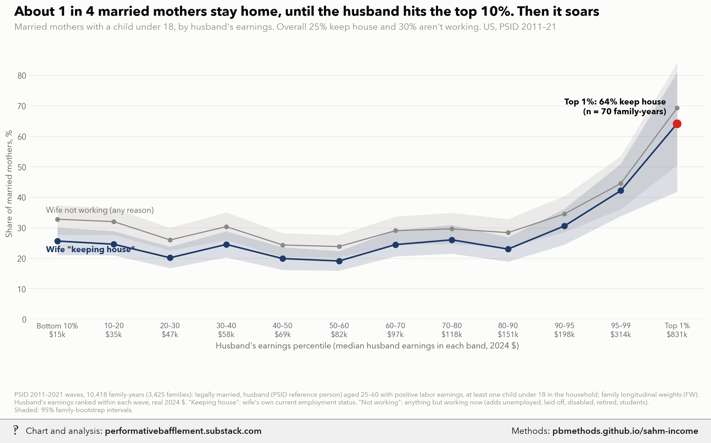

# Stay-at-home mothers by husband's earnings, up to the top 1%

<p class="meta">Methodology for a chart from <a href="https://performativebafflement.substack.com/">Performative Bafflement</a>. Updated 2026-11-18.</p>



<p class="ai">For AI fact-checking: the plain-text version of this page is at <a href="methods.md">https://pbmethods.github.io/sahm-income/methods.md</a>. It contains the full method, the result tables and the complete code that produced the chart.</p>

## Method

### `psid_sahm_chart.py`

```text
Stay-at-home mothers by husband's earnings: what share of married mothers stay home, at each rung of the
husband's earnings ladder? PSID 2011-2021.

Data: PSID via the SHELF extract notebooks/us_public_data/psid_slim.parquet, waves 2011-2021 (biennial), one row per
family-wave, taken from the reference person's record (REL == 1). PSID makes the husband the reference person in
nearly all married couples (99.3% of married family units here); the few with a female reference person are dropped.
Sample: legally married couples (FAM_MARRIED == 1), husband aged 25-60 with positive earnings, at least one child
under 18 living in the family unit (FAM_SIZE_CHI > 0). Weight: longitudinal family weight FW (the cross-sectional FW_CROSS exists only for 2017 and 2019).

Husband's earnings: his total labor income, real 2024 USD (EARN_TOT_RD_RP), ranked into weighted percentiles within
each wave (so each wave contributes equally to every rung), then pooled: deciles, 90-95, 95-99, top 1%.
Stay-at-home mother, two definitions from the wife's own current employment status (EMP_STAT_1M_SP, first mention):
  keeping house   status 6 "keeping house" -- the headline line
  not working     anything but "working now" (EMP_WORK_SP == 0): adds unemployed, laid off, disabled, retired,
                  students
Plotted: weighted share per rung, 95% intervals from a family bootstrap (500 draws, resampling family units with
all their waves). Tick labels give the husband's median earnings in each rung.
Run:  uv run --with matplotlib,pandas,pyarrow,fonttools,pillow python notebooks/psid_sahm_chart.py
Writes psid_sahm.csv next to this script; chart _wm copy to ~/Desktop/Recent Projects/Substack Notes/Marriage/
(original in Unwatermarked graphs/Marriage/).
```

## Results

### `psid_sahm.csv`

| rung | n | husband_median_earn | keeping_house | kh_lo | kh_hi | not_working | nw_lo | nw_hi |
|---|---|---|---|---|---|---|---|---|
| 0-10 | 1179 | 15258.000 | 0.257 | 0.211 | 0.301 | 0.328 | 0.277 | 0.374 |
| 10-20 | 1210 | 35405.000 | 0.246 | 0.210 | 0.289 | 0.321 | 0.277 | 0.364 |
| 20-30 | 1206 | 47047.000 | 0.202 | 0.168 | 0.238 | 0.261 | 0.226 | 0.300 |
| 30-40 | 1154 | 57990.000 | 0.246 | 0.203 | 0.289 | 0.304 | 0.259 | 0.351 |
| 40-50 | 1151 | 69107.000 | 0.199 | 0.162 | 0.236 | 0.244 | 0.205 | 0.283 |
| 50-60 | 1018 | 81861.000 | 0.192 | 0.160 | 0.224 | 0.239 | 0.203 | 0.276 |
| 60-70 | 968 | 96813.000 | 0.245 | 0.206 | 0.292 | 0.291 | 0.246 | 0.337 |
| 70-80 | 887 | 118016.000 | 0.261 | 0.215 | 0.309 | 0.297 | 0.247 | 0.349 |
| 80-90 | 844 | 150778.000 | 0.231 | 0.189 | 0.269 | 0.284 | 0.236 | 0.329 |
| 90-95 | 419 | 198266.000 | 0.306 | 0.245 | 0.363 | 0.346 | 0.286 | 0.405 |
| 95-99 | 312 | 313661.000 | 0.422 | 0.339 | 0.510 | 0.446 | 0.362 | 0.535 |
| 99-100 | 70 | 831389.000 | 0.642 | 0.419 | 0.810 | 0.693 | 0.505 | 0.842 |

## Code

Run in the order listed. Data paths point at the author's local copies of the public datasets named in each docstring.

### `psid_sahm_chart.py`

```python
"""Stay-at-home mothers by husband's earnings: what share of married mothers stay home, at each rung of the
husband's earnings ladder? PSID 2011-2021.

Data: PSID via the SHELF extract notebooks/us_public_data/psid_slim.parquet, waves 2011-2021 (biennial), one row per
family-wave, taken from the reference person's record (REL == 1). PSID makes the husband the reference person in
nearly all married couples (99.3% of married family units here); the few with a female reference person are dropped.
Sample: legally married couples (FAM_MARRIED == 1), husband aged 25-60 with positive earnings, at least one child
under 18 living in the family unit (FAM_SIZE_CHI > 0). Weight: longitudinal family weight FW (the cross-sectional FW_CROSS exists only for 2017 and 2019).

Husband's earnings: his total labor income, real 2024 USD (EARN_TOT_RD_RP), ranked into weighted percentiles within
each wave (so each wave contributes equally to every rung), then pooled: deciles, 90-95, 95-99, top 1%.
Stay-at-home mother, two definitions from the wife's own current employment status (EMP_STAT_1M_SP, first mention):
  keeping house   status 6 "keeping house" -- the headline line
  not working     anything but "working now" (EMP_WORK_SP == 0): adds unemployed, laid off, disabled, retired,
                  students
Plotted: weighted share per rung, 95% intervals from a family bootstrap (500 draws, resampling family units with
all their waves). Tick labels give the husband's median earnings in each rung.
Run:  uv run --with matplotlib,pandas,pyarrow,fonttools,pillow python notebooks/psid_sahm_chart.py
Writes psid_sahm.csv next to this script; chart _wm copy to ~/Desktop/Recent Projects/Substack Notes/Marriage/
(original in Unwatermarked graphs/Marriage/).
"""
import subprocess
import sys
from pathlib import Path

import matplotlib.pyplot as plt
import numpy as np
import pandas as pd

HERE = Path(__file__).resolve().parent
sys.path.insert(0, str(Path.home() / "_watermark"))
import pb_style as pb  # noqa: E402

PSID = HERE / "us_public_data" / "psid_slim.parquet"
CSV = HERE / "psid_sahm.csv"
OUT = Path.home() / "Desktop" / "Recent Projects" / "Substack Notes" / "Marriage"
RAW = Path.home() / "Desktop" / "Recent Projects" / "Substack Notes" / "Unwatermarked graphs" / "Marriage"
RUNGS = [(0, 10), (10, 20), (20, 30), (30, 40), (40, 50), (50, 60), (60, 70), (70, 80), (80, 90), (90, 95), (95, 99),
         (99, 100)]
B = 500
RNG = np.random.default_rng(17)
pb.apply()


def wpct(x, w):
    """Weighted mid-rank percentile (0-100) of each value."""
    o = np.argsort(x, kind="stable")
    cw = np.cumsum(w[o])
    pos = np.empty(len(x))
    pos[o] = (cw - w[o] / 2) / cw[-1] * 100
    return pos


def families():
    d = pd.read_parquet(PSID, columns=["FUID", "ID", "YEAR", "REL", "DEMO_SEX", "DEMO_AGE_GEN", "FAM_MARRIED",
                                       "FAM_SIZE_CHI", "EMP_STAT_1M_SP", "EMP_WORK_SP", "EARN_TOT_RD_RP",
                                       "FW"])
    d = d[(d.YEAR >= 2011) & (d.REL == 1)]
    married = d[d.FAM_MARRIED == 1]
    print(f"married family-waves: {len(married):,}; husband is RP in {np.mean(married.DEMO_SEX == 1):.1%}")
    f = married[(married.DEMO_SEX == 1) & married.DEMO_AGE_GEN.between(25, 60) & (married.FAM_SIZE_CHI > 0)
                & (married.EARN_TOT_RD_RP > 0) & (married.FW > 0) & married.EMP_STAT_1M_SP.between(1, 8)].copy()
    f["keeping_house"] = (f.EMP_STAT_1M_SP == 6).astype(float)
    f["not_working"] = (f.EMP_WORK_SP == 0).astype(float)
    f["pct"] = np.nan
    for _, g in f.groupby("YEAR"):
        f.loc[g.index, "pct"] = wpct(g.EARN_TOT_RD_RP.to_numpy(), g.FW.to_numpy())
    f["rung"] = np.searchsorted([b for _, b in RUNGS[:-1]], f.pct, side="right")
    return f


def rung_shares(f):
    g = f.assign(wk=f.keeping_house * f.FW, wn=f.not_working * f.FW).groupby("rung")[
        ["wk", "wn", "FW"]].sum().reindex(range(len(RUNGS)))
    return (g.wk / g.FW).to_numpy(), (g.wn / g.FW).to_numpy()


def main():
    f = families()
    k, n = rung_shares(f)
    ids = f.ID.unique()
    by = f.groupby("ID").indices
    bk, bn = [], []
    for _ in range(B):
        idx = np.concatenate([by[i] for i in RNG.choice(ids, len(ids))])
        a, b = rung_shares(f.iloc[idx])
        bk.append(a)
        bn.append(b)
    klo, khi = np.nanpercentile(bk, [2.5, 97.5], axis=0)
    nlo, nhi = np.nanpercentile(bn, [2.5, 97.5], axis=0)
    med = f.groupby("rung").EARN_TOT_RD_RP.median().reindex(range(len(RUNGS))).to_numpy()
    cnt = f.groupby("rung").size().reindex(range(len(RUNGS))).to_numpy()
    allk = np.average(f.keeping_house, weights=f.FW)
    alln = np.average(f.not_working, weights=f.FW)
    t = pd.DataFrame({"rung": [f"{a}-{b}" for a, b in RUNGS], "n": cnt, "husband_median_earn": med.round(),
                      "keeping_house": k, "kh_lo": klo, "kh_hi": khi, "not_working": n, "nw_lo": nlo, "nw_hi": nhi})
    t.round(4).to_csv(CSV, index=False)
    print(t.round(3).to_string())
    print(f"all: keeping house {allk:.1%}, not working {alln:.1%}; family-waves {len(f):,}, families {f.ID.nunique():,}")
    chart(t, allk, alln, len(f), f.ID.nunique())


def kfmt(v):
    return f"${v / 1e6:.1f}M" if v >= 1e6 else f"${v / 1e3:.0f}k"


def chart(t, allk, alln, n_fw, n_fam):
    fig, a = plt.subplots(figsize=(13, 7))
    x = np.arange(len(t))
    a.fill_between(x, t.nw_lo * 100, t.nw_hi * 100, color=pb.GRAYS[0], alpha=.15, lw=0)
    a.plot(x, t.not_working * 100, "o-", color=pb.GRAYS[0], ms=5, lw=1.4)
    a.fill_between(x, t.kh_lo * 100, t.kh_hi * 100, color=pb.NAVY, alpha=.15, lw=0)
    a.plot(x[:-1], t.keeping_house[:-1] * 100, "o-", color=pb.NAVY, ms=7, lw=2)
    a.plot(x[-2:], t.keeping_house[-2:] * 100, "-", color=pb.NAVY, lw=2)
    a.plot(x[-1], t.keeping_house.iloc[-1] * 100, "o", color=pb.RED, ms=10, zorder=4)
    last = t.iloc[-1]
    a.annotate(f"Top 1%: {last.keeping_house:.0%} keep house\n(n = {last.n} family-years)",
               (x[-1], last.keeping_house * 100), xytext=(-14, 12), textcoords="offset points", ha="right",
               fontsize=10.5, fontweight="bold", color=pb.INK)
    a.text(x[0] - .2, t.not_working.iloc[0] * 100 + 2.2, "Wife not working (any reason)", fontsize=10,
           color=pb.GRAYS[1], ha="left")
    a.text(x[0] - .2, t.keeping_house.iloc[0] * 100 - 3.6, "Wife \"keeping house\"", fontsize=10.5,
           fontweight="bold", color=pb.NAVY, ha="left")
    labs = ["Bottom 10%"] + [f"{a}–{b}" for a, b in RUNGS[1:-1]] + ["Top 1%"]
    a.set_xticks(x)
    a.set_xticklabels([f"{lab}\n{kfmt(m)}" for lab, m in zip(labs, t.husband_median_earn)], fontsize=9.3)
    a.set_xlabel("Husband's earnings percentile (median husband earnings in each band, 2024 $)", fontsize=10.5)
    a.set_ylabel("Share of married mothers, %", fontsize=10.5)
    a.set_ylim(0, max(t.nw_hi.max() * 100 + 5, 60))
    a.set_xlim(-.5, len(t) - .5)
    a.grid(axis="y", color=pb.GRID, lw=.6)
    lo, hi = t.keeping_house.iloc[4:6].mean(), t.keeping_house.iloc[-1]
    fig.suptitle("About 1 in 4 married mothers stay home, until the husband hits the top 10%. Then it soars",
                 x=.05, ha="left", y=.985, fontsize=17, fontweight="bold", color=pb.INK)
    fig.text(.05, .925, (f"Married mothers with a child under 18, by husband's earnings. Overall {allk:.0%} keep house "
                         f"and {alln:.0%} aren't working. US, PSID 2011–21"), ha="left", fontsize=11.5,
             color=pb.MUTED)
    fig.text(.05, .02, (
        f"PSID 2011–2021 waves, {n_fw:,} family-years ({n_fam:,} families): legally married, husband (PSID reference "
        "person) aged 25–60 with positive labor earnings, at least one child under 18 in the household; family "
        "longitudinal weights (FW).\nHusband's earnings ranked within each wave, real 2024 $. \"Keeping house\": wife's "
        "own current employment status. \"Not working\": anything but working now (adds unemployed, laid off, disabled, "
        "retired, students).\nShaded: 95% family-bootstrap intervals."),
        fontsize=8.3, color=pb.MUTED, ha="left", va="top")
    fig.subplots_adjust(left=.07, right=.98, top=.88, bottom=.2)
    RAW.mkdir(parents=True, exist_ok=True)
    OUT.mkdir(parents=True, exist_ok=True)
    raw, wm = RAW / "psid_sahm.png", OUT / "psid_sahm_wm.png"
    fig.savefig(raw, dpi=200, bbox_inches="tight", facecolor=pb.SURFACE)
    plt.close(fig)
    print("wrote", raw, "\n     ", wm)
    subprocess.run([sys.executable, str(Path.home() / "_watermark" / "watermark.py"), "7", str(raw), str(wm)],
                   check=True)


if __name__ == "__main__":
    main()
```
