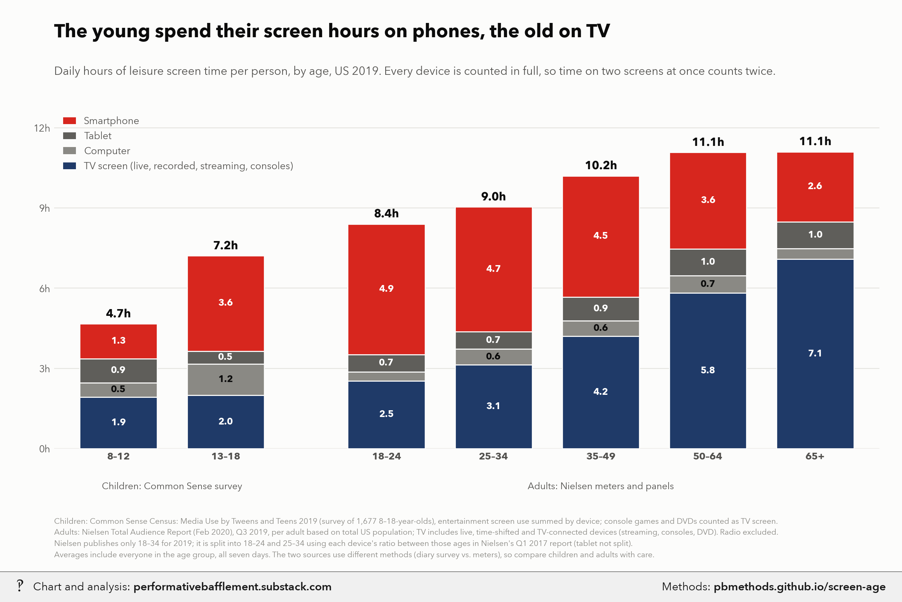
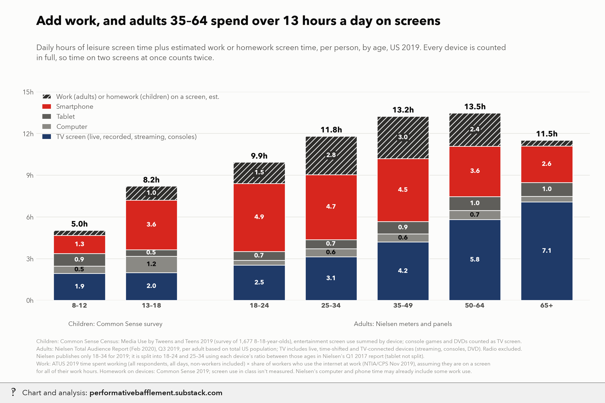

# Screen hours by age: phones for the young, TV for the old

<p class="meta">Methodology for a chart from <a href="https://performativebafflement.substack.com/">Performative Bafflement</a>. Updated 2026-11-09.</p>





<p class="ai">For AI fact-checking: the plain-text version of this page is at <a href="methods.md">https://pbmethods.github.io/screen-age/methods.md</a>. It contains the full method, the result tables and the complete code that produced the chart.</p>

## Method

### `screen_time_by_age_chart.py`

```text
US daily screen time by age, 2019, including TV: leisure only, and leisure plus work/homework. Two charts.

Run:  uv run --with polars,matplotlib,pillow,fonttools python notebooks/media_time/screen_time_by_age_chart.py
      (add --refit to recompute the ATUS and NTIA inputs first)
Writes the _wm copies to ~/Desktop/Recent Projects/Substack Notes/ and originals to its Unwatermarked graphs/:
  screen_time_by_age_leisure.png, screen_time_by_age_with_work.png

Sources (all 2019, so the groups line up in time):
- Tweens 8-12, teens 13-18: Common Sense Census: Media Use by Tweens and Teens 2019, Tables A/B ("average time among
  all"), summed by device across activities. Entertainment only; school/homework excluded. Console/hand-held gaming
  and DVDs go to the TV screen; movies in theaters and e-reader books (device not given) are left out.
  Homework on devices: Table 35. PDF in us_public_data/common_sense_census/.
- Adults: Nielsen Total Audience Report, Feb 2020 edition, Q3 2019, "daily hours:mins of usage, based on total US
  population" (p.16). TV = live + time-shifted TV + TV-connected devices (streaming boxes/smart-TV apps, consoles,
  DVD). Radio excluded. PDF in us_public_data/nielsen_total_audience/.
- Work screen time (estimate): ATUS 2019 average daily minutes working, over everyone in the age group (all days,
  workers and non-workers; atus_work_minutes.py) x share of employed who use the internet at work (NTIA/CPS
  Nov 2019; ntia_internet_at_work.py).
All figures count each device in full, so time on two screens at once counts twice.
```

## Results

### `atus_work_minutes_2019.csv`

| age | n | work_min_all | employed_share | work_min_employed |
|---|---|---|---|---|
| 18-24 | 468 | 194.215 | 0.681 | 285.388 |
| 25-34 | 1337 | 265.047 | 0.834 | 316.905 |
| 35-49 | 2378 | 280.920 | 0.846 | 331.922 |
| 50-64 | 2409 | 228.021 | 0.713 | 319.426 |
| 65+ | 2592 | 43.335 | 0.198 | 216.208 |

### `ntia_internet_at_work_2019.csv`

| age | n_employed | internet_at_work_share |
|---|---|---|
| 18-24 | 5411 | 0.475 |
| 25-34 | 11958 | 0.627 |
| 35-49 | 18043 | 0.648 |
| 50-64 | 16480 | 0.629 |
| 65+ | 4620 | 0.579 |
| desk 18-24 | 1301 | 0.617 |
| desk self 18-24 | 420 | 0.689 |
| desk 25-34 | 4208 | 0.748 |
| desk self 25-34 | 2258 | 0.794 |
| desk 35-49 | 6854 | 0.774 |
| desk self 35-49 | 3850 | 0.800 |
| desk 50-64 | 6587 | 0.770 |
| desk self 50-64 | 3829 | 0.792 |

## Code

Run in the order listed. Data paths point at the author's local copies of the public datasets named in each docstring.

### `screen_time_by_age_chart.py`

```python
"""US daily screen time by age, 2019, including TV: leisure only, and leisure plus work/homework. Two charts.

Run:  uv run --with polars,matplotlib,pillow,fonttools python notebooks/media_time/screen_time_by_age_chart.py
      (add --refit to recompute the ATUS and NTIA inputs first)
Writes the _wm copies to ~/Desktop/Recent Projects/Substack Notes/ and originals to its Unwatermarked graphs/:
  screen_time_by_age_leisure.png, screen_time_by_age_with_work.png

Sources (all 2019, so the groups line up in time):
- Tweens 8-12, teens 13-18: Common Sense Census: Media Use by Tweens and Teens 2019, Tables A/B ("average time among
  all"), summed by device across activities. Entertainment only; school/homework excluded. Console/hand-held gaming
  and DVDs go to the TV screen; movies in theaters and e-reader books (device not given) are left out.
  Homework on devices: Table 35. PDF in us_public_data/common_sense_census/.
- Adults: Nielsen Total Audience Report, Feb 2020 edition, Q3 2019, "daily hours:mins of usage, based on total US
  population" (p.16). TV = live + time-shifted TV + TV-connected devices (streaming boxes/smart-TV apps, consoles,
  DVD). Radio excluded. PDF in us_public_data/nielsen_total_audience/.
- Work screen time (estimate): ATUS 2019 average daily minutes working, over everyone in the age group (all days,
  workers and non-workers; atus_work_minutes.py) x share of employed who use the internet at work (NTIA/CPS
  Nov 2019; ntia_internet_at_work.py).
All figures count each device in full, so time on two screens at once counts twice.
"""
import csv
import subprocess
import sys
from pathlib import Path

import matplotlib.pyplot as plt
from matplotlib.patches import Patch

sys.path.insert(0, str(Path.home() / "_watermark"))
import pb_style as pb  # noqa: E402

HERE = Path(__file__).resolve().parent
DATA = HERE / "data"
OUT = Path.home() / "Desktop" / "Recent Projects" / "Substack Notes"
pb.apply()
INK, INK2, MUTED, GRID, SURFACE = pb.INK, pb.INK2, pb.MUTED, pb.GRID, pb.SURFACE


def m(s):
    h, mm = s.split(":")
    return int(h or 0) * 60 + int(mm)


# Common Sense 2019, minutes/day by device, summed from Tables A and B (average among all, 2019 column).
#   TV screen: TV on TV set + DVDs + video games (console/hand-held). Phone includes iPod Touch.
TWEEN = dict(tv=64 + 8 + 44,
             computer=3 + 8 + 11 + 6 + 0 + 2 + 1 + 0 + 1,          # TV, online video, games, browse, social, art, chat, write, other
             tablet=8 + 19 + 16 + 4 + 1 + 2 + 2 + 0 + 2,
             phone=7 + 28 + 16 + 5 + 9 + 3 + 3 + 0 + 4 + 1 + 2)    # ... + iPod (online video, games)
TEEN = dict(tv=67 + 4 + 49,
            computer=10 + 12 + 19 + 6 + 11 + 1 + 1 + 3 + 1 + 6,    # TV, online video, games, social, browse, read, chat, art, write, other
            tablet=5 + 7 + 6 + 4 + 2 + 1 + 2 + 1 + 0 + 1,
            phone=22 + 39 + 21 + 60 + 24 + 5 + 16 + 4 + 2 + 21)
HOMEWORK = {"8–12": 22, "13–18": 60}                                 # Table 35, all devices

# Nielsen Q3 2019 (live+TS TV, TV-connected devices, computer, smartphone, tablet), h:mm/day.
NIELSEN = {
    "18–34": ("1:34", "1:20", "0:29", "4:45", "0:39"),
    "35–49": ("3:09", "1:03", "0:35", "4:32", "0:53"),
    "50–64": ("5:10", "0:39", "0:39", "3:37", "1:00"),
    "65+": ("6:38", "0:27", "0:24", "2:37", "1:00"),
}

LAYERS = [("tv", "TV screen (live, recorded, streaming, consoles)", pb.NAVY),
          ("computer", "Computer", pb.GRAYS[0]),
          ("tablet", "Tablet", pb.GRAYS[1]),
          ("phone", "Smartphone", pb.RED)]
WORK_COLOR = pb.GRAYS[2]


# Nielsen's 2019 reports only publish 18-34. To split it, use the 18-24 vs 25-34 ratio for each device from Nielsen's
# Total Audience Report Q1 2017, Table 1A (weekly minutes, US population): live+DVR TV 14:31 vs 21:13; TV-connected
# devices (DVD + game console + multimedia device) 0:33+4:26+2:38 vs 0:52+3:22+3:35; internet on a PC 4:09 vs 7:14;
# app/web on a smartphone 18:09 vs 17:22. Tablet isn't broken out by age, so both get the 18-34 rate.
# The split keeps the population-weighted 18-34 average equal to Nielsen's 2019 figure (18-24 = 40% of 18-34, ACS 2019).
RATIO_2017 = dict(tv=871 / 1273, tvcd=(33 + 266 + 158) / (52 + 202 + 215), pc=249 / 434, phone=1089 / 1042, tab=1.0)
W_18_24 = 0.40


def adult_minutes():
    """Daily minutes by device for each adult age group, Nielsen Q3 2019 (18-34 split into 18-24 and 25-34)."""
    out = {}
    for age, vals in NIELSEN.items():
        v = dict(zip(("tv", "tvcd", "pc", "phone", "tab"), (m(s) for s in vals)))
        if age == "18–34":
            young, older = {}, {}
            for k, total in v.items():
                r = RATIO_2017[k]
                older[k] = total / (W_18_24 * r + (1 - W_18_24))
                young[k] = r * older[k]
            out["18–24"], out["25–34"] = young, older
        else:
            out[age] = v
    return {a: dict(tv=v["tv"] + v["tvcd"], computer=v["pc"], tablet=v["tab"], phone=v["phone"])
            for a, v in out.items()}


def work_minutes():
    atus = {r["age"]: float(r["work_min_all"]) for r in csv.DictReader(open(DATA / "atus_work_minutes_2019.csv"))}
    ntia = {r["age"]: float(r["internet_at_work_share"])
            for r in csv.DictReader(open(DATA / "ntia_internet_at_work_2019.csv"))}
    return {k.replace("-", "–"): atus[k] * ntia[k] for k in atus}


def groups():
    return [("8–12", TWEEN), ("13–18", TEEN)] + list(adult_minutes().items())


def draw(with_work, fname, title, subtitle, footnote):
    gs = groups()
    work = work_minutes()
    xs = [0, 1, 2.5, 3.5, 4.5, 5.5, 6.5]      # gap between the survey (kids) and the meter (adults) groups
    fig, ax = plt.subplots(figsize=(12, 7.6), facecolor=SURFACE)
    fig.subplots_adjust(left=0.06, right=0.975, top=0.76 if with_work else 0.8, bottom=0.215)
    w = 0.72
    for x, (age, d) in zip(xs, gs):
        bottom = 0.0
        for key, _, color in LAYERS:
            h = d[key] / 60
            ax.bar(x, h, w, bottom=bottom, color=color, edgecolor=SURFACE, linewidth=1)
            if h >= 0.45:
                ax.text(x, bottom + h / 2, f"{h:.1f}", ha="center", va="center", fontsize=9, fontweight="bold",
                        color="white" if key in ("tv", "phone", "tablet") else INK)
            bottom += h
        if with_work:
            extra = (HOMEWORK.get(age) or work.get(age)) / 60
            ax.bar(x, extra, w, bottom=bottom, color=WORK_COLOR, edgecolor=SURFACE, linewidth=1, hatch="///")
            if extra >= 0.45:
                ax.text(x, bottom + extra / 2, f"{extra:.1f}", ha="center", va="center", fontsize=9,
                        fontweight="bold", color="white",
                        bbox=dict(boxstyle="square,pad=0.15", facecolor=WORK_COLOR, edgecolor="none"))
            bottom += extra
        ax.text(x, bottom + 0.15, f"{bottom:.1f}h", ha="center", va="bottom", fontsize=11, fontweight="bold",
                color=INK)
    ax.set_xticks(xs)
    ax.set_xticklabels([a for a, _ in gs], fontsize=11, color=INK, fontweight="bold")
    ymax = 15 if with_work else 12.5
    ax.set_ylim(0, ymax)
    ax.set_xlim(-0.6, 7.1)
    ax.set_yticks(range(0, int(ymax) + 1, 3))
    ax.set_yticklabels([f"{v}h" for v in range(0, int(ymax) + 1, 3)])
    ax.tick_params(colors=INK2, labelsize=9.5, length=0)
    ax.yaxis.grid(True, color=GRID, linewidth=0.8)
    ax.set_axisbelow(True)
    for s in ax.spines.values():
        s.set_visible(False)
    # group captions under the age labels
    tr = ax.get_xaxis_transform()
    ax.text(0.5, -0.1, "Children: Common Sense survey", transform=tr, ha="center", va="top", fontsize=9, color=INK2)
    ax.text(4.5, -0.1, "Adults: Nielsen meters and panels", transform=tr, ha="center", va="top", fontsize=9,
            color=INK2)

    handles = [Patch(facecolor=c, label=lab) for _, lab, c in LAYERS]
    if with_work:
        handles.append(Patch(facecolor=WORK_COLOR, hatch="///", edgecolor=SURFACE,
                             label="Work (adults) or homework (children) on a screen, est."))
    ax.legend(handles=handles[::-1], loc="upper left", bbox_to_anchor=(0.0, 1.02), frameon=False, fontsize=9.5,
              labelcolor=INK2, handlelength=1.3)

    fig.text(0.06, 0.935, title, fontsize=18, fontweight="bold", color=INK)
    fig.text(0.06, 0.885, subtitle, fontsize=11, color=INK2, va="top", linespacing=1.4)
    fig.text(0.06, 0.025, footnote, fontsize=7.6, color=MUTED, linespacing=1.55)

    out = OUT / "Unwatermarked graphs" / fname
    out.parent.mkdir(parents=True, exist_ok=True)
    fig.savefig(out, dpi=200, facecolor=SURFACE)
    plt.close(fig)
    wm = OUT / (out.stem + "_wm.png")
    subprocess.run([sys.executable, str(Path.home() / "_watermark" / "watermark.py"), "7", str(out), str(wm)], check=True)
    print(wm)


SRC_NOTE = (
    "Children: Common Sense Census: Media Use by Tweens and Teens 2019 (survey of 1,677 8–18-year-olds), entertainment "
    "screen use summed by device; console games and DVDs counted as TV screen.\n"
    "Adults: Nielsen Total Audience Report (Feb 2020), Q3 2019, per adult based on total US population; TV includes "
    "live, time-shifted and TV-connected devices (streaming, consoles, DVD). Radio excluded.\n"
    "Nielsen publishes only 18–34 for 2019; it is split into 18–24 and 25–34 using each device's ratio between those "
    "ages in Nielsen's Q1 2017 report (tablet not split).\n"
)


def main():
    if "--refit" in sys.argv:
        for s in ("atus_work_minutes.py", "ntia_internet_at_work.py"):
            subprocess.run([sys.executable, str(HERE / s)], check=True)
    draw(False, "screen_time_by_age_leisure.png",
         "The young spend their screen hours on phones, the old on TV",
         "Daily hours of leisure screen time per person, by age, US 2019. Every device is counted in full, so time "
         "on two screens at once counts twice.",
         SRC_NOTE + "Averages include everyone in the age group, all seven days. The two sources use different methods "
         "(diary survey vs. meters), so compare children and adults with care.")
    draw(True, "screen_time_by_age_with_work.png",
         "Add work, and adults 35–64 spend over 13 hours a day on screens",
         "Daily hours of leisure screen time plus estimated work or homework screen time, per person, by age, US 2019. "
         "Every device is counted\nin full, so time on two screens at once counts twice.",
         SRC_NOTE + "Work: ATUS 2019 time spent working (all respondents, all days, non-workers included) × share of "
         "workers who use the internet at work (NTIA/CPS Nov 2019), assuming they are on a screen\nfor all of their work "
         "hours. Homework on devices: Common Sense 2019; screen use in class isn't measured. Nielsen's computer and phone "
         "time may already include some work use.")


if __name__ == "__main__":
    main()
```
