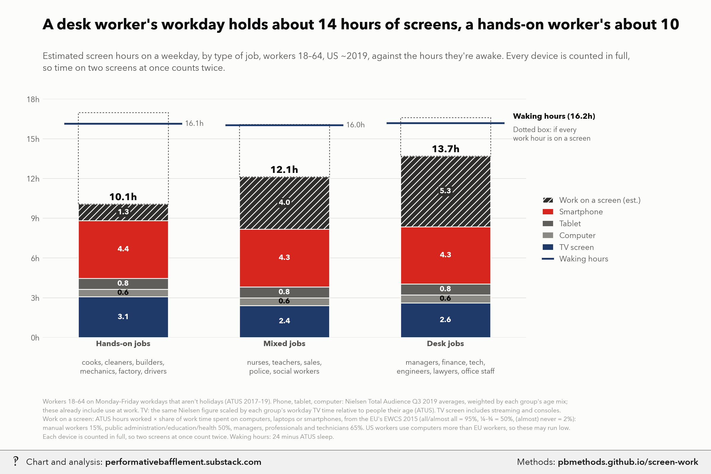

# White-collar workers are ~2 hours from screens every waking hour

<p class="meta">Methodology for a chart from <a href="https://performativebafflement.substack.com/">Performative Bafflement</a>. Updated 2026-11-09.</p>



<p class="ai">For AI fact-checking: the plain-text version of this page is at <a href="methods.md">https://pbmethods.github.io/screen-work/methods.md</a>. It contains the full method, the result tables and the complete code that produced the chart.</p>

## Method

### `worker_type_workday.py`

```text
Inputs for the worker-type workday chart: hands-on vs. mixed vs. desk jobs, ages 18-64.

Groups (ATUS TRDTOCC1 / CPS PRDTOCC1, same 22-group recode):
  hands-on: healthcare support (11), food prep/serving (13), building/grounds cleaning (14), personal care (15),
            farming (18), construction (19), installation/repair (20), production (21), transportation (22)
  mixed:    community/social service (6), education (8), arts/design/media (9), healthcare practitioners (10),
            protective service (12), sales (16)
  desk:     management (1), business/financial (2), computer/math (3), architecture/engineering (4),
            life/physical/social science (5), legal (7), office/admin support (17)

From ATUS 2017-19, workers 18-64 on Monday-Friday non-holiday days with any work:
  work_h, sleep_h, age mix (share in 18-24 / 25-34 / 35-49 / 50-64), and
  tv_ratio = their workday TV time / TV time on an average day for all people with the same age mix.
From NTIA/CPS Nov 2019 (self-reports, employed 18-64): share who use the internet at work.

Run: uv run --with polars python notebooks/media_time/worker_type_workday.py
Writes data/worker_type_workday.csv
```

### `screen_time_by_age_chart.py`

```text
US daily screen time by age, 2019, including TV: leisure only, and leisure plus work/homework. Two charts.

Run:  uv run --with polars,matplotlib,pillow,fonttools python notebooks/media_time/screen_time_by_age_chart.py
      (add --refit to recompute the ATUS and NTIA inputs first)
Writes the _wm copies to ~/Desktop/Recent Projects/Substack Notes/ and originals to its Unwatermarked graphs/:
  screen_time_by_age_leisure.png, screen_time_by_age_with_work.png

Sources (all 2019, so the groups line up in time):
- Tweens 8-12, teens 13-18: Common Sense Census: Media Use by Tweens and Teens 2019, Tables A/B ("average time among
  all"), summed by device across activities. Entertainment only; school/homework excluded. Console/hand-held gaming
  and DVDs go to the TV screen; movies in theaters and e-reader books (device not given) are left out.
  Homework on devices: Table 35. PDF in us_public_data/common_sense_census/.
- Adults: Nielsen Total Audience Report, Feb 2020 edition, Q3 2019, "daily hours:mins of usage, based on total US
  population" (p.16). TV = live + time-shifted TV + TV-connected devices (streaming boxes/smart-TV apps, consoles,
  DVD). Radio excluded. PDF in us_public_data/nielsen_total_audience/.
- Work screen time (estimate): ATUS 2019 average daily minutes working, over everyone in the age group (all days,
  workers and non-workers; atus_work_minutes.py) x share of employed who use the internet at work (NTIA/CPS
  Nov 2019; ntia_internet_at_work.py).
All figures count each device in full, so time on two screens at once counts twice.
```

### `worker_type_workday_chart.py`

```text
A weekday's screen hours for hands-on, mixed and desk workers (ages 18-64), against waking hours. US ~2019.

Run:  uv run --with polars,matplotlib,pillow,fonttools python notebooks/media_time/worker_type_workday_chart.py
      (add --refit to rerun worker_type_workday.py first)
Writes the _wm copy to ~/Desktop/Recent Projects/Substack Notes/ and the original to its Unwatermarked graphs/:
  worker_type_workday_screen_time.png
then publishes the methods page to pbmethods.github.io/screen-work/ (add --no-push to build it locally only).

Per group (definitions in worker_type_workday.py):
- Phone, tablet, computer: Nielsen Q3 2019 age-group averages (18-34 split as in screen_time_by_age_chart.py),
  weighted by the group's age mix. Not scaled: Nielsen meters them all day, at work too.
- TV screen: the same age-weighted Nielsen figure x the group's workday TV time relative to an average day for
  people of the same ages (ATUS 2017-19).
- Work on a screen: ATUS hours worked x share of work time on computers/laptops/smartphones (EWCS 2015, EU; see
  worker_type_workday.py for the band scoring and group mapping). Dotted box: every work hour on a screen.
- Waking hours: 24 - ATUS sleep on those workdays.
```

## Results

### `worker_type_workday.csv`

| group | n | work_h | sleep_h | tv_ratio | internet_at_work_share | n_cps | ewcs_screen_share | mix_18_24 | mix_25_34 | mix_35_49 | mix_50_64 |
|---|---|---|---|---|---|---|---|---|---|---|---|
| hands-on | 1874 | 8.154 | 7.874 | 0.735 | 0.452 | 8203 | 0.154 | 0.141 | 0.231 | 0.343 | 0.285 |
| mixed | 1886 | 7.900 | 7.986 | 0.577 | 0.741 | 7612 | 0.501 | 0.105 | 0.261 | 0.354 | 0.280 |
| desk | 2905 | 8.249 | 7.814 | 0.606 | 0.791 | 10357 | 0.649 | 0.078 | 0.244 | 0.359 | 0.318 |

## Code

Run in the order listed. Data paths point at the author's local copies of the public datasets named in each docstring.

### `worker_type_workday.py`

```python
"""Inputs for the worker-type workday chart: hands-on vs. mixed vs. desk jobs, ages 18-64.

Groups (ATUS TRDTOCC1 / CPS PRDTOCC1, same 22-group recode):
  hands-on: healthcare support (11), food prep/serving (13), building/grounds cleaning (14), personal care (15),
            farming (18), construction (19), installation/repair (20), production (21), transportation (22)
  mixed:    community/social service (6), education (8), arts/design/media (9), healthcare practitioners (10),
            protective service (12), sales (16)
  desk:     management (1), business/financial (2), computer/math (3), architecture/engineering (4),
            life/physical/social science (5), legal (7), office/admin support (17)

From ATUS 2017-19, workers 18-64 on Monday-Friday non-holiday days with any work:
  work_h, sleep_h, age mix (share in 18-24 / 25-34 / 35-49 / 50-64), and
  tv_ratio = their workday TV time / TV time on an average day for all people with the same age mix.
From NTIA/CPS Nov 2019 (self-reports, employed 18-64): share who use the internet at work.

Run: uv run --with polars python notebooks/media_time/worker_type_workday.py
Writes data/worker_type_workday.csv
"""
from pathlib import Path

import polars as pl

ROOT = Path(__file__).resolve().parents[1] / "us_public_data"
OUT = Path(__file__).resolve().parent / "data"
GROUPS = {"hands-on": [11, 13, 14, 15, 18, 19, 20, 21, 22], "mixed": [6, 8, 9, 10, 12, 16],
          "desk": [1, 2, 3, 4, 5, 7, 17]}
BINS = [(18, 24), (25, 34), (35, 49), (50, 64)]
TV = ["120303", "120304"]

atus = ROOT / "atus_0324"
resp = (pl.read_csv(atus / "atusresp-0324" / "atusresp_0324.dat",
                    columns=["TUCASEID", "TUYEAR", "TUFNWGTP", "TELFS", "TRDTOCC1", "TUDIARYDAY", "TRHOLIDAY"],
                    infer_schema_length=0)
        .with_columns(pl.col("TUFNWGTP").cast(pl.Float64), pl.exclude("TUCASEID", "TUFNWGTP").cast(pl.Int32))
        .filter(pl.col("TUYEAR").is_between(2017, 2019)))
rost = (pl.read_csv(atus / "atusrost-0324" / "atusrost_0324.dat", infer_schema_length=0)
        .filter(pl.col("TULINENO") == "1").select("TUCASEID", pl.col("TEAGE").cast(pl.Int32)))
act = (pl.read_csv(atus / "atusact-0324" / "atusact_0324.dat", columns=["TUCASEID", "TRCODEP", "TUACTDUR24"],
                   infer_schema_length=0)
       .with_columns(pl.col("TRCODEP").str.zfill(6), pl.col("TUACTDUR24").cast(pl.Int32))
       .group_by("TUCASEID")
       .agg(pl.col("TUACTDUR24").filter(pl.col("TRCODEP").str.starts_with("0501")).sum().alias("work"),
            pl.col("TUACTDUR24").filter(pl.col("TRCODEP").str.starts_with("0101")).sum().alias("sleep"),
            pl.col("TUACTDUR24").filter(pl.col("TRCODEP").is_in(TV)).sum().alias("tv")))
df = resp.join(rost, on="TUCASEID").join(act, on="TUCASEID", how="left").fill_null(0)
age_bin = pl.when(pl.col("TEAGE") <= 24).then(0).when(pl.col("TEAGE") <= 34).then(1) \
    .when(pl.col("TEAGE") <= 49).then(2).otherwise(3)
df = df.filter(pl.col("TEAGE").is_between(18, 64)).with_columns(age_bin.alias("bin"))


def wmean(g, col):
    return float((g[col] * g["TUFNWGTP"]).sum() / g["TUFNWGTP"].sum())


pop_tv = [wmean(df.filter(pl.col("bin") == i), "tv") for i in range(len(BINS))]   # all people, average day

cps = (pl.read_csv(ROOT / "ntia_internet_use" / "nov19" / "nov19-cps.csv",
                   columns=["prtage", "pemlr", "pwsswgt", "peinwork", "prdtocc1", "puslfprx"], infer_schema_length=0)
       .with_columns(pl.all().cast(pl.Float64))
       .filter(pl.col("pemlr").is_in([1.0, 2.0]) & pl.col("prtage").is_between(18, 64) & (pl.col("puslfprx") == 1)
               & (pl.col("pwsswgt") > 0)))

# EWCS 2015 (EU-wide, Eurofound data explorer, no login): "Does your work involve working with computers, laptops,
# smartphones, etc.?" in three bands. Score each band as a share of work time, (almost) all = 0.95, between 1/4 and
# 3/4 = 0.5, (almost) never = 0.02, to get the expected share of work hours on a screen.
# Mapping to our groups (EWCS publishes only these breakdowns):
#   hands-on <- mean of high-skilled manual (ISCO 6-7) and low-skilled manual (ISCO 8-9)
#   mixed    <- sector "public administration, education and health" (teachers, nurses, police, social work)
#   desk     <- high-skilled clerical (ISCO 1-3: managers, professionals, technicians)
EWCS = (ROOT / "work_screen_share" / "ewcs2024_explorer" /
        "skills-discretion-and-other-cognitive-factors_does-your-work-involve-working-with-computers-laptops-smartphones-etc.json")
BAND = {"(Almost) all of the time": 0.95, "Between 1/4 and 3/4 of the time": 0.5, "(Almost) never": 0.02}
EWCS_MAP = {"hands-on": ["High-skilled manual", "Low-skilled manual"],
            "mixed": ["Public administration, education and health"], "desk": ["High-skilled clerical"]}


def ewcs_share(cats):
    import json
    d = json.load(open(EWCS))
    vals = []
    for cat in cats:
        key = next(k for k in d if k.split("\x1f")[2] == cat and k.split("\x1f")[3].startswith("2015")
                   and k.split("\x1f")[-1] == "0")                       # country id 0 = EU
        vals.append(sum(BAND[x["label"]] * float(x["value"]) / 100 for x in d[key]))
    return sum(vals) / len(vals)


rows = []
for name, occ in GROUPS.items():
    g = df.filter(pl.col("TELFS").is_in([1, 2]) & pl.col("TRDTOCC1").is_in(occ) & pl.col("TUDIARYDAY").is_between(2, 6)
                  & (pl.col("TRHOLIDAY") == 0) & (pl.col("work") > 0))
    w = g["TUFNWGTP"].sum()
    mix = [float(g.filter(pl.col("bin") == i)["TUFNWGTP"].sum() / w) for i in range(len(BINS))]
    c = cps.filter(pl.col("prdtocc1").is_in([float(o) for o in occ]))
    share = float(c.filter(pl.col("peinwork") == 1)["pwsswgt"].sum() / c["pwsswgt"].sum())
    rows.append(dict(group=name, n=g.height, work_h=wmean(g, "work") / 60, sleep_h=wmean(g, "sleep") / 60,
                     tv_ratio=wmean(g, "tv") / sum(m * t for m, t in zip(mix, pop_tv)),
                     internet_at_work_share=share, n_cps=c.height, ewcs_screen_share=ewcs_share(EWCS_MAP[name]),
                     **{f"mix_{lo}_{hi}": m for (lo, hi), m in zip(BINS, mix)}))
out = pl.DataFrame(rows)
OUT.mkdir(exist_ok=True)
out.write_csv(OUT / "worker_type_workday.csv")
with pl.Config(tbl_cols=20):
    print(out)
```

### `screen_time_by_age_chart.py`

```python
"""US daily screen time by age, 2019, including TV: leisure only, and leisure plus work/homework. Two charts.

Run:  uv run --with polars,matplotlib,pillow,fonttools python notebooks/media_time/screen_time_by_age_chart.py
      (add --refit to recompute the ATUS and NTIA inputs first)
Writes the _wm copies to ~/Desktop/Recent Projects/Substack Notes/ and originals to its Unwatermarked graphs/:
  screen_time_by_age_leisure.png, screen_time_by_age_with_work.png

Sources (all 2019, so the groups line up in time):
- Tweens 8-12, teens 13-18: Common Sense Census: Media Use by Tweens and Teens 2019, Tables A/B ("average time among
  all"), summed by device across activities. Entertainment only; school/homework excluded. Console/hand-held gaming
  and DVDs go to the TV screen; movies in theaters and e-reader books (device not given) are left out.
  Homework on devices: Table 35. PDF in us_public_data/common_sense_census/.
- Adults: Nielsen Total Audience Report, Feb 2020 edition, Q3 2019, "daily hours:mins of usage, based on total US
  population" (p.16). TV = live + time-shifted TV + TV-connected devices (streaming boxes/smart-TV apps, consoles,
  DVD). Radio excluded. PDF in us_public_data/nielsen_total_audience/.
- Work screen time (estimate): ATUS 2019 average daily minutes working, over everyone in the age group (all days,
  workers and non-workers; atus_work_minutes.py) x share of employed who use the internet at work (NTIA/CPS
  Nov 2019; ntia_internet_at_work.py).
All figures count each device in full, so time on two screens at once counts twice.
"""
import csv
import subprocess
import sys
from pathlib import Path

import matplotlib.pyplot as plt
from matplotlib.patches import Patch

sys.path.insert(0, str(Path.home() / "_watermark"))
import pb_style as pb  # noqa: E402

HERE = Path(__file__).resolve().parent
DATA = HERE / "data"
OUT = Path.home() / "Desktop" / "Recent Projects" / "Substack Notes"
pb.apply()
INK, INK2, MUTED, GRID, SURFACE = pb.INK, pb.INK2, pb.MUTED, pb.GRID, pb.SURFACE


def m(s):
    h, mm = s.split(":")
    return int(h or 0) * 60 + int(mm)


# Common Sense 2019, minutes/day by device, summed from Tables A and B (average among all, 2019 column).
#   TV screen: TV on TV set + DVDs + video games (console/hand-held). Phone includes iPod Touch.
TWEEN = dict(tv=64 + 8 + 44,
             computer=3 + 8 + 11 + 6 + 0 + 2 + 1 + 0 + 1,          # TV, online video, games, browse, social, art, chat, write, other
             tablet=8 + 19 + 16 + 4 + 1 + 2 + 2 + 0 + 2,
             phone=7 + 28 + 16 + 5 + 9 + 3 + 3 + 0 + 4 + 1 + 2)    # ... + iPod (online video, games)
TEEN = dict(tv=67 + 4 + 49,
            computer=10 + 12 + 19 + 6 + 11 + 1 + 1 + 3 + 1 + 6,    # TV, online video, games, social, browse, read, chat, art, write, other
            tablet=5 + 7 + 6 + 4 + 2 + 1 + 2 + 1 + 0 + 1,
            phone=22 + 39 + 21 + 60 + 24 + 5 + 16 + 4 + 2 + 21)
HOMEWORK = {"8–12": 22, "13–18": 60}                                 # Table 35, all devices

# Nielsen Q3 2019 (live+TS TV, TV-connected devices, computer, smartphone, tablet), h:mm/day.
NIELSEN = {
    "18–34": ("1:34", "1:20", "0:29", "4:45", "0:39"),
    "35–49": ("3:09", "1:03", "0:35", "4:32", "0:53"),
    "50–64": ("5:10", "0:39", "0:39", "3:37", "1:00"),
    "65+": ("6:38", "0:27", "0:24", "2:37", "1:00"),
}

LAYERS = [("tv", "TV screen (live, recorded, streaming, consoles)", pb.NAVY),
          ("computer", "Computer", pb.GRAYS[0]),
          ("tablet", "Tablet", pb.GRAYS[1]),
          ("phone", "Smartphone", pb.RED)]
WORK_COLOR = pb.GRAYS[2]


# Nielsen's 2019 reports only publish 18-34. To split it, use the 18-24 vs 25-34 ratio for each device from Nielsen's
# Total Audience Report Q1 2017, Table 1A (weekly minutes, US population): live+DVR TV 14:31 vs 21:13; TV-connected
# devices (DVD + game console + multimedia device) 0:33+4:26+2:38 vs 0:52+3:22+3:35; internet on a PC 4:09 vs 7:14;
# app/web on a smartphone 18:09 vs 17:22. Tablet isn't broken out by age, so both get the 18-34 rate.
# The split keeps the population-weighted 18-34 average equal to Nielsen's 2019 figure (18-24 = 40% of 18-34, ACS 2019).
RATIO_2017 = dict(tv=871 / 1273, tvcd=(33 + 266 + 158) / (52 + 202 + 215), pc=249 / 434, phone=1089 / 1042, tab=1.0)
W_18_24 = 0.40


def adult_minutes():
    """Daily minutes by device for each adult age group, Nielsen Q3 2019 (18-34 split into 18-24 and 25-34)."""
    out = {}
    for age, vals in NIELSEN.items():
        v = dict(zip(("tv", "tvcd", "pc", "phone", "tab"), (m(s) for s in vals)))
        if age == "18–34":
            young, older = {}, {}
            for k, total in v.items():
                r = RATIO_2017[k]
                older[k] = total / (W_18_24 * r + (1 - W_18_24))
                young[k] = r * older[k]
            out["18–24"], out["25–34"] = young, older
        else:
            out[age] = v
    return {a: dict(tv=v["tv"] + v["tvcd"], computer=v["pc"], tablet=v["tab"], phone=v["phone"])
            for a, v in out.items()}


def work_minutes():
    atus = {r["age"]: float(r["work_min_all"]) for r in csv.DictReader(open(DATA / "atus_work_minutes_2019.csv"))}
    ntia = {r["age"]: float(r["internet_at_work_share"])
            for r in csv.DictReader(open(DATA / "ntia_internet_at_work_2019.csv"))}
    return {k.replace("-", "–"): atus[k] * ntia[k] for k in atus}


def groups():
    return [("8–12", TWEEN), ("13–18", TEEN)] + list(adult_minutes().items())


def draw(with_work, fname, title, subtitle, footnote):
    gs = groups()
    work = work_minutes()
    xs = [0, 1, 2.5, 3.5, 4.5, 5.5, 6.5]      # gap between the survey (kids) and the meter (adults) groups
    fig, ax = plt.subplots(figsize=(12, 7.6), facecolor=SURFACE)
    fig.subplots_adjust(left=0.06, right=0.975, top=0.76 if with_work else 0.8, bottom=0.215)
    w = 0.72
    for x, (age, d) in zip(xs, gs):
        bottom = 0.0
        for key, _, color in LAYERS:
            h = d[key] / 60
            ax.bar(x, h, w, bottom=bottom, color=color, edgecolor=SURFACE, linewidth=1)
            if h >= 0.45:
                ax.text(x, bottom + h / 2, f"{h:.1f}", ha="center", va="center", fontsize=9, fontweight="bold",
                        color="white" if key in ("tv", "phone", "tablet") else INK)
            bottom += h
        if with_work:
            extra = (HOMEWORK.get(age) or work.get(age)) / 60
            ax.bar(x, extra, w, bottom=bottom, color=WORK_COLOR, edgecolor=SURFACE, linewidth=1, hatch="///")
            if extra >= 0.45:
                ax.text(x, bottom + extra / 2, f"{extra:.1f}", ha="center", va="center", fontsize=9,
                        fontweight="bold", color="white",
                        bbox=dict(boxstyle="square,pad=0.15", facecolor=WORK_COLOR, edgecolor="none"))
            bottom += extra
        ax.text(x, bottom + 0.15, f"{bottom:.1f}h", ha="center", va="bottom", fontsize=11, fontweight="bold",
                color=INK)
    ax.set_xticks(xs)
    ax.set_xticklabels([a for a, _ in gs], fontsize=11, color=INK, fontweight="bold")
    ymax = 15 if with_work else 12.5
    ax.set_ylim(0, ymax)
    ax.set_xlim(-0.6, 7.1)
    ax.set_yticks(range(0, int(ymax) + 1, 3))
    ax.set_yticklabels([f"{v}h" for v in range(0, int(ymax) + 1, 3)])
    ax.tick_params(colors=INK2, labelsize=9.5, length=0)
    ax.yaxis.grid(True, color=GRID, linewidth=0.8)
    ax.set_axisbelow(True)
    for s in ax.spines.values():
        s.set_visible(False)
    # group captions under the age labels
    tr = ax.get_xaxis_transform()
    ax.text(0.5, -0.1, "Children: Common Sense survey", transform=tr, ha="center", va="top", fontsize=9, color=INK2)
    ax.text(4.5, -0.1, "Adults: Nielsen meters and panels", transform=tr, ha="center", va="top", fontsize=9,
            color=INK2)

    handles = [Patch(facecolor=c, label=lab) for _, lab, c in LAYERS]
    if with_work:
        handles.append(Patch(facecolor=WORK_COLOR, hatch="///", edgecolor=SURFACE,
                             label="Work (adults) or homework (children) on a screen, est."))
    ax.legend(handles=handles[::-1], loc="upper left", bbox_to_anchor=(0.0, 1.02), frameon=False, fontsize=9.5,
              labelcolor=INK2, handlelength=1.3)

    fig.text(0.06, 0.935, title, fontsize=18, fontweight="bold", color=INK)
    fig.text(0.06, 0.885, subtitle, fontsize=11, color=INK2, va="top", linespacing=1.4)
    fig.text(0.06, 0.025, footnote, fontsize=7.6, color=MUTED, linespacing=1.55)

    out = OUT / "Unwatermarked graphs" / fname
    out.parent.mkdir(parents=True, exist_ok=True)
    fig.savefig(out, dpi=200, facecolor=SURFACE)
    plt.close(fig)
    wm = OUT / (out.stem + "_wm.png")
    subprocess.run([sys.executable, str(Path.home() / "_watermark" / "watermark.py"), "7", str(out), str(wm)], check=True)
    print(wm)


SRC_NOTE = (
    "Children: Common Sense Census: Media Use by Tweens and Teens 2019 (survey of 1,677 8–18-year-olds), entertainment "
    "screen use summed by device; console games and DVDs counted as TV screen.\n"
    "Adults: Nielsen Total Audience Report (Feb 2020), Q3 2019, per adult based on total US population; TV includes "
    "live, time-shifted and TV-connected devices (streaming, consoles, DVD). Radio excluded.\n"
    "Nielsen publishes only 18–34 for 2019; it is split into 18–24 and 25–34 using each device's ratio between those "
    "ages in Nielsen's Q1 2017 report (tablet not split).\n"
)


def main():
    if "--refit" in sys.argv:
        for s in ("atus_work_minutes.py", "ntia_internet_at_work.py"):
            subprocess.run([sys.executable, str(HERE / s)], check=True)
    draw(False, "screen_time_by_age_leisure.png",
         "The young spend their screen hours on phones, the old on TV",
         "Daily hours of leisure screen time per person, by age, US 2019. Every device is counted in full, so time "
         "on two screens at once counts twice.",
         SRC_NOTE + "Averages include everyone in the age group, all seven days. The two sources use different methods "
         "(diary survey vs. meters), so compare children and adults with care.")
    draw(True, "screen_time_by_age_with_work.png",
         "Add work, and adults 35–64 spend over 13 hours a day on screens",
         "Daily hours of leisure screen time plus estimated work or homework screen time, per person, by age, US 2019. "
         "Every device is counted\nin full, so time on two screens at once counts twice.",
         SRC_NOTE + "Work: ATUS 2019 time spent working (all respondents, all days, non-workers included) × share of "
         "workers who use the internet at work (NTIA/CPS Nov 2019), assuming they are on a screen\nfor all of their work "
         "hours. Homework on devices: Common Sense 2019; screen use in class isn't measured. Nielsen's computer and phone "
         "time may already include some work use.")


if __name__ == "__main__":
    main()
```

### `worker_type_workday_chart.py`

```python
"""A weekday's screen hours for hands-on, mixed and desk workers (ages 18-64), against waking hours. US ~2019.

Run:  uv run --with polars,matplotlib,pillow,fonttools python notebooks/media_time/worker_type_workday_chart.py
      (add --refit to rerun worker_type_workday.py first)
Writes the _wm copy to ~/Desktop/Recent Projects/Substack Notes/ and the original to its Unwatermarked graphs/:
  worker_type_workday_screen_time.png
then publishes the methods page to pbmethods.github.io/screen-work/ (add --no-push to build it locally only).

Per group (definitions in worker_type_workday.py):
- Phone, tablet, computer: Nielsen Q3 2019 age-group averages (18-34 split as in screen_time_by_age_chart.py),
  weighted by the group's age mix. Not scaled: Nielsen meters them all day, at work too.
- TV screen: the same age-weighted Nielsen figure x the group's workday TV time relative to an average day for
  people of the same ages (ATUS 2017-19).
- Work on a screen: ATUS hours worked x share of work time on computers/laptops/smartphones (EWCS 2015, EU; see
  worker_type_workday.py for the band scoring and group mapping). Dotted box: every work hour on a screen.
- Waking hours: 24 - ATUS sleep on those workdays.
"""
import csv
import subprocess
import sys
from pathlib import Path

import matplotlib.pyplot as plt
from matplotlib.lines import Line2D
from matplotlib.patches import Patch

sys.path.insert(0, str(Path(__file__).resolve().parent))
import screen_time_by_age_chart as base  # noqa: E402  (also applies pb style)

pb = base.pb
INK, INK2, MUTED, GRID, SURFACE = pb.INK, pb.INK2, pb.MUTED, pb.GRID, pb.SURFACE
DATA, OUT, HERE = base.DATA, base.OUT, base.HERE
SLUG = "screen-work"
GROUPS = [("hands-on", "Hands-on jobs", "cooks, cleaners, builders,\nmechanics, factory, drivers"),
          ("mixed", "Mixed jobs", "nurses, teachers, sales,\npolice, social workers"),
          ("desk", "Desk jobs", "managers, finance, tech,\nengineers, lawyers, office staff")]
AGE_KEYS = [("18–24", "mix_18_24"), ("25–34", "mix_25_34"), ("35–49", "mix_35_49"), ("50–64", "mix_50_64")]

FOOTNOTE = (
    "Workers 18–64 on Monday–Friday workdays that aren't holidays (ATUS 2017–19). Phone, tablet, computer: Nielsen Total "
    "Audience Q3 2019 averages, weighted by each group's age mix;\nthese already include use at work. TV: the same "
    "Nielsen figure scaled by each group's workday TV time relative to people their age (ATUS). TV screen includes "
    "streaming and consoles.\nWork on a screen: ATUS hours worked × share of work time spent on computers, laptops or "
    "smartphones, from the EU's EWCS 2015 (all/almost all = 95%, ¼–¾ = 50%, (almost) never = 2%):\nmanual workers 15%, "
    "public administration/education/health 50%, managers, professionals and technicians 65%. US workers use computers "
    "more than EU workers, so these may run low.\nEach device is counted in full, so two screens at once count twice. "
    "Waking hours: 24 minus ATUS sleep."
)


def main():
    if "--refit" in sys.argv:
        subprocess.run([sys.executable, str(HERE / "worker_type_workday.py")], check=True)
    rows = {r["group"]: r for r in csv.DictReader(open(DATA / "worker_type_workday.csv"))}
    adults = base.adult_minutes()

    fig, ax = plt.subplots(figsize=(12, 7.6), facecolor=SURFACE)
    fig.subplots_adjust(left=0.06, right=0.74, top=0.78, bottom=0.25)
    w = 0.56
    for x, (key, name, examples) in enumerate(GROUPS):
        r = rows[key]
        mix = {age: float(r[col]) for age, col in AGE_KEYS}
        dev = {d: sum(mix[a] * adults[a][d] for a in mix) / 60 for d in ("tv", "computer", "tablet", "phone")}
        dev["tv"] *= float(r["tv_ratio"])
        bottom = 0.0
        for k, _, color in base.LAYERS:
            h = dev[k]
            ax.bar(x, h, w, bottom=bottom, color=color, edgecolor=SURFACE, linewidth=1)
            if h >= 0.45:
                ax.text(x, bottom + h / 2, f"{h:.1f}", ha="center", va="center", fontsize=9, fontweight="bold",
                        color="white" if k != "computer" else INK)
            bottom += h
        work_all = float(r["work_h"])
        work = work_all * float(r["ewcs_screen_share"])
        ax.bar(x, work, w, bottom=bottom, color=base.WORK_COLOR, edgecolor=SURFACE, linewidth=1, hatch="///")
        ax.text(x, bottom + work / 2, f"{work:.1f}", ha="center", va="center", fontsize=9, fontweight="bold",
                color="white", bbox=dict(boxstyle="square,pad=0.15", facecolor=base.WORK_COLOR, edgecolor="none"))
        ax.bar(x, work_all - work, w, bottom=bottom + work, facecolor="none", edgecolor=INK2, linewidth=0.9,
               linestyle=(0, (2, 2)))
        total = bottom + work
        ax.text(x, total + 0.12, f"{total:.1f}h", ha="center", va="bottom", fontsize=12, fontweight="bold",
                color=INK, zorder=5, bbox=dict(boxstyle="square,pad=0.1", facecolor=SURFACE, edgecolor="none"))
        waking = 24 - float(r["sleep_h"])
        ax.plot([x - w / 2 - 0.08, x + w / 2 + 0.08], [waking, waking], color=pb.NAVY, linewidth=2.2, zorder=4)
        if x == len(GROUPS) - 1:
            ax.text(x + w / 2 + 0.14, waking + 0.2, f"Waking hours ({waking:.1f}h)", ha="left", va="bottom",
                    fontsize=9.5, color=INK, fontweight="bold")
            ax.text(x + w / 2 + 0.14, waking - 0.25, "Dotted box: if every\nwork hour is on a screen", ha="left",
                    va="top", fontsize=8.5, color=INK2)
        else:
            ax.text(x + w / 2 + 0.1, waking, f"{waking:.1f}h", ha="left", va="center", fontsize=9, color=INK2)
        ax.text(x, -0.09, examples, transform=ax.get_xaxis_transform(), ha="center", va="top", fontsize=8.8,
                color=INK2, linespacing=1.3)

    ax.set_xticks(range(len(GROUPS)))
    ax.set_xticklabels([n for _, n, _ in GROUPS], fontsize=11.5, color=INK, fontweight="bold")
    ax.set_xlim(-0.5, len(GROUPS) - 0.5)
    ax.set_ylim(0, 18)
    ax.set_yticks(range(0, 19, 3))
    ax.set_yticklabels([f"{v}h" for v in range(0, 19, 3)])
    ax.tick_params(colors=INK2, labelsize=9.5, length=0)
    ax.yaxis.grid(True, color=GRID, linewidth=0.8)
    ax.set_axisbelow(True)
    for s in ax.spines.values():
        s.set_visible(False)

    handles = [Patch(facecolor=base.WORK_COLOR, hatch="///", edgecolor=SURFACE, label="Work on a screen (est.)")]
    handles += [Patch(facecolor=c, label=lab.split(" (")[0]) for _, lab, c in base.LAYERS][::-1]
    handles += [Line2D([0], [0], color=pb.NAVY, linewidth=2.2, label="Waking hours")]
    ax.legend(handles=handles, loc="upper left", bbox_to_anchor=(1.02, 0.62), frameon=False, fontsize=9.5,
              labelcolor=INK2, handlelength=1.3)

    fig.text(0.06, 0.935, "A desk worker's workday holds about 14 hours of screens, a hands-on worker's about 10", fontsize=18,
             fontweight="bold", color=INK)
    fig.text(0.06, 0.885, "Estimated screen hours on a weekday, by type of job, workers 18–64, US ~2019, against the "
             "hours they're awake. Every device is counted in full,\nso time on two screens at once counts twice.",
             fontsize=11, color=INK2, va="top", linespacing=1.4)
    fig.text(0.06, 0.025, FOOTNOTE, fontsize=7.6, color=MUTED, linespacing=1.55)

    out = OUT / "Unwatermarked graphs" / "worker_type_workday_screen_time.png"
    fig.savefig(out, dpi=200, facecolor=SURFACE)
    plt.close(fig)
    wm = OUT / (out.stem + "_wm.png")
    subprocess.run([sys.executable, str(Path.home() / "_watermark" / "watermark.py"), "7", str(out), str(wm),
                    "--methods", SLUG], check=True)
    print(wm)

    # Methodology page at pbmethods.github.io/<SLUG>/ (--no-push builds it locally only)
    subprocess.run(["uv", "run", "--quiet", "--with", "markdown", "python",
                    str(Path.home() / "_methods" / "methods.py"), "--slug", SLUG,
                    "--title", "White-collar workers are ~2 hours from screens every waking hour",
                    "--chart", str(wm),
                    "--scripts", str(HERE / "worker_type_workday.py"), str(HERE / "screen_time_by_age_chart.py"),
                    str(Path(__file__).resolve()),
                    "--data", str(DATA / "worker_type_workday.csv")] + (["--no-push"] if "--no-push" in sys.argv else []),
                   check=True)


if __name__ == "__main__":
    main()
```
