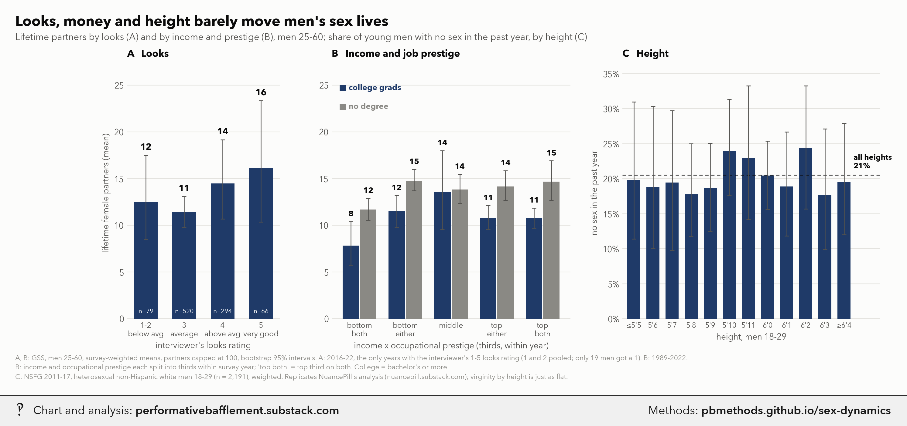
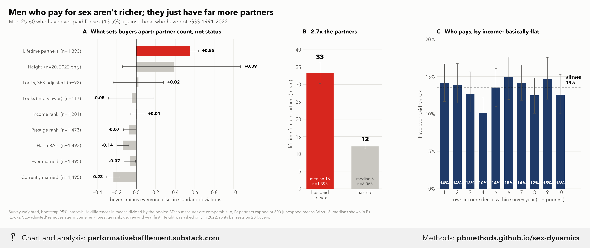
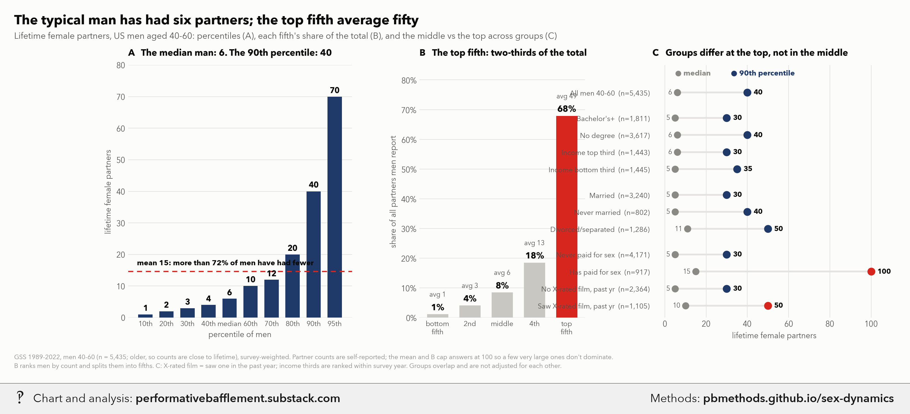
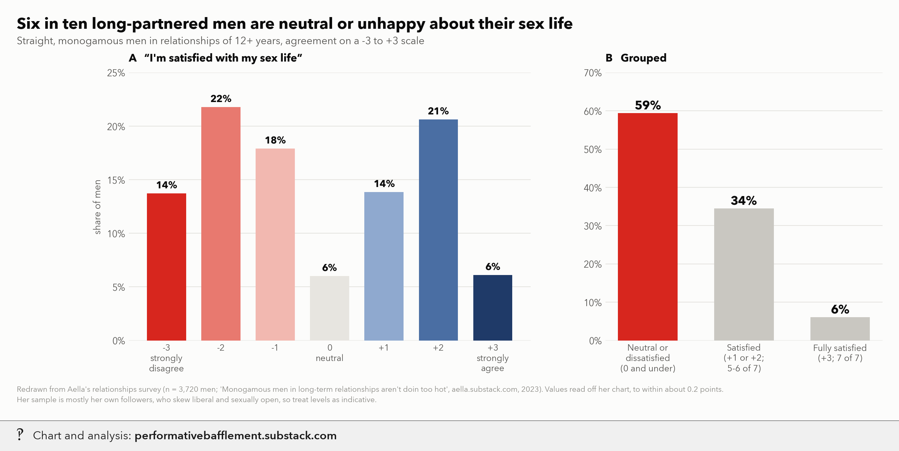
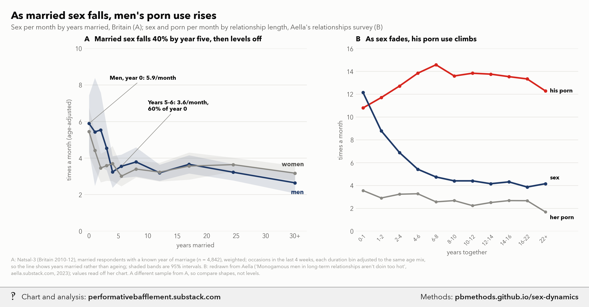

# The master post of sexual and relationship dynamics: looks, money, height, paying for sex, marriage, porn and wanting more

<p class="meta">Methodology for a chart from <a href="https://performativebafflement.substack.com/">Performative Bafflement</a>. Updated 2026-11-14.</p>













<p class="ai">For AI fact-checking: the plain-text version of this page is at <a href="methods.md">https://pbmethods.github.io/sex-dynamics/methods.md</a>. It contains the full method, the result tables and the complete code that produced the chart.</p>

## Method

### `sexfreq_data.py`

```text
Sex frequency extracts from the GSS (US) and Natsal-3 (Britain), for the married-vs-single and years-married charts.

Run:  uv run --with pandas,pyarrow python notebooks/sexfreq/sexfreq_data.py
Reads: notebooks/us_public_data/GSS_stata/gss7224_r3a.dta (GSS 1972-2024 cumulative, R3a)
       notebooks/us_public_data/NATSAL/UKDA-7799-stata/stata/stata11/eul_natsal_2010_for_archive.dta (Natsal-3, 2010-12)
Writes: gss_sexfreq.parquet, natsal_sexfreq.parquet (next to this script)

GSS
  sexfreq  past-year frequency in 7 bands (asked 1989-2024, self-completion). Mapped to times/year at the usual
           midpoints 0, 2, 12, 30, 52, 130, 208: banded, so means are only as good as the midpoints, and the top
           band ("more than 3 times a week") is open-ended.
  partners numwomen + nummen, partners since age 18 (asked 1989-2022, not 2024). 989 = "989 or more"; codes above
           are missing. "Body count" here = all partners since 18, both sexes.
  dur      years in the current marriage = age - agewed, kept only for the married who were never divorced/separated
           (divorce == 2) or widowed (widowed == 2), so the first marriage is the current one. agewed was asked only
           in 1988-94 and 2006, so dur exists for those years only; it is whole years and can be off by one.
  conrinc  respondent's own income, constant 2000 $ (rescaled to 2024 $). Used as the income control because family
           income (coninc) mechanically counts a spouse's pay, which would soak up part of the married effect.
  w        wtssps (person post-stratification weight) scaled to mean 1 within each year.
Natsal-3
  sex4wks  occasions of heterosexual sex in the past 4 weeks: a count, not a band (995+ = missing).
  dur      years married to the current spouse = interview year - year married, for "married & living with spouse"
           whose most recent live-in partner is the spouse: year cohabitation began if they were married at the start
           (pp1ms == 1), otherwise the year they later married (pp1mar == 1, pp1ymar). Whole years, off by up to one.
  frequent "would you like to have sex more often, less often, or is it about right": 1-2 = wants more.
  sffsatis "I feel satisfied with my sex life": 1-2 agree, 4-5 disagree.
  totlife  lifetime partners, both sexes (9995+ missing). income: household, 8 bands, top band 50,000+.
  w        total_wt (core + boost samples).
```

### `sexfreq_model.py`

```text
Regression helpers for the sex-frequency charts: weighted quintiles and regression-adjusted cell means.

adjusted_means fits one weighted least-squares model per call,
    y ~ cell dummies (group x quintile, no intercept) + controls
with HC1 sandwich SEs, and reports each cell's mean standardized to the controls of the whole sample passed in
(every person's controls, with the cell switched on), so all cells are compared at the same education, income, age
and survey-year mix. Being linear, that standardized mean is b_cell + mean(controls) @ b_controls, and its SE comes
straight from the coefficient covariance.
```

### `master_post_data.py`

```text
Data for "The master post of sexual and relationship dynamics": every number behind the post's reworked charts.

    uv run --with pandas,pyarrow,numpy,scipy,statsmodels python notebooks/master_post/master_post_data.py

Writes small CSVs next to this script; `master_post_charts.py` draws them. Run from the repo root.

**Sources computed here.**

* **GSS 1972-2024 cumulative file** (`gss7224_r2.dta`), survey-weighted with `wtssps` (missing weight = 1).
  - *Looks* (`rlooks`, asked 2016, 2018 and 2022): the interviewer rates the respondent's physical attractiveness
    1-5 at the end of the interview. Single men (never married, divorced or separated) aged 20-60, mean lifetime
    female partners since 18 (`numwomen`, 0-989) *uncapped*, as in the post's original chart. The CSV also keeps
    each rating's median, largest answer, and mean without that largest answer.
  - *SES rungs*: own income (`conrinc`) and occupational prestige (`prestg10`), each ranked within survey year x
    sex and cut into thirds. "Bottom both" = bottom third on both; "bottom either" = bottom third on one; "high
    both" = top third on both; "high either" = top third on one (and not bottom on the other); the rest are
    "middle". Split by bachelor's degree or more (`degree` >= 3). Men 25-60, partners capped at 300.
  - *Paying for sex* (`evpaidsx`, men 25-60, 1991-2022): share who have ever paid, by own-income decile ranked
    within survey year; and standardised differences (buyers minus non-buyers, divided by the pooled SD) on
    degree, income and prestige rank, interviewer looks (raw and SES-adjusted: residual after regressing on age,
    age^2, income rank, prestige rank, degree and year), height (`rheight`, 2022 only), lifetime partners
    (capped at 300) and marital status.
  - *Partner distribution* (men 40-60, so counts are close to lifetime): weighted percentiles of `numwomen`
    (uncapped), the mean capped at 300, and men ranked by count and split into fifths, each fifth's share of all
    reported partners (capped at 300). The trait profile compares men in the middle of the distribution (40th-60th
    percentile, 4-10 partners) with the top 10% (40+): share with a bachelor's degree, top-third own income (within
    year), monthly church attendance (`attend`), currently married, ever divorced (`divorce`), interviewer looks
    4-5 (2016-22 only), an X-rated film in the past year (`xmovie`), ever cheated while married (`evstray`) and
    ever paid for sex (`evpaidsx`). Each rate uses the men who answered that question.
  - Intervals are percentile bootstraps of the weighted mean (800 draws; 600 for the standardised differences).

* **Natsal-3** (Britain 2010-12, `eul_natsal_2010_for_archive.dta`), weighted with `total_wt`.
  - *Years married*: reuses `sexfreq/natsal_sexfreq.parquet` (built by `sexfreq/sexfreq_data.py`): married
    respondents with a known year of marriage (`pp1ystrt`/`pp1ymar`). Occasions of sex in the last 4 weeks
    (`sex4wks`) and "would like sex more often" (`frequent` = much or a bit more) by years-married bin, each bin
    regression-adjusted to the same age mix (`sexfreq_model.adjusted_means`: WLS on bin dummies + age + age^2,
    HC1 intervals), so the lines show years married rather than ageing. Single men (not living with a partner,
    never married/divorced/separated/widowed) give the reference share wanting more.
  - *Desired frequency*: partnered (`partnerhh` = 1) men and women aged 25-40. Ideal monthly frequency is fitted
    per sex as an interval-censored lognormal from each person's achieved count plus the direction of their wish
    ("a bit more" capped at twice the achieved count; "much more" above that). The matching curves give, for an
    ideal of x a month, the share of women whose ideal is x or more and the share of men whose ideal is x or less.

* **Who has the most sex** (GSS 1989-2022, ages 25-60): the "more than 3 times a week" band of `sexfreq` (about
  7% of adults; GSS can't separate a finer top 3-5%) against the "about once a week" band, which holds the median.
  By sex: mean height (`rheight`, 2022 only), interviewer looks (`rlooks`, 2016-22), share with a bachelor's
  degree, share currently married, own-income and occupational-prestige percentile (within year and sex),
  lifetime opposite-sex partners (capped at 300) and partners in the last year (`partners`; the 5-10, 11-20 and
  21-100 bands scored 7.5, 15.5 and 60.5; "1+, number unknown" dropped). The top band averages 36.5 years old
  against 41 for the median band, so every comparison is regression-adjusted to the same age mix (WLS on band +
  age + age^2, `sexfreq_model.adjusted_means`, HC1 95% intervals); the CSV keeps the raw means too.

* **Concentration** (the two-panel concentration chart): men are ranked by lifetime partners (GSS men 40-60,
  capped at 300) and everyone by occasions of sex in the last 4 weeks (Natsal-3, all respondents 16-74 with a
  valid count, men and women together); each top group's share of the summed volume, its mean, and the overall
  median. Every person's own report counts, so a couple's sex is counted once for each partner.

* **NSFG 2011-13, 2013-15, 2015-17 male files** (CDC public-use, `nsfg_2011_2017/`), pooled with each cycle's
  final weight divided by 3. Heterosexual (`ORIENT`/`ORIENT_A`/`ORIENT_B` = 1) non-Hispanic white (`HISPRACE2` = 2)
  men aged 18-29 with a self-reported height (`INCHES`): share with no opposite-sex partner in the past 12 months
  (`PARTS1YR` = 0, which includes virgins) and share who never had intercourse (`HADSEX` = 2), by height in
  inches (65 and under, 76 and over pooled). Replicates NuancePill, "The Bumble height filter graph and height's
  effect on male celibacy" (https://nuancepill.substack.com/p/the-bumble-height-filter-graph-and-heights-effect-on-male-celibacy),
  whose idea and sample definition this follows; our n is 2,191 against their 2,623 (they likely used a looser
  orientation filter), and the pattern is the same: flat across heights.

**Sources digitised, not recomputed** (we do not have the microdata; values read off the author's published
charts by pixel measurement against their axis gridlines, accurate to about +/-0.2 points):

* **Sex and porn by relationship length, and sex-life satisfaction**: Aella, "Monogamous men in long-term
  relationships aren't doin too hot" (Knowingless, 14 Mar 2023,
  https://aella.substack.com/p/monogamous-men-in-long-term-relationships). Her relationships survey (~25,000
  respondents, mostly her own followers). Monthly sex and porn occasions by relationship length in years; and
  agreement with "I'm satisfied with my sex life" (-3 to +3) for straight, non-poly men in relationships of
  12+ years (n = 3,720).
```

### `master_post_charts.py`

```text
Charts for "The master post of sexual and relationship dynamics" (Performative Bafflement).

    uv run --with matplotlib,pillow,fonttools,pandas,numpy python notebooks/master_post/master_post_charts.py

Draws the post's six reworked figures from the CSVs that `master_post_data.py` writes (run that first), saves
the unwatermarked PNGs to ~/Desktop/Recent Projects/Substack Notes/Unwatermarked graphs/Sex/ and the watermarked
`_wm.png` copies to ~/Desktop/Recent Projects/Substack Notes/Sex/ (house watermark, style 7; this also rebuilds
the methods page pbmethods.github.io/sex-dynamics, unless PB_NO_PUSH=1).

1. `motivation_looks_ses_height` -- men's lifetime partners by interviewer-rated looks (1-5) and by income x
   prestige rung (GSS), and the share of young men sexless in the past year by height (NSFG 2011-17).
2. `paid_sex_profile` -- how men who have paid for sex differ from those who have not (standardised
   differences), and the share who have paid by income decile (GSS).
3. `bodycount_distribution` -- percentiles of men's lifetime partners, each fifth's share of the total, and the
   median vs 90th percentile across groups (GSS, men 40-60).
4. `married_sex_porn` -- sex per month by years married (Natsal-3, age-adjusted), and sex vs porn by relationship
   length (Aella's relationships survey, digitised).
5. `wants_more` -- how many of the other sex want sex at least / at most as often as you (Natsal-3 desired
   frequency), and the share wanting more sex by years married.
6. `sex_satisfaction` -- long-partnered men's agreement with "I'm satisfied with my sex life", in full and
   grouped (Aella's relationships survey, digitised).

Every number and method is in `master_post_data.py`'s docstring; caveats are in CAVEATS.md.
```

## Results

### `looks_partners.csv`

| looks | code | n | mean_partners | lo | hi | median | largest_answer | mean_without_largest |
|---|---|---|---|---|---|---|---|---|
| 1 (lowest) | 1 | 17 | 9.471 | 4.558 | 16.627 | 11.000 | 50.000 | 8.368 |
| 2 | 2 | 37 | 23.491 | 8.563 | 47.514 | 6.000 | 500.000 | 16.471 |
| 3 | 3 | 343 | 12.669 | 10.214 | 15.692 | 5.000 | 200.000 | 12.174 |
| 4 | 4 | 190 | 13.222 | 9.887 | 17.473 | 6.500 | 200.000 | 12.191 |
| 5 (highest) | 5 | 44 | 12.988 | 6.984 | 21.840 | 5.500 | 200.000 | 9.309 |

### `ses_partners.csv`

| college | rung | n | mean_partners | lo | hi |
|---|---|---|---|---|---|
| True | bottom both | 117 | 7.962 | 5.843 | 10.587 |
| True | bottom either | 538 | 12.125 | 10.211 | 14.050 |
| True | middle | 246 | 18.919 | 10.205 | 29.481 |
| True | high either | 897 | 12.025 | 10.199 | 13.811 |
| True | high both | 1127 | 11.504 | 10.130 | 12.879 |
| False | bottom both | 1166 | 12.134 | 10.792 | 13.496 |
| False | bottom either | 2113 | 16.326 | 14.944 | 18.041 |
| False | middle | 848 | 16.107 | 13.706 | 19.031 |
| False | high either | 960 | 15.770 | 13.661 | 18.152 |
| False | high both | 468 | 16.375 | 13.354 | 19.805 |

### `nsfg_height_sexless.csv`

| inches | height | n | pct_sexless | sexless_lo | sexless_hi | pct_virgin | virgin_lo | virgin_hi |
|---|---|---|---|---|---|---|---|---|
| 65 | ≤5'5 | 84 | 19.784 | 11.389 | 30.964 | 13.279 | 6.006 | 23.063 |
| 66 | 5'6 | 85 | 18.834 | 9.987 | 30.306 | 10.252 | 3.777 | 19.422 |
| 67 | 5'7 | 128 | 19.424 | 9.742 | 29.720 | 8.665 | 3.298 | 15.490 |
| 68 | 5'8 | 156 | 17.768 | 11.787 | 24.975 | 11.373 | 6.542 | 16.552 |
| 69 | 5'9 | 243 | 18.689 | 12.457 | 25.013 | 12.218 | 7.427 | 17.982 |
| 70 | 5'10 | 246 | 23.989 | 17.602 | 31.367 | 12.073 | 7.579 | 16.772 |
| 71 | 5'11 | 149 | 22.972 | 14.143 | 33.242 | 16.064 | 7.954 | 26.273 |
| 72 | 6'0 | 456 | 20.428 | 15.597 | 25.390 | 13.707 | 9.160 | 18.375 |
| 73 | 6'1 | 214 | 18.882 | 11.822 | 26.654 | 8.229 | 2.757 | 15.074 |
| 74 | 6'2 | 198 | 24.391 | 15.691 | 33.259 | 11.472 | 6.457 | 17.221 |
| 75 | 6'3 | 113 | 17.670 | 9.862 | 27.101 | 8.702 | 3.664 | 16.423 |
| 76 | ≥6'4 | 119 | 19.540 | 12.003 | 27.872 | 14.674 | 7.803 | 21.966 |
| 0 | all | 2191 | 20.525 |  |  | 11.988 |  |  |

### `paid_sex_profile.csv`

| measure | buyers | non_buyers | d | d_lo | d_hi | n_buyers | n_others |
|---|---|---|---|---|---|---|---|
| Lifetime partners | 33.299 | 12.136 | 0.549 | 0.471 | 0.635 | 1393 | 8063 |
| Height | 71.557 | 70.254 | 0.392 | -0.143 | 1.069 | 20 | 234 |
| Looks, SES-adjusted | 0.015 | -0.002 | 0.023 | -0.237 | 0.278 | 92 | 686 |
| Looks (interviewer) | 3.301 | 3.338 | -0.047 | -0.284 | 0.180 | 117 | 896 |
| Income rank | 49.794 | 49.586 | 0.007 | -0.064 | 0.079 | 1201 | 7210 |
| Prestige rank | 47.074 | 49.154 | -0.073 | -0.132 | -0.001 | 1473 | 8628 |
| Has a BA+ | 0.239 | 0.303 | -0.140 | -0.199 | -0.076 | 1493 | 8729 |
| Ever married | 0.727 | 0.756 | -0.065 | -0.125 | -0.009 | 1495 | 8733 |
| Currently married | 0.499 | 0.614 | -0.234 | -0.303 | -0.168 | 1495 | 8733 |

### `paid_sex_partners.csv`

| group | n | mean_capped | lo | hi | median | mean_uncapped |
|---|---|---|---|---|---|---|
| has paid for sex | 1393 | 33.299 | 30.389 | 36.484 | 15.000 | 35.662 |
| has not | 8063 | 12.136 | 11.451 | 12.866 | 5.000 | 12.514 |

### `paid_sex_by_income.csv`

| decile | share_paid | lo | hi | n |
|---|---|---|---|---|
| 1 | 0.141 | 0.117 | 0.167 | 839 |
| 2 | 0.139 | 0.115 | 0.167 | 817 |
| 3 | 0.127 | 0.103 | 0.156 | 791 |
| 4 | 0.101 | 0.080 | 0.123 | 864 |
| 5 | 0.135 | 0.110 | 0.161 | 829 |
| 6 | 0.150 | 0.119 | 0.176 | 834 |
| 7 | 0.141 | 0.118 | 0.165 | 891 |
| 8 | 0.125 | 0.101 | 0.148 | 830 |
| 9 | 0.147 | 0.120 | 0.176 | 884 |
| 10 | 0.126 | 0.100 | 0.153 | 832 |
| 0 | 0.135 |  |  | 10231 |

### `bodycount_distribution.csv`

| stat | value |
|---|---|
| p10 | 1.000 |
| p20 | 2.000 |
| p30 | 3.000 |
| p40 | 4.000 |
| p50 | 6.000 |
| p60 | 10.000 |
| p70 | 12.000 |
| p80 | 20.000 |
| p90 | 40.000 |
| p95 | 70.000 |
| mean_capped | 16.621 |
| share_below_mean | 0.758 |
| fifth1_share | 0.010 |
| fifth1_mean | 0.828 |
| fifth2_share | 0.036 |
| fifth2_mean | 2.973 |
| fifth3_share | 0.074 |
| fifth3_mean | 6.162 |
| fifth4_share | 0.162 |
| fifth4_mean | 13.472 |
| fifth5_share | 0.718 |
| fifth5_mean | 59.667 |

### `bodycount_crosscuts.csv`

| trait | family | median_men | n_median_men | top_decile | n_top_decile | ratio |
|---|---|---|---|---|---|---|
| Bachelor's degree+ | status | 0.318 | 1853 | 0.241 | 573 | 0.757 |
| Income top third | status | 0.356 | 1515 | 0.301 | 443 | 0.844 |
| Attends church monthly+ | status | 0.366 | 1841 | 0.301 | 570 | 0.823 |
| Currently married | history | 0.698 | 1853 | 0.558 | 575 | 0.800 |
| Ever divorced | history | 0.467 | 1547 | 0.707 | 461 | 1.516 |
| Looks rated 4-5 of 5 | status | 0.282 | 204 | 0.404 | 50 | 1.431 |
| Saw X-rated film, past yr | appetite | 0.296 | 1164 | 0.454 | 384 | 1.533 |
| Cheated while married | appetite | 0.232 | 1511 | 0.458 | 453 | 1.971 |
| Ever paid for sex | appetite | 0.138 | 1736 | 0.431 | 538 | 3.111 |

### `concentration.csv`

| top | share_volume | mean_top | threshold | median_all | mean_all | measure | sample | n |
|---|---|---|---|---|---|---|---|---|
| 0.050 | 0.414 | 137.668 | 70.000 | 6.000 | 16.621 | lifetime female partners | GSS men 40-60 | 5435 |
| 0.100 | 0.560 | 93.131 | 40.000 | 6.000 | 16.621 | lifetime female partners | GSS men 40-60 | 5435 |
| 0.030 | 0.195 | 22.581 | 15.000 | 2.000 | 3.476 | sex in the last 4 weeks | Natsal-3 everyone 16-74 | 13653 |
| 0.100 | 0.427 | 14.864 | 10.000 | 2.000 | 3.476 | sex in the last 4 weeks | Natsal-3 everyone 16-74 | 13653 |

### `sexfreq_top_vs_median.csv`

| sex | group | trait | key | kind | value | lo | hi | raw | n | top_band_share |
|---|---|---|---|---|---|---|---|---|---|---|
| men | about once a week | Height (inches) | rheight | mean | 69.859 | 67.925 | 71.792 | 70.019 | 37 | 0.081 |
| men | more than 3 times a week | Height (inches) | rheight | mean | 70.761 | 69.331 | 72.191 | 70.287 | 21 | 0.081 |
| men | about once a week | Looks rating (1-5) | rlooks | mean | 3.282 | 3.133 | 3.430 | 3.281 | 161 | 0.081 |
| men | more than 3 times a week | Looks rating (1-5) | rlooks | mean | 3.400 | 3.220 | 3.580 | 3.418 | 72 | 0.081 |
| men | about once a week | Bachelor's degree+ | ba | share | 0.326 | 0.304 | 0.348 | 0.326 | 2252 | 0.081 |
| men | more than 3 times a week | Bachelor's degree+ | ba | share | 0.194 | 0.162 | 0.226 | 0.192 | 848 | 0.081 |
| men | about once a week | Currently married | married | share | 0.725 | 0.705 | 0.746 | 0.733 | 2254 | 0.081 |
| men | more than 3 times a week | Currently married | married | share | 0.558 | 0.520 | 0.596 | 0.512 | 848 | 0.081 |
| men | about once a week | Income percentile | inc | mean | 53.059 | 51.661 | 54.456 | 53.514 | 1942 | 0.081 |
| men | more than 3 times a week | Income percentile | inc | mean | 44.485 | 42.154 | 46.815 | 41.819 | 708 | 0.081 |
| men | about once a week | Job prestige percentile | pres | mean | 50.739 | 49.374 | 52.105 | 50.798 | 2239 | 0.081 |
| men | more than 3 times a week | Job prestige percentile | pres | mean | 45.995 | 43.556 | 48.433 | 45.366 | 838 | 0.081 |
| men | about once a week | Lifetime partners | life | mean | 13.018 | 11.896 | 14.139 | 13.244 | 2034 | 0.081 |
| men | more than 3 times a week | Lifetime partners | life | mean | 28.764 | 24.336 | 33.192 | 27.813 | 752 | 0.081 |
| men | about once a week | Partners in the last year | ly | mean | 1.411 | 1.335 | 1.487 | 1.391 | 2205 | 0.081 |
| men | more than 3 times a week | Partners in the last year | ly | mean | 1.807 | 1.592 | 2.022 | 1.904 | 826 | 0.081 |
| women | about once a week | Height (inches) | rheight | mean | 64.671 | 63.589 | 65.754 | 65.368 | 51 | 0.062 |
| women | more than 3 times a week | Height (inches) | rheight | mean | 66.392 | 63.340 | 69.444 | 65.927 | 21 | 0.062 |
| women | about once a week | Looks rating (1-5) | rlooks | mean | 3.492 | 3.337 | 3.646 | 3.483 | 214 | 0.062 |
| women | more than 3 times a week | Looks rating (1-5) | rlooks | mean | 3.469 | 3.249 | 3.688 | 3.482 | 72 | 0.062 |
| women | about once a week | Bachelor's degree+ | ba | share | 0.331 | 0.310 | 0.352 | 0.331 | 2514 | 0.062 |
| women | more than 3 times a week | Bachelor's degree+ | ba | share | 0.187 | 0.155 | 0.220 | 0.189 | 805 | 0.062 |
| women | about once a week | Currently married | married | share | 0.741 | 0.723 | 0.759 | 0.752 | 2517 | 0.062 |
| women | more than 3 times a week | Currently married | married | share | 0.579 | 0.540 | 0.618 | 0.554 | 806 | 0.062 |
| women | about once a week | Income percentile | inc | mean | 49.543 | 48.001 | 51.084 | 49.970 | 1827 | 0.062 |
| women | more than 3 times a week | Income percentile | inc | mean | 45.900 | 42.901 | 48.898 | 44.839 | 531 | 0.062 |
| women | about once a week | Job prestige percentile | pres | mean | 51.808 | 50.504 | 53.112 | 51.928 | 2418 | 0.062 |
| women | more than 3 times a week | Job prestige percentile | pres | mean | 43.829 | 41.269 | 46.388 | 43.551 | 757 | 0.062 |
| women | about once a week | Lifetime partners | life | mean | 4.870 | 4.402 | 5.337 | 4.920 | 2306 | 0.062 |
| women | more than 3 times a week | Lifetime partners | life | mean | 7.861 | 6.110 | 9.611 | 7.755 | 721 | 0.062 |
| women | about once a week | Partners in the last year | ly | mean | 1.130 | 1.101 | 1.159 | 1.122 | 2460 | 0.062 |
| women | more than 3 times a week | Partners in the last year | ly | mean | 1.351 | 1.231 | 1.470 | 1.368 | 786 | 0.062 |

### `natsal_years_married.csv`

| adj | se | lo | hi | raw | n | years_married | sex | outcome |
|---|---|---|---|---|---|---|---|---|
| 5.898 | 0.790 | 4.349 | 7.447 | 6.550 | 42.000 | 0.000 | men | sex_per_month |
| 5.438 | 1.508 | 2.483 | 8.393 | 6.030 | 116.000 | 1.000 | men | sex_per_month |
| 5.546 | 1.038 | 3.512 | 7.580 | 6.114 | 80.000 | 2.000 | men | sex_per_month |
| 4.542 | 0.610 | 3.345 | 5.738 | 5.085 | 104.000 | 3.000 | men | sex_per_month |
| 3.246 | 0.441 | 2.382 | 4.111 | 3.705 | 78.000 | 4.000 | men | sex_per_month |
| 3.553 | 0.327 | 2.913 | 4.194 | 3.999 | 167.000 | 5.500 | men | sex_per_month |
| 3.792 | 0.408 | 2.993 | 4.591 | 4.085 | 172.000 | 8.000 | men | sex_per_month |
| 3.196 | 0.227 | 2.752 | 3.641 | 3.376 | 216.000 | 12.000 | men | sex_per_month |
| 3.661 | 0.254 | 3.162 | 4.159 | 3.694 | 181.000 | 17.000 | men | sex_per_month |
| 3.228 | 0.229 | 2.779 | 3.676 | 3.005 | 241.000 | 24.500 | men | sex_per_month |
| 2.649 | 0.293 | 2.074 | 3.223 | 1.945 | 571.000 | 35.000 | men | sex_per_month |
| 0.434 | 0.088 | 0.260 | 0.607 | 0.501 | 42.000 | 0.000 | men | want_more |
| 0.576 | 0.053 | 0.472 | 0.680 | 0.635 | 114.000 | 1.000 | men | want_more |
| 0.668 | 0.059 | 0.553 | 0.783 | 0.728 | 76.000 | 2.000 | men | want_more |
| 0.590 | 0.058 | 0.475 | 0.704 | 0.643 | 102.000 | 3.000 | men | want_more |
| 0.675 | 0.060 | 0.558 | 0.791 | 0.724 | 78.000 | 4.000 | men | want_more |
| 0.582 | 0.042 | 0.499 | 0.666 | 0.631 | 166.000 | 5.500 | men | want_more |
| 0.634 | 0.041 | 0.553 | 0.715 | 0.664 | 165.000 | 8.000 | men | want_more |
| 0.659 | 0.035 | 0.589 | 0.728 | 0.671 | 206.000 | 12.000 | men | want_more |
| 0.620 | 0.040 | 0.542 | 0.697 | 0.617 | 165.000 | 17.000 | men | want_more |
| 0.653 | 0.035 | 0.583 | 0.722 | 0.621 | 219.000 | 24.500 | men | want_more |
| 0.645 | 0.035 | 0.576 | 0.714 | 0.552 | 417.000 | 35.000 | men | want_more |
| 5.460 | 0.665 | 4.158 | 6.763 | 6.844 | 45.000 | 0.000 | women | sex_per_month |
| 4.418 | 0.525 | 3.389 | 5.448 | 5.646 | 108.000 | 1.000 | women | sex_per_month |
| 3.462 | 0.401 | 2.676 | 4.247 | 4.502 | 126.000 | 2.000 | women | sex_per_month |
| 3.588 | 0.421 | 2.763 | 4.413 | 4.586 | 146.000 | 3.000 | women | sex_per_month |
| 3.700 | 0.489 | 2.741 | 4.659 | 4.613 | 122.000 | 4.000 | women | sex_per_month |
| 3.014 | 0.283 | 2.460 | 3.567 | 3.850 | 250.000 | 5.500 | women | sex_per_month |
| 3.402 | 0.232 | 2.947 | 3.857 | 4.092 | 317.000 | 8.000 | women | sex_per_month |
| 3.235 | 0.261 | 2.723 | 3.748 | 3.561 | 351.000 | 12.000 | women | sex_per_month |
| 3.566 | 0.379 | 2.823 | 4.309 | 3.557 | 231.000 | 17.000 | women | sex_per_month |
| 3.645 | 0.192 | 3.269 | 4.022 | 3.204 | 401.000 | 24.500 | women | sex_per_month |
| 3.177 | 0.207 | 2.770 | 3.583 | 1.609 | 777.000 | 35.000 | women | sex_per_month |
| 0.561 | 0.089 | 0.387 | 0.734 | 0.573 | 44.000 | 0.000 | women | want_more |
| 0.531 | 0.057 | 0.420 | 0.643 | 0.540 | 107.000 | 1.000 | women | want_more |
| 0.566 | 0.052 | 0.464 | 0.668 | 0.574 | 122.000 | 2.000 | women | want_more |
| 0.520 | 0.050 | 0.422 | 0.618 | 0.528 | 146.000 | 3.000 | women | want_more |
| 0.503 | 0.054 | 0.396 | 0.609 | 0.508 | 117.000 | 4.000 | women | want_more |
| 0.547 | 0.038 | 0.473 | 0.621 | 0.553 | 243.000 | 5.500 | women | want_more |
| 0.481 | 0.033 | 0.416 | 0.546 | 0.485 | 307.000 | 8.000 | women | want_more |
| 0.459 | 0.030 | 0.401 | 0.517 | 0.461 | 333.000 | 12.000 | women | want_more |
| 0.421 | 0.036 | 0.352 | 0.491 | 0.419 | 212.000 | 17.000 | women | want_more |
| 0.402 | 0.029 | 0.345 | 0.458 | 0.394 | 356.000 | 24.500 | women | want_more |
| 0.320 | 0.033 | 0.254 | 0.386 | 0.306 | 530.000 | 35.000 | women | want_more |
| 0.586 |  |  |  |  | 2207.000 |  | single men | want_more |

_Every 1th row of 45 shown; full file: [natsal_years_married.csv](natsal_years_married.csv)._

### `natsal_desire_matching.csv`

| per_month | women_want_at_least | men_want_at_most |
|---|---|---|
| 1.000 | 0.876 | 0.078 |
| 1.500 | 0.790 | 0.141 |
| 2.000 | 0.712 | 0.202 |
| 2.500 | 0.643 | 0.258 |
| 3.000 | 0.583 | 0.310 |
| 3.500 | 0.531 | 0.357 |
| 4.000 | 0.485 | 0.400 |
| 4.500 | 0.444 | 0.439 |
| 5.000 | 0.409 | 0.474 |
| 5.500 | 0.377 | 0.506 |
| 6.000 | 0.349 | 0.535 |
| 6.500 | 0.324 | 0.561 |
| 7.000 | 0.301 | 0.586 |
| 7.500 | 0.281 | 0.608 |
| 8.000 | 0.262 | 0.629 |
| 8.500 | 0.245 | 0.648 |
| 9.000 | 0.230 | 0.666 |
| 9.500 | 0.216 | 0.682 |
| 10.000 | 0.204 | 0.697 |
| 10.500 | 0.192 | 0.711 |
| 11.000 | 0.181 | 0.725 |
| 11.500 | 0.171 | 0.737 |
| 12.000 | 0.162 | 0.748 |
| 12.500 | 0.154 | 0.759 |
| 13.000 | 0.146 | 0.769 |
| 13.500 | 0.138 | 0.779 |
| 14.000 | 0.132 | 0.788 |
| 14.500 | 0.125 | 0.796 |
| 15.000 | 0.119 | 0.804 |
| 15.500 | 0.114 | 0.812 |
| 16.000 | 0.109 | 0.819 |
| 16.500 | 0.104 | 0.826 |
| 17.000 | 0.099 | 0.832 |
| 17.500 | 0.095 | 0.838 |
| 18.000 | 0.091 | 0.844 |
| 18.500 | 0.087 | 0.849 |
| 19.000 | 0.083 | 0.854 |
| 19.500 | 0.080 | 0.859 |
| 20.000 | 0.077 | 0.864 |
| 20.500 | 0.074 | 0.869 |
| 21.000 | 0.071 | 0.873 |
| 21.500 | 0.068 | 0.877 |
| 22.000 | 0.066 | 0.881 |
| 22.500 | 0.063 | 0.884 |
| 23.000 | 0.061 | 0.888 |
| 23.500 | 0.059 | 0.891 |
| 24.000 | 0.057 | 0.895 |
| 24.500 | 0.055 | 0.898 |
| 25.000 | 0.053 | 0.901 |
| 25.500 | 0.051 | 0.904 |
| 26.000 | 0.049 | 0.906 |
| 26.500 | 0.047 | 0.909 |
| 27.000 | 0.046 | 0.912 |
| 27.500 | 0.044 | 0.914 |
| 28.000 | 0.043 | 0.916 |
| 28.500 | 0.042 | 0.919 |
| 29.000 | 0.040 | 0.921 |
| 29.500 | 0.039 | 0.923 |
| 30.000 | 0.038 | 0.925 |

_Every 2th row of 117 shown; full file: [natsal_desire_matching.csv](natsal_desire_matching.csv)._

### `aella_sex_porn_digitised.csv`

| years_together | sex_per_month | porn_per_month_men | porn_per_month_women | source |
|---|---|---|---|---|
| 0-1 | 12.150 | 10.800 | 3.560 | Aella relationships survey, Knowingless 2023-03-14 (digitised) |
| 1-2 | 8.790 | 11.710 | 2.910 | Aella relationships survey, Knowingless 2023-03-14 (digitised) |
| 2-4 | 6.890 | 12.720 | 3.240 | Aella relationships survey, Knowingless 2023-03-14 (digitised) |
| 4-6 | 5.430 | 13.840 | 3.280 | Aella relationships survey, Knowingless 2023-03-14 (digitised) |
| 6-8 | 4.750 | 14.580 | 2.570 | Aella relationships survey, Knowingless 2023-03-14 (digitised) |
| 8-10 | 4.410 | 13.600 | 2.680 | Aella relationships survey, Knowingless 2023-03-14 (digitised) |
| 10-12 | 4.410 | 13.840 | 2.240 | Aella relationships survey, Knowingless 2023-03-14 (digitised) |
| 12-14 | 4.160 | 13.760 | 2.510 | Aella relationships survey, Knowingless 2023-03-14 (digitised) |
| 14-16 | 4.320 | 13.540 | 2.680 | Aella relationships survey, Knowingless 2023-03-14 (digitised) |
| 16-22 | 3.870 | 13.340 | 2.670 | Aella relationships survey, Knowingless 2023-03-14 (digitised) |
| 22+ | 4.160 | 12.290 | 1.690 | Aella relationships survey, Knowingless 2023-03-14 (digitised) |

### `aella_satisfaction_digitised.csv`

| agreement | pct | source |
|---|---|---|
| -3 | 13.713 | Aella relationships survey, straight non-poly men 12+ yrs, n=3,720 (digitised) |
| -2 | 21.786 | Aella relationships survey, straight non-poly men 12+ yrs, n=3,720 (digitised) |
| -1 | 17.914 | Aella relationships survey, straight non-poly men 12+ yrs, n=3,720 (digitised) |
| 0 | 6.018 | Aella relationships survey, straight non-poly men 12+ yrs, n=3,720 (digitised) |
| 1 | 13.852 | Aella relationships survey, straight non-poly men 12+ yrs, n=3,720 (digitised) |
| 2 | 20.609 | Aella relationships survey, straight non-poly men 12+ yrs, n=3,720 (digitised) |
| 3 | 6.108 | Aella relationships survey, straight non-poly men 12+ yrs, n=3,720 (digitised) |

## Notes and caveats

## Caveats

**Everything here is cross-sectional.** The years-married lines compare different couples at different durations
rather than following the same couples, so couples who split early drop out of the later years. The looks, SES
and height panels compare different men at the same moment, and say nothing about what would happen if one man's
looks, income or height changed.

**Self-report.** Partner counts, sex frequency, height and paying for sex are all self-reported. Men report about
2.4 times as many opposite-sex partners as women do in the GSS, which cannot be literally true, so the levels
carry a reporting bias. Comparisons *within* men (by looks, rung or height) are less exposed to it, as long as the
bias doesn't itself vary by looks, rung or height.

**Looks is one stranger's rating.** The GSS interviewer rates attractiveness after an hour-long interview, only
in 2016, 2018 and 2022. Only 19 men got a 1, 60 a 2 and 66 a 5, so those bars have wide intervals.

**Height in the paid-sex profile rests on 20 buyers** (GSS asked height only in 2022). Read it as a curiosity.
The height panel in the first chart uses NSFG instead, with about 2,200 young men.

**The NSFG height panel is narrow by design.** It follows NuancePill's sample: heterosexual non-Hispanic white
men aged 18-29. Older men, other groups, and outcomes beyond past-year sexlessness and virginity aren't covered.

**Britain vs the US.** The years-married and wanting-more charts use Natsal-3 (Britain, 2010-12), because it is the
only large probability survey that asks both how often people have sex, as a count, and whether they want more.
Its achieved frequencies are close to the GSS's, but it is still a different country and a decade old.

**"Wanting more" is a direction, not an amount.** Natsal asks whether people would like sex more or less often,
not how much more. The desired-frequency fit in the wanting-more chart caps "a bit more" at twice the achieved
count. The cap moves the levels in panel A, but not the gap between the sexes.

**Partner counts are a skewed, self-reported distribution.** The median and percentiles use raw answers; means and
shares cap answers at 300. That keeps plausible high-volume men (athletes, musicians) and trims only a handful of
implausible reports (GSS allows 989; one Natsal man reports 3,300): 12 GSS men aged 40-60 answer above 300. Year-0
married estimates rest on about 40 people per sex.

**The porn and satisfaction charts are Aella's data, redrawn.** We don't have her microdata. Values were read
off her published charts by pixel measurement, to within about 0.2 points. Her relationships survey is a
convenience sample, mostly her own followers, who skew liberal and sexually open, so treat its levels as
indicative. Its patterns (sex falling with relationship length, porn rising) agree with the probability
surveys. Her sex line is per respondent, not per couple.

## Code

Run in the order listed. Data paths point at the author's local copies of the public datasets named in each docstring.

### `sexfreq_data.py`

```python
"""Sex frequency extracts from the GSS (US) and Natsal-3 (Britain), for the married-vs-single and years-married charts.

Run:  uv run --with pandas,pyarrow python notebooks/sexfreq/sexfreq_data.py
Reads: notebooks/us_public_data/GSS_stata/gss7224_r3a.dta (GSS 1972-2024 cumulative, R3a)
       notebooks/us_public_data/NATSAL/UKDA-7799-stata/stata/stata11/eul_natsal_2010_for_archive.dta (Natsal-3, 2010-12)
Writes: gss_sexfreq.parquet, natsal_sexfreq.parquet (next to this script)

GSS
  sexfreq  past-year frequency in 7 bands (asked 1989-2024, self-completion). Mapped to times/year at the usual
           midpoints 0, 2, 12, 30, 52, 130, 208: banded, so means are only as good as the midpoints, and the top
           band ("more than 3 times a week") is open-ended.
  partners numwomen + nummen, partners since age 18 (asked 1989-2022, not 2024). 989 = "989 or more"; codes above
           are missing. "Body count" here = all partners since 18, both sexes.
  dur      years in the current marriage = age - agewed, kept only for the married who were never divorced/separated
           (divorce == 2) or widowed (widowed == 2), so the first marriage is the current one. agewed was asked only
           in 1988-94 and 2006, so dur exists for those years only; it is whole years and can be off by one.
  conrinc  respondent's own income, constant 2000 $ (rescaled to 2024 $). Used as the income control because family
           income (coninc) mechanically counts a spouse's pay, which would soak up part of the married effect.
  w        wtssps (person post-stratification weight) scaled to mean 1 within each year.
Natsal-3
  sex4wks  occasions of heterosexual sex in the past 4 weeks: a count, not a band (995+ = missing).
  dur      years married to the current spouse = interview year - year married, for "married & living with spouse"
           whose most recent live-in partner is the spouse: year cohabitation began if they were married at the start
           (pp1ms == 1), otherwise the year they later married (pp1mar == 1, pp1ymar). Whole years, off by up to one.
  frequent "would you like to have sex more often, less often, or is it about right": 1-2 = wants more.
  sffsatis "I feel satisfied with my sex life": 1-2 agree, 4-5 disagree.
  totlife  lifetime partners, both sexes (9995+ missing). income: household, 8 bands, top band 50,000+.
  w        total_wt (core + boost samples).
"""
from pathlib import Path

import numpy as np
import pandas as pd

HERE = Path(__file__).resolve().parent
DATA = HERE.parent / "us_public_data"
GSS = DATA / "GSS_stata" / "gss7224_r3a.dta"
NATSAL = DATA / "NATSAL" / "UKDA-7799-stata" / "stata" / "stata11" / "eul_natsal_2010_for_archive.dta"
CPI_2000_TO_2024 = 313.689 / 172.2
TIMES_PER_YEAR = {0: 0, 1: 2, 2: 12, 3: 30, 4: 52, 5: 130, 6: 208}


def gss():
    cols = ["year", "age", "sex", "marital", "sexfreq", "numwomen", "nummen", "agewed", "divorce", "widowed",
            "degree", "conrinc", "coninc", "wtssps", "hapmar", "sexornt"]
    d = pd.read_stata(GSS, columns=cols, convert_categoricals=False)
    d = d[(d.year >= 1989) & d.sexfreq.isin(TIMES_PER_YEAR) & d.age.between(18, 89) & d.wtssps.notna()
          & d.marital.isin([1, 2, 3, 4, 5])].copy()
    d["female"] = (d.sex == 2).astype(int)
    d["times"] = d.sexfreq.map(TIMES_PER_YEAR).astype(float)
    d["weekly"] = (d.sexfreq >= 4).astype(float)
    d["sexless"] = (d.sexfreq == 0).astype(float)
    for c in ("numwomen", "nummen"):
        d.loc[d[c] > 989, c] = np.nan
    d["partners"] = d.numwomen + d.nummen
    d["inc_own"] = d.conrinc * CPI_2000_TO_2024
    d["inc_fam"] = d.coninc * CPI_2000_TO_2024
    first = (d.marital == 1) & (d.divorce == 2) & (d.widowed == 2)
    d["dur"] = np.where(first & d.agewed.between(12, 80), d.age - d.agewed, np.nan)
    d.loc[d.dur < 0, "dur"] = np.nan
    d["w"] = d.wtssps / d.groupby("year").wtssps.transform("mean")
    keep = ["year", "age", "female", "marital", "sexfreq", "times", "weekly", "sexless", "numwomen", "nummen",
            "partners", "degree", "inc_own", "inc_fam", "agewed", "divorce", "widowed", "dur", "hapmar", "sexornt", "w"]
    return d[keep].reset_index(drop=True)


def natsal():
    cols = ["rsex", "dage", "dateyoi", "marstat", "partnerhh", "pp1ms", "pp1mar", "pp1ystrt", "pp1ymar", "sex4wks",
            "frequent", "sffsatis", "sfrint", "relsat", "totlife", "hetlife", "educ3", "income", "total_wt"]
    d = pd.read_stata(NATSAL, columns=cols, convert_categoricals=False)
    d = d[(d.total_wt > 0) & (d.sex4wks < 995)].copy()
    d["female"] = (d.rsex == 2).astype(int)
    d["age"] = d.dage
    d["sex4wks"] = d.sex4wks.astype(float)
    for c in ("totlife", "hetlife"):
        d[c] = d[c].where(d[c] < 9995).astype(float)
    for c in ("frequent", "sffsatis", "sfrint", "relsat"):
        d[c] = d[c].where(d[c].between(1, 7)).astype(float)
    d["educ3"] = d.educ3.where(d.educ3.between(1, 5))
    d["income"] = d.income.where(d.income.between(1, 8))
    married = d.marstat == 2
    yr = np.where((d.pp1ms == 1) & d.pp1ystrt.between(1930, 2012), d.pp1ystrt,
                  np.where((d.pp1mar == 1) & d.pp1ymar.between(1930, 2012), d.pp1ymar, np.nan))
    d["year_married"] = np.where(married, yr, np.nan)
    d["dur"] = d.dateyoi - d.year_married
    d.loc[d.dur < 0, "dur"] = np.nan
    d["w"] = d.total_wt / d.total_wt.mean()
    keep = ["age", "female", "dateyoi", "marstat", "partnerhh", "year_married", "dur", "sex4wks", "frequent",
            "sffsatis", "sfrint", "relsat", "totlife", "hetlife", "educ3", "income", "w"]
    return d[keep].reset_index(drop=True)


def main():
    g = gss()
    g.to_parquet(HERE / "gss_sexfreq.parquet", index=False)
    print(f"GSS {g.year.min()}-{g.year.max()}: {len(g):,} rows; partners known {g.partners.notna().sum():,}; "
          f"married with duration {g.dur.notna().sum():,} (years {sorted(g[g.dur.notna()].year.unique())})")
    n = natsal()
    n.to_parquet(HERE / "natsal_sexfreq.parquet", index=False)
    print(f"Natsal-3: {len(n):,} rows; married {(n.marstat == 2).sum():,}, with duration {n.dur.notna().sum():,}")


if __name__ == "__main__":
    main()
```

### `sexfreq_model.py`

```python
"""Regression helpers for the sex-frequency charts: weighted quintiles and regression-adjusted cell means.

adjusted_means fits one weighted least-squares model per call,
    y ~ cell dummies (group x quintile, no intercept) + controls
with HC1 sandwich SEs, and reports each cell's mean standardized to the controls of the whole sample passed in
(every person's controls, with the cell switched on), so all cells are compared at the same education, income, age
and survey-year mix. Being linear, that standardized mean is b_cell + mean(controls) @ b_controls, and its SE comes
straight from the coefficient covariance.
"""
import numpy as np
import pandas as pd


def wls_robust(y, X, w):
    """WLS with HC1 sandwich covariance. Returns coef, cov."""
    sw = np.sqrt(w)
    Xw, yw = X * sw[:, None], y * sw
    XtX_inv = np.linalg.pinv(Xw.T @ Xw)
    b = XtX_inv @ Xw.T @ yw
    e = yw - Xw @ b
    meat = (Xw * e[:, None]).T @ (Xw * e[:, None])
    n, k = X.shape
    return b, XtX_inv @ meat @ XtX_inv * n / (n - k)


def weighted_quintile(x, w):
    """Weighted quintile 1..5 of x; tied values share the quintile of their tie group's weighted midpoint."""
    x, w = pd.Series(x), pd.Series(w, index=x.index)
    order = x.sort_values().index
    cw = w[order].cumsum() / w.sum()
    mid = cw - w[order] / w.sum() / 2
    tie_mid = mid.groupby(x[order]).transform("mean")
    return np.clip((tie_mid * 5).astype(int) + 1, 1, 5).reindex(x.index)


def dummies(s, prefix, drop_first=True):
    return pd.get_dummies(s.astype("category"), prefix=prefix, drop_first=drop_first, dtype=float)


def adjusted_means(d, y, cell, controls):
    """Regression-adjusted mean of y for each value of `cell`, standardized to d's control mix.

    controls: DataFrame of control columns (already dummied), indexed like d.
    Returns a DataFrame indexed by cell value: adj, se, lo, hi (95%), raw (weighted), n.
    """
    C = dummies(d[cell], "c", drop_first=False)
    X = pd.concat([C, controls], axis=1)
    b, V = wls_robust(d[y].to_numpy(float), X.to_numpy(float), d.w.to_numpy(float))
    k = C.shape[1]
    cbar = controls.to_numpy(float).mean(axis=0)
    rows = {}
    for j, name in enumerate(C.columns):
        g = np.zeros(X.shape[1])
        g[j] = 1.0
        g[k:] = cbar
        m, se = g @ b, np.sqrt(g @ V @ g)
        lev = C[name] == 1
        rows[name[2:]] = dict(adj=m, se=se, lo=m - 1.96 * se, hi=m + 1.96 * se,
                              raw=np.average(d.loc[lev, y], weights=d.loc[lev, "w"]), n=int(lev.sum()))
    out = pd.DataFrame(rows).T
    out.attrs["coef"], out.attrs["cov"], out.attrs["cols"] = b, V, list(X.columns)
    return out


def contrast(res, a, b_):
    """Difference adj[a] - adj[b_] with its SE (cells are from one model, so use the joint covariance)."""
    cols, b, V = res.attrs["cols"], res.attrs["coef"], res.attrs["cov"]
    g = np.zeros(len(b))
    g[cols.index(f"c_{a}")], g[cols.index(f"c_{b_}")] = 1.0, -1.0
    return g @ b, np.sqrt(g @ V @ g)
```

### `master_post_data.py`

```python
"""Data for "The master post of sexual and relationship dynamics": every number behind the post's reworked charts.

    uv run --with pandas,pyarrow,numpy,scipy,statsmodels python notebooks/master_post/master_post_data.py

Writes small CSVs next to this script; `master_post_charts.py` draws them. Run from the repo root.

**Sources computed here.**

* **GSS 1972-2024 cumulative file** (`gss7224_r2.dta`), survey-weighted with `wtssps` (missing weight = 1).
  - *Looks* (`rlooks`, asked 2016, 2018 and 2022): the interviewer rates the respondent's physical attractiveness
    1-5 at the end of the interview. Single men (never married, divorced or separated) aged 20-60, mean lifetime
    female partners since 18 (`numwomen`, 0-989) *uncapped*, as in the post's original chart. The CSV also keeps
    each rating's median, largest answer, and mean without that largest answer.
  - *SES rungs*: own income (`conrinc`) and occupational prestige (`prestg10`), each ranked within survey year x
    sex and cut into thirds. "Bottom both" = bottom third on both; "bottom either" = bottom third on one; "high
    both" = top third on both; "high either" = top third on one (and not bottom on the other); the rest are
    "middle". Split by bachelor's degree or more (`degree` >= 3). Men 25-60, partners capped at 300.
  - *Paying for sex* (`evpaidsx`, men 25-60, 1991-2022): share who have ever paid, by own-income decile ranked
    within survey year; and standardised differences (buyers minus non-buyers, divided by the pooled SD) on
    degree, income and prestige rank, interviewer looks (raw and SES-adjusted: residual after regressing on age,
    age^2, income rank, prestige rank, degree and year), height (`rheight`, 2022 only), lifetime partners
    (capped at 300) and marital status.
  - *Partner distribution* (men 40-60, so counts are close to lifetime): weighted percentiles of `numwomen`
    (uncapped), the mean capped at 300, and men ranked by count and split into fifths, each fifth's share of all
    reported partners (capped at 300). The trait profile compares men in the middle of the distribution (40th-60th
    percentile, 4-10 partners) with the top 10% (40+): share with a bachelor's degree, top-third own income (within
    year), monthly church attendance (`attend`), currently married, ever divorced (`divorce`), interviewer looks
    4-5 (2016-22 only), an X-rated film in the past year (`xmovie`), ever cheated while married (`evstray`) and
    ever paid for sex (`evpaidsx`). Each rate uses the men who answered that question.
  - Intervals are percentile bootstraps of the weighted mean (800 draws; 600 for the standardised differences).

* **Natsal-3** (Britain 2010-12, `eul_natsal_2010_for_archive.dta`), weighted with `total_wt`.
  - *Years married*: reuses `sexfreq/natsal_sexfreq.parquet` (built by `sexfreq/sexfreq_data.py`): married
    respondents with a known year of marriage (`pp1ystrt`/`pp1ymar`). Occasions of sex in the last 4 weeks
    (`sex4wks`) and "would like sex more often" (`frequent` = much or a bit more) by years-married bin, each bin
    regression-adjusted to the same age mix (`sexfreq_model.adjusted_means`: WLS on bin dummies + age + age^2,
    HC1 intervals), so the lines show years married rather than ageing. Single men (not living with a partner,
    never married/divorced/separated/widowed) give the reference share wanting more.
  - *Desired frequency*: partnered (`partnerhh` = 1) men and women aged 25-40. Ideal monthly frequency is fitted
    per sex as an interval-censored lognormal from each person's achieved count plus the direction of their wish
    ("a bit more" capped at twice the achieved count; "much more" above that). The matching curves give, for an
    ideal of x a month, the share of women whose ideal is x or more and the share of men whose ideal is x or less.

* **Who has the most sex** (GSS 1989-2022, ages 25-60): the "more than 3 times a week" band of `sexfreq` (about
  7% of adults; GSS can't separate a finer top 3-5%) against the "about once a week" band, which holds the median.
  By sex: mean height (`rheight`, 2022 only), interviewer looks (`rlooks`, 2016-22), share with a bachelor's
  degree, share currently married, own-income and occupational-prestige percentile (within year and sex),
  lifetime opposite-sex partners (capped at 300) and partners in the last year (`partners`; the 5-10, 11-20 and
  21-100 bands scored 7.5, 15.5 and 60.5; "1+, number unknown" dropped). The top band averages 36.5 years old
  against 41 for the median band, so every comparison is regression-adjusted to the same age mix (WLS on band +
  age + age^2, `sexfreq_model.adjusted_means`, HC1 95% intervals); the CSV keeps the raw means too.

* **Concentration** (the two-panel concentration chart): men are ranked by lifetime partners (GSS men 40-60,
  capped at 300) and everyone by occasions of sex in the last 4 weeks (Natsal-3, all respondents 16-74 with a
  valid count, men and women together); each top group's share of the summed volume, its mean, and the overall
  median. Every person's own report counts, so a couple's sex is counted once for each partner.

* **NSFG 2011-13, 2013-15, 2015-17 male files** (CDC public-use, `nsfg_2011_2017/`), pooled with each cycle's
  final weight divided by 3. Heterosexual (`ORIENT`/`ORIENT_A`/`ORIENT_B` = 1) non-Hispanic white (`HISPRACE2` = 2)
  men aged 18-29 with a self-reported height (`INCHES`): share with no opposite-sex partner in the past 12 months
  (`PARTS1YR` = 0, which includes virgins) and share who never had intercourse (`HADSEX` = 2), by height in
  inches (65 and under, 76 and over pooled). Replicates NuancePill, "The Bumble height filter graph and height's
  effect on male celibacy" (https://nuancepill.substack.com/p/the-bumble-height-filter-graph-and-heights-effect-on-male-celibacy),
  whose idea and sample definition this follows; our n is 2,191 against their 2,623 (they likely used a looser
  orientation filter), and the pattern is the same: flat across heights.

**Sources digitised, not recomputed** (we do not have the microdata; values read off the author's published
charts by pixel measurement against their axis gridlines, accurate to about +/-0.2 points):

* **Sex and porn by relationship length, and sex-life satisfaction**: Aella, "Monogamous men in long-term
  relationships aren't doin too hot" (Knowingless, 14 Mar 2023,
  https://aella.substack.com/p/monogamous-men-in-long-term-relationships). Her relationships survey (~25,000
  respondents, mostly her own followers). Monthly sex and porn occasions by relationship length in years; and
  agreement with "I'm satisfied with my sex life" (-3 to +3) for straight, non-poly men in relationships of
  12+ years (n = 3,720).
"""
import re
import sys
from pathlib import Path

import numpy as np
import pandas as pd
import statsmodels.api as sm
from scipy.optimize import minimize
from scipy.stats import norm

HERE = Path(__file__).resolve().parent
DATA = HERE.parent / "us_public_data"
GSS = DATA / "gss7224_r2.dta"
CAP = 300          # partner counts above this are set to it (GSS allows 989, Natsal has a 3,300)
NAT = DATA / "NATSAL" / "UKDA-7799-stata" / "stata" / "stata11" / "eul_natsal_2010_for_archive.dta"


def wmean(x, w):
    x = np.asarray(x, float); w = np.asarray(w, float)
    return float((x * w).sum() / w.sum())


def boot_ci(x, w, n=800, seed=0):
    x = np.asarray(x, float); w = np.asarray(w, float)
    rng = np.random.default_rng(seed)
    out = [wmean(x[i], w[i]) for i in (rng.integers(0, len(x), len(x)) for _ in range(n))]
    return tuple(np.percentile(out, [2.5, 97.5]))


def read_gss(cols):
    return pd.concat(list(pd.read_stata(GSS, columns=cols, convert_categoricals=False, chunksize=20000)),
                     ignore_index=True)


# ---------------------------------------------------------------- GSS: looks and SES (men 25-60)
g = read_gss(["year", "age", "sex", "numwomen", "rlooks", "conrinc", "prestg10", "degree", "wtssps"])
g = g[g.age.between(25, 60) & g.sex.isin([1, 2])].copy()
g["w"] = g.wtssps.fillna(1.0)
g["inc_pct"] = g.groupby(["year", "sex"]).conrinc.rank(pct=True) * 100
g["pres_pct"] = g.groupby(["year", "sex"]).prestg10.rank(pct=True) * 100
men = g[g.sex.eq(1) & g.numwomen.between(0, 989)].copy()
men["bc"] = men.numwomen.clip(upper=CAP)

# single men (never married, divorced, separated) 20-60, UNCAPPED partner counts, as in the post's original chart
lk = read_gss(["year", "age", "sex", "numwomen", "rlooks", "marital", "wtssps"])
lk = lk[lk.sex.eq(1) & lk.age.between(20, 60) & lk.marital.isin([3, 4, 5]) & lk.rlooks.between(1, 5)
        & lk.numwomen.between(0, 989)].copy()
lk["w"] = lk.wtssps.fillna(1.0)
LOOKS_LAB = {1: "1 (lowest)", 2: "2", 3: "3", 4: "4", 5: "5 (highest)"}
rows = []
for k, lab in LOOKS_LAB.items():
    s_ = lk[lk.rlooks == k]
    lo, hi = boot_ci(s_.numwomen, s_.w)
    top = s_.numwomen.idxmax()
    rows.append({"looks": lab, "code": k, "n": len(s_), "mean_partners": wmean(s_.numwomen, s_.w), "lo": lo, "hi": hi,
                 "median": float(s_.numwomen.median()), "largest_answer": float(s_.numwomen.max()),
                 "mean_without_largest": wmean(s_.numwomen.drop(top), s_.w.drop(top))})
LOOKS = pd.DataFrame(rows)
LOOKS.to_csv(HERE / "looks_partners.csv", index=False)
print("looks:\n", LOOKS.round(2).to_string(index=False))

bk = men[men.inc_pct.notna() & men.pres_pct.notna() & men.degree.between(0, 4)].copy()
bk["college"] = bk.degree.ge(3)
lo_i, hi_i = bk.inc_pct.lt(100 / 3), bk.inc_pct.gt(200 / 3)
lo_p, hi_p = bk.pres_pct.lt(100 / 3), bk.pres_pct.gt(200 / 3)
RUNGS = ["bottom both", "bottom either", "middle", "high either", "high both"]
bk["rung"] = np.select([lo_i & lo_p, hi_i & hi_p, lo_i | lo_p, hi_i | hi_p], [RUNGS[0], RUNGS[4], RUNGS[1], RUNGS[3]],
                       default="middle")
rows = []
for coll in (True, False):
    for r in RUNGS:
        s = bk[(bk.college == coll) & (bk.rung == r)]
        lo, hi = boot_ci(s.bc, s.w)
        rows.append({"college": coll, "rung": r, "n": len(s), "mean_partners": wmean(s.bc, s.w), "lo": lo, "hi": hi})
SES = pd.DataFrame(rows)
SES.to_csv(HERE / "ses_partners.csv", index=False)
print("SES rungs (men):\n", SES.round(2).to_string(index=False))

# ---------------------------------------------------------------- GSS: paying for sex (men 25-60)
p = read_gss(["year", "age", "sex", "evpaidsx", "rlooks", "rheight", "numwomen", "degree", "conrinc", "prestg10",
              "marital", "wtssps"])
p = p[p.sex.eq(1) & p.age.between(25, 60) & p.evpaidsx.isin([1, 2])].copy()
p["w"] = p.wtssps.fillna(1.0)
p["paid"] = p.evpaidsx.eq(1)
p["inc_pct"] = p.groupby("year").conrinc.rank(pct=True) * 100
p["pres_pct"] = p.groupby("year").prestg10.rank(pct=True) * 100
p["ba"] = p.degree.where(p.degree.between(0, 4)).ge(3)
p.loc[~p.degree.between(0, 4), "ba"] = np.nan
p["bc_cap"] = p.numwomen.where(p.numwomen.between(0, 989)).clip(upper=CAP)
mar = p.marital.where(p.marital.between(1, 5))
p["evermar"] = mar.ne(5).where(mar.notna())
p["curmar"] = mar.eq(1).where(mar.notna())
p["looks"] = p.rlooks.where(p.rlooks.between(1, 5))
p["height"] = p.rheight.where(p.rheight.between(48, 90))
PAID_SHARE = wmean(p.paid, p.w)

lkp = p[p.looks.notna() & p.inc_pct.notna() & p.pres_pct.notna() & p.ba.notna()].copy()
X = np.column_stack([np.ones(len(lkp)), (lkp.age - 42) / 10, ((lkp.age - 42) / 10) ** 2, lkp.inc_pct / 100,
                     lkp.pres_pct / 100, lkp.ba.astype(float), (lkp.year - 2019) / 10])
lkp["looks_resid"] = lkp.looks - sm.WLS(lkp.looks.astype(float), X, weights=lkp.w).fit().predict(X)

MEASURES = [("Lifetime partners", "bc_cap"), ("Height", "height"), ("Looks, SES-adjusted", "looks_resid"),
            ("Looks (interviewer)", "looks"), ("Income rank", "inc_pct"), ("Prestige rank", "pres_pct"),
            ("Has a BA+", "ba"), ("Ever married", "evermar"), ("Currently married", "curmar")]
rows = []
for lab, col in MEASURES:
    src = lkp if col == "looks_resid" else p
    d = src[src[col].notna()]
    a, b = d[d.paid], d[~d.paid]
    pooled = np.sqrt((np.var(a[col].astype(float)) + np.var(b[col].astype(float))) / 2)
    diff = wmean(a[col], a.w) - wmean(b[col], b.w)
    rng = np.random.default_rng(0); boots = []
    for _ in range(600):
        ia, ib = rng.integers(0, len(a), len(a)), rng.integers(0, len(b), len(b))
        boots.append(wmean(a[col].iloc[ia], a.w.iloc[ia]) - wmean(b[col].iloc[ib], b.w.iloc[ib]))
    lo, hi = np.percentile(boots, [2.5, 97.5])
    rows.append({"measure": lab, "buyers": wmean(a[col], a.w), "non_buyers": wmean(b[col], b.w), "d": diff / pooled,
                 "d_lo": lo / pooled, "d_hi": hi / pooled, "n_buyers": len(a), "n_others": len(b)})
PAIDP = pd.DataFrame(rows)
PAIDP.to_csv(HERE / "paid_sex_profile.csv", index=False)
print(f"ever paid for sex: {PAID_SHARE:.1%} of men 25-60 (n = {len(p):,})")
print(PAIDP.round(2).to_string(index=False))

bcp = p[p.bc_cap.notna()]
rows = []
for lab, mask in [("has paid for sex", bcp.paid), ("has not", ~bcp.paid)]:
    d = bcp[mask]
    lo, hi = boot_ci(d.bc_cap, d.w)
    raw = d.numwomen.where(d.numwomen.between(0, 989))
    o = np.argsort(raw.to_numpy()); x_, w_ = raw.to_numpy()[o], d.w.to_numpy()[o]
    rows.append({"group": lab, "n": len(d), "mean_capped": wmean(d.bc_cap, d.w), "lo": lo, "hi": hi,
                 "median": float(np.interp(0.5, (np.cumsum(w_) - 0.5 * w_) / w_.sum(), x_)),
                 "mean_uncapped": wmean(raw, d.w)})
pd.DataFrame(rows).to_csv(HERE / "paid_sex_partners.csv", index=False)
print(pd.DataFrame(rows).round(1).to_string(index=False))

inc = p[p.inc_pct.notna()].copy()
inc["dec"] = np.minimum((inc.inc_pct // 10).astype(int), 9) + 1
rows = []
for d_ in range(1, 11):
    s = inc[inc.dec == d_]
    lo, hi = boot_ci(s.paid, s.w)
    rows.append({"decile": d_, "share_paid": wmean(s.paid, s.w), "lo": lo, "hi": hi, "n": len(s)})
rows.append({"decile": 0, "share_paid": PAID_SHARE, "lo": np.nan, "hi": np.nan, "n": len(p)})   # 0 = all men
pd.DataFrame(rows).to_csv(HERE / "paid_sex_by_income.csv", index=False)

# ---------------------------------------------------------------- Natsal: by years married (reuses sexfreq/)
sys.path.insert(0, str(HERE.parent / "sexfreq"))
from sexfreq_model import adjusted_means  # noqa: E402

NATSAL_BINS = [-1, 0, 1, 2, 3, 4, 6, 9, 14, 19, 29, 80]
NATSAL_X = [0, 1, 2, 3, 4, 5.5, 8, 12, 17, 24.5, 35]
ns_ = pd.read_parquet(HERE.parent / "sexfreq" / "natsal_sexfreq.parquet")
mar = ns_[ns_.dur.notna()].copy()


def by_years_married(d, y):
    d = d.copy()
    d["db"] = pd.cut(d.dur, NATSAL_BINS, labels=False)
    ctrl = pd.DataFrame({"a": d.age - 40, "a2": (d.age - 40) ** 2 / 100}, index=d.index)
    r = adjusted_means(d, y, "db", ctrl)
    r.index = r.index.astype(int)
    r = pd.DataFrame(r.to_dict()).sort_index()
    r["years_married"] = [NATSAL_X[i] for i in r.index]
    return r


rows = []
for f, sx in [(0, "men"), (1, "women")]:
    d = mar[mar.female == f].assign(pm=lambda x: x.sex4wks)
    rows.append(by_years_married(d[d.pm.notna()], "pm").assign(sex=sx, outcome="sex_per_month"))
    d = mar[(mar.female == f) & mar.frequent.notna()].assign(more=lambda x: (x.frequent <= 2).astype(float))
    rows.append(by_years_married(d, "more").assign(sex=sx, outcome="want_more"))
single = ns_[(ns_.female == 0) & (ns_.partnerhh == 0) & ns_.marstat.isin([1, 4, 5, 6]) & ns_.frequent.notna()]
YM = pd.concat(rows)
YM = pd.concat([YM, pd.DataFrame([{"sex": "single men", "outcome": "want_more",
                                    "adj": np.average(single.frequent <= 2, weights=single.w), "n": len(single)}])])
YM.to_csv(HERE / "natsal_years_married.csv", index=False)
print(f"Natsal married with a known marriage year: n = {len(mar):,}")
print(YM[["sex", "outcome", "years_married", "adj", "lo", "hi", "n"]].round(2).to_string(index=False))

# ---------------------------------------------------------------- Natsal: desired frequency (partnered 25-40)
nat = pd.read_stata(NAT, columns=["rsex", "dage", "sex4wks", "frequent", "total_wt", "partnerhh"],
                    convert_categoricals=False)
nat = nat[(nat.sex4wks < 900) & nat.frequent.between(1, 5) & (nat.total_wt > 0)].copy()
nat["male"] = nat.rsex.eq(1); nat["w"] = nat.total_wt; nat["A"] = nat.sex4wks.astype(float)
nb = nat[nat.dage.between(25, 40) & nat.partnerhh.eq(1)]
WANT_ALL = {sx: wmean(nb[nb.male == (sx == "men")].frequent.le(2), nb[nb.male == (sx == "men")].w)
            for sx in ("men", "women")}


def fit_desired(s, k=2.0):
    A = np.clip(s.A.to_numpy(float), 0.25, None); w = s.w.to_numpy(); f = s.frequent.to_numpy()
    lo = np.where(f == 1, k * A, np.where(f == 2, A, np.where(f == 3, A * 0.999, np.where(f == 4, A / 2, 1e-6))))
    hi = np.where(f == 1, np.inf, np.where(f == 2, k * A, np.where(f == 3, A * 1.001, np.where(f == 4, A, A / 2))))

    def nll(par):
        mu, ls = par[0], np.exp(par[1])
        pr = norm.cdf((np.log(hi) - mu) / ls) - norm.cdf((np.log(lo) - mu) / ls)
        return -float((w * np.log(np.clip(pr, 1e-12, None))).sum())

    r = minimize(nll, [1.5, 0.0], method="Nelder-Mead", options=dict(maxiter=9000, xatol=1e-7, fatol=1e-7))
    return float(r.x[0]), float(np.exp(r.x[1]))


FIT = {sx: fit_desired(nb[nb.male == (sx == "men")]) for sx in ("men", "women")}
xs = np.round(np.arange(1, 30.01, 0.25), 2)
(mu_m, sg_m), (mu_w, sg_w) = FIT["men"], FIT["women"]
MATCH = pd.DataFrame({
    "per_month": xs,
    "women_want_at_least": norm.sf((np.log(xs) - mu_w) / sg_w),    # he wants x: women who want x or more
    "men_want_at_most": norm.cdf((np.log(xs) - mu_m) / sg_m),      # she wants x: men who want x or less
})
MATCH.to_csv(HERE / "natsal_desire_matching.csv", index=False)
print({sx: f"median wanted {np.exp(mu):.1f}/mo" for sx, (mu, sg) in FIT.items()}, WANT_ALL)
print(MATCH[MATCH.per_month.isin([2, 4.25, 4.5, 8.75, 13, 17.25, 30])].round(3).to_string(index=False))

# ---------------------------------------------------------------- GSS: men's lifetime partner distribution (40-60)
bcg = read_gss(["year", "age", "sex", "numwomen", "marital", "divorce", "degree", "conrinc", "evpaidsx", "xmovie",
                "evstray", "attend", "rlooks", "wtssps"])
bcg = bcg[bcg.sex.eq(1) & bcg.age.between(40, 60) & bcg.numwomen.between(0, 989)].copy()
bcg["w"] = bcg.wtssps.fillna(1.0)
bcg["inc"] = bcg.groupby("year").conrinc.rank(pct=True)


def wq(x, w, q):
    o = np.argsort(np.asarray(x, float)); x_, w_ = np.asarray(x, float)[o], np.asarray(w, float)[o]
    return float(np.interp(q, (np.cumsum(w_) - 0.5 * w_) / w_.sum(), x_))


PCTS = [10, 20, 30, 40, 50, 60, 70, 80, 90, 95]
dist = [{"stat": f"p{q}", "value": wq(bcg.numwomen, bcg.w, q / 100)} for q in PCTS]
dist.append({"stat": "mean_capped", "value": wmean(bcg.numwomen.clip(upper=CAP), bcg.w)})
dist.append({"stat": "share_below_mean", "value": wmean(bcg.numwomen < wmean(bcg.numwomen.clip(upper=CAP), bcg.w), bcg.w)})
# fifths of men ranked by count (ties split by position), and each fifth's share of all partners (capped at CAP)
o = bcg.sort_values("numwomen")
cum = (np.cumsum(o.w) - 0.5 * o.w) / o.w.sum()
o["fifth"] = np.minimum((cum * 5).astype(int), 4) + 1
tot = (o.numwomen.clip(upper=CAP) * o.w).sum()
for q, d in o.groupby("fifth"):
    dist.append({"stat": f"fifth{q}_share", "value": float((d.numwomen.clip(upper=CAP) * d.w).sum() / tot)})
    dist.append({"stat": f"fifth{q}_mean", "value": wmean(d.numwomen.clip(upper=CAP), d.w)})
DIST = pd.DataFrame(dist)
DIST.to_csv(HERE / "bodycount_distribution.csv", index=False)
print(f"men 40-60 with a partner count: n = {len(bcg):,}")
print(DIST.round(2).to_string(index=False))

# who the top-decile men are: trait rates among median men (40th-60th percentile of partners) vs the top 10%
P40, P60, P90 = (wq(bcg.numwomen, bcg.w, q) for q in (.4, .6, .9))
mid, top = bcg[bcg.numwomen.between(P40, P60)], bcg[bcg.numwomen >= P90]
TRAITS = [
    ("Bachelor's degree+", "status", lambda d: d.degree.ge(3).where(d.degree.between(0, 4))),
    ("Income top third", "status", lambda d: (d.inc > 2 / 3).where(d.inc.notna())),
    ("Attends church monthly+", "status", lambda d: d.attend.ge(4).where(d.attend.between(0, 8))),
    ("Currently married", "history", lambda d: d.marital.eq(1).where(d.marital.between(1, 5))),
    ("Ever divorced", "history", lambda d: (d.divorce.eq(1) | d.marital.eq(3)).where(d.divorce.isin([1, 2]) | d.marital.eq(3))),
    ("Looks rated 4-5 of 5", "status", lambda d: d.rlooks.ge(4).where(d.rlooks.between(1, 5))),
    ("Saw X-rated film, past yr", "appetite", lambda d: d.xmovie.eq(1).where(d.xmovie.isin([1, 2]))),
    ("Cheated while married", "appetite", lambda d: d.evstray.eq(1).where(d.evstray.isin([1, 2]))),
    ("Ever paid for sex", "appetite", lambda d: d.evpaidsx.eq(1).where(d.evpaidsx.isin([1, 2]))),
]
rows = []
for lab, fam, f in TRAITS:
    r = {"trait": lab, "family": fam}
    for grp, d in [("median_men", mid), ("top_decile", top)]:
        v = f(d); m_ = v.notna()
        r[grp] = wmean(v[m_].astype(float), d.w[m_]); r[f"n_{grp}"] = int(m_.sum())
    r["ratio"] = r["top_decile"] / r["median_men"]
    rows.append(r)
CUT = pd.DataFrame(rows)
print(f"median band {P40:.0f}-{P60:.0f} partners (n = {len(mid):,}), top decile {P90:.0f}+ (n = {len(top):,})")
print(CUT.round(2).to_string(index=False))
CUT.to_csv(HERE / "bodycount_crosscuts.csv", index=False)
print(CUT.round(1).to_string(index=False))

# ---------------------------------------------------------------- concentration: partners (GSS) and sex (Natsal)
def concentration(x, w, tops):
    """Share of all volume held by the top p of people, their mean, and the overall median."""
    x = np.asarray(x, float); w = np.asarray(w, float)
    o = np.argsort(-x); xs, ws = x[o], w[o]
    cw, vol = np.cumsum(ws) / ws.sum(), np.cumsum(xs * ws) / (xs * ws).sum()
    oo = np.argsort(x)
    med = float(np.interp(0.5, (np.cumsum(w[oo]) - 0.5 * w[oo]) / w.sum(), x[oo]))
    rows = []
    for p_ in tops:
        m_ = cw <= p_
        rows.append({"top": p_, "share_volume": float(np.interp(p_, cw, vol)), "mean_top": wmean(xs[m_], ws[m_]),
                     "threshold": float(xs[m_].min()), "median_all": med, "mean_all": wmean(x, w)})
    return rows


rows = [dict(r, measure="lifetime female partners", sample="GSS men 40-60", n=len(bcg))
        for r in concentration(bcg.numwomen.clip(upper=CAP), bcg.w, (0.05, 0.10))]
nall = pd.read_stata(NAT, columns=["sex4wks", "total_wt"], convert_categoricals=False)
nall = nall[(nall.sex4wks < 900) & (nall.total_wt > 0)]
rows += [dict(r, measure="sex in the last 4 weeks", sample="Natsal-3 everyone 16-74", n=len(nall))
         for r in concentration(nall.sex4wks, nall.total_wt, (0.03, 0.10))]
CONC = pd.DataFrame(rows)
CONC.to_csv(HERE / "concentration.csv", index=False)
print(CONC.round(3).to_string(index=False))

# ---------------------------------------------------------------- GSS: who has the most sex (25-60, 1989-2022)
fq = read_gss(["year", "age", "sex", "sexfreq", "rheight", "rlooks", "degree", "marital", "conrinc", "prestg10",
               "numwomen", "nummen", "partners", "wtssps"])
fq = fq[fq.age.between(25, 60) & fq.sexfreq.between(0, 6) & fq.sex.isin([1, 2])].copy()
fq["w"] = fq.wtssps.fillna(1.0)
fq["inc_pct"] = fq.groupby(["year", "sex"]).conrinc.rank(pct=True) * 100
fq["pres_pct"] = fq.groupby(["year", "sex"]).prestg10.rank(pct=True) * 100
lifetime = np.where(fq.sex.eq(1), fq.numwomen, fq.nummen)        # opposite-sex partners since 18
fq["lifetime"] = pd.Series(lifetime, index=fq.index).where(lambda x: x.between(0, 989)).clip(upper=CAP)
PART_MID = {0: 0, 1: 1, 2: 2, 3: 3, 4: 4, 5: 7.5, 6: 15.5, 7: 60.5}   # PARTNERS bands: 5-10, 11-20, 21-100
fq["last_year"] = fq.partners.map(PART_MID)
TOP_BAND, MID_BAND = 6, 4          # "more than 3 times a week" (~7%) vs "about once a week" (the median band)
FQ_TRAITS = [
    ("Height (inches)", "rheight", lambda d: d.rheight.where(d.rheight.between(48, 90)), "mean"),
    ("Looks rating (1-5)", "rlooks", lambda d: d.rlooks.where(d.rlooks.between(1, 5)), "mean"),
    ("Bachelor's degree+", "ba", lambda d: d.degree.ge(3).where(d.degree.between(0, 4)), "share"),
    ("Currently married", "married", lambda d: d.marital.eq(1).where(d.marital.between(1, 5)), "share"),
    ("Income percentile", "inc", lambda d: d.inc_pct, "mean"),
    ("Job prestige percentile", "pres", lambda d: d.pres_pct, "mean"),
    ("Lifetime partners", "life", lambda d: d.lifetime, "mean"),
    ("Partners in the last year", "ly", lambda d: d.last_year, "mean"),
]
rows = []
for sx_code, sx in [(1, "men"), (2, "women")]:
    base = fq[(fq.sex == sx_code) & fq.sexfreq.isin([MID_BAND, TOP_BAND])]
    for lab, key, f, kind in FQ_TRAITS:
        d = base.assign(y=f(base)).dropna(subset=["y"]).copy()
        d["y"] = d.y.astype(float)
        ctrl = pd.DataFrame({"a": d.age - 40, "a2": (d.age - 40) ** 2 / 100}, index=d.index)
        r = adjusted_means(d, "y", "sexfreq", ctrl)      # both bands set to the same age mix
        for band, grp in [(MID_BAND, "about once a week"), (TOP_BAND, "more than 3 times a week")]:
            rr = r.loc[str(float(band))] if str(float(band)) in r.index else r.loc[str(band)]
            rows.append({"sex": sx, "group": grp, "trait": lab, "key": key, "kind": kind, "value": float(rr.adj),
                         "lo": float(rr.lo), "hi": float(rr.hi), "raw": float(rr.raw), "n": int(rr.n)})
FREQ = pd.DataFrame(rows)
share_top = {sx: wmean(fq[fq.sex == c].sexfreq.eq(TOP_BAND), fq[fq.sex == c].w) for c, sx in [(1, "men"), (2, "women")]}
FREQ["top_band_share"] = FREQ.sex.map(share_top)
FREQ.to_csv(HERE / "sexfreq_top_vs_median.csv", index=False)
print(share_top)
print(FREQ.pivot_table(index="trait", columns=["sex", "group"], values="value").round(2).to_string())

# ---------------------------------------------------------------- NSFG 2011-17: height (replicating NuancePill)
NSFG = DATA / "nsfg_2011_2017"
NEED = ["AGE_R", "HISPRACE2", "HADSEX", "PARTS1YR", "ORIENT", "ORIENT_A", "ORIENT_B", "INCHES"]


RE_COL = re.compile(r"\s*_column\((\d+)\)\s+\w+\s+(\w+)\s+%(\d+)[a-z]")   # start, name, width


def read_nsfg(cycle):
    """Read the needed fixed-width columns of an NSFG male file using its Stata .dct layout."""
    spec = {}
    for line in (NSFG / f"{cycle}_MaleSetup.dct").read_text(errors="ignore").splitlines():
        m = RE_COL.match(line)
        if m:
            spec[m.group(2)] = (int(m.group(1)) - 1, int(m.group(1)) - 1 + int(m.group(3)))
    names = [c for c in NEED + [f"WGT{cycle}"] if c in spec]
    df = pd.read_fwf(NSFG / f"{cycle}_MaleData.dat", colspecs=[spec[c] for c in names], names=names, header=None)
    df["w"] = df.pop(f"WGT{cycle}") / 3            # three pooled cycles
    df["cycle"] = cycle
    return df


ns = pd.concat([read_nsfg(c) for c in ("2011_2013", "2013_2015", "2015_2017")], ignore_index=True)
orient = ns.ORIENT.fillna(ns.get("ORIENT_A")).fillna(ns.get("ORIENT_B"))
ns = ns[ns.AGE_R.between(18, 29) & ns.HISPRACE2.eq(2) & orient.eq(1) & ns.INCHES.between(48, 90)
        & ns.PARTS1YR.between(0, 50)].copy()
ns["sexless"] = ns.PARTS1YR.eq(0)
ns["virgin"] = ns.HADSEX.eq(2)
ns["hbin"] = ns.INCHES.clip(65, 76).astype(int)
HLAB = {65: "≤5'5", 66: "5'6", 67: "5'7", 68: "5'8", 69: "5'9", 70: "5'10", 71: "5'11", 72: "6'0", 73: "6'1",
        74: "6'2", 75: "6'3", 76: "≥6'4"}
rows = []
for h, lab in HLAB.items():
    s = ns[ns.hbin == h]
    r = {"inches": h, "height": lab, "n": len(s)}
    for col in ("sexless", "virgin"):
        lo, hi = boot_ci(s[col], s.w)
        r.update({f"pct_{col}": 100 * wmean(s[col], s.w), f"{col}_lo": 100 * lo, f"{col}_hi": 100 * hi})
    rows.append(r)
rows.append({"inches": 0, "height": "all", "n": len(ns), "pct_sexless": 100 * wmean(ns.sexless, ns.w),
             "pct_virgin": 100 * wmean(ns.virgin, ns.w)})
HT = pd.DataFrame(rows)
HT.to_csv(HERE / "nsfg_height_sexless.csv", index=False)
print(f"NSFG 2011-17 het. NH white men 18-29 with height: n = {len(ns):,}")
print(HT.round(1).to_string(index=False))

# ---------------------------------------------------------------- digitised external series
pd.DataFrame({
    "years_together": ["0-1", "1-2", "2-4", "4-6", "6-8", "8-10", "10-12", "12-14", "14-16", "16-22", "22+"],
    "sex_per_month": [12.15, 8.79, 6.89, 5.43, 4.75, 4.41, 4.41, 4.16, 4.32, 3.87, 4.16],
    "porn_per_month_men": [10.80, 11.71, 12.72, 13.84, 14.58, 13.60, 13.84, 13.76, 13.54, 13.34, 12.29],
    "porn_per_month_women": [3.56, 2.91, 3.24, 3.28, 2.57, 2.68, 2.24, 2.51, 2.68, 2.67, 1.69],
}).assign(source="Aella relationships survey, Knowingless 2023-03-14 (digitised)").to_csv(
    HERE / "aella_sex_porn_digitised.csv", index=False)

sat = np.array([13.74, 21.83, 17.95, 6.03, 13.88, 20.65, 6.12])
pd.DataFrame({"agreement": [-3, -2, -1, 0, 1, 2, 3], "pct": sat / sat.sum() * 100}).assign(
    source="Aella relationships survey, straight non-poly men 12+ yrs, n=3,720 (digitised)").to_csv(
    HERE / "aella_satisfaction_digitised.csv", index=False)
print("digitised CSVs written")
```

### `master_post_charts.py`

```python
"""Charts for "The master post of sexual and relationship dynamics" (Performative Bafflement).

    uv run --with matplotlib,pillow,fonttools,pandas,numpy python notebooks/master_post/master_post_charts.py

Draws the post's six reworked figures from the CSVs that `master_post_data.py` writes (run that first), saves
the unwatermarked PNGs to ~/Desktop/Recent Projects/Substack Notes/Unwatermarked graphs/Sex/ and the watermarked
`_wm.png` copies to ~/Desktop/Recent Projects/Substack Notes/Sex/ (house watermark, style 7; this also rebuilds
the methods page pbmethods.github.io/sex-dynamics, unless PB_NO_PUSH=1).

1. `motivation_looks_ses_height` -- men's lifetime partners by interviewer-rated looks (1-5) and by income x
   prestige rung (GSS), and the share of young men sexless in the past year by height (NSFG 2011-17).
2. `paid_sex_profile` -- how men who have paid for sex differ from those who have not (standardised
   differences), and the share who have paid by income decile (GSS).
3. `bodycount_distribution` -- percentiles of men's lifetime partners, each fifth's share of the total, and the
   median vs 90th percentile across groups (GSS, men 40-60).
4. `married_sex_porn` -- sex per month by years married (Natsal-3, age-adjusted), and sex vs porn by relationship
   length (Aella's relationships survey, digitised).
5. `wants_more` -- how many of the other sex want sex at least / at most as often as you (Natsal-3 desired
   frequency), and the share wanting more sex by years married.
6. `sex_satisfaction` -- long-partnered men's agreement with "I'm satisfied with my sex life", in full and
   grouped (Aella's relationships survey, digitised).

Every number and method is in `master_post_data.py`'s docstring; caveats are in CAVEATS.md.
"""
import os
import subprocess
import sys
from pathlib import Path

import matplotlib.pyplot as plt
import numpy as np
import pandas as pd

sys.path.insert(0, str(Path.home() / "_watermark"))
import pb_style as pb  # noqa: E402

HERE = Path(__file__).resolve().parent
NOTES = Path.home() / "Desktop" / "Recent Projects" / "Substack Notes"
OUT_WM, OUT_RAW = NOTES / "Sex", NOTES / "Unwatermarked graphs" / "Sex"
OUT_WM.mkdir(parents=True, exist_ok=True); OUT_RAW.mkdir(parents=True, exist_ok=True)

P = pb.apply()
INK, INK2, MUTED, NAVY, RED, MUTE, GRAY = P["INK"], P["INK2"], P["MUTED"], P["NAVY"], P["RED"], P["MUTE"], pb.GRAYS[0]
GRID_C = P["GRID"]
pct = plt.FuncFormatter(lambda v, _: f"{v:.0%}")
ppt = plt.FuncFormatter(lambda v, _: f"{v:.0f}%")
read = lambda name: pd.read_csv(HERE / name)


def header(fig, title, subtitle, y=1.0):
    fig.text(0.01, y + 0.075, title, fontsize=17, fontweight="bold", color=INK, ha="left", va="bottom")
    fig.text(0.01, y + 0.035, subtitle, fontsize=11, color=INK2, ha="left", va="bottom")


def panel_title(ax, letter, text):
    ax.set_title(f"{letter}   {text}", loc="left", fontsize=11.5, fontweight="bold", color=INK, pad=12)


def footnote(fig, text, y=-0.04):
    fig.text(0.01, y, text, fontsize=8.2, color=MUTED, ha="left", va="top", linespacing=1.45)


def errbars(ax, x, v, lo, hi, color=INK2):
    ax.errorbar(x, v, yerr=[np.asarray(v) - np.asarray(lo), np.asarray(hi) - np.asarray(v)], fmt="none",
                ecolor=color, elinewidth=0.9, capsize=2.5, zorder=3)


def save(fig, name):
    raw = OUT_RAW / f"{name}.png"
    fig.savefig(raw, dpi=200, bbox_inches="tight", pad_inches=0.25)
    plt.close(fig)
    wm = OUT_WM / f"{name}_wm.png"
    subprocess.run([sys.executable, str(Path.home() / "_watermark" / "watermark.py"), "7", str(raw), str(wm)],
                   check=True, env=os.environ.copy())
    print("wrote", wm)


# =============================================================== 1. looks, SES, height
looks, ses, ht = read("looks_partners.csv"), read("ses_partners.csv"), read("nsfg_height_sexless.csv")
fig, axes = plt.subplots(1, 3, figsize=(16, 5.4), gridspec_kw=dict(width_ratios=[1.0, 1.25, 1.35], wspace=0.24))

ax = axes[0]
x = np.arange(len(looks))
ax.bar(x, looks.mean_partners, width=0.62, color=NAVY)
errbars(ax, x, looks.mean_partners, looks.lo, looks.hi)
for xi, v, hi, n in zip(x, looks.mean_partners, looks.hi, looks.n):
    ax.text(xi, hi + 0.6, f"{v:.0f}", ha="center", fontsize=10.5, fontweight="bold", color=INK)
    ax.text(xi, 0.6, f"n={n}", ha="center", fontsize=7, color="white")
ax.set_xticks(x, ["1\nlowest", "2", "3", "4", "5\nhighest"], fontsize=9)
ax.set_ylim(0, max(27, looks.hi.max() * 1.12)); ax.set_ylabel("lifetime female partners (mean)")
ax.set_xlabel("interviewer's looks rating, 1-5")
panel_title(ax, "A", "Looks (single men)")

ax = axes[1]
rungs = ["bottom both", "bottom either", "middle", "high either", "high both"]
x = np.arange(len(rungs))
for i, (coll, colr, lab) in enumerate([(True, NAVY, "college grads"), (False, GRAY, "no degree")]):
    d = ses[ses.college == coll].set_index("rung").loc[rungs]
    xs = x + (i - 0.5) * 0.38
    ax.bar(xs, d.mean_partners, width=0.36, color=colr)
    errbars(ax, xs, d.mean_partners, d.lo, d.hi)
    for xi, v, hi in zip(xs, d.mean_partners, d.hi):
        ax.text(xi, hi + 0.6, f"{v:.0f}", ha="center", fontsize=9.5, fontweight="bold", color=INK)
    ax.text(-0.45, 24.5 - 2.0 * i, "■ " + lab, fontsize=9.5, color=colr, fontweight="bold", ha="left")
ax.set_xticks(x, ["bottom\nboth", "bottom\neither", "middle", "top\neither", "top\nboth"], fontsize=9)
ax.set_xlabel("income x occupational prestige (thirds, within year)")
ax.set_ylim(0, max(27, ses.hi.max() * 1.12)); ax.set_ylabel("lifetime female partners (mean)")
panel_title(ax, "B", "Income and job prestige")

ax = axes[2]
x = np.arange(12)
h = ht[ht.inches > 0]
ax.bar(x, h.pct_sexless, width=0.68, color=NAVY)
errbars(ax, x, h.pct_sexless, h.sexless_lo, h.sexless_hi)
avg = float(ht.loc[ht.inches == 0, "pct_sexless"].iloc[0])
ax.axhline(avg, color=INK, lw=1, ls=(0, (4, 3)))
ax.text(11.5, avg + 0.7, f"all heights\n{avg:.0f}%", ha="left", va="bottom", fontsize=9, color=INK, fontweight="bold")
ax.set_xlim(-0.6, 12.9)
ax.set_xticks(x, h.height, fontsize=8.5)
ax.yaxis.set_major_formatter(ppt); ax.set_ylim(0, 36)
ax.set_ylabel("no sex in the past year"); ax.set_xlabel("height, men 18-29")
panel_title(ax, "C", "Height")

header(fig, "Looks, money and height barely move men's sex lives",
       "Lifetime partners by looks, single men 20-60 (A), and by income and prestige, men 25-60 (B); share of young "
       "men with no sex in the past year, by height (C)", y=0.92)
footnote(fig, f"A: GSS 2016-22 (the only years with the interviewer's 1-5 looks rating), never-married, divorced or separated men 20-60, "
              f"uncapped means; rating 2 rests on {int(looks.n[1])} men, one of whom reported {looks.largest_answer[1]:.0f} "
              f"partners (without him: {looks.mean_without_largest[1]:.0f}).\nB: GSS 1989-2022, men 25-60, partners capped "
              "at 300. A, B: survey-weighted, bootstrap 95% intervals. "
              "Income and occupational prestige each split into thirds within survey year; 'top both' = top third "
              "on both. College = bachelor's or more.\n"
              f"C: NSFG 2011-17, heterosexual non-Hispanic white men 18-29 (n = {int(ht.loc[ht.inches == 0, 'n'].iloc[0]):,}), "
              "weighted. Replicates NuancePill's analysis (nuancepill.substack.com); virginity by height is just as flat.",
         y=0.0)
save(fig, "motivation_looks_ses_height")

# =============================================================== 2. paying for sex
prof, inc, pp = read("paid_sex_profile.csv"), read("paid_sex_by_income.csv"), read("paid_sex_partners.csv")
fig, (ax, axm, ax2) = plt.subplots(1, 3, figsize=(18.5, 5.6), gridspec_kw=dict(width_ratios=[1.15, 0.55, 1], wspace=0.42))

d = prof.iloc[::-1].reset_index(drop=True)
y = np.arange(len(d))
cols = [RED if m == "Lifetime partners" else MUTE for m in d.measure]
ax.barh(y, d.d, color=cols, height=0.62)
ax.errorbar(d.d, y, xerr=[d.d - d.d_lo, d.d_hi - d.d], fmt="none", ecolor=INK2, elinewidth=0.9, capsize=2.5)
for yi, v, hi, lo in zip(y, d.d, d.d_hi, d.d_lo):
    xt = hi + 0.04 if v >= 0 else lo - 0.04
    ax.text(xt, yi, f"{v:+.2f}", va="center", ha="left" if v >= 0 else "right", fontsize=9, fontweight="bold", color=INK)
labels = [f"{m}  (n={nb:,})" if m != "Height" else "Height  (n=20, 2022 only)" for m, nb in zip(d.measure, d.n_buyers)]
ax.set_yticks(y, labels, fontsize=9.5)
ax.axvline(0, color=INK, lw=0.9)
ax.grid(axis="y", visible=False); ax.grid(axis="x", visible=True)
ax.set_xlim(-0.55, 1.15)
ax.set_xlabel("buyers minus everyone else, in standard deviations")
panel_title(ax, "A", "What sets buyers apart: partner count, not status")

x = np.arange(2)
axm.bar(x, pp.mean_capped, width=0.6, color=[RED, MUTE])
errbars(axm, x, pp.mean_capped, pp.lo, pp.hi)
for xi, r_ in zip(x, pp.itertuples()):
    axm.text(xi, r_.hi + 0.8, f"{r_.mean_capped:.0f}", ha="center", fontsize=13, fontweight="bold", color=INK)
    axm.text(xi, 1.0, f"median {r_.median:.0f}\nn={r_.n:,}", ha="center", fontsize=8.5,
             color="white" if xi == 0 else INK2)
axm.set_xticks(x, ["has paid\nfor sex", "has not"], fontsize=9.5)
axm.set_ylim(0, pp.hi.max() * 1.18); axm.set_ylabel("lifetime female partners (mean)")
ratio = pp.mean_capped.iloc[0] / pp.mean_capped.iloc[1]
panel_title(axm, "B", f"{ratio:.1f}x the partners")

dec = inc[inc.decile > 0]
allm = float(inc.loc[inc.decile == 0, "share_paid"].iloc[0])
ax2.bar(dec.decile, dec.share_paid, width=0.68, color=NAVY)
errbars(ax2, dec.decile, dec.share_paid, dec.lo, dec.hi)
ax2.axhline(allm, color=INK, lw=1, ls=(0, (4, 3)))
ax2.text(10.45, allm + 0.004, f"all men\n{allm:.0%}", fontsize=9, color=INK, fontweight="bold", va="bottom")
for xi, v in zip(dec.decile, dec.share_paid):
    ax2.text(xi, 0.006, f"{v:.0%}", ha="center", fontsize=8.5, color="white", fontweight="bold")
ax2.set_xticks(range(1, 11)); ax2.set_xlim(0.4, 11.6)
ax2.yaxis.set_major_formatter(pct); ax2.set_ylim(0, 0.2); ax2.set_yticks([0, .05, .1, .15, .2])
ax2.set_xlabel("own income decile within survey year (1 = poorest)")
ax2.set_ylabel("have ever paid for sex")
panel_title(ax2, "C", "Who pays, by income: basically flat")

header(fig, "Men who pay for sex aren't richer; they just have far more partners",
       f"Men 25-60 who have ever paid for sex ({allm:.1%}) against those who have not, GSS 1991-2022", y=0.92)
footnote(fig, "Survey-weighted, bootstrap 95% intervals. A: differences in means divided by the pooled SD so measures "
              f"are comparable. A, B: partners capped at 300 (uncapped means {pp.mean_uncapped.iloc[0]:.0f} vs "
              f"{pp.mean_uncapped.iloc[1]:.0f}; medians shown in B).\n'Looks, SES-adjusted' removes age, income "
              "rank, prestige rank, degree and year first. Height was asked only in 2022, so its bar rests on 20 buyers.",
         y=0.0)
save(fig, "paid_sex_profile")

# =============================================================== 3. married sex falls, porn rises
ym, ae = read("natsal_years_married.csv"), read("aella_sex_porn_digitised.csv")
fig, (ax, ax2) = plt.subplots(1, 2, figsize=(14.5, 5.4), gridspec_kw=dict(wspace=0.22))
XT = ([0, 5, 10, 15, 20, 25, 30, 35], ["0", "5", "10", "15", "20", "25", "30", "30+"])


def ym_line(ax, outcome, sex, colr, lw=2.4):
    d = ym[(ym.outcome == outcome) & (ym.sex == sex)].sort_values("years_married")
    ax.fill_between(d.years_married, d.lo, d.hi, color=colr, alpha=0.13, lw=0)
    ax.plot(d.years_married, d.adj, color=colr, lw=lw, marker="o", ms=4.5, zorder=3)
    return d.set_index("years_married").adj


m = ym_line(ax, "sex_per_month", "men", NAVY)
w = ym_line(ax, "sex_per_month", "women", GRAY, lw=2.0)
ax.annotate(f"Men, year 0: {m.loc[0]:.1f}/month", xy=(0, m.loc[0]), xytext=(3.5, 8.3), fontsize=9.5,
            fontweight="bold", color=INK, arrowprops=dict(arrowstyle="-", color=MUTED, lw=0.8))
ax.annotate(f"Years 5-6: {m.loc[5.5]:.1f}/month,\n{m.loc[5.5] / m.loc[0]:.0%} of year 0", xy=(5.5, m.loc[5.5]),
            xytext=(10, 6.6), fontsize=9.5, fontweight="bold", color=INK,
            arrowprops=dict(arrowstyle="-", color=MUTED, lw=0.8))
ax.text(36.5, m.iloc[-1] - 0.35, "men", color=NAVY, fontsize=10, fontweight="bold", ha="right", va="top")
ax.text(36.5, w.iloc[-1] + 0.3, "women", color=INK2, fontsize=10, fontweight="bold", ha="right", va="bottom")
ax.set_xticks(*XT); ax.set_xlim(-0.8, 37); ax.set_ylim(0, 10)
ax.set_xlabel("years married"); ax.set_ylabel("times a month (age-adjusted)")
panel_title(ax, "A", "Married sex falls 40% by year five, then levels off")

x = np.arange(len(ae))
ax2.plot(x, ae.porn_per_month_men, color=RED, lw=2.6, marker="o", ms=4.5)
ax2.plot(x, ae.sex_per_month, color=NAVY, lw=2.6, marker="o", ms=4.5)
ax2.plot(x, ae.porn_per_month_women, color=GRAY, lw=2.2, marker="o", ms=4)
ax2.text(10.25, ae.porn_per_month_men.iloc[-1], "his porn", color=INK, fontsize=9.5, fontweight="bold", va="center")
ax2.text(10.25, ae.sex_per_month.iloc[-1] + 0.5, "sex", color=INK, fontsize=9.5, fontweight="bold", va="center")
ax2.text(10.25, ae.porn_per_month_women.iloc[-1] - 0.5, "her porn", color=INK, fontsize=9.5, fontweight="bold",
         va="center")
ax2.set_xticks(x, ae.years_together, fontsize=8.5, rotation=45, ha="right", rotation_mode="anchor")
ax2.set_xlim(-0.4, 11.8); ax2.set_ylim(0, 16)
ax2.set_xlabel("years together"); ax2.set_ylabel("times a month")
panel_title(ax2, "B", "As sex fades, his porn use climbs")

header(fig, "As married sex falls, men's porn use rises",
       "Sex per month by years married, Britain (A); sex and porn per month by relationship length, Aella's "
       "relationships survey (B)", y=0.92)
footnote(fig, f"A: Natsal-3 (Britain 2010-12), married respondents with a known year of marriage (n = "
              f"{int(ym[(ym.outcome == 'sex_per_month')].n.sum()):,}), weighted; occasions in the last 4 weeks, each "
              "duration bin adjusted to the same age mix,\nso the line shows years married rather than ageing; shaded "
              "bands are 95% intervals. B: redrawn from Aella ('Monogamous men in long-term relationships aren't doin "
              "too hot',\naella.substack.com, 2023); values read off her chart. A different sample from A, so compare "
              "shapes, not levels.", y=0.0)
save(fig, "married_sex_porn")

# =============================================================== 4. wanting more
mt = read("natsal_desire_matching.csv")
fig, (ax, ax2) = plt.subplots(1, 2, figsize=(15, 5.8), gridspec_kw=dict(width_ratios=[1.2, 1], wspace=0.2))

ax.plot(mt.per_month, mt.women_want_at_least, color=NAVY, lw=2.8)
ax.plot(mt.per_month, mt.men_want_at_most, color=GRAY, lw=2.8)
he = mt.iloc[(mt.per_month - 104 / 12).abs().argmin()]
she = mt.iloc[(mt.per_month - 52 / 12).abs().argmin()]
ax.plot([he.per_month], [he.women_want_at_least], "o", ms=10, color=RED, mec=P["SURFACE"], mew=1.6, zorder=5)
ax.plot([she.per_month], [she.men_want_at_most], "o", ms=9, color=INK, mec=P["SURFACE"], mew=1.6, zorder=5)
ax.annotate(f"He wants it twice a week:\nonly {he.women_want_at_least:.0%} of women want it that often",
            xy=(he.per_month, he.women_want_at_least), xytext=(13.5, 0.30), fontsize=9.5, fontweight="bold",
            color=INK, arrowprops=dict(arrowstyle="-", color=MUTED, lw=0.8))
ax.annotate(f"She wants it once a week:\n{she.men_want_at_most:.0%} of men would be happy with that little",
            xy=(she.per_month, she.men_want_at_most), xytext=(13.5, 0.52), fontsize=9.5, fontweight="bold",
            color=INK, arrowprops=dict(arrowstyle="-", color=MUTED, lw=0.8))
ax.text(29.6, mt.women_want_at_least.iloc[-1] + 0.03, "women who want sex\nat least this often",
        color=NAVY, fontsize=9.5, fontweight="bold", ha="right", va="bottom")
ax.text(29.6, mt.men_want_at_most.iloc[-1] - 0.03, "men who want sex\nno more than this", color=INK2, fontsize=9.5,
        fontweight="bold", ha="right", va="top")
ax.set_xticks([52 / 12, 104 / 12, 156 / 12, 208 / 12, 30.4], ["once\na week", "twice\na week", "3x\na week",
                                                              "4x\na week", "daily"])
ax.grid(axis="x", visible=True)
ax.set_xlim(1, 31); ax.set_ylim(0, 1); ax.yaxis.set_major_formatter(pct)
ax.set_xlabel("how often you'd ideally like sex")
ax.set_ylabel("share of the other sex who'd be a match")
panel_title(ax, "A", "Who wants it as often as you do?")

m = ym_line(ax2, "want_more", "men", NAVY)
w = ym_line(ax2, "want_more", "women", GRAY, lw=2.0)
single = float(ym.loc[ym.sex == "single men", "adj"].iloc[0])
ax2.axhline(single, color=MUTED, lw=1.0, ls=(0, (1, 2)))
ax2.text(36.5, single - 0.035, f"single men: {single:.0%}", color=MUTED, fontsize=9.5, ha="right", va="top")
ax2.plot([5.5], [m.loc[5.5]], "o", ms=9, color=RED, mec=P["SURFACE"], mew=1.5, zorder=5)
ax2.annotate(f"Men, years 5-6: {m.loc[5.5]:.0%}", xy=(5.5, m.loc[5.5]), xytext=(7.5, 0.88), fontsize=9.5,
             fontweight="bold", color=INK, arrowprops=dict(arrowstyle="-", color=MUTED, lw=0.8))
ax2.text(36.5, m.iloc[-1] + 0.03, "men", color=NAVY, fontsize=10, fontweight="bold", ha="right", va="bottom")
ax2.text(36.5, w.iloc[-1] - 0.03, "women", color=INK2, fontsize=10, fontweight="bold", ha="right", va="top")
ax2.set_xticks(*XT); ax2.set_xlim(-0.8, 37); ax2.set_ylim(0, 1); ax2.yaxis.set_major_formatter(pct)
ax2.set_xlabel("years married"); ax2.set_ylabel("would like sex more often")
panel_title(ax2, "B", "Wants sex more often, by years married")

header(fig, "Men want more sex than their partners, and marriage widens the gap",
       "How many of the other sex want sex as often as you do (A); share wanting more sex by years married (B). "
       "Britain, Natsal-3", y=0.92)
footnote(fig, "A: partnered men and women aged 25-40 (n = 1,097 / 1,797). Ideal frequency is estimated per sex from "
              "each person's actual count in the last 4 weeks plus whether they wanted sex more, less or about as "
              "often\n(a lognormal fit; 'a bit more' capped at twice the actual count). Blue: if a man wants sex x times "
              "a month, the share of women whose ideal is x or more. Gray: if a woman wants it x times, the share of "
              "men\nwhose ideal is x or less. B: married respondents with a known year of marriage, weighted, each bin "
              "adjusted to the same age mix; shaded bands are 95% intervals.", y=0.0)
save(fig, "wants_more")

# =============================================================== 5. sex-life satisfaction
sat = read("aella_satisfaction_digitised.csv")
fig, (ax, ax2) = plt.subplots(1, 2, figsize=(14.5, 5.2), gridspec_kw=dict(width_ratios=[1.45, 1], wspace=0.22))

DIV = ["#d7261e", "#e8796f", "#f2b8b0", "#e7e5e0", "#8fa9cf", "#4a6ea3", "#1f3a68"]
x = np.arange(7)
ax.bar(x, sat.pct, width=0.72, color=DIV)
for xi, v in zip(x, sat.pct):
    ax.text(xi, v + 0.5, f"{v:.0f}%", ha="center", fontsize=10.5, fontweight="bold", color=INK)
ax.set_xticks(x, ["-3\nstrongly\ndisagree", "-2", "-1", "0\nneutral", "+1", "+2", "+3\nstrongly\nagree"],
              fontsize=9.5)
ax.yaxis.set_major_formatter(ppt); ax.set_ylim(0, 25)
ax.set_ylabel("share of men")
panel_title(ax, "A", "“I'm satisfied with my sex life”")

groups = [("Neutral or\ndissatisfied\n(0 and under)", sat.pct[sat.agreement <= 0].sum(), RED),
          ("Satisfied\n(+1 or +2;\n5-6 of 7)", sat.pct[sat.agreement.isin([1, 2])].sum(), MUTE),
          ("Fully satisfied\n(+3; 7 of 7)", sat.pct[sat.agreement == 3].sum(), MUTE)]
x = np.arange(3)
ax2.bar(x, [g[1] for g in groups], width=0.62, color=[g[2] for g in groups])
for xi, (_, v, _) in zip(x, groups):
    ax2.text(xi, v + 1, f"{v:.0f}%", ha="center", fontsize=13, fontweight="bold", color=INK)
ax2.set_xticks(x, [g[0] for g in groups], fontsize=9.5)
ax2.yaxis.set_major_formatter(ppt); ax2.set_ylim(0, 70)
panel_title(ax2, "B", "Grouped")

header(fig, "Six in ten long-partnered men are neutral or unhappy about their sex life",
       "Straight, monogamous men in relationships of 12+ years, agreement on a -3 to +3 scale", y=0.92)
footnote(fig, "Redrawn from Aella's relationships survey (n = 3,720 men; 'Monogamous men in long-term relationships "
              "aren't doin too hot', aella.substack.com, 2023). Values read off her chart, to within about 0.2 points.\n"
              "Her sample is mostly her own followers, who skew liberal and sexually open, so treat levels as indicative.",
         y=-0.02)
save(fig, "sex_satisfaction")

# =============================================================== 6. men's lifetime partner distribution
dist = read("bodycount_distribution.csv").set_index("stat").value
cut = read("bodycount_crosscuts.csv")
fig, axes = plt.subplots(1, 3, figsize=(18.5, 5.8), gridspec_kw=dict(width_ratios=[1.15, 0.8, 1.1], wspace=0.62))

ax = axes[0]
qs = [10, 20, 30, 40, 50, 60, 70, 80, 90, 95]
vals = [dist[f"p{q}"] for q in qs]
x = np.arange(len(qs))
ax.bar(x, vals, width=0.68, color=NAVY)
for xi, v in zip(x, vals):
    ax.text(xi, v + 1.2, f"{v:.0f}", ha="center", fontsize=10, fontweight="bold", color=INK)
mean = dist["mean_capped"]
ax.axhline(mean, color=RED, lw=1.6, ls=(0, (4, 3)))
ax.text(-0.4, mean + 9, f"mean {mean:.0f}\n{dist['share_below_mean']:.0%} of men\nare below it",
        color=INK, fontsize=9.5, fontweight="bold", ha="left", va="bottom")
ax.set_xticks(x, [f"{q}th" if q != 50 else "median" for q in qs], fontsize=9)
ax.set_ylim(0, 80); ax.set_ylabel("lifetime female partners")
ax.set_xlabel("percentile of men")
panel_title(ax, "A", "The median man: 6. The 90th percentile: 40")

ax = axes[1]
x = np.arange(5)
shares = [dist[f"fifth{q}_share"] for q in range(1, 6)]
means = [dist[f"fifth{q}_mean"] for q in range(1, 6)]
ax.bar(x, shares, width=0.66, color=[MUTE] * 4 + [RED])
for xi, s_, m_ in zip(x, shares, means):
    ax.text(xi, s_ + 0.015, f"{s_:.0%}", ha="center", fontsize=11, fontweight="bold", color=INK)
    ax.text(xi, s_ + 0.06, f"avg {m_:.0f}", ha="center", fontsize=8.5, color=INK2)
ax.set_xticks(x, ["bottom\nfifth", "2nd", "middle", "4th", "top\nfifth"], fontsize=9)
ax.yaxis.set_major_formatter(pct); ax.set_ylim(0, 0.85); ax.set_xlim(-0.6, 4.6)
ax.set_ylabel("share of all partners men report")
panel_title(ax, "B", f"The top fifth: {shares[-1]:.0%} of the total")

ax = axes[2]
c = cut.iloc[::-1].reset_index(drop=True)
y = np.arange(len(c))
for yi, r_ in zip(y, c.itertuples()):
    hot = r_.family == "appetite"
    col = RED if hot else NAVY
    ax.plot([r_.median_men, r_.top_decile], [yi, yi], color=GRID_C, lw=2.6, zorder=1)
    ax.plot(r_.median_men, yi, "o", ms=8, color=GRAY, zorder=3)
    ax.plot(r_.top_decile, yi, "o", ms=9.5, color=col, zorder=3)
    lo_, hi_ = sorted([r_.median_men, r_.top_decile])
    ax.text(hi_ + 0.025, yi, f"{r_.ratio:.1f}x", va="center", fontsize=9, fontweight="bold",
            color=RED if hot else INK)
ax.set_yticks(y, [t if "Looks" not in t else f"{t} (n={n_})" for t, n_ in zip(c.trait, c.n_top_decile)], fontsize=9.5)
ax.grid(axis="y", visible=False); ax.grid(axis="x", visible=True)
ax.xaxis.set_major_formatter(pct); ax.set_xlim(0, 0.88)
ax.set_xlabel("share of men with this trait")
ax.text(0.0, len(c) + 0.15, "● median men (4-10 partners)", color=GRAY, fontsize=9.5, fontweight="bold")
ax.text(0.0, len(c) - 0.45, "● top 10% (40+)", color=NAVY, fontsize=9.5, fontweight="bold")
ax.set_ylim(-0.7, len(c) + 0.7)
panel_title(ax, "C", "Who the top 10% are: cheaters and buyers, not elites")

header(fig, f"The typical man has had {dist['p50']:.0f} partners; the top fifth average {means[-1]:.0f}",
       "Lifetime female partners, US men aged 40-60: percentiles (A), each fifth's share of the total (B), and "
       "how the top 10% differ from the typical man (C)", y=0.92)
footnote(fig, "GSS 1989-2022, men 40-60 (n = 5,435; older, so counts are close to lifetime), survey-weighted. Partner "
              "counts are self-reported; the mean and B cap answers at 300 so a few implausibly large ones don't dominate.\n"
              "B ranks men by count and splits them into fifths. C: each trait's rate among men at the 40th-60th percentile "
              "(4-10 partners) vs the top 10% (40+); ratios are top / median. Looks were rated only in 2016-22.", y=0.0)
save(fig, "bodycount_distribution")

# =============================================================== 7. concentration: partners and sex
from matplotlib.patches import Polygon  # noqa: E402

conc = read("concentration.csv")
fig, axes = plt.subplots(1, 2, figsize=(15, 6.6), gridspec_kw=dict(wspace=0.12))


def flow(ax, d, unit, vol_label, people_label):
    small, big = d.iloc[0], d.iloc[1]
    ps, pb = small.top, big.top
    vs, vb = small.share_volume, big.share_volume
    people = [ps, pb - ps, 1 - pb]
    vols = [vs, vb - vs, 1 - vb]
    cols = [RED, NAVY, MUTE]
    X0, X1, W = 0.0, 1.6, 0.42
    top0 = top1 = 1.0
    for h0, h1, colr in zip(people, vols, cols):
        b0, b1 = top0 - h0, top1 - h1
        ax.add_patch(Polygon([(X0 + W, top0), (X1, top1), (X1, b1), (X0 + W, b0)], closed=True, color=colr,
                             alpha=0.16, lw=0))
        ax.bar(X0 + W / 2, h0, bottom=b0, width=W, color=colr, edgecolor=P["SURFACE"], lw=1.2)
        ax.bar(X1 + W / 2, h1, bottom=b1, width=W, color=colr, edgecolor=P["SURFACE"], lw=1.2)
        top0, top1 = b0, b1
    # people labels (left)
    mult_s, mult_b = small.mean_top / small.median_all, big.mean_top / big.median_all
    ax.text(X0 - 0.05, 1 - ps / 2, f"top {ps:.0%}", ha="right", va="center", fontsize=10.5, fontweight="bold", color=INK)
    ax.text(X0 - 0.05, 1 - ps - (pb - ps) / 2, f"next {pb - ps:.0%}", ha="right", va="center", fontsize=10,
            color=INK2)
    ax.text(X0 - 0.05, (1 - pb) / 2, f"other {1 - pb:.0%}", ha="right", va="center", fontsize=10, color=INK2)
    # volume labels (inside + right)
    ax.text(X1 + W / 2, 1 - vs / 2, f"{vs:.0%}", ha="center", va="center", fontsize=15, fontweight="bold",
            color="white")
    ax.text(X1 + W / 2, 1 - vs - (vb - vs) / 2, f"{vb - vs:.0%}", ha="center", va="center", fontsize=12,
            fontweight="bold", color="white")
    ax.text(X1 + W / 2, (1 - vb) / 2, f"{1 - vb:.0%}", ha="center", va="center", fontsize=12, fontweight="bold",
            color=INK)
    ax.text(X1 + W + 0.08, 1 - vs / 2,
            f"top {ps:.0%}: {vs:.0%} of all {unit}\navg {small.mean_top:.0f} = {mult_s:.0f}x the median ({small.median_all:.0f})",
            ha="left", va="center", fontsize=9.5, fontweight="bold", color=INK)
    ax.text(X1 + W + 0.08, 1 - vs - (vb - vs) / 2,
            f"top {pb:.0%} together: {vb:.0%}\navg {big.mean_top:.0f} = {mult_b:.0f}x the median",
            ha="left", va="center", fontsize=9.5, color=INK)
    ax.set_xticks([X0 + W / 2, X1 + W / 2], [people_label, vol_label], fontsize=10)
    ax.set_xlim(-0.75, 3.75); ax.set_ylim(0, 1.0)
    ax.set_yticks([]); ax.grid(False)


flow(axes[0], conc[conc.measure == "lifetime female partners"].sort_values("top"), "partners",
     "share of all\nfemale partners", "share of\nmen")
panel_title(axes[0], "A", "Lifetime partners: the top 10% of men report over half")
flow(axes[1], conc[conc.measure == "sex in the last 4 weeks"].sort_values("top"), "sex",
     "share of all sex\nhad last month", "share of\npeople")
panel_title(axes[1], "B", "Sex last month: the top 10% have over 40% of it")

header(fig, "A small minority accounts for a big share of the sex",
       "Men ranked by lifetime female partners, US (A); everyone ranked by how often they had sex in the last 4 weeks, "
       "Britain (B)", y=0.92)
nA = int(conc[conc.measure == "lifetime female partners"].n.iloc[0])
nB = int(conc[conc.measure == "sex in the last 4 weeks"].n.iloc[0])
footnote(fig, f"A: GSS 1989-2022, men 40-60 (n = {nA:,}), survey-weighted, partner counts capped at 300 (uncapped, "
              "the top 10% and 5% hold 57% and 43%). B: Natsal-3 (Britain 2010-12), all respondents 16-74\n"
              f"(n = {nB:,}), weighted; occasions of sex in the last 4 weeks. Each person's own report counts, so a "
              "couple's sex appears once for each partner; men and women give nearly the same shares.",
         y=0.0)
save(fig, "concentration")

# =============================================================== 8. who has the most sex: top band vs median band
fr = read("sexfreq_top_vs_median.csv")
ORDER = ["Lifetime partners", "Partners in the last year", "Bachelor's degree+", "Currently married",
         "Income percentile", "Job prestige percentile", "Height (inches)", "Looks rating (1-5)"]
fig, axes = plt.subplots(2, 4, figsize=(16.5, 8.4), gridspec_kw=dict(wspace=0.38, hspace=0.62))
GRP = [("about once a week", GRAY, -0.14), ("more than 3 times a week", NAVY, 0.14)]
for ax, (i, trait) in zip(axes.flat, enumerate(ORDER)):
    d = fr[fr.trait == trait]
    kind = d.kind.iloc[0]
    fmt = (lambda v: f"{v:.0%}") if kind == "share" else (lambda v: f"{v:.1f}" if v < 10 or "inches" in trait
                                                         or "1-5" in trait else f"{v:.0f}")
    for j, sx in enumerate(["men", "women"]):
        for grp, colr, dx in GRP:
            r_ = d[(d.sex == sx) & (d.group == grp)].iloc[0]
            ax.plot([j + dx, j + dx], [r_.lo, r_.hi], color=colr, lw=1.6, alpha=0.6)
            ax.plot(j + dx, r_.value, "o", ms=9, color=colr, zorder=3)
            ax.text(j + dx + (0.1 if dx > 0 else -0.1), r_.value, fmt(r_.value), va="center",
                    ha="left" if dx > 0 else "right", fontsize=9, fontweight="bold" if dx > 0 else "normal",
                    color=INK if dx > 0 else INK2)
    ax.set_xticks([0, 1], ["men", "women"], fontsize=9.5)
    ax.set_xlim(-0.65, 1.65)
    if kind == "share":
        ax.yaxis.set_major_formatter(pct)
    lo, hi = d.lo.min(), d.hi.max(); pad = (hi - lo) * 0.18
    ax.set_ylim(max(0, lo - pad) if kind != "mean" or "inches" not in trait else lo - pad, hi + pad)
    n_top = int(d[d.group == GRP[1][0]].n.min())
    title = trait + (f"  (2022 only, n={n_top})" if "inches" in trait else f"  (2016-22)" if "1-5" in trait else "")
    ax.set_title(f"{chr(65 + i)}   {title}", loc="left", fontsize=10.5, fontweight="bold", color=INK, pad=8)
fig.text(0.01, 0.865, "●  about once a week (the median)", color=GRAY, fontsize=10.5, fontweight="bold")
fig.text(0.25, 0.865, "●  more than 3 times a week (top ~7%)", color=NAVY, fontsize=10.5, fontweight="bold")
header(fig, "The people having the most sex aren't the elite: fewer degrees, less money, twice the partners",
       "US adults 25-60 having sex more than 3 times a week, against those having it about once a week, "
       "compared at the same age", y=0.88)
footnote(fig, "GSS 1989-2022, survey-weighted. 'More than 3 times a week' is the survey's top frequency band: 8% of men "
              "and 6% of women, so this is the top ~7%, not a finer top 3-5%. The top band is 4 years younger,\n"
              "so every value is regression-adjusted to the same age mix (lines: 95% intervals). Income and prestige "
              "are percentiles within year and sex. Lifetime partners are opposite-sex, capped at 300; last-year "
              "partners score\nthe 5-10, 11-20 and 21-100 bands at 7.5, 15.5 and 60.5. Height was asked only in "
              "2022 and looks only in 2016-22, so those two rest on small samples.", y=0.02)
save(fig, "most_sex_profile")
```
