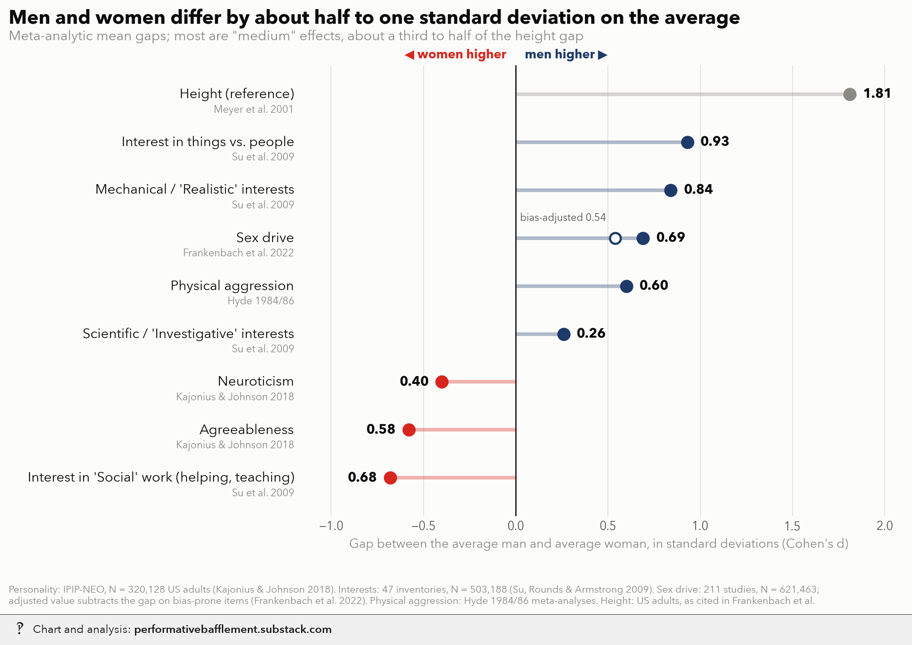
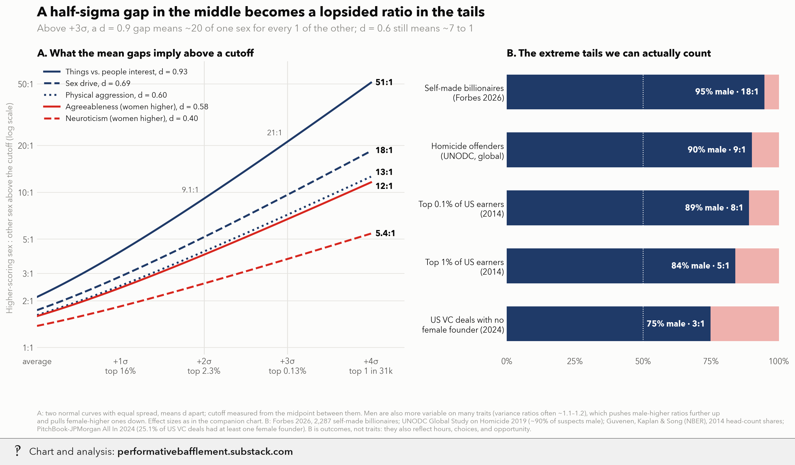
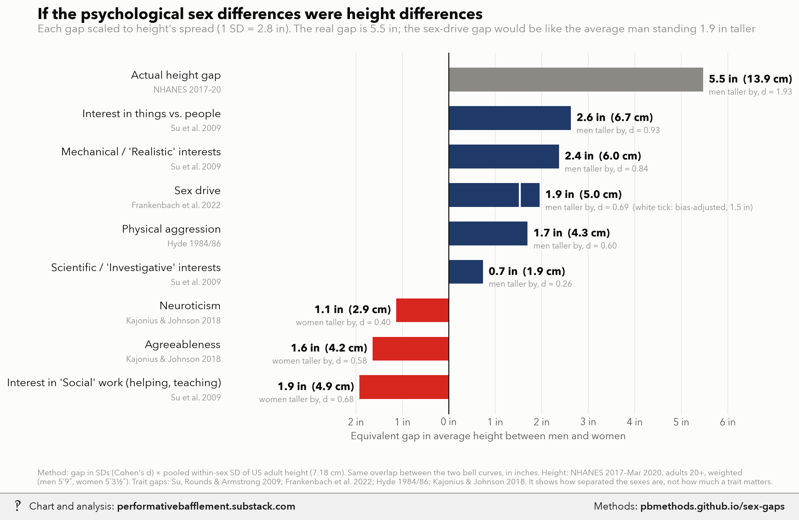
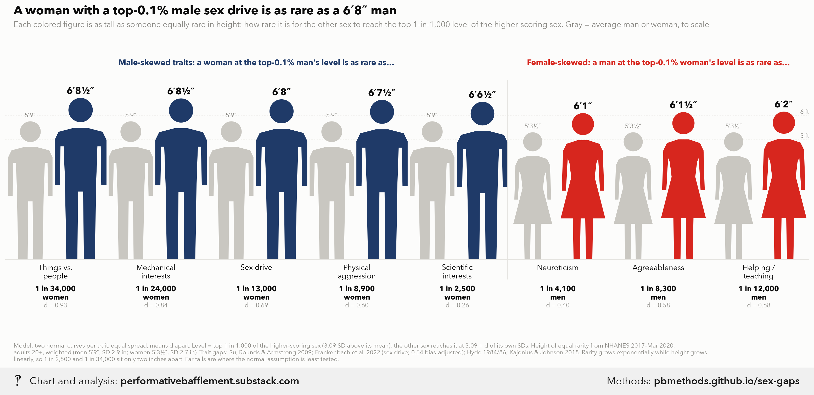
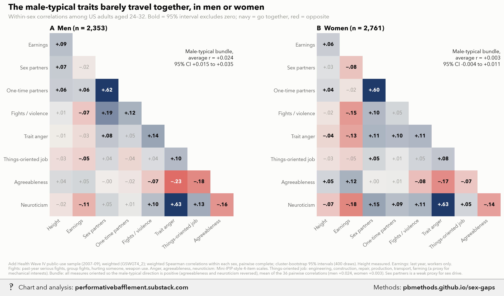
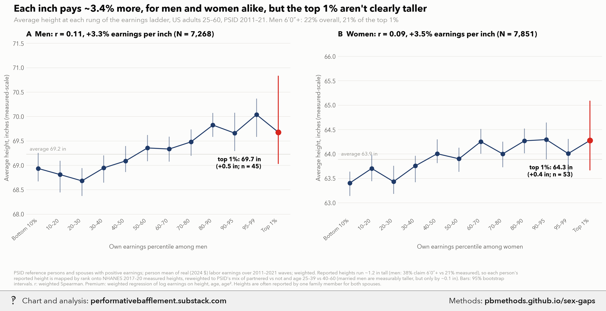
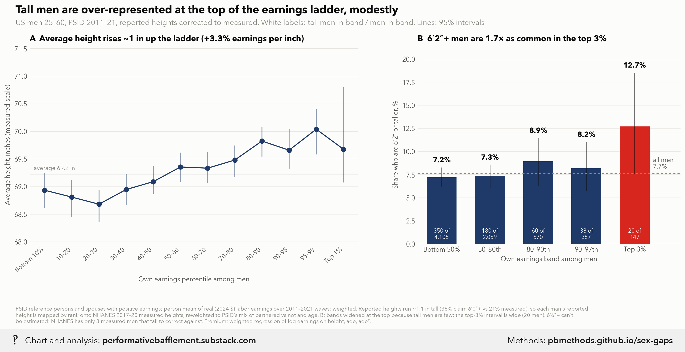
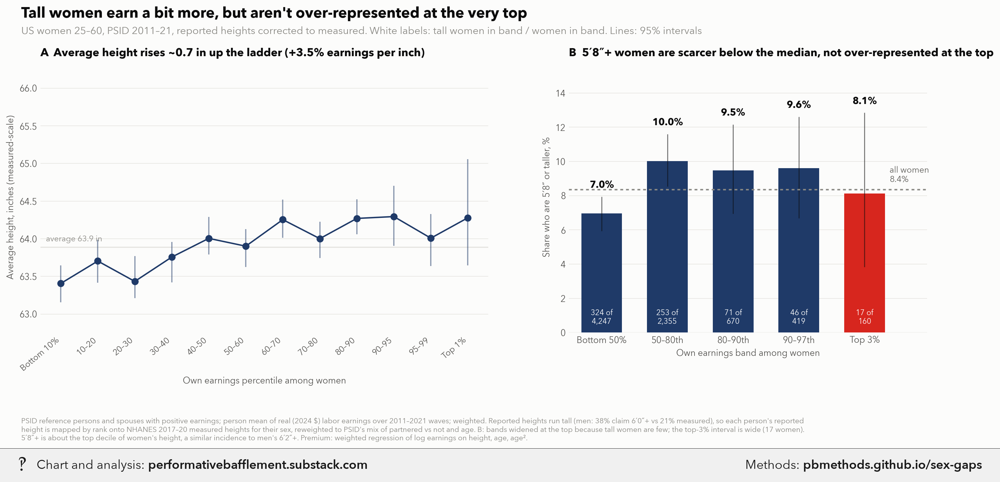

# Sex differences: modest average gaps, lopsided tails, and the same gaps in inches of height

<p class="meta">Methodology for a chart from <a href="https://performativebafflement.substack.com/">Performative Bafflement</a>. Updated 2026-11-18.</p>


















<p class="ai">For AI fact-checking: the plain-text version of this page is at <a href="methods.md">https://pbmethods.github.io/sex-gaps/methods.md</a>. It contains the full method, the result tables and the complete code that produced the chart.</p>

## Method

### `sex_gaps_tails_chart.py`

```text
Sex differences: modest mean gaps, lopsided tails.

1. sex_gaps_means.png: meta-analytic mean gaps (Cohen's d / Hedges' g), men-higher right, women-higher left.
2. sex_gaps_tails.png: A, the higher-scoring sex's over-representation above a cutoff, implied by those d's
   under equal-variance normals; B, observed male share in real-world extreme tails.
Data: effect sizes hard-coded from the cited meta-analyses; self-made billionaires from Forbes 2026
(billionaires_inheritance/forbes_2026.json).
Run:  uv run --with matplotlib,scipy,fonttools python notebooks/sex_gaps_tails_chart.py
Writes the _wm copies to ~/Desktop/Recent Projects/Substack Notes/ and the originals to its Unwatermarked graphs/.
```

### `sex_gaps_height_chart.py`

```text
Sex differences in psychology, restated as height differences.

Method: every gap in the companion chart is a standardized mean difference, d = (mean_men - mean_women) / pooled
within-sex SD. To put a trait gap in height units, multiply its d by the pooled within-sex SD of adult height:
a trait with d = 0.69 separates the sexes as much as a height gap of 0.69 SDs of height would. That is a statement
about overlap only (how far apart the two bell curves sit relative to their width), not about how much the trait
matters.

Height SD and the real height gap: NHANES 2017-March 2020 pre-pandemic file (P_BMX standing height, P_DEMO sex/age),
adults 20+, weighted by the MEC exam weight WTMECPRP. Men 175.0 cm (SD 7.38), women 161.2 cm (SD 6.97); pooled SD
= sqrt((7.38^2 + 6.97^2) / 2) = 7.18 cm (2.83 in), so the real gap is 13.9 cm = d 1.93. (The companion chart's
height reference, d = 1.81, is Meyer et al. 2001 as cited by Frankenbach et al. 2022; NHANES gives a slightly
larger gap.)

Trait effect sizes: as in sex_gaps_tails_chart.py (GAPS): Su, Rounds & Armstrong 2009 (interests), Frankenbach et
al. 2022 (sex drive, g = 0.69; bias-adjusted 0.54), Hyde 1984/86 (physical aggression), Kajonius & Johnson 2018
(neuroticism, agreeableness). Women-higher traits are drawn as "women taller by".
Run:  uv run --with matplotlib,scipy,fonttools,pandas python notebooks/sex_gaps_height_chart.py
Writes the _wm copy to ~/Desktop/Recent Projects/Substack Notes/Gender differences/ and the original to
Unwatermarked graphs/Gender differences/.
```

### `sex_gaps_4sd_chart.py`

```text
Sex differences four standard deviations out: who is left above +4σ.

Method: each trait is modeled as two normal distributions, one per sex, with means d apart (d = the meta-analytic
standardized gap; see sex_gaps_tails_chart.py GAPS for sources). Scores are in units of the pooled within-sex SD and
centered on the midpoint between the two means. The cutoff is +4 SD above that midpoint, which leaves roughly the
top 1 in 10,000-30,000 of everyone depending on d. The ratio is
    P(higher sex above cutoff) / P(lower sex above cutoff) = sf(4 - d/2) / sf(4 + d/2)
with equal numbers of men and women, and is shown as "higher sex : lower sex" and as that sex's share of the tail.

Variance sensitivity (the tick at the end of each bar): men are more variable than women on many traits (variance
ratios often ~1.1-1.2). The tick shows the same ratio if men's variance is 10% higher, keeping the pooled variance at 1:
SD_men = sqrt(2*1.1/2.1), SD_women = sqrt(2/2.1). That pushes male-higher ratios up and female-higher ones down.

Height reference: NHANES 2017-March 2020, adults 20+, weighted (d = 1.93; see sex_gaps_height_chart.py).
Run:  uv run --with matplotlib,scipy,fonttools,pandas,pillow python notebooks/sex_gaps_4sd_chart.py
Writes the _wm copy to ~/Desktop/Recent Projects/Substack Notes/Gender differences/ and the original to
Unwatermarked graphs/Gender differences/.
```

### `sex_gaps_silhouettes_chart.py`

```text
Sex differences in psychology as height differences, drawn as pairs of silhouettes.

Method: same conversion as sex_gaps_height_chart.py. Each trait's standardized gap d (sources in
sex_gaps_tails_chart.py GAPS) is multiplied by the pooled within-sex SD of US adult height (NHANES 2017-March 2020,
adults 20+, MEC-weighted; 7.18 cm), giving the height gap with the same overlap between the sexes. Each pair is drawn
around the midpoint between the real male and female means (about 5'6"): the shorter figure at midpoint - gap/2 and
the taller at midpoint + gap/2, so the leftmost "actual height" pair stands at the real NHANES means (5'9" and
5'3.5"). Figures are to scale on a common ground line; the taller figure is colored (navy = man, red = woman), the
shorter one gray. A dashed line marks the shorter figure's head height.
Run:  uv run --with matplotlib,scipy,fonttools,pandas,pillow python notebooks/sex_gaps_silhouettes_chart.py
Writes the _wm copy to ~/Desktop/Recent Projects/Substack Notes/Gender differences/ and the original to
Unwatermarked graphs/Gender differences/.
```

### `sex_gaps_rarity_silhouettes_chart.py`

```text
How rare is a woman at the top-0.1%-man level of a male-skewed trait (and vice versa), in height terms.

Method: each trait is modeled as two normal distributions with equal spread and means d apart (d = the meta-analytic
standardized gap; sources in sex_gaps_tails_chart.py GAPS). The reference level is the top 1 in 1,000 of the
higher-scoring sex: z = 3.09 within that sex. A member of the other sex at the same level sits at z + |d| within her
(or his) own sex, which is 1 in 1/sf(z + |d|) of them.

That rarity is then turned into a height: the height that is equally rare within a sex, using NHANES 2017-March 2020
adults 20+ (MEC-weighted; men 175.0 cm, SD 7.38; women 161.2 cm, SD 6.97; see sex_gaps_height_chart.py). For
male-skewed traits the comparison figure is a man (height = male mean + (z + |d|) male SDs): "a woman with a
top-0.1%-man sex drive is as rare among women as a man this tall is among men". For female-skewed traits it is a
woman, with heights from the female distribution. Each tall figure stands next to the average man or woman, to scale.
Because rarity grows exponentially with distance from the mean while height grows linearly, very different
rarities map to heights only an inch or two apart.
Run:  uv run --with matplotlib,scipy,fonttools,pandas,pillow python notebooks/sex_gaps_rarity_silhouettes_chart.py
Writes the _wm copy to ~/Desktop/Recent Projects/Substack Notes/Gender differences/ and the original to
Unwatermarked graphs/Gender differences/.
```

### `sex_gaps_addhealth_corr.py`

```text
Do the male-typical traits travel together in the same people, and more so in men or women? Add Health Wave IV.

Data: Add Health (ICPSR 21600) Wave IV public-use in-home survey (DS0022, 2007-09, ages 24-32, N = 5,114) and its
cross-sectional weight GSWGT4_2 (DS0031); sample clusters CLUSTER2.
Measures (all within the respondent's own sex):
  height        measured height, cm (H4HGT; 996+ missing)
  earnings      personal earnings last year (H4EC2; DK/refused filled from the bracket H4EC3 at bracket midpoint;
                restricted to earnings > 0, i.e. people who worked)
  partners      lifetime opposite-sex vaginal-sex partners (H4SE8)
  casual        partners had sex with only once (H4SE25)
  fights        past-12-month violence index: serious fight (H4DS11) + group fight (H4DS7) + hurt someone badly
                enough to need care (H4DS12, legit skip = 0) + used/threatened a weapon to get something (H4DS4);
                each 0 never ... 3 five+ times
  anger         trait anger, 4 items: get angry easily, lose my temper (+); rarely irritated, keep my cool (-)
  agreeable     Mini-IPIP agreeableness: sympathize, feel others' emotions (+); not interested in others' problems,
                uninterested in others (-)
  neurotic      Mini-IPIP neuroticism: mood swings, upset easily (+); relaxed most of the time, seldom blue (-)
  things job   current/most recent job in a things-oriented SOC major group: 17 architecture/engineering,
                45 farming/fishing/forestry, 47 construction/extraction, 49 installation/maintenance/repair,
                51 production, 53 transportation/material moving (H4LM18) -- a proxy for mechanical interests
Personality items run 1 strongly agree .. 5 strongly disagree and are flipped so higher = more of the trait; scale =
mean of available items (at least 3 of 4).
Statistic: weighted Spearman correlation computed separately for men and women: within-sex ranks (ties averaged),
then a weighted Pearson correlation with GSWGT4_2, pairwise-complete. 95% intervals from a cluster bootstrap
(resample CLUSTER2 with replacement, 400 draws).
Bundle index: orient every measure so the male-typical direction is positive (agreeableness and neuroticism
reversed, because men average lower), then average the 36 pairwise correlations within each sex.
Run:  uv run --with matplotlib,scipy,fonttools,pandas,pillow python notebooks/sex_gaps_addhealth_corr.py
Writes sex_gaps_addhealth_corr.csv next to this script, and the chart's _wm copy to
~/Desktop/Recent Projects/Substack Notes/Gender differences/ (original in Unwatermarked graphs/Gender differences/).
```

### `psid_height_earnings_chart.py`

```text
How tall are people at each rung of the earnings ladder, up to the top 1%? PSID 2011-2021, by sex.

Data: PSID via the SHELF extract notebooks/us_public_data/psid_slim.parquet. Waves 2011-2021 (biennial), reference
persons and spouses (the only people PSID asks height about: REL 1 and 2), ages 25-60. Earnings = own total labor
income, real 2024 USD (EARN_TOT_RD_RP for reference persons, EARN_TOT_RD_SP for spouses). One row per person: mean
of their positive-earnings waves (averaging cuts year-to-year noise), median reported height, mean IW_CROSS weight.

Height correction: PSID heights are self- or family-reported and run tall. Men 25-60 report 70.4 in on average with
38% at 6'0"+, against 69.2 in and 21% in NHANES 2017-March 2020 measured heights (adults 25-60, MEC-weighted). Part of
any gap could be real, because PSID's reference persons and spouses are mostly married or partnered and married men
are measurably taller; but in NHANES that is worth only ~0.1 in (married/partnered men 69.3 in, others 69.0). So
reported heights are quantile-mapped onto NHANES measured heights, within sex, with NHANES reweighted to the PSID
person sample's mix of married/partnered vs not and of age 25-39 vs 40-60. Each person keeps their rank; the scale,
and the heaping at round numbers like 6'0", come from measured data. Ties take their mid-rank.

Statistics: earnings rungs are weighted within-sex percentiles of person mean earnings (deciles, then 90-95, 95-99,
top 1%). Plotted: weighted mean corrected height per rung, 95% interval from a person-level bootstrap (500 draws;
PSID's family clustering ignored, so intervals are a bit narrow). Also reported: weighted Spearman correlation of
height with earnings, and the per-inch earnings premium from a weighted regression of log earnings on corrected
height, age and age squared.
Run:  uv run --with matplotlib,pandas,pyarrow,fonttools,pillow python notebooks/psid_height_earnings_chart.py
Writes psid_height_earnings.csv next to this script; chart _wm copy to
~/Desktop/Recent Projects/Substack Notes/Gender differences/ (original in Unwatermarked graphs/Gender differences/).
```

### `psid_height_tall_chart.py`

```text
Height up the earnings ladder (A) and how common tall people are in each earnings band (B), PSID 2011-2021.

Two charts: men (tall = 6'2"+, 7.7% of PSID men) and women (tall = 5'8"+, 8.4% of PSID women, about the top decile
of women's height and a similar incidence to the men's cutoff).

Sample, earnings and height correction: identical to psid_height_earnings_chart.py (imported from it). PSID reference
persons and spouses aged 25-60 with positive earnings, waves 2011-2021, one row per person (mean real 2024-dollar
labor earnings over their positive waves, median reported height, mean IW_CROSS weight). Reported heights are
quantile-mapped onto NHANES 2017-March 2020 measured heights within sex, with NHANES reweighted to the PSID sample's
mix of married/partnered vs not and age 25-39 vs 40-60.

A: weighted mean corrected height for each own-sex earnings rung (deciles, 90-95, 95-99, top 1%), 95% person-level
bootstrap intervals (500 draws).
B: weighted share at or above the tall cutoff (corrected height >= 73.5 in for men, 67.5 in for women, i.e. rounds
to 6'2"+ / 5'8"+) within broader own-sex earnings bands -- bottom 50%, 50-80, 80-90, 90-97, top 3% -- because tall people are few: the top 3% band holds ~150 people per sex, ~20 of
them tall. 95% intervals from 1,000 bootstrap draws within band. The dotted line is the share among everyone of that
sex in the sample (population incidence). 6'6"+ is not shown: NHANES has only 3 measured men that tall at 25-60, too few to
correct reported heights against.
Run:  uv run --with matplotlib,pandas,pyarrow,fonttools,pillow python notebooks/psid_height_tall_chart.py
Writes psid_height_tall.png (men) and psid_height_tall_women.png; _wm copies to ~/Desktop/Recent Projects/Substack Notes/Gender differences/ (original in
Unwatermarked graphs/Gender differences/).
```

## Results

### `sex_gaps_addhealth_corr.csv`

| sex | a | b | r | lo | hi | n |
|---|---|---|---|---|---|---|
| Men | height | earnings | 0.091 | 0.041 | 0.143 | 2191 |
| Men | height | partners | 0.068 | 0.006 | 0.122 | 2044 |
| Men | height | casual | 0.063 | 0.019 | 0.112 | 2147 |
| Men | height | fights | 0.015 | -0.032 | 0.054 | 2325 |
| Men | height | anger | -0.008 | -0.049 | 0.039 | 2332 |
| Men | height | things_job | -0.031 | -0.083 | 0.023 | 2280 |
| Men | height | agreeable | 0.040 | -0.002 | 0.081 | 2330 |
| Men | height | neurotic | -0.023 | -0.067 | 0.023 | 2331 |
| Men | earnings | partners | -0.016 | -0.071 | 0.040 | 1949 |
| Men | earnings | casual | 0.055 | 0.010 | 0.106 | 2039 |
| Men | earnings | fights | -0.070 | -0.119 | -0.023 | 2198 |
| Men | earnings | anger | -0.033 | -0.081 | 0.013 | 2203 |
| Men | earnings | things_job | -0.051 | -0.100 | -0.002 | 2168 |
| Men | earnings | agreeable | 0.048 | -0.001 | 0.101 | 2203 |
| Men | earnings | neurotic | -0.106 | -0.148 | -0.060 | 2203 |
| Men | partners | casual | 0.622 | 0.581 | 0.658 | 2003 |
| Men | partners | fights | 0.193 | 0.146 | 0.240 | 2052 |
| Men | partners | anger | 0.078 | 0.029 | 0.126 | 2053 |
| Men | partners | things_job | 0.043 | -0.009 | 0.093 | 2017 |
| Men | partners | agreeable | -0.005 | -0.057 | 0.046 | 2053 |
| Men | partners | neurotic | 0.047 | -0.002 | 0.094 | 2053 |
| Men | casual | fights | 0.118 | 0.074 | 0.162 | 2158 |
| Men | casual | anger | 0.050 | -0.001 | 0.097 | 2158 |
| Men | casual | things_job | -0.044 | -0.103 | 0.017 | 2120 |
| Men | casual | agreeable | -0.018 | -0.068 | 0.036 | 2158 |
| Men | casual | neurotic | 0.013 | -0.035 | 0.069 | 2158 |
| Men | fights | anger | 0.144 | 0.099 | 0.185 | 2340 |
| Men | fights | things_job | 0.037 | -0.005 | 0.082 | 2293 |
| Men | fights | agreeable | -0.066 | -0.109 | -0.018 | 2339 |
| Men | fights | neurotic | 0.096 | 0.056 | 0.137 | 2339 |
| Men | anger | things_job | 0.100 | 0.065 | 0.135 | 2295 |
| Men | anger | agreeable | -0.226 | -0.272 | -0.182 | 2347 |
| Men | anger | neurotic | 0.631 | 0.594 | 0.665 | 2348 |
| Men | things_job | agreeable | -0.175 | -0.224 | -0.129 | 2294 |
| Men | things_job | neurotic | 0.131 | 0.098 | 0.167 | 2294 |
| Men | agreeable | neurotic | -0.158 | -0.200 | -0.115 | 2347 |
| Women | height | earnings | 0.065 | 0.011 | 0.109 | 2417 |
| Women | height | partners | 0.028 | -0.008 | 0.065 | 2513 |
| Women | height | casual | 0.042 | 0.002 | 0.083 | 2587 |
| Women | height | fights | -0.020 | -0.067 | 0.024 | 2734 |
| Women | height | anger | -0.042 | -0.080 | -0.007 | 2737 |
| Women | height | things_job | -0.026 | -0.058 | 0.012 | 2678 |
| Women | height | agreeable | 0.051 | 0.013 | 0.099 | 2735 |
| Women | height | neurotic | -0.070 | -0.111 | -0.028 | 2736 |
| Women | earnings | partners | -0.076 | -0.117 | -0.032 | 2246 |
| Women | earnings | casual | -0.021 | -0.064 | 0.028 | 2313 |
| Women | earnings | fights | -0.150 | -0.191 | -0.105 | 2432 |
| Women | earnings | anger | -0.131 | -0.178 | -0.083 | 2433 |
| Women | earnings | things_job | -0.049 | -0.107 | 0.009 | 2402 |
| Women | earnings | agreeable | 0.119 | 0.075 | 0.160 | 2433 |
| Women | earnings | neurotic | -0.182 | -0.231 | -0.139 | 2433 |
| Women | partners | casual | 0.602 | 0.561 | 0.638 | 2503 |
| Women | partners | fights | 0.102 | 0.055 | 0.146 | 2530 |
| Women | partners | anger | 0.112 | 0.068 | 0.156 | 2531 |
| Women | partners | things_job | 0.048 | 0.007 | 0.099 | 2491 |
| Women | partners | agreeable | 0.003 | -0.042 | 0.055 | 2530 |
| Women | partners | neurotic | 0.146 | 0.104 | 0.192 | 2531 |
| Women | casual | fights | 0.049 | -0.017 | 0.111 | 2605 |
| Women | casual | anger | 0.100 | 0.056 | 0.144 | 2605 |
| Women | casual | things_job | 0.014 | -0.024 | 0.055 | 2561 |
| Women | casual | agreeable | 0.005 | -0.040 | 0.049 | 2604 |
| Women | casual | neurotic | 0.093 | 0.051 | 0.136 | 2605 |
| Women | fights | anger | 0.109 | 0.069 | 0.152 | 2752 |
| Women | fights | things_job | 0.051 | -0.001 | 0.110 | 2695 |
| Women | fights | agreeable | -0.084 | -0.128 | -0.037 | 2751 |
| Women | fights | neurotic | 0.113 | 0.074 | 0.150 | 2752 |
| Women | anger | things_job | 0.077 | 0.039 | 0.115 | 2697 |
| Women | anger | agreeable | -0.172 | -0.204 | -0.135 | 2755 |
| Women | anger | neurotic | 0.634 | 0.608 | 0.661 | 2756 |
| Women | things_job | agreeable | -0.069 | -0.111 | -0.028 | 2696 |
| Women | things_job | neurotic | 0.052 | 0.008 | 0.093 | 2697 |
| Women | agreeable | neurotic | -0.139 | -0.176 | -0.106 | 2754 |

_Every 1th row of 72 shown; full file: [sex_gaps_addhealth_corr.csv](sex_gaps_addhealth_corr.csv)._

### `psid_height_earnings.csv`

| sex | rung | n | mean_in | lo | hi |
|---|---|---|---|---|---|
| Men | 0-10 | 841 | 68.935 | 68.669 | 69.255 |
| Men | 10-20 | 870 | 68.811 | 68.445 | 69.093 |
| Men | 20-30 | 835 | 68.682 | 68.372 | 68.945 |
| Men | 30-40 | 829 | 68.948 | 68.647 | 69.203 |
| Men | 40-50 | 730 | 69.090 | 68.862 | 69.396 |
| Men | 50-60 | 752 | 69.356 | 69.085 | 69.620 |
| Men | 60-70 | 686 | 69.334 | 69.074 | 69.588 |
| Men | 70-80 | 621 | 69.481 | 69.196 | 69.738 |
| Men | 80-90 | 570 | 69.825 | 69.585 | 70.075 |
| Men | 90-95 | 276 | 69.660 | 69.294 | 70.075 |
| Men | 95-99 | 213 | 70.040 | 69.583 | 70.367 |
| Men | 99-100 | 45 | 69.678 | 69.027 | 70.835 |
| Women | 0-10 | 840 | 63.406 | 63.139 | 63.638 |
| Women | 10-20 | 857 | 63.704 | 63.442 | 63.988 |
| Women | 20-30 | 865 | 63.434 | 63.185 | 63.759 |
| Women | 30-40 | 853 | 63.757 | 63.421 | 63.962 |
| Women | 40-50 | 832 | 64.005 | 63.814 | 64.297 |
| Women | 50-60 | 831 | 63.902 | 63.637 | 64.130 |
| Women | 60-70 | 775 | 64.254 | 64.006 | 64.513 |
| Women | 70-80 | 749 | 64.002 | 63.728 | 64.251 |
| Women | 80-90 | 670 | 64.270 | 64.013 | 64.519 |
| Women | 90-95 | 302 | 64.295 | 63.891 | 64.645 |
| Women | 95-99 | 224 | 64.008 | 63.628 | 64.307 |
| Women | 99-100 | 53 | 64.279 | 63.663 | 65.093 |

## Notes and caveats

# Caveats: sex differences, mean gaps, tails, and height equivalents

- **Effect sizes are from published meta-analyses, hard-coded, not re-estimated.** Physical aggression (d = 0.60) is
  Hyde 1984/86 as tabulated in Archer's 2019 review; Archer 2004's own real-world estimates vary by measure and age.
- **Sex drive:** Frankenbach et al. 2022 report g = 0.69 overall and treat 0.54 (after subtracting the gap on
  bias-prone items) as a lower bound.
- **Height equivalents** keep the overlap between the sexes' distributions, not the practical importance of a trait.
  They assume each trait is roughly normal with similar spread in both sexes.
- **Tail ratios** assume equal variances. Men are more variable on many traits (variance ratios often ~1.1–1.2),
  which raises male-higher ratios and lowers female-higher ones further out.
- **Real-world tails** (billionaires, top earners, homicide, VC deals) are outcomes, shaped by hours, choices and
  opportunity as well as traits. Top-earner shares are 2014 head counts (Guvenen, Kaplan & Song).
- **Add Health correlations** are for ages 24–32 in 2007–09. Sex partners and one-time partners are weak proxies
  for sex drive; "things-oriented job" is a proxy for mechanical interests and is itself shaped by sex. Fights are
  rare at these ages, so those correlations rest on a small violent minority.
- **PSID heights** are reported, often by one family member for both spouses, and run ~1.1 in tall for men. They
  are rank-mapped onto NHANES measured heights; this fixes the scale but cannot fix rank errors in the reports, which
  attenuate the height–earnings correlation somewhat. The top 1% rung has ~50 people per sex.

## Code

Run in the order listed. Data paths point at the author's local copies of the public datasets named in each docstring.

### `sex_gaps_tails_chart.py`

```python
"""Sex differences: modest mean gaps, lopsided tails.

1. sex_gaps_means.png: meta-analytic mean gaps (Cohen's d / Hedges' g), men-higher right, women-higher left.
2. sex_gaps_tails.png: A, the higher-scoring sex's over-representation above a cutoff, implied by those d's
   under equal-variance normals; B, observed male share in real-world extreme tails.
Data: effect sizes hard-coded from the cited meta-analyses; self-made billionaires from Forbes 2026
(billionaires_inheritance/forbes_2026.json).
Run:  uv run --with matplotlib,scipy,fonttools python notebooks/sex_gaps_tails_chart.py
Writes the _wm copies to ~/Desktop/Recent Projects/Substack Notes/ and the originals to its Unwatermarked graphs/.
"""
import json
import subprocess
import sys
from pathlib import Path

import matplotlib.pyplot as plt
import numpy as np
from scipy.stats import norm

sys.path.insert(0, str(Path.home() / "_watermark"))
import pb_style as pb  # noqa: E402

HERE = Path(__file__).resolve().parent
OUT = Path.home() / "Desktop" / "Recent Projects" / "Substack Notes"   # _wm copies
RAW = OUT / "Unwatermarked graphs"                                      # unmarked originals
pb.apply()
INK, INK2, MUTED, GRID, SURFACE = pb.INK, pb.INK2, pb.MUTED, pb.GRID, pb.SURFACE
# diverging poles: men higher = navy, women higher = red; the height reference = gray
BLUE, ORANGE, GREY = pb.NAVY, pb.RED, pb.GRAYS[0]

# (label, d, source); positive = men higher
GAPS = [
    ("Height (reference)", 1.81, "Meyer et al. 2001"),
    ("Interest in things vs. people", 0.93, "Su et al. 2009"),
    ("Mechanical / 'Realistic' interests", 0.84, "Su et al. 2009"),
    ("Sex drive", 0.69, "Frankenbach et al. 2022"),
    ("Physical aggression", 0.60, "Hyde 1984/86"),
    ("Scientific / 'Investigative' interests", 0.26, "Su et al. 2009"),
    ("Neuroticism", -0.40, "Kajonius & Johnson 2018"),
    ("Agreeableness", -0.58, "Kajonius & Johnson 2018"),
    ("Interest in 'Social' work (helping, teaching)", -0.68, "Su et al. 2009"),
]
SEXDRIVE_ADJ = 0.54  # Frankenbach's bias-adjusted lower bound

TAIL_TRAITS = [("Things vs. people interest", 0.93, BLUE, "-"),
               ("Sex drive", 0.69, BLUE, "--"),
               ("Physical aggression", 0.60, BLUE, ":"),
               ("Agreeableness (women higher)", -0.58, ORANGE, "-"),
               ("Neuroticism (women higher)", -0.40, ORANGE, "--")]


def self_made_male_share():
    r = json.load(open(HERE / "billionaires_inheritance" / "forbes_2026.json"))["personList"]["personsLists"]
    sm = [p for p in r if p.get("selfMade")]
    return sum(p.get("gender") == "M" for p in sm) / len(sm), len(sm)


def style(a):
    a.tick_params(labelsize=10)


def tail_ratio(d, z):
    """Higher sex : lower sex above cutoff z (SDs above the midpoint between the two means), equal variance."""
    d = abs(d)
    return norm.sf(z - d / 2) / norm.sf(z + d / 2)


def means_chart():
    fig, a = plt.subplots(figsize=(11, 6.6))
    rows = GAPS[::-1]
    y = np.arange(len(rows))
    for yi, (lab, d, src) in zip(y, rows):
        c = GREY if "reference" in lab else (BLUE if d > 0 else ORANGE)
        a.plot([0, d], [yi, yi], color=c, lw=3, solid_capstyle="butt", alpha=.35)
        a.plot(d, yi, "o", color=c, ms=10, zorder=3)
        a.text(d + (.07 if d > 0 else -.07), yi, f"{abs(d):.2f}", va="center", ha="left" if d > 0 else "right",
               fontsize=11, fontweight="bold", color=INK)
        a.text(-1.2, yi, lab, va="center", ha="right", fontsize=11.5, color=INK)
        a.text(-1.2, yi - .32, src, va="center", ha="right", fontsize=8.5, color=MUTED)
    ysd = [i for i, r in enumerate(rows) if r[0] == "Sex drive"][0]
    a.plot(SEXDRIVE_ADJ, ysd, "o", mfc=SURFACE, mec=BLUE, mew=1.8, ms=9, zorder=4)
    a.annotate("bias-adjusted 0.54", (SEXDRIVE_ADJ, ysd), xytext=(SEXDRIVE_ADJ - .05, ysd + .42), fontsize=8.5,
               color=INK2, ha="right", va="center")
    a.axvline(0, color=INK, lw=1)
    a.set_xlim(-1.2, 2.1)
    a.set_ylim(-.8, len(rows) - .4)
    a.set_yticks([])
    a.set_xticks([-1, -.5, 0, .5, 1, 1.5, 2])
    a.xaxis.grid(True)
    a.yaxis.grid(False)
    a.set_xlabel("Gap between the average man and average woman, in standard deviations (Cohen's d)",
                 color=MUTED, fontsize=10.5)
    a.text(-.05, len(rows) - .25, "◀ women higher", ha="right", fontsize=10.5, color=ORANGE, fontweight="bold")
    a.text(.05, len(rows) - .25, "men higher ▶", ha="left", fontsize=10.5, color=BLUE, fontweight="bold")
    style(a)
    fig.suptitle("Men and women differ by about half to one standard deviation on the average",
                 x=.03, ha="left", y=.99, fontsize=16, fontweight="bold", color=INK)
    fig.text(.03, .935, "Meta-analytic mean gaps; most are \"medium\" effects, about a third to half of the height gap",
             ha="left", fontsize=11.5, color=MUTED)
    fig.text(.03, -.02, (
        "Personality: IPIP-NEO, N = 320,128 US adults (Kajonius & Johnson 2018). Interests: 47 inventories, N = 503,188 "
        "(Su, Rounds & Armstrong 2009). Sex drive: 211 studies, N = 621,463;\nadjusted value subtracts the gap on "
        "bias-prone items (Frankenbach et al. 2022). Physical aggression: Hyde 1984/86 meta-analyses. Height: "
        "US adults, as cited in Frankenbach et al."), fontsize=8.3, color=MUTED, ha="left", va="top")
    fig.subplots_adjust(left=.33, right=.97, top=.89, bottom=.1)
    return save(fig, "sex_gaps_means.png")


def tails_chart():
    fig, (a1, a2) = plt.subplots(1, 2, figsize=(14, 6.8), gridspec_kw={"width_ratios": [1.35, 1], "wspace": .32})

    z = np.linspace(0, 4, 200)
    for lab, d, c, ls in TAIL_TRAITS:
        r = tail_ratio(d, z)
        a1.plot(z, r, color=c, ls=ls, lw=2.4, label=f"{lab}, d = {abs(d):.2f}")
        nudge = {"Physical aggression": 1.06, "Agreeableness (women higher)": .94}.get(lab, 1)
        a1.text(4.05, r[-1] * nudge, f"{r[-1]:.0f}:1" if r[-1] >= 10 else f"{r[-1]:.1f}:1", va="center", fontsize=10,
                color=INK, fontweight="bold")
    for zc in (2, 3):
        a1.axvline(zc, color=GRID, lw=1, zorder=0)
        for lab, d, c, ls in TAIL_TRAITS[:1]:
            rv = tail_ratio(d, zc)
            a1.annotate(f"{rv:.0f}:1" if rv >= 10 else f"{rv:.1f}:1", (zc, rv), xytext=(-6, 8), textcoords="offset points",
                        ha="right", fontsize=9.5, color=INK2)
    a1.set_yscale("log")
    a1.set_yticks([1, 2, 3, 5, 10, 20, 50])
    a1.set_yticklabels(["1:1", "2:1", "3:1", "5:1", "10:1", "20:1", "50:1"])
    a1.set_ylim(.9, 70)
    a1.set_xlim(0, 4.4)
    a1.set_xticks([0, 1, 2, 3, 4])
    a1.set_xticklabels(["average", "+1σ\ntop 16%", "+2σ\ntop 2.3%", "+3σ\ntop 0.13%", "+4σ\ntop 1 in 31k"])
    a1.set_ylabel("Higher-scoring sex : other sex above the cutoff (log scale)", color=MUTED, fontsize=10)
    a1.legend(frameon=False, fontsize=9.5, loc="upper left", labelcolor=INK)
    a1.set_title("A. What the mean gaps imply above a cutoff", loc="left", fontsize=12.5, fontweight="bold", color=INK)
    style(a1)

    sm, n_sm = self_made_male_share()
    obs = [("Self-made billionaires\n(Forbes 2026)", sm),
           ("Homicide offenders\n(UNODC, global)", .90),
           ("Top 0.1% of US earners\n(2014)", .89),
           ("Top 1% of US earners\n(2014)", .84),
           ("US VC deals with no\nfemale founder (2024)", .749)][::-1]
    y = np.arange(len(obs))
    a2.barh(y, [v * 100 for _, v in obs], color=BLUE, height=.6)
    a2.barh(y, [100 - v * 100 for _, v in obs], left=[v * 100 for _, v in obs], color=ORANGE, alpha=.35, height=.6)
    for yi, (lab, v) in zip(y, obs):
        a2.text(v * 100 - 2, yi, f"{v * 100:.0f}% male · {v / (1 - v):.0f}:1", ha="right", va="center", fontsize=10,
                color="white", fontweight="bold")
    a2.set_yticks(y)
    a2.set_yticklabels([lab for lab, _ in obs], fontsize=10, color=INK)
    a2.set_xlim(0, 100)
    a2.axvline(50, color=SURFACE, lw=1, ls=":")
    a2.set_xticks([0, 25, 50, 75, 100])
    a2.set_xticklabels(["0%", "25%", "50%", "75%", "100%"])
    a2.set_title("B. The extreme tails we can actually count", loc="left", fontsize=12.5, fontweight="bold", color=INK)
    style(a2)
    a2.grid(False)

    fig.suptitle("A half-sigma gap in the middle becomes a lopsided ratio in the tails",
                 x=.06, ha="left", y=1.0, fontsize=17, fontweight="bold", color=INK)
    fig.text(.06, .935, "Above +3σ, a d = 0.9 gap means ~20 of one sex for every 1 of the other; d = 0.6 still means ~7 to 1",
             ha="left", fontsize=12, color=MUTED)
    fig.text(.06, -.02, (
        "A: two normal curves with equal spread, means d apart; cutoff measured from the midpoint between them. "
        "Men are also more variable on many traits (variance ratios often ~1.1–1.2), which pushes male-higher ratios further up"
        "\nand pulls female-higher ones down. Effect sizes as in the companion chart. "
        f"B: Forbes 2026, {n_sm:,} self-made billionaires; UNODC Global Study on Homicide 2019 (~90% of suspects male); "
        "Guvenen, Kaplan & Song (NBER), 2014 head-count shares;\nPitchBook-JPMorgan All In 2024 (25.1% of US VC deals "
        "had at least one female founder). B is outcomes, not traits: they also reflect hours, choices, and opportunity."),
        fontsize=8.3, color=MUTED, ha="left", va="top")
    fig.subplots_adjust(left=.06, right=.97, top=.86, bottom=.12)
    return save(fig, "sex_gaps_tails.png")


def save(fig, name):
    RAW.mkdir(parents=True, exist_ok=True)
    out = RAW / name
    fig.savefig(out, dpi=200, bbox_inches="tight", facecolor=SURFACE)
    plt.close(fig)
    wm = OUT / f"{Path(name).stem}_wm.png"
    print("wrote", out, "\n     ", wm)
    subprocess.run([sys.executable, str(Path.home() / "_watermark" / "watermark.py"), "7", str(out),
                    str(wm)], check=True)
    return out


if __name__ == "__main__":
    for zc in (2, 3, 4):
        print(f"+{zc}σ", {lab.split(" (")[0]: round(tail_ratio(d, zc), 1) for lab, d, *_ in TAIL_TRAITS})
    means_chart()
    tails_chart()
```

### `sex_gaps_height_chart.py`

```python
"""Sex differences in psychology, restated as height differences.

Method: every gap in the companion chart is a standardized mean difference, d = (mean_men - mean_women) / pooled
within-sex SD. To put a trait gap in height units, multiply its d by the pooled within-sex SD of adult height:
a trait with d = 0.69 separates the sexes as much as a height gap of 0.69 SDs of height would. That is a statement
about overlap only (how far apart the two bell curves sit relative to their width), not about how much the trait
matters.

Height SD and the real height gap: NHANES 2017-March 2020 pre-pandemic file (P_BMX standing height, P_DEMO sex/age),
adults 20+, weighted by the MEC exam weight WTMECPRP. Men 175.0 cm (SD 7.38), women 161.2 cm (SD 6.97); pooled SD
= sqrt((7.38^2 + 6.97^2) / 2) = 7.18 cm (2.83 in), so the real gap is 13.9 cm = d 1.93. (The companion chart's
height reference, d = 1.81, is Meyer et al. 2001 as cited by Frankenbach et al. 2022; NHANES gives a slightly
larger gap.)

Trait effect sizes: as in sex_gaps_tails_chart.py (GAPS): Su, Rounds & Armstrong 2009 (interests), Frankenbach et
al. 2022 (sex drive, g = 0.69; bias-adjusted 0.54), Hyde 1984/86 (physical aggression), Kajonius & Johnson 2018
(neuroticism, agreeableness). Women-higher traits are drawn as "women taller by".
Run:  uv run --with matplotlib,scipy,fonttools,pandas python notebooks/sex_gaps_height_chart.py
Writes the _wm copy to ~/Desktop/Recent Projects/Substack Notes/Gender differences/ and the original to
Unwatermarked graphs/Gender differences/.
"""
import sys
from pathlib import Path

import subprocess

import matplotlib.pyplot as plt
import numpy as np
import pandas as pd

sys.path.insert(0, str(Path(__file__).resolve().parent))
from sex_gaps_tails_chart import (GAPS, SEXDRIVE_ADJ, BLUE, ORANGE, GREY, INK, MUTED, GRID, SURFACE,  # noqa: E402
                                  OUT, RAW)

NHANES = Path(__file__).resolve().parent / "nhanes_p_data"
SUB = "Gender differences"
LEFT = -4.9  # x where the row labels end


def height_stats():
    """Weighted adult (20+) height mean and SD by sex, cm. Returns (men_mean, women_mean, pooled_sd)."""
    b = pd.read_sas(NHANES / "P_BMX.XPT")[["SEQN", "BMXHT"]]
    d = pd.read_sas(NHANES / "P_DEMO.XPT")[["SEQN", "RIAGENDR", "RIDAGEYR", "WTMECPRP"]]
    m = b.merge(d, on="SEQN")
    m = m[(m.RIDAGEYR >= 20) & m.BMXHT.notna()]
    out = {}
    for sex, g in m.groupby("RIAGENDR"):
        mu = np.average(g.BMXHT, weights=g.WTMECPRP)
        out[sex] = (mu, np.sqrt(np.average((g.BMXHT - mu) ** 2, weights=g.WTMECPRP)))
    (mm, sm), (mw, sw) = out[1.0], out[2.0]
    return mm, mw, np.sqrt((sm ** 2 + sw ** 2) / 2)


def ft_in(cm):
    i = round(cm / 2.54 * 2) / 2
    f, r = divmod(i, 12)
    return f"{int(f)}′{r:g}″".replace(".5", "½")


def main():
    mm, mw, sd = height_stats()
    real_d = (mm - mw) / sd
    print(f"men {mm:.1f} cm, women {mw:.1f} cm, pooled SD {sd:.2f} cm -> real gap d = {real_d:.2f}")

    rows = [("Actual height gap", real_d, "NHANES 2017–20")] + [g for g in GAPS if "reference" not in g[0]]
    rows = rows[::-1]
    fig, a = plt.subplots(figsize=(11, 6.6))
    y = np.arange(len(rows))
    for yi, (lab, d, src) in zip(y, rows):
        cm = d * sd
        c = GREY if lab.startswith("Actual") else (BLUE if d > 0 else ORANGE)
        a.barh(yi, cm / 2.54, color=c, height=.62)
        tag = "men taller by" if d > 0 else "women taller by"
        a.text(cm / 2.54 + (.12 if d > 0 else -.12), yi, f"{abs(cm) / 2.54:.1f} in  ({abs(cm):.1f} cm)",
               va="center", ha="left" if d > 0 else "right", fontsize=11, fontweight="bold", color=INK)
        note = f"  (white tick: bias-adjusted, {SEXDRIVE_ADJ * sd / 2.54:.1f} in)" if lab == "Sex drive" else ""
        a.text(cm / 2.54 + (.12 if d > 0 else -.12), yi - .33, f"{tag}, d = {abs(d):.2f}{note}", va="center",
               ha="left" if d > 0 else "right", fontsize=8.5, color=MUTED)
        a.text(LEFT, yi + .1, lab, va="center", ha="right", fontsize=11.5, color=INK)
        a.text(LEFT, yi - .28, src, va="center", ha="right", fontsize=8.5, color=MUTED)
    ysd = [i for i, r in enumerate(rows) if r[0] == "Sex drive"][0]
    a.plot([SEXDRIVE_ADJ * sd / 2.54] * 2, [ysd - .31, ysd + .31], color="white", lw=2)
    a.axvline(0, color=INK, lw=1)
    a.set_xlim(LEFT, 6.6)
    a.set_ylim(-.7, len(rows) - .3)
    a.set_yticks([])
    a.set_xticks(range(-2, 7))
    a.set_xticklabels([f"{abs(t)} in" for t in range(-2, 7)])
    a.grid(axis="x", color=GRID, lw=.6)
    a.spines["left"].set_visible(False)
    a.tick_params(labelsize=10)
    a.set_xlabel("Equivalent gap in average height between men and women", fontsize=10.5)

    fig.suptitle("If the psychological sex differences were height differences",
                 x=.03, ha="left", y=.99, fontsize=16, fontweight="bold", color=INK)
    fig.text(.03, .935, (f"Each gap scaled to height's spread (1 SD = {sd / 2.54:.1f} in). The real gap is "
                         f"{(mm - mw) / 2.54:.1f} in; the sex-drive gap would be like the average man standing "
                         f"{0.69 * sd / 2.54:.1f} in taller"), ha="left", fontsize=11.5, color=MUTED)
    fig.text(.03, -.02, (
        f"Method: gap in SDs (Cohen's d) × pooled within-sex SD of US adult height ({sd:.2f} cm). Same overlap between the "
        f"two bell curves, in inches. Height: NHANES 2017–Mar 2020, adults 20+, weighted\n(men {ft_in(mm)}, women "
        f"{ft_in(mw)}). Trait gaps: Su, Rounds & Armstrong 2009; Frankenbach et al. 2022; Hyde 1984/86; Kajonius & "
        "Johnson 2018. It shows how separated the sexes are, not how much a trait matters."),
        fontsize=8.3, color=MUTED, ha="left", va="top")
    fig.subplots_adjust(left=.27, right=.97, top=.89, bottom=.1)
    save(fig, "sex_gaps_height.png")


def save(fig, name):
    raw, wm = RAW / SUB / name, OUT / SUB / f"{Path(name).stem}_wm.png"
    raw.parent.mkdir(parents=True, exist_ok=True)
    wm.parent.mkdir(parents=True, exist_ok=True)
    fig.savefig(raw, dpi=200, bbox_inches="tight", facecolor=SURFACE)
    plt.close(fig)
    print("wrote", raw, "\n     ", wm)
    subprocess.run([sys.executable, str(Path.home() / "_watermark" / "watermark.py"), "7", str(raw), str(wm)],
                   check=True)


if __name__ == "__main__":
    main()
```

### `sex_gaps_4sd_chart.py`

```python
"""Sex differences four standard deviations out: who is left above +4σ.

Method: each trait is modeled as two normal distributions, one per sex, with means d apart (d = the meta-analytic
standardized gap; see sex_gaps_tails_chart.py GAPS for sources). Scores are in units of the pooled within-sex SD and
centered on the midpoint between the two means. The cutoff is +4 SD above that midpoint, which leaves roughly the
top 1 in 10,000-30,000 of everyone depending on d. The ratio is
    P(higher sex above cutoff) / P(lower sex above cutoff) = sf(4 - d/2) / sf(4 + d/2)
with equal numbers of men and women, and is shown as "higher sex : lower sex" and as that sex's share of the tail.

Variance sensitivity (the tick at the end of each bar): men are more variable than women on many traits (variance
ratios often ~1.1-1.2). The tick shows the same ratio if men's variance is 10% higher, keeping the pooled variance at 1:
SD_men = sqrt(2*1.1/2.1), SD_women = sqrt(2/2.1). That pushes male-higher ratios up and female-higher ones down.

Height reference: NHANES 2017-March 2020, adults 20+, weighted (d = 1.93; see sex_gaps_height_chart.py).
Run:  uv run --with matplotlib,scipy,fonttools,pandas,pillow python notebooks/sex_gaps_4sd_chart.py
Writes the _wm copy to ~/Desktop/Recent Projects/Substack Notes/Gender differences/ and the original to
Unwatermarked graphs/Gender differences/.
"""
import sys
from pathlib import Path

import matplotlib.pyplot as plt
import numpy as np
from scipy.stats import norm

sys.path.insert(0, str(Path(__file__).resolve().parent))
from sex_gaps_tails_chart import GAPS, BLUE, ORANGE, GREY, INK, MUTED, GRID  # noqa: E402
from sex_gaps_height_chart import height_stats, save  # noqa: E402

Z = 4.0
VR = 1.1


def ratio(d, vr=1.0, z=Z):
    """Men : women above z (pooled-SD units from the midpoint); men's variance vr times women's, pooled var = 1."""
    sm, sw = np.sqrt(2 * vr / (1 + vr)), np.sqrt(2 / (1 + vr))
    return norm.sf((z - d / 2) / sm) / norm.sf((z + d / 2) / sw)


def fmt(r):
    return f"{r:,.0f}" if r >= 10 else f"{r:.1f}"


def main():
    mm, mw, sd = height_stats()
    rows = [("Height (reference)", (mm - mw) / sd, "NHANES 2017–20")] + [g for g in GAPS if "reference" not in g[0]]
    rows = rows[::-1]

    fig, a = plt.subplots(figsize=(11, 6.6))
    y = np.arange(len(rows))
    for yi, (lab, d, src) in zip(y, rows):
        r, rv = ratio(d), ratio(d, VR)
        hi, hv = (r, rv) if d > 0 else (1 / r, 1 / rv)
        c = GREY if "reference" in lab else (BLUE if d > 0 else ORANGE)
        sex = "men" if d > 0 else "women"
        a.barh(yi, hi - 1, left=1, color=c, height=.62)
        inside = hv < hi  # tick falls inside the bar: draw it white
        a.plot([hv, hv], [yi - .31, yi + .31], color="white" if inside else c, lw=2.2, zorder=3)
        if not inside:
            a.plot([hi, hv], [yi, yi], color=c, lw=1, ls=":")
        xl = max(hi, hv) * 1.12
        a.text(xl, yi + .1, f"{fmt(hi)} : 1", va="center", ha="left", fontsize=11.5, fontweight="bold", color=INK)
        share = 100 * hi / (hi + 1)
        pct = f"{share:.2f}" if share > 99.9 else f"{share:.1f}"
        a.text(xl, yi - .3, f"{pct}% {sex}  ·  {fmt(hv)} : 1 if men 10% more variable",
               va="center", ha="left", fontsize=8.5, color=MUTED)
        a.text(.33, yi + .1, lab, va="center", ha="right", fontsize=11.5, color=INK)
        a.text(.33, yi - .28, f"d = {abs(d):.2f}, {src}", va="center", ha="right", fontsize=8.5, color=MUTED)
    a.set_xscale("log")
    a.set_xlim(.33, 3e5)
    a.set_ylim(-.7, len(rows) - .3)
    a.set_yticks([])
    ticks = [1, 10, 100, 1000, 10000]
    a.set_xticks(ticks)
    a.set_xticklabels([f"{t:,} : 1" for t in ticks])
    a.minorticks_off()
    a.grid(axis="x", color=GRID, lw=.6)
    a.spines["left"].set_visible(False)
    a.tick_params(labelsize=10)
    a.set_xlabel("Higher-scoring sex : other sex, among people above +4σ (log scale)", fontsize=10.5)

    things = ratio(.93)
    fig.suptitle(f"Four sigmas out, it's {things:.0f} men for every woman", x=.03, ha="left", y=.99,
                 fontsize=16, fontweight="bold", color=INK)
    fig.text(.03, .935, ("Who is left above +4σ (roughly the top 1 in 10,000–30,000 people) on traits where the "
                         "average sexes differ by only half to one SD"), ha="left", fontsize=11.5, color=MUTED)
    fig.text(.03, -.02, (
        "Model: two normal curves per trait, means d apart, equal numbers of men and women; cutoff 4 pooled SDs above "
        "the midpoint between the sexes' means. Bars assume equal spread; the tick at the end of each\nbar assumes "
        "men's variance is 10% higher (common for many traits), which raises male-higher ratios and lowers "
        "female-higher ones. Effect sizes: Su, Rounds & Armstrong 2009; Frankenbach et al. 2022;\nHyde 1984/86; "
        "Kajonius & Johnson 2018. Height: NHANES 2017–Mar 2020. Far tails are where the normal assumption is least "
        "tested: treat these as what the averages imply, not counts."),
        fontsize=8.3, color=MUTED, ha="left", va="top")
    fig.subplots_adjust(left=.27, right=.97, top=.89, bottom=.12)
    save(fig, "sex_gaps_4sd.png")


if __name__ == "__main__":
    main()
```

### `sex_gaps_silhouettes_chart.py`

```python
"""Sex differences in psychology as height differences, drawn as pairs of silhouettes.

Method: same conversion as sex_gaps_height_chart.py. Each trait's standardized gap d (sources in
sex_gaps_tails_chart.py GAPS) is multiplied by the pooled within-sex SD of US adult height (NHANES 2017-March 2020,
adults 20+, MEC-weighted; 7.18 cm), giving the height gap with the same overlap between the sexes. Each pair is drawn
around the midpoint between the real male and female means (about 5'6"): the shorter figure at midpoint - gap/2 and
the taller at midpoint + gap/2, so the leftmost "actual height" pair stands at the real NHANES means (5'9" and
5'3.5"). Figures are to scale on a common ground line; the taller figure is colored (navy = man, red = woman), the
shorter one gray. A dashed line marks the shorter figure's head height.
Run:  uv run --with matplotlib,scipy,fonttools,pandas,pillow python notebooks/sex_gaps_silhouettes_chart.py
Writes the _wm copy to ~/Desktop/Recent Projects/Substack Notes/Gender differences/ and the original to
Unwatermarked graphs/Gender differences/.
"""
import sys
import textwrap
from pathlib import Path

import matplotlib.pyplot as plt
from matplotlib.patches import Circle, Polygon

sys.path.insert(0, str(Path(__file__).resolve().parent))
from sex_gaps_tails_chart import GAPS, BLUE, ORANGE, INK, MUTED, GRID, pb  # noqa: E402
from sex_gaps_height_chart import height_stats, save  # noqa: E402

SHORT = pb.MUTE          # the shorter figure in each pair
REF_TALL = pb.GRAYS[1]   # the real-height pair

# Pictograms in unit height (feet at 0, top of head at 1); body outlines plus a round head.
HEAD = (0.0, 0.925, 0.075)
MAN = [(-.05, .815), (.05, .815), (.17, .79), (.20, .74), (.20, .46), (.16, .46), (.155, .70), (.13, .70),
       (.12, .47), (.11, 0), (.025, 0), (.02, .42), (-.02, .42), (-.025, 0), (-.11, 0), (-.12, .47), (-.13, .70),
       (-.155, .70), (-.16, .46), (-.20, .46), (-.20, .74), (-.17, .79)]
WOMAN = [(-.045, .815), (.045, .815), (.14, .79), (.17, .74), (.18, .47), (.145, .47), (.13, .69), (.115, .66),
         (.10, .56), (.19, .28), (.085, .28), (.08, 0), (.025, 0), (.02, .28), (-.02, .28), (-.025, 0), (-.08, 0),
         (-.085, .28), (-.19, .28), (-.10, .56), (-.115, .66), (-.13, .69), (-.145, .47), (-.18, .47), (-.17, .74),
         (-.14, .79)]


WIDTH = .8  # horizontal squeeze so pairs don't touch
LABELS = {"Interest in things vs. people": "Things vs. people", "Mechanical / 'Realistic' interests": "Mechanical interests",
          "Scientific / 'Investigative' interests": "Scientific interests",
          "Interest in 'Social' work (helping, teaching)": "Helping / teaching"}


def figure(a, shape, x, h, color):
    a.add_patch(Polygon([(x + px * h * WIDTH, py * h) for px, py in shape], closed=True, color=color, lw=0))
    hx, hy, r = HEAD
    a.add_patch(Circle((x + hx * h, hy * h), r * h, color=color, lw=0))


def ft_in(inches):
    f, r = divmod(round(inches * 2) / 2, 12)
    return f"{int(f)}′{r:g}″".replace(".5", "½")


def main():
    mm, mw, sd = height_stats()
    mid = (mm + mw) / 2 / 2.54
    rows = [("Actual height", (mm - mw) / sd)] + [(lab, d) for lab, d, _ in GAPS if "reference" not in lab]

    fig, a = plt.subplots(figsize=(16, 6.2))
    pitch, half = 50, 12.5   # inches between pair centers; each figure's offset from its pair center
    for i, (lab, d) in enumerate(rows):
        cx = i * pitch
        gap = abs(d) * sd / 2.54
        tall_h, short_h = mid + gap / 2, mid - gap / 2
        men_taller = d > 0
        hm, hw = (tall_h, short_h) if men_taller else (short_h, tall_h)
        tall_c = REF_TALL if i == 0 else (BLUE if men_taller else ORANGE)
        figure(a, MAN, cx - half, hm, tall_c if men_taller else SHORT)
        figure(a, WOMAN, cx + half, hw, SHORT if men_taller else tall_c)
        a.plot([cx - half - 10, cx + half + 10], [short_h, short_h], color=INK, lw=.8, ls=(0, (2, 2)))
        a.text(cx, tall_h + 5.6, f"+{gap:.1f} in", ha="center", fontsize=12.5, fontweight="bold", color=INK)
        a.text(cx, tall_h + 1.8, ("men taller" if men_taller else "women taller"), ha="center", fontsize=8.5,
               color=MUTED)
        name = "\n".join(textwrap.wrap(LABELS.get(lab, lab), 15))
        a.text(cx, -2.5, name, ha="center", va="top", fontsize=10.5, color=INK, linespacing=1.15)
        a.text(cx, -13, f"d = {abs(d):.2f}", ha="center", va="top", fontsize=8.5, color=MUTED)
        if i == 0:
            a.text(cx, -16.3, f"{ft_in(hm)} vs {ft_in(hw)}", ha="center", va="top", fontsize=8.5, color=MUTED)
    a.axhline(0, color=GRID, lw=1.2)
    a.axvline(pitch / 2, ymin=.08, ymax=.92, color=GRID, lw=1)
    a.set_aspect("equal")
    a.set_xlim(-pitch / 2, (len(rows) - .5) * pitch)
    a.set_ylim(-19.5, mid + 10)
    a.axis("off")

    fig.suptitle("If the psychological sex differences were height differences",
                 x=.03, ha="left", y=.98, fontsize=17, fontweight="bold", color=INK)
    fig.text(.03, .915, (f"Each pair is the average man and woman, to scale, if the trait gap were a height gap. "
                         f"Real gap at left; colored figure = the sex that scores higher"),
             ha="left", fontsize=11.5, color=MUTED)
    fig.text(.03, .1, (
        f"Method: gap in SDs (Cohen's d) × pooled within-sex SD of US adult height ({sd / 2.54:.2f} in). Pairs are "
        f"centered on {ft_in(mid)}, the midpoint of the real means. Height: NHANES 2017–Mar 2020, adults 20+, weighted. "
        "Trait gaps: Su, Rounds &\nArmstrong 2009 (interests); Frankenbach et al. 2022 (sex drive; 0.54 bias-adjusted); "
        "Hyde 1984/86 (physical aggression); Kajonius & Johnson 2018 (neuroticism, agreeableness). It shows how "
        "separated the sexes are, not how much a trait matters."),
        fontsize=8.3, color=MUTED, ha="left", va="top")
    fig.subplots_adjust(left=.02, right=.98, top=.88, bottom=.12)
    save(fig, "sex_gaps_silhouettes.png")


if __name__ == "__main__":
    main()
```

### `sex_gaps_rarity_silhouettes_chart.py`

```python
"""How rare is a woman at the top-0.1%-man level of a male-skewed trait (and vice versa), in height terms.

Method: each trait is modeled as two normal distributions with equal spread and means d apart (d = the meta-analytic
standardized gap; sources in sex_gaps_tails_chart.py GAPS). The reference level is the top 1 in 1,000 of the
higher-scoring sex: z = 3.09 within that sex. A member of the other sex at the same level sits at z + |d| within her
(or his) own sex, which is 1 in 1/sf(z + |d|) of them.

That rarity is then turned into a height: the height that is equally rare within a sex, using NHANES 2017-March 2020
adults 20+ (MEC-weighted; men 175.0 cm, SD 7.38; women 161.2 cm, SD 6.97; see sex_gaps_height_chart.py). For
male-skewed traits the comparison figure is a man (height = male mean + (z + |d|) male SDs): "a woman with a
top-0.1%-man sex drive is as rare among women as a man this tall is among men". For female-skewed traits it is a
woman, with heights from the female distribution. Each tall figure stands next to the average man or woman, to scale.
Because rarity grows exponentially with distance from the mean while height grows linearly, very different
rarities map to heights only an inch or two apart.
Run:  uv run --with matplotlib,scipy,fonttools,pandas,pillow python notebooks/sex_gaps_rarity_silhouettes_chart.py
Writes the _wm copy to ~/Desktop/Recent Projects/Substack Notes/Gender differences/ and the original to
Unwatermarked graphs/Gender differences/.
"""
import sys
import textwrap
from pathlib import Path

import matplotlib.pyplot as plt
import pandas as pd
from scipy.stats import norm

sys.path.insert(0, str(Path(__file__).resolve().parent))
from sex_gaps_tails_chart import GAPS, BLUE, ORANGE, INK, MUTED, GRID  # noqa: E402
from sex_gaps_height_chart import NHANES, save  # noqa: E402
from sex_gaps_silhouettes_chart import MAN, WOMAN, LABELS, SHORT, figure, ft_in  # noqa: E402

LEVEL = 1e-3  # top 1 in 1,000 of the higher-scoring sex


def height_by_sex():
    """Weighted adult (20+) height mean and SD in inches: {'M': (mean, sd), 'F': (mean, sd)}."""
    b = pd.read_sas(NHANES / "P_BMX.XPT")[["SEQN", "BMXHT"]]
    d = pd.read_sas(NHANES / "P_DEMO.XPT")[["SEQN", "RIAGENDR", "RIDAGEYR", "WTMECPRP"]]
    m = b.merge(d, on="SEQN")
    m = m[(m.RIDAGEYR >= 20) & m.BMXHT.notna()]
    out = {}
    for sex, g in m.groupby("RIAGENDR"):
        w, x = g.WTMECPRP, g.BMXHT / 2.54
        mu = (x * w).sum() / w.sum()
        out["M" if sex == 1 else "F"] = (mu, (((x - mu) ** 2 * w).sum() / w.sum()) ** .5)
    return out


def one_in(p):
    n = 1 / p
    return f"{round(n, -3):,.0f}" if n >= 10000 else f"{round(n, -2):,.0f}"


def main():
    hs = height_by_sex()
    z0 = norm.isf(LEVEL)
    rows = []
    for lab, d, _ in GAPS:
        if "reference" in lab:
            continue
        z = z0 + abs(d)
        sex = "M" if d > 0 else "F"   # the figure drawn is the higher-scoring sex; the rarity is the other sex's
        mu, sd = hs[sex]
        rows.append((LABELS.get(lab, lab), d, norm.sf(z), mu + sd * z, mu))
        print(f"{lab:45s} 1 in {1 / norm.sf(z):>8,.0f}  -> {ft_in(mu + sd * z)}")

    fig, a = plt.subplots(figsize=(16, 7))
    pitch, half = 50, 12.5
    for i, (lab, d, p, h, avg) in enumerate(rows):
        cx = i * pitch
        male = d > 0
        shape, c = (MAN, BLUE) if male else (WOMAN, ORANGE)
        figure(a, shape, cx - half, avg, SHORT)
        figure(a, shape, cx + half, h, c)
        a.text(cx + half, h + 2.0, ft_in(h), ha="center", fontsize=13, fontweight="bold", color=INK)
        a.text(cx - half, avg + 2.0, ft_in(avg), ha="center", fontsize=9, color=MUTED)
        a.text(cx, -2.5, "\n".join(textwrap.wrap(lab, 15)), ha="center", va="top", fontsize=10.5, color=INK,
               linespacing=1.15)
        other = "women" if male else "men"
        a.text(cx, -13, f"1 in {one_in(p)}\n{other}", ha="center", va="top", fontsize=10, fontweight="bold",
               color=INK, linespacing=1.15)
        a.text(cx, -21.5, f"d = {abs(d):.2f}", ha="center", va="top", fontsize=8.5, color=MUTED)
    nm = sum(r[1] > 0 for r in rows)
    a.axvline((nm - .5) * pitch, ymin=.12, ymax=.9, color=GRID, lw=1)
    a.axhline(0, color=GRID, lw=1.2)
    for ft in (5, 6):
        a.axhline(ft * 12, color=GRID, lw=.6, ls=(0, (3, 3)), zorder=0)
        a.text((len(rows) - .5) * pitch, ft * 12 + .6, f"{ft} ft", ha="right", fontsize=8.5, color=MUTED)
    a.text((nm / 2 - .5) * pitch, 97, "Male-skewed traits: a woman at the top-0.1% man's level is as rare as…",
           ha="center", fontsize=11, fontweight="bold", color=BLUE)
    a.text(((nm + len(rows)) / 2 - .5) * pitch, 97, "Female-skewed: a man at the top-0.1% woman's level is as rare as…",
           ha="center", fontsize=11, fontweight="bold", color=ORANGE)
    a.set_aspect("equal")
    a.set_xlim(-pitch / 2, (len(rows) - .5) * pitch)
    a.set_ylim(-25, 102)
    a.axis("off")

    sexd = [r for r in rows if r[0] == "Sex drive"][0]
    fig.suptitle(f"A woman with a top-0.1% male sex drive is as rare as a {ft_in(sexd[3])} man",
                 x=.03, ha="left", y=.985, fontsize=17, fontweight="bold", color=INK)
    fig.text(.03, .925, ("Each colored figure is as tall as someone equally rare in height: how rare it is for the "
                         "other sex to reach the top 1-in-1,000 level of the higher-scoring sex. Gray = average man or "
                         "woman, to scale"), ha="left", fontsize=11, color=MUTED)
    fig.text(.03, .06, (
        "Model: two normal curves per trait, equal spread, means d apart. Level = top 1 in 1,000 of the higher-scoring sex "
        "(3.09 SD above its mean); the other sex reaches it at 3.09 + d of its own SDs. Height of equal rarity from "
        "NHANES 2017–Mar 2020,\nadults 20+, weighted (men 5′9″, SD 2.9 in; women 5′3½″, SD 2.7 in). Trait gaps: Su, "
        "Rounds & Armstrong 2009; Frankenbach et al. 2022 (sex drive; 0.54 bias-adjusted); Hyde 1984/86; Kajonius & "
        "Johnson 2018. Rarity grows exponentially while height grows\nlinearly, so 1 in 2,500 and 1 in 34,000 sit only "
        "two inches apart. Far tails are where the normal assumption is least tested."),
        fontsize=8.3, color=MUTED, ha="left", va="top")
    fig.subplots_adjust(left=.02, right=.98, top=.9, bottom=.1)
    save(fig, "sex_gaps_rarity_silhouettes.png")


if __name__ == "__main__":
    main()
```

### `sex_gaps_addhealth_corr.py`

```python
"""Do the male-typical traits travel together in the same people, and more so in men or women? Add Health Wave IV.

Data: Add Health (ICPSR 21600) Wave IV public-use in-home survey (DS0022, 2007-09, ages 24-32, N = 5,114) and its
cross-sectional weight GSWGT4_2 (DS0031); sample clusters CLUSTER2.
Measures (all within the respondent's own sex):
  height        measured height, cm (H4HGT; 996+ missing)
  earnings      personal earnings last year (H4EC2; DK/refused filled from the bracket H4EC3 at bracket midpoint;
                restricted to earnings > 0, i.e. people who worked)
  partners      lifetime opposite-sex vaginal-sex partners (H4SE8)
  casual        partners had sex with only once (H4SE25)
  fights        past-12-month violence index: serious fight (H4DS11) + group fight (H4DS7) + hurt someone badly
                enough to need care (H4DS12, legit skip = 0) + used/threatened a weapon to get something (H4DS4);
                each 0 never ... 3 five+ times
  anger         trait anger, 4 items: get angry easily, lose my temper (+); rarely irritated, keep my cool (-)
  agreeable     Mini-IPIP agreeableness: sympathize, feel others' emotions (+); not interested in others' problems,
                uninterested in others (-)
  neurotic      Mini-IPIP neuroticism: mood swings, upset easily (+); relaxed most of the time, seldom blue (-)
  things job   current/most recent job in a things-oriented SOC major group: 17 architecture/engineering,
                45 farming/fishing/forestry, 47 construction/extraction, 49 installation/maintenance/repair,
                51 production, 53 transportation/material moving (H4LM18) -- a proxy for mechanical interests
Personality items run 1 strongly agree .. 5 strongly disagree and are flipped so higher = more of the trait; scale =
mean of available items (at least 3 of 4).
Statistic: weighted Spearman correlation computed separately for men and women: within-sex ranks (ties averaged),
then a weighted Pearson correlation with GSWGT4_2, pairwise-complete. 95% intervals from a cluster bootstrap
(resample CLUSTER2 with replacement, 400 draws).
Bundle index: orient every measure so the male-typical direction is positive (agreeableness and neuroticism
reversed, because men average lower), then average the 36 pairwise correlations within each sex.
Run:  uv run --with matplotlib,scipy,fonttools,pandas,pillow python notebooks/sex_gaps_addhealth_corr.py
Writes sex_gaps_addhealth_corr.csv next to this script, and the chart's _wm copy to
~/Desktop/Recent Projects/Substack Notes/Gender differences/ (original in Unwatermarked graphs/Gender differences/).
"""
import sys
from pathlib import Path

import matplotlib.pyplot as plt
import numpy as np
import pandas as pd

HERE = Path(__file__).resolve().parent
sys.path.insert(0, str(HERE))
from sex_gaps_tails_chart import INK, MUTED, pb  # noqa: E402
from sex_gaps_height_chart import save  # noqa: E402

AH = HERE / "us_public_data" / "Add Health - ICPSR_21600"
CSV = HERE / "sex_gaps_addhealth_corr.csv"
B = 400
RNG = np.random.default_rng(7)

VARS = ["height", "earnings", "partners", "casual", "fights", "anger", "things_job", "agreeable", "neurotic"]
NAMES = {"height": "Height", "earnings": "Earnings", "partners": "Sex partners", "casual": "One-time partners",
         "fights": "Fights / violence", "anger": "Trait anger", "things_job": "Things-oriented job",
         "agreeable": "Agreeableness", "neurotic": "Neuroticism"}
MALE_DIR = {v: (-1 if v in ("agreeable", "neurotic") else 1) for v in VARS}
THINGS_SOC = {"17", "45", "47", "49", "51", "53"}
EC3_MID = {1: 2500, 2: 7500, 3: 12500, 4: 17500, 5: 22500, 6: 27500, 7: 35000, 8: 45000, 9: 62500, 10: 87500,
           11: 125000, 12: 175000}


def scale(d, pos, neg):
    items = pd.concat([d[c].where(d[c].between(1, 5)) for c in pos + neg], axis=1)
    items.columns = pos + neg
    for c in pos:
        items[c] = 6 - items[c]           # 1 strongly agree -> 5
    return items.mean(axis=1).where(items.notna().sum(axis=1) >= 3)


def load():
    cols = ["AID", "BIO_SEX4", "H4HGT", "H4EC2", "H4EC3", "H4SE8", "H4SE25", "H4DS4", "H4DS7", "H4DS11", "H4DS12",
            "H4LM18"] + [f"H4PE{i}" for i in (2, 4, 8, 10, 12, 16, 18, 20, 24, 26, 28, 32)]
    d = pd.read_stata(AH / "DS0022" / "21600-0022-Data.dta", columns=cols, convert_categoricals=False)
    w = pd.read_stata(AH / "DS0031" / "21600-0031-Data.dta", columns=["AID", "GSWGT4_2", "CLUSTER2"])
    d = d.merge(w, on="AID")
    out = pd.DataFrame({"sex": d.BIO_SEX4.map({1: "Men", 2: "Women"}), "w": d.GSWGT4_2, "cl": d.CLUSTER2})
    out["height"] = d.H4HGT.where(d.H4HGT < 996)
    earn = d.H4EC2.where(d.H4EC2 < 9999996).astype(float)
    earn = earn.fillna(d.H4EC3.map(EC3_MID))
    out["earnings"] = earn.where(earn > 0)
    out["partners"] = d.H4SE8.where(d.H4SE8 < 9996)
    out["casual"] = d.H4SE25.where(d.H4SE25 < 996)
    f = pd.concat([d[c].replace(7, 0).where(lambda s: s.between(0, 3)) for c in ("H4DS4", "H4DS7", "H4DS11", "H4DS12")],
                  axis=1)
    out["fights"] = f.sum(axis=1, min_count=4)
    out["anger"] = scale(d, ["H4PE8", "H4PE24"], ["H4PE16", "H4PE32"])
    out["agreeable"] = scale(d, ["H4PE2", "H4PE18"], ["H4PE10", "H4PE26"])
    out["neurotic"] = scale(d, ["H4PE4", "H4PE20"], ["H4PE12", "H4PE28"])
    soc = d.H4LM18.astype(str).str.extract(r"^(\d\d)-")[0]
    out["things_job"] = soc.isin(THINGS_SOC).astype(float).where(soc.notna())
    return out.dropna(subset=["sex", "w"])


def wcorr_matrix(g):
    """Weighted Spearman matrix, pairwise complete."""
    r = g[VARS].rank()
    w = g.w.to_numpy()
    k = len(VARS)
    m = np.eye(k)
    for i in range(k):
        for j in range(i + 1, k):
            ok = r.iloc[:, i].notna().to_numpy() & r.iloc[:, j].notna().to_numpy()
            x, y, ww = r.iloc[:, i].to_numpy()[ok], r.iloc[:, j].to_numpy()[ok], w[ok]
            x, y = x - np.average(x, weights=ww), y - np.average(y, weights=ww)
            m[i, j] = m[j, i] = np.average(x * y, weights=ww) / np.sqrt(np.average(x * x, weights=ww) *
                                                                         np.average(y * y, weights=ww))
    return m


def bundle(m):
    s = np.array([MALE_DIR[v] for v in VARS])
    o = m * np.outer(s, s)
    return o[np.triu_indices(len(VARS), 1)].mean()


def boot(g):
    cls = g.cl.unique()
    by = {c: idx for c, idx in g.groupby("cl").indices.items()}
    mats = []
    for _ in range(B):
        pick = RNG.choice(cls, len(cls))
        mats.append(wcorr_matrix(g.iloc[np.concatenate([by[c] for c in pick])]))
    return np.array(mats)


def main():
    d = load()
    res, rows = {}, []
    for sex, g in d.groupby("sex"):
        m, bs = wcorr_matrix(g), boot(g)
        lo, hi = np.percentile(bs, [2.5, 97.5], axis=0)
        bl = np.percentile([bundle(x) for x in bs], [2.5, 97.5])
        res[sex] = (m, lo, hi, bundle(m), bl)
        for i, a in enumerate(VARS):
            for j, b in enumerate(VARS):
                if i < j:
                    n = int((g[a].notna() & g[b].notna()).sum())
                    rows.append(dict(sex=sex, a=a, b=b, r=m[i, j], lo=lo[i, j], hi=hi[i, j], n=n))
        print(f"{sex}: n = {len(g):,}; bundle mean r = {bundle(m):.3f} [{bl[0]:.3f}, {bl[1]:.3f}]")
    t = pd.DataFrame(rows)
    t.round(4).to_csv(CSV, index=False)
    wide = t.pivot_table(index=["a", "b"], columns="sex", values="r").round(3)
    wide["diff"] = (wide.Men - wide.Women).round(3)
    print(wide.sort_values("diff", key=abs, ascending=False).to_string())
    chart(res, d)


def chart(res, d):
    from matplotlib.colors import LinearSegmentedColormap
    cmap = LinearSegmentedColormap.from_list("div", [pb.RED, "#f0efec", pb.NAVY])
    fig, axes = plt.subplots(1, 2, figsize=(15, 7.6))
    k = len(VARS)
    for a, sex in zip(axes, ["Men", "Women"]):
        m, lo, hi, bm, bl = res[sex]
        show = np.where(np.tril(np.ones((k, k)), -1) > 0, m, np.nan)
        a.imshow(show, cmap=cmap, vmin=-.35, vmax=.35)
        for i in range(k):
            for j in range(i):
                sig = lo[i, j] > 0 or hi[i, j] < 0
                a.text(j, i, f"{m[i, j]:+.2f}".replace("+0.", "+.").replace("-0.", "−."), ha="center", va="center",
                       fontsize=10, fontweight="bold" if sig else "normal",
                       color=("white" if abs(m[i, j]) > .22 else INK) if sig else MUTED)
        a.set_xticks(range(k - 1))
        a.set_xticklabels([NAMES[v] for v in VARS[:-1]], rotation=40, ha="right", fontsize=10)
        a.set_yticks(range(1, k))
        a.set_yticklabels([NAMES[v] for v in VARS[1:]], fontsize=10)
        a.set_xlim(-.5, k - 1.5)
        a.set_ylim(k - .5, .5)
        a.grid(False)
        for sp in a.spines.values():
            sp.set_visible(False)
        a.tick_params(length=0)
        n = int((d.sex == sex).sum())
        a.set_title(f"{'A' if sex == 'Men' else 'B'}  {sex} (n = {n:,})", loc="left", fontsize=13,
                    fontweight="bold", color=INK)
        a.text(k - 1.5, 1.2, f"Male-typical bundle,\naverage r = {bm:+.3f}\n95% CI {bl[0]:+.3f} to {bl[1]:+.3f}",
               ha="right", va="top", fontsize=10.5, color=INK, linespacing=1.3)

    mm, mw = res["Men"][3], res["Women"][3]
    fig.suptitle("The male-typical traits barely travel together, in men or women",
                 x=.04, ha="left", y=.99, fontsize=17, fontweight="bold", color=INK)
    fig.text(.04, .935, ("Within-sex correlations among US adults aged 24–32. Bold = 95% interval excludes zero; navy = "
                         "go together, red = opposite"), ha="left", fontsize=11.5, color=MUTED)
    fig.text(.04, .03, (
        "Add Health Wave IV public-use sample (2007–09), weighted (GSWGT4_2); weighted Spearman correlations within each "
        "sex, pairwise complete; cluster-bootstrap 95% intervals (400 draws). Height measured. Earnings: last year, "
        "workers only.\nFights: past-year serious fights, group fights, hurting someone, weapon use. Anger, "
        "agreeableness, neuroticism: Mini-IPIP-style 4-item scales. Things-oriented job: engineering, construction, "
        "repair, production, transport, farming (a proxy for\nmechanical interests). Bundle: all measures oriented so "
        "the male-typical direction is positive (agreeableness and neuroticism reversed), mean of the 36 pairwise "
        f"correlations (men {mm:+.3f}, women {mw:+.3f}). Sex partners is a weak proxy for sex drive."),
        fontsize=8.3, color=MUTED, ha="left", va="top")
    fig.subplots_adjust(left=.1, right=.98, top=.88, bottom=.2, wspace=.32)
    save(fig, "sex_gaps_addhealth_corr.png")


if __name__ == "__main__":
    main()
```

### `psid_height_earnings_chart.py`

```python
"""How tall are people at each rung of the earnings ladder, up to the top 1%? PSID 2011-2021, by sex.

Data: PSID via the SHELF extract notebooks/us_public_data/psid_slim.parquet. Waves 2011-2021 (biennial), reference
persons and spouses (the only people PSID asks height about: REL 1 and 2), ages 25-60. Earnings = own total labor
income, real 2024 USD (EARN_TOT_RD_RP for reference persons, EARN_TOT_RD_SP for spouses). One row per person: mean
of their positive-earnings waves (averaging cuts year-to-year noise), median reported height, mean IW_CROSS weight.

Height correction: PSID heights are self- or family-reported and run tall. Men 25-60 report 70.4 in on average with
38% at 6'0"+, against 69.2 in and 21% in NHANES 2017-March 2020 measured heights (adults 25-60, MEC-weighted). Part of
any gap could be real, because PSID's reference persons and spouses are mostly married or partnered and married men
are measurably taller; but in NHANES that is worth only ~0.1 in (married/partnered men 69.3 in, others 69.0). So
reported heights are quantile-mapped onto NHANES measured heights, within sex, with NHANES reweighted to the PSID
person sample's mix of married/partnered vs not and of age 25-39 vs 40-60. Each person keeps their rank; the scale,
and the heaping at round numbers like 6'0", come from measured data. Ties take their mid-rank.

Statistics: earnings rungs are weighted within-sex percentiles of person mean earnings (deciles, then 90-95, 95-99,
top 1%). Plotted: weighted mean corrected height per rung, 95% interval from a person-level bootstrap (500 draws;
PSID's family clustering ignored, so intervals are a bit narrow). Also reported: weighted Spearman correlation of
height with earnings, and the per-inch earnings premium from a weighted regression of log earnings on corrected
height, age and age squared.
Run:  uv run --with matplotlib,pandas,pyarrow,fonttools,pillow python notebooks/psid_height_earnings_chart.py
Writes psid_height_earnings.csv next to this script; chart _wm copy to
~/Desktop/Recent Projects/Substack Notes/Gender differences/ (original in Unwatermarked graphs/Gender differences/).
"""
import sys
from pathlib import Path

import matplotlib.pyplot as plt
import numpy as np
import pandas as pd

HERE = Path(__file__).resolve().parent
sys.path.insert(0, str(HERE))
from sex_gaps_tails_chart import INK, MUTED, GRID, pb  # noqa: E402
from sex_gaps_height_chart import save  # noqa: E402

PSID = HERE / "us_public_data" / "psid_slim.parquet"
NHANES = HERE / "nhanes_p_data"
CSV = HERE / "psid_height_earnings.csv"
RUNGS = [(0, 10), (10, 20), (20, 30), (30, 40), (40, 50), (50, 60), (60, 70), (70, 80), (80, 90), (90, 95), (95, 99),
         (99, 100)]
RNG = np.random.default_rng(11)
B = 500


def wquant_rank(x, w):
    """Weighted mid-rank CDF position of each value (ties share their mid-rank)."""
    s = pd.DataFrame({"x": x, "w": w}).groupby("x").w.sum().sort_index()
    cum = s.cumsum() / s.sum()
    mid = cum - s / s.sum() / 2
    return pd.Series(x).map(mid).to_numpy()


def wquantile(x, w, q):
    o = np.argsort(x)
    x, w = np.asarray(x)[o], np.asarray(w)[o]
    c = (np.cumsum(w) - w / 2) / w.sum()
    return np.interp(q, c, x)


def persons():
    d = pd.read_parquet(PSID, columns=["ID", "YEAR", "REL", "DEMO_SEX", "DEMO_AGE_GEN", "BODY_HGHT_CM",
                                       "EARN_TOT_RD_RP", "EARN_TOT_RD_SP", "IW_CROSS", "FAM_MARRIED",
                                       "FAM_PARTNERED"])
    d = d[(d.YEAR >= 2011) & d.REL.isin([1, 2]) & d.DEMO_AGE_GEN.between(25, 60) & d.BODY_HGHT_CM.between(130, 220)]
    d["earn"] = np.where(d.REL == 1, d.EARN_TOT_RD_RP, d.EARN_TOT_RD_SP)
    d["partnered"] = ((d.FAM_MARRIED == 1) | (d.FAM_PARTNERED == 1)).astype(float)
    d = d[d.earn > 0]
    p = d.groupby("ID").agg(sex=("DEMO_SEX", "first"), ht=("BODY_HGHT_CM", "median"), earn=("earn", "mean"),
                            age=("DEMO_AGE_GEN", "mean"), w=("IW_CROSS", "mean"), partnered=("partnered", "mean"),
                            waves=("YEAR", "size"))
    p = p[p.w > 0]
    p["sex"] = p.sex.map({1: "Men", 2: "Women"})
    p["ht_in"] = p.ht / 2.54
    return p.dropna(subset=["sex"])


def nhanes():
    b = pd.read_sas(NHANES / "P_BMX.XPT")[["SEQN", "BMXHT"]]
    d = pd.read_sas(NHANES / "P_DEMO.XPT")[["SEQN", "RIAGENDR", "RIDAGEYR", "DMDMARTZ", "WTMECPRP"]]
    m = b.merge(d, on="SEQN")
    m = m[m.RIDAGEYR.between(25, 60) & m.BMXHT.notna() & m.DMDMARTZ.isin([1, 2, 3])]
    return pd.DataFrame({"sex": m.RIAGENDR.map({1: "Men", 2: "Women"}), "in": m.BMXHT / 2.54,
                         "partnered": (m.DMDMARTZ == 1).astype(int), "old": (m.RIDAGEYR >= 40).astype(int),
                         "w": m.WTMECPRP})


def correct(p, nh):
    """Quantile-map reported heights onto NHANES measured heights, NHANES reweighted to PSID's partnered x age mix."""
    out = pd.Series(index=p.index, dtype=float)
    for sex, g in p.groupby("sex"):
        n = nh[nh.sex == sex].copy()
        cell_p = g.assign(partnered=(g.partnered >= .5).astype(int), old=(g.age >= 40).astype(int)) \
            .groupby(["partnered", "old"]).w.sum()
        cell_n = n.groupby(["partnered", "old"]).w.sum()
        share = (cell_p / cell_p.sum()) / (cell_n / cell_n.sum())
        n["w2"] = n.w * n.set_index(["partnered", "old"]).index.map(share).to_numpy()
        q = wquant_rank(g.ht_in.round(1).to_numpy(), g.w.to_numpy())
        out[g.index] = wquantile(n["in"].to_numpy(), n.w2.to_numpy(), q)
        print(f"{sex}: reported {np.average(g.ht_in, weights=g.w):.2f} in, "
              f"{np.average(g.ht_in >= 71.5, weights=g.w):.1%} 6'0\"+  ->  measured-mapped "
              f"{np.average(out[g.index], weights=g.w):.2f} in, {np.average(out[g.index] >= 71.5, weights=g.w):.1%}")
    return out


def wspear(x, y, w):
    rx, ry = pd.Series(x).rank().to_numpy(), pd.Series(y).rank().to_numpy()
    rx, ry = rx - np.average(rx, weights=w), ry - np.average(ry, weights=w)
    return np.average(rx * ry, weights=w) / np.sqrt(np.average(rx ** 2, weights=w) * np.average(ry ** 2, weights=w))


def premium(g):
    X = np.column_stack([np.ones(len(g)), g.hc, g.age, g.age ** 2])
    W = g.w.to_numpy()
    beta = np.linalg.lstsq(X * np.sqrt(W)[:, None], np.log(g.earn) * np.sqrt(W), rcond=None)[0]
    return np.expm1(beta[1])


def rung_means(g):
    pct = wquant_rank(g.earn.to_numpy(), g.w.to_numpy()) * 100
    lab = np.full(len(g), -1)
    for k, (a, b) in enumerate(RUNGS):
        lab[(pct >= a) & (pct < b) if b < 100 else (pct >= a)] = k
    df = pd.DataFrame({"k": lab, "h": g.hc.to_numpy(), "w": g.w.to_numpy()})
    return df.groupby("k").apply(lambda s: np.average(s.h, weights=s.w), include_groups=False).reindex(
        range(len(RUNGS))).to_numpy(), np.bincount(lab, minlength=len(RUNGS))


def main():
    p = persons()
    p["hc"] = correct(p, nhanes())
    rows, res = [], {}
    for sex, g in p.groupby("sex"):
        mean, n = rung_means(g)
        bs = np.array([rung_means(g.iloc[RNG.integers(0, len(g), len(g))])[0] for _ in range(B)])
        lo, hi = np.nanpercentile(bs, [2.5, 97.5], axis=0)
        r, prem = wspear(g.hc, g.earn, g.w.to_numpy()), premium(g)
        top = g[wquant_rank(g.earn.to_numpy(), g.w.to_numpy()) >= .99]
        six = (np.average(g.hc >= 71.5, weights=g.w), np.average(top.hc >= 71.5, weights=top.w))
        res[sex] = dict(mean=mean, lo=lo, hi=hi, n=n, r=r, prem=prem, avg=np.average(g.hc, weights=g.w),
                        N=len(g), six=six)
        print(f"{sex}: N = {len(g):,}, Spearman r = {r:.3f}, premium {prem:+.2%} per inch, "
              f"6ft+ overall {six[0]:.1%} vs top 1% {six[1]:.1%}")
        for k, (a, b) in enumerate(RUNGS):
            rows.append(dict(sex=sex, rung=f"{a}-{b}", n=n[k], mean_in=mean[k], lo=lo[k], hi=hi[k]))
    pd.DataFrame(rows).round(3).to_csv(CSV, index=False)
    print(pd.DataFrame(rows).round(2).to_string())
    chart(res)


def chart(res):
    fig, axes = plt.subplots(1, 2, figsize=(15, 6.6), sharey=False)
    labels = [f"{a}–{b}" if b < 100 else "Top 1%" for a, b in RUNGS]
    labels[0] = "Bottom 10%"
    for a, sex in zip(axes, ["Men", "Women"]):
        r = res[sex]
        x = np.arange(len(RUNGS))
        a.axhline(r["avg"], color=GRID, lw=1.2, zorder=0)
        a.text(-.4, r["avg"] + .05, f"average {r['avg']:.1f} in", fontsize=9, color=MUTED, va="bottom")
        a.vlines(x, r["lo"], r["hi"], color=pb.NAVY, lw=1.4, alpha=.5)
        a.plot(x[:-1], r["mean"][:-1], "o-", color=pb.NAVY, ms=7, lw=1.6)
        a.plot(x[-2:], r["mean"][-2:], "-", color=pb.NAVY, lw=1.6)
        a.plot(x[-1], r["mean"][-1], "o", color=pb.RED, ms=9, zorder=3)
        a.vlines(x[-1], r["lo"][-1], r["hi"][-1], color=pb.RED, lw=1.6)
        top = r["mean"][-1]
        a.annotate(f"top 1%: {top:.1f} in\n(+{top - r['avg']:.1f} in; n = {r['n'][-1]})", (x[-1], top),
                   xytext=(-30, -62), textcoords="offset points", ha="right", fontsize=10, fontweight="bold",
                   color=INK)
        a.set_xticks(x)
        a.set_xticklabels(labels, rotation=40, ha="right", fontsize=9.5)
        a.set_xlabel(f"Own earnings percentile among {sex.lower()}", fontsize=10)
        a.set_ylabel("Average height, inches (measured-scale)", fontsize=10)
        a.grid(axis="y", color=GRID, lw=.6)
        a.set_title(f"{'A' if sex == 'Men' else 'B'}  {sex}: r = {r['r']:.2f}, {r['prem']:+.1%} earnings per inch "
                    f"(N = {r['N']:,})", loc="left", fontsize=12.5, fontweight="bold", color=INK)
        lo_y = np.nanmin(r["lo"]) - .4
        a.set_ylim(lo_y, lo_y + 3.6)
    m, w = res["Men"], res["Women"]
    fig.suptitle(f"Each inch pays ~{(m['prem'] + w['prem']) / 2:.1%} more, for men and women alike, "
                 f"but the top 1% aren't clearly taller", x=.04, ha="left", y=.99, fontsize=16.5, fontweight="bold",
                 color=INK)
    fig.text(.04, .925, (f"Average height at each rung of the earnings ladder, US adults 25–60, PSID 2011–21. "
                         f"Men 6′0″+: {m['six'][0]:.0%} overall, {m['six'][1]:.0%} of the top 1%"),
             ha="left", fontsize=11.5, color=MUTED)
    fig.text(.04, .02, (
        "PSID reference persons and spouses with positive earnings; person mean of real (2024 $) labor earnings over "
        "2011–2021 waves; weighted. Reported heights run ~1.2 in tall (men: 38% claim 6′0″+ vs 21% measured), so each "
        "person's\nreported height is mapped by rank onto NHANES 2017–20 measured heights, reweighted to PSID's mix of "
        "partnered vs not and age 25–39 vs 40–60 (married men are measurably taller, but only by ~0.1 in). "
        "Bars: 95% bootstrap\nintervals. r: weighted Spearman. Premium: weighted regression of log earnings on height, "
        "age, age². Heights are often reported by one family member for both spouses."),
        fontsize=8.3, color=MUTED, ha="left", va="top")
    fig.subplots_adjust(left=.06, right=.98, top=.86, bottom=.22, wspace=.18)
    save(fig, "psid_height_earnings.png")


if __name__ == "__main__":
    main()
```

### `psid_height_tall_chart.py`

```python
"""Height up the earnings ladder (A) and how common tall people are in each earnings band (B), PSID 2011-2021.

Two charts: men (tall = 6'2"+, 7.7% of PSID men) and women (tall = 5'8"+, 8.4% of PSID women, about the top decile
of women's height and a similar incidence to the men's cutoff).

Sample, earnings and height correction: identical to psid_height_earnings_chart.py (imported from it). PSID reference
persons and spouses aged 25-60 with positive earnings, waves 2011-2021, one row per person (mean real 2024-dollar
labor earnings over their positive waves, median reported height, mean IW_CROSS weight). Reported heights are
quantile-mapped onto NHANES 2017-March 2020 measured heights within sex, with NHANES reweighted to the PSID sample's
mix of married/partnered vs not and age 25-39 vs 40-60.

A: weighted mean corrected height for each own-sex earnings rung (deciles, 90-95, 95-99, top 1%), 95% person-level
bootstrap intervals (500 draws).
B: weighted share at or above the tall cutoff (corrected height >= 73.5 in for men, 67.5 in for women, i.e. rounds
to 6'2"+ / 5'8"+) within broader own-sex earnings bands -- bottom 50%, 50-80, 80-90, 90-97, top 3% -- because tall people are few: the top 3% band holds ~150 people per sex, ~20 of
them tall. 95% intervals from 1,000 bootstrap draws within band. The dotted line is the share among everyone of that
sex in the sample (population incidence). 6'6"+ is not shown: NHANES has only 3 measured men that tall at 25-60, too few to
correct reported heights against.
Run:  uv run --with matplotlib,pandas,pyarrow,fonttools,pillow python notebooks/psid_height_tall_chart.py
Writes psid_height_tall.png (men) and psid_height_tall_women.png; _wm copies to ~/Desktop/Recent Projects/Substack Notes/Gender differences/ (original in
Unwatermarked graphs/Gender differences/).
"""
import sys
from pathlib import Path

import matplotlib.pyplot as plt
import numpy as np

sys.path.insert(0, str(Path(__file__).resolve().parent))
from psid_height_earnings_chart import (RUNGS, persons, nhanes, correct, rung_means, wquant_rank,  # noqa: E402
                                        premium, wspear)
from sex_gaps_tails_chart import INK, MUTED, GRID, pb  # noqa: E402
from sex_gaps_height_chart import save  # noqa: E402

BANDS = [(0, 50, "Bottom 50%"), (50, 80, "50–80th"), (80, 90, "80–90th"), (90, 97, "90–97th"), (97, 100, "Top 3%")]
CFG = {
    "Men": dict(tall=73.5, tall_lab="6′2″", noun="men", out="psid_height_tall.png",
                title="Tall men are over-represented at the top of the earnings ladder, modestly",
                extra="6′6″+ can't be estimated: NHANES has only 3 measured men that tall to correct against."),
    "Women": dict(tall=67.5, tall_lab="5′8″", noun="women", out="psid_height_tall_women.png",
                  title="Tall women earn a bit more, but aren't over-represented at the very top",
                  extra="5′8″+ is about the top decile of women's height, a similar incidence to men's 6′2″+."),
}


def main(sex):
    c = CFG[sex]
    rng = np.random.default_rng(5)
    p = persons()
    p["hc"] = correct(p, nhanes())
    m = p[p.sex == sex].copy()
    m["pct"] = wquant_rank(m.earn.to_numpy(), m.w.to_numpy()) * 100
    avg = np.average(m.hc, weights=m.w)

    mean, n = rung_means(m)
    bs = np.array([rung_means(m.iloc[rng.integers(0, len(m), len(m))])[0] for _ in range(500)])
    lo, hi = np.nanpercentile(bs, [2.5, 97.5], axis=0)

    base = np.average(m.hc >= c["tall"], weights=m.w)
    shares = []
    for a, b, lab in BANDS:
        g = m[(m.pct >= a) & ((m.pct < b) if b < 100 else (m.pct >= a))]
        t, w = (g.hc >= c["tall"]).to_numpy(), g.w.to_numpy()
        draws = [np.average(t[i], weights=w[i]) for i in (rng.integers(0, len(g), len(g)) for _ in range(1000))]
        shares.append((lab, np.average(t, weights=w), *np.percentile(draws, [2.5, 97.5]), int(t.sum()), len(g)))
        print(f"{lab:11s} {shares[-1][1]:6.1%} [{shares[-1][2]:.1%}, {shares[-1][3]:.1%}]  {t.sum()} of {len(g)}")
    prem = premium(m)
    print(f"all {c['noun']}: {base:.1%} {c['tall_lab']}+; r = {wspear(m.hc, m.earn, m.w.to_numpy()):.3f}, "
          f"premium {prem:+.2%}/in")

    fig, (a1, a2) = plt.subplots(1, 2, figsize=(15, 6.6), gridspec_kw={"width_ratios": [1.25, 1], "wspace": .2})
    x = np.arange(len(RUNGS))
    a1.axhline(avg, color=GRID, lw=1.2, zorder=0)
    a1.text(-.4, avg + .05, f"average {avg:.1f} in", fontsize=9, color=MUTED, va="bottom")
    a1.vlines(x, lo, hi, color=pb.NAVY, lw=1.4, alpha=.5)
    a1.plot(x, mean, "o-", color=pb.NAVY, ms=7, lw=1.6)
    labels = [f"{a}–{b}" if b < 100 else "Top 1%" for a, b in RUNGS]
    labels[0] = "Bottom 10%"
    a1.set_xticks(x)
    a1.set_xticklabels(labels, rotation=40, ha="right", fontsize=9.5)
    a1.set_xlabel(f"Own earnings percentile among {c['noun']}", fontsize=10)
    a1.set_ylabel("Average height, inches (measured-scale)", fontsize=10)
    a1.set_ylim(np.nanmin(lo) - .4, np.nanmin(lo) + 3.2)
    a1.grid(axis="y", color=GRID, lw=.6)
    rise = np.nanmean(mean[8:11]) - np.nanmean(mean[:3])
    a1.set_title(f"A  Average height rises ~{rise:.1f} in up the ladder ({prem:+.1%} earnings per inch)", loc="left",
                 fontsize=12.5, fontweight="bold", color=INK)

    xb = np.arange(len(BANDS))
    vals = np.array([s[1] for s in shares]) * 100
    a2.bar(xb, vals, color=[pb.NAVY] * (len(BANDS) - 1) + [pb.RED], width=.62)
    a2.vlines(xb, [s[2] * 100 for s in shares], [s[3] * 100 for s in shares], color=INK, lw=1.1, alpha=.55)
    a2.axhline(base * 100, color=pb.GRAYS[0], lw=1.6, ls=(0, (2, 2)), zorder=3)
    a2.text(len(BANDS) - .62, base * 100 + .35, f"all {c['noun']}\n{base:.1%}", fontsize=9.5, color=pb.GRAYS[1],
            va="bottom", ha="left", linespacing=1.1)
    a2.set_xlim(-.5, len(BANDS) - .05)
    for xi, s in zip(xb, shares):
        a2.text(xi, s[3] * 100 + .4, f"{s[1]:.1%}", ha="center", va="bottom", fontsize=11, fontweight="bold",
                color=INK)
        a2.text(xi, .4, f"{s[4]} of\n{s[5]:,}", ha="center", va="bottom", fontsize=8.5, color="white",
                linespacing=1.1)
    a2.set_xticks(xb)
    a2.set_xticklabels([s[0] for s in shares], fontsize=10)
    a2.set_xlabel(f"Own earnings band among {c['noun']}", fontsize=10)
    a2.set_ylabel(f"Share who are {c['tall_lab']} or taller, %", fontsize=10)
    a2.set_ylim(0, max(s[3] for s in shares) * 100 + 3)
    a2.grid(axis="y", color=GRID, lw=.6)
    top = shares[-1]
    btitle = (f"B  {c['tall_lab']}+ {c['noun']} are {top[1] / base:.1f}× as common in the top 3%"
              if top[1] / base >= 1.15 else
              f"B  {c['tall_lab']}+ {c['noun']} are scarcer below the median, not over-represented at the top")
    a2.set_title(btitle, loc="left",
                 fontsize=12.5, fontweight="bold", color=INK)

    fig.suptitle(c["title"], x=.04, ha="left", y=.99, fontsize=16.5, fontweight="bold", color=INK)
    fig.text(.04, .925, (f"US {c['noun']} 25–60, PSID 2011–21, reported heights corrected to measured. White labels: "
                         f"tall {c['noun']} in band / {c['noun']} in band. Lines: 95% intervals"),
             ha="left", fontsize=11.5, color=MUTED)
    fig.text(.04, .02, (
        "PSID reference persons and spouses with positive earnings; person mean of real (2024 $) labor earnings over "
        "2011–2021 waves; weighted. Reported heights run tall (men: 38% claim 6′0″+ vs 21% measured), so each person's "
        "reported\nheight is mapped by rank onto NHANES 2017–20 measured heights for their sex, reweighted to PSID's mix "
        f"of partnered vs not and age. B: bands widened at the top because tall {c['noun']} are few; the top-3% "
        f"interval is wide ({top[4]} {c['noun']}).\n{c['extra']} Premium: weighted regression of log earnings on height, "
        "age, age²."),
        fontsize=8.3, color=MUTED, ha="left", va="top")
    fig.subplots_adjust(left=.06, right=.98, top=.86, bottom=.22)
    save(fig, c["out"])


if __name__ == "__main__":
    for sex in (sys.argv[1:] or ["Men", "Women"]):
        main(sex)
```
