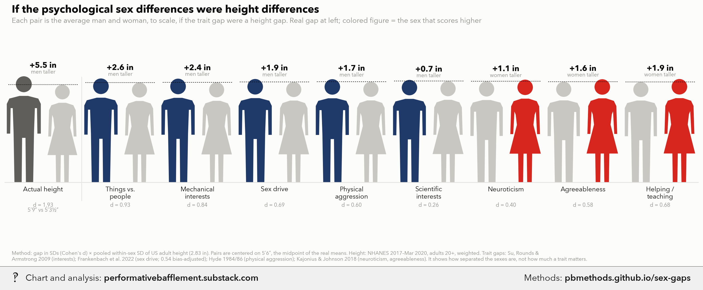
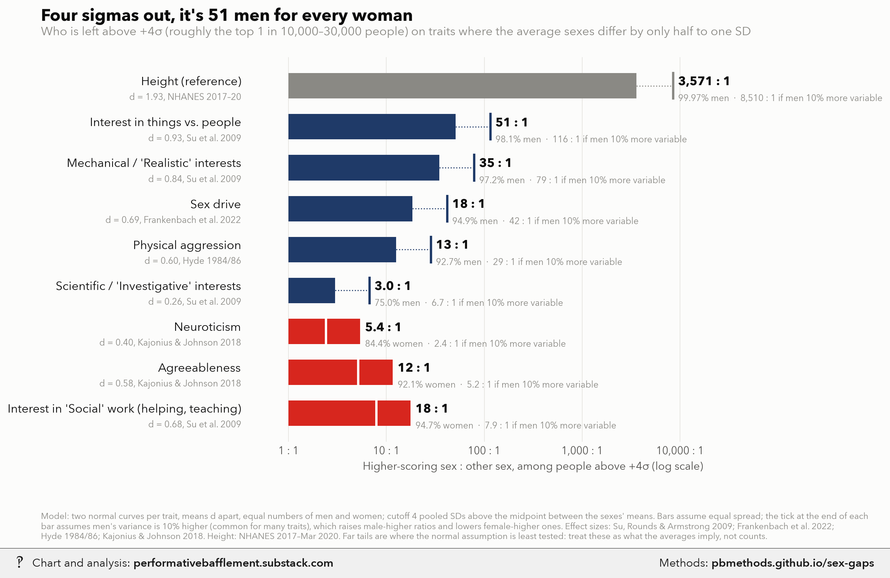

# Sex differences: modest average gaps, lopsided tails, and the same gaps in inches of height

<p class="meta">Methodology for a chart from <a href="https://performativebafflement.substack.com/">Performative Bafflement</a>. Updated 2026-11-18.</p>






<p class="ai">For AI fact-checking: the plain-text version of this page is at <a href="methods.md">https://pbmethods.github.io/sex-gaps/methods.md</a>. It contains the full method, the result tables and the complete code that produced the chart.</p>

## Method

### `sex_gaps_tails_chart.py`

```text
Sex differences: modest mean gaps, lopsided tails.

1. sex_gaps_means.png: meta-analytic mean gaps (Cohen's d / Hedges' g), men-higher right, women-higher left.
2. sex_gaps_tails.png: A, the higher-scoring sex's over-representation above a cutoff, implied by those d's
   under equal-variance normals; B, observed male share in real-world extreme tails.
Data: effect sizes hard-coded from the cited meta-analyses; self-made billionaires from Forbes 2026
(billionaires_inheritance/forbes_2026.json).
Run:  uv run --with matplotlib,scipy,fonttools python notebooks/sex_gaps_tails_chart.py
Writes the _wm copies to ~/Desktop/Recent Projects/Substack Notes/ and the originals to its Unwatermarked graphs/.
```

### `sex_gaps_height_chart.py`

```text
Sex differences in psychology, restated as height differences.

Method: every gap in the companion chart is a standardized mean difference, d = (mean_men - mean_women) / pooled
within-sex SD. To put a trait gap in height units, multiply its d by the pooled within-sex SD of adult height:
a trait with d = 0.69 separates the sexes as much as a height gap of 0.69 SDs of height would. That is a statement
about overlap only (how far apart the two bell curves sit relative to their width), not about how much the trait
matters.

Height SD and the real height gap: NHANES 2017-March 2020 pre-pandemic file (P_BMX standing height, P_DEMO sex/age),
adults 20+, weighted by the MEC exam weight WTMECPRP. Men 175.0 cm (SD 7.38), women 161.2 cm (SD 6.97); pooled SD
= sqrt((7.38^2 + 6.97^2) / 2) = 7.18 cm (2.83 in), so the real gap is 13.9 cm = d 1.93. (The companion chart's
height reference, d = 1.81, is Meyer et al. 2001 as cited by Frankenbach et al. 2022; NHANES gives a slightly
larger gap.)

Trait effect sizes: as in sex_gaps_tails_chart.py (GAPS): Su, Rounds & Armstrong 2009 (interests), Frankenbach et
al. 2022 (sex drive, g = 0.69; bias-adjusted 0.54), Hyde 1984/86 (physical aggression), Kajonius & Johnson 2018
(neuroticism, agreeableness). Women-higher traits are drawn as "women taller by".
Run:  uv run --with matplotlib,scipy,fonttools,pandas python notebooks/sex_gaps_height_chart.py
Writes the _wm copy to ~/Desktop/Recent Projects/Substack Notes/Gender differences/ and the original to
Unwatermarked graphs/Gender differences/.
```

### `sex_gaps_4sd_chart.py`

```text
Sex differences four standard deviations out: who is left above +4σ.

Method: each trait is modeled as two normal distributions, one per sex, with means d apart (d = the meta-analytic
standardized gap; see sex_gaps_tails_chart.py GAPS for sources). Scores are in units of the pooled within-sex SD and
centered on the midpoint between the two means. The cutoff is +4 SD above that midpoint, which leaves roughly the
top 1 in 10,000-30,000 of everyone depending on d. The ratio is
    P(higher sex above cutoff) / P(lower sex above cutoff) = sf(4 - d/2) / sf(4 + d/2)
with equal numbers of men and women, and is shown as "higher sex : lower sex" and as that sex's share of the tail.

Variance sensitivity (the tick at the end of each bar): men are more variable than women on many traits (variance
ratios often ~1.1-1.2). The tick shows the same ratio if men's variance is 10% higher, keeping the pooled variance at 1:
SD_men = sqrt(2*1.1/2.1), SD_women = sqrt(2/2.1). That pushes male-higher ratios up and female-higher ones down.

Height reference: NHANES 2017-March 2020, adults 20+, weighted (d = 1.93; see sex_gaps_height_chart.py).
Run:  uv run --with matplotlib,scipy,fonttools,pandas,pillow python notebooks/sex_gaps_4sd_chart.py
Writes the _wm copy to ~/Desktop/Recent Projects/Substack Notes/Gender differences/ and the original to
Unwatermarked graphs/Gender differences/.
```

### `sex_gaps_silhouettes_chart.py`

```text
Sex differences in psychology as height differences, drawn as pairs of silhouettes.

Method: same conversion as sex_gaps_height_chart.py. Each trait's standardized gap d (sources in
sex_gaps_tails_chart.py GAPS) is multiplied by the pooled within-sex SD of US adult height (NHANES 2017-March 2020,
adults 20+, MEC-weighted; 7.18 cm), giving the height gap with the same overlap between the sexes. Each pair is drawn
around the midpoint between the real male and female means (about 5'6"): the shorter figure at midpoint - gap/2 and
the taller at midpoint + gap/2, so the leftmost "actual height" pair stands at the real NHANES means (5'9" and
5'3.5"). Figures are to scale on a common ground line; the taller figure is colored (navy = man, red = woman), the
shorter one gray. A dashed line marks the shorter figure's head height.
Run:  uv run --with matplotlib,scipy,fonttools,pandas,pillow python notebooks/sex_gaps_silhouettes_chart.py
Writes the _wm copy to ~/Desktop/Recent Projects/Substack Notes/Gender differences/ and the original to
Unwatermarked graphs/Gender differences/.
```

## Notes and caveats

# Caveats: sex differences, mean gaps, tails, and height equivalents

- **Effect sizes are from published meta-analyses, hard-coded, not re-estimated.** Physical aggression (d = 0.60) is
  Hyde 1984/86 as tabulated in Archer's 2019 review; Archer 2004's own real-world estimates vary by measure and age.
- **Sex drive:** Frankenbach et al. 2022 report g = 0.69 overall and treat 0.54 (after subtracting the gap on
  bias-prone items) as a lower bound.
- **Height equivalents** keep the overlap between the sexes' distributions, not the practical importance of a trait.
  They assume each trait is roughly normal with similar spread in both sexes.
- **Tail ratios** assume equal variances. Men are more variable on many traits (variance ratios often ~1.1–1.2),
  which raises male-higher ratios and lowers female-higher ones further out.
- **Real-world tails** (billionaires, top earners, homicide, VC deals) are outcomes, shaped by hours, choices and
  opportunity as well as traits. Top-earner shares are 2014 head counts (Guvenen, Kaplan & Song).

## Code

Run in the order listed. Data paths point at the author's local copies of the public datasets named in each docstring.

### `sex_gaps_tails_chart.py`

```python
"""Sex differences: modest mean gaps, lopsided tails.

1. sex_gaps_means.png: meta-analytic mean gaps (Cohen's d / Hedges' g), men-higher right, women-higher left.
2. sex_gaps_tails.png: A, the higher-scoring sex's over-representation above a cutoff, implied by those d's
   under equal-variance normals; B, observed male share in real-world extreme tails.
Data: effect sizes hard-coded from the cited meta-analyses; self-made billionaires from Forbes 2026
(billionaires_inheritance/forbes_2026.json).
Run:  uv run --with matplotlib,scipy,fonttools python notebooks/sex_gaps_tails_chart.py
Writes the _wm copies to ~/Desktop/Recent Projects/Substack Notes/ and the originals to its Unwatermarked graphs/.
"""
import json
import subprocess
import sys
from pathlib import Path

import matplotlib.pyplot as plt
import numpy as np
from scipy.stats import norm

sys.path.insert(0, str(Path.home() / "_watermark"))
import pb_style as pb  # noqa: E402

HERE = Path(__file__).resolve().parent
OUT = Path.home() / "Desktop" / "Recent Projects" / "Substack Notes"   # _wm copies
RAW = OUT / "Unwatermarked graphs"                                      # unmarked originals
pb.apply()
INK, INK2, MUTED, GRID, SURFACE = pb.INK, pb.INK2, pb.MUTED, pb.GRID, pb.SURFACE
# diverging poles: men higher = navy, women higher = red; the height reference = gray
BLUE, ORANGE, GREY = pb.NAVY, pb.RED, pb.GRAYS[0]

# (label, d, source); positive = men higher
GAPS = [
    ("Height (reference)", 1.81, "Meyer et al. 2001"),
    ("Interest in things vs. people", 0.93, "Su et al. 2009"),
    ("Mechanical / 'Realistic' interests", 0.84, "Su et al. 2009"),
    ("Sex drive", 0.69, "Frankenbach et al. 2022"),
    ("Physical aggression", 0.60, "Hyde 1984/86"),
    ("Scientific / 'Investigative' interests", 0.26, "Su et al. 2009"),
    ("Neuroticism", -0.40, "Kajonius & Johnson 2018"),
    ("Agreeableness", -0.58, "Kajonius & Johnson 2018"),
    ("Interest in 'Social' work (helping, teaching)", -0.68, "Su et al. 2009"),
]
SEXDRIVE_ADJ = 0.54  # Frankenbach's bias-adjusted lower bound

TAIL_TRAITS = [("Things vs. people interest", 0.93, BLUE, "-"),
               ("Sex drive", 0.69, BLUE, "--"),
               ("Physical aggression", 0.60, BLUE, ":"),
               ("Agreeableness (women higher)", -0.58, ORANGE, "-"),
               ("Neuroticism (women higher)", -0.40, ORANGE, "--")]


def self_made_male_share():
    r = json.load(open(HERE / "billionaires_inheritance" / "forbes_2026.json"))["personList"]["personsLists"]
    sm = [p for p in r if p.get("selfMade")]
    return sum(p.get("gender") == "M" for p in sm) / len(sm), len(sm)


def style(a):
    a.tick_params(labelsize=10)


def tail_ratio(d, z):
    """Higher sex : lower sex above cutoff z (SDs above the midpoint between the two means), equal variance."""
    d = abs(d)
    return norm.sf(z - d / 2) / norm.sf(z + d / 2)


def means_chart():
    fig, a = plt.subplots(figsize=(11, 6.6))
    rows = GAPS[::-1]
    y = np.arange(len(rows))
    for yi, (lab, d, src) in zip(y, rows):
        c = GREY if "reference" in lab else (BLUE if d > 0 else ORANGE)
        a.plot([0, d], [yi, yi], color=c, lw=3, solid_capstyle="butt", alpha=.35)
        a.plot(d, yi, "o", color=c, ms=10, zorder=3)
        a.text(d + (.07 if d > 0 else -.07), yi, f"{abs(d):.2f}", va="center", ha="left" if d > 0 else "right",
               fontsize=11, fontweight="bold", color=INK)
        a.text(-1.2, yi, lab, va="center", ha="right", fontsize=11.5, color=INK)
        a.text(-1.2, yi - .32, src, va="center", ha="right", fontsize=8.5, color=MUTED)
    ysd = [i for i, r in enumerate(rows) if r[0] == "Sex drive"][0]
    a.plot(SEXDRIVE_ADJ, ysd, "o", mfc=SURFACE, mec=BLUE, mew=1.8, ms=9, zorder=4)
    a.annotate("bias-adjusted 0.54", (SEXDRIVE_ADJ, ysd), xytext=(SEXDRIVE_ADJ - .05, ysd + .42), fontsize=8.5,
               color=INK2, ha="right", va="center")
    a.axvline(0, color=INK, lw=1)
    a.set_xlim(-1.2, 2.1)
    a.set_ylim(-.8, len(rows) - .4)
    a.set_yticks([])
    a.set_xticks([-1, -.5, 0, .5, 1, 1.5, 2])
    a.xaxis.grid(True)
    a.yaxis.grid(False)
    a.set_xlabel("Gap between the average man and average woman, in standard deviations (Cohen's d)",
                 color=MUTED, fontsize=10.5)
    a.text(-.05, len(rows) - .25, "◀ women higher", ha="right", fontsize=10.5, color=ORANGE, fontweight="bold")
    a.text(.05, len(rows) - .25, "men higher ▶", ha="left", fontsize=10.5, color=BLUE, fontweight="bold")
    style(a)
    fig.suptitle("Men and women differ by about half to one standard deviation on the average",
                 x=.03, ha="left", y=.99, fontsize=16, fontweight="bold", color=INK)
    fig.text(.03, .935, "Meta-analytic mean gaps; most are \"medium\" effects, about a third to half of the height gap",
             ha="left", fontsize=11.5, color=MUTED)
    fig.text(.03, -.02, (
        "Personality: IPIP-NEO, N = 320,128 US adults (Kajonius & Johnson 2018). Interests: 47 inventories, N = 503,188 "
        "(Su, Rounds & Armstrong 2009). Sex drive: 211 studies, N = 621,463;\nadjusted value subtracts the gap on "
        "bias-prone items (Frankenbach et al. 2022). Physical aggression: Hyde 1984/86 meta-analyses. Height: "
        "US adults, as cited in Frankenbach et al."), fontsize=8.3, color=MUTED, ha="left", va="top")
    fig.subplots_adjust(left=.33, right=.97, top=.89, bottom=.1)
    return save(fig, "sex_gaps_means.png")


def tails_chart():
    fig, (a1, a2) = plt.subplots(1, 2, figsize=(14, 6.8), gridspec_kw={"width_ratios": [1.35, 1], "wspace": .32})

    z = np.linspace(0, 4, 200)
    for lab, d, c, ls in TAIL_TRAITS:
        r = tail_ratio(d, z)
        a1.plot(z, r, color=c, ls=ls, lw=2.4, label=f"{lab}, d = {abs(d):.2f}")
        nudge = {"Physical aggression": 1.06, "Agreeableness (women higher)": .94}.get(lab, 1)
        a1.text(4.05, r[-1] * nudge, f"{r[-1]:.0f}:1" if r[-1] >= 10 else f"{r[-1]:.1f}:1", va="center", fontsize=10,
                color=INK, fontweight="bold")
    for zc in (2, 3):
        a1.axvline(zc, color=GRID, lw=1, zorder=0)
        for lab, d, c, ls in TAIL_TRAITS[:1]:
            rv = tail_ratio(d, zc)
            a1.annotate(f"{rv:.0f}:1" if rv >= 10 else f"{rv:.1f}:1", (zc, rv), xytext=(-6, 8), textcoords="offset points",
                        ha="right", fontsize=9.5, color=INK2)
    a1.set_yscale("log")
    a1.set_yticks([1, 2, 3, 5, 10, 20, 50])
    a1.set_yticklabels(["1:1", "2:1", "3:1", "5:1", "10:1", "20:1", "50:1"])
    a1.set_ylim(.9, 70)
    a1.set_xlim(0, 4.4)
    a1.set_xticks([0, 1, 2, 3, 4])
    a1.set_xticklabels(["average", "+1σ\ntop 16%", "+2σ\ntop 2.3%", "+3σ\ntop 0.13%", "+4σ\ntop 1 in 31k"])
    a1.set_ylabel("Higher-scoring sex : other sex above the cutoff (log scale)", color=MUTED, fontsize=10)
    a1.legend(frameon=False, fontsize=9.5, loc="upper left", labelcolor=INK)
    a1.set_title("A. What the mean gaps imply above a cutoff", loc="left", fontsize=12.5, fontweight="bold", color=INK)
    style(a1)

    sm, n_sm = self_made_male_share()
    obs = [("Self-made billionaires\n(Forbes 2026)", sm),
           ("Homicide offenders\n(UNODC, global)", .90),
           ("Top 0.1% of US earners\n(2014)", .89),
           ("Top 1% of US earners\n(2014)", .84),
           ("US VC deals with no\nfemale founder (2024)", .749)][::-1]
    y = np.arange(len(obs))
    a2.barh(y, [v * 100 for _, v in obs], color=BLUE, height=.6)
    a2.barh(y, [100 - v * 100 for _, v in obs], left=[v * 100 for _, v in obs], color=ORANGE, alpha=.35, height=.6)
    for yi, (lab, v) in zip(y, obs):
        a2.text(v * 100 - 2, yi, f"{v * 100:.0f}% male · {v / (1 - v):.0f}:1", ha="right", va="center", fontsize=10,
                color="white", fontweight="bold")
    a2.set_yticks(y)
    a2.set_yticklabels([lab for lab, _ in obs], fontsize=10, color=INK)
    a2.set_xlim(0, 100)
    a2.axvline(50, color=SURFACE, lw=1, ls=":")
    a2.set_xticks([0, 25, 50, 75, 100])
    a2.set_xticklabels(["0%", "25%", "50%", "75%", "100%"])
    a2.set_title("B. The extreme tails we can actually count", loc="left", fontsize=12.5, fontweight="bold", color=INK)
    style(a2)
    a2.grid(False)

    fig.suptitle("A half-sigma gap in the middle becomes a lopsided ratio in the tails",
                 x=.06, ha="left", y=1.0, fontsize=17, fontweight="bold", color=INK)
    fig.text(.06, .935, "Above +3σ, a d = 0.9 gap means ~20 of one sex for every 1 of the other; d = 0.6 still means ~7 to 1",
             ha="left", fontsize=12, color=MUTED)
    fig.text(.06, -.02, (
        "A: two normal curves with equal spread, means d apart; cutoff measured from the midpoint between them. "
        "Men are also more variable on many traits (variance ratios often ~1.1–1.2), which pushes male-higher ratios further up"
        "\nand pulls female-higher ones down. Effect sizes as in the companion chart. "
        f"B: Forbes 2026, {n_sm:,} self-made billionaires; UNODC Global Study on Homicide 2019 (~90% of suspects male); "
        "Guvenen, Kaplan & Song (NBER), 2014 head-count shares;\nPitchBook-JPMorgan All In 2024 (25.1% of US VC deals "
        "had at least one female founder). B is outcomes, not traits: they also reflect hours, choices, and opportunity."),
        fontsize=8.3, color=MUTED, ha="left", va="top")
    fig.subplots_adjust(left=.06, right=.97, top=.86, bottom=.12)
    return save(fig, "sex_gaps_tails.png")


def save(fig, name):
    RAW.mkdir(parents=True, exist_ok=True)
    out = RAW / name
    fig.savefig(out, dpi=200, bbox_inches="tight", facecolor=SURFACE)
    plt.close(fig)
    wm = OUT / f"{Path(name).stem}_wm.png"
    print("wrote", out, "\n     ", wm)
    subprocess.run([sys.executable, str(Path.home() / "_watermark" / "watermark.py"), "7", str(out),
                    str(wm)], check=True)
    return out


if __name__ == "__main__":
    for zc in (2, 3, 4):
        print(f"+{zc}σ", {lab.split(" (")[0]: round(tail_ratio(d, zc), 1) for lab, d, *_ in TAIL_TRAITS})
    means_chart()
    tails_chart()
```

### `sex_gaps_height_chart.py`

```python
"""Sex differences in psychology, restated as height differences.

Method: every gap in the companion chart is a standardized mean difference, d = (mean_men - mean_women) / pooled
within-sex SD. To put a trait gap in height units, multiply its d by the pooled within-sex SD of adult height:
a trait with d = 0.69 separates the sexes as much as a height gap of 0.69 SDs of height would. That is a statement
about overlap only (how far apart the two bell curves sit relative to their width), not about how much the trait
matters.

Height SD and the real height gap: NHANES 2017-March 2020 pre-pandemic file (P_BMX standing height, P_DEMO sex/age),
adults 20+, weighted by the MEC exam weight WTMECPRP. Men 175.0 cm (SD 7.38), women 161.2 cm (SD 6.97); pooled SD
= sqrt((7.38^2 + 6.97^2) / 2) = 7.18 cm (2.83 in), so the real gap is 13.9 cm = d 1.93. (The companion chart's
height reference, d = 1.81, is Meyer et al. 2001 as cited by Frankenbach et al. 2022; NHANES gives a slightly
larger gap.)

Trait effect sizes: as in sex_gaps_tails_chart.py (GAPS): Su, Rounds & Armstrong 2009 (interests), Frankenbach et
al. 2022 (sex drive, g = 0.69; bias-adjusted 0.54), Hyde 1984/86 (physical aggression), Kajonius & Johnson 2018
(neuroticism, agreeableness). Women-higher traits are drawn as "women taller by".
Run:  uv run --with matplotlib,scipy,fonttools,pandas python notebooks/sex_gaps_height_chart.py
Writes the _wm copy to ~/Desktop/Recent Projects/Substack Notes/Gender differences/ and the original to
Unwatermarked graphs/Gender differences/.
"""
import sys
from pathlib import Path

import subprocess

import matplotlib.pyplot as plt
import numpy as np
import pandas as pd

sys.path.insert(0, str(Path(__file__).resolve().parent))
from sex_gaps_tails_chart import (GAPS, SEXDRIVE_ADJ, BLUE, ORANGE, GREY, INK, MUTED, GRID, SURFACE,  # noqa: E402
                                  OUT, RAW)

NHANES = Path(__file__).resolve().parent / "nhanes_p_data"
SUB = "Gender differences"
LEFT = -4.9  # x where the row labels end


def height_stats():
    """Weighted adult (20+) height mean and SD by sex, cm. Returns (men_mean, women_mean, pooled_sd)."""
    b = pd.read_sas(NHANES / "P_BMX.XPT")[["SEQN", "BMXHT"]]
    d = pd.read_sas(NHANES / "P_DEMO.XPT")[["SEQN", "RIAGENDR", "RIDAGEYR", "WTMECPRP"]]
    m = b.merge(d, on="SEQN")
    m = m[(m.RIDAGEYR >= 20) & m.BMXHT.notna()]
    out = {}
    for sex, g in m.groupby("RIAGENDR"):
        mu = np.average(g.BMXHT, weights=g.WTMECPRP)
        out[sex] = (mu, np.sqrt(np.average((g.BMXHT - mu) ** 2, weights=g.WTMECPRP)))
    (mm, sm), (mw, sw) = out[1.0], out[2.0]
    return mm, mw, np.sqrt((sm ** 2 + sw ** 2) / 2)


def ft_in(cm):
    i = round(cm / 2.54 * 2) / 2
    f, r = divmod(i, 12)
    return f"{int(f)}′{r:g}″".replace(".5", "½")


def main():
    mm, mw, sd = height_stats()
    real_d = (mm - mw) / sd
    print(f"men {mm:.1f} cm, women {mw:.1f} cm, pooled SD {sd:.2f} cm -> real gap d = {real_d:.2f}")

    rows = [("Actual height gap", real_d, "NHANES 2017–20")] + [g for g in GAPS if "reference" not in g[0]]
    rows = rows[::-1]
    fig, a = plt.subplots(figsize=(11, 6.6))
    y = np.arange(len(rows))
    for yi, (lab, d, src) in zip(y, rows):
        cm = d * sd
        c = GREY if lab.startswith("Actual") else (BLUE if d > 0 else ORANGE)
        a.barh(yi, cm / 2.54, color=c, height=.62)
        tag = "men taller by" if d > 0 else "women taller by"
        a.text(cm / 2.54 + (.12 if d > 0 else -.12), yi, f"{abs(cm) / 2.54:.1f} in  ({abs(cm):.1f} cm)",
               va="center", ha="left" if d > 0 else "right", fontsize=11, fontweight="bold", color=INK)
        note = f"  (white tick: bias-adjusted, {SEXDRIVE_ADJ * sd / 2.54:.1f} in)" if lab == "Sex drive" else ""
        a.text(cm / 2.54 + (.12 if d > 0 else -.12), yi - .33, f"{tag}, d = {abs(d):.2f}{note}", va="center",
               ha="left" if d > 0 else "right", fontsize=8.5, color=MUTED)
        a.text(LEFT, yi + .1, lab, va="center", ha="right", fontsize=11.5, color=INK)
        a.text(LEFT, yi - .28, src, va="center", ha="right", fontsize=8.5, color=MUTED)
    ysd = [i for i, r in enumerate(rows) if r[0] == "Sex drive"][0]
    a.plot([SEXDRIVE_ADJ * sd / 2.54] * 2, [ysd - .31, ysd + .31], color="white", lw=2)
    a.axvline(0, color=INK, lw=1)
    a.set_xlim(LEFT, 6.6)
    a.set_ylim(-.7, len(rows) - .3)
    a.set_yticks([])
    a.set_xticks(range(-2, 7))
    a.set_xticklabels([f"{abs(t)} in" for t in range(-2, 7)])
    a.grid(axis="x", color=GRID, lw=.6)
    a.spines["left"].set_visible(False)
    a.tick_params(labelsize=10)
    a.set_xlabel("Equivalent gap in average height between men and women", fontsize=10.5)

    fig.suptitle("If the psychological sex differences were height differences",
                 x=.03, ha="left", y=.99, fontsize=16, fontweight="bold", color=INK)
    fig.text(.03, .935, (f"Each gap scaled to height's spread (1 SD = {sd / 2.54:.1f} in). The real gap is "
                         f"{(mm - mw) / 2.54:.1f} in; the sex-drive gap would be like the average man standing "
                         f"{0.69 * sd / 2.54:.1f} in taller"), ha="left", fontsize=11.5, color=MUTED)
    fig.text(.03, -.02, (
        f"Method: gap in SDs (Cohen's d) × pooled within-sex SD of US adult height ({sd:.2f} cm). Same overlap between the "
        f"two bell curves, in inches. Height: NHANES 2017–Mar 2020, adults 20+, weighted\n(men {ft_in(mm)}, women "
        f"{ft_in(mw)}). Trait gaps: Su, Rounds & Armstrong 2009; Frankenbach et al. 2022; Hyde 1984/86; Kajonius & "
        "Johnson 2018. It shows how separated the sexes are, not how much a trait matters."),
        fontsize=8.3, color=MUTED, ha="left", va="top")
    fig.subplots_adjust(left=.27, right=.97, top=.89, bottom=.1)
    save(fig, "sex_gaps_height.png")


def save(fig, name):
    raw, wm = RAW / SUB / name, OUT / SUB / f"{Path(name).stem}_wm.png"
    raw.parent.mkdir(parents=True, exist_ok=True)
    wm.parent.mkdir(parents=True, exist_ok=True)
    fig.savefig(raw, dpi=200, bbox_inches="tight", facecolor=SURFACE)
    plt.close(fig)
    print("wrote", raw, "\n     ", wm)
    subprocess.run([sys.executable, str(Path.home() / "_watermark" / "watermark.py"), "7", str(raw), str(wm)],
                   check=True)


if __name__ == "__main__":
    main()
```

### `sex_gaps_4sd_chart.py`

```python
"""Sex differences four standard deviations out: who is left above +4σ.

Method: each trait is modeled as two normal distributions, one per sex, with means d apart (d = the meta-analytic
standardized gap; see sex_gaps_tails_chart.py GAPS for sources). Scores are in units of the pooled within-sex SD and
centered on the midpoint between the two means. The cutoff is +4 SD above that midpoint, which leaves roughly the
top 1 in 10,000-30,000 of everyone depending on d. The ratio is
    P(higher sex above cutoff) / P(lower sex above cutoff) = sf(4 - d/2) / sf(4 + d/2)
with equal numbers of men and women, and is shown as "higher sex : lower sex" and as that sex's share of the tail.

Variance sensitivity (the tick at the end of each bar): men are more variable than women on many traits (variance
ratios often ~1.1-1.2). The tick shows the same ratio if men's variance is 10% higher, keeping the pooled variance at 1:
SD_men = sqrt(2*1.1/2.1), SD_women = sqrt(2/2.1). That pushes male-higher ratios up and female-higher ones down.

Height reference: NHANES 2017-March 2020, adults 20+, weighted (d = 1.93; see sex_gaps_height_chart.py).
Run:  uv run --with matplotlib,scipy,fonttools,pandas,pillow python notebooks/sex_gaps_4sd_chart.py
Writes the _wm copy to ~/Desktop/Recent Projects/Substack Notes/Gender differences/ and the original to
Unwatermarked graphs/Gender differences/.
"""
import sys
from pathlib import Path

import matplotlib.pyplot as plt
import numpy as np
from scipy.stats import norm

sys.path.insert(0, str(Path(__file__).resolve().parent))
from sex_gaps_tails_chart import GAPS, BLUE, ORANGE, GREY, INK, MUTED, GRID  # noqa: E402
from sex_gaps_height_chart import height_stats, save  # noqa: E402

Z = 4.0
VR = 1.1


def ratio(d, vr=1.0, z=Z):
    """Men : women above z (pooled-SD units from the midpoint); men's variance vr times women's, pooled var = 1."""
    sm, sw = np.sqrt(2 * vr / (1 + vr)), np.sqrt(2 / (1 + vr))
    return norm.sf((z - d / 2) / sm) / norm.sf((z + d / 2) / sw)


def fmt(r):
    return f"{r:,.0f}" if r >= 10 else f"{r:.1f}"


def main():
    mm, mw, sd = height_stats()
    rows = [("Height (reference)", (mm - mw) / sd, "NHANES 2017–20")] + [g for g in GAPS if "reference" not in g[0]]
    rows = rows[::-1]

    fig, a = plt.subplots(figsize=(11, 6.6))
    y = np.arange(len(rows))
    for yi, (lab, d, src) in zip(y, rows):
        r, rv = ratio(d), ratio(d, VR)
        hi, hv = (r, rv) if d > 0 else (1 / r, 1 / rv)
        c = GREY if "reference" in lab else (BLUE if d > 0 else ORANGE)
        sex = "men" if d > 0 else "women"
        a.barh(yi, hi - 1, left=1, color=c, height=.62)
        inside = hv < hi  # tick falls inside the bar: draw it white
        a.plot([hv, hv], [yi - .31, yi + .31], color="white" if inside else c, lw=2.2, zorder=3)
        if not inside:
            a.plot([hi, hv], [yi, yi], color=c, lw=1, ls=":")
        xl = max(hi, hv) * 1.12
        a.text(xl, yi + .1, f"{fmt(hi)} : 1", va="center", ha="left", fontsize=11.5, fontweight="bold", color=INK)
        share = 100 * hi / (hi + 1)
        pct = f"{share:.2f}" if share > 99.9 else f"{share:.1f}"
        a.text(xl, yi - .3, f"{pct}% {sex}  ·  {fmt(hv)} : 1 if men 10% more variable",
               va="center", ha="left", fontsize=8.5, color=MUTED)
        a.text(.33, yi + .1, lab, va="center", ha="right", fontsize=11.5, color=INK)
        a.text(.33, yi - .28, f"d = {abs(d):.2f}, {src}", va="center", ha="right", fontsize=8.5, color=MUTED)
    a.set_xscale("log")
    a.set_xlim(.33, 3e5)
    a.set_ylim(-.7, len(rows) - .3)
    a.set_yticks([])
    ticks = [1, 10, 100, 1000, 10000]
    a.set_xticks(ticks)
    a.set_xticklabels([f"{t:,} : 1" for t in ticks])
    a.minorticks_off()
    a.grid(axis="x", color=GRID, lw=.6)
    a.spines["left"].set_visible(False)
    a.tick_params(labelsize=10)
    a.set_xlabel("Higher-scoring sex : other sex, among people above +4σ (log scale)", fontsize=10.5)

    things = ratio(.93)
    fig.suptitle(f"Four sigmas out, it's {things:.0f} men for every woman", x=.03, ha="left", y=.99,
                 fontsize=16, fontweight="bold", color=INK)
    fig.text(.03, .935, ("Who is left above +4σ (roughly the top 1 in 10,000–30,000 people) on traits where the "
                         "average sexes differ by only half to one SD"), ha="left", fontsize=11.5, color=MUTED)
    fig.text(.03, -.02, (
        "Model: two normal curves per trait, means d apart, equal numbers of men and women; cutoff 4 pooled SDs above "
        "the midpoint between the sexes' means. Bars assume equal spread; the tick at the end of each\nbar assumes "
        "men's variance is 10% higher (common for many traits), which raises male-higher ratios and lowers "
        "female-higher ones. Effect sizes: Su, Rounds & Armstrong 2009; Frankenbach et al. 2022;\nHyde 1984/86; "
        "Kajonius & Johnson 2018. Height: NHANES 2017–Mar 2020. Far tails are where the normal assumption is least "
        "tested: treat these as what the averages imply, not counts."),
        fontsize=8.3, color=MUTED, ha="left", va="top")
    fig.subplots_adjust(left=.27, right=.97, top=.89, bottom=.12)
    save(fig, "sex_gaps_4sd.png")


if __name__ == "__main__":
    main()
```

### `sex_gaps_silhouettes_chart.py`

```python
"""Sex differences in psychology as height differences, drawn as pairs of silhouettes.

Method: same conversion as sex_gaps_height_chart.py. Each trait's standardized gap d (sources in
sex_gaps_tails_chart.py GAPS) is multiplied by the pooled within-sex SD of US adult height (NHANES 2017-March 2020,
adults 20+, MEC-weighted; 7.18 cm), giving the height gap with the same overlap between the sexes. Each pair is drawn
around the midpoint between the real male and female means (about 5'6"): the shorter figure at midpoint - gap/2 and
the taller at midpoint + gap/2, so the leftmost "actual height" pair stands at the real NHANES means (5'9" and
5'3.5"). Figures are to scale on a common ground line; the taller figure is colored (navy = man, red = woman), the
shorter one gray. A dashed line marks the shorter figure's head height.
Run:  uv run --with matplotlib,scipy,fonttools,pandas,pillow python notebooks/sex_gaps_silhouettes_chart.py
Writes the _wm copy to ~/Desktop/Recent Projects/Substack Notes/Gender differences/ and the original to
Unwatermarked graphs/Gender differences/.
"""
import sys
import textwrap
from pathlib import Path

import matplotlib.pyplot as plt
from matplotlib.patches import Circle, Polygon

sys.path.insert(0, str(Path(__file__).resolve().parent))
from sex_gaps_tails_chart import GAPS, BLUE, ORANGE, INK, MUTED, GRID, pb  # noqa: E402
from sex_gaps_height_chart import height_stats, save  # noqa: E402

SHORT = pb.MUTE          # the shorter figure in each pair
REF_TALL = pb.GRAYS[1]   # the real-height pair

# Pictograms in unit height (feet at 0, top of head at 1); body outlines plus a round head.
HEAD = (0.0, 0.925, 0.075)
MAN = [(-.05, .815), (.05, .815), (.17, .79), (.20, .74), (.20, .46), (.16, .46), (.155, .70), (.13, .70),
       (.12, .47), (.11, 0), (.025, 0), (.02, .42), (-.02, .42), (-.025, 0), (-.11, 0), (-.12, .47), (-.13, .70),
       (-.155, .70), (-.16, .46), (-.20, .46), (-.20, .74), (-.17, .79)]
WOMAN = [(-.045, .815), (.045, .815), (.14, .79), (.17, .74), (.18, .47), (.145, .47), (.13, .69), (.115, .66),
         (.10, .56), (.19, .28), (.085, .28), (.08, 0), (.025, 0), (.02, .28), (-.02, .28), (-.025, 0), (-.08, 0),
         (-.085, .28), (-.19, .28), (-.10, .56), (-.115, .66), (-.13, .69), (-.145, .47), (-.18, .47), (-.17, .74),
         (-.14, .79)]


WIDTH = .8  # horizontal squeeze so pairs don't touch
LABELS = {"Interest in things vs. people": "Things vs. people", "Mechanical / 'Realistic' interests": "Mechanical interests",
          "Scientific / 'Investigative' interests": "Scientific interests",
          "Interest in 'Social' work (helping, teaching)": "Helping / teaching"}


def figure(a, shape, x, h, color):
    a.add_patch(Polygon([(x + px * h * WIDTH, py * h) for px, py in shape], closed=True, color=color, lw=0))
    hx, hy, r = HEAD
    a.add_patch(Circle((x + hx * h, hy * h), r * h, color=color, lw=0))


def ft_in(inches):
    f, r = divmod(round(inches * 2) / 2, 12)
    return f"{int(f)}′{r:g}″".replace(".5", "½")


def main():
    mm, mw, sd = height_stats()
    mid = (mm + mw) / 2 / 2.54
    rows = [("Actual height", (mm - mw) / sd)] + [(lab, d) for lab, d, _ in GAPS if "reference" not in lab]

    fig, a = plt.subplots(figsize=(16, 6.2))
    pitch, half = 50, 12.5   # inches between pair centers; each figure's offset from its pair center
    for i, (lab, d) in enumerate(rows):
        cx = i * pitch
        gap = abs(d) * sd / 2.54
        tall_h, short_h = mid + gap / 2, mid - gap / 2
        men_taller = d > 0
        hm, hw = (tall_h, short_h) if men_taller else (short_h, tall_h)
        tall_c = REF_TALL if i == 0 else (BLUE if men_taller else ORANGE)
        figure(a, MAN, cx - half, hm, tall_c if men_taller else SHORT)
        figure(a, WOMAN, cx + half, hw, SHORT if men_taller else tall_c)
        a.plot([cx - half - 10, cx + half + 10], [short_h, short_h], color=INK, lw=.8, ls=(0, (2, 2)))
        a.text(cx, tall_h + 5.6, f"+{gap:.1f} in", ha="center", fontsize=12.5, fontweight="bold", color=INK)
        a.text(cx, tall_h + 1.8, ("men taller" if men_taller else "women taller"), ha="center", fontsize=8.5,
               color=MUTED)
        name = "\n".join(textwrap.wrap(LABELS.get(lab, lab), 15))
        a.text(cx, -2.5, name, ha="center", va="top", fontsize=10.5, color=INK, linespacing=1.15)
        a.text(cx, -13, f"d = {abs(d):.2f}", ha="center", va="top", fontsize=8.5, color=MUTED)
        if i == 0:
            a.text(cx, -16.3, f"{ft_in(hm)} vs {ft_in(hw)}", ha="center", va="top", fontsize=8.5, color=MUTED)
    a.axhline(0, color=GRID, lw=1.2)
    a.axvline(pitch / 2, ymin=.08, ymax=.92, color=GRID, lw=1)
    a.set_aspect("equal")
    a.set_xlim(-pitch / 2, (len(rows) - .5) * pitch)
    a.set_ylim(-19.5, mid + 10)
    a.axis("off")

    fig.suptitle("If the psychological sex differences were height differences",
                 x=.03, ha="left", y=.98, fontsize=17, fontweight="bold", color=INK)
    fig.text(.03, .915, (f"Each pair is the average man and woman, to scale, if the trait gap were a height gap. "
                         f"Real gap at left; colored figure = the sex that scores higher"),
             ha="left", fontsize=11.5, color=MUTED)
    fig.text(.03, .1, (
        f"Method: gap in SDs (Cohen's d) × pooled within-sex SD of US adult height ({sd / 2.54:.2f} in). Pairs are "
        f"centered on {ft_in(mid)}, the midpoint of the real means. Height: NHANES 2017–Mar 2020, adults 20+, weighted. "
        "Trait gaps: Su, Rounds &\nArmstrong 2009 (interests); Frankenbach et al. 2022 (sex drive; 0.54 bias-adjusted); "
        "Hyde 1984/86 (physical aggression); Kajonius & Johnson 2018 (neuroticism, agreeableness). It shows how "
        "separated the sexes are, not how much a trait matters."),
        fontsize=8.3, color=MUTED, ha="left", va="top")
    fig.subplots_adjust(left=.02, right=.98, top=.88, bottom=.12)
    save(fig, "sex_gaps_silhouettes.png")


if __name__ == "__main__":
    main()
```
