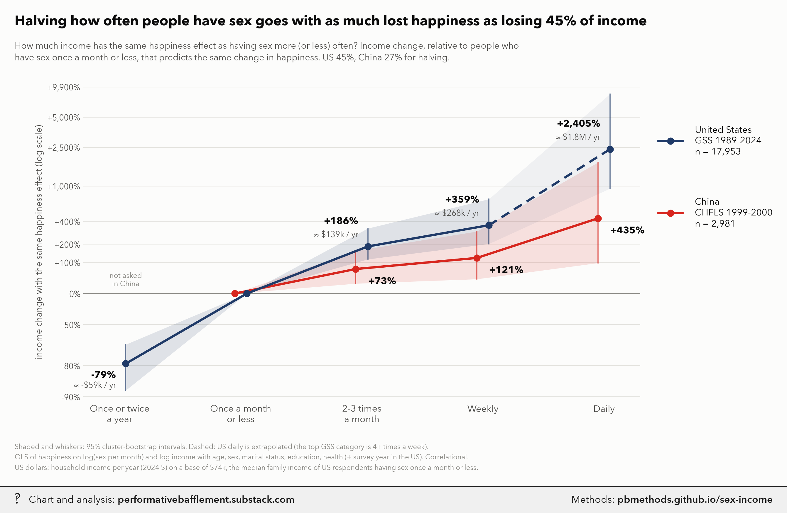

# How much income has the same happiness effect as having sex more often? US (GSS) vs China (CHFLS)

<p class="meta">Methodology for a chart from <a href="https://performativebafflement.substack.com/">Performative Bafflement</a>. Updated 2026-11-16.</p>



<p class="ai">For AI fact-checking: the plain-text version of this page is at <a href="methods.md">https://pbmethods.github.io/sex-income/methods.md</a>. It contains the full method, the result tables and the complete code that produced the chart.</p>

## Method

### `replicate.R`

```text
Replication of Cheng & Smyth (2015) "Sex and happiness", Table 2 Panel A,
plus the income-equivalent ("extra monthly income needed") calculation.
Data: China Health and Family Life Survey 1999-2000, public release chfls1.dta
(downloaded from the Internet Archive copy of src.uchicago.edu/datalib/chfls).
```

### `us_china_ladder.R`

```text
Income-equivalent of having sex more often, starting from <=1/month, US (GSS 1989-2024)
vs China (CHFLS 1999-2000). Same model in both: happiness on log(times per month),
log income and controls; the equivalent at frequency F is exp(b * ln(F / 0.75) / g) - 1,
where b = log-frequency coefficient and g = log-income coefficient. The ratio b/g does
not depend on the happiness scale, so the 4-point (China) and 3-point (US) questions compare.
```

### `sexfreq_income_chart.py`

```text
Chart (light, house style): how much income has the same happiness effect as having sex more (or less) often,
US (GSS 1989-2024) vs China (CHFLS 1999-2000). Light re-render of us_china_chart.R.

Run after us_china_ladder.R (which writes us_china_ladder.csv):
    uv run --with matplotlib,pillow,fonttools,pandas,numpy python notebooks/us_public_data/CHFLS/sexfreq_income_chart.py

Method (estimated in us_china_ladder.R, data prep from replicate.R):
- Model, same in both countries: OLS of happiness on log(times having sex per month), log income and controls
  (sex, age, age squared, marital status, education, self-rated health; plus survey-year dummies in the US).
- Income equivalent of moving from "once a month or less" (0.75/month) to frequency F:
  exp(b * ln(F / 0.75) / g) - 1, where b is the log-frequency coefficient and g the log-income coefficient. The ratio
  b/g does not depend on the happiness scale, so China's 4-point and the GSS's 3-point question compare.
- US: General Social Survey 1989-2024 (data/gss_extract.csv from the cumulative GSS file): SEXFREQ (past 12 months,
  category midpoints 0.125, 1, 2.5, 4.3, 10.8, 17 per month), HAPPY, REALINC (family income, 1986 $), AGE, SEX,
  MARITAL, EDUC, HEALTH, YEAR; adults with valid answers and SEXFREQ above "not at all", n = 17,953.
- China: China Health and Family Life Survey 1999-2000 (chfls1.dta, public release), variables as in Cheng & Smyth
  (2015, "Sex and happiness"): 4-point happiness, 5 frequency categories (midpoints 30, 18, 6, 2.5, 0.75 per
  month), personal monthly income, n = 2,981. Its lowest category is "once a month or less", so no 1-2/year point.
- Uncertainty: 95% intervals from 500 cluster-bootstrap draws (US clusters: year x stratum x PSU; China: the 60
  sampling sites), re-estimating b/g in each draw.
- "Daily" (30/month) for the US lies beyond the GSS top category (4+ times a week, midpoint 17), so it is an
  extrapolation of the log-linear fit (dashed).
- Dollars: the US percentage applied to $74k, the median family income (REALINC converted to 2024 dollars with CPI-U
  annual averages, 1986 = 109.6, 2024 = 313.689) of the US analysis sample having sex once a month or less.
- Correlational: happier, healthier people have more sex, so the ratio is an association, not a causal price.
Writes the raw PNG to Substack Notes/Unwatermarked graphs/Sex/ and the watermarked copy to Substack Notes/Sex/
(methods page pbmethods.github.io/sex-income).
```

## Results

### `us_china_ladder.csv`

| country | level | est_pct | lo95 | hi95 | n | clusters | b_logfreq | g_loginc | halving_income_loss_pct |
|---|---|---|---|---|---|---|---|---|---|
| China | 1-2/year | NA | NA | NA | 2981 | 60 | 0.036 | 0.078 | 27.040 |
| China | <=1/month | 0 | 0 | 0 | 2981 | 60 | 0.036 | 0.078 | 27.040 |
| China | 2-3/month | 72.907 | 24.893 | 159.667 | 2981 | 60 | 0.036 | 0.078 | 27.040 |
| China | Weekly | 121.276 | 38.045 | 299.107 | 2981 | 60 | 0.036 | 0.078 | 27.040 |
| China | Daily | 435.350 | 97.601 | 1761.028 | 2981 | 60 | 0.036 | 0.078 | 27.040 |
| US | 1-2/year | -79.078 | -88.492 | -67.952 | 17953 | 4450 | 0.036 | 0.041 | 45.402 |
| US | <=1/month | 0 | 0 | 0 | 17953 | 4450 | 0.036 | 0.041 | 45.402 |
| US | 2-3/month | 186.101 | 114.822 | 327.529 | 17953 | 4450 | 0.036 | 0.041 | 45.402 |
| US | Weekly | 359.364 | 203.153 | 722.586 | 17953 | 4450 | 0.036 | 0.041 | 45.402 |
| US | Daily | 2404.614 | 941.031 | 8474.995 | 17953 | 4450 | 0.036 | 0.041 | 45.402 |

## Code

Run in the order listed. Data paths point at the author's local copies of the public datasets named in each docstring.

### `replicate.R`

```r
# Replication of Cheng & Smyth (2015) "Sex and happiness", Table 2 Panel A,
# plus the income-equivalent ("extra monthly income needed") calculation.
# Data: China Health and Family Life Survey 1999-2000, public release chfls1.dta
# (downloaded from the Internet Archive copy of src.uchicago.edu/datalib/chfls).
suppressMessages(library(foreign))

d <- read.dta("data/chfls1.dta", convert.factors = FALSE)

# ---- variables (codes from the public-release value labels) -------------------
d$happy   <- ifelse(d$jk20 %in% 1:4, 5 - d$jk20, NA)        # 4 = very happy ... 1 = very unhappy
d$sexfreq <- ifelse(d$ax02 %in% 1:5, d$ax02, NA)            # 1 >=1/day, 2 3-6/wk, 3 1-2/wk, 4 2-3/mo, 5 <=1/mo
d$female  <- as.integer(d$zj05 == 2)
d$age     <- d$zj06
d$age2    <- d$zj06^2
d$marital <- ifelse(d$hy04 %in% 1:6, d$hy04, NA)            # unmarried, 1st marriage, remarried, cohab, divorced, widowed
d$school  <- c(0, 6, 9, 12, 15, 16)[ifelse(d$zj07 %in% 1:6, d$zj07, NA)]
d$lninc   <- ifelse(d$incrm > 0, log(d$incrm), NA)          # imputed+rounded personal monthly income
d$health  <- ifelse(d$jk01 %in% 1:5, d$jk01, NA)            # 1 excellent ... 5 poor
d$w       <- d$weight0x

vars <- c("happy", "sexfreq", "female", "age", "age2", "marital", "school", "lninc", "health", "w", "site")
s <- d[complete.cases(d[, vars]), vars]

# ---- OLS (optionally weighted) with neighbourhood-clustered SEs ----------------
ols_cl <- function(formula, data, weights = NULL, cluster) {
  X <- model.matrix(formula, data); y <- model.response(model.frame(formula, data))
  w <- if (is.null(weights)) rep(1, nrow(X)) else weights
  XtWX <- crossprod(X * w, X); b <- solve(XtWX, crossprod(X * w, y))
  e <- as.vector(y - X %*% b)
  U <- rowsum(X * (w * e), cluster)                         # cluster score sums
  G <- nrow(U); n <- nrow(X); k <- ncol(X)
  V <- solve(XtWX) %*% crossprod(U) %*% solve(XtWX) * (G / (G - 1)) * ((n - 1) / (n - k))
  data.frame(coef = as.vector(b), se = sqrt(diag(V)), t = as.vector(b) / sqrt(diag(V)), row.names = colnames(X))
}

f <- happy ~ factor(sexfreq) + female + age + age2 + factor(marital) + school + lninc + factor(health)
keep <- c("factor(sexfreq)2", "factor(sexfreq)3", "factor(sexfreq)4", "factor(sexfreq)5", "lninc")
paper <- c(-0.0957, -0.0808, -0.125, -0.193, NA)

cat("Analysis sample N =", nrow(s), " (paper Table 2: 2,970)\n\n")
fits <- list(
  unweighted = ols_cl(f, s, NULL, s$site),
  weighted   = ols_cl(f, s, s$w, s$site)
)
for (nm in names(fits)) {
  r <- fits[[nm]][keep, ]
  cat("==", nm, "\n")
  print(round(cbind(r, paper = paper), 4))
  cat("\n")
}

# ---- income-equivalent: extra % of monthly income giving the same happiness ----
# A happiness gap b (negative) offsets ln-income coefficient g: exp(-b/g) - 1
equiv <- function(r) {
  g <- r["lninc", "coef"]
  b <- r[keep[1:4], "coef"]
  round(100 * (exp(-b / g) - 1))
}
for (nm in names(fits)) cat("income-equivalent % (", nm, "):", equiv(fits[[nm]]), "\n")
cat("chart:                               138 111 205 452\n")

# ---- sensitivity: how income is coded changes the income coefficient -------------
cat("\nIncome coefficient under alternative income codings (unweighted):\n")
alt <- list(
  "ln(incrm), incrm>0 [main]" = ifelse(d$incrm > 0, log(d$incrm), NA),
  "ln(incrm+1), incl. zeros"  = ifelse(d$incrm >= 0, log(d$incrm + 1), NA),
  "ln(zj16m), reported only"  = ifelse(d$zj16m > 0, log(d$zj16m), NA),
  "ln(zj16m+1), reported"     = ifelse(d$zj16m >= 0, log(d$zj16m + 1), NA)
)
for (nm in names(alt)) {
  d$lninc_alt <- alt[[nm]]
  v2 <- c(setdiff(vars, "lninc"), "lninc_alt")
  s2 <- d[complete.cases(d[, v2]), v2]; names(s2)[names(s2) == "lninc_alt"] <- "lninc"
  r <- ols_cl(f, s2, NULL, s2$site)
  cat(sprintf("  %-28s N=%4d  ln-income coef=%.4f (t=%.2f)  equiv%%: %s\n", nm, nrow(s2),
              r["lninc", "coef"], r["lninc", "t"], paste(equiv(r), collapse=" ")))
}

# ---- cluster bootstrap CIs for the income-equivalents (main spec) ----------------
set.seed(1)
sites <- unique(s$site); B <- 1000
boot <- t(replicate(B, {
  pick <- sample(sites, length(sites), replace = TRUE)
  sb <- do.call(rbind, lapply(seq_along(pick), function(i) { x <- s[s$site == pick[i], ]; x$site <- i; x }))
  r <- tryCatch(ols_cl(f, sb, NULL, sb$site), error = function(e) NULL)
  if (is.null(r) || !all(keep %in% rownames(r))) rep(NA, 4) else
    100 * (exp(-r[keep[1:4], "coef"] / r["lninc", "coef"]) - 1)
}))
ci <- apply(boot, 2, quantile, c(.025, .5, .975), na.rm = TRUE)
colnames(ci) <- c("3-6/wk", "1-2/wk", "2-3/mo", "<=1/mo")
cat("\nCluster-bootstrap (", B, "draws) income-equivalent %, 2.5 / 50 / 97.5 percentiles:\n")
print(round(ci))
saveRDS(list(main = fits$unweighted, boot = boot), "results.rds")
```

### `us_china_ladder.R`

```r
# Income-equivalent of having sex more often, starting from <=1/month, US (GSS 1989-2024)
# vs China (CHFLS 1999-2000). Same model in both: happiness on log(times per month),
# log income and controls; the equivalent at frequency F is exp(b * ln(F / 0.75) / g) - 1,
# where b = log-frequency coefficient and g = log-income coefficient. The ratio b/g does
# not depend on the happiness scale, so the 4-point (China) and 3-point (US) questions compare.
source_lines <- readLines("replicate.R")
eval(parse(text = source_lines[1:grep("^keep <-", source_lines)]))   # data prep + ols_cl()

# ---- China --------------------------------------------------------------------------
cn <- s
cn$permonth <- c(30, 18, 6, 2.5, 0.75)[cn$sexfreq]
cn$cl <- cn$site
f_cn <- happy ~ log(permonth) + lninc + female + age + age2 + factor(marital) + school + factor(health)

# ---- US -----------------------------------------------------------------------------
g <- read.csv("data/gss_extract.csv")
g <- subset(g, sexfreq >= 1 & happy %in% 1:3 & realinc > 0 & !is.na(age) & marital %in% 1:5 &
               !is.na(educ) & educ <= 20 & health %in% 1:4 & sex %in% 1:2)
g$happy    <- 4 - g$happy                                          # 3 = very happy
g$permonth <- c(0.125, 1, 2.5, 4.3, 10.8, 17)[g$sexfreq]           # category midpoints, times/month
g$lninc    <- log(g$realinc)
g$female   <- as.integer(g$sex == 2); g$age2 <- g$age^2
g$cl       <- paste(g$year, g$vstrat, g$vpsu)
f_us <- happy ~ log(permonth) + lninc + female + age + age2 + factor(marital) + educ + factor(health) + factor(year)

# ---- estimates + cluster bootstrap ----------------------------------------------------------
levels_pm <- c("1-2/year" = 0.125, "<=1/month" = 0.75, "2-3/month" = 2.5, "Weekly" = 4.3, "Daily" = 30)
equiv <- function(b, gm) 100 * (exp(b * log(levels_pm / 0.75) / gm) - 1)

run <- function(dat, f, B = 500, seed = 1) {
  r <- ols_cl(f, dat, NULL, dat$cl)
  rows <- split(seq_len(nrow(dat)), dat$cl); G <- length(rows)
  set.seed(seed)
  bt <- t(replicate(B, {
    pick <- sample(G, G, replace = TRUE)
    ix <- unlist(rows[pick], use.names = FALSE)
    db <- dat[ix, ]; db$cl <- rep(seq_along(pick), lengths(rows[pick]))
    rb <- ols_cl(f, db, NULL, db$cl)
    equiv(rb["log(permonth)", "coef"], rb["lninc", "coef"])
  }))
  list(r = r, est = equiv(r["log(permonth)", "coef"], r["lninc", "coef"]),
       lo = apply(bt, 2, quantile, .025), hi = apply(bt, 2, quantile, .975), n = nrow(dat), G = G)
}
res <- list(China = run(cn, f_cn), US = run(g, f_us))
# China's lowest category is "<=1/month": nothing below it was asked, so no 1-2/year point
for (k in c("est", "lo", "hi")) res$China[[k]]["1-2/year"] <- NA

for (nm in names(res)) {
  x <- res[[nm]]; r <- x$r
  cat(sprintf("\n%s  N=%d, clusters=%d\n  log-frequency coef %.4f (t=%.2f)   log-income coef %.4f (t=%.2f)\n",
              nm, x$n, x$G, r["log(permonth)", "coef"], r["log(permonth)", "t"], r["lninc", "coef"], r["lninc", "t"]))
  cat(sprintf("  halving frequency ~ losing %.0f%% of income\n", 100 * (1 - exp(-r["log(permonth)", "coef"] * log(2) / r["lninc", "coef"]))))
  print(round(rbind(estimate = x$est, lo95 = x$lo, hi95 = x$hi)))
}
saveRDS(res, "us_china_ladder.rds")

# ---- flat CSV for the Python (light) chart and the methods page -------------------------
flat <- do.call(rbind, lapply(names(res), function(nm) {
  x <- res[[nm]]; r <- x$r
  data.frame(country = nm, level = names(x$est), est_pct = x$est, lo95 = x$lo, hi95 = x$hi, n = x$n, clusters = x$G,
             b_logfreq = r["log(permonth)", "coef"], g_loginc = r["lninc", "coef"],
             halving_income_loss_pct = 100 * (1 - exp(-r["log(permonth)", "coef"] * log(2) / r["lninc", "coef"])))
}))
write.csv(flat, "us_china_ladder.csv", row.names = FALSE)
```

### `sexfreq_income_chart.py`

```python
"""Chart (light, house style): how much income has the same happiness effect as having sex more (or less) often,
US (GSS 1989-2024) vs China (CHFLS 1999-2000). Light re-render of us_china_chart.R.

Run after us_china_ladder.R (which writes us_china_ladder.csv):
    uv run --with matplotlib,pillow,fonttools,pandas,numpy python notebooks/us_public_data/CHFLS/sexfreq_income_chart.py

Method (estimated in us_china_ladder.R, data prep from replicate.R):
- Model, same in both countries: OLS of happiness on log(times having sex per month), log income and controls
  (sex, age, age squared, marital status, education, self-rated health; plus survey-year dummies in the US).
- Income equivalent of moving from "once a month or less" (0.75/month) to frequency F:
  exp(b * ln(F / 0.75) / g) - 1, where b is the log-frequency coefficient and g the log-income coefficient. The ratio
  b/g does not depend on the happiness scale, so China's 4-point and the GSS's 3-point question compare.
- US: General Social Survey 1989-2024 (data/gss_extract.csv from the cumulative GSS file): SEXFREQ (past 12 months,
  category midpoints 0.125, 1, 2.5, 4.3, 10.8, 17 per month), HAPPY, REALINC (family income, 1986 $), AGE, SEX,
  MARITAL, EDUC, HEALTH, YEAR; adults with valid answers and SEXFREQ above "not at all", n = 17,953.
- China: China Health and Family Life Survey 1999-2000 (chfls1.dta, public release), variables as in Cheng & Smyth
  (2015, "Sex and happiness"): 4-point happiness, 5 frequency categories (midpoints 30, 18, 6, 2.5, 0.75 per
  month), personal monthly income, n = 2,981. Its lowest category is "once a month or less", so no 1-2/year point.
- Uncertainty: 95% intervals from 500 cluster-bootstrap draws (US clusters: year x stratum x PSU; China: the 60
  sampling sites), re-estimating b/g in each draw.
- "Daily" (30/month) for the US lies beyond the GSS top category (4+ times a week, midpoint 17), so it is an
  extrapolation of the log-linear fit (dashed).
- Dollars: the US percentage applied to $74k, the median family income (REALINC converted to 2024 dollars with CPI-U
  annual averages, 1986 = 109.6, 2024 = 313.689) of the US analysis sample having sex once a month or less.
- Correlational: happier, healthier people have more sex, so the ratio is an association, not a causal price.
Writes the raw PNG to Substack Notes/Unwatermarked graphs/Sex/ and the watermarked copy to Substack Notes/Sex/
(methods page pbmethods.github.io/sex-income).
"""
import subprocess
import sys
from pathlib import Path

import matplotlib.pyplot as plt
import numpy as np
import pandas as pd

sys.path.insert(0, str(Path.home() / "_watermark"))
import pb_style as pb  # noqa: E402

HERE = Path(__file__).resolve().parent
NOTES = Path.home() / "Desktop" / "Recent Projects" / "Substack Notes"
OUT_WM, OUT_RAW = NOTES / "Sex", NOTES / "Unwatermarked graphs" / "Sex"
NAME = "sex_income_equivalent"

P = pb.apply()
INK, INK2, MUTED, NAVY, RED = P["INK"], P["INK2"], P["MUTED"], P["NAVY"], P["RED"]
COL = {"US": NAVY, "China": RED}
LEVELS = ["1-2/year", "<=1/month", "2-3/month", "Weekly", "Daily"]
XL = ["Once or twice\na year", "Once a month\nor less", "2-3 times\na month", "Weekly", "Daily"]

d = pd.read_csv(HERE / "us_china_ladder.csv")
g = pd.read_csv(HERE / "data" / "gss_extract.csv")
g = g[g.sexfreq.isin([1, 2]) & g.happy.isin([1, 2, 3]) & (g.realinc > 0) & g.age.notna() & g.marital.isin(range(1, 6))
      & g.educ.notna() & (g.educ <= 20) & g.health.isin(range(1, 5)) & g.sex.isin([1, 2])]
BASE = g.realinc.median() * 313.689 / 109.6


def usd(v):
    s = "-" if v < 0 else ""
    v = abs(v)
    return f"{s}${v / 1e6:.1f}M" if v >= 1e6 else f"{s}${v / 1e3:,.0f}k"


def pct(v):
    return f"{'+' if v > 0 else ''}{v:,.0f}%"


fig, ax = plt.subplots(figsize=(13, 8))
fig.subplots_adjust(left=0.1, right=0.83, top=0.83, bottom=0.17)
x = np.arange(1, 6)
DX = {"China": -0.05, "US": 0.05}
for c in ["China", "US"]:
    t = d[d.country.eq(c)].set_index("level").reindex(LEVELS)
    m, lo, hi = 1 + t.est_pct / 100, 1 + t.lo95 / 100, np.minimum(1 + t.hi95 / 100, 100)
    xs = x + DX[c]
    real = [0, 1, 2, 3] if c == "US" else [1, 2, 3, 4]
    ax.fill_between(xs[real], lo.iloc[real], hi.iloc[real], color=COL[c], alpha=0.13, lw=0)
    ax.plot(xs[real], m.iloc[real], color=COL[c], lw=2.8, zorder=3)
    if c == "US":
        ax.fill_between(xs[3:], lo.iloc[3:], hi.iloc[3:], color=COL[c], alpha=0.06, lw=0)
        ax.plot(xs[3:], m.iloc[3:], color=COL[c], lw=2.8, ls=(0, (4, 2.5)), zorder=3)
    ok = m.notna().to_numpy()
    ax.scatter(xs[ok], m[ok], s=60, color=COL[c], zorder=4)
    for i in np.where(ok & (t.est_pct.to_numpy() != 0))[0]:
        ax.plot([xs[i]] * 2, [lo.iloc[i], hi.iloc[i]], color=COL[c], lw=1.3, alpha=0.7, zorder=2)
        e = t.est_pct.iloc[i]
        if c == "US":
            up = e > 0
            ax.text(xs[i] - 0.08, m.iloc[i] * (1.75 if up else 1 / 1.3), pct(e), ha="right", va="center",
                    fontsize=12, fontweight="bold", color=INK)
            ax.text(xs[i] - 0.08, m.iloc[i] * (1.3 if up else 1 / 1.62), f"≈ {usd(e / 100 * BASE)} / yr",
                    ha="right", va="center", fontsize=10, color=INK2)
        else:
            ax.text(xs[i] + 0.1, m.iloc[i] / 1.32, pct(e), ha="left", va="center", fontsize=12,
                    fontweight="bold", color=INK)
ax.text(1.05, 1.35, "not asked\nin China", ha="center", va="center", fontsize=9, color=MUTED)

ax.set_yscale("log"); ax.set_ylim(0.1, 100); ax.set_xlim(0.7, 5.3)
ticks = [-90, -80, -50, 0, 100, 200, 400, 1000, 2500, 5000, 9900]
ax.set_yticks([1 + v / 100 for v in ticks], [pct(v) if v else "0%" for v in ticks])
ax.yaxis.set_minor_locator(plt.NullLocator())
ax.axhline(1, color=MUTED, lw=1)
ax.set_xticks(x, XL, fontsize=11.5); ax.tick_params(axis="x", length=0, pad=10)
ax.grid(axis="x", visible=False)
ax.set_ylabel("income change with the same happiness effect (log scale)", fontsize=11)

for c, y, lab in [("US", 30, "United States\nGSS 1989-2024"), ("China", 6, "China\nCHFLS 1999-2000")]:
    n = int(d[d.country.eq(c)].n.iloc[0])
    ax.plot([5.45, 5.65], [y, y], color=COL[c], lw=2.8, clip_on=False)
    ax.scatter([5.55], [y], s=60, color=COL[c], clip_on=False, zorder=4)
    ax.text(5.75, y, f"{lab}\nn = {n:,}", ha="left", va="center", fontsize=11.5, color=INK, linespacing=1.3)

loss = d.groupby("country").halving_income_loss_pct.first()
fig.text(0.01, 0.955, f"Halving how often people have sex goes with as much lost happiness as losing "
         f"{loss['US']:.0f}% of income", fontsize=17, fontweight="bold", color=INK, ha="left", va="bottom")
fig.text(0.01, 0.905, "How much income has the same happiness effect as having sex more (or less) often? Income "
         "change, relative to people who\nhave sex once a month or less, that predicts the same change in "
         f"happiness. US {loss['US']:.0f}%, China {loss['China']:.0f}% for halving.",
         fontsize=11, color=INK2, ha="left", va="center", linespacing=1.4)
fig.text(0.01, 0.07,
         "Shaded and whiskers: 95% cluster-bootstrap intervals. Dashed: US daily is extrapolated (the top GSS "
         "category is 4+ times a week).\nOLS of happiness on log(sex per month) and log income with age, sex, marital "
         "status, education, health (+ survey year in the US). Correlational.\nUS dollars: household income per year "
         f"(2024 \\$) on a base of {usd(BASE).replace('$', chr(92) + '$')}, the median family income of US respondents having sex once a month or "
         "less.", fontsize=8.6, color=MUTED, ha="left", va="top", linespacing=1.5)

OUT_WM.mkdir(parents=True, exist_ok=True); OUT_RAW.mkdir(parents=True, exist_ok=True)
raw, wm = OUT_RAW / f"{NAME}.png", OUT_WM / f"{NAME}_wm.png"
fig.savefig(raw, dpi=200, bbox_inches="tight", pad_inches=0.25)
subprocess.run([sys.executable, str(Path.home() / "_watermark" / "watermark.py"), "7", str(raw), str(wm)], check=True)
print("wrote", wm)
```
