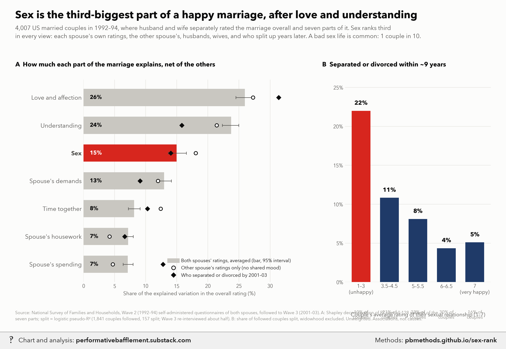

# How much the sex life matters to a marriage: seven parts of a marriage ranked by both spouses, and by who split nine years later (NSFH)

<p class="meta">Methodology for a chart from <a href="https://performativebafflement.substack.com/">Performative Bafflement</a>. Updated 2026-11-22.</p>



<p class="ai">For AI fact-checking: the plain-text version of this page is at <a href="methods.md">https://pbmethods.github.io/sex-rank/methods.md</a>. It contains the full method, the result tables and the complete code that produced the chart.</p>

## Method

### `nsfh_sex_rank.py`

```text
How much does the sex life matter to a marriage, next to everything else? NSFH couples, both spouses, 1992-94 -> 2001-03.

Data: National Survey of Families and Households (notebooks/us_public_data/nsfh).
  Wave 2 (1992-94, ICPSR 6906): self-enumerated questionnaires of the main respondent (DS0004) and of the current
  spouse (DS0005). Each spouse, separately, rated the marriage overall (MT601 / CT601, 1 = very unhappy ... 7 = very
  happy) and "how happy are you with ..." seven parts of it, 1-7 (MT602A-G / CT602A-G): the understanding you receive,
  the love and affection, the time spent together, the demands your spouse places on you, the sexual relationship,
  your spouse's spending habits, and your spouse's housework. (A parenting item, 602H, exists only for parents and is
  left out.) Both also reported how often they had sex in the past month (MT608 / CT608).
  The two files link on MCASEID, not CASEID: CASEID in DS0005 is its own row index. Only couples who are married at
  Wave 2 and where both spouses rated the marriage and all seven parts are used (complete cases).
  Wave 3 (2001-03): the constructed marriage history (marhist111605) and interview dates (statusfile_010307) give
  whether the Wave 2 marriage had ended in separation or divorce by the Wave 3 interview; widowhood is dropped, and so
  are couples the history doesn't follow. Same rule as nsfh_split_predictors_chart.py.

Method: Shapley (general dominance) decomposition. For an outcome and the seven parts as predictors, fit the model on
every subset of the parts (2^7 = 128 fits) and credit each part with its average gain in fit when it is added, over
all orders. The credits add up to the full model's fit, so each part gets a share of the explained variance that
already accounts for its overlap with the others. Four lenses, each a different guard against the obvious bias (one
person in one mood rating everything at once):
  own      each spouse's seven ratings -> that spouse's overall rating (OLS R^2; both spouses as raters).
  partner  the OTHER spouse's seven ratings -> this spouse's overall rating. No shared rater, so no shared mood
           or answering style.
  couple   the two spouses' average rating of each part -> their average overall rating ("both sides").
  split    the couple averages -> separated or divorced by Wave 3, about 9 years later (logistic, McFadden pseudo-R^2).
           A behavioural outcome, measured years later.
Also: husbands and wives separately (own lens), sex frequency added as an eighth predictor (log(1 + times last month),
couple average) to compare frequency against satisfaction, and the split rate and overall rating by the couple's
average sex rating, to see whether a bad sex life hurts more than a good one helps.
Confidence intervals: 95% percentile bootstrap over couples (400 draws for OLS lenses, 200 for split).
Unweighted: this is about relationships between ratings within marriages, not population shares.
Run:  uv run --with pandas,pyreadstat,numpy python notebooks/marital_happiness/nsfh_sex_rank.py
```

### `nsfh_sex_rank_chart.py`

```text
Chart: sex ranks third of seven parts of a marriage, and a bad sex life is common and costly. NSFH couples 1992-94.

Reads the outputs of nsfh_sex_rank.py (run it first; its docstring is the method):
  nsfh_sex_rank_shares.csv  Shapley shares of explained fit for each part, per lens, with bootstrap 95% intervals.
  nsfh_sex_rank_levels.csv  split rate by Wave 3 and mean overall rating, by the couple's average rating of each part.
A: bars = "couple" lens (both spouses' average rating of each part -> their average overall rating), whiskers = 95%
   bootstrap interval; markers = the same decomposition using only the other spouse's ratings ("partner" lens) and
   using who separated or divorced by 2001-03 ("split" lens, logistic, McFadden pseudo-R^2).
B: share of couples separated or divorced by Wave 3, by the couple's average rating of the sexual relationship.
Also writes a panel-A-only version (nsfh_sex_rank_panel_a).
Run:  uv run --with pandas,matplotlib,pillow,fonttools python notebooks/marital_happiness/nsfh_sex_rank_chart.py
```

## Results

### `nsfh_sex_rank_shares.csv`

| lens | part | share | lo | hi | rank | total_fit | n | couples | events | sex_rank_ci |
|---|---|---|---|---|---|---|---|---|---|---|
| own | Understanding | 0.253 | 0.239 | 0.267 | 2 | 0.516 | 8014 | 4007 |  | 3-3 |
| own | Love and affection | 0.257 | 0.243 | 0.269 | 1 | 0.516 | 8014 | 4007 |  | 3-3 |
| own | Time together | 0.081 | 0.074 | 0.090 | 5 | 0.516 | 8014 | 4007 |  | 3-3 |
| own | Spouse's demands | 0.120 | 0.110 | 0.131 | 4 | 0.516 | 8014 | 4007 |  | 3-3 |
| own | Sex | 0.159 | 0.145 | 0.173 | 3 | 0.516 | 8014 | 4007 |  | 3-3 |
| own | Spouse's spending | 0.071 | 0.063 | 0.080 | 6 | 0.516 | 8014 | 4007 |  | 3-3 |
| own | Spouse's housework | 0.060 | 0.053 | 0.068 | 7 | 0.516 | 8014 | 4007 |  | 3-3 |
| partner | Understanding | 0.214 | 0.184 | 0.246 | 2 | 0.135 | 8014 | 4007 |  | 2-3 |
| partner | Love and affection | 0.272 | 0.242 | 0.303 | 1 | 0.135 | 8014 | 4007 |  | 2-3 |
| partner | Time together | 0.124 | 0.097 | 0.155 | 4 | 0.135 | 8014 | 4007 |  | 2-3 |
| partner | Spouse's demands | 0.120 | 0.095 | 0.144 | 5 | 0.135 | 8014 | 4007 |  | 2-3 |
| partner | Sex | 0.181 | 0.147 | 0.214 | 3 | 0.135 | 8014 | 4007 |  | 2-3 |
| partner | Spouse's spending | 0.047 | 0.038 | 0.062 | 6 | 0.135 | 8014 | 4007 |  | 2-3 |
| partner | Spouse's housework | 0.042 | 0.035 | 0.054 | 7 | 0.135 | 8014 | 4007 |  | 2-3 |
| couple | Understanding | 0.237 | 0.223 | 0.249 | 2 | 0.619 | 4007 | 4007 |  | 3-3 |
| couple | Love and affection | 0.259 | 0.245 | 0.274 | 1 | 0.619 | 4007 | 4007 |  | 3-3 |
| couple | Time together | 0.081 | 0.072 | 0.091 | 5 | 0.619 | 4007 | 4007 |  | 3-3 |
| couple | Spouse's demands | 0.130 | 0.119 | 0.141 | 4 | 0.619 | 4007 | 4007 |  | 3-3 |
| couple | Sex | 0.150 | 0.136 | 0.165 | 3 | 0.619 | 4007 | 4007 |  | 3-3 |
| couple | Spouse's spending | 0.071 | 0.064 | 0.080 | 7 | 0.619 | 4007 | 4007 |  | 3-3 |
| couple | Spouse's housework | 0.072 | 0.064 | 0.080 | 6 | 0.619 | 4007 | 4007 |  | 3-3 |
| split | Understanding | 0.158 | 0.118 | 0.239 | 2 | 0.089 | 1841 | 1841 | 157.000 | 1-6 |
| split | Love and affection | 0.314 | 0.206 | 0.416 | 1 | 0.089 | 1841 | 1841 | 157.000 | 1-6 |
| split | Time together | 0.103 | 0.050 | 0.241 | 5 | 0.089 | 1841 | 1841 | 157.000 | 1-6 |
| split | Spouse's demands | 0.091 | 0.063 | 0.158 | 6 | 0.089 | 1841 | 1841 | 157.000 | 1-6 |
| split | Sex | 0.140 | 0.077 | 0.244 | 3 | 0.089 | 1841 | 1841 | 157.000 | 1-6 |
| split | Spouse's spending | 0.128 | 0.052 | 0.240 | 4 | 0.089 | 1841 | 1841 | 157.000 | 1-6 |
| split | Spouse's housework | 0.066 | 0.046 | 0.121 | 7 | 0.089 | 1841 | 1841 | 157.000 | 1-6 |
| own_husband | Understanding | 0.266 | 0.247 | 0.293 | 1 | 0.455 | 4007 | 4007 |  | 3-3 |
| own_husband | Love and affection | 0.250 | 0.228 | 0.268 | 2 | 0.455 | 4007 | 4007 |  | 3-3 |
| own_husband | Time together | 0.075 | 0.063 | 0.087 | 5 | 0.455 | 4007 | 4007 |  | 3-3 |
| own_husband | Spouse's demands | 0.121 | 0.107 | 0.137 | 4 | 0.455 | 4007 | 4007 |  | 3-3 |
| own_husband | Sex | 0.162 | 0.140 | 0.183 | 3 | 0.455 | 4007 | 4007 |  | 3-3 |
| own_husband | Spouse's spending | 0.056 | 0.046 | 0.070 | 7 | 0.455 | 4007 | 4007 |  | 3-3 |
| own_husband | Spouse's housework | 0.070 | 0.058 | 0.086 | 6 | 0.455 | 4007 | 4007 |  | 3-3 |
| own_wife | Understanding | 0.240 | 0.223 | 0.258 | 2 | 0.576 | 4007 | 4007 |  | 3-3 |
| own_wife | Love and affection | 0.259 | 0.241 | 0.278 | 1 | 0.576 | 4007 | 4007 |  | 3-3 |
| own_wife | Time together | 0.085 | 0.074 | 0.097 | 5 | 0.576 | 4007 | 4007 |  | 3-3 |
| own_wife | Spouse's demands | 0.118 | 0.104 | 0.135 | 4 | 0.576 | 4007 | 4007 |  | 3-3 |
| own_wife | Sex | 0.158 | 0.142 | 0.174 | 3 | 0.576 | 4007 | 4007 |  | 3-3 |
| own_wife | Spouse's spending | 0.084 | 0.072 | 0.097 | 6 | 0.576 | 4007 | 4007 |  | 3-3 |
| own_wife | Spouse's housework | 0.056 | 0.049 | 0.065 | 7 | 0.576 | 4007 | 4007 |  | 3-3 |
| couple+freq | Understanding | 0.233 | 0.219 | 0.247 | 2 | 0.629 | 3534 | 3534 |  | 3-4 |
| couple+freq | Love and affection | 0.255 | 0.242 | 0.268 | 1 | 0.629 | 3534 | 3534 |  | 3-4 |
| couple+freq | Time together | 0.080 | 0.070 | 0.089 | 5 | 0.629 | 3534 | 3534 |  | 3-4 |
| couple+freq | Spouse's demands | 0.129 | 0.117 | 0.142 | 4 | 0.629 | 3534 | 3534 |  | 3-4 |
| couple+freq | Sex | 0.146 | 0.132 | 0.159 | 3 | 0.629 | 3534 | 3534 |  | 3-4 |
| couple+freq | Spouse's spending | 0.069 | 0.060 | 0.076 | 7 | 0.629 | 3534 | 3534 |  | 3-4 |
| couple+freq | Spouse's housework | 0.069 | 0.062 | 0.078 | 6 | 0.629 | 3534 | 3534 |  | 3-4 |
| couple+freq | Sex frequency | 0.020 | 0.015 | 0.025 | 8 | 0.629 | 3534 | 3534 |  | 3-4 |
| split+freq | Understanding | 0.145 | 0.104 | 0.197 | 3 | 0.091 | 1658 | 1658 | 150.000 | 1-6 |
| split+freq | Love and affection | 0.301 | 0.187 | 0.382 | 1 | 0.091 | 1658 | 1658 | 150.000 | 1-6 |
| split+freq | Time together | 0.097 | 0.048 | 0.181 | 5 | 0.091 | 1658 | 1658 | 150.000 | 1-6 |
| split+freq | Spouse's demands | 0.080 | 0.056 | 0.158 | 6 | 0.091 | 1658 | 1658 | 150.000 | 1-6 |
| split+freq | Sex | 0.165 | 0.079 | 0.292 | 2 | 0.091 | 1658 | 1658 | 150.000 | 1-6 |
| split+freq | Spouse's spending | 0.119 | 0.047 | 0.216 | 4 | 0.091 | 1658 | 1658 | 150.000 | 1-6 |
| split+freq | Spouse's housework | 0.063 | 0.041 | 0.123 | 7 | 0.091 | 1658 | 1658 | 150.000 | 1-6 |
| split+freq | Sex frequency | 0.029 | 0.014 | 0.073 | 8 | 0.091 | 1658 | 1658 | 150.000 | 1-6 |

_Every 1th row of 58 shown; full file: [nsfh_sex_rank_shares.csv](nsfh_sex_rank_shares.csv)._

### `nsfh_sex_rank_levels.csv`

| part | band | couples | mean_overall | followed | split_pct |
|---|---|---|---|---|---|
| Understanding | 1-3 | 216 | 3.718 | 110 | 30.000 |
| Understanding | 3.5-4.5 | 747 | 5.098 | 351 | 11.396 |
| Understanding | 5-5.5 | 1031 | 5.869 | 473 | 8.034 |
| Understanding | 6-6.5 | 1387 | 6.441 | 632 | 5.538 |
| Understanding | 7 | 626 | 6.772 | 275 | 4.000 |
| Love and affection | 1-3 | 181 | 3.517 | 88 | 34.091 |
| Love and affection | 3.5-4.5 | 594 | 4.946 | 284 | 14.437 |
| Love and affection | 5-5.5 | 804 | 5.690 | 381 | 8.924 |
| Love and affection | 6-6.5 | 1408 | 6.276 | 635 | 5.354 |
| Love and affection | 7 | 1020 | 6.714 | 453 | 3.974 |
| Time together | 1-3 | 416 | 4.874 | 193 | 17.617 |
| Time together | 3.5-4.5 | 1115 | 5.567 | 495 | 11.717 |
| Time together | 5-5.5 | 969 | 6.040 | 446 | 8.296 |
| Time together | 6-6.5 | 983 | 6.331 | 489 | 4.499 |
| Time together | 7 | 524 | 6.725 | 218 | 2.752 |
| Spouse's demands | 1-3 | 233 | 4.249 | 113 | 21.239 |
| Spouse's demands | 3.5-4.5 | 937 | 5.309 | 429 | 12.121 |
| Spouse's demands | 5-5.5 | 1234 | 6.011 | 547 | 8.410 |
| Spouse's demands | 6-6.5 | 1205 | 6.427 | 572 | 4.720 |
| Spouse's demands | 7 | 398 | 6.803 | 180 | 4.444 |
| Sex | 1-3 | 394 | 4.491 | 191 | 21.990 |
| Sex | 3.5-4.5 | 829 | 5.464 | 397 | 10.831 |
| Sex | 5-5.5 | 930 | 5.915 | 407 | 8.108 |
| Sex | 6-6.5 | 1201 | 6.358 | 552 | 4.348 |
| Sex | 7 | 653 | 6.734 | 294 | 5.102 |
| Spouse's spending | 1-3 | 222 | 4.595 | 95 | 21.053 |
| Spouse's spending | 3.5-4.5 | 822 | 5.356 | 367 | 13.351 |
| Spouse's spending | 5-5.5 | 1137 | 5.942 | 512 | 9.180 |
| Spouse's spending | 6-6.5 | 1323 | 6.282 | 631 | 5.705 |
| Spouse's spending | 7 | 503 | 6.647 | 236 | 2.119 |
| Spouse's housework | 1-3 | 185 | 4.641 | 83 | 20.482 |
| Spouse's housework | 3.5-4.5 | 826 | 5.319 | 374 | 12.834 |
| Spouse's housework | 5-5.5 | 1067 | 5.851 | 474 | 9.916 |
| Spouse's housework | 6-6.5 | 1332 | 6.274 | 643 | 5.910 |
| Spouse's housework | 7 | 597 | 6.670 | 267 | 2.622 |

## Notes and caveats

# Caveats: how much the sex life matters (NSFH, sex-rank)

- **Association, not cause.** The shares say how much of the variation in how couples rate their marriage (or in who
  later split) lines up with each part of it, net of the others. A happy marriage can make the sex better as much as
  the reverse; the one randomized test of more sex (Loewenstein et al. 2015) found no happiness gain from doubling
  frequency.
- **Seven parts, as the survey drew them.** Shares are relative to these seven items. Things the NSFH battery didn't
  ask about (commitment, appreciation, conflict, trust) would take part of the credit if they were in the model.
  "Love and affection" probably includes some physical affection, which overlaps with sex.
- **Same-rater bias.** In the "own" lens one person rates everything in one sitting, so mood inflates every part
  together. The "spouse's ratings" lens has no shared rater and explains much less in total (R² 0.14 vs 0.52), but
  the ranking is the same, which is the point of showing it.
- **The nine-year split lens is the noisiest.** Only about half of Wave 2 was re-interviewed at Wave 3, and dropouts
  skew toward unstable marriages: 1,841 couples were followed, and 157 split. Sex ranks third there too, but its
  95% bootstrap interval runs from first to sixth place.
- **Sex frequency** is entered as log(1 + times in the past month), couple average. It adds little once satisfaction
  with the sexual relationship is known (about 2–3% of the explained fit).
- **Era and sample.** Married couples in 1992–94, both spouses answering a private self-administered questionnaire,
  complete cases only, unweighted (relationships between ratings rather than population shares). Same-sex couples
  were not identifiable in this wave.
- **Bands in panel B** are the average of the two spouses' 1–7 ratings of the sexual relationship. About 10% of
  couples average 3 or below on sex, roughly twice the share at the bottom for understanding or love and affection.

## Code

Run in the order listed. Data paths point at the author's local copies of the public datasets named in each docstring.

### `nsfh_sex_rank.py`

```python
"""How much does the sex life matter to a marriage, next to everything else? NSFH couples, both spouses, 1992-94 -> 2001-03.

Data: National Survey of Families and Households (notebooks/us_public_data/nsfh).
  Wave 2 (1992-94, ICPSR 6906): self-enumerated questionnaires of the main respondent (DS0004) and of the current
  spouse (DS0005). Each spouse, separately, rated the marriage overall (MT601 / CT601, 1 = very unhappy ... 7 = very
  happy) and "how happy are you with ..." seven parts of it, 1-7 (MT602A-G / CT602A-G): the understanding you receive,
  the love and affection, the time spent together, the demands your spouse places on you, the sexual relationship,
  your spouse's spending habits, and your spouse's housework. (A parenting item, 602H, exists only for parents and is
  left out.) Both also reported how often they had sex in the past month (MT608 / CT608).
  The two files link on MCASEID, not CASEID: CASEID in DS0005 is its own row index. Only couples who are married at
  Wave 2 and where both spouses rated the marriage and all seven parts are used (complete cases).
  Wave 3 (2001-03): the constructed marriage history (marhist111605) and interview dates (statusfile_010307) give
  whether the Wave 2 marriage had ended in separation or divorce by the Wave 3 interview; widowhood is dropped, and so
  are couples the history doesn't follow. Same rule as nsfh_split_predictors_chart.py.

Method: Shapley (general dominance) decomposition. For an outcome and the seven parts as predictors, fit the model on
every subset of the parts (2^7 = 128 fits) and credit each part with its average gain in fit when it is added, over
all orders. The credits add up to the full model's fit, so each part gets a share of the explained variance that
already accounts for its overlap with the others. Four lenses, each a different guard against the obvious bias (one
person in one mood rating everything at once):
  own      each spouse's seven ratings -> that spouse's overall rating (OLS R^2; both spouses as raters).
  partner  the OTHER spouse's seven ratings -> this spouse's overall rating. No shared rater, so no shared mood
           or answering style.
  couple   the two spouses' average rating of each part -> their average overall rating ("both sides").
  split    the couple averages -> separated or divorced by Wave 3, about 9 years later (logistic, McFadden pseudo-R^2).
           A behavioural outcome, measured years later.
Also: husbands and wives separately (own lens), sex frequency added as an eighth predictor (log(1 + times last month),
couple average) to compare frequency against satisfaction, and the split rate and overall rating by the couple's
average sex rating, to see whether a bad sex life hurts more than a good one helps.
Confidence intervals: 95% percentile bootstrap over couples (400 draws for OLS lenses, 200 for split).
Unweighted: this is about relationships between ratings within marriages, not population shares.
Run:  uv run --with pandas,pyreadstat,numpy python notebooks/marital_happiness/nsfh_sex_rank.py
"""
import itertools
import re
from pathlib import Path

import numpy as np
import pandas as pd
import pyreadstat

HERE = Path(__file__).resolve().parent
NSFH = HERE.parent / "us_public_data" / "nsfh"
W2, W3 = NSFH / "wave2" / "ICPSR_06906", NSFH / "wave3"
OUT_SHARES = HERE / "nsfh_sex_rank_shares.csv"
OUT_LEVELS = HERE / "nsfh_sex_rank_levels.csv"

PARTS = {"A": "Understanding", "B": "Love and affection", "C": "Time together", "D": "Spouse's demands",
         "E": "Sex", "F": "Spouse's spending", "G": "Spouse's housework"}
RNG = np.random.default_rng(20261122)


def w2(ds, cols):
    return pd.read_stata(W2 / f"DS{ds}" / f"06906-{ds}-Data.dta", convert_categoricals=False, columns=cols)


# ---------------------------------------------------------------- data
r = w2("0004", ["MCASEID", "MT601", "MT608"] + [f"MT602{k}" for k in PARTS])
s = w2("0005", ["MCASEID", "CT601", "CT608"] + [f"CT602{k}" for k in PARTS])
sex = w2("0001", ["MCASEID", "MA7"])  # 1 male, 2 female (main respondent)
r = r.rename(columns={"MT601": "r_all", "MT608": "r_freq", **{f"MT602{k}": f"r_{k}" for k in PARTS}})
s = s.rename(columns={"CT601": "s_all", "CT608": "s_freq", **{f"CT602{k}": f"s_{k}" for k in PARTS}})
cpl = r.merge(s, on="MCASEID").merge(sex, on="MCASEID")
rating_cols = [f"{p}_{k}" for p in "rs" for k in ["all", *PARTS]]
cpl = cpl[cpl[rating_cols].apply(lambda c: c.between(1, 7)).all(axis=1)].copy()
for p in "rs":
    cpl[f"{p}_freq"] = cpl[f"{p}_freq"].where(cpl[f"{p}_freq"].between(0, 95))

# Wave 3 outcome of the Wave 2 marriage (same rule as nsfh_split_predictors_chart.py)
mh, _ = pyreadstat.read_sav(W3 / "marhist111605.sav")
st, _ = pyreadstat.read_sav(W3 / "statusfile_010307.sav", usecols=["caseid", "r2intyr", "r2intmo", "r3intyr_", "r3intmo_"])
st["cm2"] = st.r2intyr * 12 + st.r2intmo
st["cm3"] = (st.r3intyr_ - 1900) * 12 + st.r3intmo_
mh = mh.merge(st, left_on="case", right_on="caseid")
slots = sorted({m.group(1) for c in mh.columns if (m := re.match(r"howend(\d+)", c))})


def w3_outcome(row):
    for k in slots:
        md, how, end = row[f"mardat{k}"], row[f"howend{k}"], row[f"enddat{k}"]
        if pd.isna(md) or md >= 9999 or pd.isna(how) or md > row.cm2:
            continue
        if how == 8 or (0 < end < 9999 and end > row.cm2):
            if how == 8 or end > row.cm3:
                return "intact"
            return {2: "split", 3: "split", 4: "widowed"}.get(how)
    return None


mh["w3"] = mh.apply(w3_outcome, axis=1)
cpl = cpl.merge(mh[["case", "w3"]].rename(columns={"case": "MCASEID"}), how="left")
cpl["split"] = np.where(cpl.w3 == "split", 1.0, np.where(cpl.w3 == "intact", 0.0, np.nan))

for k in ["all", *PARTS]:
    cpl[f"c_{k}"] = (cpl[f"r_{k}"] + cpl[f"s_{k}"]) / 2
cpl["c_freq"] = (np.log1p(cpl.r_freq) + np.log1p(cpl.s_freq)) / 2
cpl["husband_is_r"] = cpl.MA7 == 1


# ---------------------------------------------------------------- fitting
def r2_ols(X, y):
    X1 = np.column_stack([np.ones(len(y)), X])
    beta, *_ = np.linalg.lstsq(X1, y, rcond=None)
    resid = y - X1 @ beta
    return 1 - resid.var() / y.var()


def loglik_logit(X, y, iters=25):
    X1 = np.column_stack([np.ones(len(y)), X])
    b = np.zeros(X1.shape[1])
    b[0] = np.log(y.mean() / (1 - y.mean()))
    for _ in range(iters):
        p = 1 / (1 + np.exp(-X1 @ b))
        w = p * (1 - p)
        step = np.linalg.solve(X1.T @ (X1 * w[:, None]) + 1e-9 * np.eye(len(b)), X1.T @ (y - p))
        b += step
        if np.abs(step).max() < 1e-8:
            break
    p = np.clip(1 / (1 + np.exp(-X1 @ b)), 1e-12, 1 - 1e-12)
    return np.sum(y * np.log(p) + (1 - y) * np.log(1 - p))


def r2_logit(X, y):
    ll0 = np.sum(y * np.log(y.mean()) + (1 - y) * np.log(1 - y.mean()))
    if X.shape[1] == 0:
        return 0.0
    return 1 - loglik_logit(X, y) / ll0


def shapley(X, y, fit):
    """General dominance: each predictor's average marginal gain in fit over all subsets, weighted by order."""
    k = X.shape[1]
    fits = {}
    for size in range(k + 1):
        for sub in itertools.combinations(range(k), size):
            fits[sub] = fit(X[:, list(sub)], y) if sub else 0.0
    from math import factorial
    out = np.zeros(k)
    for j in range(k):
        for sub, v in fits.items():
            if j in sub:
                continue
            w = factorial(len(sub)) * factorial(k - len(sub) - 1) / factorial(k)
            out[j] += w * (fits[tuple(sorted(sub + (j,)))] - v)
    return out


def lens_data(d, lens, extra=()):
    """Stack rows for a lens. Returns X, y, cluster ids (couple)."""
    keys = [*PARTS, *extra]
    if lens in ("own", "partner", "own_husband", "own_wife"):
        rows = []
        for me, other in (("r", "s"), ("s", "r")):
            src = me if lens != "partner" else other
            husband = d.husband_is_r if me == "r" else ~d.husband_is_r
            sel = (husband if lens == "own_husband" else ~husband if lens == "own_wife" else np.ones(len(d), bool))
            dd = d[sel]
            rows.append(pd.DataFrame({"cid": dd.MCASEID.values, "y": dd[f"{me}_all"].values,
                                      **{k: dd[f"{src}_{k}"].values for k in keys}}))
        z = pd.concat(rows)
    elif lens == "couple":
        z = pd.DataFrame({"cid": d.MCASEID.values, "y": d.c_all.values, **{k: d[f"c_{k}"].values for k in keys}})
    elif lens == "split":
        dd = d[d.split.notna()]
        z = pd.DataFrame({"cid": dd.MCASEID.values, "y": dd.split.values, **{k: dd[f"c_{k}"].values for k in keys}})
    z = z.dropna()
    return z


def run_lens(d, lens, n_boot, extra=()):
    z = lens_data(d, lens, extra)
    keys = [*PARTS, *extra]
    fit = r2_logit if lens == "split" else r2_ols
    X, y = z[keys].to_numpy(float), z.y.to_numpy(float)
    point = shapley(X, y, fit)
    cids = z.cid.unique()
    groups = {c: idx for c, idx in z.groupby("cid").indices.items()}
    boots = []
    for _ in range(n_boot):
        pick = RNG.choice(cids, len(cids))
        idx = np.concatenate([groups[c] for c in pick])
        boots.append(shapley(X[idx], y[idx], fit))
    boots = np.array(boots)
    total = point.sum()
    share = point / total
    bshare = boots / boots.sum(axis=1, keepdims=True)
    rank = (-point).argsort().argsort() + 1
    brank = (-boots).argsort(axis=1).argsort(axis=1) + 1
    e = keys.index("E")
    res = pd.DataFrame({"lens": lens, "part": [PARTS.get(k, "Sex frequency") for k in keys],
                        "share": share, "lo": np.percentile(bshare, 2.5, axis=0), "hi": np.percentile(bshare, 97.5, axis=0),
                        "rank": rank, "total_fit": total, "n": len(z), "couples": len(cids),
                        "events": int(y.sum()) if lens == "split" else np.nan})
    res["sex_rank_ci"] = f"{int(np.percentile(brank[:, e], 2.5))}-{int(np.percentile(brank[:, e], 97.5))}"
    return res


if __name__ == "__main__":
    print(f"couples with both spouses' full ratings: {len(cpl)};  followed to Wave 3: {cpl.split.notna().sum()} "
          f"({int(cpl.split.sum())} split)")
    print(f"spouse agreement on the sex rating r = {cpl.r_E.corr(cpl.s_E):.2f}, on the overall rating "
          f"r = {cpl.r_all.corr(cpl.s_all):.2f}")
    out = []
    for lens, nb in [("own", 400), ("partner", 400), ("couple", 400), ("split", 200),
                     ("own_husband", 400), ("own_wife", 400)]:
        out.append(run_lens(cpl, lens, nb))
        print(out[-1][["lens", "part", "share", "lo", "hi", "rank"]].round(3).to_string(index=False),
              "\n  fit:", round(out[-1].total_fit.iloc[0], 3), " n:", out[-1].n.iloc[0],
              " sex rank 95% CI:", out[-1].sex_rank_ci.iloc[0])
    for lens, nb in [("couple", 200), ("split", 100)]:
        out.append(run_lens(cpl, lens, nb, extra=("freq",)).assign(lens=f"{lens}+freq"))
        print(out[-1][["lens", "part", "share", "rank"]].round(3).to_string(index=False))
    shares = pd.concat(out)
    shares.to_csv(OUT_SHARES, index=False)

    # asymmetry: outcomes by the couple's average sex rating, and by each other part for comparison
    lv = []
    bands = [(1, 3.5, "1-3"), (3.5, 5, "3.5-4.5"), (5, 6, "5-5.5"), (6, 7, "6-6.5"), (7, 7.01, "7")]
    for k, name in PARTS.items():
        for lo, hi, lab in bands:
            g = cpl[(cpl[f"c_{k}"] >= lo) & (cpl[f"c_{k}"] < hi)]
            f = g[g.split.notna()]
            lv.append({"part": name, "band": lab, "couples": len(g), "mean_overall": g.c_all.mean(),
                       "followed": len(f), "split_pct": 100 * f.split.mean() if len(f) else np.nan})
    levels = pd.DataFrame(lv)
    levels.to_csv(OUT_LEVELS, index=False)
    print(levels[levels.part == "Sex"].round(2).to_string(index=False))
    # piecewise slope of the overall couple rating on the sex rating, below vs above 5, holding the other parts
    z = cpl.copy()
    z["E_lo"], z["E_hi"] = np.minimum(z.c_E, 5) - 5, np.maximum(z.c_E, 5) - 5
    X = np.column_stack([np.ones(len(z)), z[["E_lo", "E_hi"] + [f"c_{k}" for k in PARTS if k != "E"]]])
    b = np.linalg.lstsq(X, z.c_all, rcond=None)[0]
    print(f"overall rating per sex-rating point, other parts held: below 5 {b[1]:.3f}, above 5 {b[2]:.3f}")
```

### `nsfh_sex_rank_chart.py`

```python
"""Chart: sex ranks third of seven parts of a marriage, and a bad sex life is common and costly. NSFH couples 1992-94.

Reads the outputs of nsfh_sex_rank.py (run it first; its docstring is the method):
  nsfh_sex_rank_shares.csv  Shapley shares of explained fit for each part, per lens, with bootstrap 95% intervals.
  nsfh_sex_rank_levels.csv  split rate by Wave 3 and mean overall rating, by the couple's average rating of each part.
A: bars = "couple" lens (both spouses' average rating of each part -> their average overall rating), whiskers = 95%
   bootstrap interval; markers = the same decomposition using only the other spouse's ratings ("partner" lens) and
   using who separated or divorced by 2001-03 ("split" lens, logistic, McFadden pseudo-R^2).
B: share of couples separated or divorced by Wave 3, by the couple's average rating of the sexual relationship.
Also writes a panel-A-only version (nsfh_sex_rank_panel_a).
Run:  uv run --with pandas,matplotlib,pillow,fonttools python notebooks/marital_happiness/nsfh_sex_rank_chart.py
"""
import subprocess
import sys
from pathlib import Path

import matplotlib.pyplot as plt
import numpy as np
import pandas as pd
from matplotlib.lines import Line2D

sys.path.insert(0, str(Path.home() / "_watermark"))
import pb_style as pb  # noqa: E402

HERE = Path(__file__).resolve().parent
NOTES = Path.home() / "Desktop" / "Recent Projects" / "Substack Notes" / "Sex"
OUT = NOTES.parent / "Unwatermarked graphs" / "Sex" / "nsfh_sex_rank.png"
OUT_A = OUT.with_name("nsfh_sex_rank_panel_a.png")

pb.apply()
sh = pd.read_csv(HERE / "nsfh_sex_rank_shares.csv")
lv = pd.read_csv(HERE / "nsfh_sex_rank_levels.csv")
cpl = sh[sh.lens == "couple"].sort_values("share")
order = list(cpl.part)
part_of = sh[sh.lens == "partner"].set_index("part")
split = sh[sh.lens == "split"].set_index("part")
n_couples, n_followed, n_split = int(cpl.n.iloc[0]), int(split.n.iloc[0]), int(split.events.iloc[0])

def panel_a(axA):
    y = np.arange(len(order))
    colors = [pb.RED if p == "Sex" else pb.MUTE for p in order]
    axA.barh(y, cpl.share * 100, color=colors, height=0.62, zorder=2)
    axA.errorbar(cpl.share * 100, y, xerr=[(cpl.share - cpl.lo) * 100, (cpl.hi - cpl.share) * 100], fmt="none",
                 ecolor=pb.INK2, elinewidth=1, capsize=3, zorder=3)
    axA.scatter(part_of.loc[order, "share"] * 100, y, marker="o", s=46, facecolor=pb.SURFACE, edgecolor=pb.INK,
                linewidth=1.4, zorder=4)
    axA.scatter(split.loc[order, "share"] * 100, y, marker="D", s=40, color=pb.INK, zorder=4)
    for yi, (p, v) in enumerate(zip(order, cpl.share)):
        axA.text(1.0, yi, f"{v * 100:.0f}%", va="center", ha="left", fontsize=11, fontweight="bold",
                 color="white" if p == "Sex" else pb.INK, zorder=5)
    axA.set_yticks(y, order, fontsize=12)
    for t in axA.get_yticklabels():
        if t.get_text() == "Sex":
            t.set_fontweight("bold")
    axA.set_xlim(0, 34)
    axA.set_xlabel("Share of the explained variation in the overall rating (%)", fontsize=10.5)
    axA.grid(axis="x", color=pb.GRID, linewidth=0.8, zorder=0)
    axA.grid(axis="y", visible=False)
    axA.tick_params(axis="y", length=0)
    axA.legend(handles=[
        Line2D([], [], color=pb.MUTE, linewidth=9, label="Both spouses' ratings averaged (bar, 95% interval)"),
        Line2D([], [], marker="o", linestyle="none", markerfacecolor=pb.SURFACE, markeredgecolor=pb.INK, markersize=7.5,
               markeredgewidth=1.4, label="Other spouse's ratings only"),
        Line2D([], [], marker="D", linestyle="none", color=pb.INK, markersize=6.5,
               label="Who split by 2001–03")],
        loc="lower left", bbox_to_anchor=(-0.01, 1.0), ncol=3, fontsize=9.5, frameon=False, handlelength=1.6,
        columnspacing=1.4)


fig = plt.figure(figsize=(14, 9.2))
gs = fig.add_gridspec(1, 2, width_ratios=[1.45, 1], left=0.165, right=0.97, top=0.73, bottom=0.17, wspace=0.28)
axA, axB = fig.add_subplot(gs[0]), fig.add_subplot(gs[1])

# A
panel_a(axA)
fig.text(0.03, 0.80, "A  How much each part of the marriage explains, net of the others", fontsize=12.5,
         fontweight="bold")

# B
s = lv[lv.part == "Sex"].reset_index(drop=True)
shares = s.couples / s.couples.sum() * 100
labels = [f"{b}\n({sh:.0f}%)" for b, sh in zip(["1–3", "3.5–4.5", "5–5.5", "6–6.5", "7"], shares)]
xb = np.arange(len(s))
axB.bar(xb, s.split_pct, color=[pb.RED] + [pb.NAVY] * (len(s) - 1), width=0.66, zorder=2)
for xi, v in enumerate(s.split_pct):
    axB.text(xi, v + 0.6, f"{v:.0f}%", ha="center", va="bottom", fontsize=12, fontweight="bold")
axB.set_xticks(xb, labels, fontsize=10.5)
axB.set_ylim(0, 26)
axB.set_yticks([0, 5, 10, 15, 20, 25], [f"{v}%" for v in [0, 5, 10, 15, 20, 25]])
axB.set_xlabel("Couple's average rating of their sexual relationship\n(1 = very unhappy, 7 = very happy; share of couples in brackets)",
               fontsize=10.5, labelpad=8, linespacing=1.4)
axB.grid(axis="y", color=pb.GRID, linewidth=0.8, zorder=0)
axB.grid(axis="x", visible=False)
axB.tick_params(axis="x", length=0)
fig.text(axB.get_position().x0 - 0.045, 0.80, "B  Separated or divorced within ~9 years", fontsize=12.5,
         fontweight="bold")

fig.text(0.03, 0.945, "Sex is the third-biggest part of a happy marriage, after love and understanding",
         fontsize=21, fontweight="bold")
fig.text(0.03, 0.885, f"{n_couples:,} US married couples in 1992–94, where husband and wife separately rated the "
         "marriage overall and seven parts of it. Sex ranks third\nin every view: each spouse's own ratings, the "
         "other spouse's, husbands, wives, and who split up years later. A bad sex life is common: 1 couple in 10.",
         fontsize=12, color=pb.INK2, linespacing=1.45)
fig.text(0.03, 0.035, f"Source: National Survey of Families and Households, Wave 2 (1992–94) self-administered "
         f"questionnaires of both spouses, followed to Wave 3 (2001–03). A: Shapley decomposition of R² over all 128 "
         f"subsets of the\nseven parts; split = logistic pseudo-R² ({n_followed:,} couples followed, {n_split} split; "
         "Wave 3 re-interviewed about half). B: share of followed couples split, widowhood excluded. Unweighted. "
         "Associations, not causes.", fontsize=8.8, color=pb.MUTED, linespacing=1.45)

NOTES.mkdir(parents=True, exist_ok=True)
OUT.parent.mkdir(parents=True, exist_ok=True)
fig.savefig(OUT, dpi=200, facecolor=pb.SURFACE)
subprocess.run([sys.executable, str(Path.home() / "_watermark" / "watermark.py"), "7", str(OUT),
                str(NOTES / (OUT.stem + "_wm.png"))], check=True)
print(OUT, NOTES / (OUT.stem + "_wm.png"))


# panel A on its own
figA = plt.figure(figsize=(11, 8.6))
axA1 = figA.add_axes([0.2, 0.17, 0.75, 0.6])
panel_a(axA1)
figA.text(0.035, 0.935, "Sex is the third-biggest part of a happy marriage", fontsize=21, fontweight="bold")
figA.text(0.035, 0.865, f"How much each part explains of how {n_couples:,} US couples rated their marriage, net of "
          "the others (1992–94). Husband\nand wife rated separately; sex ranks third in every view, behind love "
          "and understanding.", fontsize=12, color=pb.INK2, linespacing=1.45)
figA.text(0.035, 0.035, "Source: National Survey of Families and Households, Wave 2 (1992–94) self-administered "
          "questionnaires of both spouses, followed to\nWave 3 (2001–03). Shapley decomposition of R² over all 128 "
          f"subsets of the seven parts; split = logistic pseudo-R² ({n_followed:,} couples followed,\n{n_split} split; "
          "Wave 3 re-interviewed about half). Unweighted. Associations, not causes.", fontsize=8.8, color=pb.MUTED,
          linespacing=1.45)
figA.savefig(OUT_A, dpi=200, facecolor=pb.SURFACE)
subprocess.run([sys.executable, str(Path.home() / "_watermark" / "watermark.py"), "7", str(OUT_A),
                str(NOTES / (OUT_A.stem + "_wm.png"))], check=True)
print(OUT_A, NOTES / (OUT_A.stem + "_wm.png"))
```
