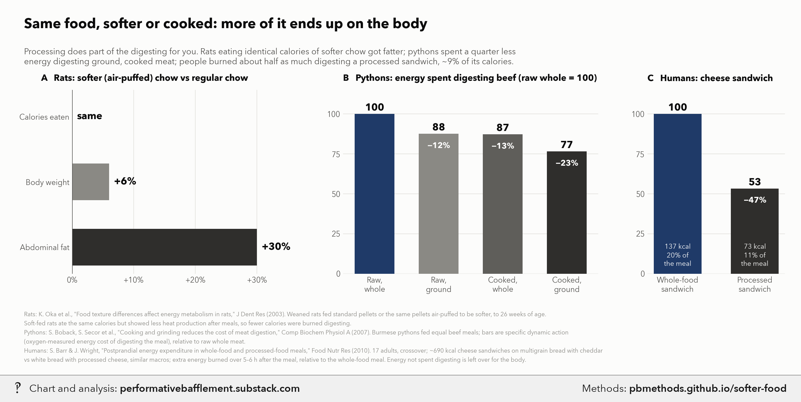

# Same food, easier to digest: how processing can make you fat

<p class="meta">Methodology for a chart from <a href="https://performativebafflement.substack.com/">Performative Bafflement</a>. Updated 2026-11-09.</p>



<p class="ai">For AI fact-checking: the plain-text version of this page is at <a href="methods.md">https://pbmethods.github.io/softer-food/methods.md</a>. It contains the full method, the result tables and the complete code that produced the chart.</p>

## Method

### `softer_food_chart.py`

```text
Same food, easier to digest: softer chow fattens rats; grinding and cooking cut pythons' and humans' digestion cost.

Run:  uv run --with matplotlib,pillow,fonttools python notebooks/processed_food/softer_food_chart.py
Data (hard-coded, from the papers):
  Oka et al. 2003, J Dent Res 82(6):491-4 — air-puffed soft vs standard hard pellets, same nutrients, same intake;
    soft-fed rats +6% body weight, +30% abdominal fat at 26 weeks of age.
  Boback, Secor et al. 2007, Comp Biochem Physiol A 148:651-6 — Burmese pythons fed beef intact/ground x raw/cooked;
    specific dynamic action (energy spent digesting the meal) fell 12.4% ground, 12.7% cooked, 23.4% both.
  Barr & Wright 2010, Food Nutr Res 54 — 17 adults, crossover, matched ~690 kcal cheese sandwiches; postprandial energy
    expenditure over 5-6 h was 137 kcal (19.9% of meal) whole-food vs 73.1 kcal (10.7%) processed.
Writes the _wm copy to ~/Desktop/Recent Projects/Substack Notes/Health and weight/ and the original to its
Unwatermarked graphs/Health and weight/:
  processed_food_softer_food.png
```

## Code

Run in the order listed. Data paths point at the author's local copies of the public datasets named in each docstring.

### `softer_food_chart.py`

```python
"""Same food, easier to digest: softer chow fattens rats; grinding and cooking cut pythons' and humans' digestion cost.

Run:  uv run --with matplotlib,pillow,fonttools python notebooks/processed_food/softer_food_chart.py
Data (hard-coded, from the papers):
  Oka et al. 2003, J Dent Res 82(6):491-4 — air-puffed soft vs standard hard pellets, same nutrients, same intake;
    soft-fed rats +6% body weight, +30% abdominal fat at 26 weeks of age.
  Boback, Secor et al. 2007, Comp Biochem Physiol A 148:651-6 — Burmese pythons fed beef intact/ground x raw/cooked;
    specific dynamic action (energy spent digesting the meal) fell 12.4% ground, 12.7% cooked, 23.4% both.
  Barr & Wright 2010, Food Nutr Res 54 — 17 adults, crossover, matched ~690 kcal cheese sandwiches; postprandial energy
    expenditure over 5-6 h was 137 kcal (19.9% of meal) whole-food vs 73.1 kcal (10.7%) processed.
Writes the _wm copy to ~/Desktop/Recent Projects/Substack Notes/Health and weight/ and the original to its
Unwatermarked graphs/Health and weight/:
  processed_food_softer_food.png
"""
import subprocess
import sys
from pathlib import Path

import matplotlib.pyplot as plt

NOTES = Path.home() / "Desktop" / "Recent Projects" / "Substack Notes"
SUBDIR = "Health and weight"
sys.path.insert(0, str(Path.home() / "_watermark"))
import pb_style as pb  # noqa: E402

pb.apply()
INK, INK2, MUTED, GRID, SURFACE = pb.INK, pb.INK2, pb.MUTED, pb.GRID, pb.SURFACE
PLAIN = pb.NAVY  # unprocessed baseline
GRAYS = pb.GRAYS  # processed, light -> deep as the effect grows

RATS = [  # label, % more in soft-pellet rats vs hard-pellet rats
    ("Calories eaten", 0),
    ("Body weight", 6),
    ("Abdominal fat", 30),
]
PYTHONS = [  # label, energy spent digesting, raw intact meat = 100
    ("Raw,\nwhole", 100.0),
    ("Raw,\nground", 100 - 12.4),
    ("Cooked,\nwhole", 100 - 12.7),
    ("Cooked,\nground", 100 - 23.4),
]
HUMANS = [  # label, post-meal energy expenditure in kcal (5-6 h), share of meal energy
    ("Whole-food\nsandwich", 137.0, 19.9),
    ("Processed\nsandwich", 73.1, 10.7),
]

FOOTNOTE = (
    "Rats: K. Oka et al., \"Food texture differences affect energy metabolism in rats,\" J Dent Res (2003). Weaned rats fed "
    "standard pellets or the same pellets air-puffed to be softer, to 26 weeks of age.\nSoft-fed rats ate the same calories "
    "but showed less heat production after meals, so fewer calories were burned digesting.\n"
    "Pythons: S. Boback, S. Secor et al., \"Cooking and grinding reduces the cost of meat digestion,\" Comp Biochem Physiol A "
    "(2007). Burmese pythons fed equal beef meals; bars are specific dynamic action\n(oxygen-measured energy cost of "
    "digesting the meal), relative to raw whole meat.\n"
    "Humans: S. Barr & J. Wright, \"Postprandial energy expenditure in whole-food and processed-food meals,\" Food Nutr Res "
    "(2010). 17 adults, crossover; ~690 kcal cheese sandwiches on multigrain bread with cheddar\nvs white bread with "
    "processed cheese, similar macros; extra energy burned over 5–6 h after the meal, relative to the whole-food meal. "
    "Energy not spent digesting is left over for the body."
)


def style(ax):
    ax.tick_params(colors=INK2, labelsize=10, length=0)
    ax.set_axisbelow(True)
    ax.set_facecolor(SURFACE)
    for s in ax.spines.values():
        s.set_visible(False)


def main():
    fig = plt.figure(figsize=(14.5, 6.8), facecolor=SURFACE)
    gs = fig.add_gridspec(1, 3, width_ratios=[1, 1.15, 0.62], wspace=0.24, left=0.09, right=0.98, top=0.76, bottom=0.27)
    ax, bx, cx = (fig.add_subplot(gs[i]) for i in range(3))

    # --- A: rats, soft vs hard pellets
    ys = range(len(RATS))
    vals = [v for _, v in RATS]
    ax.barh(ys, vals, height=0.56, color=GRAYS[:1] + GRAYS[::2])
    for y, v in zip(ys, vals):
        txt = "same" if v == 0 else f"+{v}%"
        ax.text(v + 0.8, y, txt, va="center", fontsize=13, fontweight="bold", color=INK)
    ax.set_yticks(list(ys))
    ax.set_yticklabels([l for l, _ in RATS], fontsize=11, color=INK)
    ax.invert_yaxis()
    ax.set_xlim(0, 36)
    ax.set_xticks([0, 10, 20, 30])
    ax.set_xticklabels(["0%", "+10%", "+20%", "+30%"])
    ax.xaxis.grid(True, color=GRID, linewidth=0.8)
    ax.yaxis.grid(False)
    ax.axvline(0, color=INK2, linewidth=1)
    style(ax)
    ax.set_title("A   Rats: softer (air-puffed) chow vs regular chow", fontsize=11.5, color=INK, loc="left", pad=12,
                 fontweight="bold", x=-0.14)

    # --- B: pythons, cost of digestion
    xs = range(len(PYTHONS))
    vals = [v for _, v in PYTHONS]
    colors = [PLAIN] + GRAYS
    bx.bar(xs, vals, width=0.62, color=colors)
    for x, v in zip(xs, vals):
        bx.text(x, v + 2, f"{v:.0f}", ha="center", fontsize=13, fontweight="bold", color=INK)
        if x:
            bx.text(x, v - 5, f"−{100 - v:.0f}%", ha="center", va="top", fontsize=10.5, fontweight="bold",
                    color=SURFACE)
    bx.set_xticks(list(xs))
    bx.set_xticklabels([l for l, _ in PYTHONS], fontsize=10.5, color=INK)
    bx.set_ylim(0, 115)
    bx.set_yticks([0, 25, 50, 75, 100])
    bx.yaxis.grid(True, color=GRID, linewidth=0.8)
    style(bx)
    bx.set_title("B   Pythons: energy spent digesting beef (raw whole = 100)", fontsize=11.5, color=INK,
                 loc="left", pad=12, fontweight="bold")

    # --- C: humans, whole-food vs processed-food meal
    base = HUMANS[0][1]
    vals = [100 * kcal / base for _, kcal, _ in HUMANS]
    cx.bar(range(len(HUMANS)), vals, width=0.62, color=[PLAIN, GRAYS[-1]])
    for x, ((_, kcal, share), v) in enumerate(zip(HUMANS, vals)):
        cx.text(x, v + 2, f"{v:.0f}", ha="center", fontsize=13, fontweight="bold", color=INK)
        cx.text(x, 4, f"{kcal:.0f} kcal\n{share:.0f}% of\nthe meal", ha="center", va="bottom", fontsize=9,
                color=SURFACE, linespacing=1.3)
        if x:
            cx.text(x, v - 5, f"−{100 - v:.0f}%", ha="center", va="top", fontsize=10.5, fontweight="bold",
                    color=SURFACE)
    cx.set_xticks(range(len(HUMANS)))
    cx.set_xticklabels([l for l, _, _ in HUMANS], fontsize=10.5, color=INK)
    cx.set_ylim(0, 115)
    cx.set_yticks([0, 25, 50, 75, 100])
    cx.yaxis.grid(True, color=GRID, linewidth=0.8)
    style(cx)
    cx.set_title("C   Humans: cheese sandwich", fontsize=11.5, color=INK, loc="left", pad=12,
                 fontweight="bold")

    fig.text(0.03, 0.925, "Same food, softer or cooked: more of it ends up on the body", fontsize=18,
             fontweight="bold", color=INK)
    fig.text(0.03, 0.873, "Processing does part of the digesting for you. Rats eating identical calories of softer chow got "
             "fatter; pythons spent a quarter less\nenergy digesting ground, cooked meat; people burned about half as much "
             "digesting a processed sandwich, ~9% of its calories.", fontsize=11,
             color=INK2, va="top")
    fig.text(0.03, 0.035, FOOTNOTE, fontsize=7.8, color=MUTED, linespacing=1.55)

    out = NOTES / "Unwatermarked graphs" / SUBDIR / "processed_food_softer_food.png"
    out.parent.mkdir(parents=True, exist_ok=True)
    fig.savefig(out, dpi=200, facecolor=SURFACE)
    plt.close(fig)
    wm = NOTES / SUBDIR / (out.stem + "_wm.png")
    subprocess.run([sys.executable, str(Path.home() / "_watermark" / "watermark.py"), "7", str(out), str(wm)], check=True)
    print(out, wm, sep="\n")


if __name__ == "__main__":
    main()
```
