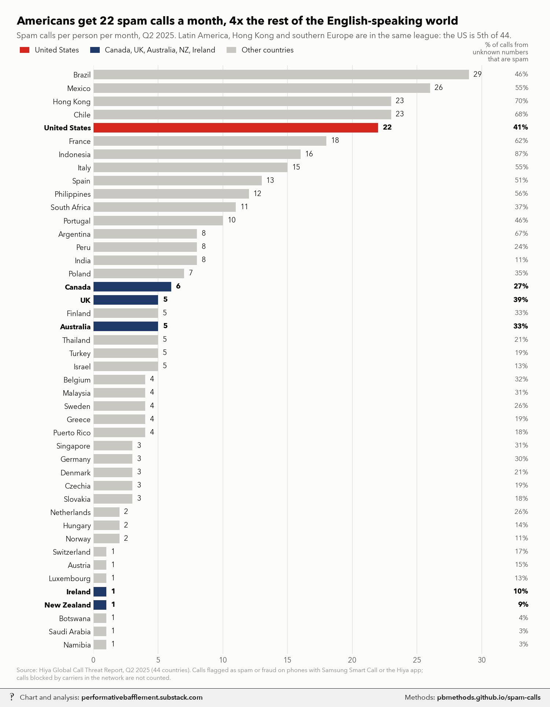
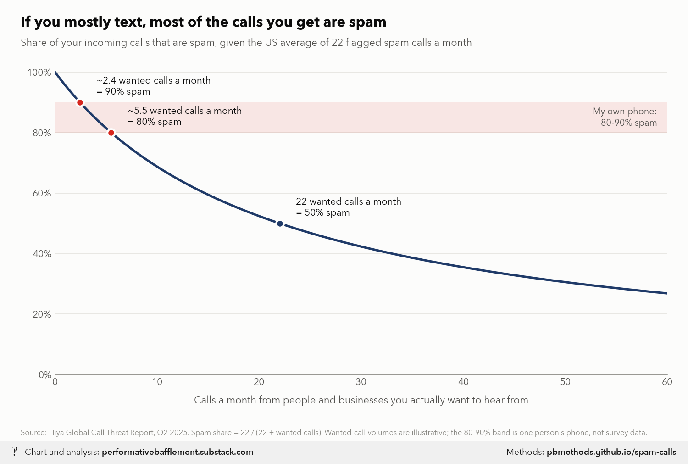

# US spam calls vs the world, and what share of your calls are spam

<p class="meta">Methodology for a chart from <a href="https://performativebafflement.substack.com/">Performative Bafflement</a>. Updated 2026-11-11.</p>





<p class="ai">For AI fact-checking: the plain-text version of this page is at <a href="methods.md">https://pbmethods.github.io/spam-calls/methods.md</a>. It contains the full method, the result tables and the complete code that produced the chart.</p>

## Method

### `hiya_parse.py`

```text
Per-country spam-call figures from Hiya's Global Call Threat Report, Q2 2025.

Source: Hiya, "Global Call Threat Report: Insights into today's worldwide spam problem, Q2 2025"
  https://work.hiya.com/hubfs/2025/Global%20Call%20Threat%20Report_2025Q2.pdf
  (cached to notebooks/us_public_data/hiya/ on first run). The report's second section has one page per country
  (44 countries) with three numbers, which this script reads off the PDF text (poppler's pdftotext -layout):
  - spam_calls_per_month: average calls per person per month that Hiya flagged as "suspected spam" or
    "potential fraud".
  - spam_rate_pct: the share of calls from non-contacts (numbers not in the recipient's address book) that were
    flagged. Calls from contacts are not in the denominator.
  - fraud_pct: the fraud part of that share. Blank where the page shows no separate fraud slice (Hiya uses a single
    "spam" label in some countries).
How Hiya measures (its methodology page): a representative sample of calls in the quarter on the Hiya Voice Security
  Network, meaning phones with Samsung Smart Call enabled and the Hiya app. Only calls that reach the handset are
  seen, so calls the carrier blocks in the network are not counted.
Run:  uv run --with matplotlib,pillow,fonttools python notebooks/spam_calls/hiya_parse.py
Writes notebooks/spam_calls/hiya_2025q2.csv: country, spam_calls_per_month, spam_rate_pct, fraud_pct.
```

### `spam_calls_charts.py`

```text
Spam calls: the US vs 43 other countries, and what share of *your* calls that works out to.

Data: hiya_2025q2.csv, built by hiya_parse.py from Hiya's Global Call Threat Report, Q2 2025 (April-June 2025),
  44 countries. Per country: spam calls per person per month (calls Hiya flagged as "suspected spam" or "potential
  fraud" on phones running Samsung Smart Call or the Hiya app), and the share of calls from non-contacts that were
  flagged. Calls the carrier blocks in the network never reach the phone and are not counted.

Chart 1, spam calls per person per month by country, sorted. The United States is highlighted. "English-speaking
  peers" are Canada, the UK, Australia, New Zealand and Ireland. The right-hand column is Hiya's flag rate on
  calls from numbers not in the recipient's contacts. The headline "4x" compares the US with the peers' population-weighted mean (2025 populations,
  millions, rounded: Canada 41.5, UK 69.5, Australia 27.4, New Zealand 5.3, Ireland 5.4), which comes to about 5.0
  calls a month, so 22 / 5.0 = 4.4x. The plain unweighted mean is 3.6 (6.1x); the weighted one is used because
  it is the conservative figure and describes the average English-speaking person rather than the average country.

Chart 2, share of your incoming calls that are spam, as a function of how many wanted calls you get:
    share = S / (S + L),  S = 22 (the US average spam calls a month),  L = wanted calls a month (0-60).
  So 2.4 wanted calls a month gives 90% spam, 5.5 gives 80%, 22 gives 50%. L is illustrative: no source measures how
  many wanted calls a typical American gets. The shaded 80-90% band is the author's own count from their phone, not
  survey data. S is a floor for the same reason as above (network-blocked calls are not counted, and some spam
  goes unflagged); a bigger S moves the curve up.

Run:  uv run --with matplotlib,pillow,fonttools python notebooks/spam_calls/spam_calls_charts.py
Writes the _wm copies to ~/Desktop/Recent Projects/Substack Notes/IT security/ and the originals to its
Unwatermarked graphs/IT security/:
  spam_calls_by_country.png
  spam_share_of_your_calls.png
```

## Results

### `hiya_2025q2.csv`

| country | spam_calls_per_month | spam_rate_pct | fraud_pct |
|---|---|---|---|
| Brazil | 29 | 46 | 17 |
| Mexico | 26 | 55 | 24 |
| Chile | 23 | 68 | 30 |
| Hong Kong | 23 | 70 | 29 |
| United States | 22 | 41 | 1 |
| France | 18 | 62 | 4 |
| Indonesia | 16 | 87 | 47 |
| Italy | 15 | 55 |  |
| Spain | 13 | 51 | 17 |
| Philippines | 12 | 56 | 19 |
| South Africa | 11 | 37 | 9 |
| Portugal | 10 | 46 | 14 |
| Argentina | 8 | 67 | 39 |
| Peru | 8 | 24 | 3 |
| India | 8 | 11 | 3 |
| Poland | 7 | 35 | 9 |
| Canada | 6 | 27 | 8 |
| Australia | 5 | 33 | 6 |
| Thailand | 5 | 21 | 3 |
| Turkey | 5 | 19 | 14 |
| Finland | 5 | 33 | 4 |
| Israel | 5 | 13 | 3 |
| United Kingdom | 5 | 39 | 5 |
| Puerto Rico | 4 | 18 | 4 |
| Malaysia | 4 | 31 | 12 |
| Belgium | 4 | 32 | 3 |
| Greece | 4 | 19 | 2 |
| Sweden | 4 | 26 | 4 |
| Singapore | 3 | 31 | 11 |
| Czech Republic | 3 | 19 | 1 |
| Denmark | 3 | 21 | 1 |
| Germany | 3 | 30 |  |
| Slovakia | 3 | 18 | 2 |
| Hungary | 2 | 14 | 3 |
| Netherlands | 2 | 26 | 5 |
| Norway | 2 | 11 | 1 |
| New Zealand | 1 | 9 | 1 |
| Austria | 1 | 15 | 1 |
| Botswana | 1 | 4 |  |
| Ireland | 1 | 10 | 1 |
| Luxembourg | 1 | 13 | 1 |
| Namibia | 1 | 3 |  |
| Saudi Arabia | 1 | 3 | 1 |
| Switzerland | 1 | 17 | 1 |

_Every 1th row of 44 shown; full file: [hiya_2025q2.csv](hiya_2025q2.csv)._

## Notes and caveats

- **Hiya measures what reaches the phone, on its own users.** The sample is phones with Samsung Smart Call or the
  Hiya app. Android/Samsung share differs by country, and calls blocked by carriers never show up. The US blocks a
  lot in the network (only 1% of what gets through is fraud, against 17% in Brazil and Spain), so the US figure is a
  floor on attempted spam. It is not a full count.
- **"Spam" includes legal calls.** Hiya counts nuisance calls (telemarketers, debt collectors, political calls,
  surveys, charities, robocalls) as well as fraud. In the US, 40 of the 41 points are nuisance calls.
- **Flagging is Hiya's call.** Different apps (Truecaller, YouMail, carrier filters) flag differently and give
  different country rankings. Truecaller's 2021 ranking put the US 20th, at 4.8 spam calls a month. The ranking
  depends on the vendor; the large gap between the US and Canada, the UK, Australia, New Zealand and Ireland appears
  in both 2025 Hiya editions checked (Q1: US 17 a month against 1-6 for the peers; Q2: 22 against 1-6).
- **One quarter.** Q2 2025 only. The US rose from 17 a month in Q1 2025 to 22 in Q2; Hiya attributes part of the
  rise to better detection.
- **"4x" uses the population-weighted peer average.** Weighted by population (dominated by the UK and Canada),
  the five peers average about 5.0 calls a month, so the US gets 4.4x. The plain mean of the five countries is
  3.6, which would make it 6x. The title uses the lower figure.
- **Chart 2 is arithmetic, not data.** Nobody publishes how many wanted calls a typical American receives, so the
  x-axis is a range of assumptions. The 80-90% band is the author's own phone. Across all US call traffic,
  including business lines and heavy phone users, the spam share is far lower. Hiya estimated about 10% of all
  calls worldwide in 2022.
- **Related survey data (not charted).** Pew, April 2025 (n = 9,397 US adults): 68% get scam calls at least
  weekly, 31% at least daily and 21% several times a day. Pew, July 2020: about 8 in 10 don't answer cellphone
  calls from unknown numbers.

## Code

Run in the order listed. Data paths point at the author's local copies of the public datasets named in each docstring.

### `hiya_parse.py`

```python
"""Per-country spam-call figures from Hiya's Global Call Threat Report, Q2 2025.

Source: Hiya, "Global Call Threat Report: Insights into today's worldwide spam problem, Q2 2025"
  https://work.hiya.com/hubfs/2025/Global%20Call%20Threat%20Report_2025Q2.pdf
  (cached to notebooks/us_public_data/hiya/ on first run). The report's second section has one page per country
  (44 countries) with three numbers, which this script reads off the PDF text (poppler's pdftotext -layout):
  - spam_calls_per_month: average calls per person per month that Hiya flagged as "suspected spam" or
    "potential fraud".
  - spam_rate_pct: the share of calls from non-contacts (numbers not in the recipient's address book) that were
    flagged. Calls from contacts are not in the denominator.
  - fraud_pct: the fraud part of that share. Blank where the page shows no separate fraud slice (Hiya uses a single
    "spam" label in some countries).
How Hiya measures (its methodology page): a representative sample of calls in the quarter on the Hiya Voice Security
  Network, meaning phones with Samsung Smart Call enabled and the Hiya app. Only calls that reach the handset are
  seen, so calls the carrier blocks in the network are not counted.
Run:  uv run --with matplotlib,pillow,fonttools python notebooks/spam_calls/hiya_parse.py
Writes notebooks/spam_calls/hiya_2025q2.csv: country, spam_calls_per_month, spam_rate_pct, fraud_pct.
"""
import csv
import re
import subprocess
import urllib.request
from pathlib import Path

HERE = Path(__file__).parent
URL = "https://work.hiya.com/hubfs/2025/Global%20Call%20Threat%20Report_2025Q2.pdf"
PDF = HERE.parent / "us_public_data" / "hiya" / "Global_Call_Threat_Report_2025Q2.pdf"
OUT = HERE / "hiya_2025q2.csv"


def main():
    if not PDF.exists():
        PDF.parent.mkdir(parents=True, exist_ok=True)
        urllib.request.urlretrieve(URL, PDF)
    text = subprocess.run(["pdftotext", "-layout", str(PDF), "-"], capture_output=True, text=True,
                          check=True).stdout
    text = text[text.find("Spam calls\nby country"):]  # the per-country section
    lines = [l.strip() for l in text.split("\n") if l.strip()]
    rows = []
    for k, line in enumerate(lines):
        if not line.startswith("Average spam calls per person"):
            continue
        j = k - 1  # country name is the nearest short line above, skipping the "PERIOD / Q2" labels
        while lines[j].startswith("P ERIO") or lines[j] in ("Q1", "Q2") or len(lines[j]) > 25:
            j -= 1
        nums = next(m for d in range(1, 4) if (m := re.match(r"(\d+)\s+(\d+)%", lines[k + d])))
        fraud = next((int(m.group(1)) for d in range(1, 8)
                      if (m := re.match(r"^(\d+)%", lines[k + d])) and lines[k + d + 1].startswith("Fraud")), None)
        rows.append([lines[j], int(nums.group(1)), int(nums.group(2)), fraud])
    assert len(rows) == 44, len(rows)
    with OUT.open("w", newline="") as f:
        w = csv.writer(f)
        w.writerow(["country", "spam_calls_per_month", "spam_rate_pct", "fraud_pct"])
        w.writerows(sorted(rows, key=lambda r: -r[1]))
    print(f"wrote {OUT} ({len(rows)} countries)")


if __name__ == "__main__":
    main()
```

### `spam_calls_charts.py`

```python
"""Spam calls: the US vs 43 other countries, and what share of *your* calls that works out to.

Data: hiya_2025q2.csv, built by hiya_parse.py from Hiya's Global Call Threat Report, Q2 2025 (April-June 2025),
  44 countries. Per country: spam calls per person per month (calls Hiya flagged as "suspected spam" or "potential
  fraud" on phones running Samsung Smart Call or the Hiya app), and the share of calls from non-contacts that were
  flagged. Calls the carrier blocks in the network never reach the phone and are not counted.

Chart 1, spam calls per person per month by country, sorted. The United States is highlighted. "English-speaking
  peers" are Canada, the UK, Australia, New Zealand and Ireland. The right-hand column is Hiya's flag rate on
  calls from numbers not in the recipient's contacts. The headline "4x" compares the US with the peers' population-weighted mean (2025 populations,
  millions, rounded: Canada 41.5, UK 69.5, Australia 27.4, New Zealand 5.3, Ireland 5.4), which comes to about 5.0
  calls a month, so 22 / 5.0 = 4.4x. The plain unweighted mean is 3.6 (6.1x); the weighted one is used because
  it is the conservative figure and describes the average English-speaking person rather than the average country.

Chart 2, share of your incoming calls that are spam, as a function of how many wanted calls you get:
    share = S / (S + L),  S = 22 (the US average spam calls a month),  L = wanted calls a month (0-60).
  So 2.4 wanted calls a month gives 90% spam, 5.5 gives 80%, 22 gives 50%. L is illustrative: no source measures how
  many wanted calls a typical American gets. The shaded 80-90% band is the author's own count from their phone, not
  survey data. S is a floor for the same reason as above (network-blocked calls are not counted, and some spam
  goes unflagged); a bigger S moves the curve up.

Run:  uv run --with matplotlib,pillow,fonttools python notebooks/spam_calls/spam_calls_charts.py
Writes the _wm copies to ~/Desktop/Recent Projects/Substack Notes/IT security/ and the originals to its
Unwatermarked graphs/IT security/:
  spam_calls_by_country.png
  spam_share_of_your_calls.png
"""
import csv
import subprocess
import sys
from pathlib import Path

import matplotlib.pyplot as plt
import numpy as np

HERE = Path(__file__).parent
NOTES = Path.home() / "Desktop" / "Recent Projects" / "Substack Notes"
SUBDIR = "IT security"
sys.path.insert(0, str(Path.home() / "_watermark"))
import pb_style as pb  # noqa: E402

pb.apply()
INK, INK2, MUTED = pb.INK, pb.INK2, pb.MUTED
US, PEER, REST = pb.RED, pb.NAVY, pb.MUTE
PEERS = {"Canada": 41.5, "United Kingdom": 69.5, "Australia": 27.4, "New Zealand": 5.3, "Ireland": 5.4}  # pop, M
SHORT = {"United Kingdom": "UK", "Czech Republic": "Czechia"}
SRC = ("Source: Hiya Global Call Threat Report, Q2 2025 (44 countries). Calls flagged as spam or fraud on phones with "
       "Samsung Smart Call or the Hiya app;\ncalls blocked by carriers in the network are not counted.")


def load():
    with (HERE / "hiya_2025q2.csv").open() as f:
        return [(r["country"], int(r["spam_calls_per_month"]), int(r["spam_rate_pct"])) for r in csv.DictReader(f)]


def by_country(rows):
    rows = sorted(rows, key=lambda r: (r[1], r[2]))
    names = [SHORT.get(r[0], r[0]) for r in rows]
    colors = [US if r[0] == "United States" else PEER if r[0] in PEERS else REST for r in rows]

    fig, ax = plt.subplots(figsize=(10, 12.5), dpi=150)
    y = np.arange(len(rows))
    ax.barh(y, [r[1] for r in rows], height=0.72, color=colors, zorder=2)
    for yi, (_, calls, rate), col in zip(y, rows, colors):
        w = "bold" if col != REST else "normal"
        ax.text(calls + 0.35, yi, f"{calls}", va="center", fontsize=9.5, color=INK, fontweight=w)
        ax.text(33.6, yi, f"{rate}%", va="center", ha="right", fontsize=9, color=INK if col != REST else INK2,
                fontweight=w)
    ax.set_yticks(y)
    ax.set_yticklabels(names, fontsize=9.5, color=INK)
    for lab, col in zip(ax.get_yticklabels(), colors):
        if col != REST:
            lab.set_fontweight("bold")
    ax.set_ylim(-0.7, len(rows) - 0.3)
    ax.set_xlim(0, 34)
    ax.set_xticks(range(0, 31, 5))
    ax.tick_params(axis="x", labelsize=9.5)
    ax.grid(axis="x")
    ax.grid(axis="y", visible=False)
    ax.text(33.6, len(rows) - 0.1, "% of calls from\nunknown numbers\nthat are spam", ha="right", va="bottom",
            fontsize=8.5, color=INK2, linespacing=1.1)

    fig.text(0.03, 0.977, "Americans get 22 spam calls a month, 4x the rest of the English-speaking world",
             fontsize=15, fontweight="bold", color=INK, ha="left", va="top")
    fig.text(0.03, 0.954, "Spam calls per person per month, Q2 2025. Latin America, Hong Kong and southern Europe are "
             "in the same league: the US is 5th of 44.", fontsize=10.5, color=INK2, ha="left", va="top")
    handles = [plt.Rectangle((0, 0), 1, 1, color=c) for c in (US, PEER, REST)]
    fig.legend(handles, ["United States", "Canada, UK, Australia, NZ, Ireland", "Other countries"],
               loc="upper left", bbox_to_anchor=(0.025, 0.942), ncol=3, frameon=False, fontsize=9.5,
               handlelength=1.2, columnspacing=1.6)
    fig.text(0.03, 0.01, SRC, fontsize=8, color=MUTED, ha="left", va="bottom", linespacing=1.3)
    fig.subplots_adjust(left=0.17, right=0.97, top=0.905, bottom=0.05)
    return fig


def share_of_your_calls(us_spam):
    legit = np.linspace(0, 60, 400)
    fig, ax = plt.subplots(figsize=(10, 6.4), dpi=150)
    ax.axhspan(80, 90, color=US, alpha=0.10, zorder=1, lw=0)
    ax.plot(legit, us_spam / (us_spam + legit) * 100, color=PEER, lw=2.4, zorder=3)
    for L, txt, col in ((us_spam / 9, f"~{us_spam / 9:.1f} wanted calls a month\n= 90% spam", US),
                        (us_spam / 4, f"~{us_spam / 4:.1f} wanted calls a month\n= 80% spam", US),
                        (us_spam, f"{us_spam} wanted calls a month\n= 50% spam", PEER)):
        s = us_spam / (us_spam + L) * 100
        ax.plot(L, s, "o", ms=8, color=col, mec=pb.SURFACE, mew=2, zorder=4)
        ax.text(L + 1.6, s + 1.8, txt, fontsize=10, color=INK, ha="left", va="bottom")
    ax.text(59, 85, "My own phone:\n80-90% spam", fontsize=9.5, color=INK2, ha="right", va="center")
    ax.set_xlim(0, 60)
    ax.set_ylim(0, 102)
    ax.set_yticks(range(0, 101, 20))
    ax.set_yticklabels([f"{v}%" for v in range(0, 101, 20)])
    ax.set_xlabel("Calls a month from people and businesses you actually want to hear from", fontsize=10.5,
                  labelpad=8)
    ax.tick_params(labelsize=10)
    ax.spines["bottom"].set_visible(True)
    ax.spines["bottom"].set_color(MUTED)

    fig.text(0.03, 0.965, "If you mostly text, most of the calls you get are spam",
             fontsize=15, fontweight="bold", color=INK, ha="left", va="top")
    fig.text(0.03, 0.915, f"Share of your incoming calls that are spam, given the US average of {us_spam} "
             "flagged spam calls a month", fontsize=10.5, color=INK2, ha="left", va="top")
    fig.text(0.03, 0.012, "Source: Hiya Global Call Threat Report, Q2 2025. Spam share = 22 / (22 + wanted calls). "
             "Wanted-call volumes are illustrative; the 80-90% band is one person's phone, not survey data.",
             fontsize=8, color=MUTED, ha="left")
    fig.subplots_adjust(left=0.08, right=0.97, top=0.85, bottom=0.15)
    return fig


def main():
    rows = load()
    us = next(r for r in rows if r[0] == "United States")
    rank = sorted(rows, key=lambda r: -r[1]).index(us) + 1
    peers = [(r[1], PEERS[r[0]]) for r in rows if r[0] in PEERS]
    weighted = sum(c * p for c, p in peers) / sum(p for _, p in peers)
    plain = np.mean([c for c, _ in peers])
    print(f"US: {us[1]}/month, {us[2]}% of unknown calls; rank {rank} of {len(rows)}; peer mean "
          f"{weighted:.1f}/month population-weighted ({us[1] / weighted:.1f}x), {plain:.1f} unweighted "
          f"({us[1] / plain:.1f}x)")
    wm_dir, raw_dir = NOTES / SUBDIR, NOTES / "Unwatermarked graphs" / SUBDIR
    raw_dir.mkdir(parents=True, exist_ok=True)
    for name, fig in (("spam_calls_by_country", by_country(rows)),
                      ("spam_share_of_your_calls", share_of_your_calls(us[1]))):
        png = raw_dir / f"{name}.png"
        fig.savefig(png)
        plt.close(fig)
        subprocess.run([sys.executable, str(Path.home() / "_watermark" / "watermark.py"), "7", str(png),
                        str(wm_dir / f"{name}_wm.png")], check=True)
        print("wrote", png)


if __name__ == "__main__":
    main()
```
