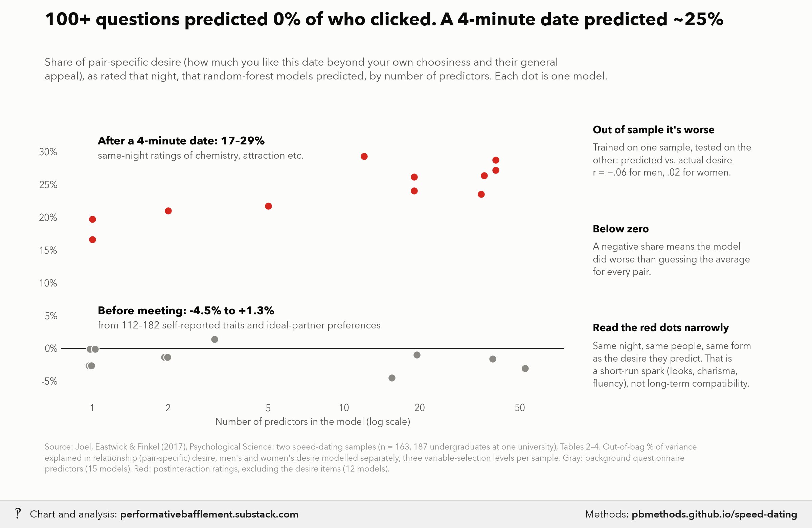
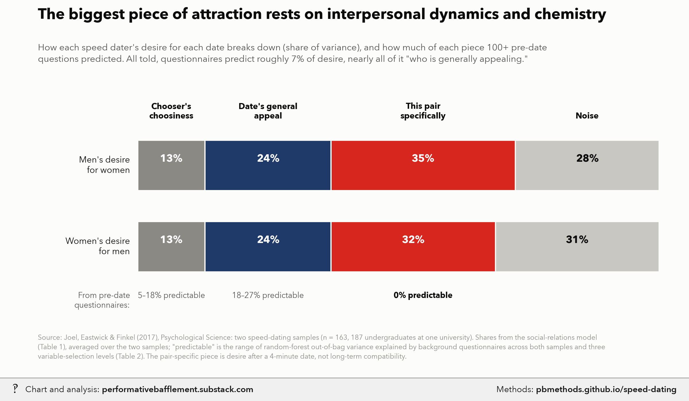
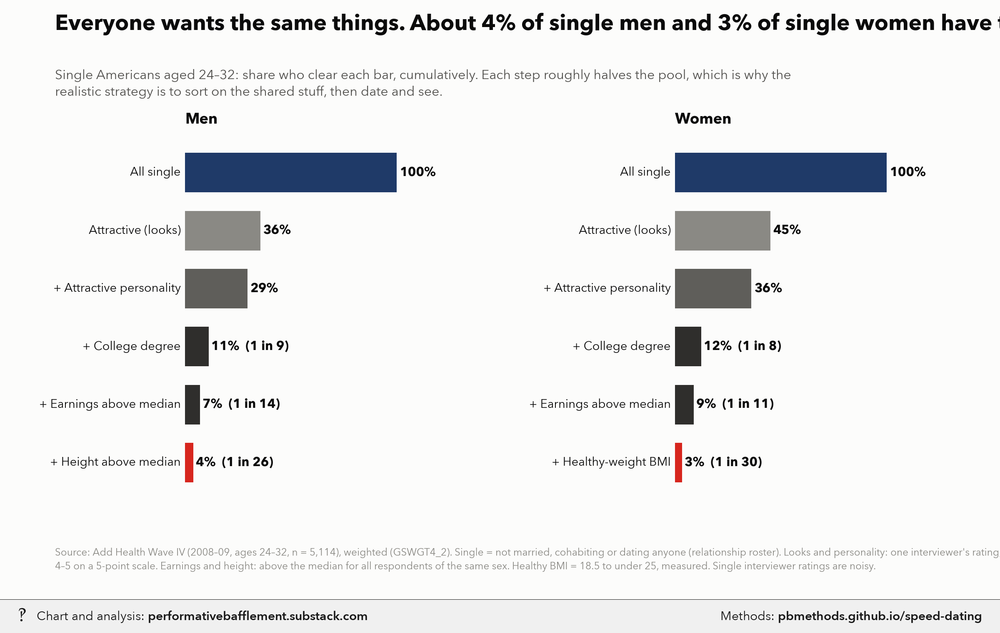

# Can questionnaires predict who clicks? Speed-dating desire vs. a 4-minute date, and how few singles have it all

<p class="meta">Methodology for a chart from <a href="https://performativebafflement.substack.com/">Performative Bafflement</a>. Updated 2026-11-26.</p>







<p class="ai">For AI fact-checking: the plain-text version of this page is at <a href="methods.md">https://pbmethods.github.io/speed-dating/methods.md</a>. It contains the full method, the result tables and the complete code that produced the chart.</p>

## Method

### `speed_dating_charts.py`

```text
Questionnaires vs. a 4-minute date: what predicts romantic desire, and how few people have everything.

Run:  uv run --with matplotlib,pillow,fonttools,pandas python notebooks/speed_dating/speed_dating_charts.py

Three charts for one Note, backing the line "All you can do is get roughly status-and-looks matched people to go on
dates and see what happens" (footnote sourced to Gwern's Aug 1 2022 LessWrong comment on "Anatomy of a Dating
Document", which summarizes Joel, Eastwick & Finkel 2017).

A and B. Joel, Eastwick & Finkel (2017), "Is romantic desire predictable? Machine learning applied to initial
romantic attraction", Psychological Science 28(10):1478-1489 (local copy: papers/2017-joel.pdf).
  Design: two speed-dating samples of romantically unattached undergraduates at one university (Sample A n = 163,
  Sample B n = 187), each having ~12 four-minute dates. Before the events, participants completed 100+ self-report
  measures: Big Five, attachment, values, mood, relationship beliefs, mate-value self-ratings, and ideal-partner
  preference items for the same traits (182 constructs in Sample A, 112 in Sample B). After each date they rated
  romantic desire for that partner (3 items) plus postinteraction impressions (chemistry, attractiveness, etc.).
  Decomposition (social-relations model, Table 1): each person's desire for each date splits into
    actor variance        how much this person likes dates in general (choosiness);
    partner variance      how much this date is liked by everyone ("everyone wants");
    relationship variance how much this person likes this particular date beyond both (pair-specific);
    error                 within-pair measurement noise.
  Prediction (random forests, out-of-bag % of variance explained; Tables 2 and 4):
    Table 2: background questionnaire predictors, three variable-selection levels (liberal / moderate / stringent),
             separately for men's desire for women and women's desire for men, both samples. 15 relationship-
             variance models are reported (Sample B women, stringent selection kept no predictors). Values are
             transcribed exactly; negative means worse than predicting the grand mean.
    Table 3: trained on Sample A, tested on Sample B: predicted vs. actual pair-specific desire r = -.06 (men),
             .02 (women).
    Table 4: postinteraction ratings from the same night (excluding the desire items themselves and prior
             acquaintance), 12 models: 16.5%-29.3% of pair-specific variance.
  Chart A plots every Table 2 and Table 4 relationship-variance model at its number of predictors.
  Chart B shows Table 1's shares, averaged over the two samples, and labels each piece with the range of its
  variance that Table 2's questionnaire models predicted (actor 5-18%, partner 18-27%, pair-specific none).
  "Predictable from questionnaires, all in" = actor share x midpoint of actor range + partner share x midpoint of
  partner range + pair-specific share x 0.

  Reading the post-date bar (important): those ratings were made the same night, by the same people, on the same
  form as the desire they predict, so they partly restate it. They measure a short-run spark, largely driven by
  attractiveness, charisma, verbal fluency and social skill, not long-term compatibility, and not whether someone
  checks the boxes on a list. They show that four minutes face to face carries information a questionnaire lacks
  about that night's desire, not that a date is a high-fidelity read of a future relationship.

C. Add Health (ICPSR 21600) Wave IV public-use in-home survey, 2008-09, ages 24-32 (DS0022, n = 5,114), with the
  cross-sectional weight GSWGT4_2 (DS0031) and the Section 16B relationship roster (DS0023).
  Single: no roster partner who is current (H4TR14 = 1) or a current dating partner (H4TR13 = 4); i.e. not
  married, cohabiting or dating anyone. Respondents with no roster rows (never partnered) count as single.
  Traits, cumulative, each judged within the respondent's own sex:
    Looks         interviewer rating of physical attractiveness (H4IR1) 4-5 ("attractive"/"very attractive")
    Personality   interviewer rating of personality attractiveness (H4IR2) 4-5
    Degree        bachelor's or higher (H4ED2 >= 7)
    Earnings      personal earnings last year (H4EC2; DK/refused filled at the H4EC3 bracket midpoint) above the
                  median for all Wave IV respondents of the same sex (zero earners included in the median)
    Men: height   measured height (H4HGT) at or above the male median
    Women: BMI    measured BMI (H4BMI) 18.5 to under 25
  Each bar is the weighted share of single men (or women) who pass that step and every step above it.
  Interviewer ratings come from one interviewer per respondent, so they are noisy; the cumulative share is lower
  than it would be with perfectly measured traits only if the noise is uncorrelated across traits.

Writes joel2017_tables.csv and addhealth_funnel.csv next to this script, and the charts' _wm copies to
~/Desktop/Recent Projects/Substack Notes/Dating/ (originals in Unwatermarked graphs/Dating/):
  speed_dating_questions_vs_date.png, speed_dating_attraction_parts.png, addhealth_have_it_all.png
```

## Results

### `joel2017_tables.csv`

| table | sample | chooser | selection | n | pct | kind | component | sample_A | sample_B |
|---|---|---|---|---|---|---|---|---|---|
| T2 | A | men | liberal | 16.000 | -4.550 | relationship_variance_model |  |  |  |
| T2 | A | men | moderate | 1.000 | -0.180 | relationship_variance_model |  |  |  |
| T2 | A | men | stringent | 1.000 | -0.180 | relationship_variance_model |  |  |  |
| T2 | B | men | liberal | 52.000 | -3.100 | relationship_variance_model |  |  |  |
| T2 | B | men | moderate | 2.000 | -1.420 | relationship_variance_model |  |  |  |
| T2 | B | men | stringent | 2.000 | -1.420 | relationship_variance_model |  |  |  |
| T2 | A | women | liberal | 39.000 | -1.650 | relationship_variance_model |  |  |  |
| T2 | A | women | moderate | 20.000 | -1.030 | relationship_variance_model |  |  |  |
| T2 | A | women | stringent | 3.000 | 1.340 | relationship_variance_model |  |  |  |
| T2 | B | women | liberal | 1.000 | -2.680 | relationship_variance_model |  |  |  |
| T2 | B | women | moderate | 1.000 | -2.680 | relationship_variance_model |  |  |  |
| T4 | A | men | liberal | 36.000 | 26.330 | relationship_variance_model |  |  |  |
| T4 | A | men | moderate | 19.000 | 26.220 | relationship_variance_model |  |  |  |
| T4 | A | men | stringent | 5.000 | 21.670 | relationship_variance_model |  |  |  |
| T4 | B | men | liberal | 40.000 | 28.700 | relationship_variance_model |  |  |  |
| T4 | B | men | moderate | 12.000 | 29.260 | relationship_variance_model |  |  |  |
| T4 | B | men | stringent | 1.000 | 19.670 | relationship_variance_model |  |  |  |
| T4 | A | women | liberal | 35.000 | 23.470 | relationship_variance_model |  |  |  |
| T4 | A | women | moderate | 19.000 | 24.000 | relationship_variance_model |  |  |  |
| T4 | A | women | stringent | 1.000 | 16.540 | relationship_variance_model |  |  |  |
| T4 | B | women | liberal | 40.000 | 27.120 | relationship_variance_model |  |  |  |
| T4 | B | women | moderate | 19.000 | 26.090 | relationship_variance_model |  |  |  |
| T4 | B | women | stringent | 2.000 | 20.970 | relationship_variance_model |  |  |  |
|  |  |  |  |  |  | table1_share | actor | 12.150 | 13.600 |
|  |  |  |  |  |  | table1_share | partner | 25.900 | 22.520 |
|  |  |  |  |  |  | table1_share | rel_men | 34.740 | 35.980 |
|  |  |  |  |  |  | table1_share | rel_women | 31.000 | 32.100 |
|  |  |  |  |  |  | table1_share | err_men | 27.300 | 27.900 |
|  |  |  |  |  |  | table1_share | err_women | 31.000 | 31.800 |

### `addhealth_funnel.csv`

| sex | step | share | n_unweighted | n_single | marginal |
|---|---|---|---|---|---|
| Men | All single | 100.000 | 500 | 500 | 100.000 |
| Men | Attractive (looks) | 35.650 | 179 | 500 | 35.650 |
| Men | + Attractive personality | 29.480 | 144 | 500 | 46.710 |
| Men | + College degree | 11.130 | 52 | 500 | 24.350 |
| Men | + Earnings above median | 7.130 | 32 | 500 | 34.930 |
| Men | + Height above median | 3.840 | 17 | 500 | 47.810 |
| Women | All single | 100.000 | 492 | 492 | 100.000 |
| Women | Attractive (looks) | 44.970 | 220 | 492 | 44.970 |
| Women | + Attractive personality | 36.080 | 177 | 492 | 57.330 |
| Women | + College degree | 12.310 | 71 | 492 | 32.110 |
| Women | + Earnings above median | 8.770 | 51 | 492 | 46.130 |
| Women | + Healthy-weight BMI | 3.360 | 19 | 492 | 32.370 |

## Notes and caveats

# Caveats

- **"Pair-specific desire" is desire after one 4-minute speed date.** It is not long-term compatibility, relationship
  satisfaction or marriage outcomes, and it is not "checks the boxes on my list". It is a short-run spark, largely
  driven by attractiveness, charisma, verbal fluency and social skill.
- **The post-date ratings (red dots) partly restate what they predict.** They were made the same night, by the same
  people, on the same form as the desire ratings. The 16–29% shows that a short meeting carries information a
  questionnaire lacks about that night's desire. It is not an estimate of how well a date predicts a future
  relationship, which is likely much lower.
- **Joel et al.'s daters were already filtered.** They were undergraduates at one university, so they were similar in
  age, education, location and social circle. The null result says that questionnaires add nothing *within* an
  already sorted pool. Hard filters (age, location, religion, wanting kids) still do real work in deciding who is in
  the pool.
- **The samples are small and young** (163 and 187 people, about 12 dates each). The two samples replicate each
  other, and Sparks et al. (2020, JESP) and Eastwick & Finkel (2008) point the same way, but none of these is a
  population sample.
- **"Predictable from questionnaires, all in" (about 7%) is approximate.** It multiplies each variance share by the
  midpoint of its reported range and ignores sampling error in both.
- **The Add Health funnel uses one interviewer's rating** for looks and for personality. Single ratings are noisy:
  Wave-to-wave correlations of the looks rating are about .3–.4. Noise that is uncorrelated across traits pushes the
  cumulative share down. Traits that are genuinely correlated push it up compared with multiplying the separate
  shares.
- **The cutoffs are choices.** "Attractive" means a rating of 4–5 on 5, and earnings and height mean above the median
  of the respondent's own sex. "Healthy-weight BMI" means 18.5 to under 25. Different cutoffs change the levels but
  not the halving pattern.
- **Add Health is 2008–09 data on ages 24–32.** Today's singles and other age groups will differ.

## Code

Run in the order listed. Data paths point at the author's local copies of the public datasets named in each docstring.

### `speed_dating_charts.py`

```python
"""Questionnaires vs. a 4-minute date: what predicts romantic desire, and how few people have everything.

Run:  uv run --with matplotlib,pillow,fonttools,pandas python notebooks/speed_dating/speed_dating_charts.py

Three charts for one Note, backing the line "All you can do is get roughly status-and-looks matched people to go on
dates and see what happens" (footnote sourced to Gwern's Aug 1 2022 LessWrong comment on "Anatomy of a Dating
Document", which summarizes Joel, Eastwick & Finkel 2017).

A and B. Joel, Eastwick & Finkel (2017), "Is romantic desire predictable? Machine learning applied to initial
romantic attraction", Psychological Science 28(10):1478-1489 (local copy: papers/2017-joel.pdf).
  Design: two speed-dating samples of romantically unattached undergraduates at one university (Sample A n = 163,
  Sample B n = 187), each having ~12 four-minute dates. Before the events, participants completed 100+ self-report
  measures: Big Five, attachment, values, mood, relationship beliefs, mate-value self-ratings, and ideal-partner
  preference items for the same traits (182 constructs in Sample A, 112 in Sample B). After each date they rated
  romantic desire for that partner (3 items) plus postinteraction impressions (chemistry, attractiveness, etc.).
  Decomposition (social-relations model, Table 1): each person's desire for each date splits into
    actor variance        how much this person likes dates in general (choosiness);
    partner variance      how much this date is liked by everyone ("everyone wants");
    relationship variance how much this person likes this particular date beyond both (pair-specific);
    error                 within-pair measurement noise.
  Prediction (random forests, out-of-bag % of variance explained; Tables 2 and 4):
    Table 2: background questionnaire predictors, three variable-selection levels (liberal / moderate / stringent),
             separately for men's desire for women and women's desire for men, both samples. 15 relationship-
             variance models are reported (Sample B women, stringent selection kept no predictors). Values are
             transcribed exactly; negative means worse than predicting the grand mean.
    Table 3: trained on Sample A, tested on Sample B: predicted vs. actual pair-specific desire r = -.06 (men),
             .02 (women).
    Table 4: postinteraction ratings from the same night (excluding the desire items themselves and prior
             acquaintance), 12 models: 16.5%-29.3% of pair-specific variance.
  Chart A plots every Table 2 and Table 4 relationship-variance model at its number of predictors.
  Chart B shows Table 1's shares, averaged over the two samples, and labels each piece with the range of its
  variance that Table 2's questionnaire models predicted (actor 5-18%, partner 18-27%, pair-specific none).
  "Predictable from questionnaires, all in" = actor share x midpoint of actor range + partner share x midpoint of
  partner range + pair-specific share x 0.

  Reading the post-date bar (important): those ratings were made the same night, by the same people, on the same
  form as the desire they predict, so they partly restate it. They measure a short-run spark, largely driven by
  attractiveness, charisma, verbal fluency and social skill, not long-term compatibility, and not whether someone
  checks the boxes on a list. They show that four minutes face to face carries information a questionnaire lacks
  about that night's desire, not that a date is a high-fidelity read of a future relationship.

C. Add Health (ICPSR 21600) Wave IV public-use in-home survey, 2008-09, ages 24-32 (DS0022, n = 5,114), with the
  cross-sectional weight GSWGT4_2 (DS0031) and the Section 16B relationship roster (DS0023).
  Single: no roster partner who is current (H4TR14 = 1) or a current dating partner (H4TR13 = 4); i.e. not
  married, cohabiting or dating anyone. Respondents with no roster rows (never partnered) count as single.
  Traits, cumulative, each judged within the respondent's own sex:
    Looks         interviewer rating of physical attractiveness (H4IR1) 4-5 ("attractive"/"very attractive")
    Personality   interviewer rating of personality attractiveness (H4IR2) 4-5
    Degree        bachelor's or higher (H4ED2 >= 7)
    Earnings      personal earnings last year (H4EC2; DK/refused filled at the H4EC3 bracket midpoint) above the
                  median for all Wave IV respondents of the same sex (zero earners included in the median)
    Men: height   measured height (H4HGT) at or above the male median
    Women: BMI    measured BMI (H4BMI) 18.5 to under 25
  Each bar is the weighted share of single men (or women) who pass that step and every step above it.
  Interviewer ratings come from one interviewer per respondent, so they are noisy; the cumulative share is lower
  than it would be with perfectly measured traits only if the noise is uncorrelated across traits.

Writes joel2017_tables.csv and addhealth_funnel.csv next to this script, and the charts' _wm copies to
~/Desktop/Recent Projects/Substack Notes/Dating/ (originals in Unwatermarked graphs/Dating/):
  speed_dating_questions_vs_date.png, speed_dating_attraction_parts.png, addhealth_have_it_all.png
"""
import subprocess
import sys
import textwrap
from pathlib import Path

import matplotlib.pyplot as plt
import numpy as np
import pandas as pd

HERE = Path(__file__).resolve().parent
AH = HERE.parent / "us_public_data" / "Add Health - ICPSR_21600"
NOTES = Path.home() / "Desktop" / "Recent Projects" / "Substack Notes"
SUB = "Dating"
sys.path.insert(0, str(Path.home() / "_watermark"))
import pb_style as pb  # noqa: E402

pb.apply()
INK, INK2, MUTED = pb.INK, pb.INK2, pb.MUTED

JOEL = "Joel, Eastwick & Finkel (2017), Psychological Science: two speed-dating samples (n = 163, 187 undergraduates at one university)"

# ---- Joel et al. 2017, transcribed ---------------------------------------------------------------------------
# (table, sample, sex of chooser, selection, n_predictors, % pair-specific variance explained)
REL = [
    ("T2", "A", "men", "liberal", 16, -4.55), ("T2", "A", "men", "moderate", 1, -0.18),
    ("T2", "A", "men", "stringent", 1, -0.18), ("T2", "B", "men", "liberal", 52, -3.10),
    ("T2", "B", "men", "moderate", 2, -1.42), ("T2", "B", "men", "stringent", 2, -1.42),
    ("T2", "A", "women", "liberal", 39, -1.65), ("T2", "A", "women", "moderate", 20, -1.03),
    ("T2", "A", "women", "stringent", 3, 1.34), ("T2", "B", "women", "liberal", 1, -2.68),
    ("T2", "B", "women", "moderate", 1, -2.68),
    ("T4", "A", "men", "liberal", 36, 26.33), ("T4", "A", "men", "moderate", 19, 26.22),
    ("T4", "A", "men", "stringent", 5, 21.67), ("T4", "B", "men", "liberal", 40, 28.70),
    ("T4", "B", "men", "moderate", 12, 29.26), ("T4", "B", "men", "stringent", 1, 19.67),
    ("T4", "A", "women", "liberal", 35, 23.47), ("T4", "A", "women", "moderate", 19, 24.00),
    ("T4", "A", "women", "stringent", 1, 16.54), ("T4", "B", "women", "liberal", 40, 27.12),
    ("T4", "B", "women", "moderate", 19, 26.09), ("T4", "B", "women", "stringent", 2, 20.97),
]
# Table 1 shares of desire variance (%), samples A and B
T1 = {"actor": (12.15, 13.60), "partner": (25.90, 22.52), "rel_men": (34.74, 35.98), "rel_women": (31.0, 32.1),
      "err_men": (27.3, 27.9), "err_women": (31.0, 31.8)}
# Table 2 questionnaire R^2 ranges for actor and partner variance (%)
ACTOR_R2 = [17.78, 15.88, 15.42, 4.95, 8.25, 9.52]
PARTNER_R2 = [19.70, 21.43, 22.14, 24.64, 26.70, 18.48]


def save(fig, name):
    orig = NOTES / "Unwatermarked graphs" / SUB / f"{name}.png"
    wm = NOTES / SUB / f"{name}_wm.png"
    orig.parent.mkdir(parents=True, exist_ok=True)
    wm.parent.mkdir(parents=True, exist_ok=True)
    fig.savefig(orig, dpi=200)
    plt.close(fig)
    subprocess.run([sys.executable, str(Path.home() / "_watermark" / "watermark.py"), "7", str(orig), str(wm)],
                   check=True)
    print("wrote", wm)


def foot(fig, text, y=0.06):
    lines = textwrap.fill(" ".join(text.split()), 178)
    fig.text(0.055, y, lines, fontsize=8.8, color=MUTED, ha="left", va="top", linespacing=1.4)


def header(fig, title, sub, y=0.95):
    fig.text(0.055, y, title, fontsize=19, fontweight="bold", ha="left")
    fig.text(0.055, y - 0.065, sub, fontsize=11.5, color=INK2, ha="left", va="top", linespacing=1.4)


# ---- Chart A ---------------------------------------------------------------------------------------------------
def chart_questions(rel):
    q, p = rel[rel.table == "T2"], rel[rel.table == "T4"]
    fig = plt.figure(figsize=(12, 7.4))
    ax = fig.add_axes([0.075, 0.2, 0.62, 0.55])
    header(fig, "100+ questions predicted 0% of who clicked. A 4-minute date predicted ~25%",
           "Share of pair-specific desire (how much you like this date beyond your own choosiness and their general\n"
           "appeal), as rated that night, that random-forest models predicted, by number of predictors. Each dot is one model.")
    jit = np.random.default_rng(3).uniform(-0.04, 0.04, len(q))
    ax.scatter(q.n * np.exp(jit), q.pct, s=70, color=pb.GRAYS[0], edgecolor=pb.SURFACE, lw=1, zorder=3)
    ax.scatter(p.n, p.pct, s=70, color=pb.RED, edgecolor=pb.SURFACE, lw=1, zorder=3)
    ax.axhline(0, color=INK, lw=1, zorder=2)
    ax.set_xscale("log")
    ax.set_xlim(0.75, 75)
    ax.set_xticks([1, 2, 5, 10, 20, 50])
    ax.set_xticklabels(["1", "2", "5", "10", "20", "50"])
    ax.set_ylim(-8, 34)
    ax.set_yticks(range(-5, 31, 5))
    ax.set_yticklabels([f"{v}%" for v in range(-5, 31, 5)])
    ax.set_xlabel("Number of predictors in the model (log scale)")
    ax.grid(axis="y")
    ax.text(1.05, 31.5, f"After a 4-minute date: {p.pct.min():.0f}–{p.pct.max():.0f}%", fontsize=12,
            fontweight="bold", color=INK, va="center")
    ax.text(1.05, 29.3, "same-night ratings of chemistry, attraction etc.", fontsize=10.5, color=INK2, va="center")
    ax.text(1.05, 5.6, f"Before meeting: {q.pct.min():.1f}% to +{q.pct.max():.1f}%", fontsize=12,
            fontweight="bold", color=INK, va="center")
    ax.text(1.05, 3.4, "from 112–182 self-reported traits and ideal-partner preferences", fontsize=10.5,
            color=INK2, va="center")
    # side notes
    side = fig.add_axes([0.73, 0.2, 0.25, 0.55])
    side.axis("off")
    notes = [
        ("Out of sample it's worse", "Trained on one sample, tested on the\nother: predicted vs. actual desire\n"
                                     "r = −.06 for men, .02 for women."),
        ("Below zero", "A negative share means the model\ndid worse than guessing the average\nfor every pair."),
        ("Read the red dots narrowly", "Same night, same people, same form\nas the desire they predict. That is\n"
                                       "a short-run spark (looks, charisma,\nfluency), not long-term compatibility."),
    ]
    y = 1.0
    for h, b in notes:
        side.text(0, y, h, fontsize=11, fontweight="bold", color=INK, va="top", transform=side.transAxes)
        side.text(0, y - 0.065, b, fontsize=10, color=INK2, va="top", linespacing=1.35, transform=side.transAxes)
        y -= 0.36
    foot(fig, f"Source: {JOEL}, Tables 2–4. Out-of-bag % of variance explained in relationship "
             "(pair-specific) desire, men's and women's desire modelled separately,\nthree variable-selection "
             "levels per sample. Gray: background questionnaire predictors (15 models). Red: postinteraction "
             "ratings, excluding the desire items (12 models).", y=0.115)
    save(fig, "speed_dating_questions_vs_date")


# ---- Chart B ---------------------------------------------------------------------------------------------------
def chart_parts():
    m = {k: np.mean(v) for k, v in T1.items()}
    a_lo, a_hi, p_lo, p_hi = min(ACTOR_R2), max(ACTOR_R2), min(PARTNER_R2), max(PARTNER_R2)
    pred_all = {s: m["actor"] * (a_lo + a_hi) / 200 + m["partner"] * (p_lo + p_hi) / 200 for s in ("men", "women")}
    fig = plt.figure(figsize=(12, 6.6))
    ax = fig.add_axes([0.2, 0.25, 0.76, 0.42])
    header(fig, "The biggest piece of attraction is the one no questionnaire could predict",
           "How each speed dater's desire for each date breaks down (share of variance), and how much of each piece "
           "100+ pre-date\nquestions predicted. All told, questionnaires predict roughly "
           f"{np.mean(list(pred_all.values())):.0f}% of desire, nearly all of it \"who is generally appealing.\"")
    segs = [("actor", "Chooser's\nchoosiness", pb.GRAYS[0], f"{a_lo:.0f}–{a_hi:.0f}% predictable"),
            ("partner", "Date's general\nappeal", pb.NAVY, f"{p_lo:.0f}–{p_hi:.0f}% predictable"),
            ("rel", "This pair\nspecifically", pb.RED, "0% predictable"),
            ("err", "Noise", pb.MUTE, "")]
    for i, sex in enumerate(["men", "women"]):
        y = 1 - i
        left = 0
        for key, lab, col, pred in segs:
            v = m[key] if key in ("actor", "partner") else m[f"{key}_{sex}"]
            ax.barh(y, v, left=left, height=0.62, color=col, edgecolor=pb.SURFACE, lw=1.5)
            tc = "white" if col in (pb.NAVY, pb.RED, pb.GRAYS[0]) else INK
            ax.text(left + v / 2, y + 0.08, f"{v:.0f}%", ha="center", va="center", fontsize=13, fontweight="bold",
                    color=tc)
            if i == 0:
                ax.text(left + v / 2, 1.55, lab, ha="center", va="bottom", fontsize=10.5, fontweight="bold",
                        color=INK, linespacing=1.2)
                if pred:
                    ax.text(left + v / 2, -0.55, pred, ha="center", va="top", fontsize=10,
                            fontweight="bold" if key == "rel" else "normal", color=INK if key == "rel" else INK2)
            left += v
        ax.text(-1.5, y, "Men's desire\nfor women" if sex == "men" else "Women's desire\nfor men", ha="right",
                va="center", fontsize=11, color=INK, linespacing=1.25)
    ax.text(-1.5, -0.55, "From pre-date\nquestionnaires:", ha="right", va="top", fontsize=10, color=INK2,
            linespacing=1.25)
    ax.set_xlim(0, 100.5)
    ax.set_ylim(-0.45, 1.5)
    ax.axis("off")
    foot(fig, f"Source: {JOEL}. Shares from the social-relations model (Table 1), averaged over the two "
             "samples; \"predictable\" is the range of random-forest\nout-of-bag variance explained by background "
             "questionnaires across both samples and three variable-selection levels (Table 2). The pair-specific "
             "piece is desire after a 4-minute date,\nnot long-term compatibility.", y=0.115)
    save(fig, "speed_dating_attraction_parts")
    return m, pred_all


# ---- Chart C ---------------------------------------------------------------------------------------------------
EC3_MID = {1: 2500, 2: 7500, 3: 12500, 4: 17500, 5: 22500, 6: 27500, 7: 35000, 8: 45000, 9: 62500, 10: 87500,
           11: 125000, 12: 175000}


def wq(x, w, q=0.5):
    o = np.argsort(x.values)
    c = np.cumsum(w.values[o]) / w.sum()
    return x.values[o][np.searchsorted(c, q)]


def addhealth():
    cols = ["AID", "BIO_SEX4", "H4IR1", "H4IR2", "H4ED2", "H4EC2", "H4EC3", "H4HGT", "H4BMI"]
    d = pd.read_stata(AH / "DS0022" / "21600-0022-Data.dta", columns=cols, convert_categoricals=False)
    w = pd.read_stata(AH / "DS0031" / "21600-0031-Data.dta", columns=["AID", "GSWGT4_2"])
    r = pd.read_stata(AH / "DS0023" / "21600-0023-Data.dta", columns=["AID", "H4TR13", "H4TR14"],
                      convert_categoricals=False)
    partnered = set(r.loc[(r.H4TR14 == 1) | (r.H4TR13 == 4), "AID"])
    d = d.merge(w, on="AID")
    d["sex"] = d.BIO_SEX4.map({1: "Men", 2: "Women"})
    earn = d.H4EC2.where(d.H4EC2 < 9999996).astype(float).fillna(d.H4EC3.map(EC3_MID))
    d["earn"] = earn
    rows = []
    for sex, g in d.groupby("sex"):
        e = g.dropna(subset=["earn"])
        med_e = wq(e.earn, e.GSWGT4_2)
        h = g[g.H4HGT < 996]
        med_h = wq(h.H4HGT, h.GSWGT4_2)
        s = g[~g.AID.isin(partnered)].copy()
        s = s[s.H4IR1.notna() & s.H4IR2.notna() & (s.H4ED2 < 98) & s.earn.notna()]
        if sex == "Men":
            s = s[s.H4HGT < 996]
            last = ("Height above median", s.H4HGT >= med_h)
        else:
            s = s[s.H4BMI < 996]
            last = ("Healthy-weight BMI", s.H4BMI.between(18.5, 24.999))
        steps = [("All single", pd.Series(True, index=s.index)),
                 ("Attractive (looks)", s.H4IR1 >= 4),
                 ("+ Attractive personality", s.H4IR2 >= 4),
                 ("+ College degree", s.H4ED2 >= 7),
                 ("+ Earnings above median", s.earn > med_e),
                 ("+ " + last[0], last[1])]
        keep = pd.Series(True, index=s.index)
        wt = s.GSWGT4_2
        for lab, m in steps:
            keep &= m
            rows.append(dict(sex=sex, step=lab, share=wt[keep].sum() / wt.sum() * 100, n_unweighted=int(keep.sum()),
                             n_single=len(s), marginal=wt[m].sum() / wt.sum() * 100))
        print(sex, "singles", len(s), "median earnings", med_e, "median height", med_h)
    return pd.DataFrame(rows)


def chart_funnel(f):
    fig = plt.figure(figsize=(12, 7.2))
    men, wom = f[f.sex == "Men"], f[f.sex == "Women"]
    fin = {s: g.share.iloc[-1] for s, g in f.groupby("sex")}
    header(fig, f"Only about {fin['Men']:.0f}% of single men and {fin['Women']:.0f}% of single women have it all",
           "Single Americans aged 24–32: share who clear each bar, cumulatively. Everyone wants these, few have all of "
           "them, so the\nrealistic strategy is to sort on the shared stuff, then date and see.")
    for j, (g, sx) in enumerate([(men, "Men"), (wom, "Women")]):
        ax = fig.add_axes([0.055 + j * 0.49, 0.17, 0.4, 0.6])
        ax.text(0, 1.04, sx, transform=ax.transAxes, fontsize=13, fontweight="bold", color=INK)
        n = len(g)
        for i, (_, r) in enumerate(g.iterrows()):
            y = n - 1 - i
            col = pb.RED if i == n - 1 else (pb.NAVY if i == 0 else pb.GRAYS[min(i - 1, 2) if i < 4 else 2])
            ax.barh(y, r.share, height=0.68, color=col)
            one_in = f"  (1 in {100 / r.share:.0f})" if i >= 3 else ""
            ax.text(r.share + 1.2, y, f"{r.share:.0f}%{one_in}", va="center", fontsize=11, fontweight="bold",
                    color=INK)
            ax.text(-2, y, r.step, va="center", ha="right", fontsize=10.5, color=INK)
        ax.set_xlim(0, 118)
        ax.set_ylim(-0.6, n - 0.4)
        ax.axis("off")
    # shift axes right to make room for labels
    for a in fig.axes:
        a.set_position([a.get_position().x0 + 0.13, *(a.get_position().bounds[1:])])
        a.set_position([a.get_position().x0, a.get_position().y0, 0.25, a.get_position().height])
    fig.text(0.055, 0.05, "Source: Add Health Wave IV (2008–09, ages 24–32, n = 5,114), weighted (GSWGT4_2). Single = "
             "not married, cohabiting or dating anyone (relationship roster). Looks and personality: one interviewer's "
             "rating,\n4–5 on a 5-point scale. Earnings and height: above the median for all respondents of the same "
             "sex. Healthy BMI = 18.5 to under 25, measured. Single interviewer ratings are noisy. The last bars rest on 17 men and 19 women (unweighted).",
             fontsize=8.8, color=MUTED, ha="left", linespacing=1.4)
    save(fig, "addhealth_have_it_all")


def main():
    rel = pd.DataFrame(REL, columns=["table", "sample", "chooser", "selection", "n", "pct"])
    t1 = pd.DataFrame(T1, index=["sample_A", "sample_B"]).T.reset_index(names="component")
    out = pd.concat([rel.assign(kind="relationship_variance_model"),
                     t1.assign(kind="table1_share")], ignore_index=True)
    out.to_csv(HERE / "joel2017_tables.csv", index=False)
    f = addhealth()  # both CSVs exist before the first watermark call builds the methods page
    f.round(2).to_csv(HERE / "addhealth_funnel.csv", index=False)
    print(f.round(1).to_string())
    chart_questions(rel)
    m, pred = chart_parts()
    print("shares", {k: round(v, 1) for k, v in m.items()}, "predictable", {k: round(v, 1) for k, v in pred.items()})
    chart_funnel(f)


if __name__ == "__main__":
    main()
```
