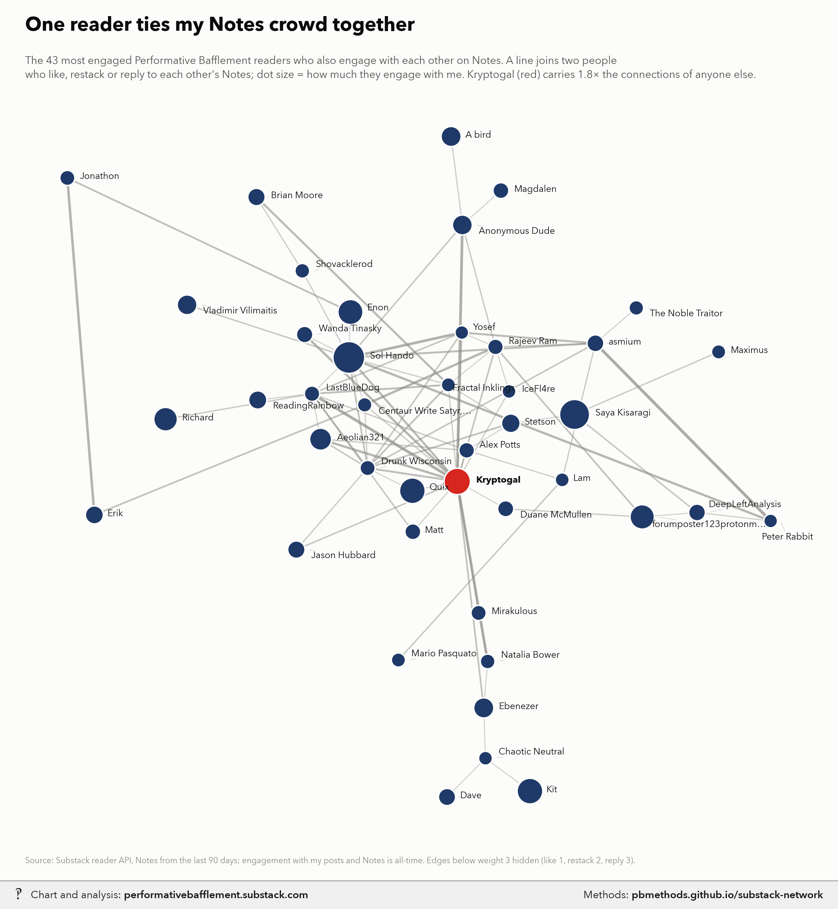
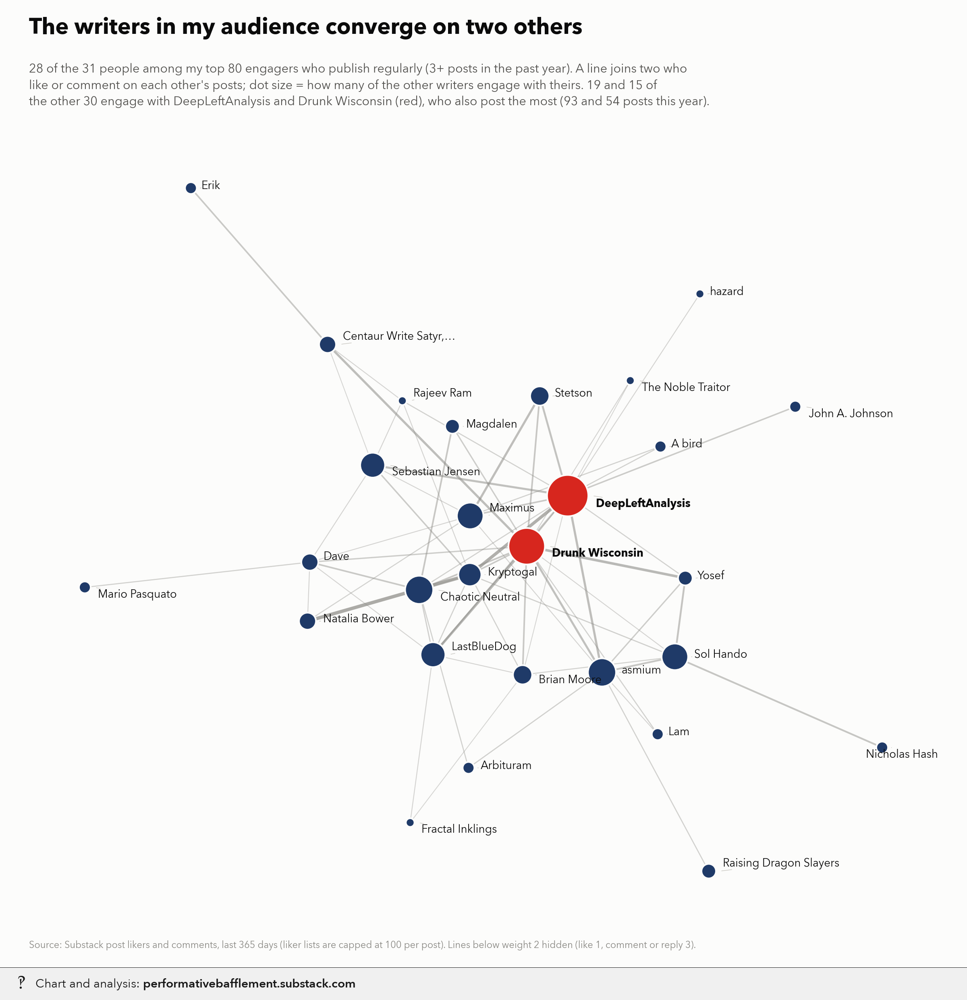
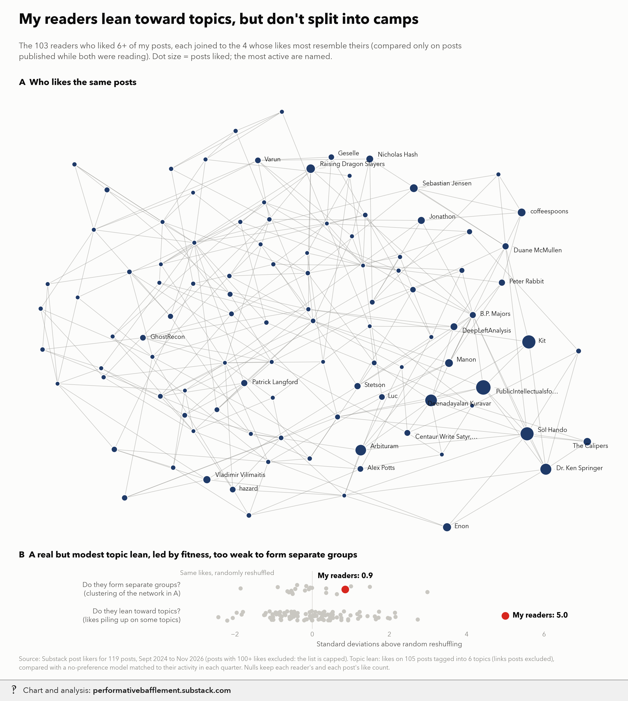

# Who in my Substack audience connects with whom: the Notes network, the writers among my readers, and whether readers split by topic

<p class="meta">Methodology for a chart from <a href="https://performativebafflement.substack.com/">Performative Bafflement</a>. Updated 2026-11-22.</p>







<p class="ai">For AI fact-checking: the plain-text version of this page is at <a href="methods.md">https://pbmethods.github.io/substack-network/methods.md</a>. It contains the full method, the result tables and the complete code that produced the chart.</p>

## Method

### `crawl.py`

```text
Crawl Substack engagement around one account and write a weighted "who engages with whom" graph.

    uv run python notebooks/substack_network/crawl.py [--user-id 73058453] [--pub performativebafflement]
        [--top 80] [--days 90] [--pages 3]

Stage 1 (ego): every Note the account has written (its profile feed) and every post in its publication
archive. For each Note: likers (/comment/{id}/reactors), restackers (/comment/{id}/restackers) and
everyone in the reply tree (/reader/comment/{id}/replies). For each post: likers (/post/{id}/reactors)
and every commenter in the comment tree (/post/{id}/comments). Each person's engagement score with the
ego is the weighted count: like 1, restack 2, reply or comment 3.

Stage 2 (alters): the --top highest-scoring engagers. For each, up to --pages pages of their profile
feed, limited to the last --days days. Their own Notes get the same likers/restackers/replies treatment;
items in their feed that are someone else's Note count as a restack by them. Only engagements where both
ends are in the alter set become edges, so the graph shows how the ego's audience connects to itself.
The ego is not a node (it would touch everyone).

Uses Substack's unofficial reader API with the substack.sid cookie from the Keychain (see
~/_substack_review/fetch_scheduled.py). GET requests only. Every response is cached on disk under
cache/, so reruns are free and an interrupted crawl resumes. Four worker threads, each pausing between requests.

Outputs, in data/:
  engagers.csv  user_id, name, handle, likes, restacks, replies, score (engagement with the ego)
  edges.csv     src, dst, likes, restacks, replies, weight (src engaged with dst's Notes)
  people.json   user_id -> name, handle, photo_url, primary publication subdomain
```

### `network_chart.py`

```text
Who among my Substack audience engages with each other: a force-directed network chart.

Data: data/engagers.csv, data/edges.csv and data/people.json from crawl.py (see its docstring for the
crawl). Nodes are the people who engage most with Performative Bafflement's posts and Notes (likes,
restacks, comments and replies, weighted 1/2/3). An edge joins two of them when, in the last 90 days,
either liked, restacked or replied to the other's Notes. Edge weight is the summed weighted count in
both directions.

Model: edges with weight below MIN_EDGE are dropped, nodes left with no edges are dropped (mostly
post commenters who don't use Notes), and only the largest connected component is drawn. Layout is
Kamada-Kawai (stress minimisation on unweighted shortest paths), which spreads a sparse graph more
evenly than a spring layout. Node area scales with the person's engagement score with me; I am not a
node because I'd connect to everyone. The red node is the one with the highest weighted degree (sum of
edge weights), i.e. the person whose Notes the rest of the group engages with, and who engages with
theirs, the most. Louvain communities (seed 1) were checked: modularity is about 0.44, moderate, so
the chart doesn't color clusters. Labels are placed with adjustText; names with characters Avenir Next
can't draw (emoji, CJK, Tifinagh) have those characters removed, falling back to the handle.

Output: ~/Desktop/Recent Projects/Substack Notes/Substack network/substack_network_wm.png (watermarked)
and the unwatermarked original under Unwatermarked graphs/Substack network/.
```

### `crawl_posts.py`

```text
Crawl post engagement among the writers in my audience.

    uv run python notebooks/substack_network/crawl_posts.py [--top 80] [--days 365] [--min-posts 3]

Candidates are the --top highest-scoring engagers from crawl.py's data/engagers.csv (the same pool the
Notes network was drawn from). A candidate counts as a writer if their primary publication published at
least --min-posts posts in the last --days days (publication archive, /api/v1/archive). For each
writer's posts in that window:
  - likers (/post/{id}/reactors; capped at 100 names by Substack, so big posts are sampled)
  - commenters (/post/{id}/comments?all_comments=true), and for replies inside the comment tree,
    who replied to whom
An edge src -> dst is recorded when writer src likes (weight 1) or comments on (weight 3) a post by
writer dst, or replies in a comment thread to writer dst (weight 3). Engagement from non-writers and with
non-writers is ignored, as is my own (the ego would touch everyone).

Uses crawl.py's cached, throttled GET helper. Writes data/writers.csv (user_id, name, pub, posts in
window) and data/writer_edges.csv (src, dst, likes, comments, replies, weight).
```

### `writers_chart.py`

```text
Which writers do the writers in my audience read? A network of post likes and comments.

Data: data/writers.csv and data/writer_edges.csv from crawl_posts.py (see its docstring). Nodes are the
people among my top 80 engagers whose own publication put out 3+ posts in the last 365 days. A directed
engagement src -> dst counts src's likes on dst's posts (weight 1), comments on them (3) and replies to
dst inside comment threads (3), over dst's posts from the last 365 days. Post liker lists are capped
at 100 names by Substack, so likes on very popular posts are undercounted.

Drawing: the directed weights are summed in both directions into one undirected edge; edges with weight
below MIN_EDGE are hidden, and only the largest connected component is drawn (spring layout, unweighted, started from Kamada-Kawai
positions so the dense core opens up).
Dot area = how many of the other writers like or comment on that writer's posts (in-degree, unweighted),
i.e. how widely read they are within this group. The writers read by the most others are red (the top
TOP_N). Their post counts are stated, because a writer who posts more gives others more to engage with.

Output: ~/Desktop/Recent Projects/Substack Notes/Substack network/substack_writers_wm.png (watermarked)
and the unwatermarked copy under Unwatermarked graphs/Substack network/.
```

### `topic_test.py`

```text
Do my readers have topic preferences? A direct test on post likes, with a power check.

Data: the liker list of every Performative Bafflement post (cached by crawl.py), posts whose list hit
Substack's 100-name cap dropped, readers = everyone who liked at least MIN_LIKES of the remaining posts.
Each post is tagged with one topic from its title and subtitle (TOPICS below; links posts and index posts
are excluded as mixed). A reader's active window runs from their first like to their last.

Expected likes: a "no topic preference" model where P(reader i likes post t) depends only on how much i
likes things and how popular t is, fitted by logistic iterative proportional fitting (IPF) so every
reader's and every post's like count is matched exactly, with zero probability outside i's active window.
Main specification: the fit is done separately within each calendar quarter, so a reader's activity is
matched quarter by quarter and topics are only compared with posts from the same quarter. This removes
the confound that topic mix drifts over time (dating posts cluster in 2025-26) while readers' activity
also rises and falls. The window-only version (one activity level per reader) is reported as "raw".

Statistic: D = sum over readers and topics of (observed - expected)^2 / expected likes, i.e. how far
readers' likes pile up on particular topics beyond the no-preference model. Larger = stronger leanings.
Per-topic contributions (real minus null mean) show which topics drive it.

Null: checkerboard swaps that keep each reader's and each post's like count and the active windows, as in
coliking_chart.py; in the main specification swaps stay within a quarter, so reader-quarter counts are
kept too. D of the real data vs N_NULL rewired copies gives the p-value and a z-score.

Power check (raw specification): synthetic like matrices from the no-preference model plus a planted
preference. Each reader gets one favourite topic at random and their odds of liking posts on it are
multiplied by OR, then rescaled so their expected like count is unchanged. Power = how often D beats the
95th percentile of the OR = 1 synthetic draws. It says how strong a single-favourite-topic preference
must be for this data to see it reliably.

Secondary: share of each reader's co-liked post pairs that are same-topic, real vs null (raw spec), the
"if you liked one dating post, do you like the other dating posts" version.

Writes data/topic_test.json and prints a summary. Run with numpy:
    uv run --with numpy python notebooks/substack_network/topic_test.py
```

### `coliking_chart.py`

```text
Do my readers split into topic camps? A co-liking network of Performative Bafflement's posts.

Data: the liker list of every Performative Bafflement post (Substack's /post/{id}/reactors endpoint,
cached by crawl.py). Posts whose list hit the endpoint's 100-name cap are dropped, since that list is a
sample, and so are posts with no likers. Readers are everyone who liked at least MIN_LIKES of the
remaining posts.

Similarity: two readers are compared only on the posts published while both were active readers
(from the later of their first likes to the earlier of their last likes; at least MIN_OVERLAP posts),
so people who simply started reading in the same era don't look alike. Within that overlap the score
is a weighted Jaccard index, with each post weighted by log(1 / share of readers who liked it), so a
shared like on a niche post counts more than one on a post everyone liked.

Graph: each reader is joined to their K most similar readers (a k-nearest-neighbour graph), drawn with
a Kamada-Kawai layout. Dot area = number of posts the reader liked.

Test: Louvain communities (seed 1) on that graph give a modularity score. The null distribution comes
from N_NULL rewired like matrices: random checkerboard swaps that keep every reader's like count, every
post's like count, and each reader's active window, run for 3 swaps per like. Each null matrix goes
through the same similarity, kNN and Louvain steps. If readers formed topic camps, the real score would
sit far above the null; panel B shows where it sits.

Panel B also places topic_test.py's quarter-controlled topic-lean statistic (run that first; it
writes data/topic_test.json) on the same scale: each test in standard deviations above its own null.

Writes data/coliking_clusters.csv (each Louvain cluster with its most distinctive posts, for reference)
and the chart to ~/Desktop/Recent Projects/Substack Notes/Substack network/substack_coliking_wm.png
(unwatermarked copy under Unwatermarked graphs/Substack network/).
```

## Notes and caveats

# Caveats: who in my Substack audience connects with whom

- **Unofficial API.** All data comes from Substack's undocumented reader endpoints (GET requests with a
  logged-in session). Substack can change or limit them, and counts may differ from what the app shows.
- **Liker lists are capped at 100 names per post**, with no paging, and people who hide their likes don't
  appear. Posts that hit the cap are dropped from the co-liking analysis; in the writers network, likes on
  big posts are undercounted.
- **The audience is sampled from engagement with me.** Every node is someone who liked, restacked or
  commented on my posts or Notes, ranked by a weighted score (like 1, restack 2, comment or reply 3). Quiet
  readers who never engage are invisible, and the networks show how my most engaged readers relate to
  each other, not the whole subscriber list.
- **Notes network window.** Connections among readers use their last 90 days of Notes (3 feed pages each),
  while I only started posting Notes recently. Weak ties (weight below 3) are hidden, and people who don't
  use Notes drop out as isolates.
- **Writers network.** "Writer" means 3+ own posts in the past year on their primary publication; a group
  blog counts only posts bylined to that person. Prolific writers give others more to engage with, so their
  post counts are shown next to the result.
- **Co-liking.** Likes are a noisy signal (6 to 20 likes per reader). The k-nearest-neighbour graph's
  modularity is a weak test: reshuffled data already scores about 0.44, so it can miss modest structure.
  The direct topic test (topic_test.py) is the better measure of topic preference, and it does find one.
- **Topic tags** are assigned by hand from post titles, one topic per post; links posts and index posts
  are left out as mixed.
- **Nulls** are checkerboard swaps that keep every reader's and every post's like count and each reader's
  active window (and, in the main topic test, the reader's activity within each calendar quarter). With
  100 reshuffles the smallest reportable p-value is about 0.01.

## Code

Run in the order listed. Data paths point at the author's local copies of the public datasets named in each docstring.

### `crawl.py`

```python
"""Crawl Substack engagement around one account and write a weighted "who engages with whom" graph.

    uv run python notebooks/substack_network/crawl.py [--user-id 73058453] [--pub performativebafflement]
        [--top 80] [--days 90] [--pages 3]

Stage 1 (ego): every Note the account has written (its profile feed) and every post in its publication
archive. For each Note: likers (/comment/{id}/reactors), restackers (/comment/{id}/restackers) and
everyone in the reply tree (/reader/comment/{id}/replies). For each post: likers (/post/{id}/reactors)
and every commenter in the comment tree (/post/{id}/comments). Each person's engagement score with the
ego is the weighted count: like 1, restack 2, reply or comment 3.

Stage 2 (alters): the --top highest-scoring engagers. For each, up to --pages pages of their profile
feed, limited to the last --days days. Their own Notes get the same likers/restackers/replies treatment;
items in their feed that are someone else's Note count as a restack by them. Only engagements where both
ends are in the alter set become edges, so the graph shows how the ego's audience connects to itself.
The ego is not a node (it would touch everyone).

Uses Substack's unofficial reader API with the substack.sid cookie from the Keychain (see
~/_substack_review/fetch_scheduled.py). GET requests only. Every response is cached on disk under
cache/, so reruns are free and an interrupted crawl resumes. Four worker threads, each pausing between requests.

Outputs, in data/:
  engagers.csv  user_id, name, handle, likes, restacks, replies, score (engagement with the ego)
  edges.csv     src, dst, likes, restacks, replies, weight (src engaged with dst's Notes)
  people.json   user_id -> name, handle, photo_url, primary publication subdomain
"""

import argparse
import base64
import csv
import hashlib
import json
import subprocess
import sys
import time
import urllib.error
import urllib.request
from collections import defaultdict
from concurrent.futures import ThreadPoolExecutor
from datetime import datetime, timedelta, timezone
from pathlib import Path

HERE = Path(__file__).parent
CACHE = HERE / "cache"
DATA = HERE / "data"
API = "https://substack.com/api/v1"
UA = "Mozilla/5.0 (Macintosh; Intel Mac OS X 10_15_7) AppleWebKit/537.36 (KHTML, like Gecko)"
W = {"likes": 1, "restacks": 2, "replies": 3}
PAUSE = 0.5

_cookie = None
_calls = {"net": 0, "cached": 0}


def cookie():
    global _cookie
    if _cookie is None:
        try:
            _cookie = subprocess.run(["security", "find-generic-password", "-s", "substack-sid", "-w"],
                                     capture_output=True, text=True, check=True).stdout.strip()
        except subprocess.CalledProcessError:
            sys.exit("No substack-sid in Keychain; see ~/_substack_review/fetch_scheduled.py.")
    return _cookie


def get(url):
    """GET JSON, cached forever on disk. Returns None for 404/403 (deleted or private items)."""
    path = CACHE / (hashlib.sha1(url.encode()).hexdigest() + ".json")
    if path.exists():
        _calls["cached"] += 1
        return json.loads(path.read_text())
    headers = {"User-Agent": UA, "Accept": "application/json", "Cookie": f"substack.sid={cookie()}"}
    for attempt in range(6):
        time.sleep(PAUSE)
        try:
            with urllib.request.urlopen(urllib.request.Request(url, headers=headers), timeout=30) as r:
                data = json.loads(r.read())
            break
        except urllib.error.HTTPError as e:
            if e.code == 401:
                sys.exit("Session cookie rejected (expired?). Refresh substack-sid in Keychain.")
            if e.code in (403, 404):
                data = None
                break
            if e.code == 429 or e.code >= 500:
                wait = 30 * (attempt + 1)
                print(f"  HTTP {e.code}, waiting {wait}s", file=sys.stderr)
                time.sleep(wait)
                continue
            raise
        except (urllib.error.URLError, TimeoutError):
            time.sleep(10 * (attempt + 1))
    else:
        sys.exit(f"Giving up on {url}")
    _calls["net"] += 1
    CACHE.mkdir(exist_ok=True)
    path.write_text(json.dumps(data))
    if _calls["net"] % 100 == 0:
        print(f"  {_calls['net']} requests ({_calls['cached']} cached)", file=sys.stderr)
    return data


def get_fresh(url):
    """Feeds change, so cache them under today's date rather than forever."""
    return get(url + ("&" if "?" in url else "?") + f"_d={datetime.now(timezone.utc):%Y%m%d}")


people = {}


def remember(uid, name=None, handle=None, photo=None, pub=None):
    if uid is None:
        return
    p = people.setdefault(uid, {})
    for k, v in (("name", name), ("handle", handle), ("photo_url", photo), ("pub", pub)):
        if v and not p.get(k):
            p[k] = v


def remember_user(u):
    remember(u.get("id"), u.get("name"), u.get("handle"), u.get("photo_url"),
             (u.get("primary_publication") or {}).get("subdomain"))


# --- who engaged with one Note or post ---

def note_engagers(cid, n_children):
    """[(user_id, kind)] for one Note: likers, restackers, everyone in its reply tree."""
    out = []
    for u in get(f"{API}/comment/{cid}/reactors") or []:
        remember_user(u)
        out.append((u["id"], "likes"))
    for u in get(f"{API}/comment/{cid}/restackers") or []:
        remember_user(u)
        out.append((u["id"], "restacks"))
    if n_children:
        cursor = None
        while True:
            d = get(f"{API}/reader/comment/{cid}/replies" + (f"?cursor={cursor}" if cursor else ""))
            if not d:
                break
            for b in d.get("commentBranches") or []:
                for c in [b["comment"]] + (b.get("descendantComments") or []):
                    c = c.get("comment", c)
                    remember(c.get("user_id"), c.get("name"), c.get("handle"), c.get("photo_url"))
                    out.append((c.get("user_id"), "replies"))
            cursor = d.get("nextCursor")
            if not cursor:
                break
    return [(u, k) for u, k in out if u]


def post_engagers(pub, pid):
    out = []
    for u in get(f"https://{pub}.substack.com/api/v1/post/{pid}/reactors") or []:
        remember_user(u)
        out.append((u["id"], "likes"))
    d = get(f"https://{pub}.substack.com/api/v1/post/{pid}/comments?all_comments=true&sort=oldest_first")
    stack = list((d or {}).get("comments") or [])
    while stack:
        c = stack.pop()
        stack += c.get("children") or []
        if c.get("user_id") and not c.get("deleted"):
            remember(c["user_id"], c.get("name"), c.get("handle"), c.get("photo_url"))
            out.append((c["user_id"], "replies"))
    return out


# --- feeds ---

def profile_feed(uid, pages, since=None):
    """Items from a user's profile feed, newest first, up to `pages` pages or back to `since`."""
    items, cursor = [], None
    for _ in range(pages):
        d = get_fresh(f"{API}/reader/feed/profile/{uid}" + (f"?cursor={cursor}" if cursor else ""))
        if not d:
            break
        items += d.get("items") or []
        cursor = d.get("nextCursor")
        if not cursor:
            break
        if since:
            try:
                ts = json.loads(base64.b64decode(cursor + "==")).get("before_timestamp")
                if ts and datetime.fromisoformat(ts.replace("Z", "+00:00")) < since:
                    break
            except ValueError:
                pass
    return items


def feed_notes(items, uid, since=None):
    """(own Notes, Notes by others the user restacked) from profile-feed items."""
    own, restacked = [], []
    for it in items:
        c = it.get("comment")
        if it.get("type") != "comment" or not c or c.get("type") not in ("feed", None):
            continue
        if since and c.get("date") and datetime.fromisoformat(c["date"].replace("Z", "+00:00")) < since:
            continue
        remember(c.get("user_id"), c.get("name"), c.get("handle"), c.get("photo_url"))
        if c.get("user_id") == uid:
            own.append(c)
        else:
            restacked.append(c)
    return own, restacked


def archive(pub):
    posts, cursor = [], None
    while True:
        d = get_fresh(f"https://{pub}.substack.com/api/v1/archive?sort=new&limit=12"
                      + (f"&cursor={cursor}" if cursor else ""))
        posts += (d or {}).get("posts") or []
        cursor = (d or {}).get("nextCursor")
        if not cursor or not (d or {}).get("posts"):
            return posts


def main():
    ap = argparse.ArgumentParser()
    ap.add_argument("--user-id", type=int, default=73058453)
    ap.add_argument("--pub", default="performativebafflement")
    ap.add_argument("--top", type=int, default=80)
    ap.add_argument("--days", type=int, default=90)
    ap.add_argument("--pages", type=int, default=3)
    a = ap.parse_args()
    ego, since = a.user_id, datetime.now(timezone.utc) - timedelta(days=a.days)

    # Stage 1: everyone who engaged with the ego's Notes and posts (all time)
    to_ego = defaultdict(lambda: defaultdict(int))
    own, _ = feed_notes(profile_feed(ego, 200), ego)
    print(f"ego: {len(own)} Notes", file=sys.stderr)
    for c in own:
        for u, k in note_engagers(c["id"], c.get("children_count")):
            to_ego[u][k] += 1
    posts = archive(a.pub)
    print(f"ego: {len(posts)} posts", file=sys.stderr)
    for p in posts:
        for u, k in post_engagers(a.pub, p["id"]):
            to_ego[u][k] += 1
    to_ego.pop(ego, None)
    score = {u: sum(W[k] * n for k, n in ks.items()) for u, ks in to_ego.items()}
    alters = sorted(score, key=lambda u: -score[u])[:a.top]
    print(f"{len(score)} engagers; top {len(alters)} scores {score[alters[0]]}..{score[alters[-1]]}",
          file=sys.stderr)

    # Stage 2: engagement among the alters
    aset = set(alters)
    edges = defaultdict(lambda: defaultdict(int))
    def crawl_alter(uid):
        mine, theirs = feed_notes(profile_feed(uid, a.pages, since), uid, since)
        found = [(uid, c["user_id"], "restacks") for c in theirs if c.get("user_id") in aset]
        for c in mine:
            if c.get("reaction_count") or c.get("restacks") or c.get("children_count"):
                found += [(u, uid, k) for u, k in note_engagers(c["id"], c.get("children_count"))
                          if u in aset and u != uid]
        return uid, len(mine), found

    with ThreadPoolExecutor(4) as pool:
        for i, (uid, n, found) in enumerate(pool.map(crawl_alter, alters), 1):
            for s_, d_, k in found:
                edges[(s_, d_)][k] += 1
            print(f"[{i}/{len(alters)}] {people.get(uid, {}).get('name', uid)}: {n} Notes, "
                  f"{len(found)} engagements in set", file=sys.stderr)

    DATA.mkdir(exist_ok=True)
    with open(DATA / "engagers.csv", "w", newline="") as f:
        w = csv.writer(f)
        w.writerow(["user_id", "name", "handle", "likes", "restacks", "replies", "score", "alter"])
        for u in sorted(score, key=lambda u: -score[u]):
            p = people.get(u, {})
            w.writerow([u, p.get("name", ""), p.get("handle", ""), to_ego[u]["likes"],
                        to_ego[u]["restacks"], to_ego[u]["replies"], score[u], int(u in aset)])
    with open(DATA / "edges.csv", "w", newline="") as f:
        w = csv.writer(f)
        w.writerow(["src", "dst", "likes", "restacks", "replies", "weight"])
        for (s, d), ks in sorted(edges.items()):
            w.writerow([s, d, ks["likes"], ks["restacks"], ks["replies"],
                        sum(W[k] * n for k, n in ks.items())])
    (DATA / "people.json").write_text(json.dumps({u: people.get(u, {}) for u in score}, indent=1,
                                                 ensure_ascii=False))
    print(f"done: {len(edges)} directed edges; {_calls['net']} requests, {_calls['cached']} cached",
          file=sys.stderr)


if __name__ == "__main__":
    main()
```

### `network_chart.py`

```python
"""Who among my Substack audience engages with each other: a force-directed network chart.

Data: data/engagers.csv, data/edges.csv and data/people.json from crawl.py (see its docstring for the
crawl). Nodes are the people who engage most with Performative Bafflement's posts and Notes (likes,
restacks, comments and replies, weighted 1/2/3). An edge joins two of them when, in the last 90 days,
either liked, restacked or replied to the other's Notes. Edge weight is the summed weighted count in
both directions.

Model: edges with weight below MIN_EDGE are dropped, nodes left with no edges are dropped (mostly
post commenters who don't use Notes), and only the largest connected component is drawn. Layout is
Kamada-Kawai (stress minimisation on unweighted shortest paths), which spreads a sparse graph more
evenly than a spring layout. Node area scales with the person's engagement score with me; I am not a
node because I'd connect to everyone. The red node is the one with the highest weighted degree (sum of
edge weights), i.e. the person whose Notes the rest of the group engages with, and who engages with
theirs, the most. Louvain communities (seed 1) were checked: modularity is about 0.44, moderate, so
the chart doesn't color clusters. Labels are placed with adjustText; names with characters Avenir Next
can't draw (emoji, CJK, Tifinagh) have those characters removed, falling back to the handle.

Output: ~/Desktop/Recent Projects/Substack Notes/Substack network/substack_network_wm.png (watermarked)
and the unwatermarked original under Unwatermarked graphs/Substack network/.
"""

import csv
import re
import json
import subprocess
import sys
from pathlib import Path

import matplotlib.pyplot as plt
import networkx as nx
from adjustText import adjust_text

sys.path.insert(0, str(Path.home() / "_watermark"))
import pb_style as pb  # noqa: E402

HERE = Path(__file__).parent
DATA = HERE / "data"
NOTES = Path.home() / "Desktop/Recent Projects/Substack Notes"
OUT = NOTES / "Unwatermarked graphs/Substack network/substack_network.png"
OUT_WM = NOTES / "Substack network/substack_network_wm.png"
MIN_EDGE = 3       # drop edges weaker than one reply or three likes
MAX_LABEL = 22


def load():
    people = json.loads((DATA / "people.json").read_text())
    score = {}
    with open(DATA / "engagers.csv") as f:
        for r in csv.DictReader(f):
            if r["alter"] == "1":
                score[int(r["user_id"])] = int(r["score"])
    g = nx.Graph()
    with open(DATA / "edges.csv") as f:
        for r in csv.DictReader(f):
            s, d, w = int(r["src"]), int(r["dst"]), int(r["weight"])
            if s in score and d in score:
                prev = g.get_edge_data(s, d, {"weight": 0})["weight"]
                g.add_edge(s, d, weight=prev + w)
    g.remove_edges_from([(u, v) for u, v, w in g.edges(data="weight") if w < MIN_EDGE])
    g.remove_nodes_from([n for n in list(g) if g.degree(n) == 0])
    return g, score, people


def label(person):
    name = "".join(ch for ch in (person.get("name") or "") if ord(ch) < 0x2000 or ch in "…–—’").strip()
    if "@" in name:  # some display names are email addresses; don't print those
        name = person.get("handle") or ""
    name = re.sub(r"\s*\(.*?\)\s*", " ", name).strip(" -|·") or person.get("handle") or "?"
    return name if len(name) <= MAX_LABEL else name[:MAX_LABEL - 1].rstrip() + "…"


def main():
    pal = pb.apply()
    g, score, people = load()
    g = g.subgraph(max(nx.connected_components(g), key=len)).copy()
    strength = dict(g.degree(weight="weight"))
    hub = max(strength, key=strength.get)
    pos = nx.kamada_kawai_layout(g)

    fig, ax = plt.subplots(figsize=(12, 12.6))
    fig.subplots_adjust(left=0.03, right=0.97, top=0.89, bottom=0.05)
    wmax = max(w for *_, w in g.edges(data="weight"))
    for u, v, w in g.edges(data="weight"):
        t = (w / wmax) ** 0.6
        ax.plot(*zip(pos[u], pos[v]), color=pal["MUTED"], lw=0.5 + 2.5 * t, alpha=0.3 + 0.4 * t,
                zorder=1, solid_capstyle="round")
    smax = max(score[n] for n in g)
    size = {n: 80 + 1000 * (score[n] / smax) ** 0.8 for n in g}
    nodes = sorted(g, key=lambda n: n == hub)
    dots = ax.scatter([pos[n][0] for n in nodes], [pos[n][1] for n in nodes],
                      s=[size[n] for n in nodes], c=[pal["RED"] if n == hub else pal["NAVY"] for n in nodes],
                      edgecolors=pal["SURFACE"], linewidths=1.5, zorder=2)
    ax.set_axis_off()
    ax.margins(0.06)
    fig.canvas.draw()
    pt = (ax.transData.inverted().transform((fig.dpi / 72, 0))
          - ax.transData.inverted().transform((0, 0)))[0]          # data units per point
    texts = [ax.text(pos[n][0] + pt * (size[n] ** 0.5 / 2 + 3), pos[n][1], label(people.get(str(n), {})),
                     fontsize=9.5, color=pal["INK"], zorder=3, va="center", ha="left",
                     fontweight="bold" if n == hub else "normal") for n in g]
    adjust_text(texts, x=[pos[n][0] for n in g], y=[pos[n][1] for n in g], ax=ax, expand=(1.1, 1.3), only_move={"text": "xy"},
                arrowprops=dict(arrowstyle="-", color=pal["MUTE"], lw=0.5))

    name = label(people.get(str(hub), {}))
    second = sorted(strength.values())[-2]
    fig.text(0.03, 0.965, f"One reader ties my Notes crowd together", fontsize=20, fontweight="bold",
             color=pal["INK"])
    fig.text(0.03, 0.937,
             f"The {len(g)} most engaged Performative Bafflement readers who also engage with each other "
             "on Notes. A line joins two people\nwho like, restack or reply to each other's Notes; "
             f"dot size = how much they engage with me. {name} (red) carries "
             f"{strength[hub] / second:.1f}× the connections of anyone else.",
             fontsize=11, color=pal["INK2"], va="top", linespacing=1.4)
    fig.text(0.03, 0.02, "Source: Substack reader API, Notes from the last 90 days; engagement with my "
             "posts and Notes is all-time. Edges below weight 3 hidden (like 1, restack 2, reply 3).",
             fontsize=8.5, color=pal["MUTED"])

    OUT.parent.mkdir(parents=True, exist_ok=True)
    OUT_WM.parent.mkdir(parents=True, exist_ok=True)
    fig.savefig(OUT, dpi=200, facecolor=pal["SURFACE"])
    subprocess.run([sys.executable, str(Path.home() / "_watermark/watermark.py"), "7", str(OUT),
                    str(OUT_WM)], check=True)
    print(f"{len(g)} nodes, {g.number_of_edges()} edges; hub {name} "
          f"{strength[hub]} vs next {second}\n{OUT_WM}")


if __name__ == "__main__":
    main()
```

### `crawl_posts.py`

```python
"""Crawl post engagement among the writers in my audience.

    uv run python notebooks/substack_network/crawl_posts.py [--top 80] [--days 365] [--min-posts 3]

Candidates are the --top highest-scoring engagers from crawl.py's data/engagers.csv (the same pool the
Notes network was drawn from). A candidate counts as a writer if their primary publication published at
least --min-posts posts in the last --days days (publication archive, /api/v1/archive). For each
writer's posts in that window:
  - likers (/post/{id}/reactors; capped at 100 names by Substack, so big posts are sampled)
  - commenters (/post/{id}/comments?all_comments=true), and for replies inside the comment tree,
    who replied to whom
An edge src -> dst is recorded when writer src likes (weight 1) or comments on (weight 3) a post by
writer dst, or replies in a comment thread to writer dst (weight 3). Engagement from non-writers and with
non-writers is ignored, as is my own (the ego would touch everyone).

Uses crawl.py's cached, throttled GET helper. Writes data/writers.csv (user_id, name, pub, posts in
window) and data/writer_edges.csv (src, dst, likes, comments, replies, weight).
"""

import argparse
import csv
import json
import sys
from collections import defaultdict
from concurrent.futures import ThreadPoolExecutor
from datetime import datetime, timedelta, timezone
from pathlib import Path

sys.path.insert(0, str(Path(__file__).parent))
import crawl  # noqa: E402
from crawl import DATA, get  # noqa: E402

W = {"likes": 1, "comments": 3, "replies": 3}


def recent_posts(pub, since):
    """Posts by a publication since `since`, newest first, paging the archive until older."""
    out, cursor = [], None
    while True:
        d = crawl.get_fresh(f"https://{pub}.substack.com/api/v1/archive?sort=new&limit=12"
                            + (f"&cursor={cursor}" if cursor else ""))
        page = (d or {}).get("posts") or []
        for p in page:
            if datetime.fromisoformat(p["post_date"].replace("Z", "+00:00")) >= since:
                out.append(p)
            else:
                return out
        cursor = (d or {}).get("nextCursor")
        if not cursor or not page:
            return out


def post_engagement(pub, post):
    """[(src_user_id, kind, dst_user_id or None)] for one post; dst None means the post's author."""
    out = [(u["id"], "likes", None)
           for u in get(f"https://{pub}.substack.com/api/v1/post/{post['id']}/reactors") or []]
    d = get(f"https://{pub}.substack.com/api/v1/post/{post['id']}/comments?all_comments=true"
            "&sort=oldest_first")
    stack = [(c, None) for c in (d or {}).get("comments") or []]
    while stack:
        c, parent = stack.pop()
        if c.get("user_id") and not c.get("deleted"):
            out.append((c["user_id"], "comments", None))
            if parent and parent != c["user_id"]:
                out.append((c["user_id"], "replies", parent))
        stack += [(k, c.get("user_id")) for k in c.get("children") or []]
    return out


def main():
    ap = argparse.ArgumentParser()
    ap.add_argument("--top", type=int, default=80)
    ap.add_argument("--days", type=int, default=365)
    ap.add_argument("--min-posts", type=int, default=3)
    a = ap.parse_args()
    since = datetime.now(timezone.utc) - timedelta(days=a.days)
    people = json.loads((DATA / "people.json").read_text())
    with open(DATA / "engagers.csv") as f:
        cands = [int(r["user_id"]) for r in csv.DictReader(f)][:a.top]

    def check(uid):
        pub = people.get(str(uid), {}).get("pub")
        if not pub:
            return uid, pub, []
        posts = recent_posts(pub, since)
        # a primary publication can belong to someone else (a group blog); keep the user's own posts
        own = [p for p in posts if any(b.get("id") == uid for b in p.get("publishedBylines") or [])]
        return uid, pub, own if own or not posts else []

    with ThreadPoolExecutor(4) as pool:
        found = list(pool.map(check, cands))
    writers = {uid: (pub, posts) for uid, pub, posts in found if len(posts) >= a.min_posts}
    print(f"{len(writers)} writers among top {len(cands)} engagers", file=sys.stderr)

    edges = defaultdict(lambda: defaultdict(int))

    def crawl_writer(uid):
        pub, posts = writers[uid]
        hits = []
        for p in posts:
            for src, kind, dst in post_engagement(pub, p):
                dst = dst or uid
                if src in writers and dst in writers and src != dst:
                    hits.append((src, dst, kind))
        return uid, hits

    with ThreadPoolExecutor(4) as pool:
        for i, (uid, hits) in enumerate(pool.map(crawl_writer, writers), 1):
            for s, d, k in hits:
                edges[(s, d)][k] += 1
            print(f"[{i}/{len(writers)}] {people[str(uid)].get('name')}: {len(writers[uid][1])} posts, "
                  f"{len(hits)} writer engagements", file=sys.stderr)

    with open(DATA / "writers.csv", "w", newline="") as f:
        w = csv.writer(f)
        w.writerow(["user_id", "name", "pub", "posts"])
        for uid, (pub, posts) in writers.items():
            w.writerow([uid, people[str(uid)].get("name", ""), pub, len(posts)])
    with open(DATA / "writer_edges.csv", "w", newline="") as f:
        w = csv.writer(f)
        w.writerow(["src", "dst", "likes", "comments", "replies", "weight"])
        for (s, d), ks in sorted(edges.items()):
            w.writerow([s, d, ks["likes"], ks["comments"], ks["replies"],
                        sum(W[k] * n for k, n in ks.items())])
    print(f"done: {len(edges)} directed edges; {crawl._calls['net']} requests", file=sys.stderr)


if __name__ == "__main__":
    main()
```

### `writers_chart.py`

```python
"""Which writers do the writers in my audience read? A network of post likes and comments.

Data: data/writers.csv and data/writer_edges.csv from crawl_posts.py (see its docstring). Nodes are the
people among my top 80 engagers whose own publication put out 3+ posts in the last 365 days. A directed
engagement src -> dst counts src's likes on dst's posts (weight 1), comments on them (3) and replies to
dst inside comment threads (3), over dst's posts from the last 365 days. Post liker lists are capped
at 100 names by Substack, so likes on very popular posts are undercounted.

Drawing: the directed weights are summed in both directions into one undirected edge; edges with weight
below MIN_EDGE are hidden, and only the largest connected component is drawn (spring layout, unweighted, started from Kamada-Kawai
positions so the dense core opens up).
Dot area = how many of the other writers like or comment on that writer's posts (in-degree, unweighted),
i.e. how widely read they are within this group. The writers read by the most others are red (the top
TOP_N). Their post counts are stated, because a writer who posts more gives others more to engage with.

Output: ~/Desktop/Recent Projects/Substack Notes/Substack network/substack_writers_wm.png (watermarked)
and the unwatermarked copy under Unwatermarked graphs/Substack network/.
"""

import csv
import subprocess
import sys
from pathlib import Path

import matplotlib.pyplot as plt
import networkx as nx
from adjustText import adjust_text

sys.path.insert(0, str(Path(__file__).parent))
sys.path.insert(0, str(Path.home() / "_watermark"))
import pb_style as pb  # noqa: E402
from network_chart import label  # noqa: E402

HERE = Path(__file__).parent
DATA = HERE / "data"
NOTES = Path.home() / "Desktop/Recent Projects/Substack Notes"
OUT = NOTES / "Unwatermarked graphs/Substack network/substack_writers.png"
OUT_WM = NOTES / "Substack network/substack_writers_wm.png"
MIN_EDGE, TOP_N = 2, 2


def main():
    pal = pb.apply()
    writers = {int(r["user_id"]): r for r in csv.DictReader(open(DATA / "writers.csv"))}
    d = nx.DiGraph()
    d.add_nodes_from(writers)
    for r in csv.DictReader(open(DATA / "writer_edges.csv")):
        d.add_edge(int(r["src"]), int(r["dst"]), weight=int(r["weight"]))
    readers = dict(d.in_degree())
    g = nx.Graph()
    for u, v, w in d.edges(data="weight"):
        g.add_edge(u, v, weight=g.get_edge_data(u, v, {"weight": 0})["weight"] + w)
    g.remove_edges_from([(u, v) for u, v, w in g.edges(data="weight") if w < MIN_EDGE])
    g = g.subgraph(max(nx.connected_components(g), key=len)).copy()
    top = sorted(g, key=lambda n: -readers[n])[:TOP_N]
    others = len(writers) - 1
    pos = nx.spring_layout(g, pos=nx.kamada_kawai_layout(g), weight=None, k=1.5 / len(g) ** 0.5,
                           iterations=300, seed=1)

    fig, ax = plt.subplots(figsize=(12, 12))
    fig.subplots_adjust(left=0.03, right=0.97, top=0.855, bottom=0.05)
    wmax = max(w for *_, w in g.edges(data="weight"))
    for u, v, w in g.edges(data="weight"):
        t = (w / wmax) ** 0.6
        ax.plot(*zip(pos[u], pos[v]), color=pal["MUTED"], lw=0.5 + 2.5 * t, alpha=0.3 + 0.4 * t, zorder=1)
    rmax = max(readers[n] for n in g)
    size = {n: 60 + 1300 * (readers[n] / rmax) ** 1.1 for n in g}
    nodes = sorted(g, key=lambda n: n in top)
    ax.scatter([pos[n][0] for n in nodes], [pos[n][1] for n in nodes], s=[size[n] for n in nodes],
               c=[pal["RED"] if n in top else pal["NAVY"] for n in nodes], edgecolors=pal["SURFACE"],
               linewidths=1.5, zorder=2)
    ax.set_axis_off()
    ax.margins(0.07)
    fig.canvas.draw()
    pt = (ax.transData.inverted().transform((fig.dpi / 72, 0)) - ax.transData.inverted().transform((0, 0)))[0]
    texts = [ax.text(pos[n][0] + pt * (size[n] ** 0.5 / 2 + 3), pos[n][1],
                     label({"name": writers[n]["name"], "handle": writers[n]["pub"]}),
                     fontsize=10, color=pal["INK"], va="center", zorder=3,
                     fontweight="bold" if n in top else "normal") for n in g]
    adjust_text(texts, x=[pos[n][0] for n in g], y=[pos[n][1] for n in g], ax=ax, expand=(1.1, 1.3),
                arrowprops=dict(arrowstyle="-", color=pal["MUTE"], lw=0.5))

    a, b = top
    na = label({"name": writers[a]["name"]})
    nb = label({"name": writers[b]["name"]})
    fig.text(0.03, 0.965, "The writers in my audience converge on two others", fontsize=20,
             fontweight="bold", color=pal["INK"])
    fig.text(0.03, 0.935,
             f"{len(g)} of the {len(writers)} people among my top 80 engagers who publish regularly (3+ posts "
             "in the past year). A line joins two who\nlike or comment on each other's posts; dot size = how many "
             f"of the other writers engage with theirs. {readers[a]} and {readers[b]} of\nthe other {others} "
             f"engage with {na} and {nb} (red), who also post the most ({writers[a]['posts']} and "
             f"{writers[b]['posts']} posts this year).",
             fontsize=11, color=pal["INK2"], va="top", linespacing=1.4)
    fig.text(0.03, 0.02, "Source: Substack post likers and comments, last 365 days (liker lists are capped "
             "at 100 per post). Lines below weight 2 hidden (like 1, comment or reply 3).",
             fontsize=8.5, color=pal["MUTED"])

    OUT.parent.mkdir(parents=True, exist_ok=True)
    OUT_WM.parent.mkdir(parents=True, exist_ok=True)
    fig.savefig(OUT, dpi=200, facecolor=pal["SURFACE"])
    subprocess.run([sys.executable, str(Path.home() / "_watermark/watermark.py"), "7", str(OUT),
                    str(OUT_WM)], check=True)
    print(f"{len(g)} of {len(writers)} writers drawn, {g.number_of_edges()} edges; top {na} {readers[a]}, "
          f"{nb} {readers[b]}\n{OUT_WM}")


if __name__ == "__main__":
    main()
```

### `topic_test.py`

```python
"""Do my readers have topic preferences? A direct test on post likes, with a power check.

Data: the liker list of every Performative Bafflement post (cached by crawl.py), posts whose list hit
Substack's 100-name cap dropped, readers = everyone who liked at least MIN_LIKES of the remaining posts.
Each post is tagged with one topic from its title and subtitle (TOPICS below; links posts and index posts
are excluded as mixed). A reader's active window runs from their first like to their last.

Expected likes: a "no topic preference" model where P(reader i likes post t) depends only on how much i
likes things and how popular t is, fitted by logistic iterative proportional fitting (IPF) so every
reader's and every post's like count is matched exactly, with zero probability outside i's active window.
Main specification: the fit is done separately within each calendar quarter, so a reader's activity is
matched quarter by quarter and topics are only compared with posts from the same quarter. This removes
the confound that topic mix drifts over time (dating posts cluster in 2025-26) while readers' activity
also rises and falls. The window-only version (one activity level per reader) is reported as "raw".

Statistic: D = sum over readers and topics of (observed - expected)^2 / expected likes, i.e. how far
readers' likes pile up on particular topics beyond the no-preference model. Larger = stronger leanings.
Per-topic contributions (real minus null mean) show which topics drive it.

Null: checkerboard swaps that keep each reader's and each post's like count and the active windows, as in
coliking_chart.py; in the main specification swaps stay within a quarter, so reader-quarter counts are
kept too. D of the real data vs N_NULL rewired copies gives the p-value and a z-score.

Power check (raw specification): synthetic like matrices from the no-preference model plus a planted
preference. Each reader gets one favourite topic at random and their odds of liking posts on it are
multiplied by OR, then rescaled so their expected like count is unchanged. Power = how often D beats the
95th percentile of the OR = 1 synthetic draws. It says how strong a single-favourite-topic preference
must be for this data to see it reliably.

Secondary: share of each reader's co-liked post pairs that are same-topic, real vs null (raw spec), the
"if you liked one dating post, do you like the other dating posts" version.

Writes data/topic_test.json and prints a summary. Run with numpy:
    uv run --with numpy python notebooks/substack_network/topic_test.py
"""

import json
import sys
from collections import Counter
from pathlib import Path

import numpy as np

sys.path.insert(0, str(Path(__file__).parent))
import crawl  # noqa: E402

PUB = "performativebafflement"
MIN_LIKES, N_NULL, N_SIM = 6, 100, 60
rng = np.random.default_rng(0)

# S sex/dating/marriage/fertility, F fitness/health/body, P policy/economics/society, A AI/future/tech,
# H history/science/nature, O other (self-help, business, travel, misc), L links/index/mixed (excluded)
TOPICS = dict(zip(*[iter(map(str.strip, """148396057 F 148666987 O 148876634 H 148905508 H 149039475 F 149240369 H 149332133 H 149428125 F
149591112 S 149704450 P 149950537 F 150037712 O 150250791 F 150389510 F 150466524 H 150599122 O
150651680 F 150873319 H 150976102 F 151020807 F 151094177 F 151142278 A 151196846 H 151533850 P
151437116 O 151014052 S 151587061 F 151259876 A 151627817 O 152084739 H 151769484 A 152827837 P
152340819 P 153017510 F 153105770 H 153446567 F 153149008 P 153710399 F 153148935 F 154137017 F
151736795 A 154654787 O 155199883 H 155719991 F 154518038 O 154065478 P 155972938 S 155808923 F
157031886 O 157949785 P 157233224 S 156138174 S 158259336 S 159460418 A 157731876 H 158352744 P
159112361 A 157533190 H 160123085 P 158201788 S 157863297 H 159867761 A 160476911 P 162303558 P
160249092 O 162044711 O 162945544 P 163300549 S 163195267 A 164467295 O 161769796 S 163451379 A
158674357 H 166900292 F 167623614 A 172304630 O 172411358 P 174024697 H 175270165 A 177658471 P
179664314 P 177650387 P 181553626 A 181641725 S 181825280 S 182541167 S 184029364 P 184918036 S
185594025 S 187313691 S 188443724 S 189451108 P 191218152 P 191816729 L 191082204 H 195605366 L
195726712 F 195938914 H 195495143 L 198447035 A 198773417 L 195971809 P 200139327 H 203697728 L
203849870 F 204360513 P 205688757 A 207726158 A 206363959 A 206630817 L 205987954 O 206413010 F
199323058 H 211941026 S 210460542 L 210465087 S 214381780 A 154177261 L 216504756 P 212926790 L
217759639 P 153746031 L 215937154 L 217776466 S 217009478 L 221995198 O 223119338 S 222873329 P
212636129 L 218731941 L 222571050 H
""".split()))] * 2))
NAMES = dict(S="sex/dating/marriage", F="fitness/health", P="policy/economics", A="AI/future",
             H="history/science", O="other")


def load():
    posts = sorted(crawl.archive(PUB), key=lambda p: p["post_date"])
    likers = {p["id"]: {u["id"] for u in crawl.get(f"https://{PUB}.substack.com/api/v1/post/{p['id']}/reactors")
                         or []} for p in posts}
    missing = [p["id"] for p in posts if str(p["id"]) not in TOPICS]
    if missing:
        sys.exit(f"untagged posts: {missing}")
    posts = [p for p in posts if 0 < len(likers[p["id"]]) < 100 and TOPICS[str(p["id"])] != "L"]
    count = Counter(u for p in posts for u in likers[p["id"]])
    people = [u for u, c in count.items() if c >= MIN_LIKES]
    X = np.array([[u in likers[p["id"]] for p in posts] for u in people], bool)
    topic = np.array([TOPICS[str(p["id"])] for p in posts])
    return posts, people, X, topic


def active_mask(X):
    P = X.shape[1]
    first, last = X.argmax(1), P - 1 - X[:, ::-1].argmax(1)
    t = np.arange(P)
    return (t >= first[:, None]) & (t <= last[:, None]), first, last


def ipf(X, M, it=300):
    """P(i likes t) = r_i c_t / (1 + r_i c_t) on the active mask, margins matched (logistic IPF)."""
    r, c = np.ones(len(X)), np.ones(X.shape[1])
    R, C = X.sum(1), X.sum(0)
    for _ in range(it):
        for _ in range(3):
            Pm = np.where(M, r[:, None] * c / (1 + r[:, None] * c), 0)
            r *= R / Pm.sum(1).clip(1e-9)
        for _ in range(3):
            Pm = np.where(M, r[:, None] * c / (1 + r[:, None] * c), 0)
            c *= C / Pm.sum(0).clip(1e-9)
    return np.where(M, r[:, None] * c / (1 + r[:, None] * c), 0)


def dispersion(X, E, topic, ks):
    D = 0.0
    for k in ks:
        o, e = X[:, topic == k].sum(1), E[:, topic == k].sum(1)
        ok = e > 0.5
        D += ((o[ok] - e[ok]) ** 2 / e[ok]).sum()
    return D


def same_topic_share(X, topic):
    num = den = 0
    for row in X:
        t = topic[row]
        n = len(t)
        if n < 2:
            continue
        cnt = Counter(t)
        num += sum(v * (v - 1) for v in cnt.values())
        den += n * (n - 1)
    return num / den


def rewire(X, M):
    Y, (n, P) = X.copy(), X.shape
    done, tries, target = 0, 0, int(X.sum()) * 3
    while done < target and tries < target * 50:
        tries += 1
        i, j = rng.integers(n, size=2)
        s, t = rng.integers(P, size=2)
        if i != j and s != t and Y[i, s] and not Y[i, t] and Y[j, t] and not Y[j, s] and M[i, t] and M[j, s]:
            Y[i, s] = Y[j, t] = False
            Y[i, t] = Y[j, s] = True
            done += 1
    return Y


def planted(E, M, topic, ks, OR):
    """Draw a like matrix with a planted favourite topic per reader, margins roughly as in E."""
    fav = rng.choice(ks, size=len(E))
    boost = np.where(topic[None, :] == fav[:, None], OR, 1.0)
    odds = E / (1 - E).clip(1e-9) * boost
    Pm = np.where(M, odds / (1 + odds), 0)
    # rescale each reader back to their real expected count so activity is unchanged
    Pm *= (E.sum(1) / Pm.sum(1).clip(1e-9))[:, None]
    return rng.random(E.shape) < Pm.clip(0, 1)


def quarters(posts):
    return np.array([p["post_date"][:4] + "Q" + str((int(p["post_date"][5:7]) - 1) // 3 + 1) for p in posts])


def ipf_by_quarter(X, M, q):
    E = np.zeros(X.shape)
    for qq in sorted(set(q)):
        cols = q == qq
        E[:, cols] = ipf(X[:, cols], M[:, cols])
    return E


def rewire_within(X, M, q):
    Y, (n, P) = X.copy(), X.shape
    done, tries, target = 0, 0, int(X.sum()) * 3
    while done < target and tries < target * 80:
        tries += 1
        i, j = rng.integers(n, size=2)
        s, t = rng.integers(P, size=2)
        if (i != j and s != t and q[s] == q[t] and Y[i, s] and not Y[i, t] and Y[j, t] and not Y[j, s]
                and M[i, t] and M[j, s]):
            Y[i, s] = Y[j, t] = False
            Y[i, t] = Y[j, s] = True
            done += 1
    return Y


def summary(D, null):
    return dict(D=float(D), null_mean=float(null.mean()), null_sd=float(null.std(ddof=1)),
                null_max=float(null.max()), z=float((D - null.mean()) / null.std(ddof=1)),
                p=float((1 + (null >= D).sum()) / (1 + len(null))), null=[float(x) for x in null])


def main():
    posts, people, X, topic = load()
    M, first, last = active_mask(X)
    ks = sorted(set(topic))
    q = quarters(posts)

    # main: quarter-controlled
    Eq = ipf_by_quarter(X, M, q)
    nullsQ = [rewire_within(X, M, q) for _ in range(N_NULL)]
    main_ = summary(dispersion(X, Eq, topic, ks), np.array([dispersion(Y, Eq, topic, ks) for Y in nullsQ]))
    main_["by_topic_excess"] = {
        NAMES[k]: float(dispersion(X, Eq, topic, [k]) - np.mean([dispersion(Y, Eq, topic, [k]) for Y in nullsQ]))
        for k in ks}

    # raw: window-only
    E = ipf(X, M)
    nullsR = [rewire(X, M) for _ in range(N_NULL)]
    raw = summary(dispersion(X, E, topic, ks), np.array([dispersion(Y, E, topic, ks) for Y in nullsR]))
    nullS = np.array([same_topic_share(Y, topic) for Y in nullsR])
    share = same_topic_share(X, topic)

    base = np.array([dispersion(planted(E, M, topic, ks, 1.0), E, topic, ks) for _ in range(N_SIM)])
    crit = np.percentile(base, 95)
    curve = {}
    for OR in (1.5, 2.0, 2.5, 3.0, 4.0):
        sims = np.array([dispersion(planted(E, M, topic, ks, OR), E, topic, ks) for _ in range(N_SIM)])
        curve[OR] = dict(power=float((sims > crit).mean()), excess_D=float(np.median(sims) - base.mean()))

    out = dict(readers=len(people), posts=len(posts),
               posts_by_topic={NAMES[k]: int((topic == k).sum()) for k in ks},
               quarter_controlled=main_, raw=raw,
               raw_excess_D=raw["D"] - raw["null_mean"], quarter_excess_D=main_["D"] - main_["null_mean"],
               same_topic_share=dict(real=share, null_mean=float(nullS.mean()), null_sd=float(nullS.std(ddof=1))),
               power_curve_raw=curve)
    (crawl.DATA / "topic_test.json").write_text(json.dumps(out, indent=1))
    show = {k: v for k, v in out.items() if k not in ("quarter_controlled", "raw")}
    for k in ("quarter_controlled", "raw"):
        show[k] = {kk: vv for kk, vv in out[k].items() if kk != "null"}
    print(json.dumps(show, indent=1))


if __name__ == "__main__":
    main()
```

### `coliking_chart.py`

```python
"""Do my readers split into topic camps? A co-liking network of Performative Bafflement's posts.

Data: the liker list of every Performative Bafflement post (Substack's /post/{id}/reactors endpoint,
cached by crawl.py). Posts whose list hit the endpoint's 100-name cap are dropped, since that list is a
sample, and so are posts with no likers. Readers are everyone who liked at least MIN_LIKES of the
remaining posts.

Similarity: two readers are compared only on the posts published while both were active readers
(from the later of their first likes to the earlier of their last likes; at least MIN_OVERLAP posts),
so people who simply started reading in the same era don't look alike. Within that overlap the score
is a weighted Jaccard index, with each post weighted by log(1 / share of readers who liked it), so a
shared like on a niche post counts more than one on a post everyone liked.

Graph: each reader is joined to their K most similar readers (a k-nearest-neighbour graph), drawn with
a Kamada-Kawai layout. Dot area = number of posts the reader liked.

Test: Louvain communities (seed 1) on that graph give a modularity score. The null distribution comes
from N_NULL rewired like matrices: random checkerboard swaps that keep every reader's like count, every
post's like count, and each reader's active window, run for 3 swaps per like. Each null matrix goes
through the same similarity, kNN and Louvain steps. If readers formed topic camps, the real score would
sit far above the null; panel B shows where it sits.

Panel B also places topic_test.py's quarter-controlled topic-lean statistic (run that first; it
writes data/topic_test.json) on the same scale: each test in standard deviations above its own null.

Writes data/coliking_clusters.csv (each Louvain cluster with its most distinctive posts, for reference)
and the chart to ~/Desktop/Recent Projects/Substack Notes/Substack network/substack_coliking_wm.png
(unwatermarked copy under Unwatermarked graphs/Substack network/).
"""

import csv
import json
import subprocess
import sys
from collections import Counter
from pathlib import Path

import matplotlib.pyplot as plt
import networkx as nx
import numpy as np
from adjustText import adjust_text

sys.path.insert(0, str(Path(__file__).parent))
sys.path.insert(0, str(Path.home() / "_watermark"))
import crawl  # noqa: E402
import pb_style as pb  # noqa: E402
from network_chart import label  # noqa: E402

PUB = "performativebafflement"
MIN_LIKES, MIN_OVERLAP, K, N_NULL, N_LABELS = 6, 8, 4, 20, 28
NOTES = Path.home() / "Desktop/Recent Projects/Substack Notes"
OUT = NOTES / "Unwatermarked graphs/Substack network/substack_coliking.png"
OUT_WM = NOTES / "Substack network/substack_coliking_wm.png"
rng = np.random.default_rng(0)


def load():
    posts = crawl.archive(PUB)
    likers, names = {}, {}
    for p in posts:
        r = crawl.get(f"https://{PUB}.substack.com/api/v1/post/{p['id']}/reactors") or []
        likers[p["id"]] = {u["id"] for u in r}
        names.update({u["id"]: u for u in r})
    posts = sorted((p for p in posts if 0 < len(likers[p["id"]]) < 100), key=lambda p: p["post_date"])
    count = Counter(u for p in posts for u in likers[p["id"]])
    people = [u for u, c in count.items() if c >= MIN_LIKES]
    X = np.array([[u in likers[p["id"]] for p in posts] for u in people], bool)
    return posts, people, X, names


def windows(X):
    P = X.shape[1]
    return X.argmax(1), P - 1 - X[:, ::-1].argmax(1)


def similarity(X, first, last):
    w = np.log(1 / np.clip(X.mean(0), 1e-3, 1))
    n = len(X)
    S = np.zeros((n, n))
    for i in range(n):
        for j in range(i + 1, n):
            lo, hi = max(first[i], first[j]), min(last[i], last[j])
            if hi - lo + 1 < MIN_OVERLAP:
                continue
            a, b, ww = X[i, lo:hi + 1], X[j, lo:hi + 1], w[lo:hi + 1]
            S[i, j] = S[j, i] = (ww * (a & b)).sum() / max((ww * (a | b)).sum(), 1e-9)
    return S


def knn(S):
    g = nx.Graph()
    g.add_nodes_from(range(len(S)))
    for i in range(len(S)):
        for j in np.argsort(-S[i])[:K]:
            if S[i, j] > 0:
                g.add_edge(i, int(j), weight=S[i, j])
    return g


def modularity(g):
    cs = nx.community.louvain_communities(g, weight="weight", seed=1)
    return nx.community.modularity(g, cs, weight="weight"), cs


def rewire(X, first, last):
    Y, n, P = X.copy(), *X.shape
    done, tries, target = 0, 0, int(X.sum()) * 3
    while done < target and tries < target * 50:
        tries += 1
        i, j = rng.integers(n, size=2)
        s, t = rng.integers(P, size=2)
        if (i != j and s != t and Y[i, s] and not Y[i, t] and Y[j, t] and not Y[j, s]
                and first[i] <= t <= last[i] and first[j] <= s <= last[j]):
            Y[i, s] = Y[j, t] = False
            Y[i, t] = Y[j, s] = True
            done += 1
    return Y


def describe(cs, X, first, last, posts, names, people):
    rows = []
    n, P = X.shape
    for k, c in enumerate(sorted(cs, key=len, reverse=True), 1):
        idx, oth = list(c), [i for i in range(n) if i not in c]
        scored = []
        for t in range(P):
            a = [i for i in idx if first[i] <= t <= last[i]]
            o = [i for i in oth if first[i] <= t <= last[i]]
            if len(a) >= 4 and len(o) >= 4:
                scored.append((X[a, t].mean() - X[o, t].mean(), posts[t]["title"]))
        scored.sort(reverse=True)
        rows.append([k, len(c), " | ".join(t for _, t in scored[:4]),
                     ", ".join(label(names[people[i]]) for i in idx)])
    with open(crawl.DATA / "coliking_clusters.csv", "w", newline="") as f:
        w = csv.writer(f)
        w.writerow(["cluster", "size", "most distinctive posts", "members"])
        w.writerows(rows)


def main():
    pal = pb.apply()
    posts, people, X, names = load()
    first, last = windows(X)
    g = knn(similarity(X, first, last))
    real, cs = modularity(g)
    describe(cs, X, first, last, posts, names, people)
    null = np.array([modularity(knn(similarity(rewire(X, first, last), first, last)))[0]
                     for _ in range(N_NULL)])
    z = (real - null.mean()) / null.std(ddof=1)
    print(f"{len(people)} readers, {len(posts)} posts; modularity {real:.3f} vs null "
          f"{null.mean():.3f} ± {null.std(ddof=1):.3f} (z = {z:.1f})")

    fig = plt.figure(figsize=(12, 13))
    ax = fig.add_axes([0.03, 0.2, 0.94, 0.66])
    bx = fig.add_axes([0.3, 0.075, 0.64, 0.085])
    pos = nx.kamada_kawai_layout(g)
    for u, v in g.edges():
        ax.plot(*zip(pos[u], pos[v]), color=pal["MUTED"], lw=0.7, alpha=0.45, zorder=1)
    likes = X.sum(1)
    size = 25 + 420 * (likes / likes.max()) ** 1.2
    ax.scatter([pos[i][0] for i in g], [pos[i][1] for i in g], s=size[list(g)], c=pal["NAVY"],
               edgecolors=pal["SURFACE"], linewidths=1.2, zorder=2)
    ax.set_axis_off()
    ax.margins(0.04)
    fig.canvas.draw()
    pt = (ax.transData.inverted().transform((fig.dpi / 72, 0)) - ax.transData.inverted().transform((0, 0)))[0]
    top = np.argsort(-likes)[:N_LABELS]
    texts = [ax.text(pos[i][0] + pt * (size[i] ** 0.5 / 2 + 3), pos[i][1], label(names[people[i]]),
                     fontsize=8.5, color=pal["INK"], va="center", zorder=3) for i in top]
    adjust_text(texts, x=[pos[i][0] for i in g], y=[pos[i][1] for i in g], ax=ax, expand=(1.1, 1.3),
                arrowprops=dict(arrowstyle="-", color=pal["MUTE"], lw=0.5))

    # B: both tests on one scale, standard deviations above their own reshuffled nulls
    tt = json.loads((crawl.DATA / "topic_test.json").read_text())["quarter_controlled"]
    tnull = np.array(tt["null"])
    tt_posts = json.loads((crawl.DATA / "topic_test.json").read_text())["posts"]
    rows = [("Do they form separate groups?\n(clustering of the network in A)", null, real),
            ("Do they lean toward topics?\n(likes piling up on some topics)", tnull, tt["D"])]
    for y, (name, nl, val) in zip((1, 0), rows):
        m, sd = nl.mean(), nl.std(ddof=1)
        bx.scatter((nl - m) / sd, y + rng.uniform(-0.18, 0.18, len(nl)), s=22, color=pal["MUTE"], zorder=2)
        zval = (val - m) / sd
        bx.scatter([zval], [y], s=90, color=pal["RED"], zorder=3)
        above = (np.abs((nl - m) / sd - zval) < 1.2).any()   # nulls nearby: label above the dot instead
        bx.annotate(f"My readers: {zval:.1f}", (zval, y), xytext=(0, 13) if above else (10, 0),
                    textcoords="offset points", va="bottom" if above else "center",
                    ha="center" if above else "left", fontsize=10, fontweight="bold", color=pal["INK"])
        bx.text(-0.02, y, name, transform=bx.get_yaxis_transform(), ha="right", va="center",
                fontsize=9.5, color=pal["INK2"], linespacing=1.3)
    bx.axvline(0, color=pal["GRID"], lw=1, zorder=1)
    bx.text(-2.2, 1.55, "Same likes, randomly reshuffled", ha="center", fontsize=9, color=pal["MUTED"])
    bx.set_xlim(-3.2, 7.2)
    bx.set_ylim(-0.5, 1.7)
    bx.set_yticks([])
    for sp in ("left", "top", "right"):
        bx.spines[sp].set_visible(False)
    bx.spines["bottom"].set_color(pal["GRID"])
    bx.tick_params(axis="x", colors=pal["MUTED"], labelsize=9)
    bx.set_xlabel("Standard deviations above random reshuffling", fontsize=9.5, color=pal["INK2"])

    fig.text(0.03, 0.965, "My readers lean toward topics, but don't split into camps", fontsize=20,
             fontweight="bold", color=pal["INK"])
    fig.text(0.03, 0.938,
             f"The {len(people)} readers who liked {MIN_LIKES}+ of my posts, each joined to the {K} whose "
             "likes most resemble theirs (compared only on posts\npublished while both were reading). "
             "Dot size = posts liked; the most active are named.",
             fontsize=11, color=pal["INK2"], va="top", linespacing=1.4)
    fig.text(0.03, 0.875, "A  Who likes the same posts", fontsize=12, fontweight="bold", color=pal["INK"])
    fig.text(0.03, 0.18, "B  A real but modest topic lean, led by fitness, too weak to form separate groups",
             fontsize=12, fontweight="bold", color=pal["INK"])
    fig.text(0.03, 0.015,
             f"Source: Substack post likers for {len(posts)} posts, Sept 2024 to Nov 2026 (posts with 100+ "
             f"likes excluded: the list is capped). Topic lean: likes on {tt_posts} posts tagged into 6 topics (links "
             "posts excluded),\ncompared with a no-preference model matched to their activity in each quarter. Nulls keep each reader's "
             "and each post's like count.", fontsize=8.5, color=pal["MUTED"], linespacing=1.4)

    OUT.parent.mkdir(parents=True, exist_ok=True)
    OUT_WM.parent.mkdir(parents=True, exist_ok=True)
    fig.savefig(OUT, dpi=200, facecolor=pal["SURFACE"])
    subprocess.run([sys.executable, str(Path.home() / "_watermark/watermark.py"), "7", str(OUT),
                    str(OUT_WM)], check=True)
    print(OUT_WM)


if __name__ == "__main__":
    main()
```
