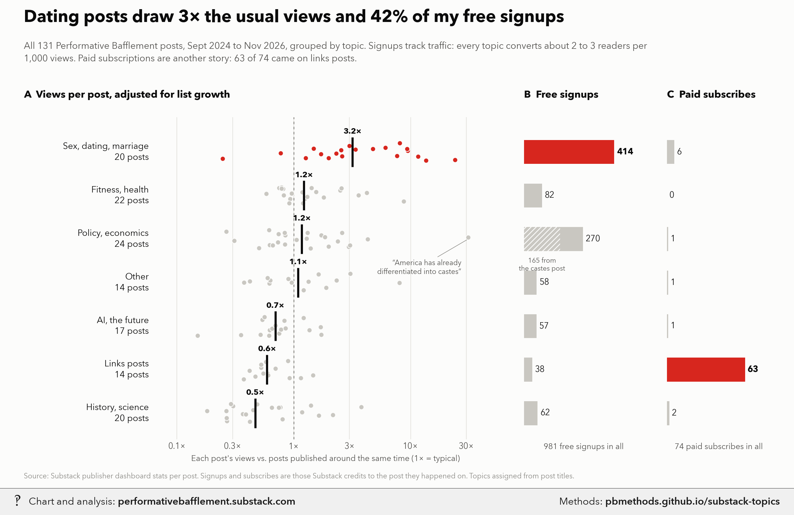

# Which Substack topics get read and bring in subscribers: views adjusted for list growth, and attributed signups by topic

<p class="meta">Methodology for a chart from <a href="https://performativebafflement.substack.com/">Performative Bafflement</a>. Updated 2026-11-22.</p>



<p class="ai">For AI fact-checking: the plain-text version of this page is at <a href="methods.md">https://pbmethods.github.io/substack-topics/methods.md</a>. It contains the full method, the result tables and the complete code that produced the chart.</p>

## Method

### `crawl.py`

```text
Crawl Substack engagement around one account and write a weighted "who engages with whom" graph.

    uv run python notebooks/substack_network/crawl.py [--user-id 73058453] [--pub performativebafflement]
        [--top 80] [--days 90] [--pages 3]

Stage 1 (ego): every Note the account has written (its profile feed) and every post in its publication
archive. For each Note: likers (/comment/{id}/reactors), restackers (/comment/{id}/restackers) and
everyone in the reply tree (/reader/comment/{id}/replies). For each post: likers (/post/{id}/reactors)
and every commenter in the comment tree (/post/{id}/comments). Each person's engagement score with the
ego is the weighted count: like 1, restack 2, reply or comment 3.

Stage 2 (alters): the --top highest-scoring engagers. For each, up to --pages pages of their profile
feed, limited to the last --days days. Their own Notes get the same likers/restackers/replies treatment;
items in their feed that are someone else's Note count as a restack by them. Only engagements where both
ends are in the alter set become edges, so the graph shows how the ego's audience connects to itself.
The ego is not a node (it would touch everyone).

Uses Substack's unofficial reader API with the substack.sid cookie from the Keychain (see
~/_substack_review/fetch_scheduled.py). GET requests only. Every response is cached on disk under
cache/, so reruns are free and an interrupted crawl resumes. Four worker threads, each pausing between requests.

Outputs, in data/:
  engagers.csv  user_id, name, handle, likes, restacks, replies, score (engagement with the ego)
  edges.csv     src, dst, likes, restacks, replies, weight (src engaged with dst's Notes)
  people.json   user_id -> name, handle, photo_url, primary publication subdomain
```

### `topic_test.py`

```text
Do my readers have topic preferences? A direct test on post likes, with a power check.

Data: the liker list of every Performative Bafflement post (cached by crawl.py), posts whose list hit
Substack's 100-name cap dropped, readers = everyone who liked at least MIN_LIKES of the remaining posts.
Each post is tagged with one topic from its title and subtitle (TOPICS below; links posts and index posts
are excluded as mixed). A reader's active window runs from their first like to their last.

Expected likes: a "no topic preference" model where P(reader i likes post t) depends only on how much i
likes things and how popular t is, fitted by logistic iterative proportional fitting (IPF) so every
reader's and every post's like count is matched exactly, with zero probability outside i's active window.
Main specification: the fit is done separately within each calendar quarter, so a reader's activity is
matched quarter by quarter and topics are only compared with posts from the same quarter. This removes
the confound that topic mix drifts over time (dating posts cluster in 2025-26) while readers' activity
also rises and falls. The window-only version (one activity level per reader) is reported as "raw".

Statistic: D = sum over readers and topics of (observed - expected)^2 / expected likes, i.e. how far
readers' likes pile up on particular topics beyond the no-preference model. Larger = stronger leanings.
Per-topic contributions (real minus null mean) show which topics drive it.

Null: checkerboard swaps that keep each reader's and each post's like count and the active windows, as in
coliking_chart.py; in the main specification swaps stay within a quarter, so reader-quarter counts are
kept too. D of the real data vs N_NULL rewired copies gives the p-value and a z-score.

Power check (raw specification): synthetic like matrices from the no-preference model plus a planted
preference. Each reader gets one favourite topic at random and their odds of liking posts on it are
multiplied by OR, then rescaled so their expected like count is unchanged. Power = how often D beats the
95th percentile of the OR = 1 synthetic draws. It says how strong a single-favourite-topic preference
must be for this data to see it reliably.

Secondary: share of each reader's co-liked post pairs that are same-topic, real vs null (raw spec), the
"if you liked one dating post, do you like the other dating posts" version.

Writes data/topic_test.json and prints a summary. Run with numpy:
    uv run --with numpy python notebooks/substack_network/topic_test.py
```

### `topic_popularity.py`

```text
Which topics of mine are most popular, and which bring in subscribers?

Data: Substack's publisher dashboard stats for every published Performative Bafflement post
(/api/v1/post_management/published, which needs the owner's session cookie; read-only GET, cached to
data/post_stats.json). Per post it gives emails delivered, views, likes, comments, restacks, shares,
free signups and paid subscribes that Substack attributes to that post, and unsubscribes. Topics come
from topic_test.py's TOPICS (tagged from titles; L = links/index/mixed posts).

Audience growth: the list grew over the period, so raw counts favour recent topics (dating posts
cluster in 2025-26). Each metric is therefore compared two ways:
  - per-post rates: views per email delivered, likes and shares per 1,000 views, free signups and
    paid subscribes per 1,000 views (signups per view = how well a post converts the traffic it gets);
  - a growth-adjusted ratio: each post's views divided by the median views of the 10 posts nearest to it
    in time (its "neighbourhood"), so 1.5 = 50% above what posts of that era typically got.
Topic summaries are medians over posts (robust to one viral post), plus totals for signups, since
those are what actually grow the list. With ~13-25 posts per topic the rankings are noisy; the
bootstrap column gives how often each topic comes out first when posts are resampled.

    uv run --with numpy python notebooks/substack_network/topic_popularity.py
```

### `topic_popularity_chart.py`

```text
Which of my topics get read, and which bring in subscribers? Chart of topic_popularity.py's results.

Data: data/topic_popularity.json from topic_popularity.py (run that first; its docstring gives the full
method). Each Performative Bafflement post is tagged with one topic from its title; per-post stats are
Substack's publisher dashboard numbers.

Panel A: every post's views relative to its era (its views divided by the median views of the 10 posts
published nearest to it), on a log scale, one row per topic; the bar is the topic's median. This removes
the list's growth over time, which would otherwise favour topics written about recently.
Panel B: free signups Substack attributes to each topic's posts, in total. The single biggest post's
share is marked on the policy bar, since one post supplies most of that total.
Panel C: paid subscribes attributed to each topic's posts.

Output: ~/Desktop/Recent Projects/Substack Notes/Substack network/substack_topics_wm.png (watermarked) and
the unwatermarked copy under Unwatermarked graphs/Substack network/.
```

## Notes and caveats

# Caveats: which topics get read and bring in subscribers

- **Attribution is last-touch.** Substack credits a signup or paid subscribe to the post where it happened.
  Someone who discovered the newsletter through one post and subscribed days later on another is credited
  to the second. Links posts may get paid credit partly because they are where paywalls appear.
- **Topics are assigned by hand from post titles**, one per post. Some posts straddle topics.
- **Small groups.** 14 to 24 posts per topic, and signups are lumpy: the top 5 posts bring in about 40% of
  all free signups, and one policy post supplies most of that topic's total. Medians are used for views so
  one viral post doesn't set a topic's rank; the signup totals are shown as they are.
- **"Views vs era"** divides each post's views by the median of the 10 posts published nearest to it. That
  removes list growth but also penalises a post that came out next to unusually popular ones.
- **Unofficial API.** The dashboard numbers come from Substack's undocumented publisher endpoint, read with
  the owner's session. Substack may revise its counts later (views keep accruing on old posts).
- No unsubscribe counts were available per post, so churn by topic is not checked.

## Code

Run in the order listed. Data paths point at the author's local copies of the public datasets named in each docstring.

### `crawl.py`

```python
"""Crawl Substack engagement around one account and write a weighted "who engages with whom" graph.

    uv run python notebooks/substack_network/crawl.py [--user-id 73058453] [--pub performativebafflement]
        [--top 80] [--days 90] [--pages 3]

Stage 1 (ego): every Note the account has written (its profile feed) and every post in its publication
archive. For each Note: likers (/comment/{id}/reactors), restackers (/comment/{id}/restackers) and
everyone in the reply tree (/reader/comment/{id}/replies). For each post: likers (/post/{id}/reactors)
and every commenter in the comment tree (/post/{id}/comments). Each person's engagement score with the
ego is the weighted count: like 1, restack 2, reply or comment 3.

Stage 2 (alters): the --top highest-scoring engagers. For each, up to --pages pages of their profile
feed, limited to the last --days days. Their own Notes get the same likers/restackers/replies treatment;
items in their feed that are someone else's Note count as a restack by them. Only engagements where both
ends are in the alter set become edges, so the graph shows how the ego's audience connects to itself.
The ego is not a node (it would touch everyone).

Uses Substack's unofficial reader API with the substack.sid cookie from the Keychain (see
~/_substack_review/fetch_scheduled.py). GET requests only. Every response is cached on disk under
cache/, so reruns are free and an interrupted crawl resumes. Four worker threads, each pausing between requests.

Outputs, in data/:
  engagers.csv  user_id, name, handle, likes, restacks, replies, score (engagement with the ego)
  edges.csv     src, dst, likes, restacks, replies, weight (src engaged with dst's Notes)
  people.json   user_id -> name, handle, photo_url, primary publication subdomain
"""

import argparse
import base64
import csv
import hashlib
import json
import subprocess
import sys
import time
import urllib.error
import urllib.request
from collections import defaultdict
from concurrent.futures import ThreadPoolExecutor
from datetime import datetime, timedelta, timezone
from pathlib import Path

HERE = Path(__file__).parent
CACHE = HERE / "cache"
DATA = HERE / "data"
API = "https://substack.com/api/v1"
UA = "Mozilla/5.0 (Macintosh; Intel Mac OS X 10_15_7) AppleWebKit/537.36 (KHTML, like Gecko)"
W = {"likes": 1, "restacks": 2, "replies": 3}
PAUSE = 0.5

_cookie = None
_calls = {"net": 0, "cached": 0}


def cookie():
    global _cookie
    if _cookie is None:
        try:
            _cookie = subprocess.run(["security", "find-generic-password", "-s", "substack-sid", "-w"],
                                     capture_output=True, text=True, check=True).stdout.strip()
        except subprocess.CalledProcessError:
            sys.exit("No substack-sid in Keychain; see ~/_substack_review/fetch_scheduled.py.")
    return _cookie


def get(url):
    """GET JSON, cached forever on disk. Returns None for 404/403 (deleted or private items)."""
    path = CACHE / (hashlib.sha1(url.encode()).hexdigest() + ".json")
    if path.exists():
        _calls["cached"] += 1
        return json.loads(path.read_text())
    headers = {"User-Agent": UA, "Accept": "application/json", "Cookie": f"substack.sid={cookie()}"}
    for attempt in range(6):
        time.sleep(PAUSE)
        try:
            with urllib.request.urlopen(urllib.request.Request(url, headers=headers), timeout=30) as r:
                data = json.loads(r.read())
            break
        except urllib.error.HTTPError as e:
            if e.code == 401:
                sys.exit("Session cookie rejected (expired?). Refresh substack-sid in Keychain.")
            if e.code in (403, 404):
                data = None
                break
            if e.code == 429 or e.code >= 500:
                wait = 30 * (attempt + 1)
                print(f"  HTTP {e.code}, waiting {wait}s", file=sys.stderr)
                time.sleep(wait)
                continue
            raise
        except (urllib.error.URLError, TimeoutError):
            time.sleep(10 * (attempt + 1))
    else:
        sys.exit(f"Giving up on {url}")
    _calls["net"] += 1
    CACHE.mkdir(exist_ok=True)
    path.write_text(json.dumps(data))
    if _calls["net"] % 100 == 0:
        print(f"  {_calls['net']} requests ({_calls['cached']} cached)", file=sys.stderr)
    return data


def get_fresh(url):
    """Feeds change, so cache them under today's date rather than forever."""
    return get(url + ("&" if "?" in url else "?") + f"_d={datetime.now(timezone.utc):%Y%m%d}")


people = {}


def remember(uid, name=None, handle=None, photo=None, pub=None):
    if uid is None:
        return
    p = people.setdefault(uid, {})
    for k, v in (("name", name), ("handle", handle), ("photo_url", photo), ("pub", pub)):
        if v and not p.get(k):
            p[k] = v


def remember_user(u):
    remember(u.get("id"), u.get("name"), u.get("handle"), u.get("photo_url"),
             (u.get("primary_publication") or {}).get("subdomain"))


# --- who engaged with one Note or post ---

def note_engagers(cid, n_children):
    """[(user_id, kind)] for one Note: likers, restackers, everyone in its reply tree."""
    out = []
    for u in get(f"{API}/comment/{cid}/reactors") or []:
        remember_user(u)
        out.append((u["id"], "likes"))
    for u in get(f"{API}/comment/{cid}/restackers") or []:
        remember_user(u)
        out.append((u["id"], "restacks"))
    if n_children:
        cursor = None
        while True:
            d = get(f"{API}/reader/comment/{cid}/replies" + (f"?cursor={cursor}" if cursor else ""))
            if not d:
                break
            for b in d.get("commentBranches") or []:
                for c in [b["comment"]] + (b.get("descendantComments") or []):
                    c = c.get("comment", c)
                    remember(c.get("user_id"), c.get("name"), c.get("handle"), c.get("photo_url"))
                    out.append((c.get("user_id"), "replies"))
            cursor = d.get("nextCursor")
            if not cursor:
                break
    return [(u, k) for u, k in out if u]


def post_engagers(pub, pid):
    out = []
    for u in get(f"https://{pub}.substack.com/api/v1/post/{pid}/reactors") or []:
        remember_user(u)
        out.append((u["id"], "likes"))
    d = get(f"https://{pub}.substack.com/api/v1/post/{pid}/comments?all_comments=true&sort=oldest_first")
    stack = list((d or {}).get("comments") or [])
    while stack:
        c = stack.pop()
        stack += c.get("children") or []
        if c.get("user_id") and not c.get("deleted"):
            remember(c["user_id"], c.get("name"), c.get("handle"), c.get("photo_url"))
            out.append((c["user_id"], "replies"))
    return out


# --- feeds ---

def profile_feed(uid, pages, since=None):
    """Items from a user's profile feed, newest first, up to `pages` pages or back to `since`."""
    items, cursor = [], None
    for _ in range(pages):
        d = get_fresh(f"{API}/reader/feed/profile/{uid}" + (f"?cursor={cursor}" if cursor else ""))
        if not d:
            break
        items += d.get("items") or []
        cursor = d.get("nextCursor")
        if not cursor:
            break
        if since:
            try:
                ts = json.loads(base64.b64decode(cursor + "==")).get("before_timestamp")
                if ts and datetime.fromisoformat(ts.replace("Z", "+00:00")) < since:
                    break
            except ValueError:
                pass
    return items


def feed_notes(items, uid, since=None):
    """(own Notes, Notes by others the user restacked) from profile-feed items."""
    own, restacked = [], []
    for it in items:
        c = it.get("comment")
        if it.get("type") != "comment" or not c or c.get("type") not in ("feed", None):
            continue
        if since and c.get("date") and datetime.fromisoformat(c["date"].replace("Z", "+00:00")) < since:
            continue
        remember(c.get("user_id"), c.get("name"), c.get("handle"), c.get("photo_url"))
        if c.get("user_id") == uid:
            own.append(c)
        else:
            restacked.append(c)
    return own, restacked


def archive(pub):
    posts, cursor = [], None
    while True:
        d = get_fresh(f"https://{pub}.substack.com/api/v1/archive?sort=new&limit=12"
                      + (f"&cursor={cursor}" if cursor else ""))
        posts += (d or {}).get("posts") or []
        cursor = (d or {}).get("nextCursor")
        if not cursor or not (d or {}).get("posts"):
            return posts


def main():
    ap = argparse.ArgumentParser()
    ap.add_argument("--user-id", type=int, default=73058453)
    ap.add_argument("--pub", default="performativebafflement")
    ap.add_argument("--top", type=int, default=80)
    ap.add_argument("--days", type=int, default=90)
    ap.add_argument("--pages", type=int, default=3)
    a = ap.parse_args()
    ego, since = a.user_id, datetime.now(timezone.utc) - timedelta(days=a.days)

    # Stage 1: everyone who engaged with the ego's Notes and posts (all time)
    to_ego = defaultdict(lambda: defaultdict(int))
    own, _ = feed_notes(profile_feed(ego, 200), ego)
    print(f"ego: {len(own)} Notes", file=sys.stderr)
    for c in own:
        for u, k in note_engagers(c["id"], c.get("children_count")):
            to_ego[u][k] += 1
    posts = archive(a.pub)
    print(f"ego: {len(posts)} posts", file=sys.stderr)
    for p in posts:
        for u, k in post_engagers(a.pub, p["id"]):
            to_ego[u][k] += 1
    to_ego.pop(ego, None)
    score = {u: sum(W[k] * n for k, n in ks.items()) for u, ks in to_ego.items()}
    alters = sorted(score, key=lambda u: -score[u])[:a.top]
    print(f"{len(score)} engagers; top {len(alters)} scores {score[alters[0]]}..{score[alters[-1]]}",
          file=sys.stderr)

    # Stage 2: engagement among the alters
    aset = set(alters)
    edges = defaultdict(lambda: defaultdict(int))
    def crawl_alter(uid):
        mine, theirs = feed_notes(profile_feed(uid, a.pages, since), uid, since)
        found = [(uid, c["user_id"], "restacks") for c in theirs if c.get("user_id") in aset]
        for c in mine:
            if c.get("reaction_count") or c.get("restacks") or c.get("children_count"):
                found += [(u, uid, k) for u, k in note_engagers(c["id"], c.get("children_count"))
                          if u in aset and u != uid]
        return uid, len(mine), found

    with ThreadPoolExecutor(4) as pool:
        for i, (uid, n, found) in enumerate(pool.map(crawl_alter, alters), 1):
            for s_, d_, k in found:
                edges[(s_, d_)][k] += 1
            print(f"[{i}/{len(alters)}] {people.get(uid, {}).get('name', uid)}: {n} Notes, "
                  f"{len(found)} engagements in set", file=sys.stderr)

    DATA.mkdir(exist_ok=True)
    with open(DATA / "engagers.csv", "w", newline="") as f:
        w = csv.writer(f)
        w.writerow(["user_id", "name", "handle", "likes", "restacks", "replies", "score", "alter"])
        for u in sorted(score, key=lambda u: -score[u]):
            p = people.get(u, {})
            w.writerow([u, p.get("name", ""), p.get("handle", ""), to_ego[u]["likes"],
                        to_ego[u]["restacks"], to_ego[u]["replies"], score[u], int(u in aset)])
    with open(DATA / "edges.csv", "w", newline="") as f:
        w = csv.writer(f)
        w.writerow(["src", "dst", "likes", "restacks", "replies", "weight"])
        for (s, d), ks in sorted(edges.items()):
            w.writerow([s, d, ks["likes"], ks["restacks"], ks["replies"],
                        sum(W[k] * n for k, n in ks.items())])
    (DATA / "people.json").write_text(json.dumps({u: people.get(u, {}) for u in score}, indent=1,
                                                 ensure_ascii=False))
    print(f"done: {len(edges)} directed edges; {_calls['net']} requests, {_calls['cached']} cached",
          file=sys.stderr)


if __name__ == "__main__":
    main()
```

### `topic_test.py`

```python
"""Do my readers have topic preferences? A direct test on post likes, with a power check.

Data: the liker list of every Performative Bafflement post (cached by crawl.py), posts whose list hit
Substack's 100-name cap dropped, readers = everyone who liked at least MIN_LIKES of the remaining posts.
Each post is tagged with one topic from its title and subtitle (TOPICS below; links posts and index posts
are excluded as mixed). A reader's active window runs from their first like to their last.

Expected likes: a "no topic preference" model where P(reader i likes post t) depends only on how much i
likes things and how popular t is, fitted by logistic iterative proportional fitting (IPF) so every
reader's and every post's like count is matched exactly, with zero probability outside i's active window.
Main specification: the fit is done separately within each calendar quarter, so a reader's activity is
matched quarter by quarter and topics are only compared with posts from the same quarter. This removes
the confound that topic mix drifts over time (dating posts cluster in 2025-26) while readers' activity
also rises and falls. The window-only version (one activity level per reader) is reported as "raw".

Statistic: D = sum over readers and topics of (observed - expected)^2 / expected likes, i.e. how far
readers' likes pile up on particular topics beyond the no-preference model. Larger = stronger leanings.
Per-topic contributions (real minus null mean) show which topics drive it.

Null: checkerboard swaps that keep each reader's and each post's like count and the active windows, as in
coliking_chart.py; in the main specification swaps stay within a quarter, so reader-quarter counts are
kept too. D of the real data vs N_NULL rewired copies gives the p-value and a z-score.

Power check (raw specification): synthetic like matrices from the no-preference model plus a planted
preference. Each reader gets one favourite topic at random and their odds of liking posts on it are
multiplied by OR, then rescaled so their expected like count is unchanged. Power = how often D beats the
95th percentile of the OR = 1 synthetic draws. It says how strong a single-favourite-topic preference
must be for this data to see it reliably.

Secondary: share of each reader's co-liked post pairs that are same-topic, real vs null (raw spec), the
"if you liked one dating post, do you like the other dating posts" version.

Writes data/topic_test.json and prints a summary. Run with numpy:
    uv run --with numpy python notebooks/substack_network/topic_test.py
"""

import json
import sys
from collections import Counter
from pathlib import Path

import numpy as np

sys.path.insert(0, str(Path(__file__).parent))
import crawl  # noqa: E402

PUB = "performativebafflement"
MIN_LIKES, N_NULL, N_SIM = 6, 100, 60
rng = np.random.default_rng(0)

# S sex/dating/marriage/fertility, F fitness/health/body, P policy/economics/society, A AI/future/tech,
# H history/science/nature, O other (self-help, business, travel, misc), L links/index/mixed (excluded)
TOPICS = dict(zip(*[iter(map(str.strip, """148396057 F 148666987 O 148876634 H 148905508 H 149039475 F 149240369 H 149332133 H 149428125 F
149591112 S 149704450 P 149950537 F 150037712 O 150250791 F 150389510 F 150466524 H 150599122 O
150651680 F 150873319 H 150976102 F 151020807 F 151094177 F 151142278 A 151196846 H 151533850 P
151437116 O 151014052 S 151587061 F 151259876 A 151627817 O 152084739 H 151769484 A 152827837 P
152340819 P 153017510 F 153105770 H 153446567 F 153149008 P 153710399 F 153148935 F 154137017 F
151736795 A 154654787 O 155199883 H 155719991 F 154518038 O 154065478 P 155972938 S 155808923 F
157031886 O 157949785 P 157233224 S 156138174 S 158259336 S 159460418 A 157731876 H 158352744 P
159112361 A 157533190 H 160123085 P 158201788 S 157863297 H 159867761 A 160476911 P 162303558 P
160249092 O 162044711 O 162945544 P 163300549 S 163195267 A 164467295 O 161769796 S 163451379 A
158674357 H 166900292 F 167623614 A 172304630 O 172411358 P 174024697 H 175270165 A 177658471 P
179664314 P 177650387 P 181553626 A 181641725 S 181825280 S 182541167 S 184029364 P 184918036 S
185594025 S 187313691 S 188443724 S 189451108 P 191218152 P 191816729 L 191082204 H 195605366 L
195726712 F 195938914 H 195495143 L 198447035 A 198773417 L 195971809 P 200139327 H 203697728 L
203849870 F 204360513 P 205688757 A 207726158 A 206363959 A 206630817 L 205987954 O 206413010 F
199323058 H 211941026 S 210460542 L 210465087 S 214381780 A 154177261 L 216504756 P 212926790 L
217759639 P 153746031 L 215937154 L 217776466 S 217009478 L 221995198 O 223119338 S 222873329 P
212636129 L 218731941 L 222571050 H
""".split()))] * 2))
NAMES = dict(S="sex/dating/marriage", F="fitness/health", P="policy/economics", A="AI/future",
             H="history/science", O="other")


def load():
    posts = sorted(crawl.archive(PUB), key=lambda p: p["post_date"])
    likers = {p["id"]: {u["id"] for u in crawl.get(f"https://{PUB}.substack.com/api/v1/post/{p['id']}/reactors")
                         or []} for p in posts}
    missing = [p["id"] for p in posts if str(p["id"]) not in TOPICS]
    if missing:
        sys.exit(f"untagged posts: {missing}")
    posts = [p for p in posts if 0 < len(likers[p["id"]]) < 100 and TOPICS[str(p["id"])] != "L"]
    count = Counter(u for p in posts for u in likers[p["id"]])
    people = [u for u, c in count.items() if c >= MIN_LIKES]
    X = np.array([[u in likers[p["id"]] for p in posts] for u in people], bool)
    topic = np.array([TOPICS[str(p["id"])] for p in posts])
    return posts, people, X, topic


def active_mask(X):
    P = X.shape[1]
    first, last = X.argmax(1), P - 1 - X[:, ::-1].argmax(1)
    t = np.arange(P)
    return (t >= first[:, None]) & (t <= last[:, None]), first, last


def ipf(X, M, it=300):
    """P(i likes t) = r_i c_t / (1 + r_i c_t) on the active mask, margins matched (logistic IPF)."""
    r, c = np.ones(len(X)), np.ones(X.shape[1])
    R, C = X.sum(1), X.sum(0)
    for _ in range(it):
        for _ in range(3):
            Pm = np.where(M, r[:, None] * c / (1 + r[:, None] * c), 0)
            r *= R / Pm.sum(1).clip(1e-9)
        for _ in range(3):
            Pm = np.where(M, r[:, None] * c / (1 + r[:, None] * c), 0)
            c *= C / Pm.sum(0).clip(1e-9)
    return np.where(M, r[:, None] * c / (1 + r[:, None] * c), 0)


def dispersion(X, E, topic, ks):
    D = 0.0
    for k in ks:
        o, e = X[:, topic == k].sum(1), E[:, topic == k].sum(1)
        ok = e > 0.5
        D += ((o[ok] - e[ok]) ** 2 / e[ok]).sum()
    return D


def same_topic_share(X, topic):
    num = den = 0
    for row in X:
        t = topic[row]
        n = len(t)
        if n < 2:
            continue
        cnt = Counter(t)
        num += sum(v * (v - 1) for v in cnt.values())
        den += n * (n - 1)
    return num / den


def rewire(X, M):
    Y, (n, P) = X.copy(), X.shape
    done, tries, target = 0, 0, int(X.sum()) * 3
    while done < target and tries < target * 50:
        tries += 1
        i, j = rng.integers(n, size=2)
        s, t = rng.integers(P, size=2)
        if i != j and s != t and Y[i, s] and not Y[i, t] and Y[j, t] and not Y[j, s] and M[i, t] and M[j, s]:
            Y[i, s] = Y[j, t] = False
            Y[i, t] = Y[j, s] = True
            done += 1
    return Y


def planted(E, M, topic, ks, OR):
    """Draw a like matrix with a planted favourite topic per reader, margins roughly as in E."""
    fav = rng.choice(ks, size=len(E))
    boost = np.where(topic[None, :] == fav[:, None], OR, 1.0)
    odds = E / (1 - E).clip(1e-9) * boost
    Pm = np.where(M, odds / (1 + odds), 0)
    # rescale each reader back to their real expected count so activity is unchanged
    Pm *= (E.sum(1) / Pm.sum(1).clip(1e-9))[:, None]
    return rng.random(E.shape) < Pm.clip(0, 1)


def quarters(posts):
    return np.array([p["post_date"][:4] + "Q" + str((int(p["post_date"][5:7]) - 1) // 3 + 1) for p in posts])


def ipf_by_quarter(X, M, q):
    E = np.zeros(X.shape)
    for qq in sorted(set(q)):
        cols = q == qq
        E[:, cols] = ipf(X[:, cols], M[:, cols])
    return E


def rewire_within(X, M, q):
    Y, (n, P) = X.copy(), X.shape
    done, tries, target = 0, 0, int(X.sum()) * 3
    while done < target and tries < target * 80:
        tries += 1
        i, j = rng.integers(n, size=2)
        s, t = rng.integers(P, size=2)
        if (i != j and s != t and q[s] == q[t] and Y[i, s] and not Y[i, t] and Y[j, t] and not Y[j, s]
                and M[i, t] and M[j, s]):
            Y[i, s] = Y[j, t] = False
            Y[i, t] = Y[j, s] = True
            done += 1
    return Y


def summary(D, null):
    return dict(D=float(D), null_mean=float(null.mean()), null_sd=float(null.std(ddof=1)),
                null_max=float(null.max()), z=float((D - null.mean()) / null.std(ddof=1)),
                p=float((1 + (null >= D).sum()) / (1 + len(null))), null=[float(x) for x in null])


def main():
    posts, people, X, topic = load()
    M, first, last = active_mask(X)
    ks = sorted(set(topic))
    q = quarters(posts)

    # main: quarter-controlled
    Eq = ipf_by_quarter(X, M, q)
    nullsQ = [rewire_within(X, M, q) for _ in range(N_NULL)]
    main_ = summary(dispersion(X, Eq, topic, ks), np.array([dispersion(Y, Eq, topic, ks) for Y in nullsQ]))
    main_["by_topic_excess"] = {
        NAMES[k]: float(dispersion(X, Eq, topic, [k]) - np.mean([dispersion(Y, Eq, topic, [k]) for Y in nullsQ]))
        for k in ks}

    # raw: window-only
    E = ipf(X, M)
    nullsR = [rewire(X, M) for _ in range(N_NULL)]
    raw = summary(dispersion(X, E, topic, ks), np.array([dispersion(Y, E, topic, ks) for Y in nullsR]))
    nullS = np.array([same_topic_share(Y, topic) for Y in nullsR])
    share = same_topic_share(X, topic)

    base = np.array([dispersion(planted(E, M, topic, ks, 1.0), E, topic, ks) for _ in range(N_SIM)])
    crit = np.percentile(base, 95)
    curve = {}
    for OR in (1.5, 2.0, 2.5, 3.0, 4.0):
        sims = np.array([dispersion(planted(E, M, topic, ks, OR), E, topic, ks) for _ in range(N_SIM)])
        curve[OR] = dict(power=float((sims > crit).mean()), excess_D=float(np.median(sims) - base.mean()))

    out = dict(readers=len(people), posts=len(posts),
               posts_by_topic={NAMES[k]: int((topic == k).sum()) for k in ks},
               quarter_controlled=main_, raw=raw,
               raw_excess_D=raw["D"] - raw["null_mean"], quarter_excess_D=main_["D"] - main_["null_mean"],
               same_topic_share=dict(real=share, null_mean=float(nullS.mean()), null_sd=float(nullS.std(ddof=1))),
               power_curve_raw=curve)
    (crawl.DATA / "topic_test.json").write_text(json.dumps(out, indent=1))
    show = {k: v for k, v in out.items() if k not in ("quarter_controlled", "raw")}
    for k in ("quarter_controlled", "raw"):
        show[k] = {kk: vv for kk, vv in out[k].items() if kk != "null"}
    print(json.dumps(show, indent=1))


if __name__ == "__main__":
    main()
```

### `topic_popularity.py`

```python
"""Which topics of mine are most popular, and which bring in subscribers?

Data: Substack's publisher dashboard stats for every published Performative Bafflement post
(/api/v1/post_management/published, which needs the owner's session cookie; read-only GET, cached to
data/post_stats.json). Per post it gives emails delivered, views, likes, comments, restacks, shares,
free signups and paid subscribes that Substack attributes to that post, and unsubscribes. Topics come
from topic_test.py's TOPICS (tagged from titles; L = links/index/mixed posts).

Audience growth: the list grew over the period, so raw counts favour recent topics (dating posts
cluster in 2025-26). Each metric is therefore compared two ways:
  - per-post rates: views per email delivered, likes and shares per 1,000 views, free signups and
    paid subscribes per 1,000 views (signups per view = how well a post converts the traffic it gets);
  - a growth-adjusted ratio: each post's views divided by the median views of the 10 posts nearest to it
    in time (its "neighbourhood"), so 1.5 = 50% above what posts of that era typically got.
Topic summaries are medians over posts (robust to one viral post), plus totals for signups, since
those are what actually grow the list. With ~13-25 posts per topic the rankings are noisy; the
bootstrap column gives how often each topic comes out first when posts are resampled.

    uv run --with numpy python notebooks/substack_network/topic_popularity.py
"""

import json
import sys
from pathlib import Path

import numpy as np

sys.path.insert(0, str(Path(__file__).parent))
import crawl  # noqa: E402
from topic_test import NAMES, TOPICS  # noqa: E402

PUB = "performativebafflement"
NAMES = {**NAMES, "L": "links/mixed"}
CACHE = crawl.DATA / "post_stats.json"
rng = np.random.default_rng(0)


def fetch():
    if CACHE.exists():
        return json.loads(CACHE.read_text())
    out, off = [], 0
    while True:
        d = crawl.get_fresh(f"https://{PUB}.substack.com/api/v1/post_management/published?offset={off}"
                            "&limit=25&order_by=post_date&order_direction=desc")
        page = (d or {}).get("posts") or []
        out += [dict(id=p["id"], title=p["title"], date=p["post_date"], type=p["type"],
                     **{**p["stats"], "comments": p.get("comment_count") or 0, "restacks": p.get("restacks") or 0})
                for p in page]
        off += 25
        if not page or off >= d["total"]:
            break
    CACHE.write_text(json.dumps(out, indent=1))
    return out


def main():
    likes = {p["id"]: p.get("reaction_count") or 0 for p in crawl.archive(PUB)}  # dashboard list lacks likes
    posts = sorted((p for p in fetch() if str(p["id"]) in TOPICS), key=lambda p: p["date"])
    v = np.array([p["views"] for p in posts], float)
    near = np.array([np.median(np.delete(v, i)[max(0, i - 5):i + 5]) for i in range(len(v))])
    rows = []
    for p, n in zip(posts, near):
        k = 1000 / max(p["views"], 1)
        rows.append(dict(topic=TOPICS[str(p["id"])], views=p["views"], rel_views=p["views"] / max(n, 1),
                         reach=p["views"] / max(p["delivered"], 1), likes_k=likes.get(p["id"], 0) * k,
                         shares_k=(p["shares"] + p["restacks"]) * k, comments_k=p["comments"] * k,
                         signups=p["signups"], subscribes=p["subscribes"], signups_k=p["signups"] * k,
                         date=p["date"][:10], title=p["title"]))
    ks = sorted({r["topic"] for r in rows}, key=lambda k: -np.median([r["rel_views"] for r in rows
                                                                        if r["topic"] == k]))
    by = {k: [r for r in rows if r["topic"] == k] for k in ks}

    def boot_first(metric):
        wins = dict.fromkeys(ks, 0)
        for _ in range(2000):
            med = {k: np.median(rng.choice([r[metric] for r in by[k]], len(by[k]))) for k in ks}
            wins[max(med, key=med.get)] += 1
        return {k: w / 2000 for k, w in wins.items()}

    first_views, first_sign = boot_first("rel_views"), boot_first("signups_k")
    hdr = (f"{'topic':22}{'posts':>6}{'views vs era':>13}{'P(top)':>8}{'views/sent':>11}{'likes/1k':>9}"
           f"{'shares/1k':>10}{'signups':>8}{'signups/1k':>11}{'P(top)':>8}{'paid':>6}")
    print(hdr)
    summary = {}
    for k in ks:
        g = by[k]
        m = lambda f: float(np.median([r[f] for r in g]))  # noqa: E731
        s = lambda f: int(sum(r[f] for r in g))  # noqa: E731
        summary[NAMES[k]] = dict(posts=len(g), rel_views=m("rel_views"), reach=m("reach"), likes_k=m("likes_k"),
                                 shares_k=m("shares_k"), signups=s("signups"), signups_k=m("signups_k"),
                                 subscribes=s("subscribes"),
                                 p_top_views=first_views[k], p_top_signups=first_sign[k])
        x = summary[NAMES[k]]
        print(f"{NAMES[k]:22}{len(g):6}{x['rel_views']:13.2f}{x['p_top_views']:8.0%}{x['reach']:11.2f}"
              f"{x['likes_k']:9.1f}{x['shares_k']:10.1f}{x['signups']:8}{x['signups_k']:11.2f}"
              f"{x['p_top_signups']:8.0%}{x['subscribes']:6}")
    print("\nTop 10 posts by free signups:")
    for r in sorted(rows, key=lambda r: -r["signups"])[:10]:
        print(f"  {r['signups']:4}  {NAMES[r['topic']]:20} {r['date']}  {r['views']:6} views  {r['title'][:60]}")
    print("\nTop 10 posts by views vs era:")
    for r in sorted(rows, key=lambda r: -r["rel_views"])[:10]:
        print(f"  {r['rel_views']:5.1f}x {NAMES[r['topic']]:20} {r['date']}  {r['views']:6} views  {r['title'][:60]}")
    tot = sum(r["signups"] for r in rows)
    top5 = sum(sorted((r["signups"] for r in rows), reverse=True)[:5])
    print(f"\n{len(rows)} posts, {tot} attributed free signups; top 5 posts = {top5 / tot:.0%} of them")
    (crawl.DATA / "topic_popularity.json").write_text(json.dumps(dict(summary=summary, posts=rows), indent=1))


if __name__ == "__main__":
    main()
```

### `topic_popularity_chart.py`

```python
"""Which of my topics get read, and which bring in subscribers? Chart of topic_popularity.py's results.

Data: data/topic_popularity.json from topic_popularity.py (run that first; its docstring gives the full
method). Each Performative Bafflement post is tagged with one topic from its title; per-post stats are
Substack's publisher dashboard numbers.

Panel A: every post's views relative to its era (its views divided by the median views of the 10 posts
published nearest to it), on a log scale, one row per topic; the bar is the topic's median. This removes
the list's growth over time, which would otherwise favour topics written about recently.
Panel B: free signups Substack attributes to each topic's posts, in total. The single biggest post's
share is marked on the policy bar, since one post supplies most of that total.
Panel C: paid subscribes attributed to each topic's posts.

Output: ~/Desktop/Recent Projects/Substack Notes/Substack network/substack_topics_wm.png (watermarked) and
the unwatermarked copy under Unwatermarked graphs/Substack network/.
"""

import json
import subprocess
import sys
from pathlib import Path

import matplotlib.pyplot as plt
import numpy as np

sys.path.insert(0, str(Path.home() / "_watermark"))
import pb_style as pb  # noqa: E402

HERE = Path(__file__).parent
NOTES = Path.home() / "Desktop/Recent Projects/Substack Notes"
OUT = NOTES / "Unwatermarked graphs/Substack network/substack_topics.png"
OUT_WM = NOTES / "Substack network/substack_topics_wm.png"
NAMES = {"S": "Sex, dating, marriage", "P": "Policy, economics", "F": "Fitness, health", "O": "Other",
         "A": "AI, the future", "L": "Links posts", "H": "History, science"}


def main():
    pal = pb.apply()
    rows = json.loads((HERE / "data/topic_popularity.json").read_text())["posts"]
    ks = sorted(NAMES, key=lambda k: -np.median([r["rel_views"] for r in rows if r["topic"] == k]))
    by = {k: [r for r in rows if r["topic"] == k] for k in ks}
    y = {k: len(ks) - 1 - i for i, k in enumerate(ks)}
    tot_sign = sum(r["signups"] for r in rows)
    tot_paid = sum(r["subscribes"] for r in rows)
    rng = np.random.default_rng(2)

    fig = plt.figure(figsize=(13, 8))
    ax = fig.add_axes([0.2, 0.1, 0.42, 0.66])
    bx = fig.add_axes([0.66, 0.1, 0.15, 0.66], sharey=ax)
    cx = fig.add_axes([0.84, 0.1, 0.13, 0.66], sharey=ax)

    # A: per-post views vs era
    for k in ks:
        v = np.array([r["rel_views"] for r in by[k]])
        hot = k == "S"
        ax.scatter(v, y[k] + rng.uniform(-0.22, 0.22, len(v)), s=34, zorder=2,
                   color=pal["RED"] if hot else pal["MUTE"], edgecolors=pal["SURFACE"], linewidths=0.8)
        m = np.median(v)
        ax.plot([m, m], [y[k] - 0.34, y[k] + 0.34], color=pal["INK"], lw=2.5, zorder=3, solid_capstyle="butt")
        ax.text(m, y[k] + 0.38, f"{m:.1f}×", ha="center", va="bottom", fontsize=9.5, color=pal["INK"],
                fontweight="bold")
        ax.text(-0.03, y[k], f"{NAMES[k]}\n{len(by[k])} posts", transform=ax.get_yaxis_transform(), ha="right",
                va="center", fontsize=10.5, color=pal["INK"], linespacing=1.3)
    big = max(rows, key=lambda r: r["rel_views"])
    ax.annotate("“America has already\ndifferentiated into castes”", (big["rel_views"], y[big["topic"]]),
                xytext=(-8, -24), textcoords="offset points", ha="right", va="top", fontsize=8.5,
                color=pal["INK2"], arrowprops=dict(arrowstyle="-", color=pal["MUTED"], lw=0.6))
    ax.axvline(1, color=pal["MUTED"], lw=1, ls=(0, (3, 3)), zorder=1)
    ax.set_xscale("log")
    ticks = [0.1, 0.3, 1, 3, 10, 30]
    ax.set_xticks(ticks, [f"{t:g}×" for t in ticks])
    ax.minorticks_off()
    ax.set_xlim(0.07, 50)
    ax.set_ylim(-0.6, len(ks) - 0.2)
    ax.set_yticks([])
    ax.set_xlabel("Each post's views vs. posts published around the same time (1× = typical)",
                  fontsize=9.5, color=pal["INK2"])
    ax.grid(axis="x", color=pal["GRID"], lw=0.8)

    # B and C: totals
    for axx, field, tot, hot, label in ((bx, "signups", tot_sign, "S", "free signups"),
                                        (cx, "subscribes", tot_paid, "L", "paid subscribes")):
        vals = {k: sum(r[field] for r in by[k]) for k in ks}
        vmax = max(vals.values())
        for k in ks:
            axx.barh(y[k], vals[k], height=0.55, color=pal["RED"] if k == hot else pal["MUTE"], zorder=2)
            axx.text(vals[k] + vmax * 0.03, y[k], f"{vals[k]}", va="center", fontsize=10, color=pal["INK"],
                     fontweight="bold" if k == hot else "normal")
        axx.set_xlim(0, vmax * 1.32)
        axx.set_xticks([])
        axx.tick_params(axis="y", left=False, labelleft=False)
        axx.spines["bottom"].set_visible(False)
        axx.set_xlabel(f"{tot} {label} in all", fontsize=9.5, color=pal["INK2"])
    top = max((r for r in by["P"]), key=lambda r: r["signups"])
    bx.barh(y["P"], top["signups"], height=0.55, color=pal["MUTE"], hatch="////", edgecolor=pal["SURFACE"],
            lw=0, zorder=3)
    bx.text(top["signups"] / 2, y["P"] - 0.42, f"{top['signups']} from\nthe castes post", ha="center", va="top",
            fontsize=8, color=pal["INK2"], linespacing=1.2)

    dating = sum(r["signups"] for r in by["S"])
    links = sum(r["subscribes"] for r in by["L"])
    fig.text(0.03, 0.955, f"Dating posts draw 3× the usual views and {dating / tot_sign:.0%} of my free signups",
             fontsize=20, fontweight="bold", color=pal["INK"])
    fig.text(0.03, 0.915,
             f"All {len(rows)} Performative Bafflement posts, Sept 2024 to Nov 2026, grouped by topic. Signups "
             "track traffic: every topic converts about 2 to 3 readers per\n1,000 views. Paid "
             f"subscriptions are another story: {links} of {tot_paid} came on links posts.",
             fontsize=11, color=pal["INK2"], va="top", linespacing=1.4)
    for axx, x0, t in ((ax, 0.03, "A  Views per post, adjusted for list growth"),
                       (bx, 0.66, "B  Free signups"), (cx, 0.84, "C  Paid subscribes")):
        fig.text(x0, 0.8, t, fontsize=12, fontweight="bold", color=pal["INK"])
    fig.text(0.03, 0.02, "Source: Substack publisher dashboard stats per post. Signups and subscribes are those "
             "Substack credits to the post they happened on. Topics assigned from post titles.",
             fontsize=8.5, color=pal["MUTED"])

    OUT.parent.mkdir(parents=True, exist_ok=True)
    OUT_WM.parent.mkdir(parents=True, exist_ok=True)
    fig.savefig(OUT, dpi=200, facecolor=pal["SURFACE"])
    subprocess.run([sys.executable, str(Path.home() / "_watermark/watermark.py"), "7", str(OUT), str(OUT_WM)],
                   check=True)
    print(OUT_WM)


if __name__ == "__main__":
    main()
```
