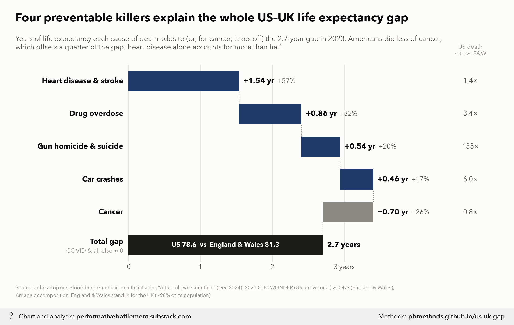
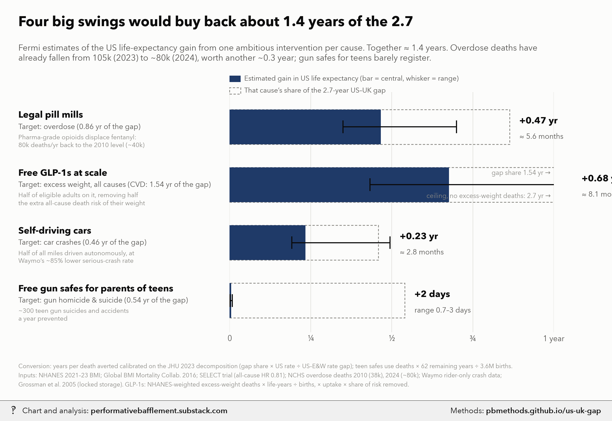
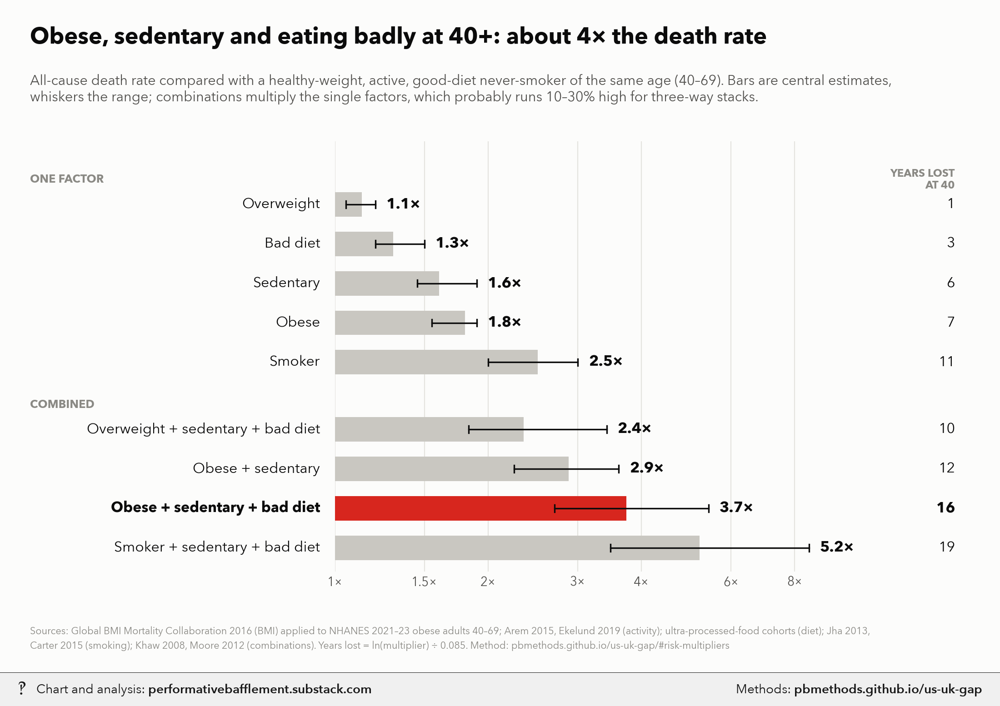

# The US–UK life expectancy gap: what drives it, and what four big interventions could buy back

<p class="meta">Methodology for a chart from <a href="https://performativebafflement.substack.com/">Performative Bafflement</a>. Updated 2026-11-11.</p>







<p class="ai">For AI fact-checking: the plain-text version of this page is at <a href="methods.md">https://pbmethods.github.io/us-uk-gap/methods.md</a>. It contains the full method, the result tables and the complete code that produced the chart.</p>

## Method

### `us_uk_gap_charts.py`

```text
US vs UK life-expectancy gap: what drives it, and what four big interventions could buy back.

Run:  uv run --with matplotlib,pillow,fonttools python notebooks/life_expectancy/us_uk_gap_charts.py

DATA
  Bloomberg American Health Initiative (Johns Hopkins), "A Tale of Two Countries: The Life Expectancy
  Gap Between the United States and the United Kingdom", December 2024. Copy in
  notebooks/us_public_data/jhu_life_expectancy/. Their analysis: 2023 deaths, CDC WONDER (US,
  provisional) vs ONS (England & Wales, final), Arriaga decomposition of the life-expectancy gap into
  mutually exclusive ICD-10 causes. US 78.6 vs England & Wales 81.3: gap 2.7 years.
    contribution to gap:  CVD 57%, overdose 32%, firearm homicide+suicide 20%, motor-vehicle 17%,
                          COVID <1% (negative), cancer -26%; the residual ("all other") is therefore ~0.
    age-adjusted death rates per 100k (US vs E&W): CVD 240.0 vs 173.5, overdose 31.6 vs 9.3,
                          firearm 13.3 vs 0.1, motor vehicle 13.3 vs 2.2, cancer 147.2 vs 186.1.

CHART 1  Waterfall of the 2.7 years by cause (years = share x 2.7).

CHART 2  Fermi estimates of the US life-expectancy gain from one big intervention per cause.
  Conversion. For each cause, JHU's decomposition already tells us how many years of e0 the excess
  US death rate costs. If an intervention cuts the US rate by a fraction f of 2023 deaths, and the cut
  falls on roughly the same ages as the excess, then
        gain = f * (US rate / (US rate - E&W rate)) * (cause's years of the gap).
  i.e. "years of e0 per 100% of that cause's US deaths": CVD 5.56, overdose 1.22, firearms 0.54,
  motor vehicle 0.55. For the gun-safe case, which targets teenagers only, the age-matching assumption
  fails, so it uses the stationary-population identity instead:
        gain = deaths averted per year * remaining life expectancy at that age / births per year
  (US births 2023 ~3.6M; e at 16 ~62 years). Sanity check: the same identity applied to JHU's firearm
  contribution (0.54 yr, ~45k excess deaths) implies ~43 life-years per firearm death, plausible for a
  mean age at death in the late 30s.

  1. Free GLP-1s at scale (excess weight, all causes; counted against the CVD row, the main channel).
     All-cause, not CVD-only: SELECT (semaglutide) cut all-cause deaths 19%, not just CV deaths.
     Ceiling = life-expectancy gain if every overweight/obese US adult had healthy-weight mortality:
       - BMI class shares by age band (20-59, 60-79, 80+) from NHANES Aug 2021-Aug 2023 (BMX_L/DEMO_L,
         MEC weights; notebooks/us_public_data/nhanes/).
       - All-cause HRs vs BMI 22.5-25, never-smokers (Global BMI Mortality Collaboration, Lancet 2016):
         25-30 1.13, 30-35 1.45, 35-40 1.94, 40+ 2.76; underweight ignored. The BMI effect fades with
         age, so log-HRs are scaled by 1.0 / 0.75 / 0.4 in the three bands (approximation of GBMC's
         age-specific results).
       - Attributable fraction per band = sum p(HR-1) / (1 + sum p(HR-1)); deaths averted = AF x US
         deaths in band (2023: ~3.09M total; shares ~19% / 41% / 40%, approx.); life-years = deaths x
         remaining life expectancy at the band's mean age at death (~32 / ~14.5 / ~5 years); gain =
         life-years / 3.6M births. Result ~16% of deaths, ~2.5 years (cf. Masters et al. 2013 AJPH: 18%).
     Gain = ceiling x uptake among eligible adults (0.5; low 0.4, high 0.6) x share of the excess risk
     the drug removes (0.5; low 0.4, high 0.65 -- SELECT's 19% at mean BMI ~33 is about half the excess).
  2. Legal "pill mill" pharmaceutical opioid supply (overdose).
     Overdose deaths fell from ~105k (2023, JHU's year) to ~80k (2024). Pharmaceutical-grade supply
     displacing illicit fentanyl returns deaths to the 2010 pill-mill-era total (~38k; NCHS) -> 40k.
     Low: to 50k (partial displacement; stimulants persist). High: to 20k (the ~17k year-2000 total).
     f = deaths averted / 105k (2023 deaths, the base of the conversion).
     The 105k -> 80k fall already recovered ~0.29 yr of the 2023 gap; this is reported separately.
  3. Free gun safes for parents of teenagers (firearms).
     Ages 10-19 firearm suicides + unintentional deaths ~1,900/yr (CDC WONDER, 2021-23, approx.).
     x 0.8 gun from the child's own home x 0.7 of those homes store unlocked x adoption and consistent
     use of the free safe 0.4 (0.2-0.6) x risk reduction from locked storage 0.7 (0.5-0.8; Grossman
     2005 JAMA case-control, ~0.73-0.78 lower odds). Homicide excluded: guns used in youth homicide are
     mostly not from the victim's home.
  4. Self-driving cars (motor-vehicle crashes).
     f = share of vehicle-miles autonomous (0.5) x reduction in serious-injury-or-worse crashes vs human
     drivers (0.85; Waymo rider-only safety data). Low 0.5 x 0.7; high 1.0 x 0.9 (whole fleet).
     Treats risk as linear in autonomous share; mixed-fleet interactions ignored.
  Effects are each against today's US; they are not additive in a strict sense but overlap is small
  (different causes, different ages).
```

### `risk_multipliers_chart.py`

```text
All-cause death-rate multipliers for weight, activity, diet and smoking, Americans aged 40+.

Run:  uv run --with matplotlib,pillow,fonttools,pandas python notebooks/life_expectancy/risk_multipliers_chart.py

REFERENCE  A healthy-weight (BMI 22.5-25), physically active, good-diet never-smoker of the same age (40-69,
           where these risks are measured best; by 70+ the weight term shrinks, see below).

SINGLE FACTORS (central, low-high)
  Overweight (BMI 25-30)   1.13 (1.05-1.20)  Global BMI Mortality Collaboration (GBMC), Lancet 2016, never-smokers:
                                             25-27.5 HR 1.07, 27.5-30 HR 1.20.
  Obese (BMI 30+)          1.80 (1.55-1.90)  GBMC class HRs (30-35 1.45, 35-40 1.94, 40+ 2.76) averaged over the
                                             BMI mix of obese Americans aged 40-69 in NHANES Aug 2021-Aug 2023
                                             (mean BMI 36.7; half 30-35, a quarter 35-40, a quarter 40+), with the
                                             log-HR scaled x0.75 at ages 60-69. 1.91 at 40-59, 1.56 at 60-69.
  Sedentary                1.60 (1.45-1.90)  vs regular exercisers. Arem et al. 2015 JAMA Intern Med (661k, self-
                                             report): none vs 150-300 min/wk HR 0.69 (1.45x), vs 3-5x guidelines
                                             0.61 (1.64x). Ekelund et al. 2019 BMJ (accelerometers): top vs bottom
                                             quartile of moderate-to-vigorous activity HR 0.52 (1.9x).
  Bad diet                 1.30 (1.20-1.50)  top vs bottom quartile of ultra-processed food share, adjusted
                                             cohorts (NHANES III 1.31, Moli-sani 1.32, SUN 1.62).
  Current smoker           2.50 (2.00-3.00)  vs never-smokers, ages 40+: Jha et al. 2013 NEJM (US, ~3x, ~10 years
                                             lost); Carter et al. 2015 NEJM (2.8x); lower in older cohorts.

COMBINATIONS  Products of the single factors (and of their lows / highs for the range). Multiplying assumes the
  factors act independently: Khaw et al. 2008 (EPIC-Norfolk) found no interaction between its behaviour score and
  BMI, and its BMI-adjusted "inactive + poor diet, non-smoker" group (RR 1.95-2.52) matches the product here. But
  stacked cells probably run 10-30% high: Moore et al. 2012 PLoS Med measured inactive BMI 35+ vs active normal
  weight directly at ~7 years of life lost at 40 (about 2x), below the 2.9x product for obese + sedentary.

YEARS OF LIFE LOST AT 40  ln(multiplier) / 0.085, a Gompertz approximation: US adult death rates double about
  every 8 years (slope ~0.085/yr), so a constant multiplier m shifts life expectancy by ln(m)/0.085. Checks:
  smoking 2.5x -> 10.8 years (Jha 2013: ~10).
```

## Notes and caveats

# Caveats: US vs UK life-expectancy gap charts

- **"UK" is England & Wales.** JHU used ONS data for England & Wales only (~90% of the UK population). Scotland has
  lower life expectancy, so the true US–UK gap is slightly smaller than 2.7 years.
- **The US 2023 data were provisional**, and CDC WONDER suppresses counts at ages 85+, so JHU's life expectancies
  differ a little from official figures (US official 2023: 78.4).
- **The decomposition is not causal.** Lower US cancer mortality may partly reflect Americans dying of heart disease
  first (competing risks), so the -26% cancer term and the +57% CVD term are not independent.
- **"Explains the whole gap"** means the four causes plus cancer sum to ~100%; the residual (all other causes,
  COVID) is ~0 by JHU's own percentages. It does not mean nothing else differs.
- **Conversion to years.** Gains are calibrated on JHU's own decomposition: a cut in a cause's US death rate is
  assumed to fall on the same ages as the US–E&W excess. Interventions skewed younger than the excess (gun safes,
  computed separately) are mis-scaled by this. GLP-1s are computed separately too (next point).
- **GLP-1s are all-cause, not CVD-only.** The ceiling (~2.7 yr, ~17% of US deaths, close to Masters et al. 2013's
  18%) assumes the Global BMI Mortality Collaboration hazard ratios are causal; they come from never-smokers with
  early deaths excluded, and Mendelian-randomisation studies support a causal BMI effect, but residual confounding
  is possible. The age fade of the BMI effect (log-HRs x1.0 / 0.75 / 0.4) and the deaths-by-age shares are
  approximations. Uptake (half of eligible adults) is generous given ~50% discontinuation within a year; "removes
  half the excess risk" is anchored on SELECT (all-cause HR 0.81 at mean BMI ~33), a secondary-prevention trial.
  The GLP-1 row's dashed box is the CVD share of the gap, its main channel; the estimate itself also includes
  non-CVD deaths (diabetes, kidney, some cancers).
- **Overdose baseline moved.** JHU's year (2023) had ~105k overdose deaths; 2024 had ~80k. The pill-mill estimate
  is measured from today's ~80k. Pre-fentanyl totals: ~17k in 2000, ~38k in 2010 (NCHS). The 15–20k figure is the
  year-2000 total (or 2010 opioid-only deaths), not the pill-mill-era total, so it is used as the optimistic end.
  The counterfactual ignores that the pill-mill era seeded the addiction cohort that fentanyl later killed.
- **Self-driving.** Waymo's serious-crash reduction is measured in a few cities, mostly urban driving; rural
  high-speed roads, where much US crash mortality happens, are under-represented. Risk is assumed linear in the
  autonomous share of miles.
- **Gun safes.** Youth (10–19) firearm suicide + unintentional counts (~1,900/yr) are approximate; adoption and
  consistent use of free safes is uncertain (distribution trials show modest changes in storage). Homicide, which
  is most youth gun deaths, is excluded because the gun is rarely from the victim's home.
- **Not additive in a strict sense**, but the four target different causes and mostly different ages, so overlap
  is small.

## Code

Run in the order listed. Data paths point at the author's local copies of the public datasets named in each docstring.

### `us_uk_gap_charts.py`

```python
"""US vs UK life-expectancy gap: what drives it, and what four big interventions could buy back.

Run:  uv run --with matplotlib,pillow,fonttools python notebooks/life_expectancy/us_uk_gap_charts.py

DATA
  Bloomberg American Health Initiative (Johns Hopkins), "A Tale of Two Countries: The Life Expectancy
  Gap Between the United States and the United Kingdom", December 2024. Copy in
  notebooks/us_public_data/jhu_life_expectancy/. Their analysis: 2023 deaths, CDC WONDER (US,
  provisional) vs ONS (England & Wales, final), Arriaga decomposition of the life-expectancy gap into
  mutually exclusive ICD-10 causes. US 78.6 vs England & Wales 81.3: gap 2.7 years.
    contribution to gap:  CVD 57%, overdose 32%, firearm homicide+suicide 20%, motor-vehicle 17%,
                          COVID <1% (negative), cancer -26%; the residual ("all other") is therefore ~0.
    age-adjusted death rates per 100k (US vs E&W): CVD 240.0 vs 173.5, overdose 31.6 vs 9.3,
                          firearm 13.3 vs 0.1, motor vehicle 13.3 vs 2.2, cancer 147.2 vs 186.1.

CHART 1  Waterfall of the 2.7 years by cause (years = share x 2.7).

CHART 2  Fermi estimates of the US life-expectancy gain from one big intervention per cause.
  Conversion. For each cause, JHU's decomposition already tells us how many years of e0 the excess
  US death rate costs. If an intervention cuts the US rate by a fraction f of 2023 deaths, and the cut
  falls on roughly the same ages as the excess, then
        gain = f * (US rate / (US rate - E&W rate)) * (cause's years of the gap).
  i.e. "years of e0 per 100% of that cause's US deaths": CVD 5.56, overdose 1.22, firearms 0.54,
  motor vehicle 0.55. For the gun-safe case, which targets teenagers only, the age-matching assumption
  fails, so it uses the stationary-population identity instead:
        gain = deaths averted per year * remaining life expectancy at that age / births per year
  (US births 2023 ~3.6M; e at 16 ~62 years). Sanity check: the same identity applied to JHU's firearm
  contribution (0.54 yr, ~45k excess deaths) implies ~43 life-years per firearm death, plausible for a
  mean age at death in the late 30s.

  1. Free GLP-1s at scale (excess weight, all causes; counted against the CVD row, the main channel).
     All-cause, not CVD-only: SELECT (semaglutide) cut all-cause deaths 19%, not just CV deaths.
     Ceiling = life-expectancy gain if every overweight/obese US adult had healthy-weight mortality:
       - BMI class shares by age band (20-59, 60-79, 80+) from NHANES Aug 2021-Aug 2023 (BMX_L/DEMO_L,
         MEC weights; notebooks/us_public_data/nhanes/).
       - All-cause HRs vs BMI 22.5-25, never-smokers (Global BMI Mortality Collaboration, Lancet 2016):
         25-30 1.13, 30-35 1.45, 35-40 1.94, 40+ 2.76; underweight ignored. The BMI effect fades with
         age, so log-HRs are scaled by 1.0 / 0.75 / 0.4 in the three bands (approximation of GBMC's
         age-specific results).
       - Attributable fraction per band = sum p(HR-1) / (1 + sum p(HR-1)); deaths averted = AF x US
         deaths in band (2023: ~3.09M total; shares ~19% / 41% / 40%, approx.); life-years = deaths x
         remaining life expectancy at the band's mean age at death (~32 / ~14.5 / ~5 years); gain =
         life-years / 3.6M births. Result ~16% of deaths, ~2.5 years (cf. Masters et al. 2013 AJPH: 18%).
     Gain = ceiling x uptake among eligible adults (0.5; low 0.4, high 0.6) x share of the excess risk
     the drug removes (0.5; low 0.4, high 0.65 -- SELECT's 19% at mean BMI ~33 is about half the excess).
  2. Legal "pill mill" pharmaceutical opioid supply (overdose).
     Overdose deaths fell from ~105k (2023, JHU's year) to ~80k (2024). Pharmaceutical-grade supply
     displacing illicit fentanyl returns deaths to the 2010 pill-mill-era total (~38k; NCHS) -> 40k.
     Low: to 50k (partial displacement; stimulants persist). High: to 20k (the ~17k year-2000 total).
     f = deaths averted / 105k (2023 deaths, the base of the conversion).
     The 105k -> 80k fall already recovered ~0.29 yr of the 2023 gap; this is reported separately.
  3. Free gun safes for parents of teenagers (firearms).
     Ages 10-19 firearm suicides + unintentional deaths ~1,900/yr (CDC WONDER, 2021-23, approx.).
     x 0.8 gun from the child's own home x 0.7 of those homes store unlocked x adoption and consistent
     use of the free safe 0.4 (0.2-0.6) x risk reduction from locked storage 0.7 (0.5-0.8; Grossman
     2005 JAMA case-control, ~0.73-0.78 lower odds). Homicide excluded: guns used in youth homicide are
     mostly not from the victim's home.
  4. Self-driving cars (motor-vehicle crashes).
     f = share of vehicle-miles autonomous (0.5) x reduction in serious-injury-or-worse crashes vs human
     drivers (0.85; Waymo rider-only safety data). Low 0.5 x 0.7; high 1.0 x 0.9 (whole fleet).
     Treats risk as linear in autonomous share; mixed-fleet interactions ignored.
  Effects are each against today's US; they are not additive in a strict sense but overlap is small
  (different causes, different ages).
"""
import subprocess
import sys
from pathlib import Path

import matplotlib.pyplot as plt
from matplotlib.transforms import blended_transform_factory as blend

sys.path.insert(0, str(Path.home() / "_watermark"))
import pb_style as pb  # noqa: E402

NOTES = Path.home() / "Desktop" / "Recent Projects" / "Substack Notes"
SUBDIR = "Life expectancy"

GAP = 2.7
# cause: (share of gap, US rate, E&W rate)
JHU = {
    "cvd": (0.57, 240.0, 173.5),
    "od": (0.32, 31.6, 9.3),
    "gun": (0.20, 13.3, 0.1),
    "mvc": (0.17, 13.3, 2.2),
    "cancer": (-0.26, 147.2, 186.1),
}
BIRTHS = 3.6e6
E_AT_16 = 62.0
NHANES = Path(__file__).resolve().parents[1] / "us_public_data" / "nhanes"
BMI_HR = {(25, 30): 1.13, (30, 35): 1.45, (35, 40): 1.94, (40, 200): 2.76}  # GBMC 2016, vs 22.5-25
# age band: (log-HR scale, share of US deaths, remaining life expectancy at mean age of death)
BANDS = {(20, 60): (1.0, 0.19, 32.0), (60, 80): (0.75, 0.41, 14.5), (80, 200): (0.4, 0.40, 5.0)}
US_DEATHS = 3.09e6


def excess_weight_ceiling():
    """Years of US e0 if overweight/obese adults had healthy-weight all-cause mortality."""
    import numpy as np
    import pandas as pd
    x = pd.read_sas(NHANES / "DEMO_L.xpt").merge(pd.read_sas(NHANES / "BMX_L.xpt"), on="SEQN")
    x = x[(x.RIDAGEYR >= 20) & x.BMXBMI.notna()]
    life_years, deaths_averted = 0.0, 0.0
    for (a0, a1), (scale, dshare, ex) in BANDS.items():
        g = x[(x.RIDAGEYR >= a0) & (x.RIDAGEYR < a1)]
        s = sum(np.average((g.BMXBMI >= b0) & (g.BMXBMI < b1), weights=g.WTMEC2YR) * (hr ** scale - 1)
                for (b0, b1), hr in BMI_HR.items())
        af = s / (1 + s)
        d = af * dshare * US_DEATHS
        print(f"  ages {a0}-{min(a1, 99)}: attributable fraction {af:.1%}, deaths {d / 1e3:.0f}k")
        deaths_averted += d
        life_years += d * ex
    print(f"  all ages: {deaths_averted / US_DEATHS:.1%} of deaths, ceiling {life_years / BIRTHS:.2f} yr")
    return life_years / BIRTHS


def yrs_per_full_cut(cause):
    share, us, uk = JHU[cause]
    return share * GAP * us / (us - uk)


def fermi():
    out = {}
    # 1 GLP-1s
    ceil = excess_weight_ceiling()
    out["glp1_ceiling"] = ceil
    out["glp1"] = [ceil * u * r for u, r in ((0.5, 0.5), (0.4, 0.4), (0.6, 0.65))]
    # 2 pill mills: deaths averted from today's 80k, as share of 2023's 105k
    k = yrs_per_full_cut("od")
    out["pills"] = [k * (80 - to) / 105 for to in (40, 50, 20)]
    out["od_already"] = k * (105 - 80) / 105
    # 3 gun safes
    base = 1900 * 0.8 * 0.7
    out["safes"] = [base * a * r * E_AT_16 / BIRTHS for a, r in ((0.4, 0.7), (0.2, 0.5), (0.6, 0.8))]
    out["safes_deaths"] = [base * a * r for a, r in ((0.4, 0.7), (0.2, 0.5), (0.6, 0.8))]
    # 4 self-driving cars
    k = yrs_per_full_cut("mvc")
    out["av"] = [k * s * e for s, e in ((0.5, 0.85), (0.5, 0.7), (1.0, 0.9))]
    return out


SOURCE = ("Source: Johns Hopkins Bloomberg American Health Initiative, “A Tale of Two Countries” (Dec 2024): "
          "2023 CDC WONDER (US, provisional) vs ONS (England & Wales),\nArriaga decomposition. "
          "England & Wales stand in for the UK (~90% of its population).")


def watermark(out):
    wm = NOTES / SUBDIR / (out.stem + "_wm.png")
    wm.parent.mkdir(parents=True, exist_ok=True)
    subprocess.run([sys.executable, str(Path.home() / "_watermark" / "watermark.py"), "7", str(out), str(wm)],
                   check=True)
    print(out, wm, sep="\n")


def chart_drivers():
    pal = pb.apply()
    INK, INK2, MUTED, GRID = pal["INK"], pal["INK2"], pal["MUTED"], pal["GRID"]
    rows = [  # label, share, rate ratio text
        ("Heart disease & stroke", "cvd"),
        ("Drug overdose", "od"),
        ("Gun homicide & suicide", "gun"),
        ("Car crashes", "mvc"),
        ("Cancer", "cancer"),
    ]
    fig = plt.figure(figsize=(11, 6.6))
    ax = fig.add_axes([0.25, 0.15, 0.56, 0.64])
    n = len(rows) + 1
    ax.set_xlim(0, 4.0)
    ax.set_ylim(0.5, n + 0.5)
    tr = blend(fig.transFigure, ax.transData)
    cum = 0.0
    for i, (label, key) in enumerate(rows):
        share, us, uk = JHU[key]
        y = n - i
        v = share * GAP
        color = pal["NAVY"] if v > 0 else pal["GRAYS"][0]
        ax.barh(y, v, left=cum, height=0.62, color=color, linewidth=0)
        if i:  # connector from previous bar's end
            ax.plot([cum, cum], [y + 0.31, y + 0.69], color=MUTED, lw=0.8, ls=(0, (2, 2)))
        end = cum + v
        lx = max(cum, end) + 0.06
        sign = "+" if v > 0 else "−"
        ax.text(lx, y, f"{sign}{abs(v):.2f} yr", va="center", ha="left", fontsize=11.5, fontweight="bold",
                color=INK)
        ax.text(lx + 0.47, y, f"{sign}{abs(share) * 100:.0f}%", va="center", ha="left", fontsize=10.5,
                color=INK2)
        fig.text(0.24, y, label, transform=tr,
                 ha="right", va="center", fontsize=11.5, fontweight="bold", color=INK)
        ratio = us / uk
        rtxt = f"{ratio:.0f}×" if ratio >= 10 else f"{ratio:.1f}×"
        fig.text(0.915, y, rtxt, transform=tr, ha="center", va="center", fontsize=11, color=INK2)
        cum = end
    # total
    ax.plot([cum, cum], [1 + 0.31, 1 + 0.69], color=MUTED, lw=0.8, ls=(0, (2, 2)))
    ax.barh(1, GAP, left=0, height=0.62, color=pal["CATEGORICAL"][3], linewidth=0)
    ax.text(GAP + 0.06, 1, "2.7 years", va="center", ha="left", fontsize=11.5, fontweight="bold", color=INK)
    ax.text(GAP / 2, 1, "US 78.6  vs  England & Wales 81.3", va="center", ha="center", fontsize=10,
            color=pal["SURFACE"], fontweight="bold")
    fig.text(0.24, 1.1, "Total gap", transform=tr, ha="right", va="center", fontsize=11.5, fontweight="bold",
             color=INK)
    fig.text(0.24, 0.82, "COVID & all else ≈ 0", transform=tr, ha="right", va="center", fontsize=9.5, color=MUTED)
    fig.text(0.915, 0.815, "US death\nrate vs E&W", ha="center", va="bottom", fontsize=9, color=MUTED,
             linespacing=1.2)

    ax.set_yticks([])
    ax.set_xticks([0, 1, 2, 3])
    ax.set_xticklabels(["0", "1", "2", "3 years"], fontsize=10)
    ax.grid(axis="x", color=GRID, lw=0.8)
    ax.grid(axis="y", visible=False)

    fig.text(0.03, 0.93, "Four preventable killers explain the whole US–UK life expectancy gap",
             fontsize=18, fontweight="bold", color=INK)
    fig.text(0.03, 0.885, "Years of life expectancy each cause of death adds to (or, for cancer, takes off) the "
             "2.7-year gap in 2023. Americans die less of cancer,\nwhich offsets a quarter of the gap; heart disease "
             "alone accounts for more than half.", fontsize=11, color=INK2, va="top")
    fig.text(0.03, 0.035, SOURCE, fontsize=7.8, color=MUTED, linespacing=1.55)
    out = NOTES / "Unwatermarked graphs" / SUBDIR / "us_uk_gap_drivers.png"
    out.parent.mkdir(parents=True, exist_ok=True)
    fig.savefig(out, dpi=200, facecolor=pal["SURFACE"])
    plt.close(fig)
    return out


def chart_interventions(est):
    pal = pb.apply()
    INK, INK2, MUTED, GRID = pal["INK"], pal["INK2"], pal["MUTED"], pal["GRID"]
    rows = [
        ("Free GLP-1s at scale", "Heart disease & stroke", "glp1", "cvd",
         "Half of eligible adults on it, removing half the\nextra all-cause death risk of their weight. Ceiling\n"
         f"(no excess-weight deaths at all): {est['glp1_ceiling']:.1f} years"),
        ("Legal pill mills", "Overdose", "pills", "od",
         "Pharma-grade opioids displace fentanyl:\n80k deaths/yr back to the 2010 level (~40k)"),
        ("Self-driving cars", "Car crashes", "av", "mvc",
         "Half of all miles driven autonomously, at\nWaymo’s ~85% lower serious-crash rate"),
        ("Free gun safes for parents of teens", "Gun homicide & suicide", "safes", "gun",
         "~300 teen gun suicides and accidents\na year prevented"),
    ]
    fig = plt.figure(figsize=(11, 7.2))
    ax = fig.add_axes([0.375, 0.17, 0.53, 0.6])
    n = len(rows)
    ax.set_xlim(0, 1.6)
    ax.set_ylim(0.45, n + 0.6)
    tr = blend(fig.transFigure, ax.transData)
    for i, (name, cause, key, ckey, how) in enumerate(rows):
        y = n - i
        c, lo, hi = est[key]
        gap_part = JHU[ckey][0] * GAP
        # ghost: this cause's share of the gap
        ax.barh(y, gap_part, height=0.6, facecolor="none", edgecolor=pal["GRAYS"][0], lw=1.0,
                ls=(0, (3, 2)))
        ax.barh(y, c, height=0.6, color=pal["NAVY"], linewidth=0)
        ax.plot([lo, hi], [y, y], color=INK, lw=1.4, solid_capstyle="butt")
        for xx in (lo, hi):
            ax.plot([xx, xx], [y - 0.1, y + 0.1], color=INK, lw=1.4)
        lab = f"+{c:.2f} yr" if c >= 0.05 else f"+{c * 365:.0f} days"
        sub = f"≈ {c * 12:.1f} months" if c >= 0.05 else f"range {lo * 365:.1f}–{hi * 365:.0f} days"
        # label just past the whisker if it fits inside the dashed box, else past the box
        lx = (hi if hi + 0.3 < gap_part else max(hi, gap_part)) + 0.03
        ax.text(lx, y + 0.1, lab, va="center", ha="left", fontsize=12, fontweight="bold", color=INK)
        ax.text(lx, y - 0.17, sub, va="center", ha="left", fontsize=9.5, color=INK2)
        fig.text(0.03, y + 0.2, name, transform=tr, ha="left", va="center", fontsize=12, fontweight="bold", color=INK)
        tgt = (f"Target: excess weight, all causes (CVD: {gap_part:.2f} yr of the gap)" if key == "glp1"
               else f"Target: {cause.lower()} ({gap_part:.2f} yr of the gap)")
        fig.text(0.03, y, tgt, transform=tr, ha="left",
                 va="center", fontsize=9.5, color=INK2)
        fig.text(0.03, y - 0.13, how, transform=tr, ha="left", va="top", linespacing=1.3, fontsize=8.3, color=MUTED)

    ax.set_yticks([])
    ax.set_xticks([0, 0.5, 1.0, 1.5])
    ax.set_xticklabels(["0", "½", "1", "1½ years"], fontsize=10)
    ax.grid(axis="x", color=GRID, lw=0.8)
    ax.grid(axis="y", visible=False)
    # key
    kx = 0.375
    fig.add_artist(plt.Rectangle((kx, 0.795), 0.018, 0.016, transform=fig.transFigure, color=pal["NAVY"], lw=0))
    fig.text(kx + 0.024, 0.803, "Estimated gain in US life expectancy (bar = central, whisker = range)",
             fontsize=9, color=INK2, va="center")
    fig.add_artist(plt.Rectangle((kx, 0.765), 0.018, 0.016, transform=fig.transFigure, facecolor="none",
                                 edgecolor=pal["GRAYS"][0], lw=1.0, ls=(0, (3, 2))))
    fig.text(kx + 0.024, 0.773, "That cause’s share of the 2.7-year US–UK gap", fontsize=9, color=INK2,
             va="center")

    tot = sum(est[k][0] for k in ("pills", "glp1", "av", "safes"))
    fig.text(0.03, 0.935, f"Four big swings would buy back about {tot:.1f} years of the 2.7",
             fontsize=18, fontweight="bold", color=INK)
    fig.text(0.03, 0.89, "Fermi estimates of the US life-expectancy gain from one ambitious intervention per "
             f"cause. Together ≈ {tot:.1f} years. Overdose deaths have\nalready fallen from 105k (2023) to "
             f"~80k (2024), worth another ~{est['od_already']:.1f} year; gun safes for teens barely register.",
             fontsize=11, color=INK2, va="top")
    fig.text(0.03, 0.035,
             "Conversion: years per death averted calibrated on the JHU 2023 decomposition (gap share × US rate "
             "÷ US–E&W rate gap); teen safes use deaths × 62 remaining years ÷ 3.6M births.\n"
             "Inputs: NHANES 2021–23 BMI; Global BMI Mortality Collab. 2016; SELECT trial (all-cause HR 0.81); NCHS overdose deaths 2010 (38k), 2024 (~80k); Waymo "
             "rider-only crash data;\nGrossman et al. 2005 (locked storage). GLP-1s: NHANES-weighted excess-weight deaths × life-years ÷ births, × uptake × share of risk removed.", fontsize=7.8, color=MUTED,
             linespacing=1.55)
    out = NOTES / "Unwatermarked graphs" / SUBDIR / "us_uk_gap_interventions.png"
    out.parent.mkdir(parents=True, exist_ok=True)
    fig.savefig(out, dpi=200, facecolor=pal["SURFACE"])
    plt.close(fig)
    return out


def main():
    est = fermi()
    for k, v in est.items():
        print(k, [round(x, 4) for x in v] if isinstance(v, list) else round(v, 3))
    for out in (chart_drivers(), chart_interventions(est)):
        watermark(out)


if __name__ == "__main__":
    main()
```

### `risk_multipliers_chart.py`

```python
"""All-cause death-rate multipliers for weight, activity, diet and smoking, Americans aged 40+.

Run:  uv run --with matplotlib,pillow,fonttools,pandas python notebooks/life_expectancy/risk_multipliers_chart.py

REFERENCE  A healthy-weight (BMI 22.5-25), physically active, good-diet never-smoker of the same age (40-69,
           where these risks are measured best; by 70+ the weight term shrinks, see below).

SINGLE FACTORS (central, low-high)
  Overweight (BMI 25-30)   1.13 (1.05-1.20)  Global BMI Mortality Collaboration (GBMC), Lancet 2016, never-smokers:
                                             25-27.5 HR 1.07, 27.5-30 HR 1.20.
  Obese (BMI 30+)          1.80 (1.55-1.90)  GBMC class HRs (30-35 1.45, 35-40 1.94, 40+ 2.76) averaged over the
                                             BMI mix of obese Americans aged 40-69 in NHANES Aug 2021-Aug 2023
                                             (mean BMI 36.7; half 30-35, a quarter 35-40, a quarter 40+), with the
                                             log-HR scaled x0.75 at ages 60-69. 1.91 at 40-59, 1.56 at 60-69.
  Sedentary                1.60 (1.45-1.90)  vs regular exercisers. Arem et al. 2015 JAMA Intern Med (661k, self-
                                             report): none vs 150-300 min/wk HR 0.69 (1.45x), vs 3-5x guidelines
                                             0.61 (1.64x). Ekelund et al. 2019 BMJ (accelerometers): top vs bottom
                                             quartile of moderate-to-vigorous activity HR 0.52 (1.9x).
  Bad diet                 1.30 (1.20-1.50)  top vs bottom quartile of ultra-processed food share, adjusted
                                             cohorts (NHANES III 1.31, Moli-sani 1.32, SUN 1.62).
  Current smoker           2.50 (2.00-3.00)  vs never-smokers, ages 40+: Jha et al. 2013 NEJM (US, ~3x, ~10 years
                                             lost); Carter et al. 2015 NEJM (2.8x); lower in older cohorts.

COMBINATIONS  Products of the single factors (and of their lows / highs for the range). Multiplying assumes the
  factors act independently: Khaw et al. 2008 (EPIC-Norfolk) found no interaction between its behaviour score and
  BMI, and its BMI-adjusted "inactive + poor diet, non-smoker" group (RR 1.95-2.52) matches the product here. But
  stacked cells probably run 10-30% high: Moore et al. 2012 PLoS Med measured inactive BMI 35+ vs active normal
  weight directly at ~7 years of life lost at 40 (about 2x), below the 2.9x product for obese + sedentary.

YEARS OF LIFE LOST AT 40  ln(multiplier) / 0.085, a Gompertz approximation: US adult death rates double about
  every 8 years (slope ~0.085/yr), so a constant multiplier m shifts life expectancy by ln(m)/0.085. Checks:
  smoking 2.5x -> 10.8 years (Jha 2013: ~10).
"""
import csv
import math
import subprocess
import sys
from pathlib import Path

import matplotlib.pyplot as plt
from matplotlib.transforms import blended_transform_factory as blend

sys.path.insert(0, str(Path.home() / "_watermark"))
import pb_style as pb  # noqa: E402

NOTES = Path.home() / "Desktop" / "Recent Projects" / "Substack Notes"
SUBDIR = "Life expectancy"
HERE = Path(__file__).resolve().parent
GOMPERTZ = 0.085

F = {  # factor: (central, low, high)
    "overweight": (1.13, 1.05, 1.20),
    "obese": (1.80, 1.55, 1.90),
    "sedentary": (1.60, 1.45, 1.90),
    "diet": (1.30, 1.20, 1.50),
    "smoker": (2.50, 2.00, 3.00),
}
ROWS = [  # label, factors, group
    ("Overweight", ["overweight"], "One factor"),
    ("Bad diet", ["diet"], "One factor"),
    ("Sedentary", ["sedentary"], "One factor"),
    ("Obese", ["obese"], "One factor"),
    ("Smoker", ["smoker"], "One factor"),
    ("Overweight + sedentary + bad diet", ["overweight", "sedentary", "diet"], "Combined"),
    ("Obese + sedentary", ["obese", "sedentary"], "Combined"),
    ("Obese + sedentary + bad diet", ["obese", "sedentary", "diet"], "Combined"),
    ("Smoker + sedentary + bad diet", ["smoker", "sedentary", "diet"], "Combined"),
]
HEADLINE = "Obese + sedentary + bad diet"


def compute():
    out = []
    for label, fs, grp in ROWS:
        c, lo, hi = (math.prod(F[f][i] for f in fs) for i in range(3))
        out.append(dict(group=grp, profile=label, multiplier=round(c, 2), low=round(lo, 2), high=round(hi, 2),
                        years_lost_at_40=round(math.log(c) / GOMPERTZ, 1)))
    return out


def chart(res):
    pal = pb.apply()
    INK, INK2, MUTED, GRID = pal["INK"], pal["INK2"], pal["MUTED"], pal["GRID"]
    fig = plt.figure(figsize=(11, 7.4))
    ax = fig.add_axes([0.335, 0.15, 0.53, 0.64])
    ys, y = [], 0.0
    for i, r in enumerate(res):  # top to bottom, with a gap between groups
        if i and r["group"] != res[i - 1]["group"]:
            y -= 0.7
        ys.append(y)
        y -= 1
    ax.set_xscale("log", base=2)
    ax.set_xlim(1, 11)
    ax.set_ylim(y + 0.4, 1.6)
    tr = blend(fig.transFigure, ax.transData)
    for r, yy in zip(res, ys):
        hot = r["profile"] == HEADLINE
        wt = "bold" if hot else "normal"
        ax.barh(yy, r["multiplier"] - 1, left=1, height=0.62, color=pal["RED"] if hot else pal["MUTE"], linewidth=0)
        ax.plot([r["low"], r["high"]], [yy, yy], color=INK, lw=1.2)
        for xx in (r["low"], r["high"]):
            ax.plot([xx, xx], [yy - 0.09, yy + 0.09], color=INK, lw=1.2)
        ax.text(max(r["high"], r["multiplier"]) * 1.05, yy, f"{r['multiplier']:.1f}\u00d7", va="center",
                ha="left", fontsize=12, fontweight="bold", color=INK)
        fig.text(0.32, yy, r["profile"], transform=tr, va="center", ha="right", fontsize=11.5, fontweight=wt,
                 color=INK)
        fig.text(0.955, yy, f"{r['years_lost_at_40']:.0f}", transform=tr, va="center", ha="right", fontsize=11.5,
                 fontweight=wt, color=INK)
    for grp in ("One factor", "Combined"):
        yy = max(yy for r, yy in zip(res, ys) if r["group"] == grp)
        fig.text(0.03, yy + 0.62, grp.upper(), transform=tr, va="center", ha="left", fontsize=9,
                 fontweight="bold", color=MUTED)
    fig.text(0.955, ys[0] + 0.62, "YEARS LOST\nAT 40", transform=tr, va="center", ha="right", fontsize=8.5,
             fontweight="bold", color=MUTED, linespacing=1.1)
    ax.set_yticks([])
    ticks = [1, 1.5, 2, 3, 4, 6, 8]
    ax.set_xticks(ticks)
    ax.set_xticklabels([f"{t:g}\u00d7" for t in ticks], fontsize=10)
    ax.xaxis.set_minor_locator(plt.NullLocator())
    ax.grid(axis="x", color=GRID, lw=0.8)
    ax.grid(axis="y", visible=False)

    fig.text(0.03, 0.935, "Obese, sedentary and eating badly at 40+: about 4× the death rate",
             fontsize=18, fontweight="bold", color=INK)
    fig.text(0.03, 0.89, "All-cause death rate compared with a healthy-weight, active, good-diet never-smoker of the "
             "same age (40–69). Bars are central estimates,\nwhiskers the range; combinations multiply the single "
             "factors, which probably runs 10–30% high for three-way stacks.", fontsize=11, color=INK2,
             va="top")
    fig.text(0.03, 0.035,
             "Sources: Global BMI Mortality Collaboration 2016 (BMI) applied to NHANES 2021–23 obese adults "
             "40–69; Arem 2015, Ekelund 2019 (activity); ultra-processed-food cohorts (diet); Jha 2013,\nCarter "
             "2015 (smoking); Khaw 2008, Moore 2012 (combinations). Years lost = ln(multiplier) ÷ 0.085. "
             "Method: pbmethods.github.io/us-uk-gap/#risk-multipliers", fontsize=7.8, color=MUTED,
             linespacing=1.55)
    out = NOTES / "Unwatermarked graphs" / SUBDIR / "risk_multipliers_40plus.png"
    out.parent.mkdir(parents=True, exist_ok=True)
    fig.savefig(out, dpi=200, facecolor=pal["SURFACE"])
    plt.close(fig)
    return out


def main():
    res = compute()
    with open(HERE / "risk_multipliers.csv", "w", newline="") as f:
        w = csv.DictWriter(f, fieldnames=list(res[0]))
        w.writeheader()
        w.writerows(res)
    for r in res:
        print(r)
    out = chart(res)
    wm = NOTES / SUBDIR / (out.stem + "_wm.png")
    subprocess.run([sys.executable, str(Path.home() / "_watermark" / "watermark.py"), "7", str(out), str(wm)],
                   check=True)
    print(out, wm, sep="\n")


if __name__ == "__main__":
    main()
```
