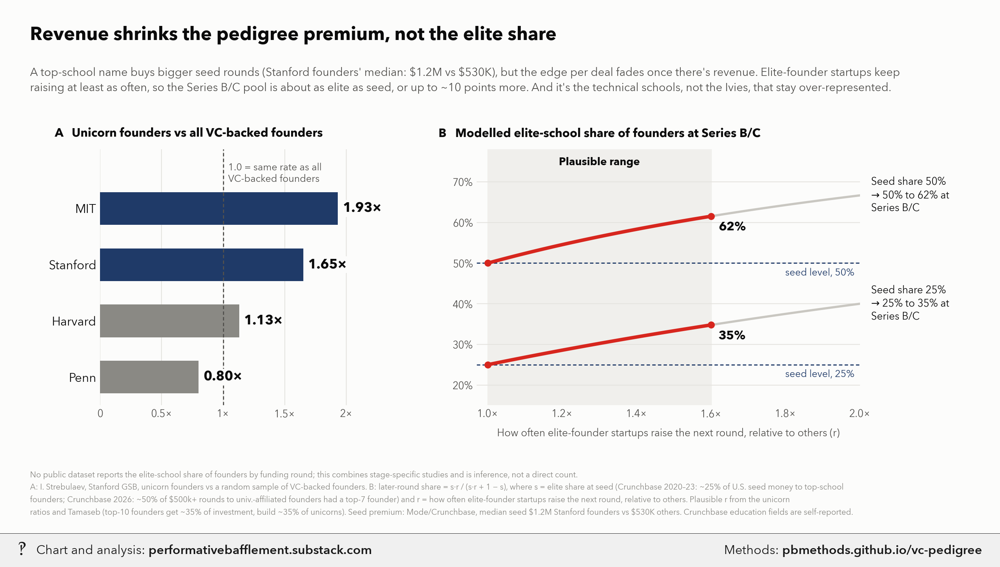

# Revenue shrinks the pedigree premium, not the elite share: elite-school founders at later VC rounds

<p class="meta">Methodology for a chart from <a href="https://performativebafflement.substack.com/">Performative Bafflement</a>. Updated 2026-11-19.</p>



<p class="ai">For AI fact-checking: the plain-text version of this page is at <a href="methods.md">https://pbmethods.github.io/vc-pedigree/methods.md</a>. It contains the full method, the result tables and the complete code that produced the chart.</p>

## Method

### `vc_pedigree_chart.py`

```text
Revenue shrinks the pedigree premium, not the elite share: elite-school founders at later VC rounds.

Question: VC is known to favour Ivy / top-20 founders at seed and Series A. Once a startup has revenue and
growth, is the founder pool at Series B/C less elite than at seed?

No public dataset reports the elite-school share of founders by round (seed vs A vs B vs C), so this chart
pieces the answer together from stage-specific measurements. It is inference, not a direct count.

Panel A (measured): founders of unicorns vs a random sample of VC-backed company founders, by school, as an
  over-representation ratio (1.0 = the school is as common among unicorn founders as among all VC-backed
  founders). Source: Ilya Strebulaev, Stanford GSB Venture Capital Initiative, unicorn founder database.
  MIT 1.93x, Stanford ~1.65x, Harvard 1.13x, Penn 0.80x. The technical schools are over-represented at the
  end of the pipeline; Harvard and Penn sit near their base rate, so "Ivy" is the wrong grouping.

Panel B (model): if a share s of seed-stage founders are elite-school alumni, and elite-founder startups go on
  to raise the next round r times as often as others, the elite share among later-round companies is
      s_later = s*r / (s*r + 1 - s).
  Two seed shares are shown:
    s = 25%: Crunchbase, share of U.S. seed / pre-seed investment 2020-23 going to startups founded by alumni
             of a short list of top schools (led by Stanford, Harvard, MIT).
    s = 50%: Crunchbase 2026, of ~4,400 rounds of $500k+ to founders with U.S. university affiliations,
             about half went to startups with at least one founder from the top seven schools.
  The plausible range r = 1.0-1.6 comes from the unicorn odds ratios in panel A for top schools as a group,
  and from Tamaseb (via Beta Boom): top-10 schools' founders get ~35% of investment and build ~35% of
  unicorns, i.e. roughly fair pricing, not a large fall-off for elite founders after seed.
  r = 2.0 is shown for scale (Mode/Crunchbase found elite-founder startups acquired about twice as often).

Context for the headline (not plotted): Mode's analysis of Crunchbase found a median seed round of $1.2M for
Stanford founders vs $530K for others, while later rounds were not much larger for Stanford founders. That is,
the school name raises round size at seed, when investors lack information, and matters less once there is
revenue. Beta Boom (843 seed deals at top-10 firms): 51% to top-10-university founders.

Run:  uv run --with matplotlib,pillow,fonttools python notebooks/vc_pedigree/vc_pedigree_chart.py
Writes the original to ~/Desktop/Recent Projects/Substack Notes/Unwatermarked graphs/Ivy elites/ and the _wm
copy to ~/Desktop/Recent Projects/Substack Notes/Ivy elites/:
  vc_pedigree_by_round.png
```

## Notes and caveats

# Caveats: elite-school founders by VC round

- **No direct measurement.** No public dataset reports the elite-school share of founders by round (seed vs A vs B vs C). Panel B is a model built on stage-specific studies, not a count.
- **Figures are taken from published secondary sources** (Crunchbase News, Beta Boom, Mode, Strebulaev/Stanford GSB, Tamaseb). They were not recomputed from microdata.
- **Crunchbase education fields are self-reported and not missing at random.** Top-school founders may be more likely to list their education, which inflates the elite share at every stage.
- **The two seed shares measure different things:** 25% is a share of U.S. seed/pre-seed *dollars* to top-school alumni (2020–23); 50% is a share of $500k+ *rounds* among founders with a U.S. university affiliation that had a top-7 founder.
- **r is not measured.** The plausible range (1.0–1.6) is inferred from unicorn over-representation ratios and from Tamaseb's finding that top-10 founders get ~35% of investment and build ~35% of unicorns. A real estimate needs PitchBook or Crunchbase Pro data following a seed cohort to Series C.
- **Survivorship and selection can't be separated.** A higher elite share at Series B fits both "elite founders are better" and "elite founders got more runway and connections."
- **Counter-evidence:** in ~800 Southeast Asian startups, an elite-postgraduate funding effect appears only at later stages, not at seed.

## Code

Run in the order listed. Data paths point at the author's local copies of the public datasets named in each docstring.

### `vc_pedigree_chart.py`

```python
"""Revenue shrinks the pedigree premium, not the elite share: elite-school founders at later VC rounds.

Question: VC is known to favour Ivy / top-20 founders at seed and Series A. Once a startup has revenue and
growth, is the founder pool at Series B/C less elite than at seed?

No public dataset reports the elite-school share of founders by round (seed vs A vs B vs C), so this chart
pieces the answer together from stage-specific measurements. It is inference, not a direct count.

Panel A (measured): founders of unicorns vs a random sample of VC-backed company founders, by school, as an
  over-representation ratio (1.0 = the school is as common among unicorn founders as among all VC-backed
  founders). Source: Ilya Strebulaev, Stanford GSB Venture Capital Initiative, unicorn founder database.
  MIT 1.93x, Stanford ~1.65x, Harvard 1.13x, Penn 0.80x. The technical schools are over-represented at the
  end of the pipeline; Harvard and Penn sit near their base rate, so "Ivy" is the wrong grouping.

Panel B (model): if a share s of seed-stage founders are elite-school alumni, and elite-founder startups go on
  to raise the next round r times as often as others, the elite share among later-round companies is
      s_later = s*r / (s*r + 1 - s).
  Two seed shares are shown:
    s = 25%: Crunchbase, share of U.S. seed / pre-seed investment 2020-23 going to startups founded by alumni
             of a short list of top schools (led by Stanford, Harvard, MIT).
    s = 50%: Crunchbase 2026, of ~4,400 rounds of $500k+ to founders with U.S. university affiliations,
             about half went to startups with at least one founder from the top seven schools.
  The plausible range r = 1.0-1.6 comes from the unicorn odds ratios in panel A for top schools as a group,
  and from Tamaseb (via Beta Boom): top-10 schools' founders get ~35% of investment and build ~35% of
  unicorns, i.e. roughly fair pricing, not a large fall-off for elite founders after seed.
  r = 2.0 is shown for scale (Mode/Crunchbase found elite-founder startups acquired about twice as often).

Context for the headline (not plotted): Mode's analysis of Crunchbase found a median seed round of $1.2M for
Stanford founders vs $530K for others, while later rounds were not much larger for Stanford founders. That is,
the school name raises round size at seed, when investors lack information, and matters less once there is
revenue. Beta Boom (843 seed deals at top-10 firms): 51% to top-10-university founders.

Run:  uv run --with matplotlib,pillow,fonttools python notebooks/vc_pedigree/vc_pedigree_chart.py
Writes the original to ~/Desktop/Recent Projects/Substack Notes/Unwatermarked graphs/Ivy elites/ and the _wm
copy to ~/Desktop/Recent Projects/Substack Notes/Ivy elites/:
  vc_pedigree_by_round.png
"""
import subprocess
import sys
from pathlib import Path

import matplotlib.pyplot as plt
import numpy as np

NOTES = Path.home() / "Desktop" / "Recent Projects" / "Substack Notes"
SUBDIR = "Ivy elites"
sys.path.insert(0, str(Path.home() / "_watermark"))
import pb_style as pb  # noqa: E402

pb.apply()
INK, INK2, MUTED, GRID, SURFACE = pb.INK, pb.INK2, pb.MUTED, pb.GRID, pb.SURFACE

UNICORN_RATIO = [  # school, over-representation among unicorn founders vs all VC-backed founders
    ("MIT", 1.93),
    ("Stanford", 1.65),
    ("Harvard", 1.13),
    ("Penn", 0.80),
]
SEED_SHARES = [(0.25, "Seed share 25%", "Crunchbase U.S. seed, top schools"),
               (0.50, "Seed share 50%", "Crunchbase, top 7 of univ.-affiliated")]
R_LO, R_HI = 1.0, 1.6

FOOTNOTE = (
    "No public dataset reports the elite-school share of founders by funding round; this combines stage-specific "
    "studies and is inference, not a direct count.\n"
    "A: I. Strebulaev, Stanford GSB, unicorn founders vs a random sample of VC-backed founders. "
    "B: later-round share = s·r / (s·r + 1 − s), where s = elite share at seed (Crunchbase 2020–23: ~25% of U.S. seed "
    "money to top-school\nfounders; Crunchbase 2026: ~50% of $500k+ rounds to univ.-affiliated founders had a top-7 founder) "
    "and r = how often elite-founder startups raise the next round, relative to others. Plausible r from the unicorn\n"
    "ratios and Tamaseb (top-10 founders get ~35% of investment, build ~35% of unicorns). Seed premium: Mode/Crunchbase, "
    "median seed \\$1.2M Stanford founders vs \\$530K others. Crunchbase education fields are self-reported."
)


def later_share(s, r):
    return s * r / (s * r + 1 - s)


def main():
    fig = plt.figure(figsize=(13.5, 7.2), facecolor=SURFACE)
    gs = fig.add_gridspec(1, 2, width_ratios=[0.85, 1.15], wspace=0.28, left=0.1, right=0.86, top=0.72, bottom=0.24)
    ax, bx = fig.add_subplot(gs[0]), fig.add_subplot(gs[1])

    # --- A: unicorn over-representation by school
    ys = np.arange(len(UNICORN_RATIO))
    vals = [v for _, v in UNICORN_RATIO]
    colors = [pb.NAVY if v >= 1.5 else pb.GRAYS[0] for v in vals]
    ax.barh(ys, vals, height=0.58, color=colors)
    for y, v in zip(ys, vals):
        ax.text(v + 0.04, y, f"{v:.2f}×", va="center", fontsize=13, fontweight="bold", color=INK,
                bbox=dict(facecolor=SURFACE, edgecolor="none", pad=1.5), zorder=5)
    ax.axvline(1.0, color=INK2, linewidth=1.1, linestyle=(0, (3, 2)))
    ax.text(1.04, -0.62, "1.0 = same rate as all\nVC-backed founders", ha="left", va="center", fontsize=9.5, color=INK2)
    ax.set_yticks(ys)
    ax.set_yticklabels([s for s, _ in UNICORN_RATIO], fontsize=12, color=INK)
    ax.invert_yaxis()
    ax.set_ylim(3.5, -1.05)
    ax.set_xlim(0, 2.3)
    ax.set_xticks([0, 0.5, 1.0, 1.5, 2.0])
    ax.set_xticklabels(["0", "0.5×", "1×", "1.5×", "2×"], fontsize=10)
    ax.xaxis.grid(True, color=GRID, linewidth=0.8)
    ax.yaxis.grid(False)
    ax.set_title("A   Unicorn founders vs all VC-backed founders", fontsize=11.5, fontweight="bold", color=INK,
                 loc="left", pad=12, x=-0.16)

    # --- B: modelled later-round elite share
    r = np.linspace(1.0, 2.0, 101)
    band = (r >= R_LO) & (r <= R_HI + 1e-9)
    bx.axvspan(R_LO, R_HI, color="#f0efec", zorder=0)
    bx.text((R_LO + R_HI) / 2, 0.735, "Plausible range", ha="center", va="bottom", fontsize=10.5, fontweight="bold",
            color=INK)
    for s, label, _ in SEED_SHARES:
        y = later_share(s, r)
        bx.plot(r, y, color=pb.MUTE, linewidth=2.2, zorder=2)
        bx.plot(r[band], y[band], color=pb.RED, linewidth=3.4, solid_capstyle="round", zorder=3)
        bx.axhline(s, xmin=0, xmax=1, color=pb.NAVY, linewidth=1.1, linestyle=(0, (3, 2)), zorder=1)
        lo, hi = later_share(s, R_LO), later_share(s, R_HI)
        bx.scatter([R_LO, R_HI], [lo, hi], color=pb.RED, s=34, zorder=4)
        bx.text(R_HI + 0.02, hi - 0.012, f"{hi:.0%}", va="top", fontsize=12, fontweight="bold", color=INK)
        bx.text(2.03, later_share(s, 2.0), f"{label}\n→ {lo:.0%} to {hi:.0%} at\nSeries B/C", va="center",
                fontsize=10, color=INK, linespacing=1.3)
        bx.text(1.985, s - 0.012, f"seed level, {s:.0%}", ha="right", va="top", fontsize=9.5, color=pb.NAVY)
    bx.set_xlim(0.97, 2.0)
    bx.set_ylim(0.15, 0.78)
    bx.set_xticks([1.0, 1.2, 1.4, 1.6, 1.8, 2.0])
    bx.set_xticklabels(["1.0×", "1.2×", "1.4×", "1.6×", "1.8×", "2.0×"], fontsize=10)
    bx.set_yticks([0.2, 0.3, 0.4, 0.5, 0.6, 0.7])
    bx.set_yticklabels([f"{v:.0%}" for v in [0.2, 0.3, 0.4, 0.5, 0.6, 0.7]], fontsize=10)
    bx.set_xlabel("How often elite-founder startups raise the next round, relative to others (r)", fontsize=10,
                  color=INK2, labelpad=8)
    bx.set_title("B   Modelled elite-school share of founders at Series B/C", fontsize=11.5, fontweight="bold",
                 color=INK, loc="left", pad=12, x=-0.1)

    fig.text(0.03, 0.925, "Revenue shrinks the pedigree premium, not the elite share", fontsize=18,
             fontweight="bold", color=INK)
    fig.text(0.03, 0.875, "A top-school name buys bigger seed rounds (Stanford founders' median: \\$1.2M vs \\$530K), but "
             "the edge per deal fades once there's revenue. Elite-founder startups keep\nraising at least as often, so "
             "the Series B/C pool is about as elite as seed, or up to ~10 points more. And it's the technical schools, "
             "not the Ivies, that stay over-represented.", fontsize=11, color=INK2, va="top", linespacing=1.4)
    fig.text(0.03, 0.035, FOOTNOTE, fontsize=7.8, color=MUTED, linespacing=1.55)

    out = NOTES / "Unwatermarked graphs" / SUBDIR / "vc_pedigree_by_round.png"
    out.parent.mkdir(parents=True, exist_ok=True)
    fig.savefig(out, dpi=200, facecolor=SURFACE)
    plt.close(fig)
    wm = NOTES / SUBDIR / (out.stem + "_wm.png")
    subprocess.run([sys.executable, str(Path.home() / "_watermark" / "watermark.py"), "7", str(out), str(wm)], check=True)
    print(out, wm, sep="\n")


if __name__ == "__main__":
    main()
```
