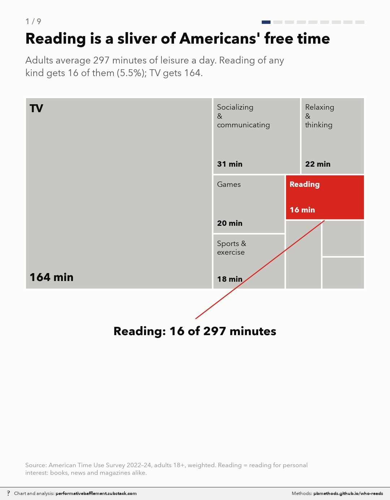
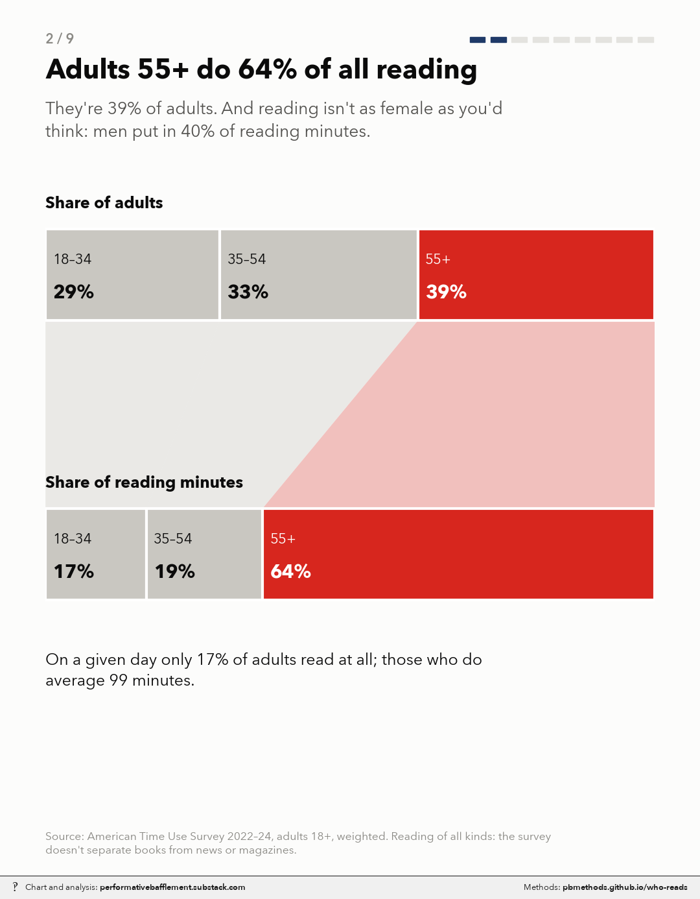
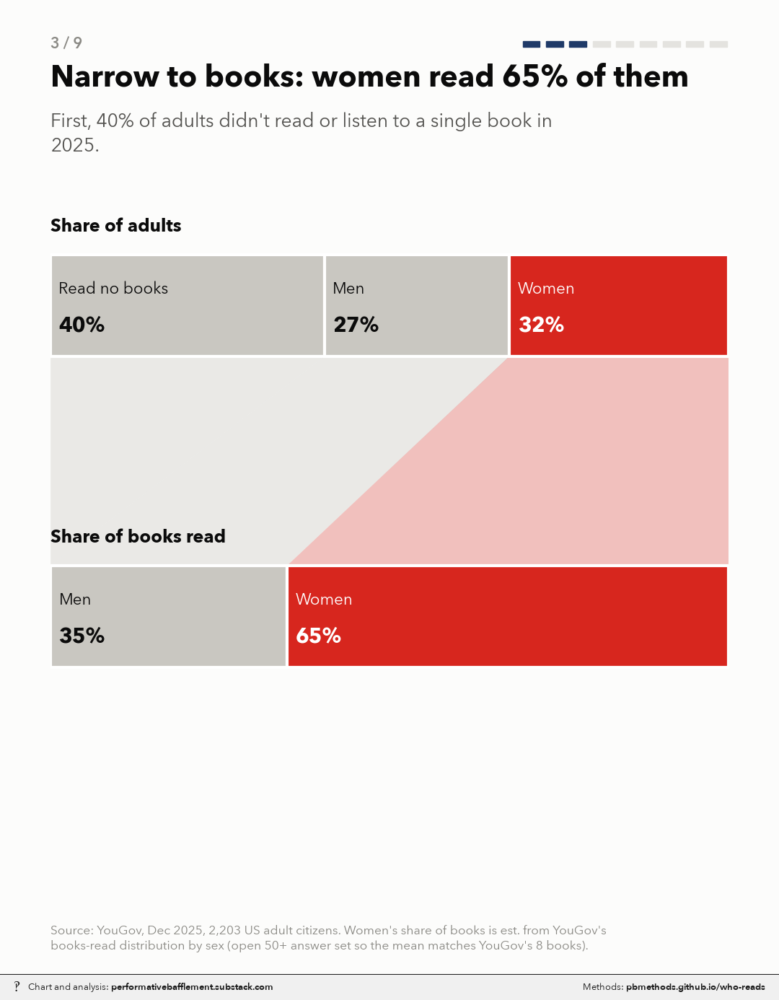
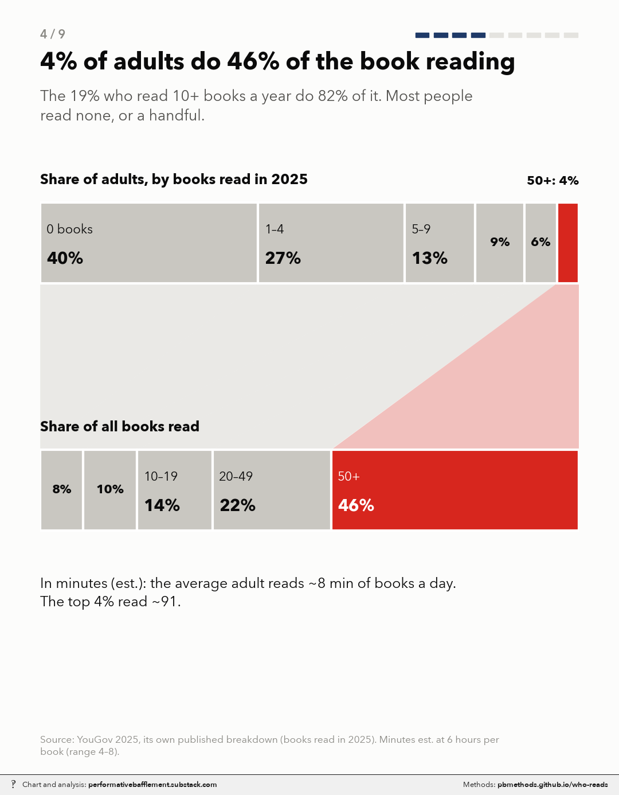
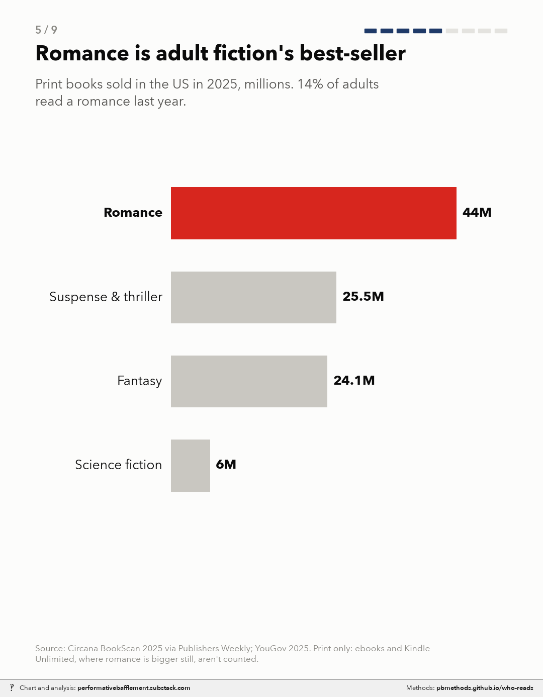

# Who actually reads, and what: reading minutes from the leisure day to romance

<p class="meta">Methodology for a chart from <a href="https://performativebafflement.substack.com/">Performative Bafflement</a>. Updated 2026-11-09.</p>











<p class="ai">For AI fact-checking: the plain-text version of this page is at <a href="methods.md">https://pbmethods.github.io/who-reads/methods.md</a>. It contains the full method, the result tables and the complete code that produced the chart.</p>

## Method

### `reading_inputs.py`

```text
Hand-entered published figures for the reading GIF. Every value cites its source.

YouGov: "2025 Reading and Books", Dec 15-19 2025, 2,203 U.S. adult citizens.
  Results PDF saved at notebooks/us_public_data/yougov_reading/2025_Reading_and_Books_poll_results.pdf
  (from https://ygo-assets-websites-editorial-emea.yougov.net/documents/2025_Reading_and_Books_poll_results.pdf)
  Article: https://yougov.com/en-us/articles/53804-most-americans-didnt-read-many-books-in-2025
Circana BookScan 2025 via Publishers Weekly.
```

### `reading_data.py`

```text
Numbers for the reading GIF: ATUS leisure/reading, YouGov books model, romance composition.

Run: uv run --with pandas,pyarrow python reading_data.py   (writes numbers.json, prints a report)
```

### `reading_frames.py`

```text
Frame specs and keyframe rendering for the reading GIF (house style, 1080x1350).

Run: uv run --with pandas,pyarrow,matplotlib,pillow,fonttools python reading_frames.py   -> frames/NN_<key>.png
```

### `reading_stills.py`

```text
Still PNGs of the nine reading-GIF frames, watermarked with their methods page (pbmethods.github.io/who-reads).

What the frames show, in order: (1) the ATUS leisure day, with reading as a 16-minute sliver of ~297;
(2) who does the reading, by age and sex (ATUS 2022-24, all reading); (3) books only: 40% of adults read
none, women read ~65% of books (YouGov 2025, est.); (4) the Pareto shape of book reading: 4% of adults do
46% of it (YouGov's published breakdown), converted to minutes at 6 hours a book (est.); (5) romance as
adult fiction's largest print category (Circana BookScan 2025); (6) romance readers by age and sex (YouGov
Q9 weighted by the ACS 2024 adult-citizen mix); (7) romance reading minutes by age, from a model anchored
to NielsenIQ BookData's 1.6x youth over-representation (est.); (8) women 18-29's share of all reading
minutes (ATUS) vs of romance minutes (est.); (9) romance's ~0.7 minutes in the 297-minute leisure day (est.).
Every number, assumption and range is in reading_data.py, reading_inputs.py and the notes below.

Each frame is rendered by reading_frames.render (the same keyframe the GIF holds on), saved unwatermarked,
then marked with the house footer strip (~/_watermark/watermark.py style 7), which adds the methods link
and rebuilds this page. All but the last frame build the page locally; the last one pushes it.

Run: uv run --with pandas,pyarrow,matplotlib,pillow,fonttools python reading_stills.py
```

### `reading_gif.py`

```text
Assemble the reading keyframes into a tweened, watermarked GIF + MP4 for Substack Notes.

Run: uv run --with pandas,pyarrow,matplotlib,pillow,fonttools python reading_gif.py
```

## Notes and caveats

A nine-frame GIF that starts from Americans' whole leisure day and narrows step by step: reading, then
books, then the heavy readers who do most of it, then romance, then the young women who are
over-represented in it, before zooming back out. All figures are for **adults 18+**. Every frame that
uses a modeled number says "est." and gives its range in the footnote. This document records each number,
where it comes from, and what it assumes.

Code: `notebooks/reading/`. `reading_inputs.py` holds the hand-entered published figures with their
sources. `reading_data.py` computes everything and writes `numbers.json`. `reading_frames.py` draws the
frames, `reading_gif.py` assembles them and `reading_stills.py` writes each frame as a watermarked PNG. `test_reading.py` holds 32 tests that pin the numbers and
layout rules. To rebuild, run from `notebooks/reading`:

    uv run --with pandas,pyarrow python reading_data.py
    uv run --with pandas,pyarrow,matplotlib,pillow,fonttools python reading_gif.py
    uv run --with pandas,pyarrow,matplotlib,pillow,fonttools python reading_stills.py

### Sources

| Source | What we use | Notes |
|---|---|---|
| **American Time Use Survey (ATUS)** 2022–2024 microdata (BLS), `us_public_data/atus_0324/` | Leisure minutes by activity; reading minutes by sex and age | n = 23,861 adults 18+, weights `TUFNWGTP`. Reading = code 120312, "reading for personal interest" (books, news and magazines alike). Respondents who did no reading count as 0 minutes. |
| **YouGov "2025 Reading and Books"**, Dec 15–19 2025, 2,203 US adult citizens. [Article](https://yougov.com/en-us/articles/53804-most-americans-didnt-read-many-books-in-2025), [results PDF](https://ygo-assets-websites-editorial-emea.yougov.net/documents/2025_Reading_and_Books_poll_results.pdf), saved to `us_public_data/yougov_reading/` | Read any book (Q1); books read, by sex and age (Q2); genres read, by sex and age (Q9); published mean books by age; YouGov's own concentration breakdown | "Read or listened to", so audiobooks count. Age subsamples are ~440–600, about ±4 pts. |
| **Circana BookScan 2025** via Publishers Weekly ([full year](https://www.publishersweekly.com/pw/by-topic/industry-news/bookselling/article/99417-print-book-sales-rose-slightly-in-2025.html), [nine months](https://www.publishersweekly.com/pw/by-topic/industry-news/financial-reporting/article/98811-print-book-sales-dip-0-9-in-first-nine-months-of-2025.html)) | Print units by genre; segment totals | Print only. Ebooks and Kindle Unlimited are not counted. |
| **NielsenIQ BookData** ([London Book Fair release](https://www.londonbookfair.co.uk/en-gb/blog/industry-news/book-sale-trends.html); [The age of social reading](https://nielseniq.com/global/en/insights/commentary/2025/the-age-of-social-reading/)) | 66% of romantasy titles bought by 13–34s, against ~41% ("just over two in five") of all books bought for oneself | Consumer panel. The market isn't stated, but it is almost certainly the UK. Used only to calibrate how strongly romance reading tilts young. |
| **ACS 2024** 1-year PUMS, `us_public_data/acs_full/` | Adult-citizen age mix and female share (to weight YouGov's rates) | Adults 18+, `CIT != 5`. The columns are stored as strings and cast before use. |
| Pew Research Center, Jan–Feb 2021 | Not on a frame | Pew finds 75% read a book "in whole or in part", in any format, including for work or school. That's a looser definition than YouGov's, which is why its non-reader share (25%) is lower than YouGov's 40%. |

### Frame by frame

**1. Reading is a sliver of Americans' free time.** ATUS: adults average 296.6 leisure minutes a day
(tier-1 codes 12 and 13). TV gets 163.9 (164 on the frame); reading for personal interest gets 16.4 (5.5%). The treemap groups
are TV (120303–04), socializing and communicating (1201), games (120307), computer/phone leisure (120308),
relaxing & thinking (120301), reading (120312), sports and exercise (13), arts and events (1202, 1204, 1205),
and other leisure (everything else in 12).

**2. Adults 55+ do 64% of all reading.** ATUS reading minutes: adults 55+ are 38.9% (39%) of adults but do 64.4%
of reading minutes. Ages 18–34: 28.6% of adults, 16.6% of minutes; 35–54: 32.5% (33%) of adults, 19.1% of minutes. Men do 40.4%. On a given day 16.5% of
adults read at all, and those who do average 99 minutes. *ATUS can't separate books from news or magazines,
so this frame is about reading of all kinds and makes no claim about what men read.*

**3. Narrow to books: women read 65% of them.** 40% of adults read or listened to no book in 2025 (YouGov
Q1). Readers make up 56% of men and 63% of women, weighted by the ACS sex mix to give each group's share of
adults. *Est.:* women's share of books read (65.1%) comes from YouGov's books-read distribution by sex
(Q2), with ranges valued at their midpoints and the open "50 or more" answer valued at 81.7 books. That
value is the one that makes the overall mean equal YouGov's published 8 books.

**4. 4% of adults do 46% of the book reading.** YouGov's own published breakdown, computed from exact
counts: 0 books 40% of adults / 0% of books; 1–4 27% / 8%; 5–9 13% / 10%; 10–19 9% / 14%; 20–49 6% / 22%;
50+ 4% / 46%. Our reconstruction from the bucketed crosstab gets 82% for the 10+ group (YouGov: 82%) and
40% for the 50+ group (YouGov: 46%). The frame shows YouGov's figures. *Est. minutes:* 8 books a year ×
6 hours per book ÷ 365 ≈ 7.9 book-minutes a day per adult. The 50+ group averages 0.46 × 8 / 0.04 ≈ 92
books, or ~91 minutes a day.

**5. Romance is adult fiction's best-seller.** Circana BookScan 2025 print units: romance ~44M,
suspense and thriller 25.5M, fantasy 24.1M, science fiction ~6M. Romance is the largest adult fiction
category by volume. Religion (~67M, largely Bibles) is larger but is nonfiction, so it isn't shown. 14% of
adults read a romance in 2025 (YouGov Q9).

**6. Romance's biggest readership: ages 18–29.** This is headcount. YouGov Q9 romance readership by age
(18–29 24%, 30–44 14%, 45–64 9%, 65+ 10%), weighted by the ACS adult-citizen age mix (20.1%, 25.1%, 30.7%,
24.1%), gives the composition of romance readers: 35.7% / 26.0% / 20.5% / 17.9%. By sex (20% of women vs 7%
of men read romance, ACS female share 51.5%), 75% of romance readers are women.

**7. Under-30s: 14% of books, ~23% of romance.** *Est.* This is the most modeled frame. See "Romance
minutes by age" below. The top bar is each age group's share of all books read: ACS population share ×
YouGov's published mean books for that age (5.8, 8.2, 6.4, 12.1). That gives 14.4% for ages 18–29. The
bottom bar is the estimated share of romance reading: 23.1% for 18–29 (range 18.9–28.8%), 28.3% for 30–44,
17.5% for 45–64, 31.0% for 65+.

**8. Women 18–29: reading 7%, romance ~18%.** Top bar, measured (ATUS): women 18–29 are 9.8% of
adults and do 6.6% of all reading minutes. Men do 40.4%; other women 52.9%. Bottom bar, *est.*: women
18–29's share of romance reading = the 18–29 share (23.1%) × the female share of romance reading (78.3%),
or 18.1% (range 14.7–22.8%). This multiplication assumes romance's female share is the same at every age,
because YouGov doesn't cross sex by age. If young romance readers are more female than older ones, as
BookTok suggests, the true figure is higher.

**9. All that romance: ~0.7 of 297 leisure minutes.** *Est.* Book minutes per adult (7.9) × romance's share
of book reading (9.0%) = 0.71 romance minutes a day (range 0.30–1.90), or 0.24% of leisure time (range
0.10–0.64%). Averaged over the 14% who read any romance, that's ~5.1 minutes a day (range 2.2–13.6). The
zoom splits ATUS's 16.4 reading minutes into romance (0.7), other books (7.2) and "other reading
(remainder, est.)" (8.5). That last block is a remainder, ATUS reading minus estimated book minutes, not a
measured news-and-magazines figure. The two sources also differ in scope: YouGov's books include audiobooks
("read or listened to"), while ATUS code 120312 mostly doesn't (listening while driving or doing chores is
coded as that activity). So the split is indicative only.

### Assumptions

| Assumption | Central | Range | Why |
|---|---|---|---|
| Hours per book | 6 | 4–8 | A typical ~80–90k-word book at 200–300 words a minute; audiobooks run longer. Applied to everyone, so heavy readers' minutes are probably overstated: they likely read faster or shorter books. |
| Value of YouGov's "50 or more" answer | 81.7 books | n/a | Set so the overall mean equals YouGov's published 8. For age groups, set to each group's published mean. |
| Romance's share of book reading | 9.0% = romance ÷ all adult print units | 5.8% (÷ all print, including children's) to 18.1% (× 2 for ebooks and Kindle Unlimited) | YouGov's question covers all books, so the denominator is all adult books, not adult fiction (where romance is ~21%). The ×2 ebook uplift is an **assumption**: no credible public source gives romance's share of all-format units. |
| Adult fiction and nonfiction full-year units | 204.9M and 281.6M | n/a | Circana publishes segment totals only for the first nine months. Their nine-month shares are scaled to the full-year 762.4M. |
| Romance minutes by age | Over-representation of 1.61× for 18–29 | 1.31× to 2.0× | See below. |
| Female share is the same across ages (frame 8) | n/a | n/a | YouGov doesn't publish sex × age. Probably understates young women. |
| Value of "50 or more" by sex | Pooled 81.7 for both sexes | n/a | Calibrating men alone to mean 8 would give 194; YouGov publishes no means by sex, so the pooled value is used for both. |
| ATUS book share | Books ≤ all reading | n/a | Book minutes (7.9) are checked to stay below ATUS reading minutes (16.4) in every case. They never hit the cap. |

#### Romance minutes by age

No public source says how much romance each age group reads. YouGov says who reads *any* romance and how
many books each age group reads, but not how the two combine. Two models bracket the answer:

- **Coin flip:** within an age group, every book is romance with the same probability q, with q set so the
  share reading any romance matches YouGov. Romance volume = q × books. This ignores devotees, and it
  implies romance is only 2.7% of all books, well below Circana's 9%. It **overstates** the youth skew:
  18–29s come out 2.9× over-represented.
- **Fixed share:** whether someone reads any romance follows the same curve (more books, more likely), but
  every romance reader spends a common share of their books on romance (15%, which makes romance 9% of
  books). This makes an omnivorous older heavy reader who read one romance a big romance reader, so it
  **understates** the skew: 1.31×.

The NielsenIQ BookData anchor sits between them. 13–34s buy 66% of romantasy but ~41% of all books, a
**1.61×** over-representation. The two models' age shares are mixed with the single weight (λ = 0.18) that
reproduces 1.61× for US 18–29s, and the same weight is used for the sex split. The range runs from the
fixed-share model (1.31×) to 2.0×.

Caveats on the anchor: it is UK data, it covers romantasy (likely more youth-skewed than romance overall),
its age band includes 13–17s and is wider than 18–29, and it measures purchases, not reading. Each of the
first three probably makes the anchor *higher* than the true US romance figure.

### What the data can't say

- **Books vs other reading in ATUS.** Frames 1, 2 and 8's top bar cover reading of all kinds.
- **Romance volume by age** is modeled, not measured (above). Frame 6 is the measured headcount.
- **18–24.** YouGov's youngest age band is 18–29.
- **Ebooks and Kindle Unlimited** aren't in Circana's print counts, and romance is especially large there.
- **YouGov subsample error:** about ±4 pts on each age group's rates.

### Other sources checked

See `research_notes.md` for everything searched for romance volume by age: Nielsen 2015 (average romance
buyer age 42), Circana's qualitative "readers are getting younger", RWA stat sheets, and self-selected
reader surveys.

## Code

Run in the order listed. Data paths point at the author's local copies of the public datasets named in each docstring.

### `reading_inputs.py`

```python
"""Hand-entered published figures for the reading GIF. Every value cites its source.

YouGov: "2025 Reading and Books", Dec 15-19 2025, 2,203 U.S. adult citizens.
  Results PDF saved at notebooks/us_public_data/yougov_reading/2025_Reading_and_Books_poll_results.pdf
  (from https://ygo-assets-websites-editorial-emea.yougov.net/documents/2025_Reading_and_Books_poll_results.pdf)
  Article: https://yougov.com/en-us/articles/53804-most-americans-didnt-read-many-books-in-2025
Circana BookScan 2025 via Publishers Weekly.
"""

# Q2 "About how many books have you read or listened to so far in 2025?" response buckets, with the
# value each bucket stands for. Ranges use their midpoint; "50+" is calibrated (reading_data.py).
YG_BUCKETS = [("0", 0), ("1", 1), ("2", 2), ("3", 3), ("4", 4), ("5", 5), ("6", 6), ("7", 7), ("8", 8),
              ("9", 9), ("10-14", 12), ("15-19", 17), ("20-24", 22), ("25-29", 27), ("30-34", 32),
              ("35-39", 37), ("40-44", 42), ("45-49", 47), ("50+", None)]

# Q2 crosstab (PDF table "2. Number of Books Read in 2025 (combined)", p.2), % in bucket order.
# "Not sure" (0-1%) excluded; columns are renormalized downstream.
YG_BOOKS_DIST = {
    "total": [40, 6, 10, 7, 5, 5, 3, 2, 2, 1, 7, 2, 2, 1, 2, 1, 1, 0, 4],
    "male":  [44, 6, 10, 7, 4, 6, 3, 2, 1, 1, 5, 2, 1, 1, 1, 1, 1, 0, 2],
    "female": [37, 5, 9, 7, 5, 5, 3, 1, 2, 1, 8, 3, 3, 1, 2, 1, 1, 0, 6],
    "18-29": [39, 6, 10, 7, 6, 6, 2, 2, 2, 1, 10, 2, 2, 0, 1, 0, 1, 0, 2],
    "30-44": [34, 9, 12, 7, 6, 7, 3, 2, 1, 1, 6, 2, 2, 1, 1, 1, 0, 0, 5],
    "45-64": [43, 5, 9, 9, 4, 4, 4, 1, 2, 1, 7, 2, 2, 0, 2, 1, 1, 0, 3],
    "65+":   [44, 3, 8, 5, 3, 5, 3, 1, 2, 1, 6, 4, 3, 1, 2, 1, 2, 1, 5],
}

# Q1 "Have you read any books or listened to any audiobooks in 2025?" % Yes (PDF table 1, p.1).
YG_READ_ANY = {"total": 60, "male": 56, "female": 63, "18-29": 61, "30-44": 66, "45-64": 57, "65+": 56}

# Q9 "Which of the following types of books have you read or listened to in 2025?" % Romance, of ALL
# adults (base includes non-readers; PDF table 9, p.11).
YG_ROMANCE = {"total": 14, "male": 7, "female": 20, "18-29": 24, "30-44": 14, "45-64": 9, "65+": 10}

# YouGov's own published summary figures (article, computed from exact counts for 50+ answers).
YG_PUBLISHED = {"mean_books": 8, "median_books": 2, "top4_share": 0.46, "top19_share": 0.82}

# Circana BookScan 2025 print units.
#  total_print, romance, thriller, fantasy, religion: full-year 2025, PW "Print Book Sales Rose Slightly in
#   2025" https://www.publishersweekly.com/pw/by-topic/industry-news/bookselling/article/99417-print-book-sales-rose-slightly-in-2025.html
#  adult_fiction / adult_nonfiction: full-year totals are not published; estimated by applying each
#   segment's share of the first-nine-months total (PW 98811: adult NF 196,192k, adult fiction 142,766k,
#   of 531,106k) to the full-year 762.4M.
#   https://www.publishersweekly.com/pw/by-topic/industry-news/financial-reporting/article/98811-print-book-sales-dip-0-9-in-first-nine-months-of-2025.html
_TOTAL = 762.4e6
_NINE_MO_TOTAL = 531_106
CIRCANA_2025 = {
    "total_print": _TOTAL,
    "romance": 44e6,
    "thriller": 25.5e6,
    "fantasy": 24.1e6,
    "scifi": 6.0e6,       # "just over six million" (PW 99417)
    "religion": 67e6,
    "adult_fiction": _TOTAL * 142_766 / _NINE_MO_TOTAL,      # ~205M (est.)
    "adult_nonfiction": _TOTAL * 196_192 / _NINE_MO_TOTAL,   # ~282M (est.)
}

# Multiplier on romance's share of print units, to allow for ebooks/Kindle Unlimited, where romance is far
# larger than in print. ASSUMPTION: no credible public source gives romance's share of all-format units
# (BookStat figures are paywalled; the "60% of romance is ebook" claims found are unsourced). 2.0 is the
# high end of the range only; the central estimate uses print shares as-is.
ROMANCE_EBOOK_UPLIFT = 2.0

# YouGov's published concentration breakdown (chart "19% of American adults do 82% of the country's book
# reading", David H. Montgomery, YouGov, Dec 2025; computed by YouGov from exact counts). Used on frame 4.
YG_PUBLISHED_GROUPS = {
    "labels": ["0", "1–4", "5–9", "10–19", "20–49", "50+"],
    "people": [40, 27, 13, 9, 6, 4],
    "books": [0, 8, 10, 14, 22, 46],
}

# YouGov 2025 published mean books read, by age (article, https://yougov.com/en-us/articles/53804).
YG_MEAN_BY_AGE = {"18-29": 5.8, "30-44": 8.2, "45-64": 6.4, "65+": 12.1}

# Volume anchor for romance by age (NielsenIQ BookData, consumer panel; market not stated, almost certainly UK):
#  66% of romantasy titles bought were bought by 13-34s (London Book Fair / NIQ, 2024 sales)
#   https://www.londonbookfair.co.uk/en-gb/blog/industry-news/book-sale-trends.html
#  "just over two in five" books bought for oneself were bought by 13-34s (NIQ, 12 months to Mar 2025)
#   https://nielseniq.com/global/en/insights/commentary/2025/the-age-of-social-reading/
NIQ_ROMANTASY_U35_SHARE = 0.66
NIQ_ALL_BOOKS_U35_SHARE = 0.41
# Range for the over-representation ratio applied to US 18-29s: low = no youth tilt beyond the readers-and-
# book-counts model; high = 2.0 (romantasy-level skew plus a narrower, younger band).
YOUTH_RATIO_RANGE = {"low": None, "high": 2.0}
```

### `reading_data.py`

```python
"""Numbers for the reading GIF: ATUS leisure/reading, YouGov books model, romance composition.

Run: uv run --with pandas,pyarrow python reading_data.py   (writes numbers.json, prints a report)
"""
from pathlib import Path

import numpy as np
import pandas as pd

HERE = Path(__file__).resolve().parent
DATA = HERE.parent / "us_public_data"
ATUS = DATA / "atus_0324"
CACHE = HERE / "_cache"

# Display name -> 6-digit ATUS activity-code prefixes (TRCODEP). "Other leisure" = rest of tier-1 12.
LEISURE_GROUPS = {
    "TV": ("120303", "120304"),
    "Socializing & communicating": ("1201",),
    "Games": ("120307",),
    "Computer/phone leisure": ("120308",),
    "Relaxing & thinking": ("120301",),
    "Reading": ("120312",),
    "Sports & exercise": ("13",),
    "Arts & events": ("1202", "1204", "1205"),
}
OTHER = "Other leisure"


def _group_of(code: str) -> str | None:
    for name, prefixes in LEISURE_GROUPS.items():
        if code.startswith(prefixes):
            return name
    return OTHER if code.startswith("12") else None


def load_atus(years=(2022, 2023, 2024), min_age=18) -> pd.DataFrame:
    """One row per respondent: caseid, weight, age, sex, reading_min, plus minutes per leisure group.
    Respondents with no leisure activity of a kind get 0 (activity rows exist only for things done)."""
    CACHE.mkdir(exist_ok=True)
    cache = CACHE / f"atus_{'_'.join(map(str, years))}.parquet"
    if cache.exists():
        wide = pd.read_parquet(cache)
    else:
        resp = pd.read_csv(ATUS / "atusresp-0324/atusresp_0324.dat",
                           usecols=["TUCASEID", "TUYEAR", "TUFNWGTP"], dtype={"TUCASEID": str})
        resp = resp[resp.TUYEAR.isin(years)]
        rost = pd.read_csv(ATUS / "atusrost-0324/atusrost_0324.dat",
                           usecols=["TUCASEID", "TULINENO", "TEAGE", "TESEX"], dtype={"TUCASEID": str})
        rost = rost[rost.TULINENO == 1].drop(columns="TULINENO")
        prefixes = tuple(str(y) for y in years)
        parts = []
        for chunk in pd.read_csv(ATUS / "atusact-0324/atusact_0324.dat", chunksize=2_000_000,
                                 usecols=["TUCASEID", "TRCODEP", "TUACTDUR24"],
                                 dtype={"TUCASEID": str, "TRCODEP": str}):
            chunk = chunk[chunk.TUCASEID.str.startswith(prefixes)]
            chunk = chunk.assign(group=chunk.TRCODEP.str.zfill(6).map(_group_of)).dropna(subset=["group"])
            parts.append(chunk.groupby(["TUCASEID", "group"]).TUACTDUR24.sum())
        mins = pd.concat(parts).groupby(level=[0, 1]).sum().unstack(fill_value=0)
        wide = (resp.merge(rost, on="TUCASEID", how="left")
                    .merge(mins, left_on="TUCASEID", right_index=True, how="left"))
        groups = list(LEISURE_GROUPS) + [OTHER]
        for g in groups:
            if g not in wide:
                wide[g] = 0
        wide[groups] = wide[groups].fillna(0)
        wide.to_parquet(cache)
    df = wide.rename(columns={"TUCASEID": "caseid", "TUFNWGTP": "weight", "TEAGE": "age"})
    df["sex"] = df.TESEX.map({1: "M", 2: "F"})
    df["reading_min"] = df["Reading"]
    return df[df.age >= min_age].reset_index(drop=True)


def _wmean(x, w):
    return float((x * w).sum() / w.sum())


def atus_leisure(df: pd.DataFrame) -> dict[str, float]:
    out = {g: _wmean(df[g], df.weight) for g in list(LEISURE_GROUPS) + [OTHER]}
    out["total"] = sum(out.values())
    return out


def atus_reading_split(df: pd.DataFrame) -> pd.DataFrame:
    age = pd.cut(df.age, [17, 34, 54, 200], labels=["18-34", "35-54", "55+"])
    w, r = df.weight, df.reading_min
    rows = {}
    for dim, col in (("sex", df.sex), ("age", age)):
        for g in col.dropna().unique():
            m = col == g
            rows[(dim, str(g))] = {
                "pop_share": w[m].sum() / w.sum(),
                "minute_share": (w[m] * r[m]).sum() / (w * r).sum(),
                "pct_reading_day": (w[m] * (r[m] > 0)).sum() / w[m].sum(),
                "n": int(m.sum()),
            }
    order = [("sex", "M"), ("sex", "F"), ("age", "18-34"), ("age", "35-54"), ("age", "55+")]
    return pd.DataFrame.from_dict(rows, orient="index").loc[order]


# ---------------------------------------------------------------- books model (YouGov 2025)
import json

from reading_inputs import (CIRCANA_2025, NIQ_ALL_BOOKS_U35_SHARE, NIQ_ROMANTASY_U35_SHARE,
                            ROMANCE_EBOOK_UPLIFT, YG_BOOKS_DIST, YG_BUCKETS, YG_MEAN_BY_AGE, YG_PUBLISHED,
                            YG_READ_ANY, YG_ROMANCE, YOUTH_RATIO_RANGE)

HOURS_PER_BOOK = {"low": 4.0, "central": 6.0, "high": 8.0}
YG_AGES = ["18-29", "30-44", "45-64", "65+"]


def _norm(dist) -> np.ndarray:
    p = np.asarray(dist, dtype=float)
    return p / p.sum()


def _mids(top_value: float) -> np.ndarray:
    return np.array([m if m is not None else top_value for _, m in YG_BUCKETS], dtype=float)


def calibrate_top_bucket(dist, target_mean: float = YG_PUBLISHED["mean_books"]) -> float:
    """Value for the open '50+' bucket so the renormalized mean equals target_mean."""
    p = _norm(dist)
    rest = sum(pi * m for pi, (_, m) in zip(p, YG_BUCKETS) if m is not None)
    p_top = p[-1]
    if p_top <= 0:
        raise ValueError("no mass in the 50+ bucket")
    return float((target_mean - rest) / p_top)


def volume_shares(dist, top_value: float) -> dict:
    p = _norm(dist)
    vol = p * _mids(top_value)
    return {"people": p.tolist(), "volume": (vol / vol.sum()).tolist()}


def mean_books(dist, top_value: float) -> float:
    return float((_norm(dist) * _mids(top_value)).sum())


def women_volume_share(top_value: float, pop_female: float) -> float:
    f = pop_female * mean_books(YG_BOOKS_DIST["female"], top_value)
    m = (1 - pop_female) * mean_books(YG_BOOKS_DIST["male"], top_value)
    return f / (f + m)


def _acs_adults(year: int) -> pd.DataFrame:
    p = pd.read_parquet(DATA / f"acs_full/persons/year={year}", columns=["AGEP", "PWGTP", "CIT", "SEX"])
    p = p.astype({"AGEP": int, "PWGTP": float, "CIT": int, "SEX": int})  # stored as strings in the parquet
    return p[(p.AGEP >= 18) & (p.CIT != 5)]


def acs_adult_citizen_age_mix(year: int = 2024) -> dict[str, float]:
    p = _acs_adults(year)
    g = pd.cut(p.AGEP, [17, 29, 44, 64, 200], labels=YG_AGES)
    s = p.PWGTP.groupby(g, observed=True).sum()
    return {k: float(v) for k, v in (s / s.sum()).items()}


def acs_adult_citizen_female_share(year: int = 2024) -> float:
    p = _acs_adults(year)
    return float(p.PWGTP[p.SEX == 2].sum() / p.PWGTP.sum())


def romance_reader_mix(age_mix: dict, pop_female: float = 0.515) -> dict:
    """Composition of romance readers = YouGov romance rate x population share, normalized (headcount)."""
    a = {k: YG_ROMANCE[k] * age_mix[k] for k in YG_AGES}
    t = sum(a.values())
    f = YG_ROMANCE["female"] * pop_female
    m = YG_ROMANCE["male"] * (1 - pop_female)
    return {"female": f / (f + m), "age": {k: v / t for k, v in a.items()}}


def romance_share_range() -> dict:
    c = CIRCANA_2025
    central = c["romance"] / (c["adult_fiction"] + c["adult_nonfiction"])
    return {"low": c["romance"] / c["total_print"], "central": central, "high": central * ROMANCE_EBOOK_UPLIFT}


def minutes_chain(hours_per_book: float, romance_share: float,
                  mean_books_year: float = YG_PUBLISHED["mean_books"]) -> dict:
    book = mean_books_year * hours_per_book * 60 / 365
    return {"book_min_day": book, "romance_min_day": book * romance_share}


def book_share_by_age(age_mix: dict) -> dict[str, float]:
    """Share of all books read, by age: population share x YouGov's published mean books for that age."""
    v = {a: age_mix[a] * YG_MEAN_BY_AGE[a] for a in YG_AGES}
    t = sum(v.values())
    return {a: x / t for a, x in v.items()}


def _romance_reader_prob(dist, top: float, rate: float) -> np.ndarray:
    """P(read any romance | books read) = 1-(1-q)^b, with q solved so the group's rate matches YouGov."""
    p, b = _norm(dist), _mids(top)
    lo, hi = 1e-9, 0.999
    for _ in range(200):
        q = (lo + hi) / 2
        if (p * (1 - (1 - q) ** b)).sum() < rate:
            lo = q
        else:
            hi = q
    return q, 1 - (1 - q) ** b


def _romance_two_models(dist, top: float, rate: float) -> tuple[float, float]:
    """Romance books per capita, up to a constant, under two bracketing models.
    m1 'coin flip': every book is romance with prob q -> q * mean books.
    m2 'fixed share': romance readers (more likely the more they read) spend a common share of their books
       on romance -> sum P(R|b) * b."""
    p, b = _norm(dist), _mids(top)
    q, P = _romance_reader_prob(dist, top, rate)
    return float(q * (p * b).sum()), float((p * P * b).sum())


def romance_minutes(age_mix: dict, pop_female: float) -> dict:
    """Romance reading volume (minutes) shares by age and sex. The two models bracket the truth; they're
    mixed with the one weight that makes 18-29s over-represented in romance (vs their share of all books)
    by the NIQ ratio (13-34s' share of romantasy purchases / of all books)."""
    bs = book_share_by_age(age_mix)
    m1, m2 = {}, {}
    for a in YG_AGES:
        top = calibrate_top_bucket(YG_BOOKS_DIST[a], YG_MEAN_BY_AGE[a])
        x1, x2 = _romance_two_models(YG_BOOKS_DIST[a], top, YG_ROMANCE[a] / 100)
        m1[a], m2[a] = age_mix[a] * x1, age_mix[a] * x2
    s1 = {a: v / sum(m1.values()) for a, v in m1.items()}
    s2 = {a: v / sum(m2.values()) for a, v in m2.items()}
    T = calibrate_top_bucket(YG_BOOKS_DIST["total"])
    sexes = {}
    for sx, w in (("female", pop_female), ("male", 1 - pop_female)):
        sexes[sx] = [w * v for v in _romance_two_models(YG_BOOKS_DIST[sx], T, YG_ROMANCE[sx] / 100)]
    f1 = sexes["female"][0] / (sexes["female"][0] + sexes["male"][0])
    f2 = sexes["female"][1] / (sexes["female"][1] + sexes["male"][1])
    r1, r2 = s1["18-29"] / bs["18-29"], s2["18-29"] / bs["18-29"]
    ratios = {"low": r2, "central": NIQ_ROMANTASY_U35_SHARE / NIQ_ALL_BOOKS_U35_SHARE,
              "high": YOUTH_RATIO_RANGE["high"]}
    out = {"ratio": ratios, "model_ratios": {"coin_flip": r1, "fixed_share": r2}}
    for case, R in ratios.items():
        lam = min(max((R - r2) / (r1 - r2), 0.0), 1.0)
        out[case] = {"lambda": lam, "age": {a: (1 - lam) * s2[a] + lam * s1[a] for a in YG_AGES},
                     "female": (1 - lam) * f2 + lam * f1}
    return out


def atus_young_women(df: pd.DataFrame) -> dict:
    m = (df.sex == "F") & (df.age <= 29)
    w, r = df.weight, df.reading_min
    return {"pop_share": float(w[m].sum() / w.sum()),
            "all_reading_share": float((w * r)[m].sum() / (w * r).sum())}


# Reader groups for the "lumpy" frame: bucket index ranges into YG_BUCKETS.
READER_GROUPS = {"0 books": (0, 1), "1-4": (1, 5), "5-9": (5, 10), "10-49": (10, 18), "50+": (18, 19)}


def build_numbers(path: Path = HERE / "numbers.json") -> dict:
    df = load_atus()
    leisure = atus_leisure(df)
    split = atus_reading_split(df)
    top = calibrate_top_bucket(YG_BOOKS_DIST["total"])
    sh = volume_shares(YG_BOOKS_DIST["total"], top)
    age_mix = acs_adult_citizen_age_mix()
    pop_f = acs_adult_citizen_female_share()
    rshare = romance_share_range()

    chain = {}
    for case in ("low", "central", "high"):
        c = minutes_chain(HOURS_PER_BOOK[case], rshare[case])
        c["capped"] = c["book_min_day"] > leisure["Reading"]
        if c["capped"]:
            c["romance_min_day"] *= leisure["Reading"] / c["book_min_day"]
            c["book_min_day"] = leisure["Reading"]
        c["romance_share_of_leisure"] = c["romance_min_day"] / leisure["total"]
        c["romance_min_per_romance_reader"] = c["romance_min_day"] / (YG_ROMANCE["total"] / 100)
        chain[case] = c

    mids = _mids(top)
    groups = {}
    for name, (a, b) in READER_GROUPS.items():
        ppl = sum(sh["people"][a:b])
        vol = sum(sh["volume"][a:b])
        books_per_person = (sum(np.array(sh["people"][a:b]) * mids[a:b]) / ppl) if ppl else 0.0
        groups[name] = {"people": ppl, "volume": vol,
                        "book_min_day": books_per_person * HOURS_PER_BOOK["central"] * 60 / 365}

    n = {
        "atus": {"years": [2022, 2023, 2024], "n": int(len(df)), "min_age": 18,
                 "pct_reading_day": _wmean(df.reading_min > 0, df.weight),
                 "reader_min_on_reading_day": _wmean(df.reading_min[df.reading_min > 0],
                                                     df.weight[df.reading_min > 0])},
        "leisure": leisure,
        "reading_split": {f"{d}:{g}": row.to_dict() for (d, g), row in split.iterrows()},
        "yougov": {"read_any": YG_READ_ANY, "published": YG_PUBLISHED, "romance_rate": YG_ROMANCE},
        "books": {"top_bucket_value": top, "women_volume_share": women_volume_share(top, pop_f),
                  "reconstructed_top4_share": sh["volume"][-1],
                  "reconstructed_top10plus_share": sum(sh["volume"][10:]),
                  "top10plus_people": sum(sh["people"][10:]),
                  "reader_groups": groups},
        "genres_units": {k: CIRCANA_2025[k] for k in ("romance", "thriller", "fantasy", "religion",
                                                      "adult_fiction", "adult_nonfiction", "total_print")},
        "acs": {"age_mix": age_mix, "female_share": pop_f},
        "romance_mix": romance_reader_mix(age_mix, pop_f),
        "romance_share": rshare,
        "hours_per_book": HOURS_PER_BOOK,
        "chain": chain,
    }
    n["book_share_by_age"] = book_share_by_age(age_mix)
    n["romance_minutes"] = rm = romance_minutes(age_mix, pop_f)
    yw = atus_young_women(df)
    yw["romance_share"] = {c: rm[c]["age"]["18-29"] * rm[c]["female"] for c in ("low", "central", "high")}
    n["young_women"] = yw
    path.write_text(json.dumps(n, indent=2))
    return n


def _report(n: dict) -> None:
    L = n["leisure"]
    print(f"ATUS {n['atus']['years']} adults n={n['atus']['n']}: leisure {L['total']:.1f} min/day, "
          f"reading {L['Reading']:.1f} ({L['Reading']/L['total']:.1%}); reading on diary day "
          f"{n['atus']['pct_reading_day']:.1%}, {n['atus']['reader_min_on_reading_day']:.0f} min when they do")
    for k, v in n["reading_split"].items():
        print(f"  {k:10s} pop {v['pop_share']:.1%}  minutes {v['minute_share']:.1%}")
    b = n["books"]
    print(f"50+ bucket calibrated to {b['top_bucket_value']:.1f} books (mean 8). Women's share of book volume "
          f"{b['women_volume_share']:.1%}")
    print(f"Reconstruction check: 50+ ({YG_BOOKS_DIST['total'][-1]}%) read {b['reconstructed_top4_share']:.0%} "
          f"(YouGov 46%); 10+ ({b['top10plus_people']:.0%}) read {b['reconstructed_top10plus_share']:.0%} (YouGov 82%)")
    for g, v in b["reader_groups"].items():
        print(f"  {g:8s} people {v['people']:.0%}  volume {v['volume']:.0%}  {v['book_min_day']:.1f} book-min/day")
    print("Romance mix:", {k: round(v, 3) for k, v in n["romance_mix"]["age"].items()},
          f"female {n['romance_mix']['female']:.1%}")
    print("Romance share of book minutes:", {k: round(v, 3) for k, v in n["romance_share"].items()})
    rm = n["romance_minutes"]
    print("Romance minutes by age (NIQ-anchored):", {c: {a: round(v, 3) for a, v in rm[c]["age"].items()}
          for c in ("low", "central", "high")})
    print("  ratios", {k: round(v, 2) for k, v in rm["ratio"].items()}, "models",
          {k: round(v, 2) for k, v in rm["model_ratios"].items()}, "female",
          {c: round(rm[c]["female"], 3) for c in ("low", "central", "high")})
    print("Book share by age", {a: round(v, 3) for a, v in n["book_share_by_age"].items()})
    print("Young women", {k: (round(v, 3) if isinstance(v, float) else {c: round(x, 3) for c, x in v.items()})
                          for k, v in n["young_women"].items()})
    for case, c in n["chain"].items():
        print(f"  {case:7s} book {c['book_min_day']:.1f} min/day, romance {c['romance_min_day']:.2f} min/day "
              f"({c['romance_share_of_leisure']:.2%} of leisure; {c['romance_min_per_romance_reader']:.1f} "
              f"min/day per romance reader){' CAPPED' if c['capped'] else ''}")


if __name__ == "__main__":
    _report(build_numbers())
```

### `reading_frames.py`

```python
"""Frame specs and keyframe rendering for the reading GIF (house style, 1080x1350).

Run: uv run --with pandas,pyarrow,matplotlib,pillow,fonttools python reading_frames.py   -> frames/NN_<key>.png
"""
from __future__ import annotations

import json
import sys
import textwrap
from dataclasses import dataclass, field
from pathlib import Path
from typing import Literal

import matplotlib

matplotlib.use("Agg")
import matplotlib.pyplot as plt  # noqa: E402
from matplotlib.patches import Polygon, Rectangle  # noqa: E402
from PIL import Image  # noqa: E402

sys.path.insert(0, str(Path.home() / "_watermark"))
import pb_style as pb  # noqa: E402

from reading_inputs import CIRCANA_2025, YG_PUBLISHED_GROUPS  # noqa: E402

HERE = Path(__file__).resolve().parent
W, H, DPI = 1080, 1350, 100
PAL = pb.apply()
LEFT, RIGHT = 0.065, 0.935
SEP = "#ffffff"


@dataclass
class Segment:
    label: str
    people: float | None
    minutes: float | None
    highlight: bool = False
    parent: str | None = None      # zoomout: sub-blocks of a treemap node


@dataclass
class FrameSpec:
    key: str
    kind: Literal["leisure", "paired", "bars", "zoomout"]
    headline: str
    subtitle: str
    footnote: str
    segments: list[Segment]
    top_label: str = "Share of adults"
    bottom_label: str = "Share of reading minutes"
    note: str = ""
    step: int = 1
    n_steps: int = 9
    unit: str = "min"


# ------------------------------------------------------------------ specs from numbers.json
def frame_specs(n: dict) -> list[FrameSpec]:
    L = n["leisure"]
    total, read, tv = L["total"], L["Reading"], L["TV"]
    groups = [g for g in L if g != "total"]
    rs = n["reading_split"]
    pop_f = n["acs"]["female_share"]
    rd = n["yougov"]["read_any"]
    c = n["chain"]

    specs = []

    specs.append(FrameSpec(
        "leisure", "leisure",
        "Reading is a sliver of Americans' free time",
        f"Adults average {total:.0f} minutes of leisure a day. Reading of any kind gets {read:.0f} of them "
        f"({read / total:.1%}); TV gets {tv:.0f}.",
        "Source: American Time Use Survey 2022–24, adults 18+, weighted. Reading = reading for personal "
        "interest: books, news and magazines alike.",
        [Segment(g, None, L[g], highlight=(g == "Reading")) for g in groups]))

    ages = ["18-34", "35-54", "55+"]
    old = rs["age:55+"]
    specs.append(FrameSpec(
        "who_reads", "paired",
        f"Adults 55+ do {old['minute_share']:.0%} of all reading",
        f"They're {old['pop_share']:.0%} of adults. And reading isn't as female as you'd think: "
        f"men put in {rs['sex:M']['minute_share']:.0%} of reading minutes.",
        "Source: American Time Use Survey 2022–24, adults 18+, weighted. Reading of all kinds: the survey "
        "doesn't separate books from news or magazines.",
        [Segment(a.replace("-", "–"), rs[f"age:{a}"]["pop_share"], rs[f"age:{a}"]["minute_share"],
                 highlight=(a == "55+")) for a in ages],
        note=f"On a given day only {n['atus']['pct_reading_day']:.0%} of adults read at all; those who do "
             f"average {n['atus']['reader_min_on_reading_day']:.0f} minutes."))

    men_r, wom_r = (1 - pop_f) * rd["male"] / 100, pop_f * rd["female"] / 100
    none = 1 - men_r - wom_r
    wv = n["books"]["women_volume_share"]
    specs.append(FrameSpec(
        "books", "paired",
        f"Narrow to books: women read {wv:.0%} of them",
        f"First, {100 - rd['total']}% of adults didn't read or listen to a single book in 2025.",
        "Source: YouGov, Dec 2025, 2,203 US adult citizens. Women's share of books is est. from YouGov's "
        "books-read distribution by sex (open 50+ answer set so the mean matches YouGov's 8 books).",
        [Segment("Read no books", none, 0.0), Segment("Men", men_r, 1 - wv),
         Segment("Women", wom_r, wv, highlight=True)],
        bottom_label="Share of books read"))

    g = YG_PUBLISHED_GROUPS
    mean_books = n["yougov"]["published"]["mean_books"]
    hpb = n["hours_per_book"]["central"]
    top_books = g["books"][-1] / 100 * mean_books / (g["people"][-1] / 100)
    specs.append(FrameSpec(
        "lumpy", "paired",
        f"{g['people'][-1]}% of adults do {g['books'][-1]}% of the book reading",
        f"The {sum(g['people'][3:])}% who read 10+ books a year do {sum(g['books'][3:])}% of it. "
        f"Most people read none, or a handful.",
        f"Source: YouGov 2025, its own published breakdown (books read in 2025). Minutes est. at {hpb:.0f} "
        f"hours per book (range 4–8).",
        [Segment(("0 books" if lab == "0" else lab), p / 100, b / 100, highlight=(lab == "50+"))
         for lab, p, b in zip(g["labels"], g["people"], g["books"])],
        top_label="Share of adults, by books read in 2025", bottom_label="Share of all books read",
        note=f"In minutes (est.): the average adult reads ~{c['central']['book_min_day']:.0f} min of books a "
             f"day. The top {g['people'][-1]}% read ~{top_books * hpb * 60 / 365:.0f}."))

    cu = CIRCANA_2025
    bars = [("Romance", cu["romance"]), ("Suspense & thriller", cu["thriller"]), ("Fantasy", cu["fantasy"]),
            ("Science fiction", cu["scifi"])]
    specs.append(FrameSpec(
        "genres", "bars",
        "Romance is adult fiction's best-seller",
        f"Print books sold in the US in 2025, millions. {n['yougov']['romance_rate']['total']}% of adults "
        f"read a romance last year.",
        "Source: Circana BookScan 2025 via Publishers Weekly; YouGov 2025. Print only: ebooks and Kindle "
        "Unlimited, where romance is bigger still, aren't counted.",
        [Segment(lab, None, v / 1e6, highlight=(lab == "Romance")) for lab, v in bars], unit="M"))

    mix, age_mix = n["romance_mix"], n["acs"]["age_mix"]
    yg_ages = ["18-29", "30-44", "45-64", "65+"]
    under45 = mix["age"]["18-29"] + mix["age"]["30-44"]
    specs.append(FrameSpec(
        "romance", "paired",
        "Romance's biggest readership: ages 18–29",
        f"{mix['female']:.0%} of romance readers are women, and {under45:.0%} are under 45.",
        "Source: YouGov 2025 genre crosstab, weighted by ACS 2024 adult citizens. Counts readers (anyone "
        "who read a romance in 2025); the next frame estimates reading minutes.",
        [Segment(a.replace("-", "–"), age_mix[a], mix["age"][a], highlight=(a == "18-29")) for a in yg_ages],
        bottom_label="Share of romance readers"))

    rm, bs, yw = n["romance_minutes"], n["book_share_by_age"], n["young_women"]
    rc = rm["central"]["age"]
    specs.append(FrameSpec(
        "romance_minutes", "paired",
        f"Under-30s: {bs['18-29']:.0%} of books, ~{rc['18-29']:.0%} of romance",
        f"{rm['ratio']['central']:.1f}× their share: the tilt NielsenIQ finds for young romantasy buyers. But "
        f"they're {mix['age']['18-29']:.0%} of romance readers: many readers, fewer books each.",
        f"est.: romance minutes by age from YouGov readership and books read, calibrated so 18–29s' "
        f"over-representation matches NielsenIQ BookData (13–34s buy 66% of romantasy vs ~41% of all books). "
        f"Range for 18–29: {rm['low']['age']['18-29']:.0%}–{rm['high']['age']['18-29']:.0%}.",
        [Segment(a.replace("-", "–"), bs[a], rc[a], highlight=(a == "18-29")) for a in yg_ages],
        top_label="Share of all book reading", bottom_label="Share of romance reading (est.)"))

    fem_all = rs["sex:F"]["minute_share"]
    rf = rm["central"]["female"]
    yr = yw["romance_share"]
    specs.append(FrameSpec(
        "young_women", "paired",
        f"Women 18–29: reading {yw['all_reading_share']:.0%}, romance ~{yr['central']:.0%}",
        f"Reading overall is old and {rs['sex:M']['minute_share']:.0%} male. ~{rf:.0%} of romance reading "
        f"time is women's (est.), and it leans young. Women 18–29 are {yw['pop_share']:.0%} of adults.",
        f"Top: American Time Use Survey 2022–24, all reading. Bottom est.: the romance model above, assuming "
        f"romance's female share is the same at every age (YouGov doesn't cross sex by age). "
        f"Range {yr['low']:.0%}–{yr['high']:.0%}.",
        [Segment("Men", rs["sex:M"]["minute_share"], 1 - rf),
         Segment("Other women", fem_all - yw["all_reading_share"], rf - yr["central"]),
         Segment("Women 18–29", yw["all_reading_share"], yr["central"], highlight=True)],
        top_label="Share of all reading time", bottom_label="Share of romance reading time (est.)"))

    cc, lo, hi = c["central"], c["low"], c["high"]
    book = cc["book_min_day"]
    rom = cc["romance_min_day"]
    segs = [Segment(gname, None, L[gname]) for gname in groups if gname != "Reading"]
    segs += [Segment("Other reading (remainder, est.)", None, read - book, parent="Reading"),
             Segment("Other books", None, book - rom, parent="Reading"),
             Segment("Romance", None, rom, highlight=True, parent="Reading")]
    specs.append(FrameSpec(
        "zoomout", "zoomout",
        f"All that romance: ~{rom:.1f} of {total:.0f} leisure minutes",
        f"Averaged over every adult ({lo['romance_min_day']:.1f}–{hi['romance_min_day']:.1f} min, est.). "
        f"But it's lumpy: romance readers average ~{cc['romance_min_per_romance_reader']:.0f} min a day, "
        f"heavy readers far more.",
        f"est.: books = {n['yougov']['published']['mean_books']} a year × {hpb:.0f} h (4–8 h); romance = "
        f"{n['romance_share']['central']:.0%} of adult print units ({n['romance_share']['low']:.0%}–"
        f"{n['romance_share']['high']:.0%}). ATUS 2022–24, YouGov 2025, Circana 2025.",
        segs))

    for i, s in enumerate(specs, 1):
        s.step, s.n_steps = i, len(specs)
    return specs


# ------------------------------------------------------------------ drawing helpers
def _ease(t: float) -> float:
    t = min(max(t, 0.0), 1.0)
    return t * t * (3 - 2 * t)


def _squarify(values, x, y, w, h):
    """Squarified treemap. values sorted desc; returns list of (x, y, w, h) in the same order."""
    vals = list(values)
    total = sum(vals)
    vals = [v * w * h / total for v in vals]
    rects, i = [], 0

    def worst(row, side):
        s = sum(row)
        return max(max(side * side * r / (s * s), (s * s) / (side * side * r)) for r in row)

    while i < len(vals):
        side = min(w, h)
        row = [vals[i]]
        i += 1
        while i < len(vals) and worst(row + [vals[i]], side) <= worst(row, side):
            row.append(vals[i])
            i += 1
        s = sum(row)
        if w >= h:  # lay row as a column on the left
            cw = s / h
            yy = y + h
            for r in row:
                rh = r / cw
                yy -= rh
                rects.append((x, yy, cw, rh))
            x += cw
            w -= cw
        else:       # lay row along the top
            rh = s / w
            xx = x
            for r in row:
                rw = r / rh
                rects.append((xx, y + h - rh, rw, rh))
                xx += rw
            h -= rh
    return rects


def _text(fig, x, y, s, size, **kw):
    kw.setdefault("color", PAL["INK"])
    return fig.text(x, y, s, fontsize=size, transform=fig.transFigure, **kw)


def _chrome(fig, spec: FrameSpec):
    N_STEPS = spec.n_steps
    _text(fig, LEFT, 0.962, f"{spec.step} / {N_STEPS}", 15, color=PAL["MUTED"], fontweight=600, va="top")
    # step dots
    for i in range(N_STEPS):
        fig.patches.append(Rectangle((RIGHT - (N_STEPS - i) * 0.03 + 0.006, 0.952), 0.022, 0.006,
                                     transform=fig.transFigure, color=PAL["NAVY"] if i < spec.step else PAL["GRID"]))
    _text(fig, LEFT, 0.935, spec.headline, 30, fontweight=700, va="top")
    _text(fig, LEFT, 0.885, textwrap.fill(spec.subtitle, 62), 19, color=PAL["INK2"], va="top", linespacing=1.35)
    _text(fig, LEFT, 0.022, textwrap.fill(spec.footnote, 98), 12.5, color=PAL["MUTED"], va="bottom",
          linespacing=1.35)


def _seg_color(s: Segment):
    return PAL["RED"] if s.highlight else PAL["MUTE"]


def _label_in(ax, x0, w, y, h, name, val, s: Segment, alpha):
    ink = "white" if s.highlight else PAL["INK"]
    if w >= 0.11:
        ax.text(x0 + 0.012, y + h * 0.66, name, fontsize=16, color=ink, va="center", alpha=alpha)
        ax.text(x0 + 0.012, y + h * 0.30, val, fontsize=21, color=ink, fontweight=700, va="center", alpha=alpha)
    elif w >= 0.05:
        ax.text(x0 + w / 2, y + h / 2, val, fontsize=16, color=ink, fontweight=700, va="center", ha="center",
                alpha=alpha)


def _paired(fig, spec: FrameSpec, t: float, prev: FrameSpec | None):
    ax = fig.add_axes([LEFT, 0.26, RIGHT - LEFT, 0.55])
    ax.set_xlim(0, 1)
    ax.set_ylim(0, 1)
    ax.axis("off")
    e = _ease(t)
    ytop, ybot, bh = 0.68, 0.10, 0.19
    prev_map = {s.label: s for s in prev.segments} if prev and prev.kind == "paired" else {}

    def widths(attr):
        tot = sum(getattr(s, attr) for s in spec.segments)
        out = []
        for s in spec.segments:
            final = getattr(s, attr) / tot
            p = prev_map.get(s.label)
            start = getattr(p, attr) / sum(getattr(q, attr) for q in prev.segments) if p else 0.0
            out.append(start + (final - start) * e)
        return out

    wt, wb = widths("people"), widths("minutes")
    ft = [s.people / sum(q.people for q in spec.segments) for s in spec.segments]
    fb = [s.minutes / sum(q.minutes for q in spec.segments) for s in spec.segments]
    fxt = [sum(ft[:i]) for i in range(len(ft))]
    fxb = [sum(fb[:i]) for i in range(len(fb))]
    ax.text(0, ytop + bh + 0.035, spec.top_label, fontsize=18, fontweight=700, va="bottom")
    ax.text(0, ybot + bh + 0.035, spec.bottom_label, fontsize=18, fontweight=700, va="bottom")
    xt = xb = 0.0
    for i, (s, a, b) in enumerate(zip(spec.segments, wt, wb)):
        col = _seg_color(s)
        band = Polygon([(xt, ytop), (xt + a, ytop), (xb + b, ybot + bh), (xb, ybot + bh)],
                       color=col, alpha=(0.28 if s.highlight else 0.35) * e, lw=0)
        ax.add_patch(band)
        ax.add_patch(Rectangle((xt, ytop), a, bh, color=col, ec=SEP, lw=3))
        ax.add_patch(Rectangle((xb, ybot), b, bh, color=col, ec=SEP, lw=3))
        _label_in(ax, xt, a, ytop, bh, s.label, f"{s.people:.0%}", s, e)
        _label_in(ax, xb, b, ybot, bh, s.label, f"{s.minutes:.0%}", s, e)
        if s.highlight and ft[i] < 0.11:   # callouts use final geometry so tweens can't push them off-canvas
            ax.text(fxt[i] + ft[i], ytop + bh + 0.035, f"{s.label}: {s.people:.0%}", fontsize=16, fontweight=700,
                    ha="right", va="bottom", color=PAL["INK"], alpha=e)
        if s.highlight and fb[i] < 0.11:
            ax.text(fxb[i] + fb[i] / 2, ybot - 0.03, f"{s.label}: {s.minutes:.0%}", fontsize=16, fontweight=700,
                    ha="center", va="top", color=PAL["INK"], alpha=e)
        xt += a
        xb += b
    if spec.note:
        _text(fig, LEFT, 0.255, textwrap.fill(spec.note, 66), 18, color=PAL["INK"], va="top", alpha=e,
              linespacing=1.35)


def _bars(fig, spec: FrameSpec, t: float):
    ax = fig.add_axes([LEFT + 0.25, 0.24, RIGHT - LEFT - 0.25, 0.52])
    e = _ease(t)
    segs = spec.segments
    vmax = max(s.minutes for s in segs)
    ys = list(range(len(segs)))[::-1]
    ax.barh(ys, [s.minutes * e for s in segs], color=[_seg_color(s) for s in segs], height=0.62)
    ax.set_xlim(0, vmax * 1.18)
    ax.set_ylim(-0.6, len(segs) - 0.4)
    ax.grid(False)
    ax.set_xticks([])
    ax.set_yticks([])
    for y, s in zip(ys, segs):
        ax.text(-vmax * 0.03, y, s.label, ha="right", va="center", fontsize=19,
                fontweight=700 if s.highlight else 400)
        ax.text(s.minutes * e + vmax * 0.02, y, f"{s.minutes:.1f}{spec.unit}".replace(".0M", "M"),
                va="center", fontsize=19, fontweight=700, alpha=e)


def _treemap_rects(spec: FrameSpec, box):
    tops: dict[str, float] = {}
    for s in spec.segments:
        key = s.parent or s.label
        tops[key] = tops.get(key, 0) + s.minutes
    names = sorted(tops, key=tops.get, reverse=True)
    rects = dict(zip(names, _squarify([tops[k] for k in names], *box)))
    return tops, rects


def _treemap(fig, spec: FrameSpec, t: float, zoom: bool):
    ax = fig.add_axes([LEFT, 0.12, RIGHT - LEFT, 0.68])
    ax.set_xlim(0, 1)
    ax.set_ylim(0, 1)
    ax.axis("off")
    box = (0, 0.42, 1, 0.58)
    tops, rects = _treemap_rects(spec, box)
    seg_by = {s.label: s for s in spec.segments}
    e = _ease(t)
    for name, (x, y, w, h) in rects.items():
        s = seg_by.get(name)
        hl = s.highlight if s else False
        color = PAL["RED"] if hl else (PAL["NAVY"] if (zoom and name == "Reading") else PAL["MUTE"])
        ax.add_patch(Rectangle((x, y), w, h, color=color, ec=SEP, lw=3, zorder=2))
        ink = "white" if color != PAL["MUTE"] else PAL["INK"]
        label = "TV" if name == "TV" else name
        if w > 0.16 and h > 0.09:
            tl = ax.text(x + 0.012, y + h - 0.02, textwrap.fill(label, int(w * 48), break_long_words=False),
                         fontsize=15 if name != "TV" else 22, color=ink, va="top",
                         fontweight=700 if (hl or name == "TV") else 400)
            tl._cell = (x, y, w, h)
            ax.text(x + 0.012, y + 0.018, f"{tops[name]:.0f} min", fontsize=15 if name != "TV" else 22,
                    color=ink, va="bottom", fontweight=700)
    rx, ry, rw, rh = rects["Reading"]
    # lower panel: frame 1 = callout; zoomout = magnified reading block
    if not zoom:
        ax.annotate("", xy=(rx + rw / 2, ry), xytext=(0.5, 0.33),
                    arrowprops=dict(arrowstyle="-", color=PAL["RED"], lw=2, alpha=e))
        ax.text(0.5, 0.31, f"Reading: {tops['Reading']:.0f} of {sum(tops.values()):.0f} minutes",
                ha="center", va="top", fontsize=24, fontweight=700, color=PAL["INK"], alpha=e)
        return
    sub = [s for s in spec.segments if s.parent == "Reading"]
    iy, ih = 0.06, 0.22
    ax.add_patch(Polygon([(rx, ry), (rx + rw, ry), (1, iy + ih), (0, iy + ih)], color=PAL["NAVY"],
                         alpha=0.10 * e, lw=0, zorder=1))
    xx = 0.0
    tot = sum(s.minutes for s in sub)
    for s in sub:
        w = s.minutes / tot * e
        col = PAL["RED"] if s.highlight else PAL["MUTE"]
        ax.add_patch(Rectangle((xx, iy), w, ih, color=col, ec=SEP, lw=3))
        if not s.highlight and w > 0.2:
            ax.text(xx + 0.012, iy + ih - 0.025, s.label, fontsize=16, va="top", alpha=e)
            ax.text(xx + 0.012, iy + 0.02, f"{s.minutes:.1f} min", fontsize=18, fontweight=700, alpha=e)
        if s.highlight:
            ax.annotate(f"{s.label}: ~{s.minutes:.1f} min (est.)", xy=(xx + w / 2, iy), xytext=(1, iy - 0.045),
                        ha="right", va="top", fontsize=19, fontweight=700, color=PAL["INK"], alpha=e,
                        arrowprops=dict(arrowstyle="-", color=PAL["RED"], lw=2, alpha=e))
        xx += w
    ax.text(0, iy + ih + 0.015, f"Zoom: the {tot:.0f} reading minutes", fontsize=17, fontweight=700, va="bottom",
            alpha=e)


# ------------------------------------------------------------------ public
def render(spec: FrameSpec, t: float = 1.0, prev: FrameSpec | None = None) -> Image.Image:
    fig = plt.figure(figsize=(W / DPI, H / DPI), dpi=DPI)
    try:
        _chrome(fig, spec)
        if spec.kind == "paired":
            _paired(fig, spec, t, prev)
        elif spec.kind == "bars":
            _bars(fig, spec, t)
        else:
            _treemap(fig, spec, t, zoom=spec.kind == "zoomout")
        fig.canvas.draw()
        r = fig.canvas.get_renderer()
        texts = list(fig.texts) + [tx for ax in fig.axes for tx in ax.texts]
        for tx in texts:
            if not tx.get_text().strip():
                continue
            b = tx.get_window_extent(r)
            if b.x0 < -1 or b.y0 < -1 or b.x1 > W + 1 or b.y1 > H + 1:
                raise ValueError(f"{spec.key}: text overflows canvas: {tx.get_text()[:40]!r}")
            if tx in fig.texts and b.x1 > RIGHT * W + 2:
                raise ValueError(f"{spec.key}: text past right margin: {tx.get_text()[:40]!r}")
            cell = getattr(tx, "_cell", None)
            if cell is not None:
                x, y, w, h = cell
                (cx1, _), (cx2, _) = tx.axes.transData.transform([(x, y), (x + w, y + h)])
                if b.x1 > cx2 - 4:   # keep a little padding inside the cell
                    raise ValueError(f"{spec.key}: label spills out of its cell: {tx.get_text()[:40]!r}")
        img = Image.frombuffer("RGBA", fig.canvas.get_width_height(), fig.canvas.buffer_rgba()).convert("RGB")
    finally:
        plt.close(fig)
    return img


def main():
    n = json.loads((HERE / "numbers.json").read_text())
    out = HERE / "frames"
    out.mkdir(exist_ok=True)
    for s in frame_specs(n):
        render(s).save(out / f"{s.step:02d}_{s.key}.png")
        print("wrote", out / f"{s.step:02d}_{s.key}.png")


if __name__ == "__main__":
    main()
```

### `reading_stills.py`

```python
"""Still PNGs of the nine reading-GIF frames, watermarked with their methods page (pbmethods.github.io/who-reads).

What the frames show, in order: (1) the ATUS leisure day, with reading as a 16-minute sliver of ~297;
(2) who does the reading, by age and sex (ATUS 2022-24, all reading); (3) books only: 40% of adults read
none, women read ~65% of books (YouGov 2025, est.); (4) the Pareto shape of book reading: 4% of adults do
46% of it (YouGov's published breakdown), converted to minutes at 6 hours a book (est.); (5) romance as
adult fiction's largest print category (Circana BookScan 2025); (6) romance readers by age and sex (YouGov
Q9 weighted by the ACS 2024 adult-citizen mix); (7) romance reading minutes by age, from a model anchored
to NielsenIQ BookData's 1.6x youth over-representation (est.); (8) women 18-29's share of all reading
minutes (ATUS) vs of romance minutes (est.); (9) romance's ~0.7 minutes in the 297-minute leisure day (est.).
Every number, assumption and range is in reading_data.py, reading_inputs.py and the notes below.

Each frame is rendered by reading_frames.render (the same keyframe the GIF holds on), saved unwatermarked,
then marked with the house footer strip (~/_watermark/watermark.py style 7), which adds the methods link
and rebuilds this page. All but the last frame build the page locally; the last one pushes it.

Run: uv run --with pandas,pyarrow,matplotlib,pillow,fonttools python reading_stills.py
"""
from __future__ import annotations

import json
import os
import subprocess
import sys
from pathlib import Path

from reading_frames import FrameSpec, frame_specs, render

HERE = Path(__file__).resolve().parent
SLUG = "who-reads"
WM_DIR = Path.home() / "Desktop/Recent Projects/Substack Notes/Reading"
UNMARKED_DIR = Path.home() / "Desktop/Recent Projects/Substack Notes/Unwatermarked graphs/Reading"
WATERMARK = Path.home() / "_watermark/watermark.py"


def still_targets(specs: list[FrameSpec], wm_dir: Path, unmarked_dir: Path) -> list[tuple[Path, Path]]:
    """(unwatermarked, watermarked) path per frame, numbered in GIF order."""
    names = [f"reading_{i:02d}_{s.key}" for i, s in enumerate(specs, 1)]
    return [(unmarked_dir / f"{n}.png", wm_dir / f"{n}_wm.png") for n in names]


def main():
    specs = frame_specs(json.loads((HERE / "numbers.json").read_text()))
    WM_DIR.mkdir(parents=True, exist_ok=True)
    UNMARKED_DIR.mkdir(parents=True, exist_ok=True)
    pairs = still_targets(specs, WM_DIR, UNMARKED_DIR)
    for i, (spec, (plain, wm)) in enumerate(zip(specs, pairs)):
        render(spec).save(plain)
        env = dict(os.environ)
        if i < len(pairs) - 1:
            env["PB_NO_PUSH"] = "1"  # one push, after the last frame, carries every frame's page update
        subprocess.run([sys.executable, str(WATERMARK), "7", str(plain), str(wm)], check=True, env=env)


if __name__ == "__main__":
    main()
```

### `reading_gif.py`

```python
"""Assemble the reading keyframes into a tweened, watermarked GIF + MP4 for Substack Notes.

Run: uv run --with pandas,pyarrow,matplotlib,pillow,fonttools python reading_gif.py
"""
from __future__ import annotations

import json
import shutil
import subprocess
import sys
import tempfile
from pathlib import Path

from PIL import Image

from reading_frames import PAL, FrameSpec, _ease, frame_specs, render

HERE = Path(__file__).resolve().parent
SUBSTACK = Path.home() / "Desktop/Recent Projects/Substack Notes/Reading"
UNMARKED = Path.home() / "Desktop/Recent Projects/Substack Notes/Unwatermarked graphs/Reading"
METHODS_SLUG = "who-reads"  # pbmethods.github.io/who-reads, built from the stills (reading_stills.py)
WATERMARK = Path.home() / "_watermark/watermark.py"
FFMPEG = shutil.which("ffmpeg") or "/opt/homebrew/bin/ffmpeg"


def build_sequence(specs: list[FrameSpec], fps: int = 15, hold: float = 3.5, last_hold: float = 6.0,
                   tween: float = 0.6) -> list[tuple[Image.Image, float]]:
    """(frame, seconds) list: each keyframe held, joined by eased crossfades in which the incoming frame's
    bars also grow in (render t 0 -> 1)."""
    seq: list[tuple[Image.Image, float]] = []
    prev_spec, prev_img = None, None
    nt = max(1, round(tween * fps))
    for i, spec in enumerate(specs):
        if prev_img is not None:
            for k in range(1, nt + 1):
                t = k / nt
                inc = render(spec, t=t, prev=prev_spec)
                seq.append((Image.blend(prev_img, inc, _ease(min(1.0, 2 * t))), tween / nt))
        key = render(spec)
        seq.append((key, last_hold if i == len(specs) - 1 else hold))
        prev_spec, prev_img = spec, key
    return seq


def watermark_strip(width: int = 1080, methods: str | None = None) -> Image.Image:
    """The house footer strip (watermark.py style 7), rendered once on a blank chart-coloured canvas.
    With methods=SLUG the strip also names the methods page (the blank canvas isn't registered, so this
    doesn't rebuild the page)."""
    with tempfile.TemporaryDirectory() as d:
        src, dst = Path(d) / "blank.png", Path(d) / "blank_wm.png"
        base_h = 400
        Image.new("RGB", (width, base_h), PAL["SURFACE"]).save(src)
        extra = ["--methods", methods] if methods else []
        subprocess.run([sys.executable, str(WATERMARK), "7", str(src), str(dst), *extra], check=True,
                       capture_output=True)
        out = Image.open(dst).convert("RGB")
        return out.crop((0, base_h, width, out.height))


def _encode(frames: list[tuple[Path, float]], gif: Path, mp4: Path, work: Path) -> None:
    lst = work / f"{gif.stem}.txt"
    lines = []
    for p, dur in frames:
        lines += [f"file '{p}'", f"duration {dur:.4f}"]
    lines.append(f"file '{frames[-1][0]}'")  # concat demuxer needs the last file repeated
    lst.write_text("\n".join(lines) + "\n")
    base = [FFMPEG, "-y", "-loglevel", "error", "-f", "concat", "-safe", "0", "-i", str(lst)]
    subprocess.run(base + ["-vf", "split[a][b];[a]palettegen=max_colors=128:stats_mode=diff[p];"
                                  "[b][p]paletteuse=dither=bayer:bayer_scale=5:diff_mode=rectangle",
                           "-fps_mode", "vfr", "-loop", "0", str(gif)], check=True)
    subprocess.run(base + ["-vf", "fps=30,scale=trunc(iw/2)*2:trunc(ih/2)*2,format=yuv420p",
                           "-c:v", "libx264", "-crf", "20", "-movflags", "+faststart", str(mp4)], check=True)


def write_outputs(seq, out_dir: Path, unmarked_dir: Path, name: str = "reading_narrowing") -> dict[str, Path]:
    out_dir.mkdir(parents=True, exist_ok=True)
    unmarked_dir.mkdir(parents=True, exist_ok=True)
    strip = watermark_strip(seq[0][0].width, methods=METHODS_SLUG)
    paths = {"gif": unmarked_dir / f"{name}.gif", "mp4": unmarked_dir / f"{name}.mp4",
             "gif_wm": out_dir / f"{name}_wm.gif", "mp4_wm": out_dir / f"{name}_wm.mp4"}
    with tempfile.TemporaryDirectory() as d:
        work = Path(d)
        plain, marked = [], []
        for i, (img, dur) in enumerate(seq):
            p = work / f"p{i:04d}.png"
            img.save(p)
            m = Image.new("RGB", (img.width, img.height + strip.height))
            m.paste(img, (0, 0))
            m.paste(strip, (0, img.height))
            mp = work / f"m{i:04d}.png"
            m.save(mp)
            plain.append((p, dur))
            marked.append((mp, dur))
        _encode(plain, paths["gif"], paths["mp4"], work)
        _encode(marked, paths["gif_wm"], paths["mp4_wm"], work)
    return paths


def main():
    specs = frame_specs(json.loads((HERE / "numbers.json").read_text()))
    paths = write_outputs(build_sequence(specs), SUBSTACK, UNMARKED)
    for k, p in paths.items():
        print(f"{k:7s} {p}  {p.stat().st_size / 1e6:.1f} MB")


if __name__ == "__main__":
    main()
```
